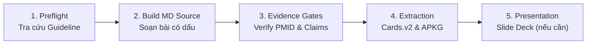

# NGÂN HÀNG KHOẢNG TRỐNG & DANH MỤC LỰA CHỌN BÀI HỌC SẢN PHỤ KHOA & HỖ TRỢ SINH SẢN (ART)
## Registry of Clinical Gaps & Topic Selection Board

> **Kho lưu trữ:** `F:/DL/mavisresearch/Bai hoc y khoa/`  
> **Khởi tạo:** 2026-11-02 từ kết quả khảo sát toàn diện hệ thống `01_San phu khoa`, `02_Ho tro sinh san ART`, `03_Sieu am thai`, `13_Giao trinh San YTB`, `_DEBT_LEDGER.md` và `SAN_PHU_KHOA_PRIORITY.md`.  
> **Mục đích:** Lưu trữ có cấu trúc toàn bộ các khoảng trống kiến thức lâm sàng, các bài bán thành phẩm và các bài cần tái cấu trúc để Bác sĩ / AI Assistant lựa chọn triển khai theo thứ tự ưu tiên.

---

## 1. BẢNG TRA CỨU & BỘ CHỌN NHANH (QUICK SELECTION MATRIX)

> *Hướng dẫn sử dụng:* Đánh dấu `[x]` vào ô trạng thái khi bắt đầu triển khai hoặc hoàn tất.

### Nhóm A: Hỗ trợ sinh sản (ART / Vô sinh - Hiếm muộn)

| Chọn | Mã | Mức | Tên chuyên đề (Việt - Anh) | Thư mục dự kiến / Hiện có | Trạng thái |
|:---:|:---|:---:|:---|:---|:---:|
| [x] | **ART-GAP-01** | **P0** | Thất bại làm tổ liên tiếp (Recurrent Implantation Failure — RIF) | `02_Ho tro sinh san ART/45_Recurrent_Implantation_Failure_RIF` | ✅ Đã build MD (Chờ APKG) |
| [ ] | **ART-GAP-02** | **P0** | Phác đồ đối kháng GnRH chuyên sâu (GnRH Antagonist Protocol Mastery) | `02_Ho tro sinh san ART/47_GnRH_Antagonist_Protocol_Mastery` | Chưa có bài riêng |
| [ ] | **ART-GAP-03** | **P0** | Xử trí Niêm mạc tử cung mỏng & Tối ưu hóa cửa sổ làm tổ trong FET | `02_Ho tro sinh san ART/48_Thin_Endometrium_FET_Optimization` | Chưa có bài riêng |
| [ ] | **ART-GAP-04** | **P1** | Kỹ thuật Chọc hút noãn (OPU) & Chuyển phôi (ET) dưới hướng dẫn siêu âm | `02_Ho tro sinh san ART/49_OPU_ET_Ultrasound_Guided_Procedures` | Bài mới |
| [ ] | **ART-GAP-05** | **P1** | Labo IVF lâm sàng: Đánh giá phôi, Time-lapse, Sinh thiết PGT & Thể khảm | `02_Ho tro sinh san ART/50_Clinical_Embryology_Lab_TimeLapse_PGT` | Bài mới |
| [ ] | **ART-GAP-06** | **P1** | Suy buồng trứng sớm (POI) & Giảm dự trữ buồng trứng sớm (DOR) | `02_Ho tro sinh san ART/51_POI_DOR_Management_Oocyte_Donation` | Bài mới |
| [ ] | **ART-GAP-07** | **P2** | Bảo tồn khả năng sinh sản: Trữ trứng/mô buồng trứng xã hội & Oncofertility | `02_Ho tro sinh san ART/52_Fertility_Preservation_Oncofertility` | Bài mới |

### Nhóm B: Sản khoa & Cấp cứu Chu sinh (Obstetrics & Perinatology)

| Chọn | Mã | Mức | Tên chuyên đề (Việt - Anh) | Thư mục dự kiến / Hiện có | Trạng thái |
|:---:|:---|:---:|:---|:---|:---:|
| [ ] | **OB-GAP-01** | **P0** | Băng huyết sau sinh (Postpartum Hemorrhage — PPH): Tiếp cận 4T, MTP & Thang can thiệp | `01_San phu khoa/41_Postpartum_Hemorrhage_PPH_Management` | Cực kỳ cấp bách |
| [ ] | **OB-GAP-02** | **P0** | Tiền sản giật thể nặng, Cơn tăng huyết áp kịch phát & Hội chứng HELLP | `01_San phu khoa/42_Severe_Preeclampsia_Eclampsia_HELLP` | Chưa có bài điều trị |
| [ ] | **OB-GAP-03** | **P0** | Phổ gai nhau cài răng lược (PAS) & Cấp cứu Bánh nhau (Nhau tiền đạo, Nhau bong non) | `01_San phu khoa/43_Placenta_Accreta_Spectrum_PAS_Abruptio` | Cấp cứu ngoại sản |
| [ ] | **OB-GAP-04** | **P0** | Chiều dài cổ tử cung (TVS CL), Hở eo CTC & Dự phòng sinh non | `03_Sieu am thai/09_Cervical_Length_PTB` | Cần cập nhật toàn diện |
| [ ] | **OB-GAP-05** | **P0** | Ối vỡ non (PPROM), Kháng sinh chờ đợi & Quản lý nhiễm trùng ối | `03_Sieu am thai/45_PPROM_Ultrasound_Management` | Khoảng trống P0 |
| [ ] | **OB-GAP-06** | **P1** | Chuyển dạ đình trệ, Biểu đồ chuyển dạ WHO Labour Care Guide & Chỉ định mổ lấy thai | `01_San phu khoa/44_Dystocia_Labour_Care_Guide_Cesarean_Audit` | Bài mới |
| [ ] | **OB-GAP-07** | **P1** | Khởi phát chuyển dạ (IOL): Điểm Bishop, Làm chín muồi CTC cơ học vs thuốc | `01_San phu khoa/45_Induction_of_Labour_IOL_Cervical_Ripening` | Bài mới |
| [ ] | **OB-GAP-08** | **P1** | Nhiễm trùng chu sinh nguy hiểm: GBS screening, Viêm gan B mẹ con, HIV & TORCH | `01_San phu khoa/46_Perinatal_Infections_GBS_HBV_HIV_TORCH` | Bài mới |

### Nhóm C: Phụ khoa & Hình ảnh học TVS (Gynecology & Pelvic Imaging)

| Chọn | Mã | Mức | Tên chuyên đề (Việt - Anh) | Thư mục dự kiến / Hiện có | Trạng thái |
|:---:|:---|:---:|:---|:---|:---:|
| [ ] | **GYN-GAP-01** | **P0** | Dị tật bẩm sinh ống Müller (Müllerian Duct Anomalies) & Siêu âm 3D Coronal | `01_San phu khoa/40_Mullerian_Anomalies_3D_US` | Khoảng trống P0 |
| [ ] | **GYN-GAP-02** | **P0** | Bệnh viêm vùng chậu (PID) & Áp xe phần phụ (Tubo-Ovarian Abscess — TOA) | `05_Vi sinh - Mien dich/V3_PID_Tubo_Ovarian_Abscess` | Khoảng trống P0 |
| [ ] | **GYN-GAP-03** | **P1** | Cấp cứu đau hố chậu: Xoắn phần phụ (Ovarian Torsion) & Nang hoàng thể xuất huyết vỡ | `01_San phu khoa/47_Acute_Pelvic_Pain_Torsion_Ruptured_Cyst` | Bài mới |
| [ ] | **GYN-GAP-04** | **P1** | Khối u buồng trứng: Phân loại theo mô hình IOTA Simple Rules, ADNEX & O-RADS US | `01_San phu khoa/48_Ovarian_Masses_IOTA_ADNEX_ORADS` | Bài mới |
| [ ] | **GYN-GAP-05** | **P1** | Mãn kinh & Liệu pháp hormone thay thế (Menopause & MHT/HRT Guidelines) | `01_San phu khoa/49_Menopause_Hormone_Therapy_MHT_IMS` | Bài mới |
| [ ] | **GYN-GAP-06** | **P2** | Nhiễm trùng lây truyền qua đường tình dục (STIs): Chlamydia, Lậu, Giang mai, HSV & HPV | `05_Vi sinh - Mien dich/V2_STIs_Screening_Management` | Bài mới |

### Nhóm D: Nội tiết sinh sản & Di truyền lâm sàng (Reproductive Endocrinology & Genetics)

| Chọn | Mã | Mức | Tên chuyên đề (Việt - Anh) | Thư mục dự kiến / Hiện có | Trạng thái |
|:---:|:---|:---:|:---|:---|:---:|
| [ ] | **ENDO-GAP-01** | **P0** | Hội chứng buồng trứng đa nang (PCOS) toàn diện: Đồng thuận Quốc tế 2023 & Điều trị vô sinh | `04_Noi tiet - Hormone/01_PCOS_International_Guideline_2023` | Bài mới mở chuỗi |
| [ ] | **ENDO-GAP-02** | **P1** | Sảy thai liên tiếp (RPL) & Hội chứng Kháng Phospholipid (APS) trong Sản khoa | `01_San phu khoa/50_Recurrent_Pregnancy_Loss_APS` | Bài mới |
| [ ] | **ENDO-GAP-03** | **P1** | Tăng prolactin máu (Hyperprolactinemia) & U tuyến yên trong vô sinh | `04_Noi tiet - Hormone/02_Hyperprolactinemia_Pituitary_Adenoma` | Bài mới |
| [ ] | **ENDO-GAP-04** | **P2** | Di truyền học trong vô sinh nam & nữ: Karyotype, Đột biến CFTR, Mất đoạn AZF, Hội chứng Klinefelter & Turner | `02_Ho tro sinh san ART/53_Reproductive_Genetics_Karyotype_AZF_CFTR` | Bài mới |

### Nhóm E: Khai thông bài bán thành phẩm (Có MD nguồn sâu, cần tạo Cards & APKG)

| Chọn | Mã | Chuyên ngành | Tên bài | Thư mục | Khối lượng MD | Việc cần làm |
|:---:|:---|:---:|:---|:---|:---:|:---|
| [ ] | **MID-01** | ART | 10 Phác đồ kích thích buồng trứng hiện đại (ESHRE 2025) | `02_Ho tro sinh san ART/14_Stimulation_Protocols` | 1,290 dòng | Trích xuất `cards.v2.json` và build `.apkg` |
| [ ] | **MID-02** | ART | Quá kích buồng trứng (OHSS): Cơ chế, Dự phòng 3 cấp độ & Xử trí (ASRM 2024) | `02_Ho tro sinh san ART/21_OHSS_Comprehensive` | 622 dòng | Trích xuất `cards.v2.json` và build `.apkg` |
| [ ] | **MID-03** | ART | Siêu âm theo dõi nang noãn & niêm mạc trong IVF/ICSI | `02_Ho tro sinh san ART/41_US_Monitoring_Ovarian_Stimulation` | 657 dòng | Trích xuất `cards.v2.json` và build `.apkg`, gộp slide folder 34 |
| [ ] | **MID-04** | Sản | Sinh lý chuyển dạ & Hướng dẫn đỡ đẻ (FIGO/ACOG) | `01_San phu khoa/05_Sinh_ly_chuyen_da_Do_de` | 384 dòng | Trích xuất `cards.v2.json` và build `.apkg` |
| [ ] | **MID-05** | Sản | Đẻ chỉ huy (Operative Vaginal Delivery — OVD, Kiềm & Giác hút) | `01_San phu khoa/07_De_chi_huy_OVD` | 420 dòng | Chuẩn hóa `cards.v2.json` và build `.apkg` mới |
| [ ] | **MID-06** | ART | Siêu âm bơm bọt/dịch kiểm tra vòi trứng (HyCoSy / HyFoSy) | `02_Ho tro sinh san ART/19_HyCoSy_HyFoSy_Tubal_Patency` | 478 dòng | Trích xuất `cards.v2.json` và build `.apkg` |
| [ ] | **MID-07** | ART | Xử trí thai trong & ngoài tử cung sau IUI / PUL | `02_Ho tro sinh san ART/06_IUI - PUL EP IUP management` | 246 dòng | Trích xuất `cards.v2.json` và build `.apkg` |
| [ ] | **MID-08** | ART | Xử trí nang buồng trứng trước kích thích buồng trứng (COS) | `02_Ho tro sinh san ART/35_Ovarian_Cyst_Before_COS` | Đã có APKG | Viết lại file `.md` nguồn bài giảng |

---

## 2. HỒ SƠ CHI TIẾT CÁC KHOẢNG TRỐNG LÂM SÀNG (TOPIC DOSSIERS)

---

### HỒ SƠ ART-GAP-01: THẤT BẠI LÀM TỔ LIÊN TIẾP (RECURRENT IMPLANTATION FAILURE — RIF)
* **Thư mục:** `02_Ho tro sinh san ART/45_Recurrent_Implantation_Failure_RIF/`
* **Mức độ ưu tiên:** 🔴 **P0 (Làm ngay — Hiện thư mục đang trống hoàn toàn)**
* **Lý do lâm sàng:** RIF là tình huống gây khủng hoảng tâm lý và kinh tế nặng nề nhất cho bệnh nhân IVF. Trên lâm sàng rất dễ dẫn đến chỉ định lạm dụng xét nghiệm và can thiệp không có bằng chứng (overtesting & overtreatment).
* **Khung nội dung bắt buộc (Checklist):**
  1. [ ] **Định nghĩa chuẩn hóa:** Đồng thuận ESHRE 2023 / ASRM (chuyển ít nhất bao nhiêu phôi nang euploid có chất lượng tốt mà không có thai lâm sàng).
  2. [ ] **Kiểm tra 3 trục nguyên nhân:**
     - *Trục Phôi:* Lệch bội (aneuploidy), bất thường cấu trúc di truyền, phôi khảm (mosaicism).
     - *Trục Tử cung:* Viêm nội mạc tử cung mạn tính (Chronic Endometritis — tiêu chuẩn mô bệnh học tế bào CD138+), polyp, u xơ dưới niêm, vách ngăn, dính buồng tử cung (Asherman), ứ dịch tai vòi (Hydrosalpinx).
     - *Trục Toàn thân / Miễn dịch:* Hội chứng kháng phospholipid (APS), bệnh tự miễn tuyến giáp, đái tháo đường, béo phì, lối sống.
  3. [ ] **Thẩm định bằng chứng EBM (Reality Check):** Phân định rạch ròi giữa *Khuyến cáo* vs *Không khuyến cáo thường quy* cho: PRP buồng tử cung, G-CSF, cào niêm mạc (endometrial scratch), truyền lipid (intralipid), thuốc ức chế miễn dịch (corticosteroid, kháng TNF-$\alpha$), xét nghiệm ERA.
  4. [ ] **Lưu đồ tiếp cận từng bước (Step-by-step Clinical Algorithm):** Khi nào dừng lại để nội soi buồng tử cung (Hysteroscopy), khi nào xét nghiệm miễn dịch, khi nào đổi phác đồ chuẩn bị niêm mạc (NC vs HRT).
* **Guideline tham chiếu:** ESHRE Good Practice Guide on RIF (2023), ASRM Practice Committee Opinion on RIF.

---

### HỒ SƠ ART-GAP-02: PHÁC ĐỒ ĐỐI KHÁNG GnRH CHUYÊN SÂU (GnRH ANTAGONIST PROTOCOL MASTERY)
* **Thư mục:** `02_Ho tro sinh san ART/47_GnRH_Antagonist_Protocol_Mastery/`
* **Mức độ ưu tiên:** 🔴 **P0 (Phác đồ chủ lực của 80% chu kỳ IVF)**
* **Lý do lâm sàng:** Bài 14 nói về 10 phác đồ tổng quan nhưng bác sĩ thực hành cần một hướng dẫn "cầm tay chỉ việc" chuyên sâu cho Antagonist: từ thời điểm bắt đầu, xử trí đỉnh LH sớm, đến quyết định trigger.
* **Khung nội dung bắt buộc (Checklist):**
  1. [ ] Cơ chế dược lực học: Cạnh tranh trực tiếp thụ thể GnRH tại tuyến yên, không có hiệu ứng "flare-up", ức chế LH tức thì trong 2-4 giờ.
  2. [ ] Phác đồ Cố định (Fixed — bắt đầu ngày 5 hoặc 6 KTBT) vs Phác đồ Linh hoạt (Flexible — bắt đầu khi nang trội $\ge 14\text{ mm}$ hoặc $E_2 \ge 600\text{ pg/mL}$): So sánh ưu nhược điểm và kết cục thai.
  3. [ ] Xử trí hiện tượng thoát ức chế LH (LH break-through / premature LH surge): Định nghĩa ($LH > 10\text{ IU/L}$ kèm tăng Progesterone), cách xử trí hủy chu kỳ hay cứu vãn (rescue trigger).
  4. [ ] Vấn đề ức chế sâu LH (Oversuppression): Khi nào nồng độ LH đáy $< 0.5\text{ IU/L}$ gây ảnh hưởng chất lượng noãn? Chỉ định phối hợp r-LH hoặc hMG.
  5. [ ] Cây quyết định Trigger: GnRHa trigger đơn thuần (phòng ngừa triệt để OHSS), Dual trigger (GnRHa + hCG liều thấp 1,000-1,500 IU), Double trigger.
* **Guideline tham chiếu:** ESHRE Guideline: Ovarian Stimulation for IVF/ICSI (2025 update).

---

### HỒ SƠ ART-GAP-03: XỬ TRÍ NIÊM MẠC TỬ CUNG MỎNG & CỬA SỔ LÀM TỔ TRONG FET
* **Thư mục:** `02_Ho tro sinh san ART/48_Thin_Endometrium_FET_Optimization/`
* **Mức độ ưu tiên:** 🔴 **P0**
* **Lý do lâm sàng:** Niêm mạc mỏng ($< 7\text{ mm}$ ngày chuyển phôi) làm giảm tỷ lệ có thai lâm sàng và tăng tỷ lệ hủy chu kỳ FET; điều trị thường bế tắc và kéo dài.
* **Khung nội dung bắt buộc (Checklist):**
  1. [ ] Định nghĩa niêm mạc mỏng (ngưỡng cắt $7\text{ mm}$ vs $6\text{ mm}$) và các hình thái niêm mạc trên TVS (tam tầng Triple-line vs đồng nhất tăng âm sớm).
  2. [ ] Tối ưu hóa phác đồ Estrogen: Uống vs Đặt âm đạo vs Miếng dán qua da (tránh hiệu ứng chuyển hóa qua gan bước một); phác đồ tăng liều dần (step-up) vs liều cao cố định; kéo dài thời gian dùng estrogen (extended estrogen stimulation).
  3. [ ] So sánh hiệu quả chuẩn bị niêm mạc: Chu kỳ tự nhiên (NC/mNC) vs Chu kỳ nhân tạo (HRT) ở bệnh nhân có tiền sử niêm mạc mỏng.
  4. [ ] Đánh giá y học chứng cứ các biện pháp hỗ trợ tưới máu: Sildenafil (Viagra đặt âm đạo), Aspirin liều thấp, Pentoxifylline phối hợp Tocopherol (Vitamin E), Bơm G-CSF buồng tử cung, Bơm huyết tương giàu tiểu cầu (PRP) tự thân.
* **Guideline tham chiếu:** Cochrane Review on interventions for thin endometrium in ART; ASRM Endometrial Receptivity Guidelines.

---

### HỒ SƠ OB-GAP-01: BĂNG HUYẾT SAU SINH (POSTPARTUM HEMORRHAGE — PPH)
* **Thư mục:** `01_San phu khoa/41_Postpartum_Hemorrhage_PPH_Management/`
* **Mức độ ưu tiên:** 🔴 **P0 (Cực kỳ cấp bách — Nguyên nhân tử vong mẹ hàng đầu)**
* **Lý do lâm sàng:** Cấp cứu tối khẩn trong phòng sinh và phòng mổ. Bắt buộc mọi bác sĩ sản phụ khoa phải phản xạ thuần thục theo thang bậc can thiệp và kích hoạt báo động đỏ kịp thời.
* **Khung nội dung bắt buộc (Checklist):**
  1. [ ] Định nghĩa mới của FIGO/ACOG: Lượng máu mất $\ge 1,000\text{ mL}$ hoặc kèm dấu hiệu shock giảm thể tích trong vòng 24h sau sinh.
  2. [ ] Tiếp cận chẩn đoán nhanh theo quy tắc 4T: Tone (đờ tử cung - 70%), Tissue (sót bánh nhau/màng nhau - 10%), Trauma (rách âm đạo, CTC, vỡ tử cung, lộn tử cung - 20%), Thrombin (rối loạn đông máu - 1%).
  3. [ ] Hồi sức tích cực & Quy trình truyền máu khối lượng lớn (Massive Transfusion Protocol — MTP): Tỷ lệ 1 Hồng cầu lắng : 1 Huyết tương tươi đông lạnh : 1 Tiểu cầu (1:1:1); mục tiêu duy trì Fibrinogen $> 2\text{ g/L}$.
  4. [ ] Bậc thang sử dụng thuốc co hồi tử cung (Uterotonics):
     - Oxytocin (đầu tay): Tiêm bắp hoặc truyền tĩnh mạch chậm.
     - Ergometrine / Methylergonovine (chống chỉ định trong tăng huyết áp, tiền sản giật).
     - Carboprost tromethamine / PGF2$\alpha$ (chống chỉ định trong hen phế quản).
     - Misoprostol (PGE1) đặt trực tràng / ngậm dưới lưỡi.
     - Tranexamic acid (TXA): $1\text{ g}$ IV trong vòng 3 giờ đầu sau sinh (bằng chứng từ nghiên cứu thế kỷ WOMAN trial).
  5. [ ] Thang can thiệp cơ học & ngoại khoa: Ép tử cung bằng hai tay (bimanual compression) $\rightarrow$ Bóng chèn buồng tử cung (Bakri balloon tamponade) $\rightarrow$ Mũi khâu ép cầm máu B-Lynch / Hayman $\rightarrow$ Thắt động mạch tử cung / động mạch hạ vị $\rightarrow$ Cắt tử cung bán phần / toàn phần cấp cứu.
* **Guideline tham chiếu:** WHO Guidelines for the management of postpartum haemorrhage; ACOG Practice Bulletin No. 183; RCOG Green-top Guideline No. 52.

---

### HỒ SƠ OB-GAP-02: TIỀN SẢN GIẬT THỂ NẶNG, CƠN TĂNG HUYẾT ÁP KỊCH PHÁT & HỘI CHỨNG HELLP
* **Thư mục:** `01_San phu khoa/42_Severe_Preeclampsia_Eclampsia_HELLP/`
* **Mức độ ưu tiên:** 🔴 **P0 (Bài sàng lọc đã có, còn thiếu bài cấp cứu điều trị)**
* **Lý do lâm sàng:** Cấp cứu sản khoa đe dọa trực tiếp tính mạng mẹ và con do tai biến mạch máu não, suy thận, bong non và tử vong chu sinh.
* **Khung nội dung bắt buộc (Checklist):**
  1. [ ] Tiêu chuẩn chẩn đoán Tiền sản giật có dấu hiệu nặng (Severe features): $HA \ge 160/110\text{ mmHg}$, tiểu cầu $< 100,000/\mu\text{L}$, men gan tăng gấp đôi, đau hạ sườn phải/thượng vị dai dẳng, suy thận tiến triển (creatinine $> 1.1\text{ mg/dL}$), phù phổi cấp, rối loạn thị giác/thần kinh mới khởi phát.
  2. [ ] Xử trí hạ áp cấp cứu trong cơn THA kịch phát (trong vòng 30-60 phút): Phác đồ Labetalol tiêm tĩnh mạch ngắt quãng, Hydralazine, Nicardipine truyền tĩnh mạch; mục tiêu hạ HA an toàn về ngưỡng $140-150 / 90-100\text{ mmHg}$ để tránh tụt áp đột ngột gây giảm tưới máu nhau thai.
  3. [ ] Phác đồ Magnesium Sulfate ($MgSO_4$) chống co giật (Pritchard vs Zuspan): Liều nạp $4-6\text{ g}$ IV, liều duy trì $1-2\text{ g/h}$; theo dõi ngộ độc Mg (phản xạ gân bánh chè, nhịp thở $\ge 16$ lần/phút, lượng nước tiểu $\ge 30\text{ mL/h}$); thuốc giải độc đặc hiệu Calcium Gluconate $10\%$.
  4. [ ] Hội chứng HELLP: Chẩn đoán theo tiêu chuẩn Tennessee / Mississippi (Tán huyết vi mạch, men gan AST $\ge 70\text{ IU/L}$, tiểu cầu $< 100,000/\mu\text{L}$); các biến chứng vỡ bao gan, DIC và chiến lược hồi sức.
  5. [ ] Thời điểm và phương thức chấm dứt thai kỳ: Khi nào cần mổ ngay bất kể tuổi thai, khi nào có thể trì hoãn 48 giờ để tiêm Corticosteroid trưởng thành phổi.
* **Guideline tham chiếu:** ACOG Practice Bulletin No. 222 (Gestational Hypertension and Preeclampsia); ISSHP Classification, Diagnosis and Management of Hypertensive Disorders of Pregnancy (2021).

---

### HỒ SƠ OB-GAP-03: PHỔ GAI NHAU CÀI RĂNG LƯỢC (PAS) & CẤP CỨU BÁNH NHAU
* **Thư mục:** `01_San phu khoa/43_Placenta_Accreta_Spectrum_PAS_Abruptio/`
* **Mức độ ưu tiên:** 🔴 **P0**
* **Lý do lâm sàng:** Bệnh cảnh mổ đẻ cũ kèm nhau tiền đạo cài răng lược là nguyên nhân hàng đầu gây mất máu ồ ạt hàng lít máu và cắt tử cung trong mổ lấy thai.
* **Khung nội dung bắt buộc (Checklist):**
  1. [ ] Phân loại PAS: Placenta Accreta (dính nông cơ), Increta (xâm lấn sâu cơ), Percreta (xuyên thủng thanh mạc tử cung, xâm lấn bàng quang, trực tràng).
  2. [ ] Dấu hiệu siêu âm chẩn đoán chuẩn FIGO/ISUOG: Mất khoảng sáng sau nhau (clear zone), các xoang mạch máu bánh nhau dạng lacunae bất thường dòng xoáy cao, thành bàng quang bị đẩy lồi hoặc gián đoạn, cầu mạch máu tăng sinh nối liền cơ tử cung và bàng quang.
  3. [ ] Chuẩn bị và tổ chức cuộc mổ PAS đa chuyên khoa (Sản khoa, Gây mê hồi sức, Ngoại niệu, X-quang can thiệp nút mạch): Vết rạch da, đường rạch tử cung tránh bánh nhau, không cố bóc nhau, các kỹ thuật bảo tồn tử cung vs cắt tử cung có kế hoạch.
  4. [ ] Nhau tiền đạo (Placenta Previa): Phân loại mép, bán trung tâm, trung tâm; quản lý ra máu thai kỳ và thời điểm mổ lấy thai chủ động (36-37 tuần).
  5. [ ] Nhau bong non (Placental Abruption): Sinh lý bệnh hoại tử mạch màng rụng, xuất huyết sau nhau; tam chứng lâm sàng; phân biệt thể xuất huyết ẩn (concealed) vs xuất huyết hở; biến chứng DIC và phong huyết tử cung-nhau (Couvelaire uterus).
* **Guideline tham chiếu:** FIGO Consensus Guidelines on Placenta Accreta Spectrum Disorders (2018); ISUOG Consensus Statement on PAS.

---

### HỒ SƠ GYN-GAP-01: BẤT THƯỜNG BẨM SINH ỐNG MÜLLER & SIÊU ÂM 3D
* **Thư mục:** `01_San phu khoa/40_Mullerian_Anomalies_3D_US/`
* **Mức độ ưu tiên:** 🔴 **P0**
* **Lý do lâm sàng:** Dễ chẩn đoán nhầm giữa tử cung có vách ngăn (Septate uterus) và tử cung hai sừng (Bicornuate uterus). Sai lầm này dẫn đến chỉ định phẫu thuật sai: cắt nhầm cơ tử cung ở tử cung hai sừng gây thủng tử cung hoặc bỏ sót vách ngăn cần cắt ở bệnh nhân hiếm muộn/sảy thai.
* **Khung nội dung bắt buộc (Checklist):**
  1. [ ] Cơ chế phôi thai học: Sự hợp nhất và tiêu biến vách ngăn của hai ống cận trung thận (Müllerian ducts) ở tuần thứ 6-12 thai kỳ.
  2. [ ] Các hệ thống phân loại: AFS 1988, ESHRE/ESGE 2013 và ASRM 2021.
  3. [ ] Kỹ thuật siêu âm 3D mặt cắt trán (Coronal view) — "Chìa khóa vàng":
     - Đường nối hai lỗ vòi tử cung (Interostial line).
     - Đo độ sâu lõm ngoài thanh mạc đáy tử cung (External fundal indentation): Nếu lõm $< 10\text{ mm}$ $\rightarrow$ Tử cung có vách ngăn (Septate); Nếu lõm $\ge 10\text{ mm}$ $\rightarrow$ Tử cung hai sừng (Bicornuate).
     - Đo độ sâu và độ dày vách ngăn nội mạc (Internal indentation).
  4. [ ] Các thể lâm sàng: Tử cung một sừng (Unicornuate), Tử cung đôi (Didelphys), Tử cung hình cung (Arcuate) và Hội chứng OHVIRA (Herlyn-Werner-Wunderlich).
  5. [ ] Chỉ định và kỹ thuật phẫu thuật nội soi buồng tử cung cắt vách ngăn: Khi nào nên mổ, chuẩn bị trước mổ, kiểm soát trong mổ và phòng ngừa dính buồng sau mổ.
* **Guideline tham chiếu:** ASRM Müllerian Anomalies Classification (2021); ESHRE/ESGE Consensus on Female Genital Anomalies.

---

### HỒ SƠ GYN-GAP-02: BỆNH VIÊM VÙNG CHẬU (PID) & ÁP XE PHẦN PHỤ (TOA)
* **Thư mục:** `05_Vi sinh - Mien dich/V3_PID_Tubo_Ovarian_Abscess/`
* **Mức độ ưu tiên:** 🔴 **P0**
* **Lý do lâm sàng:** Cấp cứu phụ khoa thường gặp, là căn nguyên hàng đầu gây vô sinh do tắc vòi trứng, thai ngoài tử cung và đau vùng chậu mạn tính nếu điều trị chậm trễ hoặc không đúng phác đồ.
* **Khung nội dung bắt buộc (Checklist):**
  1. [ ] Vi sinh bệnh sinh: Đa vi khuẩn (Polymicrobial) gồm Chlamydia trachomatis, Neisseria gonorrhoeae, Mycoplasma genitalium, vi khuẩn yếm khí âm đạo và trực khuẩn ruột.
  2. [ ] Tiêu chuẩn chẩn đoán lâm sàng CDC 2021:
     - Tiêu chuẩn tối thiểu: Đau khi lay lắc cổ tử cung (Cervical motion tenderness), đau thân tử cung, đau hai phần phụ khi khám bằng hai tay.
     - Tiêu chuẩn bổ sung: Sốt $> 38.3^\circ\text{C}$, khí hư âm đạo nhầy mủ, bạch cầu tăng, CRP/máu lắng tăng, xét nghiệm NAAT dương tính với Chlamydia/Lậu.
  3. [ ] Hình ảnh siêu âm TVS đặc trưng: Thành vòi trứng dày $\ge 5\text{ mm}$, dấu hiệu bánh răng cưa (Cogwheel sign), dịch vòi trứng lợn cợn không thuần nhất; hình ảnh khối áp xe buồng trứng - vòi trứng (TOA) cấu trúc nang hỗn hợp vách dày, mất ranh giới giữa buồng trứng và tai vòi.
  4. [ ] Phác đồ kháng sinh kinh nghiệm (Parenteral vs Oral): Ceftriaxone + Doxycycline + Metronidazole theo CDC.
  5. [ ] Tiêu chuẩn nhập viện nội trú và tiêu chuẩn can thiệp ngoại khoa: Chỉ định chọc hút mủ TOA dưới hướng dẫn siêu âm ngã âm đạo vs phẫu thuật nội soi dẫn lưu ổ mủ.
* **Guideline tham chiếu:** CDC Sexually Transmitted Infections Treatment Guidelines (2021); RCOG Green-top Guideline No. 32.

---

### HỒ SƠ ENDO-GAP-01: HỘI CHỨNG BUỒNG TRỨNG ĐA NANG (PCOS) TOÀN DIỆN
* **Thư mục:** `04_Noi tiet - Hormone/01_PCOS_International_Guideline_2023/`
* **Mức độ ưu tiên:** 🔴 **P0 (Mở chuỗi Nội tiết sinh sản)**
* **Lý do lâm sàng:** Bệnh lý nội tiết chuyển hóa phổ biến nhất ở phụ nữ độ tuổi sinh sản ($10-15\%$), chi phối trực tiếp đến vô sinh không rụng trứng, quá kích buồng trứng trong IVF và các bệnh lý mạn tính sau này (ĐTĐ type 2, bệnh tim mạch).
* **Khung nội dung bắt buộc (Checklist):**
  1. [ ] Tiêu chuẩn Rotterdam cập nhật (Đồng thuận Quốc tế 2023): Thỏa 2/3 tiêu chuẩn (Rối loạn phóng noãn, Cường androgen lâm sàng/sinh hóa, Hình thái buồng trứng đa nang trên TVS hoặc AMH huyết thanh cao).
  2. [ ] Điểm mới 2023 về AMH: Nồng độ AMH có thể được sử dụng thay thế tiêu chuẩn siêu âm đếm nang noãn (AFC) ở phụ nữ trưởng thành để chẩn đoán PCOM.
  3. [ ] Sinh lý bệnh cốt lõi: Kháng insulin $\rightarrow$ Tăng insulin máu bù trừ $\rightarrow$ Kích thích tế bào vỏ buồng trứng sản xuất quá mức Androgen $\rightarrow$ Giảm SHBG tại gan $\rightarrow$ Tăng testosterone tự do $\rightarrow$ Ngừng phát triển nang noãn.
  4. [ ] Quản lý hiếm muộn & Kích thích rụng trứng (OI):
     - Lựa chọn đầu tay (First-line): **Letrozole** (tỷ lệ rụng trứng và sinh sống vượt trội so với Clomiphene citrate, nguy cơ đa thai thấp).
     - Phối hợp Metformin ở bệnh nhân kháng insulin, BMI cao.
     - Bước hai: Gonadotropin liều thấp tăng dần (Low-dose step-up protocol) hoặc Phẫu thuật nội soi đốt điểm buồng trứng (Laparoscopic Ovarian Drilling — LOD).
  5. [ ] Chiến lược IVF/ICSI ở bệnh nhân PCOS: Phác đồ GnRH Antagonist bắt buộc phối hợp GnRHa trigger và Freeze-all để triệt tiêu hoàn toàn nguy cơ OHSS.
* **Guideline tham chiếu:** Recommendations from the 2023 International Evidence-based Guideline for the Assessment and Management of Polycystic Ovary Syndrome (Teede et al.).

---

## 3. QUY TRÌNH CHUẨN KHI BẮT ĐẦU CHỌN & XÂY DỰNG 1 CHUYÊN ĐỀ

Khi Bác sĩ hoặc AI Assistant lựa chọn bất kỳ một mã nào trong bảng trên để triển khai, **bắt buộc tuân thủ 5 bước của Pipeline Master**:

1. **Bước 1 — Preflight & Tra cứu Guideline bằng Bộ Science Skills đã kiểm định:**
   - Xác định tài liệu nguồn chính thức (ESHRE, ASRM, ACOG, RCOG, FIGO, ISUOG, WHO).
   - Dùng `pubmed-database` (`scripts/pubmed_api.py search_pubmed` và `fetch_article_abstracts`) để lấy PMID, Abstract và DOI gốc.
   - Dùng `literature-search-europepmc` để tra cứu PMCID, tải PDF toàn văn và kiểm tra mức độ trích dẫn Open Access.
   - Dùng `clinical-trials-database` để kiểm tra các thử nghiệm lâm sàng đối chứng (RCT) đang diễn ra.
   - Dùng `clinvar-database` và `embl-ebi-ols` nếu bài học liên quan đến di truyền/đột biến hoặc chuẩn hóa mã bệnh DOID.
   - Đối chiếu với quy chuẩn tại `SEARCH_STRATEGY.md §Tầng 1` và `WORKFLOW.md §3a`.
2. **Bước 2 — Soạn thảo File `.md` nguồn (Full-depth):**
   - Đặt tên file chuẩn: `Ten_bai_YYYY-MM-DD.md`.
   - Cấu trúc tối thiểu 7-8 mục chính (Mục lục, Sinh lý bệnh, Chẩn đoán, Phân loại, Phác đồ xử trí, Tình huống lâm sàng, Bẫy thường gặp, Bảng tóm tắt).
   - Tiếng Việt có dấu chuẩn xác 100%, công thức KaTeX `$`, bảng so sánh trực quan.
3. **Bước 3 — Chạy các Cổng kiểm định Y học chứng cứ (Evidence Gates):**
   - Kiểm tra xác thực toàn bộ PMID trích dẫn (`verify_all_pmids.py`).
   - Kiểm tra tính xác thực của các khẳng định lâm sàng (`verify_claims.py`).
   - Kiểm tra độ sâu nội dung và dấu tiếng Việt (`lesson_lint.py`).
4. **Bước 4 — Đóng gói Bộ thẻ nhớ Anki (`cards.v2.json` & `.apkg`):**
   - Trích xuất bộ thẻ 2 mặt (Question - Answer), có nhãn phân loại, lý giải cơ chế và nguồn trích dẫn ở mặt sau.
   - Biên dịch ra file `.apkg` và kiểm tra lỗi hiển thị font tiếng Việt.
5. **Bước 5 — Cập nhật Sổ nợ & Catalog:**
   - Đánh dấu `[x]` vào bảng Quick Selection Matrix tại file này.
   - Cập nhật `_CATALOG.md` và gạch nợ trong `_DEBT_LEDGER.md`.

---

## 4. BẢNG THEO DÕI TIẾN ĐỘ THỰC HIỆN (PROGRESS TRACKER)

| Ngày cập nhật | Mã bài | Người thực hiện | Deliverables hoàn tất | Trạng thái nghiệm thu |
|:---:|:---:|:---:|:---|:---:|
| 2026-11-02 | *Khởi tạo* | System | Tạo bảng tổng hợp khoảng trống & hồ sơ chi tiết | ✅ Sẵn sàng cho chọn bài |
| 2026-11-02 | **ART-45** | AI Assistant / Dr. Hung | `ART-45_That_bai_lam_to_lien_tiep_RIF_2026-11-02_RELEASE_v1.md`, `lesson.json` | 🟢 Hoàn tất MD chuẩn (Chưa build APKG) |
