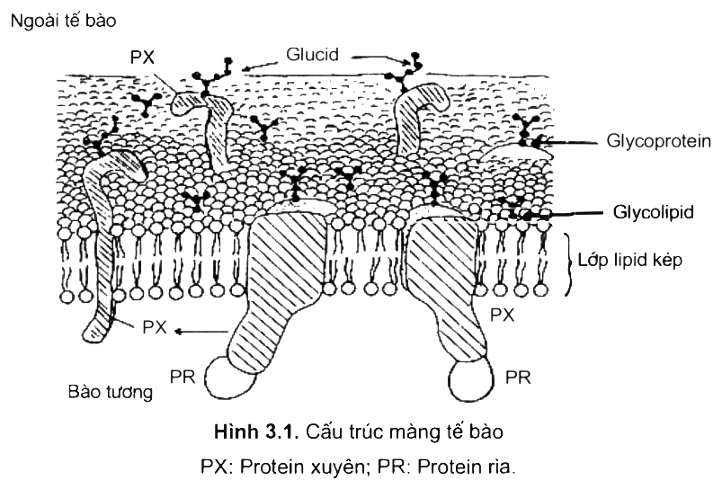
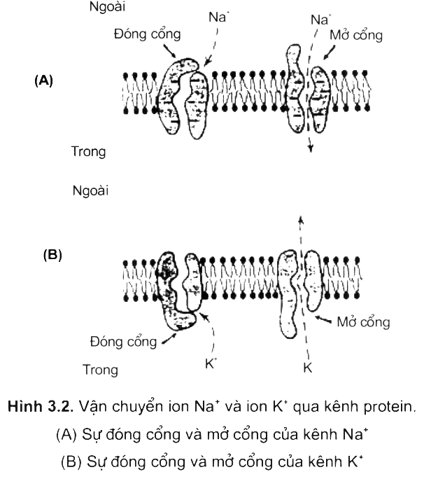
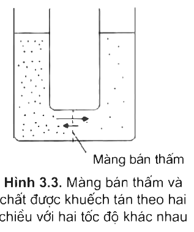
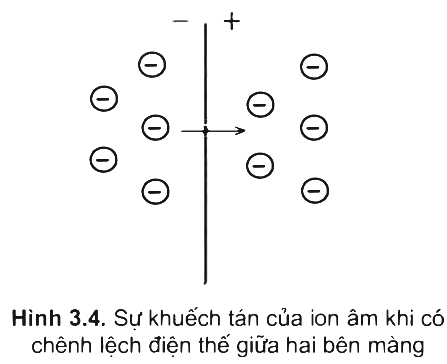
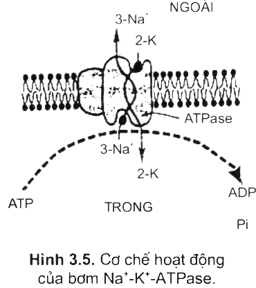
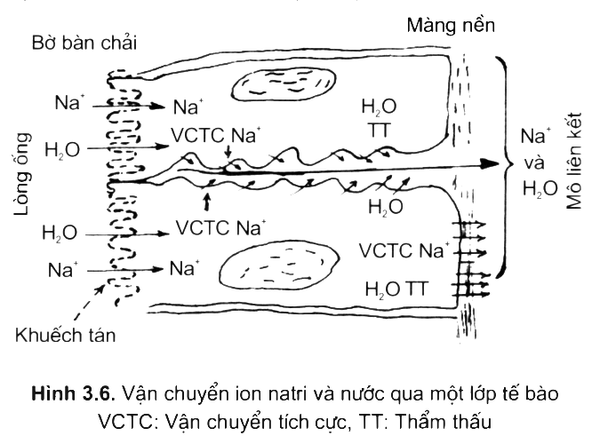
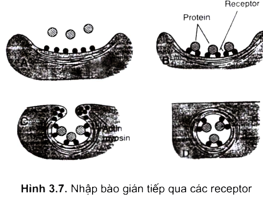
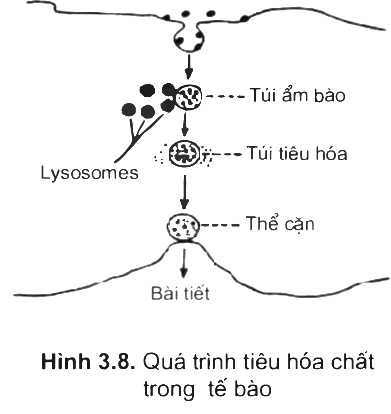

# BÀI 3: SINH LÝ TẾ BÀO - TRAO ĐỔI CHẤT QUA MÀNG TẾ BÀO

## MỤC TIÊU
*Sau khi học xong bài này, sinh viên có khả năng:*
1. Trình bày được sự khuếch tán qua màng tế bào.
2. Trình bày được các hình thức vận chuyển tích cực qua màng.
3. Trình bày được hình thức vận chuyển qua một lớp tế bào.
4. Trình bày được hiện tượng thực bào, ẩm bào, tiêu hóa chất trong tế bào và xuất bào.

---

Cơ thể con người được cấu tạo từ muôn vàn tế bào. Tế bào là đơn vị cấu tạo và là đơn vị chức năng của cơ thể sinh vật cũng như của cơ thể người. Cơ thể người có từ 75 đến 100 ngàn tỷ tế bào. Muốn hiểu chức năng sinh lý của các cơ quan trong cơ thể, trước hết cần tìm hiểu cấu trúc và chức năng của tế bào. Mọi hoạt động chức năng của cơ thể đều có cơ sở tại tế bào và các rối loạn chức năng cũng có cơ sở ở tế bào.

Tế bào có màng, bào tương, các bào quan và nhân.

Tế bào có những chức năng chủ yếu là:
- Thông tin: tiếp nhận, xử lý và truyền tin.
- Vận chuyển vật chất qua màng tế bào.
- Tiêu hóa chất: nhập bào, tiêu hóa và xuất bào.
- Tổng hợp protein: tổng hợp protein và xuất bào.
- Sinh năng lượng.

Bài này tập trung vào hai vấn đề có ý nghĩa quan trọng đối với chức năng sinh lý của các cơ quan và của toàn cơ thể, đó là:
- Màng tế bào và chức năng vận chuyển vật chất qua màng.
- Hiện tượng nhập bào, tiêu hóa chất và xuất bào.

---

## 1. ĐẶC ĐIỂM CẤU TRÚC - CHỨC NĂNG CỦA MÀNG TẾ BÀO

Mỗi tế bào được bao bọc bởi một màng bào tương (*plasma membrane*), màng này ngăn cách các thành phần của tế bào với dịch ngoại bào. Màng tế bào có tính thấm chọn lọc cao, nó cho phép các chất dinh dưỡng đi vào tế bào và giải phóng các sản phẩm của tế bào ra ngoài. Nhờ tính thấm chọn lọc này mà thành phần các chất trong bào tương rất khác với thành phần của dịch ngoại bào. Tính thấm chọn lọc của màng phụ thuộc vào các cơ chế trao đổi chất qua màng tế bào. Mặt khác, trên bề mặt của màng tế bào có nhiều vị trí gắn kết với các chất hóa học đặc hiệu do các tế bào khác sản xuất, làm cho màng tế bào có vai trò quan trọng trong sự kết nối giữa các tế bào với nhau.

Màng là bao hàm cả màng bao bọc xung quanh tế bào và các màng bên trong tế bào, bao bọc nhân và các bào quan. Các loại màng này đều có những đặc điểm cấu trúc - chức năng giống nhau, đó là một cấu trúc mỏng, rất đàn hồi, dày từ $7{,}5 - 10\text{ nm}$ ($1\text{ nm} = 10^{-9}\text{ mét}$), được cấu tạo bởi các thành phần là protein, glucid và lipid, chủ yếu là protein và lipid (*hình 3.1*).

Thành phần lipid chiếm gần 50% khối lượng màng. Thành phần protein cũng chiếm khoảng 50% khối lượng màng, dao động từ 18% ở màng tế bào Schwann (tế bào đệm của hệ thần kinh) tới 76% ở màng ty thể. Tỷ lệ giữa hai thành phần lipid và protein của màng tế bào phản ánh chức năng của tế bào. Ví dụ: Thành phần lipid cao (82%) ở màng tế bào Schwann có myelin cho thấy vai trò của tế bào Schwann là bảo vệ chắc chắn và cách điện cho sợi trục của tế bào thần kinh. Thành phần protein cao ở màng ty thể (76%) cho thấy ty thể chứa đựng nhiều enzym và những protein sống khác phục vụ cho chức năng chuyển hóa năng lượng của cơ quan này.

### 1.1. Lớp lipid kép của màng tế bào
Thành phần lipid tạo nên lớp lipid kép của màng tế bào. Lớp lipid kép có đặc điểm là rất mỏng, *mềm mại*, có thể uốn khúc, trượt đi trượt lại và dễ biến dạng. Tính chất mềm mại và dễ biến dạng làm cho nó có khả năng *hòa màng*. Hiện tượng hòa màng xảy ra ở cả màng tế bào và ở màng các bào quan, thường gặp trong quá trình tạo ra các túi vận chuyển, túi tiêu hóa, túi thực bào... Lớp lipid kép là một lá mỡ mỏng liên tục bao quanh tế bào hoặc bào quan, bề dày chỉ có hai phân tử là phospholipid và cholesterol. Phospholipid có hai đầu, một đầu là gốc phosphat ưa nước và một đầu là gốc acid béo kỵ nước. Cholesterol cũng có hai đầu, một đầu là gốc hydroxyl ưa nước và một đầu là nhân steroid kỵ nước. Đầu kỵ nước của hai phân tử này bị dịch gian bào và dịch nội bào đẩy, nên quay vào trong, gặp nhau, hấp dẫn nhau và nằm ở trung tâm của màng. Đầu ưa nước nằm ở hai phía của màng, tiếp xúc với dịch ngoại bào và dịch nội bào.

### 1.2. Các protein của màng tế bào
Protein là thành phần quan trọng của các màng sinh học. Các khối protein nằm xen giữa lớp lipid kép. Chúng thuộc loại protein dạng cầu hoặc có dạng chữ S, hầu hết có bản chất là glycoprotein. Có hai loại protein:
1. Protein trung tâm (protein xuyên), nằm xuyên qua suốt chiều dày của màng tế bào, hai đầu thò ra hai bên màng.
2. Protein ngoại vi (protein rìa), chỉ bám vào một phía của màng.

Hai loại protein này có cấu tạo và chức năng khác nhau.

#### 1.2.1. Protein xuyên
Protein xuyên thường có kích thước phân tử lớn. Có các loại protein xuyên là:
- Nhiều phân tử protein xuyên có các kênh (các lỗ) xuyên suốt khối protein, qua các kênh này các chất tan trong nước, đặc biệt là các ion có thể khuếch tán qua lại giữa dịch ngoại bào và dịch nội bào. Các kênh này có các cổng đóng và mở. Cổng của các kênh hoạt động có tính chọn lọc, cho phép một chất khuếch tán qua ưu tiên hơn chất khác. Có hai loại cổng: một loại cổng đóng mở theo điện thế (*voltage-gated*) và một loại cổng đóng mở theo chất kết nối (*ligand-gated*).
- Một số phân tử protein xuyên là protein mang (*carrier*) làm nhiệm vụ vận chuyển vật chất. Có những protein vận chuyển vật chất thuận chiều với bậc thang điện hóa, tức là đi từ nơi có nồng độ, áp suất, điện thế cao đến nơi có nồng độ, áp suất, điện thế thấp. Có những protein mang lại vận chuyển vật chất ngược chiều với bậc thang điện hóa, tức là vận chuyển vật chất từ nơi có nồng độ, áp suất, điện thế thấp đến nơi có nồng độ, áp suất, điện thế cao. Có những protein mang chỉ vận chuyển một chất duy nhất (*uniport*), cũng có những protein mang lại vận chuyển được hai chất cùng một lúc theo cùng một chiều, gọi là đồng vận chuyển (*symport*) và cũng có protein mang vận chuyển hai chất cùng một lúc nhưng theo hai chiều đối ngược nhau, gọi là vận chuyển ngược (*antiport*).
- Một số phân tử protein xuyên có hoạt tính enzym.

#### 1.2.2. Protein ngoại vi (protein rìa)
Protein ngoại vi thường có phân tử nhỏ hơn protein xuyên, bám vào đầu phía trong của protein xuyên. Những phân tử protein ngoại vi có chức năng và hoạt tính hầu như hoàn toàn là enzym.

### 1.3. Những carbohydrat của màng tế bào
Thành phần glucid (carbohydrat) chiếm khoảng 2% đến 10% khối lượng của màng. Tuy carbohydrat chiếm một tỷ lệ ít ở màng nhưng nó có chức năng quan trọng trong sinh lý màng tế bào. Hầu hết carbohydrat hoặc ở dạng kết hợp với protein màng tạo thành glycoprotein hoặc kết hợp với lipid trong lớp lipid kép tạo thành glycolipid. Toàn bộ mặt ngoài của màng tế bào có một vỏ glucid lỏng lẻo, gọi là **glycocalyx**.

Chức năng của carbohydrat màng là:
1. Tích điện âm nên thường đẩy những vật tích điện âm.
2. Lớp glycocalyx của tế bào này gắn với glycocalyx của tế bào khác làm cho các tế bào dính nhau.
3. Một số carbohydrat nằm trên bề mặt màng tế bào có tác dụng như receptor có khả năng gắn kết với những chất đặc hiệu như hormon.
4. Một số carbohydrat màng tham gia phản ứng miễn dịch.

---

## 2. CÁC HÌNH THỨC VẬN CHUYỂN VẬT CHẤT QUA MÀNG TẾ BÀO

Tế bào sống luôn luôn trao đổi vật chất với môi trường xung quanh nó là dịch ngoại bào. Thành phần của các chất trong dịch nội bào và dịch ngoại bào rất khác nhau. Ví dụ, ở dịch ngoại bào có nồng độ các ion $\text{Na}^+$, $\text{Ca}^{2+}$, $\text{Cl}^-...$ cao hơn nhiều lần so với các ion này ở dịch nội bào, ngược lại ở dịch nội bào lại có nồng độ ion $\text{K}^+$, phosphat, sulphat... cao hơn ở dịch ngoại bào. Sự khác biệt về nồng độ các chất ở dịch nội bào và dịch ngoại bào là rất quan trọng đối với sự sống của tế bào. Có sự khác biệt này là do các cơ chế vận chuyển vật chất qua màng tế bào tạo ra.

Các chất được vận chuyển hoặc qua lớp lipid kép hoặc qua thành phần protein của màng đều theo một trong hai quá trình cơ bản là: **khuếch tán thụ động** và **vận chuyển tích cực**.
- **Khuếch tán thụ động:** là hình thức vận chuyển vật chất thuận chiều bậc thang điện hóa (*electrochemical gradient*), tức là vật chất đi từ nơi có nồng độ, áp suất, điện thế cao đến nơi có nồng độ, áp suất, điện thế thấp. Quá trình chuyển động này nhờ năng lượng tự nhiên sẵn có do vận động động học của vật chất (còn gọi là chuyển động nhiệt). Do không cần năng lượng từ hóa năng (ATP) của tế bào nên hình thức vận chuyển này được coi là vận chuyển thụ động (khuếch tán thụ động).
- **Vận chuyển tích cực:** là hình thức vận chuyển các chất ngược chiều bậc thang điện hóa. Do vận chuyển vật chất ngược với bậc thang năng lượng (ngược bậc thang điện hóa) nên hình thức vận chuyển này nhất thiết phải sử dụng năng lượng từ bên ngoài và cần có chất mang (protein mang).

### 2.1. Hình thức vận chuyển khuếch tán thụ động
Các phân tử, các hạt vật chất (có thể là ion, nước, chất tan trong nước, chất tan trong các dịch nội bào, ngoại bào, chất khí) chuyển động từ nơi có nồng độ cao đến nơi có nồng độ thấp hơn nhờ năng lượng của chuyển động nhiệt là hiện tượng khuếch tán thụ động.

Có hai hình thức khuếch tán thụ động là **khuếch tán đơn thuần** (*simple diffusion*) và **khuếch tán được thuận hóa** (*facilitated diffusion*, còn gọi là khuếch tán được tăng cường hay khuếch tán có gia tốc).
- Trong khuếch tán đơn thuần, mức độ khuếch tán được xác định bởi số lượng chất được vận chuyển, tốc độ chuyển động nhiệt và số lượng các kênh protein trong màng tế bào.
- Trong khuếch tán được thuận hóa cần phải có protein mang để gắn với các ion hoặc phân tử được vận chuyển và đưa chúng qua màng.

#### 2.1.1. Khuếch tán đơn thuần qua lớp lipid kép
Yếu tố quan trọng nhất để một chất được vận chuyển qua lớp lipid kép của màng là **độ hòa tan trong mỡ** của chất đó.
- Các chất có bản chất là lipid được vận chuyển dễ dàng qua lớp lipid kép.
- Các chất không phải là lipid nhưng tan trong lipid (mỡ) cũng được vận chuyển qua lớp lipid kép rất nhanh như khí oxy, nitơ, $\text{CO}_2$, các vitamin tan trong dầu (như vitamin A, D, E, K), rượu, cồn. Các chất này tiếp xúc với màng, chúng lập tức hòa tan vào thành phần lipid kép và tiếp tục khuếch tán qua màng.

Tốc độ khuếch tán qua màng của một chất tỷ lệ thuận với độ hòa tan của chất đó trong mỡ.

- **Nước và các phân tử không tan trong lipid:** mặc dù nước không hòa tan trong lớp lipid kép của màng tế bào nhưng nước đi qua màng rất nhanh, phần lớn đi qua lớp lipid kép, phần nhỏ đi qua các kênh protein. Nước khuếch tán qua màng rất nhanh. Ví dụ, số lượng nước thấm qua màng hồng cầu trong một giây lớn hơn thể tích mỗi hồng cầu là 100 lần. Nguyên nhân tại sao nước vận chuyển nhanh qua màng thì chưa rõ nhưng người ta cho rằng do kích thước phân tử của chúng rất nhỏ trong khi động năng của chúng rất lớn nên nước có thể thấm qua lớp lipid kép của màng giống như những viên đạn, làm cho phần kỵ nước của màng chưa kịp ngăn cản thì phân tử nước đã qua rồi.
- Các phân tử khác không tan trong mỡ nhưng nếu kích thước của chúng rất nhỏ thì cũng có thể đi qua lớp lipid kép giống như phân tử nước. Khi kích thước tăng lên thì tốc độ khuếch tán của chúng giảm rất nhanh. Ví dụ, đường kính của phân tử urê chỉ lớn hơn phân tử nước 20% nhưng tốc độ thấm qua màng của urê thấp hơn của nước 1000 lần.
- Các ion không thể thấm qua lớp lipid kép mặc dù kích thước của ion rất nhỏ. Các ion $\text{Na}^+$, $\text{K}^+$, $\text{H}^+...$ thấm qua lớp lipid kép với tốc độ chậm hơn của nước 1 triệu lần, do đó chúng chỉ đi qua các kênh protein của màng.

Nguyên nhân các ion không qua được lớp lipid kép là do chúng tích điện:
1. Các ion tích điện làm cho các phân tử nước gắn vào các ion, tạo thành những ion gắn nước (thủy hợp, hợp nước) có kích thước rất to, không qua được lớp lipid kép.
2. Điện tích của các ion tương tác với điện tích của lớp lipid kép (phần quay ra hai phía ngoài của lớp lipid kép tích điện âm), do đó khi các ion mang điện cố gắng đi qua hàng rào tích điện âm thì chúng bị giữ lại hoặc bị xua đuổi, không qua được lớp lipid kép.

#### 2.1.2. Khuếch tán đơn thuần qua các kênh (lỗ) protein
Các kênh protein là các con đường sũng nước tạo thành những khe hở chạy xuyên qua các phân tử protein xuyên màng. Người ta đã dùng máy tính dựng lại kiến trúc ba chiều của một số phân tử protein và chứng minh đó là những kênh hình ống, nối dịch nội bào với dịch ngoại bào. Vì vậy, các chất có thể khuếch tán trực tiếp qua các kênh này.

Các kênh protein có hai đặc tính:
- **Kênh protein có tính thấm chọn lọc cao:** nó chỉ cho nước hoặc một vài ion hay phân tử đặc hiệu đi qua kênh. Tính chọn lọc phụ thuộc vào đặc điểm của kênh như hình dáng, đường kính và điện tích ở mặt trong của kênh. Ví dụ, kênh $\text{Na}^+$ có kích thước $0{,}3 \times 0{,}5\text{ nm}$, mặt trong tích điện âm rất mạnh. Điện tích âm ở mặt trong sẽ kéo ion $\text{Na}^+$ từ dịch ngoại bào vào dịch nội bào khi cánh cổng của kênh mở ra. Như vậy kênh $\text{Na}^+$ chỉ cho ion $\text{Na}^+$ đi qua. Một loại kênh khác chỉ cho ion $\text{K}^+$ đi qua. Các kênh $\text{K}^+$ có kích thước nhỏ hơn kênh $\text{Na}^+$ ($0{,}3 \times 0{,}3\text{ nm}$), mặt trong kênh không tích điện âm, vì vậy không có lực hấp dẫn để kéo các ion đi vào trong kênh và các ion cũng không bị tách khỏi các phân tử nước đã kết hợp với chúng. Dạng ngậm nước của ion $\text{K}^+$ có đường kính nhỏ hơn dạng ngậm nước của ion $\text{Na}^+$. Các ion $\text{K}^+$ ngậm nước có đường kính nhỏ hơn nên có thể dễ dàng khuếch tán qua các kênh $\text{K}^+$ nhỏ hơn này.
- **Cổng của kênh protein và sự đóng, mở các kênh:** Cổng của kênh protein hoạt động đóng mở giúp cho sự kiểm soát tính thấm của các kênh. Cổng có thể khép cánh đóng lại hoặc đẩy cánh mở ra, đóng hay mở là do biến đổi hình dạng phân tử protein. Ion $\text{Na}^+$ có nhiều ở dịch ngoại bào và cánh cổng của kênh $\text{Na}^+$ đóng mở ở mặt ngoài màng tế bào. Còn ion $\text{K}^+$ có nồng độ cao trong tế bào và cánh cổng của kênh $\text{K}^+$ đóng mở ở mặt trong màng tế bào (*hình 3.2*).

Sự đóng mở các kênh được kiểm soát bằng hai cơ chế:
- **Đóng mở do điện thế (*voltage gating*):** Sự thay đổi hình dáng phân tử của cổng phụ thuộc vào điện thế màng. Điện tích âm trong màng làm cổng $\text{Na}^+$ đóng chặt. Khi mặt trong màng mất điện tích âm thì cổng $\text{Na}^+$ mở ra, cho phép một lượng lớn ion $\text{Na}^+$ đi qua kênh để vào trong tế bào. Đó là nguyên nhân chính gây ra các điện thế hoạt động ở dây thần kinh khi có xung động xuất hiện. Cổng của kênh $\text{K}^+$ cũng mở khi mặt trong màng trở thành điện tích dương nhưng đáp ứng của cổng này chậm hơn nhiều so với các cổng $\text{Na}^+$.
- **Đóng mở do chất kết nối (*ligand gating*):** đóng mở do chất kết nối là đóng mở kênh khi protein kênh gắn với một phân tử khác. Phân tử gắn vào protein kênh được gọi là chất kết nối. Sự gắn này làm thay đổi hình dạng của phân tử protein và làm đóng hoặc mở cổng. Ví dụ: Acetylcholin gắn vào protein kênh acetylcholin, làm cổng của kênh mở ra, cho phép các phân tử và ion dương có kích thước nhỏ hơn kích thước của kênh đi qua. Loại cổng này có vai trò rất quan trọng trong dẫn truyền xung động thần kinh qua synap (dẫn truyền xung động thần kinh từ tế bào thần kinh này đến tế bào thần kinh khác hoặc từ tế bào thần kinh đến tế bào cơ).

#### 2.1.3. Khuếch tán được thuận hóa (facilitated diffusion)
Khuếch tán được thuận hóa là sự khuếch tán nhờ vai trò của chất mang (*carrier*) mà sự khuếch tán được dễ dàng hơn, tăng tốc độ hơn. Nếu thiếu chất mang thì sự khuếch tán không thực hiện được. Vì vậy, khuếch tán được thuận hóa còn gọi là **khuếch tán qua chất mang**.

Khuếch tán được thuận hóa có đặc điểm là tốc độ khuếch tán tăng dần đến mức tối đa (gọi là $V_{max}$) thì dừng lại, mặc dù nồng độ chất khuếch tán vẫn tiếp tục tăng. Đây là điểm khác với khuếch tán đơn thuần, trong khuếch tán đơn thuần tốc độ khuếch tán tăng tỷ lệ thuận với tăng nồng độ chất khuếch tán.

Tốc độ khuếch tán tối đa qua kênh của các ion nhanh hơn so với khuếch tán qua chất mang. Ví dụ, một số kênh có thể cho ion đi qua với tốc độ $10^8\text{ ion/giây}$, trong khi đó tốc độ khuếch tán ion nhanh nhất qua chất mang là $10^5\text{ ion/giây}$.

Nguyên nhân hạn chế tốc độ tối đa ($V_{max}$) trong khuếch tán được thuận hóa là do số lượng các vị trí gắn (*binding sites*) trên phân tử protein mang có hạn nên nếu tăng nồng độ chất khuếch tán thì cũng không còn chỗ gắn nữa. Mặt khác khi chất được khuếch tán đi tới phân tử protein mang thì nó phải dừng lại để kết nối vào vị trí gắn đặc hiệu (*binding site*), sau đó phải có thời gian để protein mang thay đổi hình dạng làm cho chất được khuếch tán tách ra khỏi điểm gắn và đi về phía bên kia của màng. Thời gian để protein mang thay đổi hình dạng là nguyên nhân chính giới hạn tốc độ tối đa ($V_{max}$) của các chất được vận chuyển theo cách khuếch tán được thuận hóa.

Những chất được vận chuyển bằng khuếch tán được thuận hóa là glucose, một số đường đơn như mannose, galactose, xylose, arabinose và phần lớn các acid amin. Protein mang trong vận chuyển glucose có trọng lượng phân tử $45.000\text{ dalton}$. Chất mang này cũng có thể vận chuyển một số monosaccharid khác có cấu trúc tương tự glucose, như mannose, galactose, xylose và arabinose. Hormon insulin của tuyến tuỵ có tác dụng làm tăng tốc độ khuếch tán được thuận hóa của glucose lên 10 đến 20 lần và đó là cơ chế chủ yếu của insulin trong điều hoà việc sử dụng glucose của cơ thể.

#### 2.1.4. Các yếu tố ảnh hưởng tới tốc độ khuếch tán thực
Quan sát tốc độ khuếch tán của một chất có nồng độ khác nhau ở hai bên màng bán thấm (*hình 3.3*), ta sẽ thấy có hai dòng khuếch tán qua màng với hai tốc độ khác nhau: sự khuếch tán chất từ bên nồng độ cao sang bên nồng độ thấp có tốc độ cao (nhanh), đồng thời lại có dòng khuếch tán chất từ bên nồng độ thấp sang bên nồng độ cao có tốc độ thấp hơn (chậm hơn). Điều cần quan tâm ở đây là **tốc độ khuếch tán thực (*net diffusion*)**. Tốc độ khuếch tán thực là hiệu tốc độ khuếch tán của hai dòng vận chuyển chất theo hai chiều khác nhau qua màng.

Bốn yếu tố ảnh hưởng tới tốc độ khuếch tán thực là:
1. Tính thấm của màng đối với chất khuếch tán.
2. Sự chênh lệch nồng độ ở hai bên màng.
3. Sự chênh lệch áp suất qua màng.
4. Sự chênh lệch điện thế ở hai bên màng (khi chất qua màng là ion).

##### 2.1.4.1. Tính thấm của màng
Tính thấm của màng đối với một chất (*permeability*: $P$) là tốc độ khuếch tán thực của chất đó qua một đơn vị diện tích màng, dưới tác dụng của một đơn vị chênh lệch nồng độ (khi không có chênh lệch áp suất và điện thế). Những yếu tố ảnh hưởng đến tính thấm của màng là:
- **Độ dày của màng:** màng càng dày tốc độ khuếch tán càng giảm.
- **Độ hòa tan trong lipid của chất khuếch tán:** Độ hòa tan trong lipid của chất khuếch tán càng cao thì tốc độ khuếch tán của chất đó càng lớn.
- **Số lượng kênh protein của màng:** Tốc độ khuếch tán tỷ lệ thuận với số kênh protein có trên một đơn vị diện tích của màng.
- **Nhiệt độ:** Nhiệt độ càng cao thì chuyển động nhiệt của phân tử và ion trong dung dịch càng mạnh, do đó làm tăng tốc độ khuếch tán.
- **Trọng lượng phân tử của chất khuếch tán:** Trọng lượng phân tử của chất khuếch tán càng thấp thì càng dễ khuếch tán, làm tăng tốc độ khuếch tán. Tốc độ chuyển động nhiệt của một chất hòa tan tỷ lệ nghịch với căn bậc hai của trọng lượng phân tử chất đó. Mặt khác, khi đường kính của phân tử khuếch tán gần bằng đường kính của kênh thì lực cản rất lớn. Vì vậy, tính thấm của màng đối với các phân tử nhỏ sẽ lớn gấp hàng trăm đến hàng triệu lần tính thấm của màng đối với các phân tử lớn.

Hệ số khuếch tán qua màng của một chất, ký hiệu là $D$ (*diffusion*) bằng tính thấm (*permeability*: $P$) của màng đối với chất đó nhân với diện tích toàn màng (*total area*: $A$):
$$D = P \times A$$

##### 2.1.4.2. Ảnh hưởng của chênh lệch nồng độ
Tốc độ khuếch tán thực tỷ lệ thuận với chênh lệch nồng độ chất ở hai bên màng:
$$\text{Tốc độ khuếch tán thực} \propto D(C_o - C_i)$$
Trong đó $D$ là hệ số khuếch tán, $C_o$ là nồng độ chất ở ngoài màng (*out*) và $C_i$ là nồng độ chất ở trong màng (*in*).

##### 2.1.4.3. Ảnh hưởng của chênh lệch áp suất
Tốc độ khuếch tán thực tỷ lệ thuận với chênh lệch áp suất ở hai bên màng. Khi có chênh lệch áp suất lớn giữa hai bên màng thì có dòng các phân tử vận chuyển từ bên áp suất cao sang bên áp suất thấp. Ví dụ, ở màng mao mạch sát với tiểu động mạch (mao động mạch) áp suất thủy tĩnh bên trong mao mạch lớn hơn ở bên ngoài dịch kẽ khoảng $20\text{ mmHg}$ nên nước và các phân tử hòa tan khuếch tán từ mao mạch ra dịch kẽ.

##### 2.1.4.4. Ảnh hưởng của chênh lệch điện thế đối với sự khuếch tán của các ion
Khi có chênh lệch điện thế giữa hai bên màng thì các ion, do tích điện, sẽ khuếch tán qua màng mặc dù không có sự chênh lệch nồng độ của chúng ở hai bên màng.

*Ví dụ:* Nồng độ các ion âm ở hai bên màng hoàn toàn bằng nhau. Nếu bên phải màng tích điện dương và bên trái tích điện âm thì sẽ tạo ra một bậc thang điện tích qua màng (*gradient điện*). Điện tích dương ở bên phải màng sẽ hấp dẫn ion âm, còn điện tích âm ở bên trái màng sẽ đẩy chúng. Vì vậy, sẽ xuất hiện quá trình khuếch tán thực của ion âm từ trái sang phải. Sau một thời gian, một lượng lớn ion âm được chuyển sang phải và tạo ra sự chênh lệch nồng độ của ion giữa hai bên màng. Lúc này sự chênh lệch nồng độ lại làm cho các ion vận chuyển về bên trái trong khi sự chênh lệch điện thế đẩy chúng về bên phải (*hình 3.4*). Sự chênh lệch nồng độ tăng dần đến mức xu thế khuếch tán do chênh lệch nồng độ bằng xu thế khuếch tán do chênh lệch điện thế, lúc này hệ thống ở vào trạng thái cân bằng động.

Ở nhiệt độ cơ thể ($37^\circ\text{C}$), khi chênh lệch điện thế cân bằng với chênh lệch nồng độ của những ion hóa trị 1 như $\text{Na}^+$, $\text{K}^+$, $\text{Cl}^-$ thì ta có thể xác định được điện thế đó theo **phương trình Nernst** như sau:
$$EMF = \pm 61 \log \frac{C_1}{C_2}$$
Trong đó:
- $EMF$ là lực điện động giữa hai bên màng (tức điện thế, tính bằng $\text{mV}$).
- $C_1$ là nồng độ ion ở bên 1.
- $C_2$ là nồng độ ion ở bên 2.

Trong phương trình trên, dấu điện thế là dương đối với các ion âm và là âm đối với các ion dương.

Hiểu được mối liên quan giữa điện thế qua màng và sự khuếch tán của các ion sẽ giúp chúng ta hiểu được bản chất của sự truyền đạt các xung động thần kinh.

---

### 2.2. Vận chuyển tích cực

#### 2.2.1. Định nghĩa
Vận chuyển tích cực là sự chuyển động của các phân tử và ion ngược chiều bậc thang điện hóa. Bậc thang điện hóa là tổng các lực tạo ra sự chuyển động, bao gồm chênh lệch nồng độ, chênh lệch áp suất và chênh lệch điện thế.

Do vận chuyển tích cực đi ngược chiều bậc thang điện hóa nên nhất thiết cần phải có chất mang và cần cung cấp năng lượng từ bên ngoài (chứ không phải chỉ là số năng lượng ít ỏi từ chuyển động nhiệt của phân tử và ion như trong khuếch tán).

Các chất được vận chuyển tích cực qua màng tế bào là các ion $\text{Na}^+$, $\text{K}^+$, $\text{Ca}^{2+}$, $\text{Fe}^{2+}$, $\text{H}^+$, $\text{Cl}^-$, $\text{I}^-$, urat, một số đường đơn và phần lớn acid amin.

#### 2.2.2. Sự khác nhau giữa vận chuyển tích cực nguyên phát và tích cực thứ phát
Căn cứ vào nguồn năng lượng được sử dụng trong quá trình vận chuyển mà chia vận chuyển tích cực thành hai loại:
- **Vận chuyển tích cực nguyên phát:** là hình thức vận chuyển sử dụng năng lượng từ phân giải ATP hoặc từ một số chất phosphat giàu năng lượng như creatin phosphat.
- **Vận chuyển tích cực thứ phát:** là hình thức vận chuyển sử dụng năng lượng từ những bậc thang nồng độ ion sinh ra. Bậc thang này là thứ phát, là hệ quả của vận chuyển tích cực trước đó (vận chuyển tích cực nguyên phát).

#### 2.2.3. Vận chuyển tích cực nguyên phát: bơm natri - kali
Bơm natri - kali (bơm $\text{Na}^+$-$\text{K}^+$-$\text{ATPase}$) là cơ chế vận chuyển tích cực nguyên phát đã được nghiên cứu đầy đủ và rất chi tiết, đó là cơ chế bơm ion $\text{Na}^+$ ra khỏi tế bào đồng thời bơm ion $\text{K}^+$ vào trong tế bào. Bơm natri - kali có ở màng của mọi loại tế bào.

##### 2.2.3.1. Cấu tạo của bơm $\text{Na}^+$-$\text{K}^+$-$\text{ATPase}$
Là một protein mang có hai phân tử protein dạng cầu, một to và một nhỏ. Phân tử protein to có trọng lượng phân tử là $100.000\text{ dalton}$, phân tử protein nhỏ có trọng lượng phân tử là $55.000\text{ dalton}$. Chưa biết chức năng của phân tử protein nhỏ.

Về mặt cấu tạo, protein to có ba đặc điểm sau:
- Ở mặt trong có 3 vị trí tiếp nhận (*receptor*) đặc hiệu với ion $\text{Na}^+$.
- Ở mặt ngoài có 2 vị trí tiếp nhận (*receptor*) đặc hiệu với ion $\text{K}^+$.
- Ở mặt trong, gần receptor tiếp nhận ion $\text{Na}^+$ có enzym ATPase.

##### 2.2.3.2. Hoạt động của bơm $\text{Na}^+$-$\text{K}^+$-$\text{ATPase}$
Khi có 3 ion $\text{Na}^+$ gắn ở mặt trong và 2 ion $\text{K}^+$ gắn ở mặt ngoài phân tử protein mang thì enzym ATPase được hoạt hóa, phân giải một phân tử ATP và giải phóng năng lượng. Năng lượng này làm thay đổi hình dạng phân tử protein mang, để đưa 3 ion $\text{Na}^+$ ra ngoài và 2 ion $\text{K}^+$ vào trong tế bào (*hình 3.5*).

##### 2.2.3.3. Vai trò (ý nghĩa) của bơm $\text{Na}^+$-$\text{K}^+$-$\text{ATPase}$
- **Kiểm soát thể tích tế bào:** đây là chức năng quan trọng nhất của bơm $\text{Na}^+$-$\text{K}^+$-$\text{ATPase}$. Ở bên trong tế bào có một số lượng lớn protein và các hợp chất hữu cơ khác do kích thước lớn không thể thấm ra ngoài. Phần lớn các phân tử này mang điện tích âm, do đó chúng hấp dẫn các ion dương và gây ra một lực thẩm thấu hút nước vào bên trong tế bào, làm tế bào phồng lên và có thể vỡ. Bơm $\text{Na}^+$-$\text{K}^+$-$\text{ATPase}$ ngăn cản khuynh hướng phồng tế bào vì khi hoạt động nó đưa 3 ion $\text{Na}^+$ ra ngoài nhưng chỉ đưa 2 ion $\text{K}^+$ vào trong. Màng tế bào ít thấm $\text{Na}^+$ hơn $\text{K}^+$, do đó một khi ion $\text{Na}^+$ được bơm ra ngoài thì nó có khuynh hướng ở lại bên ngoài và kéo nước ra theo. Hơn nữa, khi tế bào bắt đầu phồng lên thì sẽ hoạt hóa bơm $\text{Na}^+$-$\text{K}^+$-$\text{ATPase}$ để đưa nhiều ion $\text{Na}^+$ và nước hơn nữa ra ngoài, giữ cho thể tích tế bào không thay đổi.
- **Bơm $\text{Na}^+$-$\text{K}^+$-$\text{ATPase}$ tạo điện thế nghỉ của màng:** khi hoạt động bơm $\text{Na}^+$-$\text{K}^+$-$\text{ATPase}$ chuyển 3 ion $\text{Na}^+$ ra ngoài và đưa 2 ion $\text{K}^+$ vào trong, có nghĩa là mỗi khi hoạt động bơm đã đưa 1 ion dương ra ngoài, làm cho ion dương ở bên ngoài tăng lên và ở bên trong giảm đi, như thế là bơm đã tạo điện tích âm ở bên trong màng khi tế bào nghỉ ngơi. Bơm $\text{Na}^+$-$\text{K}^+$-$\text{ATPase}$ đóng vai trò quan trọng nhất trong các nguyên nhân tạo điện thế nghỉ của màng.

Ngoài bơm natri - kali, **bơm canxi** cũng là một loại bơm vận chuyển tích cực nguyên phát. Bình thường nồng độ ion canxi ở dịch ngoại bào cao hơn ở dịch nội bào khoảng 10.000 lần. Có sự chênh lệch này là do hoạt động của hai loại bơm canxi:
1. Một loại bơm canxi nằm ở màng tế bào để bơm canxi từ bào tương ra dịch ngoại bào.
2. Loại bơm thứ hai nằm ở màng các bào quan bên trong tế bào (màng của mạng nội bào tương, màng của ty thể...) để bơm canxi từ bào tương vào bên trong các bào quan.

Về mặt cấu tạo, protein mang của bơm canxi cũng nằm xuyên qua màng và cũng có enzym ATPase có tác dụng phân giải ATP để cung cấp năng lượng cho quá trình vận chuyển.

#### 2.2.4. Vận chuyển tích cực thứ phát: đồng vận chuyển
Vận chuyển tích cực thứ phát là loại vận chuyển dùng năng lượng gián tiếp từ bậc thang nồng độ ion, bậc thang này được tạo nên nhờ vận chuyển tích cực nguyên phát.

Bơm $\text{Na}^+$-$\text{K}^+$-$\text{ATPase}$ hoạt động tạo nồng độ ion $\text{Na}^+$ rất cao ở bên ngoài màng tế bào. Nồng độ cao này là một thế năng, có xu hướng làm ion $\text{Na}^+$ khuếch tán vào bên trong, khi $\text{Na}^+$ đi vào thì "kèm theo" một chất khác cùng gắn vào chất mang chung với ion $\text{Na}^+$. Những chất đi cùng chiều với ion $\text{Na}^+$ thì gọi là **"đồng vận chuyển cùng chiều"**, những chất đi ngược chiều thì gọi là **"đồng vận chuyển ngược chiều"** hay **"đổi chỗ"**.

##### 2.2.4.1. Đồng vận chuyển cùng chiều
Là vận chuyển các chất đi cùng chiều với ion $\text{Na}^+$. Để $\text{Na}^+$ có thể kéo theo một chất đi cùng chiều với nó cần phải có một protein mang, protein mang này có hai receptor có thể gắn đồng thời với ion natri và với chất cùng vận chuyển. Khi cả hai chất đã cùng được gắn vào protein mang thì protein mang sẽ thay đổi hình dạng và thế năng từ bậc thang nồng độ của ion $\text{Na}^+$ sẽ chuyển thành động năng để vận chuyển cả hai chất đi vào trong tế bào.

Glucose và acid amin là những chất được vận chuyển qua màng theo cơ chế vận chuyển tích cực thứ phát - đồng vận chuyển với ion $\text{Na}^+$.

Ngoài cơ chế đồng vận chuyển của glucose và acid amin với ion $\text{Na}^+$, còn hai cơ chế đồng vận chuyển nữa là:
1. *Đồng vận chuyển $\text{Na}^+$-$\text{K}^+$-$2\text{Cl}^-$:* Trong trường hợp này sẽ có $2\text{ ion Cl}^-$ đi vào tế bào cùng chiều với $1\text{ ion K}^+$ và $1\text{ ion Na}^+$.
2. *Đồng vận chuyển $\text{K}^+$ và $\text{Cl}^-$:* Trong trường hợp này thì cả ion $\text{K}^+$ và ion $\text{Cl}^-$ đều cùng được vận chuyển từ trong tế bào ra ngoài.

Ngoài ra cũng còn cơ chế đồng vận chuyển các ion iodua, sắt, urat.

##### 2.2.4.2. Đồng vận chuyển ngược chiều (vận chuyển đổi chỗ)
Trong trường hợp này chất được vận chuyển sẽ gắn vào protein mang ở phía đối diện với phía gắn ion $\text{Na}^+$. Khi cả hai chất đã được gắn vào protein mang, phân tử protein mang sẽ thay đổi hình dạng, năng lượng do bậc thang nồng độ ion $\text{Na}^+$ cung cấp sẽ đưa $\text{Na}^+$ vào trong tế bào, còn chất kia thì đi ra khỏi tế bào.

Các ion $\text{Ca}^{2+}$ và $\text{H}^+$ vận chuyển ngược chiều (đổi chỗ) với ion $\text{Na}^+$:
- Trong vận chuyển ngược $\text{Na}^+$-$\text{Ca}^{2+}$ thì ion $\text{Na}^+$ đi vào tế bào, còn ion $\text{Ca}^{2+}$ đi ra khỏi tế bào. Hình thức vận chuyển này bổ sung thêm cho vận chuyển tích cực nguyên phát của bơm $\text{Ca}^{2+}$ ở một số tế bào để đưa thêm ion $\text{Ca}^{2+}$ ra khỏi tế bào.
- *Vận chuyển ngược chiều $\text{Na}^+$-$\text{H}^+$* là hình thức vận chuyển rất quan trọng ở ống lượn gần của thận. Trong trường hợp này ion $\text{Na}^+$ đi từ lòng ống vào tế bào ống, còn ion $\text{H}^+$ lại đi từ trong tế bào ống vào dịch ở lòng ống, kết quả là vừa thải được ion $\text{H}^+$ sinh ra trong quá trình chuyển hóa, vừa giữ được ion $\text{Na}^+$ cần cho cơ thể.

Một cơ chế đồng vận chuyển ngược chiều nữa là sự trao đổi giữa một bên màng là ion $\text{Ca}^{2+}$ hoặc ion $\text{Na}^+$ và bên kia màng là ion $\text{Mg}^{2+}$ hoặc ion $\text{K}^+$. Ngoài ra còn có sự trao đổi các ion âm giữa một bên màng là ion $\text{Cl}^-$ và bên kia là ion $\text{HCO}_3^-$ hoặc sulfat.

---

## 3. VẬN CHUYỂN QUA MỘT LỚP TẾ BÀO

Ở nhiều nơi trong cơ thể, vận chuyển chất không chỉ đơn giản là vận chuyển qua một màng tế bào, mà là vận chuyển qua một lớp tế bào. Ví dụ, vận chuyển qua một lớp tế bào biểu mô, như sự vận chuyển các chất qua lớp tế bào biểu mô ruột, tế bào biểu mô ống thận, tế bào biểu mô của tuyến ngoại tiết, tế bào biểu mô túi mật...

Cơ chế cơ bản của sự vận chuyển vật chất qua một lớp tế bào bao gồm hai quá trình là:
1. Vận chuyển tích cực chất qua màng tế bào vào trong tế bào.
2. Khuếch tán đơn thuần hoặc khuếch tán được thuận hóa qua màng ở phía bên kia của tế bào để ra dịch kẽ. Phía bên nào của màng tế bào là vận chuyển tích cực và phía bên nào là khuếch tán tùy thuộc từng cơ quan.

Sau đây là ví dụ minh họa sự vận chuyển $\text{Na}^+$ và nước qua lớp tế bào biểu mô ở ruột non hoặc ở ống thận (*hình 3.6*). Lớp tế bào biểu mô lòng ống có đặc điểm là khe giữa các tế bào rất sát nhau, đến mức bịt kín ở bờ lòng ống, nhưng ở bờ đáy thì những khe này lại mở rộng ra, tạo thành những kênh dẫn chỉ cho dịch kẽ đi theo một chiều từ lòng ống đến màng đáy, rồi vào dịch kẽ ở mô liên kết. Ở phía lòng ống, màng tế bào có tính thấm cao với ion $\text{Na}^+$ và nước, do đó hai chất này thấm qua màng một cách dễ dàng theo cơ chế khuếch tán đơn thuần để vào trong tế bào. Sau khi đã ở trong tế bào, ion $\text{Na}^+$ đi ra dịch kẽ giữa các tế bào qua bờ bên và đi ra dịch ngoại bào qua bờ đáy theo cơ chế vận chuyển tích cực. Do nồng độ ion $\text{Na}^+$ tăng lên ở dịch kẽ, dịch ngoại bào và cao hơn nồng độ $\text{Na}^+$ ở trong tế bào, đã tạo ra lực thẩm thấu hút nước ra khỏi tế bào. Cùng vận chuyển với ion $\text{Na}^+$, ion $\text{Cl}^-$ cũng được vận chuyển thụ động theo $\text{Na}^+$ để trung hòa điện. Glucose hoặc acid amin cũng được vận chuyển từ lòng ống vào tế bào theo cơ chế vận chuyển tích cực - đồng vận chuyển với $\text{Na}^+$, làm cho nồng độ hai chất này tăng lên ở trong tế bào, nên hai chất này được tiếp tục vận chuyển ra khỏi tế bào qua bờ bên và bờ đáy theo cơ chế khuếch tán được thuận hóa.

Nhờ những cơ chế vận chuyển vật chất như đã trình bày ở trên mà các chất dinh dưỡng, các ion và các chất khác được hấp thu từ lòng ruột vào máu hoặc được tái hấp thu từ lòng ống thận trở về máu.

---

## 4. HIỆN TƯỢNG NHẬP BÀO, TIÊU HÓA CHẤT VÀ XUẤT BÀO

Quá trình tiêu hóa chất trong tế bào bao gồm các giai đoạn:
1. Nhập bào (còn gọi là tế bào nuốt), có hai loại nhập bào là thực bào và ẩm bào;
2. Tiêu hóa chất đã được nhập bào;
3. Xuất bào là thải các chất cặn bã và các chất do tế bào tổng hợp ra ngoài tế bào.

### 4.1. Nhập bào (Endocytosis)
Nhập bào còn gọi là tế bào nuốt. Có hai loại nhập bào là ẩm bào và thực bào.

#### 4.1.1. Ẩm bào (pinocytosis)
Là "tế bào uống" các dịch lỏng và các chất tan có kích thước nhỏ. Ẩm bào xảy ra liên tục ở màng của hầu hết các tế bào, đặc biệt hiện tượng này xảy ra nhanh ở một số tế bào như ở đại thực bào. Ở màng tế bào đại thực bào có khoảng 3% diện tích màng bị lõm vào thành những túi nhỏ trong một phút. Những túi này có kích thước rất nhỏ, đường kính chỉ khoảng $100 - 200\text{ nm}$.

#### 4.1.2. Thực bào (phagocytosis)
Là "tế bào ăn" các sản phẩm như vi khuẩn, mô chết, các bạch cầu đa nhân... có kích thước lớn. Nếu như hầu hết các tế bào trong cơ thể có khả năng ẩm bào thì chỉ có một số tế bào có khả năng thực bào, đó là các đại thực bào ở mô và tế bào bạch cầu.

Có hai cách ẩm bào hoặc thực bào, nói cách khác là có hai cách nhập bào: nhập bào trực tiếp và nhập bào gián tiếp.
- **Nhập bào trực tiếp:** Các sản phẩm được nhập bào tiếp xúc với màng tế bào rồi cùng màng tế bào lõm vào tạo túi thực bào, rồi túi thực bào tách khỏi màng tế bào và màng tế bào lại trở về trạng thái bình thường. Cách nhập bào trực tiếp xảy ra thường xuyên và liên tục ở màng các tế bào.
- **Nhập bào gián tiếp qua các receptor:** Trong trường hợp này các sản phẩm được nhập bào tiếp xúc và gắn vào các receptor trên màng tế bào. Các receptor thường nằm ở những chỗ lõm đặc biệt trên màng tế bào, cũng có một số receptor nằm trên bề mặt màng tế bào ngoài chỗ lõm. Phía trong màng sát với những chỗ lõm này là một mạng lưới các sợi protein có cấu tạo bởi các sợi actin và myosin có khả năng co giãn. Khi có một chất đặc hiệu đến sát màng tế bào thì chất này được chuyển đến chỗ lõm trên màng và gắn vào các receptor ở đó. Lúc này màng tế bào thay đổi, quây tròn hố lõm lại thành những cái túi. Ngay sau đó cái túi này tách ra khỏi màng và trở thành **túi thực bào sớm (*early endosome*)** (*hình 3.7*), đồng thời màng tế bào lại trở về trạng thái bình thường. Các receptor tiêu hóa trong túi thực bào sớm quay trở lại màng nhờ các bơm protein ở màng túi hoạt động giải phóng chúng ra khỏi các túi. Các túi thực bào sớm trôi trong bào tương và di chuyển sâu vào bên trong tế bào, trở thành **túi thực bào muộn (*late endosome*)**. Điều gì làm cho màng tế bào xoắn lại để hình thành các túi thực bào thì vẫn chưa rõ. Nhưng có điều chắc chắn rằng quá trình này cần phải được cung cấp năng lượng từ ATP và cần sự có mặt của ion canxi để làm cho các sợi actin và myosin co lại, hình thành các túi thực bào từ màng tế bào.

Hiện tượng nhập bào qua các receptor xảy ra nhanh hơn hiện tượng nhập bào trực tiếp. Các lipoprotein tỷ trọng thấp (*Low Density Lipoprotein Cholesterol - LDLC*), một sản phẩm chuyển hóa quan trọng của cholesterol, được nhập bào theo cách này. Ngoài ra, một số chất khác cũng được nhập bào theo cách này như một số độc tố và virus.

### 4.2. Tiêu hóa các chất đã được nhập bào
Các túi thực bào muộn sau khi được hình thành thì di chuyển sâu vào trong bào tương của tế bào, hòa màng và hợp nhất lại với các lysosom. Lysosom tiết ra các enzym tiêu hóa hydrolase vào túi thực bào và thủy phân các chất trong túi. Các sản phẩm được tiêu hóa như acid amin, acid béo, glucose, các ion... khuếch tán qua màng túi thực bào vào bào tương, còn các chất cặn bã thì ở lại trong túi thực bào.

### 4.3. Xuất bào (exocytosis)
Quá trình giải phóng các chất ra khỏi tế bào gọi là **xuất bào**.

Tế bào có thể giải phóng các chất cặn bã trong quá trình tiêu hóa ra khỏi tế bào. Như đã trình bày ở trên, trong quá trình tiêu hóa các sản phẩm tiêu hóa có bản chất là các chất dinh dưỡng được giữ lại tế bào bằng cách khuếch tán qua túi thực bào vào bào tương, còn các chất cặn bã ở lại trong các túi thực bào. Các túi này được vận chuyển đến màng tế bào, hòa màng với màng tế bào và giải phóng các chất cặn bã ra khỏi tế bào (*hình 3.8*).

Tế bào cũng có thể giải phóng các sản phẩm do tế bào tổng hợp (protein, hormon) ra ngoài theo hình thức xuất bào. Các protein được tổng hợp tại tế bào sẽ được vận chuyển từ mạng nội bào tương đến bộ Golgi. Ở bộ Golgi chúng được đưa vào các hạt hay các bọc bài tiết. Các hạt hay bọc bài tiết này được vận chuyển tới màng tế bào. Tại đây màng của chúng hòa vào màng tế bào, rồi màng đứt ra, giải phóng các chất bên trong bọc (hạt) ra khỏi tế bào. Sau đó màng tế bào lại liền trở lại như bình thường.

Quá trình xuất bào cũng cần cung cấp canxi và năng lượng.

Quá trình tiêu hóa chất trong tế bào bao gồm các giai đoạn nhập bào, tiêu hóa chất đã được nhập bào và xuất bào, được minh họa ở *hình 3.8*.

Như vậy, hiện tượng xuất bào làm màng tế bào rộng ra, còn hiện tượng nhập bào thì làm màng tế bào hẹp lại. Trên thực tế hai quá trình này luôn được cân bằng, nên kích thước bề mặt tế bào luôn ổn định.

---

## CÂU HỎI TỰ LƯỢNG GIÁ
1. Trình bày sự khuếch tán đơn thuần qua lớp lipid kép.
2. Trình bày sự khuếch tán đơn thuần qua các kênh protein.
3. Trình bày sự khuếch tán được thuận hóa.
4. So sánh sự khuếch tán đơn thuần và khuếch tán được thuận hóa.
5. Trình bày các yếu tố ảnh hưởng đến tốc độ thực của khuếch tán.
6. Trình bày về cấu tạo và hoạt động của bơm $\text{Na}^+$-$\text{K}^+$-$\text{ATPase}$.
7. Nêu các ý nghĩa của bơm $\text{Na}^+$-$\text{K}^+$-$\text{ATPase}$.
8. Trình bày về vận chuyển tích cực thứ phát - đồng vận chuyển.
9. Trình bày về vận chuyển tích cực thứ phát - vận chuyển ngược (đổi chỗ).
10. Trình bày về vận chuyển qua một lớp tế bào.
11. Trình bày về hiện tượng nhập bào (thực bào, ẩm bào).
12. Trình bày về hiện tượng tiêu hóa chất trong tế bào và xuất bào.
