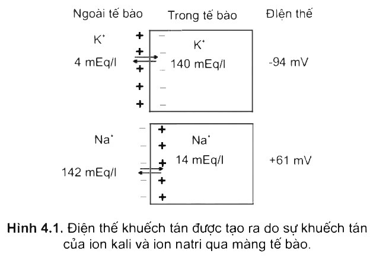
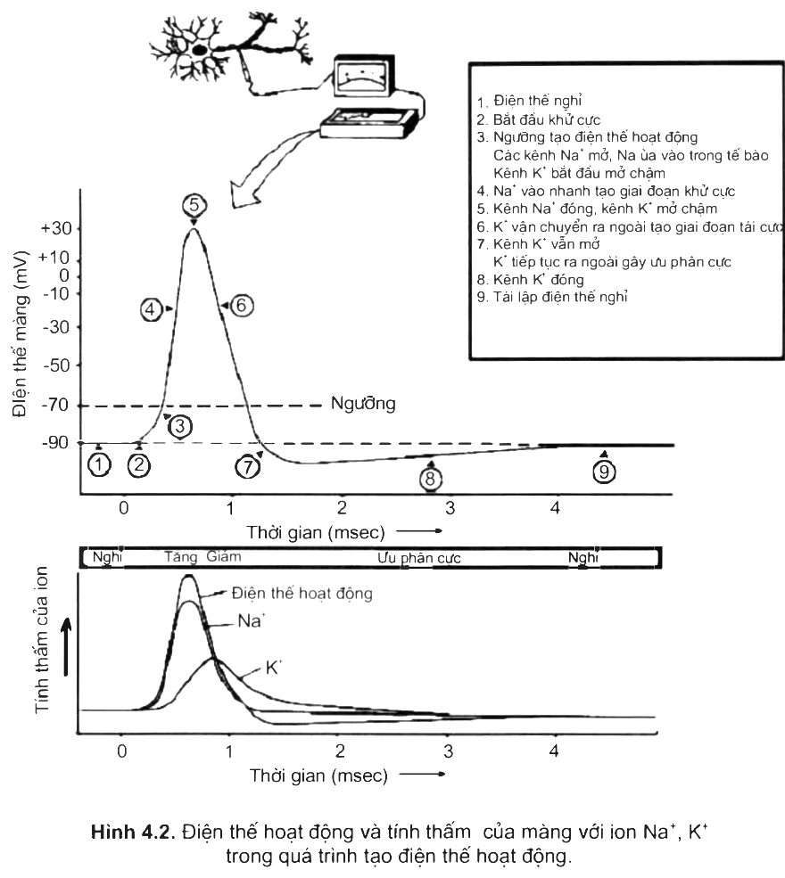
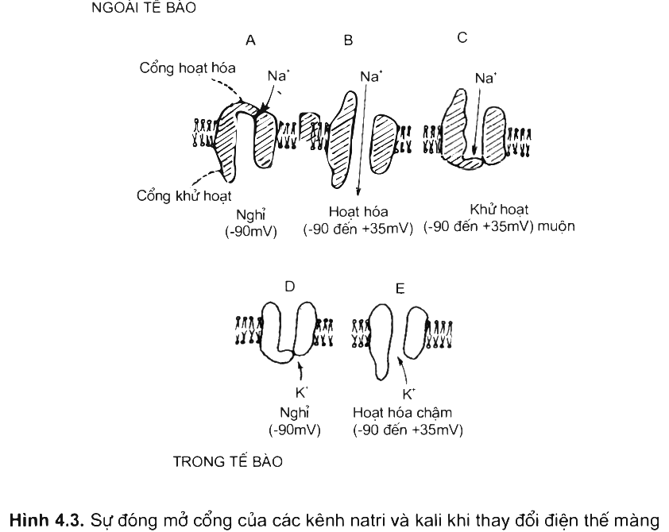

# BÀI 4: SINH LÝ ĐIỆN THẾ MÀNG VÀ ĐIỆN THẾ HOẠT ĐỘNG

## MỤC TIÊU
*Sau khi học xong bài này, sinh viên có khả năng:*
1. Nêu được các nguyên nhân tạo điện thế nghỉ và điện thế hoạt động.
2. Trình bày được sự phát sinh và sự lan truyền của điện thế hoạt động.

---

Bình thường ở trạng thái nghỉ, hai bên màng tế bào có sự chênh lệch điện tích, tạo một điện thế giữa hai bên màng, điện thế này được gọi là **điện thế màng lúc nghỉ**. Khi màng bị kích thích, có sự thay đổi điện thế của màng so với lúc nghỉ, điện thế này xuất hiện và được dẫn truyền dọc theo màng, đó là **điện thế hoạt động**.

Bài này tập trung trình bày về điện thế màng lúc nghỉ và lúc hoạt động của tế bào thần kinh và tế bào cơ.

---

## 1. CƠ SỞ VẬT LÝ CỦA ĐIỆN THẾ MÀNG

### 1.1. Sự khuếch tán của các ion, điện thế khuếch tán
Bình thường, khi tế bào ở trạng thái nghỉ có sự chênh lệch nồng độ ion giữa hai bên màng, cụ thể là:

| Ion | Dịch ngoại bào | Dịch nội bào | Điện thế khuếch tán (Điện thế Nernst) |
| :--- | :---: | :---: | :---: |
| $[\text{Na}^+]$ | $142\text{ mEq/l}$ | $14\text{ mEq/l}$ | $+61\text{ mV}$ |
| $[\text{K}^+]$ | $4\text{ mEq/l}$ | $140\text{ mEq/l}$ | $-94\text{ mV}$ |
| $[\text{Cl}^-]$ | $103\text{ mEq/l}$ | $4\text{ mEq/l}$ | $-70\text{ mV}$ |

Do có sự chênh lệch nồng độ giữa hai bên màng mà ion có xu hướng khuếch tán từ nơi nồng độ cao đến nơi nồng độ thấp (theo chiều bậc thang nồng độ). Ví dụ, ion natri có xu hướng khuếch tán từ ngoài vào trong màng, còn ion kali lại có xu hướng khuếch tán từ trong ra ngoài màng.

Theo như bảng trên thì bên trong màng tế bào có nồng độ ion kali rất cao so với bên ngoài, cụ thể là cao gấp khoảng 35 lần so với bên ngoài. Ngược lại, nồng độ ion natri ở bên ngoài màng cao hơn bên trong màng khoảng 10 lần.

Giả thử trong một thời điểm màng chỉ cho một loại ion thấm qua là ion kali và không cho một ion nào khác thấm qua. Vì ion kali có nồng độ ở bên trong màng tế bào nên ion kali có xu hướng khuếch tán ra ngoài. Ion kali mang điện tích dương khuếch tán ra ngoài, để lại các ion âm ở bên trong màng không khuếch tán ra ngoài do kích thước lớn như các phân tử protein, các gốc sulphat, phosphat. Sự di chuyển ion kali đã làm cho điện tích bên trong màng âm hơn và xuất hiện một hiệu điện thế có tác dụng kéo các ion kali mang điện tích dương trở lại phía trong màng. Chỉ trong một khoảnh khắc chừng một miligiây, điện thế này đạt tới mức ngăn không cho ion kali khuếch tán ra ngoài màng nữa, mặc dù nồng độ kali ở bên trong tế bào vẫn còn cao hơn bên ngoài. Ở sợi thần kinh của động vật có vú, điện thế $-94\text{ mV}$ bên trong màng đủ để giữ các ion kali không khuếch tán ra ngoài thêm nữa.

Cũng tương tự như trên, giả thử lại có tình huống là màng chỉ cho ion natri thấm qua. Vì nồng độ ion natri ở bên ngoài màng cao hơn bên trong màng nên ion natri có xu hướng khuếch tán vào trong màng. Ion natri mang điện tích dương nên sự khuếch tán vào bên trong màng của ion natri đã tạo điện thế màng trái dấu với trường hợp khuếch tán của ion kali, tức là bên ngoài tích điện âm còn bên trong thì tích điện dương. Điện thế lúc này tăng vọt lên và đạt trị số $+61\text{ mV}$ ở bên trong màng, mức điện thế này đủ ngăn không cho ion natri khuếch tán thêm vào bên trong nữa. Sự khuếch tán qua màng của ion kali, ion natri và điện thế khuếch tán của chúng được minh họa ở *hình 4.1*.

Như vậy sự khuếch tán của các ion, mà chủ yếu là ion kali và ion natri đã phát sinh ra điện thế khuếch tán. Vậy **điện thế khuếch tán là điện thế màng được tạo ra do sự khuếch tán ion qua màng**.

### 1.2. Phương trình Nernst
Điện thế Nernst - hay điện thế khuếch tán - đối với một loại ion là điện thế màng được tạo ra do sự khuếch tán của ion đó qua màng. Nói một cách khác, điện thế Nernst đối với một loại ion khuếch tán qua màng là điện thế được tạo ra giữa hai bên màng vừa đủ để ngăn không cho loại ion đó tiếp tục khuếch tán qua màng thêm nữa.

Giá trị của điện thế Nernst phụ thuộc vào tỷ lệ của nồng độ ion ở hai bên màng, tỷ lệ nồng độ càng lớn thì xu thế khuếch tán ion càng mạnh và điện thế Nernst càng cao. Điện thế Nernst được tính bằng **phương trình Nernst** như sau:

$$\text{Điện thế Nernst (mV)} = \pm 61 \log \frac{C_i}{C_o}$$

Trong đó:
- $C_i$ là nồng độ ion ở trong màng tế bào.
- $C_o$ là nồng độ ion ở ngoài màng tế bào.

Trong phương trình này dấu của điện thế là dương đối với các ion âm và dấu của điện thế là âm đối với các ion dương. Dùng phương trình này có thể tính được điện thế Nernst đối với các ion hóa trị một ở $37^\circ\text{C}$. Với phương trình này ta coi điện thế ngoài màng bằng không và trị số điện thế Nernst tính ra được là điện thế bên trong màng.

Như vậy, theo phương trình Nernst ta tính được điện thế khuếch tán là:
- Đối với ion kali:
$$-61 \times \log(35) = -61 \times 1{,}54 = -94\text{ mV}$$
- Đối với ion natri:
$$-61 \times \log(0{,}1) = -61 \times (-1) = +61\text{ mV}$$

### 1.3. Cách tính điện thế khuếch tán khi màng thấm nhiều ion khác nhau - Phương trình Goldman
Trên thực tế, trong cùng một thời điểm có nhiều ion khác nhau thấm qua màng và tính thấm của màng cũng khác nhau đối với mỗi loại ion. Vì vậy khi màng thấm nhiều loại ion khác nhau cùng một lúc thì điện thế khuếch tán phụ thuộc vào ba yếu tố là:
1. Dấu của điện tích ion;
2. Tính thấm $P$ của màng đối với mỗi ion;
3. Nồng độ $C_i$ của ion ở bên trong màng và nồng độ $C_o$ của ion ở bên ngoài màng.

Vì thế để tính điện thế khuếch tán khi màng thấm nhiều loại ion khác nhau phải dùng **phương trình Goldman** (*Goldman - Hodgkin - Katz*), phương trình này có tính đến cả 3 yếu tố nêu trên. Phương trình này tính điện thế bên trong màng khi có hai ion dương hóa trị một là natri, kali và một ion âm hóa trị một là clo:

$$EMF(\text{mV}) = -61 \log \frac{C_{\text{Na}_i^+} P_{\text{Na}^+} + C_{\text{K}_i^+} P_{\text{K}^+} + C_{\text{Cl}_o^-} P_{\text{Cl}^-}}{C_{\text{Na}_o^+} P_{\text{Na}^+} + C_{\text{K}_o^+} P_{\text{K}^+} + C_{\text{Cl}_i^-} P_{\text{Cl}^-}}$$

Trong đó:
- $EMF$ là điện thế bên trong màng.
- $C$ là nồng độ của ion.
- $P$ là tính thấm của màng đối với ion tương ứng.

Khi dùng phương trình Goldman cần chú ý:
- Các ion natri, kali và clo đều rất quan trọng trong việc tạo điện thế màng ở thân nơron, ở sợi thần kinh và ở cơ.
- Mức độ quan trọng của mỗi ion trong việc tạo điện thế phụ thuộc tỷ lệ thuận với tính thấm của màng đối với ion đó. Ví dụ, nếu lúc đó màng không thấm kali và clo, thì điện thế màng chỉ phụ thuộc vào bậc thang nồng độ của ion natri và sẽ bằng đúng trị số tính được theo phương trình Nernst đối với ion natri.
- Nếu nồng độ ion dương bên trong màng cao hơn bên ngoài màng, thì bậc thang đó sẽ tạo điện thế âm bên trong màng, vì ion dương khuếch tán ra ngoài màng để lại anion âm không lọt được qua màng, ở lại bên trong tạo điện thế âm bên trong màng. Đối với ion âm cũng tương tự như vậy nhưng dấu của điện thế màng sẽ ngược lại.
- Tính thấm của kênh natri và kênh kali biến đổi cực kỳ nhanh khi xuất hiện xung động thần kinh (tức xuất hiện điện thế hoạt động), trong khi đó tính thấm của kênh clo biến đổi chậm, vì vậy tính thấm của màng đối với natri và kali có ý nghĩa chủ yếu trong sự phát sinh và dẫn truyền xung động thần kinh trên sợi thần kinh.

### 1.4. Đo điện thế màng
Đo điện thế màng của sợi thần kinh rất khó vì sợi thần kinh rất nhỏ. Phương pháp thường được dùng để đo điện thế màng của sợi thần kinh như sau:

Dùng điện cực thăm dò là một pipet cực nhỏ, khoảng $1\text{ micromet}$, chứa đầy dung dịch điện giải rất mạnh như kali clorua ($\text{KCl}$), chọc qua màng vào bên trong sợi thần kinh. Một điện cực nữa là điện cực trung tính được đặt vào dịch ngoại bào. Hai vi điện cực đó nối vào một điện kế và ta đo được điện thế màng. Vì trị số điện thế màng rất nhỏ nên phải dùng loại điện kế rất nhạy là dao động kế.

---

## 2. ĐIỆN THẾ NGHỈ

### 2.1. Định nghĩa
Khi tế bào ở trạng thái nghỉ điện thế mặt trong màng có trị số âm so với mặt ngoài, điện thế này được gọi là **điện thế nghỉ của màng** (hay điện thế màng lúc nghỉ - *Resting membrane potential*).

Trị số điện thế nghỉ của màng tế bào khác nhau tùy thuộc vào loại tế bào:
- Ở thân nơron là $-65\text{ mV}$.
- Ở sợi thần kinh lớn và sợi cơ vân là $-90\text{ mV}$.
- Ở một số sợi thần kinh nhỏ là $-60$ đến $-40\text{ mV}$.

Nếu điện thế màng bớt âm hơn thì màng dễ bị kích thích hơn. Nếu điện thế màng âm hơn (ưu phân cực) thì màng khó bị kích thích hơn. Đây là cơ sở của hai hình thức hoạt động của nơron là hưng phấn hay ức chế.

### 2.2. Các nguyên nhân gây ra điện thế nghỉ (điện thế màng lúc nghỉ)
Ở trạng thái nghỉ sở dĩ mặt trong có trị số âm hơn so với mặt ngoài là do có sự chênh lệch nồng độ ion giữa hai bên màng. Có ba nguyên nhân gây ra sự chênh lệch này đó là:
1. Sự rò rỉ ion qua màng;
2. Bơm $\text{Na}^+$-$\text{K}^+$-$\text{ATPase}$;
3. Ion âm kích thước lớn trong tế bào.

#### 2.2.1. Sự rò rỉ ion qua màng (khuếch tán qua màng)
Trên màng có các kênh protein cho các ion đặc hiệu thấm qua. Ở trạng thái nghỉ cổng của các kênh này luôn đóng nhưng không đóng chặt hoàn toàn nên các ion có thể rò rỉ qua kênh, còn gọi là rò rỉ qua màng. Mức độ rò rỉ qua màng của từng loại ion không giống nhau và phụ thuộc vào mức độ đóng chặt kênh của mỗi loại ion. Ví dụ: cổng của kênh kali đóng không chặt bằng cổng của kênh natri, nên sự rò rỉ kali từ trong ra ngoài màng là đáng chú ý hơn cả vì sự rò rỉ này rất lớn, lớn hơn sự rò rỉ natri từ ngoài vào trong màng tới 100 lần. Điện thế được tạo ra do sự rò rỉ ion được gọi là điện thế khuếch tán.
- **Điện thế do khuếch tán ion kali:** như đã trình bày ở trên, khi màng ở trạng thái nghỉ, tỷ lệ nồng độ ion kali bên trong / ion kali bên ngoài màng $= 35$ nên $\log(35) = 1{,}54$ và điện thế Nernst của ion kali là $-94\text{ mV}$, khi ion kali là yếu tố duy nhất tạo điện thế nghỉ của màng. Như vậy sự đóng góp vào điện thế màng lúc nghỉ do khuếch tán ion kali là $-94\text{ mV}$.
- **Điện thế do khuếch tán ion natri:** với ion natri, khi màng ở trạng thái nghỉ, do tỷ lệ nồng độ ion natri bên trong / ion natri bên ngoài màng $= 0{,}1$ nên $\log(0{,}1) = -1$ và điện thế Nernst của ion natri là $+61\text{ mV}$, khi ion natri là yếu tố duy nhất tạo điện thế nghỉ của màng. Ta nói sự đóng góp vào điện thế màng lúc nghỉ do khuếch tán ion natri là $+61\text{ mV}$.

Do tính thấm của màng đối với ion kali cao hơn đối với ion natri 100 lần, nên phần đóng góp cho điện thế nghỉ của ion kali cao hơn đối với ion natri.

Dựa vào phương trình Goldman tính được điện thế khuếch tán của cả hai ion natri và kali là **$-86\text{ mV}$**.

#### 2.2.2. Bơm $\text{Na}^+$-$\text{K}^+$-$\text{ATPase}$
Đây là nguyên nhân chính tạo điện thế nghỉ của màng, vì bơm $\text{Na}^+$-$\text{K}^+$-$\text{ATPase}$ hoạt động liên tục, vận chuyển tích cực ion $\text{Na}^+$ và ion $\text{K}^+$ qua màng. Mỗi chu kỳ hoạt động bơm đưa 3 ion $\text{Na}^+$ đi ra ngoài và 2 ion $\text{K}^+$ vào trong tế bào, tức là tạo ra thiếu hụt ion dương ở bên trong màng. Phần điện thế âm bên trong màng do bơm $\text{Na}^+$-$\text{K}^+$-$\text{ATPase}$ tạo ra là **$-4\text{ mV}$**.

Bơm hoạt động đã tạo ra sự chênh lệch nồng độ ion giữa hai bên màng, nói cách khác là đã tạo ra bậc thang nồng độ của các ion. Bậc thang này khác nhau tuỳ loại ion và là cơ sở cho sự rò rỉ ion qua màng. Ngoài bơm $\text{Na}^+$-$\text{K}^+$-$\text{ATPase}$, một số bơm khác như bơm canxi hoạt động thường xuyên trên màng tế bào cũng tạo ra sự chênh lệch nồng độ ion giữa hai bên màng tế bào.

Từ các số liệu trên cho thấy do cả ba nguyên nhân là điện thế do khuếch tán ion kali, điện thế do khuếch tán ion natri, điện thế do hoạt động của bơm $\text{Na}^+$-$\text{K}^+$-$\text{ATPase}$ tạo nên điện thế màng lúc nghỉ là:
$$-86\text{ mV} + (-4\text{ mV}) = -90\text{ mV}$$
ở màng tế bào cơ tim, cơ vân, sợi trục lớn của tế bào thần kinh...

Ở một số loại tế bào khác, như sợi thần kinh đường kính nhỏ, tế bào cơ trơn và nhiều loại nơron thần kinh có điện thế màng chỉ từ $-40\text{ mV}$ đến $-60\text{ mV}$.

#### 2.2.3. Ion âm có kích thước lớn trong tế bào
Ngoài hai nguyên nhân trên, trong tế bào có các ion âm do có kích thước lớn nên không qua được màng tế bào ra ngoài (phân tử protein, phosphat...). Những ion này cũng góp phần làm cho điện thế bên trong màng âm hơn so với bên ngoài.

---

## 3. ĐIỆN THẾ HOẠT ĐỘNG

### 3.1. Định nghĩa và các giai đoạn của điện thế hoạt động

#### 3.1.1. Định nghĩa
**Điện thế hoạt động (*Action Potential*)** là những thay đổi điện thế nhanh, đột ngột mỗi khi màng bị kích thích. Mỗi điện thế hoạt động bắt đầu bằng sự biến đổi đột ngột từ điện thế âm lúc nghỉ sang điện thế dương khi màng bị kích thích, rồi lại quay trở lại điện thế âm cũng rất nhanh. Các quá trình biến đổi điện thế xảy ra nhanh như bùng nổ, chỉ trong khoảng thời gian một vài phần vạn giây.

Những tín hiệu thần kinh được dẫn truyền bằng các điện thế hoạt động này. Nói một cách khác bản chất của xung động thần kinh chính là các điện thế hoạt động. Các điện thế hoạt động di chuyển dọc theo sợi thần kinh cho đến tận các cúc tận cùng.

Như đã trình bày ở trên, trong trạng thái nghỉ màng có điện thế nghỉ, tức là màng ở trạng thái cực hóa (*polarization*, còn gọi là trạng thái phân cực), bên trong màng tích điện âm và bên ngoài màng tích điện dương. Khi màng bị kích thích sẽ có sự thay đổi đột ngột từ điện thế nghỉ sang điện thế hoạt động.

#### 3.1.2. Các giai đoạn của điện thế hoạt động
Điện thế hoạt động gồm các giai đoạn sau (*hình 4.2*):

##### a. Giai đoạn khử cực
Khi bị kích thích màng đột nhiên trở nên có tính thấm rất cao đối với ion $\text{Na}^+$ làm cho một lượng lớn ion $\text{Na}^+$ ùa vào bên trong tế bào. Trạng thái cực hóa bị mất, điện thế màng từ $-90\text{ mV}$ chuyển nhanh sang phía điện thế dương. Hiện tượng này được gọi là **khử cực (*depolarization*)**, tức là khử bỏ trạng thái cực hóa. Ở những sợi thần kinh lớn còn có hiện tượng "quá đà" (*overshoot*), tức là điện thế không những tăng lên đến $0\text{ mV}$ mà còn tăng lên đến trị số dương (ví dụ tăng lên đến $+30\text{ mV}$). Ở những sợi thần kinh nhỏ hoặc thân nơron thì điện thế chỉ tăng gần mức trị số $0\text{ mV}$, chứ không vượt quá được trị số $0\text{ mV}$.

##### b. Giai đoạn tái cực
Vài phần vạn giây sau khi màng tăng vọt tính thấm với ion $\text{Na}^+$ thì kênh natri bắt đầu đóng lại. Lúc này kênh kali mở rộng ra, ion $\text{K}^+$ khuếch tán ra ngoài, làm mặt trong màng bớt dương hơn, rồi lại trở nên âm hơn mặt ngoài như trong trạng thái nghỉ. Vì vậy, giai đoạn này được gọi là **giai đoạn tái cực (*repolarization*)** và điện thế nghỉ của màng cũng được tái tạo lại với trị số $-90\text{ mV}$.

##### c. Giai đoạn ưu phân cực
Do sự mở các kênh kali chậm hơn và vẫn tiếp tục mở trong vài miligiây sau khi điện thế hoạt động chấm dứt, nên sau giai đoạn tái cực điện thế màng không chỉ trở về mức điện thế lúc nghỉ ($-90\text{ mV}$) mà còn âm hơn nữa (có thể tới khoảng $-100\text{ mV}$), sau đó mới trở về bình thường. Vì vậy giai đoạn này được gọi là **giai đoạn ưu phân cực** (*hình 4.2*).

### 3.2. Nguyên nhân của điện thế hoạt động
Nguyên nhân của điện thế hoạt động là sự thay đổi hoạt động của các kênh ion, trong đó có vai trò của kênh natri, kênh kali và một vài kênh khác.

#### 3.2.1. Sự hoạt hóa kênh natri
Như đã trình bày ở phần đặc điểm cấu trúc - chức năng của màng tế bào (bài 3), kênh natri có hai cổng ở hai đầu kênh, cổng ở phía ngoài màng là *cổng hoạt hóa*, cổng ở phía trong màng là *cổng khử hoạt*.

Ở trạng thái bình thường, điện thế màng lúc nghỉ là $-90\text{ mV}$, *cổng hoạt hóa ở bên ngoài đóng* nên ion natri không vào bên trong màng được, còn *cổng khử hoạt ở bên trong màng thì mở* (*hình 4.3 A*).

- **Kênh natri được hoạt hóa khi màng bị kích thích:** Điện thế màng trở nên bớt âm hơn (tăng từ $-90\text{ mV}$ về phía $0\text{ mV}$). Khi điện thế tăng lên đến $-70\text{ mV}$ (hoặc tới $-50\text{ mV}$ tùy loại tế bào ở từng cơ quan) thì gây biến đổi đột ngột hình dáng cổng hoạt hóa của kênh natri, *cổng hoạt hóa mở ra* (*hình 4.3 B*), các ion natri ùa qua kênh vào trong tế bào. Lúc này tính thấm của màng đối với ion natri tăng 500 - 5000 lần. Trạng thái này kéo dài vài phần vạn giây.
- **Khử hoạt kênh natri (*hình 4.3 C*):** Sự tăng điện thế bên trong màng làm mở cổng hoạt hóa nhưng đồng thời cũng làm đóng cổng khử hoạt. Việc đóng cổng khử hoạt xảy ra ngay sau khi mở cổng hoạt hóa, chỉ sau vài phần vạn giây. Điều đáng chú ý là việc mở cổng hoạt hóa diễn ra rất nhanh, còn đóng cổng khử hoạt thì xảy ra từ từ hơn. Khi cổng khử hoạt của kênh natri đóng lại, ion natri không tiếp tục vào tế bào được nữa.

Cần chú ý rằng chỉ khi nào điện thế màng đã quay trở về tới hoặc gần tới mức điện thế nghỉ lúc đầu thì cổng khử hoạt của kênh natri mới lại mở ra, đó là cơ sở của hiện tượng đóng mở kênh natri kế tiếp, tạo nên một xung thần kinh.

#### 3.2.2. Sự hoạt hóa kênh kali
Kênh kali cũng là loại kênh có cổng đóng mở do điện thế. Nhưng kênh kali khác kênh natri ở chỗ là chỉ có một cổng đóng mở ở bên trong màng, đó là cổng hoạt hóa, mà không có cổng khử hoạt như ở kênh natri.
- Ở trạng thái nghỉ (*hình 4.3 D*) cổng của kênh kali đóng, ion kali không ra ngoài màng được.
- Khi điện thế màng tăng từ $-90\text{ mV}$ lên phía $0\text{ mV}$ thì làm biến đổi hình dạng của cổng, cổng mở từ từ và ion kali khuếch tán qua kênh ra ngoài tế bào (*hình 4.3 E*). Thời gian mở kênh kali và ion kali khuếch tán ra ngoài trùng với thời gian giảm tốc độ khuếch tán của ion natri vào trong tế bào. Giai đoạn này cũng kéo dài trong vài phần vạn giây (dài hơn so với giai đoạn khử cực vì kênh kali mở từ từ hơn và đóng lại cũng chậm hơn). Kết quả là điện thế nghỉ được phục hồi.

#### 3.2.3. Vai trò của kênh canxi - natri
Cổng của kênh canxi cũng đóng mở do điện thế. Khi cổng của kênh mở, cả ion $\text{Ca}^{2+}$ lẫn một ít ion $\text{Na}^+$ đều khuếch tán qua kênh vào trong tế bào, do đó kênh canxi còn được gọi là *kênh canxi - natri*. Kênh canxi - natri có đặc điểm là hoạt hóa chậm, chậm gấp 10 lần đến 20 lần so với kênh natri, nên kênh này cũng được gọi là *kênh chậm* (kênh natri được gọi là *kênh nhanh*). Kênh canxi - natri có nhiều ở cơ tim và cơ trơn là các loại cơ co chậm và có tương đối ít kênh natri, ở các loại cơ này kênh canxi - natri đóng vai trò quan trọng trong tạo điện thế hoạt động.

Mặt khác, nồng độ ion $\text{Ca}^{2+}$ trong dịch kẽ còn ảnh hưởng đến sự hoạt hóa kênh natri. Bình thường các bơm canxi ở màng tế bào và màng các bào quan luôn hoạt động, bơm ion $\text{Ca}^{2+}$ từ bào tương ra ngoài tế bào và vào mạng nội bào tương, tạo nên một bậc thang ion $\text{Ca}^{2+}$ là ở dịch kẽ cao hơn trong bào tương 10.000 lần. Khi ion $\text{Ca}^{2+}$ giảm ở dịch kẽ, thì các kênh natri hoạt hóa, cổng của các kênh natri mở ra, do đó sợi thần kinh có tính hưng phấn cao (dễ phát xung). Khi nồng độ ion $\text{Ca}^{2+}$ chỉ còn 30% đến 50% so với mức bình thường, thì nhiều dây thần kinh ngoại biên phát xung một cách tự phát, gây co cơ liên tục, gọi là **"tetany"**.

### 3.3. Cơ chế phát sinh điện thế hoạt động
Điện thế hoạt động được khởi đầu (phát sinh) bằng một vòng **feedback dương mở kênh natri**.

Bình thường điện thế màng ở cơ tim, cơ vân, sợi thần kinh to là $-90\text{ mV}$. Khi có một kích thích nào đó làm điện thế màng tăng đôi chút hướng về phía $0\text{ mV}$ thì làm mở một số kênh natri, ion natri vào trong màng làm cho điện thế màng tăng lên. Điện thế màng tăng lên lại làm mở thêm các kênh natri khác. Đây là một feedback dương làm cho các kênh natri trong khoảnh khắc rất ngắn đã mở hoàn toàn (hoạt hóa hoàn toàn) tạo ra điện thế hoạt động. Tiếp sau đó các kênh natri bị khử hoạt và các kênh kali bắt đầu mở, làm cho điện thế hoạt động nhanh chóng kết thúc.

### 3.4. Ngưỡng tạo điện thế hoạt động
Sự tăng điện thế màng đến một mức nào đó thì làm phát sinh điện thế hoạt động, mức tăng đó được gọi là **ngưỡng tạo điện thế hoạt động**. Thường là tăng đột ngột $15 - 30\text{ mV}$, tức là từ $-90\text{ mV}$ lên đến $-75\text{ mV}$ hoặc $-60\text{ mV}$. Thường lấy mức $-65\text{ mV}$ và gọi $-65\text{ mV}$ là ngưỡng tạo điện thế hoạt động hay là **ngưỡng kích thích**.

### 3.5. Sự thích nghi của màng
Nếu điện thế màng tăng rất từ từ trong nhiều miligiây chứ không tăng vọt trong vài phần vạn giây, thì khi các cổng hoạt hóa của kênh natri bắt đầu mở thì đúng lúc đó cổng khử hoạt của kênh natri cũng đã đóng rồi. Như vậy không có được dòng ion natri đi vào trong màng để tạo điện thế hoạt động. Hiện tượng này được gọi là **sự thích nghi của màng đối với kích thích**. Trong điều kiện này điện thế màng cần phải vượt qua một ngưỡng kích thích cao hơn nữa, thậm chí phải tăng lên các trị số dương mới tạo được điện thế hoạt động.

### 3.6. Điện thế màng khi tế bào bị ức chế
Khi tế bào bị ức chế (do các chất truyền đạt thần kinh có tác dụng ức chế gắn với receptor đặc hiệu trên màng) thì hoặc kênh kali hoặc kênh clo, hoặc cả hai kênh này cùng mở ra. Tác dụng này kéo dài khoảng $1 - 2\text{ miligiây}$.

Kênh kali mở, các ion kali đi ra ngoài màng, làm mặt trong màng trở nên âm hơn. Kênh clo mở, các ion clo đi vào trong màng, làm điện thế trong màng trở nên âm hơn, tức là $-70\text{ mV}$ (bình thường điện thế nghỉ ở thân nơron là $-65\text{ mV}$), mức âm thêm $5\text{ mV}$ là **điện thế ức chế**.

### 3.7. Sự lan truyền điện thế hoạt động

#### 3.7.1. Cơ chế của lan truyền điện thế hoạt động
Cơ chế của lan truyền điện thế hoạt động là sự tạo nên một **"mạch điện" tại chỗ**, giữa vùng đang khử cực và phần màng ở vùng tiếp giáp: điện tích dương của ion natri trong sợi trục (trong màng tế bào) sẽ di chuyển dọc theo sợi trục xa tới 1 đến 3 milimet và làm phát sinh điện thế hoạt động ở vùng tiếp giáp. Bằng cách đó điện thế hoạt động cứ lan truyền dần đi dọc theo sợi trục (hoặc lan truyền khắp màng tế bào). Ở tế bào thần kinh điện thế hoạt động lan truyền dọc sợi trục, làn sóng lan truyền được gọi là *"xung động thần kinh"*. Làn sóng lan truyền ở cơ (gây co cơ) gọi là *"xung động ở cơ"*.

#### 3.7.2. Hướng lan truyền của điện thế hoạt động
Từ chỗ phát sinh, điện thế hoạt động lan theo *hai chiều* trên sợi trục của tế bào thần kinh nếu làm thí nghiệm dùng dòng điện nhân tạo kích thích vào đoạn giữa sợi trục. Nhưng điện thế hoạt động chỉ lan theo *một chiều* qua synap thần kinh, synap thần kinh - cơ hoặc synap thần kinh - tế bào đích. Vì vậy, trên thực tế hướng lan truyền của điện thế hoạt động trong cơ thể chỉ đi theo một chiều, hoặc từ ngoại vi về trung tâm (nếu là dẫn truyền xung động cảm giác) hoặc từ trung tâm ra ngoại vi (nếu là dẫn truyền xung động vận động).

---

## CÂU HỎI TỰ LƯỢNG GIÁ
1. Nêu định nghĩa và các nguyên nhân gây ra điện thế nghỉ.
2. Nêu định nghĩa và kể tên các giai đoạn điện thế hoạt động.
3. Trình bày ba giai đoạn của điện thế hoạt động.
4. Kể các nguyên nhân gây ra điện thế hoạt động và trình bày về sự hoạt hóa kênh natri.
5. Kể các nguyên nhân gây ra điện thế hoạt động và trình bày về sự hoạt hóa kênh kali.
6. Kể các nguyên nhân gây ra điện thế hoạt động và trình bày vai trò của kênh canxi - natri.
7. Trình bày cơ chế phát sinh điện thế hoạt động.
8. Trình bày sự lan truyền điện thế hoạt động.
