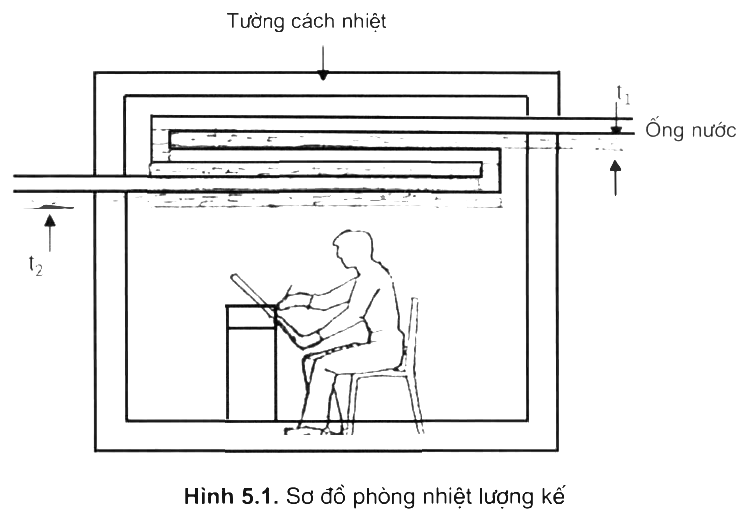

# BÀI 5: SINH LÝ CHUYỂN HÓA CHẤT, NĂNG LƯỢNG

## MỤC TIÊU
*Sau khi học xong bài này, sinh viên có khả năng:*
1. Trình bày được nhu cầu, vai trò và điều hoà chuyển hóa glucid, lipid, protein đối với cơ thể.
2. Trình bày được các dạng năng lượng, nguyên nhân tiêu hao năng lượng của cơ thể.
3. Nêu được cơ chế điều hoà chuyển hóa năng lượng.

---

Chuyển hóa là toàn bộ những phản ứng hóa học diễn ra trong cơ thể sống, xảy ra thường xuyên, liên tục ở mọi tế bào của cơ thể. Người ta thường chia làm hai loại các phản ứng hóa học đó là:
- Loại phản ứng thoái hóa còn gọi là dị hóa, là loại phản ứng phân chia một phân tử ra thành các thành phần ngày càng nhỏ hơn.
- Loại phản ứng tổng hợp còn gọi là đồng hóa là loại phản ứng ghép các phân tử nhỏ lại để tạo thành phân tử lớn hơn.

Đặc trưng cơ bản của một phản ứng hóa học là bẻ gãy các liên kết hóa học của một chất nào đó để rồi lại tạo nên một chất khác với các liên kết mới. Có rất nhiều cách bẻ gãy liên kết cũ và sắp xếp liên kết mới theo cách tổ hợp mới. Liên kết nào bị bẻ gãy và chọn kiểu liên kết mới nào được quyết định bởi cấu trúc của các chất, phân phối năng lượng trong phân tử lúc xảy ra phản ứng và phụ thuộc vào môi trường xảy ra phản ứng.

Mỗi một chất có con đường chuyển hóa riêng, một con đường chuyển hóa là một chuỗi các phản ứng hóa học có enzym xúc tác dẫn đến hình thành một sản phẩm nhất định.

Trong cơ thể sống hai quá trình chuyển hóa chất và chuyển hóa năng lượng liên quan chặt chẽ với nhau và tuân thủ những nguyên lý chung của chuyển hóa.

---

## 1. CHUYỂN HÓA CHẤT

Chuyển hóa chất trong cơ thể là những quá trình hóa học nhằm duy trì sự sống nói chung của cơ thể và sự sống của từng tế bào nói riêng. Các quá trình chuyển hóa chất chỉ có thể xảy ra được trong những điều kiện nhất định của môi trường bên trong như nhiệt độ, độ pH, thành phần các chất khí, thành phần các ion... đồng thời quá trình chuyển hóa chất cũng góp phần tạo nên sự ổn định của môi trường bên trong cơ thể. Ở bên trong cơ thể các chất dinh dưỡng sẽ trải qua một quá trình chuyển hóa phức tạp để tổng hợp nên các chất tham gia vào các cấu trúc của tế bào, các enzym, đồng thời cũng được sử dụng vào các quá trình phân giải tạo nên các sản phẩm trung gian khác nhau và đảm bảo việc cung cấp năng lượng cho mọi hoạt động của cơ thể và sự sống của từng tế bào.

Sự chuyển hóa các chất trong cơ thể có thể được phân chia thành chuyển hóa glucid, chuyển hóa lipid, chuyển hóa protein, chuyển hóa nước, các chất khoáng và vitamin.

Bài này chỉ tập trung vào chuyển hóa glucid, lipid và protein, các chuyển hóa khác sẽ được đề cập trong chương trình khác.

### 1.1. Chuyển hóa glucid

#### 1.1.1. Dạng glucid trong cơ thể
Sản phẩm cuối cùng của chuyển hóa glucid trong ống tiêu hóa là các monosaccharid như glucose, fructose, galactose trong đó glucose chiếm 80%. Chúng được vận chuyển vào tế bào niêm mạc ruột non theo cơ chế vận chuyển tích cực thứ phát nhờ chất mang chung với natri (glucose, galactose) hoặc theo cơ chế khuếch tán thuận hóa (fructose). Các monosaccharid được hấp thu qua ruột, vào máu tĩnh mạch cửa về gan và đi vào các quá trình chuyển hóa ở gan cũng như ở các tế bào khác trong cơ thể nhờ sự vận chuyển của máu trong hệ thống tuần hoàn. Ở gan, một phần glucid được chuyển thành glycogen là dạng dự trữ đường trong cơ thể. Trong cơ thể glucid tồn tại dưới các dạng:
- **Dạng vận chuyển trong máu:** là các monosaccharid như glucose, fructose, galactose nhưng chủ yếu là glucose. Có thể nói glucose là dạng monosaccharid chủ yếu vận chuyển trong máu, chiếm tới 90-95% số lượng monosaccharid vận chuyển trong máu.
- **Dạng kết hợp:** Các glucid có thể kết hợp với các lipid hoặc protein và tham gia vào thành phần cấu tạo của tế bào ở các mô trong cơ thể.
- **Dạng dự trữ:** Glucid được dự trữ dưới dạng glycogen ở gan. Các monosaccharid khi đi qua gan, một phần sẽ được các tế bào gan tổng hợp thành glycogen là dạng dự trữ chính của cơ thể. Khi thiếu hụt glucose trong cơ thể, các tế bào gan lại phân giải glycogen thành glucose để cung cấp cho cơ thể. Glycogen được dự trữ ở gan là chủ yếu, nó còn được dự trữ một phần trong cơ và trong tế bào.

#### 1.1.2. Vai trò và nhu cầu glucid trong cơ thể

##### 1.1.2.1. Vai trò của glucid trong cơ thể
- **Cung cấp năng lượng:**
  Glucid là nguồn cung cấp năng lượng chủ yếu của cơ thể. 70% năng lượng của khẩu phần ăn là do glucid cung cấp. Glycogen ở gan là kho dự trữ năng lượng của cơ thể và glucid là chất trực tiếp cung cấp năng lượng cho mọi hoạt động của cơ thể. Các tế bào não chỉ có thể lấy năng lượng từ glucid.
  Phân giải hoàn toàn một phân tử glucose sẽ giải phóng ra 38 ATP (Adenosin Triphosphat) và $420\text{ Kcal}$ dưới dạng nhiệt. Trong quá trình phân giải glucose có thể cung cấp trực tiếp một phần năng lượng cho cơ thể sử dụng thông qua ATP mà không cần qua các chặng trung gian hoặc qua chuỗi hô hấp tế bào vận chuyển các nguyên tử hydro.
- **Glucid có vai trò trong tạo hình của cơ thể:**
  Trong cơ thể ngoài vai trò dự trữ và cung cấp năng lượng, glucid còn tham gia vào các cấu tạo của rất nhiều thành phần:
  + Các ribose có trong nhân của tất cả các loại tế bào, fructose có trong tinh dịch với nồng độ 0,91-5,20 g/lít.
  + Các acid hyaluronic là thành phần chính cùng với nước tạo thành dịch ngoại bào, dịch khớp, dịch kính của mắt, vừa có tác dụng dinh dưỡng vừa có tác dụng bôi trơn.
  + Các condromucoid là thành phần cơ bản của mô sụn, thành động mạch, da, van tim, giác mạc.
  + Aminoglycolipid tạo nên chất stroma của hồng cầu.
  + Cerebrosid, aminoglycolipid là thành phần chính tạo vỏ myelin của các sợi thần kinh, tạo chất trắng của mô thần kinh.
- **Glucid tham gia vào các hoạt động chức năng của cơ thể:**
  Thông qua việc tham gia vào các thành phần cấu tạo của cơ thể, glucid có vai trò trong rất nhiều chức năng của cơ thể như chức năng bảo vệ, chức năng miễn dịch, chức năng sinh sản, chức năng dinh dưỡng và chuyển hóa, quá trình tạo hồng cầu, có vai trò trong hoạt động của hệ thần kinh, làm nhiệm vụ lưu trữ và thông tin di truyền qua các tế bào và các thế hệ thông qua ARN và ADN.

##### 1.1.2.2. Nhu cầu glucid trong cơ thể
Glucid chiếm 2% trọng lượng khô của cơ thể, ở người trưởng thành bình thường, nặng 50 kg, glucid toàn cơ thể nặng khoảng 0,3 đến 0,5 kg.

Nhu cầu glucid thường không được quy định trực tiếp mà dựa vào nhu cầu năng lượng và tỷ lệ năng lượng giữa ba chất dinh dưỡng sinh năng lượng để tính ra. Theo tài liệu của Viện Dinh dưỡng Việt Nam 1994, nhu cầu năng lượng cho trẻ em từ 1-3 tuổi là $1300\text{ Kcal/ngày}$ và của người trưởng thành nam giới là từ $2300\text{-}2500\text{ Kcal/ngày}$, đối với phụ nữ có thai 3 tháng cuối cộng thêm $350\text{ Kcal/ngày}$, phụ nữ đang cho con bú 6 tháng đầu cộng thêm $550\text{ Kcal/ngày}$. Trong tổng số Kcal/ngày, năng lượng protid chiếm 12-15%, năng lượng của lipid chiếm 15-20%, phần còn lại là do glucid cung cấp. Như vậy, cơ thể được cung cấp năng lượng chủ yếu là từ glucid chiếm 65-70% tổng số Kcal/ngày.

Glucid được cung cấp vào cơ thể thông qua nguồn thức ăn, các chất nhiều glucid thường được dùng như bột gạo tẻ 82,2 g/100 g bột, bột gạo nếp 78,8 g/100 g bột, bột ngô 73,0 g/100 g bột, bột mì 71,3 g/100 g bột...

##### 1.1.2.3. Vai trò trung tâm của glucose trong chuyển hóa glucid
Sản phẩm cuối cùng của glucid trong ống tiêu hóa là monosaccharid trong đó có 80% là glucose. Sau khi được hấp thu từ ống tiêu hóa qua ruột về gan, phần lớn fructose và galactose tiếp tục được chuyển thành glucose.

Ở gan, các tế bào gan chứa enzym có khả năng chuyển đổi giữa các monosaccharid như galactose 1-phosphat, uridin diphosphat glucose, glucose 1-phosphat, đặc biệt chúng chứa một lượng lớn enzym glucose phosphatase chuyển glucose 6-phosphat thành glucose và gốc phosphat, glucose được đưa vào máu. Như vậy, glucose trở thành sản phẩm cuối cùng của glucid và được máu vận chuyển đến các tế bào của cơ thể. Có khoảng 90 - 95% monosaccharid vận chuyển trong máu là glucose. Toàn bộ quá trình tạo đường mới và phân giải đường ở gan đều qua giai đoạn chuyển hóa của glucose. Từ các monosaccharid các tế bào gan tổng hợp nên glycogen là dạng đường dự trữ của cơ thể, đồng thời nhờ các tế bào gan, nhờ các enzym thích hợp phân giải glycogen để chuyển thành glucose và được máu chuyển đến khắp các tế bào của cơ thể. Chính vì các lý do trên mà glucose có vai trò trung tâm của chuyển hóa glucid. Phân giải hoàn toàn 1 phân tử glucose cung cấp cho cơ thể 38 ATP và qua các chặng chính là tạo thành 2 acid pyruvic rồi thành acetyl CoA để vào chu trình Krebs. Khi thừa glucose, cơ thể sẽ dự trữ dưới dạng glycogen, khi thiếu glucose cơ thể huy động từ nguồn dự trữ và tổng hợp đường mới từ các acid amin và acid béo.

#### 1.1.3. Điều hoà chuyển hóa glucid

##### 1.1.3.1. Nồng độ glucose trong máu
Nồng độ glucose trong máu luôn luôn được duy trì ổn định ở mức 80-120 g/l *(ghi chú: đơn vị mg/dl hoặc 0,8-1,2 g/l; nguyên văn sách ghi 80-120g/l)*. Ngay sau bữa ăn nồng độ glucose trong máu tăng nhưng cũng không vượt quá 140 g/l và trở lại bình thường sau 1-2 giờ. Sau vận động thể lực đường huyết có thể hơi giảm nhưng lại nhanh chóng trở về bình thường. Mức đường huyết nếu thấp dưới mức 50 g/l là hạ đường huyết, cao trên 140 g/l là tăng đường huyết và có thể gây đái tháo đường. Gan và một số hormon như insulin, glucagon, adrenalin đóng vai trò quan trọng trong việc duy trì nồng độ glucose máu.

##### 1.1.3.2. Điều hoà chuyển hóa glucid
Có hai cơ chế điều hoà ở mức toàn cơ thể đó là cơ chế thần kinh và cơ chế thể dịch.
- **Cơ chế thần kinh điều hoà chuyển hóa glucid:**
  Nhiều thực nghiệm đã chứng minh ảnh hưởng của hệ thần kinh đối với chuyển hóa glucid. Cắt bỏ não hoặc phá huỷ sàn não thất IV gây tăng đường huyết. Vùng dưới đồi cũng được chứng minh có liên quan với chuyển hóa glucid. Nhịn đói, stress, xúc cảm có tác động lên chuyển hóa glucid có lẽ là qua vùng dưới đồi. Người ta cũng đã gây được phản xạ có điều kiện có ảnh hưởng lên chuyển hóa glucid. Ví dụ saccarin có vị ngọt có thể gây bài tiết insulin như khi ăn đường. Khi nồng độ glucose trong máu giảm tác dụng trực tiếp lên vùng dưới đồi kích thích thần kinh giao cảm làm tăng bài tiết adrenalin và noradrenalin gây tăng đường huyết. Khi đường huyết tăng cao quá mức điều chỉnh của các yếu tố thần kinh và thể dịch thì thận tham gia vào cơ chế điều hoà đường huyết bằng cách thải glucose ra nước tiểu, đây là một trong những nguyên nhân gây nên bệnh đái tháo đường.
- **Cơ chế thể dịch điều hoà chuyển hóa glucid:** Chuyển hóa glucid được điều hoà chủ yếu bởi hai hệ thống hormon, một hệ thống làm tăng đường huyết và một hệ thống làm giảm đường huyết.
  + Các hormon làm tăng đường huyết gồm GH của tuyến yên, $\text{T}_3\text{ - }\text{T}_4$ của tuyến giáp, cortisol của tuyến vỏ thượng thận, adrenalin của tuyến tủy thượng thận và glucagon của tuyến tụy nội tiết.
  + Hormon làm giảm đường huyết là insulin của tuyến tụy nội tiết.
  Tác dụng cụ thể lên chuyển hóa glucid của các hormon nói trên sẽ được trình bày ở bài 13. Sinh lý Nội tiết.

#### 1.1.4. Rối loạn chuyển hóa glucid
Rối loạn chuyển hóa glucid có thể biểu hiện bằng hạ đường huyết hoặc tăng đường huyết.
- **Hạ đường huyết:** khi mức đường huyết thấp dưới mức 50 g/l là hạ đường huyết. Nguyên nhân có thể do đói, rối loạn hấp thu hoặc do ưu năng tụy nội tiết gây bài tiết quá nhiều insulin.
  Biểu hiện hạ đường huyết: bệnh nhân có thể có cảm giác đói, toát mồ hôi, tim đập nhanh, nếu không cấp cứu kịp thời bệnh nhân có thể hôn mê và chết.
- **Tăng đường huyết:** đường huyết lúc đói vượt quá $6,7\text{ mmol/lít}$ (140 g/l) là tăng đường huyết, nguyên nhân thường là do bệnh lý của hệ nội tiết như nhược năng tuyến tụy, ưu năng tuyến yên, ưu năng tuyến thượng thận.
  Các trường hợp bệnh lý làm tăng đường huyết thường dẫn đến bệnh đái tháo đường. Bệnh đái tháo đường có hai thể là thể phụ thuộc insulin và thể không phụ thuộc insulin.
  + Thể phụ thuộc insulin (đái tháo đường type 1) thường gặp ở người trẻ có các triệu chứng lâm sàng như ăn nhiều, đái nhiều, uống nhiều và gầy nhiều.
  + Thể không phụ thuộc insulin (đái tháo đường type 2) triệu chứng thường âm thầm hơn. Thể này thường gặp ở người lớn tuổi và kháng lại insulin ngoại sinh.
  + Đái tháo đường ở giai đoạn cuối của cả hai thể (giai đoạn nặng) nếu không được điều trị kịp thời thường gây nên các triệu chứng:
    - Ăn nhiều, đái nhiều, uống nhiều, gầy nhiều.
    - Đường huyết tăng cao có khi tới 300 - 1200 g/l.
    - Đường niệu.
    - $\text{Na}^+$ trong máu giảm do các thể cetonic bài tiết kéo theo $\text{Na}^+$.
    - Hơi thở có mùi aceton.

Định lượng đường huyết và đường niệu là các xét nghiệm rất chắc chắn để xác định mức độ đường huyết bình thường hay có rối loạn, giảm hay tăng đường huyết, đặc biệt là ở giai đoạn sớm của bệnh. Khi mức độ bệnh đã nặng, ngoài việc xét nghiệm đường thì có nhiều triệu chứng khác có thể nhận biết được như hơi thở có mùi aceton, đi tiểu xong thấy có hiện tượng kiến bâu vào nước tiểu.

---

### 1.2. Chuyển hóa lipid

#### 1.2.1. Dạng lipid trong cơ thể
Trong cơ thể lipid tồn tại dưới các dạng:
- **Dạng vận chuyển trong máu:** gồm có các acid béo, các phospholipid và một số lipid khác. Các lipid này vận chuyển trong máu dưới dạng các lipoprotein. Có 4 loại lipoprotein bao gồm:
  + Lipoprotein tỷ trọng rất thấp (Very Low Density Lipoprotein Cholesterol - VLDLC) là loại chứa nhiều triglycerid.
  + Lipoprotein tỷ trọng trung gian (Intermediate Density Lipoprotein Cholesterol - IDLC) có ít triglycerid hơn so với loại VLDLC.
  + Lipoprotein tỷ trọng thấp (Low Density Lipoprotein Cholesterol - LDLC), loại này hầu như không có triglycerid mà có cholesterol và phospholipid ở mức vừa phải.
  + Lipoprotein tỷ trọng cao (High Density Lipoprotein Cholesterol - HDLC), loại này có tới 30% protid.
  Các lipoprotein đều làm nhiệm vụ vận chuyển lipid của máu. Loại VLDLC vận chuyển triglycerid tổng hợp ở gan và chủ yếu đến mô mỡ. Các loại lipoprotein khác tham gia vận chuyển lipid từ gan đến các mô và cơ quan. Sau bữa ăn, hàm lượng các lipoprotein trong máu tăng cao, sau đó dần trở về bình thường. Sau bữa ăn, nồng độ cholesterol trong máu tăng nhưng không vượt quá 15% mức bình thường.
- **Dạng kết hợp:** các lipid có thể kết hợp với các glucid hoặc protid và chúng tham gia vào thành phần cấu tạo của tế bào ở các mô, các cơ quan trong cơ thể.
- **Dạng dự trữ:** các triglycerid còn gọi là mỡ trung tính được đưa đến các mô mỡ và dự trữ ở các mô mỡ. Loại VLDLC vận chuyển triglycerid tổng hợp ở gan chủ yếu đến các mô mỡ để được dự trữ ở đây. Khi có nhu cầu của cơ thể, các acid béo, các triglycerid lại được huy động từ các mô mỡ để tham gia vào các quá trình chuyển hóa cung cấp năng lượng hoặc quá trình tổng hợp nên chất mới. Các acid béo tự do (Free Fatty Acid - FFA) là dạng vận chuyển chủ yếu từ các mô mỡ đến các nơi sử dụng. Các acid béo tự do gắn với các albumin của huyết tương và được vận chuyển đến các tế bào để đi vào các quá trình chuyển hóa chất ở tế bào.

#### 1.2.2. Vai trò, nhu cầu lipid

##### 1.2.2.1. Vai trò của lipid trong cơ thể
- **Cung cấp năng lượng:** lipid là nguồn dự trữ năng lượng lớn nhất cơ thể. Lipid có thể chiếm tới 40% trọng lượng cơ thể và chủ yếu là triglycerid. Thoái hóa triglycerid cung cấp nhiều năng lượng ($9,3\text{ Kcal/gam triglycerid}$). Tuy nhiên lipid khi thoái hóa không thể cung cấp trực tiếp năng lượng cho cơ thể sử dụng mà phải qua nhiều khâu trung gian mới tạo thành ATP để cung cấp năng lượng. Các triglycerid khi phân giải trước hết phải được thuỷ phân ra thành các acid béo và glycerol. Glycerol sẽ chuyển thành acid pyruvic rồi thành acetyl CoA đi vào chu trình Krebs. Các acid béo sẽ đi theo con đường $\beta$ oxy hóa cắt thành các mẩu 2 carbon và thành acetyl CoA để đi vào chu trình Krebs. Năng lượng tạo ra khi phân giải hoàn toàn acid béo được dự trữ dưới dạng ATP và số lượng ATP được tạo ra tuỳ thuộc vào các loại acid béo khác nhau. Ví dụ như acid stearic 18 carbon phân giải hoàn toàn thành $\text{CO}_2$ và $\text{H}_2\text{O}$ sẽ cung cấp 146 ATP. Năng lượng để tạo các ATP là năng lượng toả ra do vận chuyển các nguyên tử hydro trong chuỗi hô hấp tế bào.
- **Lipid tham gia vào cấu trúc tế bào:** Lipid tham gia vào nhiều thành phần cấu trúc tế bào và tạo hình cơ thể ở tất cả các mô của cơ thể.
  + Màng tế bào và màng các bào quan trong tế bào là các màng được cấu tạo bởi thành phần chính là các lipid.
  + Các lipid phức tạp đặc biệt là phospholipid như sphingomyelin là thành phần quan trọng của cấu trúc các mô thần kinh, đặc biệt là lớp vỏ myelin của sợi trục thần kinh. Cephalin là thành phần chủ yếu của thromboplastin, một chất rất cần cho quá trình đông máu. Chất lecithin là thành phần quan trọng của lớp surfactant của phế nang. Cholesterol là thành phần chính của các hormon steroid như hormon vỏ thượng thận, hormon buồng trứng và hormon sinh dục nam, là nguyên liệu chính tạo ra acid mật và muối mật. Lipid có vai trò làm dung môi hoà tan nhóm vitamin tan trong dầu, giúp cho các vitamin này được hấp thu vào cơ thể như vitamin K, vitamin E, vitamin A, vitamin D...
- **Lipid tham gia vào các hoạt động chức năng của cơ thể:**
  + Lipid tham gia vào nhiều thành phần cấu tạo của tế bào trong cơ thể do đó tham gia vào nhiều hoạt động chức năng của tế bào trong cơ thể.
  + Tham gia vào quá trình đông máu do tham gia vào thành phần của một số chất gây đông máu.
  + Tham gia vào chức năng dẫn truyền các xung động thần kinh do có mặt một lượng lớn sphingomyelin trong các sợi thần kinh có myelin.
  + Tham gia vào chức năng chuyển hóa và sinh sản do tham gia vào thành phần cấu tạo của các hormon sinh dục và vỏ thượng thận.
  + Tham gia vào quá trình tiêu hóa do tham gia cấu tạo các acid mật và muối mật.
  + Cholesterol lắng đọng trong lớp sừng của da, ngăn cản sự thấm nước qua da.
  Tuỳ thuộc vào lipid tham gia vào thành phần cấu tạo nào của tế bào, của mô và cơ quan mà nó có thể tham gia các hoạt động chức năng khác nhau.

##### 1.2.2.2. Nhu cầu của lipid trong cơ thể
Lipid là nguồn thức ăn không thể thiếu được của cơ thể đặc biệt là các lipid chứa những acid béo không no có nhiều dây nối đôi. Nhu cầu năng lượng do lipid cung cấp là từ 18-25% tổng số nhu cầu năng lượng trong một ngày.

Lipid được cung cấp từ nguồn thức ăn như mỡ của động vật, dầu thực vật.

Một số lipid phức tạp được tổng hợp từ gan như các phospholipid nhưng cholesterol lại có thể được cung cấp từ hai nguồn là cholesterol nội sinh do cơ thể tổng hợp và cholesterol ngoại sinh được cung cấp từ thức ăn. Sau bữa ăn nồng độ cholesterol tăng nhưng không vượt quá 15% với mức bình thường.

#### 1.2.3. Điều hoà chuyển hóa lipid
Điều hoà chuyển hóa lipid ở mức toàn cơ thể theo hai cơ chế là cơ chế thần kinh và cơ chế thể dịch.
- **Cơ chế thần kinh:** nhiều thực nghiệm đã chứng minh vùng dưới đồi có liên quan đến quá trình điều hoà chuyển hóa các chất trong đó có chuyển hóa lipid. Các stress nóng, lạnh, cảm xúc đều ảnh hưởng đến hoạt động của hệ thống nội tiết và do đó ảnh hưởng đến quá trình chuyển hóa lipid.
- **Cơ chế thể dịch:** cơ chế thể dịch được thực hiện thông qua hoạt động của các hormon.
  + Các hormon làm tăng thoái hóa lipid: adrenalin của tuyến tủy thượng thận, glucagon của tuyến tụy nội tiết, GH của tuyến yên, $\text{T}_3\text{ - }\text{T}_4$ của tuyến giáp và cortisol của tuyến vỏ thượng thận.
  + Hormon làm tăng tổng hợp lipid: insulin của tuyến tụy nội tiết.
  Tác dụng cụ thể của các hormon này sẽ được trình bày ở bài 13. Sinh lý Nội tiết.

#### 1.2.4. Rối loạn chuyển hóa mỡ
- **Bệnh béo phì (Obesity):** Do ứ đọng quá nhiều lipid trong cơ thể, nguyên nhân do ăn quá nhiều lipid. Lipid, glucid, protein thừa thường được chuyển thành triglycerid dự trữ ở các mô mỡ dưới da, quanh thận, gan..., vì vậy để tránh béo phì cần có chế độ ăn hợp lý.
- **Xơ vữa động mạch:** Xơ vữa động mạch có tổn thương là mảng xơ vữa phát triển trong thành động mạch bắt đầu bằng sự lắng đọng những tinh thể cholesterol ở lớp nội mạc và lớp cơ trơn dưới nội mạc. Càng ngày, mảng này càng phát triển rộng ra lan toả, dày lên lồi vào lòng mạch cản trở lưu thông máu, đôi khi gây tắc mạch hoàn toàn. Muối $\text{Ca}^{2+}$ lắng đọng, ngưng tụ cùng cholesterol và lipid khác của cơ thể, biến động mạch thành một ống cứng, không đàn hồi (xơ cứng động mạch). Thành động mạch bị thoái hóa dễ vỡ. Tại nơi xơ cứng dễ hình thành cục máu đông (huyết khối) gây tắc mạch làm ngừng dòng máu đột ngột đặc biệt nguy hiểm nếu gây tắc mạch vành, mạch nội tạng, mạch não.
  Nguyên nhân của xơ vữa động mạch chủ yếu do cholesterol trong huyết tương ở dạng lipoprotein tỷ trọng thấp tăng cao trong máu do ăn lipid chứa nhiều acid béo bão hoà.
  Để ngăn ngừa xơ vữa động mạch, cần ăn các loại dầu thực vật chứa nhiều acid béo không no. Khi có hàm lượng cholesterol cao trong máu cần điều chỉnh chế độ ăn và dùng thuốc làm hạ cholesterol máu.
  + Cholesterol được gan biến đổi thành acid mật và muối mật được bài tiết vào tá tràng, 90% được tái hấp thu ở đoạn cuối hồi tràng để gan sử dụng lại.
  + Dùng thuốc kết hợp với acid mật ngăn ngừa sự tái hấp thu của acid mật, gan sẽ sử dụng cholesterol từ gan để tạo acid mật mới, nồng độ cholesterol sẽ giảm.
  + Merinolin ức chế enzym tổng hợp cholesterol ở gan (3 hydroxy - 3 methyglutaryl - CoA reductase) làm giảm tổng hợp cholesterol.

---

### 1.3. Chuyển hóa protein

#### 1.3.1. Dạng protid trong cơ thể
Protein được cấu tạo bởi các acid amin. Các acid amin có đặc điểm cấu tạo chung là có nhóm $\text{COOH}$ và nhóm $\text{NH}_2$. Trong phân tử protein các acid amin được nối với nhau bằng những dây nối peptid.

Trong cơ thể protein tồn tại dưới các dạng:
- Protein vận chuyển trong máu.
- Protein cấu trúc tạo hình cơ thể.
- Protein dự trữ.

##### 1.3.1.1. Protein vận chuyển trong máu
Protein vận chuyển trong máu gồm có các acid amin, albumin, globulin và fibrinogen.
- **Các acid amin:** Các acid amin vận chuyển trong máu dưới dạng các ion, nồng độ trung bình trong máu từ 35-65 g/l. Sau bữa ăn nồng độ acid amin tăng cao trong máu nhưng cũng chỉ nhiều hơn mức trung bình khoảng vài g/l vì tiêu hóa protein từ thức ăn kéo dài 2-3 giờ. Trong một khoảng thời gian nhất định chỉ có một lượng nhỏ acid amin được hấp thu vào máu. Sau khi vào máu, acid amin vào gan và được vận chuyển đến các tế bào trong cơ thể, nó được vận chuyển qua màng tế bào nhờ các chất mang. Các acid amin khác nhau cần có các chất mang khác nhau. Khi vào các tế bào các acid amin kết hợp với nhau bằng các dây nối peptid dưới ảnh hưởng trực tiếp của các ARNm và hệ thống ribosom tổng hợp thành các protid của tế bào, do vậy nồng độ acid amin trong tế bào rất thấp. Khi nồng độ acid amin trong huyết tương giảm, acid amin của tế bào được vận chuyển ra ngoài tế bào để ổn định nồng độ acid amin của huyết tương.
- **Các protein của huyết tương:** Albumin, globulin và fibrinogen là ba loại protein được vận chuyển trong huyết tương. Albumin, fibrinogen và 80% globulin được tổng hợp tại gan, 20% globulin được tạo ra ở các mô bạch huyết. Hàm lượng các protid vận chuyển trong máu luôn ổn định và nó có những vai trò quan trọng đối với cơ thể. Nếu vì một lý do nào đó gây thiếu hụt protid trong máu vượt quá khả năng thích nghi của cơ thể sẽ dẫn đến tình trạng bệnh lý.

##### 1.3.1.2. Protein cấu trúc
Protein cấu trúc là dạng protid để tạo hình cơ thể, nó ở trong cơ, trong nhân tế bào và đóng vai trò quyết định về hình thể một con người, sự khác nhau giữa các cá thể.

##### 1.3.1.3. Protein dự trữ
Protein không có dạng dự trữ riêng giống như glucid và lipid. Protein được dự trữ ở trong tất cả các tế bào. Khi thiếu hụt acid amin trong huyết tương, các protein trong tế bào phân giải ra các acid amin, các acid amin này được vận chuyển ra ngoài tế bào để ổn định nồng độ acid amin của huyết tương. Kho dự trữ acid amin trong tế bào chính là protein dự trữ. Acid amin là thành phần cấu tạo cơ bản của tất cả các protid. Các protein của huyết tương cũng là dạng dự trữ của protid. Khi cơ thể suy kiệt protein vì một lý do nào đó, các protein của huyết tương được đưa vào mô nhờ cơ chế ẩm bào của các đại thực bào, các protein được phân giải thành các acid amin được đưa trở lại máu và được đưa đến các tế bào để sử dụng.

#### 1.3.2. Vai trò, nhu cầu protein

##### 1.3.2.1. Vai trò của protein trong cơ thể
Giống như đối với glucid và lipid, protein cũng có ba vai trò trong cơ thể là cung cấp năng lượng, tham gia vào cấu trúc cơ thể và tham gia vào các hoạt động chức năng của cơ thể. Tuy nhiên, mức độ của từng vai trò có khác nhau giữa glucid, lipid và protein.
- **Vai trò cung cấp năng lượng:** Protein có vai trò cung cấp năng lượng nhưng đây không phải là vai trò chính của protein và nó không cung cấp trực tiếp năng lượng mà gián tiếp qua quá trình phân giải các acid amin để tạo thành các cetoacid và thành các acetyl CoA đi vào chu trình Krebs, tạo ra năng lượng dưới dạng ATP.
- **Vai trò tham gia cấu trúc và tạo hình cơ thể:** Đây là vai trò chính của protein. Protein tham gia vào thành phần cấu tạo của tất cả các tế bào, thành phần chủ yếu của các tế bào cơ, cấu tạo của các acid nhân tế bào (cấu tạo của các ADN và các ARN). Protein của huyết tương gồm các albumin, globulin và fibrinogen là các protein được tổng hợp từ gan.
  Protein là thành phần chính của các kháng thể và các enzym trong cơ thể. Sự khác nhau về hình thể giữa các cá thể được quyết định bởi cấu trúc tạo hình của các protein.
- **Vai trò tham gia vào các hoạt động chức năng của cơ thể:** Protein có vai trò quyết định trong di truyền. Các gen của mỗi cá thể nằm trên phân tử ADN có vai trò quyết định các đặc tính di truyền của cá thể và của loài.
  + Albumin của huyết tương tạo nên áp suất keo của máu.
  + Globulin là thành phần chủ yếu của các kháng thể, có chức năng bảo vệ cơ thể.
  + Fibrinogen có vai trò quan trọng trong đông máu.
  + Protein có vai trò trong hoạt động của các enzym khi nó tham gia vào thành phần cấu tạo của các enzym.

##### 1.3.2.2. Nhu cầu protein trong cơ thể
Nhu cầu năng lượng do protein cung cấp chiếm 12-15% tổng số nhu cầu về Kcal/ngày, thấp hơn lipid và thấp hơn nhiều so với glucid. Tuy nhiên nhu cầu sử dụng protein cho việc đổi mới tế bào và đổi mới các chất trong quá trình chuyển hóa của cơ thể thì lại rất quan trọng.

Một người dù không ăn protid và đang có chế độ ăn rất dư dật năng lượng với glucid và lipid nhưng vẫn có một lượng protein của cơ thể bị phân giải ra các acid amin sau đó khử amin và oxy hóa. Người ta gọi quá trình này là sự mất bắt buộc của protein. Trung bình một ngày mỗi người mất khoảng 20-30 gam protid cho quá trình này.

Cần bổ sung tối thiểu mỗi ngày từ 20 đến 30 gam protid, để đảm bảo an toàn nhu cầu protein mỗi ngày nên ăn khoảng 50-60 gam. Bên cạnh việc đảm bảo nhu cầu về năng lượng cần đảm bảo về chất lượng protein cung cấp. Protein của mỗi loài động vật trong thức ăn hằng ngày có tỷ lệ các acid amin khác nhau và khác với của con người vì vậy cần ăn nhiều loại protein của các loài động vật khác nhau như cá, thịt gia cầm, thịt lợn, thịt bò...

Các protein của cơ thể người được cấu tạo nên từ 20 loại acid amin khác nhau trong đó có 10 acid amin cơ thể không tự tổng hợp được hoặc chỉ được tổng hợp một lượng quá ít so với nhu cầu mà phải đưa từ ngoài vào, được gọi là các acid amin cần thiết, bao gồm: threonin, methionin, valin, leucin, isoleusin, lysin, arginin, phenylalanin, tryptophan, histidin.

Protein được cung cấp cho cơ thể trong khẩu phần ăn hàng ngày từ rất nhiều nguồn khác nhau như từ cá, trứng, thịt gia cầm, thịt lợn, thịt bò và nhiều loài động vật có vú khác. Trong sữa, rau, gạo cũng có một tỷ lệ protein nhất định nhưng hàm lượng protein rất thấp, do đó lượng protein cung cấp vẫn chủ yếu là từ động vật. Không nên ăn liên tục dài ngày chỉ có một loại protein mà nên thay đổi nhiều loại để đảm bảo cung cấp đủ thành phần 20 acid amin.

#### 1.3.3. Điều hoà chuyển hóa protein
Ở mức độ toàn cơ thể chuyển hóa protein được điều hoà theo cơ chế thần kinh và cơ chế thể dịch.
- **Cơ chế thần kinh:** tác động đến chuyển hóa protein cũng giống như đối với chuyển hóa glucid và lipid là tác động đến vùng dưới đồi hoặc tác động đến các tuyến nội tiết bởi các stress nóng, lạnh, cảm xúc...
- **Cơ chế thể dịch:** là cơ chế chính điều hoà chuyển hóa protein cũng như chuyển hóa chất nói chung thông qua các hormon tác động đến các chuyển hóa chất:
  + Một số hormon có tác dụng tăng cường quá trình vận chuyển các acid amin từ huyết tương đến các tế bào để tổng hợp protein của tế bào ở các mô như các hormon insulin, GH, hormon sinh dục, $\text{T}_3\text{ - }\text{T}_4$ trong thời kỳ đang phát triển.
  + Một số hormon như cortisol, $\text{T}_3$, $\text{T}_4$ (thời kỳ trưởng thành) lại có tác dụng ngược lại, đó là tăng cường quá trình thoái hóa protein ở các mô.
  Tác dụng cụ thể của các hormon này sẽ được trình bày ở bài 13. Sinh lý Nội tiết.

#### 1.3.4. Rối loạn chuyển hóa protein
Rối loạn phổ biến nhất của chuyển hóa protein là tình trạng thiếu protein. Đây là vấn đề cấp bách của nhiều nước. Phản ứng của cơ thể với tình trạng thiếu protein thay đổi theo thời gian và có thể chia thành 3 giai đoạn:
- Giai đoạn mất tức thời.
- Giai đoạn thích nghi tích cực.
- Giai đoạn mất thích nghi.

Cụ thể:
- **Giai đoạn mất tức thời:** tiêu hao protein giảm, protein dự trữ của cơ thể bị huy động nhưng hằng tính nội môi vẫn được giữ ổn định, nhờ đó mà cơ thể tiếp tục tồn tại.
- **Giai đoạn thích nghi tích cực:** tiêu hao theo nước tiểu và theo phân giảm đi nữa, tiêu hao protein cho sự đổi mới tế bào cũng giảm, protein dự trữ tiếp tục bị huy động đồng thời các enzym tiêu hóa của dịch vị, dịch tụy tăng lên, hệ số hấp thu protein của thức ăn tăng, nhờ vậy mà hằng tính nội môi vẫn được duy trì gần như bình thường.
- **Giai đoạn mất thích nghi:** tình trạng thiếu protein ngày càng nặng thêm, khả năng tiêu hóa hấp thu cũng giảm, hằng tính nội môi không duy trì được, xuất hiện tình trạng bệnh lý. Giai đoạn này được các thầy thuốc lâm sàng gọi là suy dinh dưỡng protein năng lượng. Nó tạo thành vòng xoắn bệnh lý và làm cho suy dinh dưỡng protein năng lượng có tỷ lệ tử vong cao. Việc phát hiện suy dinh dưỡng ngay từ giai đoạn nhẹ là rất quan trọng để có thể bổ sung kịp thời nhu cầu protein trong khẩu phần ăn hằng ngày.

---

## 2. CHUYỂN HÓA NĂNG LƯỢNG

Chuyển hóa năng lượng trong cơ thể là sự biến đổi năng lượng bên trong cơ thể, diễn ra thường xuyên, liên tục gắn liền với mọi hoạt động của cơ thể và liên quan chặt chẽ với chuyển hóa chất trong cơ thể. Trong cơ thể sống, chuyển hóa năng lượng cũng tuân theo định luật bảo tồn năng lượng: Năng lượng không tự nhiên sinh ra và cũng không tự mất đi mà chỉ chuyển từ dạng này sang dạng khác.

Cơ thể không có một bộ máy riêng để chuyển hóa năng lượng chung cho toàn bộ cơ thể, chuyển hóa xảy ra ở mọi tế bào của cơ thể. Các glucid, lipid, protid khi phân giải thành $\text{CO}_2$ và $\text{H}_2\text{O}$ nó giải phóng ra nhiều năng lượng, năng lượng giải phóng ra một phần được sử dụng để tạo thành ATP là chất giàu năng lượng để cung cấp năng lượng cho mọi hoạt động của cơ thể, một phần năng lượng còn lại của quá trình phân giải các chất được toả ra dưới dạng nhiệt năng.

Năng lượng chứa trong ATP có thể được sử dụng để thực hiện công ở tế bào như co cơ, vận chuyển vật chất qua màng tế bào, tổng hợp các phân tử hữu cơ ở trong tế bào, có thể biến đổi thành các dạng năng lượng khác như động năng, điện năng, hóa năng...

Năng lượng được liên tục quay vòng trong tế bào thông qua sự biến đổi của ATP. Một phân tử ATP chỉ tồn tại vài giây thì năng lượng của nó đã chuyển luôn sang phân tử khác và ATP trở thành ADP. Phân tử ADP mới được tạo ra này lại nhanh chóng được chuyển trở lại thành ATP do nó được cung cấp năng lượng từ các quá trình phân giải glucid, lipid hoặc protein trong tế bào.

ATP được tổng hợp liên tục nhưng đồng thời cũng được sử dụng liên tục và nồng độ ATP trong máu luôn luôn ổn định và điều hoà chuyển hóa năng lượng trong cơ thể cũng chính là điều hoà quá trình sử dụng và tổng hợp ATP.

### 2.1. Các dạng năng lượng của cơ thể

#### 2.1.1. Nguồn năng lượng
Năng lượng vào cơ thể chủ yếu là hóa năng của thức ăn. Nói chung tất cả các loại thức ăn đều chứa sáu chất dinh dưỡng như protid, lipid, glucid, vitamin, muối khoáng và nước, trong đó chỉ ba chất cung cấp năng lượng cho cơ thể là glucid, lipid và protein, do đó các chất này được gọi là các chất sinh năng lượng.

Giá trị năng lượng của mọi thức ăn phụ thuộc vào hàm lượng của ba chất dinh dưỡng sinh năng lượng. Giá trị năng lượng của một số loại thức ăn thường gặp ở nước ta như dầu, mỡ $900\text{ Kcal/100gam}$, lạc, vừng $600\text{ Kcal}$, đậu hạt $300\text{-}400\text{ Kcal}$, lương thực $350\text{ Kcal}$, thịt cá $100\text{-}250\text{ Kcal}$, rau quả dưới $100\text{ Kcal}$.

Trong ống tiêu hóa, thức ăn bị phân giải thành các chất được hấp thu. Vì vậy có thể nói năng lượng vào cơ thể dưới dạng hóa năng của các chất hấp thu.

Đối với glucid, ở trong ống tiêu hóa, sản phẩm cuối cùng có thể hấp thu được là các monosaccharid trong đó glucose chiếm tới 80%. Các monosaccharid sau khi hấp thu qua ruột được đưa về gan. Ở gan phần lớn các monosaccharid lại được chuyển thành glucose để vào máu đi đến các tế bào của cơ thể. Có tới trên 90% monosaccharid vận chuyển trong máu là glucose. Glucose nếu đi vào quá trình phân giải ở tế bào thành $\text{H}_2\text{O}$ và $\text{CO}_2$ sẽ giải phóng ra năng lượng.

Một mol glucose phân giải hoàn toàn cho ta $686\text{ Kcal/mol}$ và có thể cho ta $98\text{ mol ATP}$ nhưng trên thực tế chỉ cho khoảng 40% năng lượng chuyển thành ATP, phần còn lại toả ra dưới dạng nhiệt năng. Tổng quát toàn bộ phản ứng diễn ra trong tế bào khi phân giải glucose có thể viết như sau:

$$\text{C}_6\text{H}_{12}\text{O}_6 + 6\text{O}_2 + 38\text{ADP} + 38\text{Pi} \rightarrow 6\text{CO}_2 + 6\text{H}_2\text{O} + 38\text{ATP} + 420\text{ Kcal/mol}$$

Lipid được phân giải trong ống tiêu hóa thành các dạng có thể hấp thu được là các acid béo, các triglycerid, cholesterol và phospholipid. Chúng được hấp thu vào máu về gan và được vận chuyển trong máu dưới dạng lipoprotein. Phân giải các lipid thành $\text{CO}_2$ và $\text{H}_2\text{O}$ qua nhiều giai đoạn phức tạp hơn so với phân giải glucose. Trước hết các triglycerid phải được thuỷ phân thành glycerol và acid béo. Glycerol sẽ đi theo đường của acid pyruvic, còn acid béo sẽ được cắt thành các mẩu 2 carbon theo con đường $\beta$ oxy hóa. Các mẩu 2 carbon này sẽ chuyển thành acetyl CoA để đi vào chu trình Krebs và cung cấp năng lượng. Phân giải lipid cung cấp rất nhiều năng lượng, lipid là nguồn dự trữ năng lượng lớn nhất của cơ thể.

Protein được phân giải trong ống tiêu hóa và hấp thu vào máu dưới dạng các acid amin. Vai trò cung cấp năng lượng của protein trong cơ thể không lớn như glucid và lipid. Để cung cấp năng lượng các protein phải được phân giải thành các acid amin, sau đó khử amin thành các acid cetonic rồi lại cắt thành các mẩu 2 carbon để đi vào chu trình Krebs hoặc theo các con đường có liên quan đến phân giải glucid hoặc lipid để cho sản phẩm cuối cùng là $\text{H}_2\text{O}$ và $\text{CO}_2$ đồng thời cung cấp năng lượng tổng hợp các ATP.

Như vậy có thể nói khái quát là nguồn cung cấp năng lượng cho cơ thể là từ thức ăn, trong đó các chất dinh dưỡng chính được cung cấp từ thức ăn là glucid, lipid, các protein, muối khoáng và vitamin. Năng lượng từ các chất dinh dưỡng đưa vào cơ thể là hóa năng của các chất hấp thu từ glucid, lipid và protein. Các chất hấp thu khi vào cơ thể sẽ được chuyển hóa để cung cấp năng lượng cho mọi hoạt động của cơ thể và năng lượng cũng được chuyển thành nhiều dạng khác nhau đáp ứng với những hoạt động phù hợp của cơ thể.

#### 2.1.2. Các dạng năng lượng của cơ thể
Năng lượng là khả năng gây biến đổi vật chất hay khả năng thực hiện một công và người ta dùng công để đo năng lượng. Công là lực tác động lên vật gây đổi chỗ vật, biến đổi vật chất hay thay đổi một liên kết hóa học, sự di chuyển chất qua màng hoặc sự vận chuyển của máu trong hệ thống mạch máu... Cũng chính vì vậy có năng lượng sinh công hóa học hay còn gọi là hóa năng có khả năng làm thay đổi các liên kết hóa học. Năng lượng sinh công cơ học còn gọi là động năng là năng lượng tạo nên sự co cơ, sự vận động, sự di chuyển của dòng máu... Năng lượng sinh công điện hay còn gọi là điện năng là năng lượng tạo nên sự chênh lệch điện thế và sự di chuyển các điện tích của các ion. Năng lượng sinh công thẩm thấu là năng lượng để duy trì một áp suất thẩm thấu giữa hai môi trường. Nhiệt năng là năng lượng toả ra dưới dạng nhiệt.

##### 2.1.2.1. Năng lượng sinh công hóa học gọi là hóa năng
Hóa năng là năng lượng tồn tại trong các liên kết hóa học, khi muốn bẻ gãy hoặc làm thay đổi một liên kết hóa học theo hướng phân giải sẽ giải phóng ra năng lượng và khi muốn tổng hợp nên một liên kết hóa học mới đòi hỏi phải cung cấp năng lượng. Như vậy việc sinh công hóa học xảy ra ở khắp mọi nơi trong cơ thể là quá trình phân giải hoặc quá trình tổng hợp vật chất. Hóa năng của cơ thể tồn tại dưới nhiều hình thức như:
- Hóa năng của các chất tạo hình.
- Hóa năng của các chất dự trữ như glycogen, các mỡ trung tính (triglycerid ở các mô mỡ). Ở nam giới trưởng thành lượng lipid chiếm khoảng 10% thể trọng, ở nữ giới là 25% thể trọng.
- Hóa năng của các chất đảm bảo các hoạt động chức năng của cơ thể như các hormon, các enzym...
- Hóa năng của các chất giàu năng lượng như ATP, UTP (Uracil Triphosphat) và những liên kết giàu năng lượng khác như các coenzymA. Hóa năng của các chất giàu năng lượng đóng vai trò hết sức quan trọng vì nó là khâu trung gian trong chuyển hóa năng lượng, nó có vai trò là chất vận chuyển năng lượng, dự trữ năng lượng và cung cấp năng lượng để chuyển đổi sang các dạng năng lượng khác như động năng, điện năng, nhiệt năng.
- Hóa năng tồn tại trong các chất bài tiết của cơ thể.

Có thể nói trong cơ thể hóa năng là khởi nguồn của các dạng năng lượng khác. Không có hóa năng cơ thể không tồn tại được.

##### 2.1.2.2. Năng lượng sinh công cơ học hay động năng
Động năng là năng lượng để di dời vật từ vị trí này đến vị trí khác. Năng lượng này được cung cấp từ ATP. Khi cắt dây nối phosphat giàu năng lượng của ATP, năng lượng được giải phóng ra để thực hiện một công cơ học như sự co cơ, sự vận chuyển của dòng máu, vận chuyển vật chất qua màng v.v...

Động năng gặp ở những nơi đang có sự chuyển động, động năng gặp ở mọi nơi trong cơ thể. Không có động năng cơ thể không tồn tại và hoạt động được. Sự chuyển động của cơ thể, máu chuyển động trong hệ thống tuần hoàn, khí chuyển động trong đường dẫn khí, thức ăn chuyển động trong ống tiêu hóa, vật chất vận chuyển qua màng, tất cả các sự chuyển động của vật chất như vừa nêu ở trên thực hiện được là nhờ có động năng và năng lượng cho sự chuyển động đó được cung cấp từ ATP. Như vậy hóa năng của chất giàu năng lượng là ATP đã được chuyển thành động năng cho mọi sự chuyển động (di chuyển) của vật chất.

##### 2.1.2.3. Năng lượng sinh công điện hay điện năng
Điện năng sinh ra trong sự vận chuyển thành dòng của các ion mang điện tích qua màng tế bào và nó tạo nên điện thế của màng tế bào trong trạng thái nghỉ (điện thế nghỉ) và trong trạng thái hoạt động (điện thế hoạt động).

Nhờ có điện năng và sự chênh lệch điện thế màng tế bào chúng ta có thể ghi được các dòng điện sinh học như điện tim, điện não, điện cơ...

##### 2.1.2.4. Năng lượng sinh công thẩm thấu
Năng lượng sinh công thẩm thấu là năng lượng vận chuyển vật chất đi ngược bậc thang áp suất thẩm thấu hay vận chuyển các chất theo bậc thang áp suất thẩm thấu. Bình thường nước được vận chuyển từ môi trường nhược trương sang môi trường ưu trương hơn, sự vận chuyển này không cần có năng lượng nhưng đối với một số tuyến bài tiết như tuyến nước bọt, nước được vận chuyển ngược bậc thang áp suất thẩm thấu, đòi hỏi cung cấp nhiều năng lượng hơn so với vận chuyển nước theo áp suất thẩm thấu. Năng lượng để vận chuyển vật chất liên quan đến áp suất thẩm thấu được gọi là năng lượng sinh công thẩm thấu.

##### 2.1.2.5. Nhiệt năng
Nhiệt năng tồn tại trong toàn cơ thể. Một mặt nhiệt năng đảm bảo cho cơ thể một nhiệt độ bên trong cần thiết cho các phản ứng chuyển hóa diễn ra bình thường và do đó là cần thiết cho cơ thể, mặt khác nhiệt năng luôn luôn được tạo ra khiến cho thân nhiệt luôn luôn có xu hướng tăng lên và khi thân nhiệt vượt quá $42^\circ\text{C}$ thì các protid, nhất là các enzym bị biến tính khiến cho cơ thể không thể tồn tại được nữa, do đó nhiệt năng còn là dạng năng lượng cần thiết phải được loại trừ thường xuyên khỏi cơ thể.

Trong quá trình phân giải các chất, năng lượng giải phóng ra một phần được đưa vào tổng hợp ATP, một phần toả ra dưới dạng nhiệt năng. Nếu toàn bộ năng lượng toả ra trong quá trình phân giải trở thành nhiệt năng cả thì cơ thể sẽ không tồn tại được. Nhiệt năng rất cần thiết để duy trì thân nhiệt ổn định, vì vậy nhu cầu về nhiệt năng của cơ thể phụ thuộc vào nhiều yếu tố trong đó có quá trình sinh nhiệt và toả nhiệt của cơ thể, quá trình chuyển hóa chất và chuyển hóa năng lượng trong cơ thể.

Nhu cầu năng lượng cho mọi hoạt động sống của cơ thể là rất lớn và không thể thiếu được vì thiếu nó cơ thể sẽ không tồn tại được. Hóa năng của các chất hấp thu từ các chất dinh dưỡng glucid, lipid, protein sau khi vào cơ thể được cơ thể sử dụng trong quá trình hóa chất, chuyển hóa năng lượng, cung cấp năng lượng cho mọi hoạt động dưới các dạng năng lượng khác nhau như đã được trình bày trong phần trên. Như vậy, năng lượng của cơ thể bị tiêu hao liên tục trong quá trình sống nhưng năng lượng lại là thứ không thể tự sinh ra được, do đó để bù đắp cho phần năng lượng bị tiêu hao, cơ thể phải thường xuyên được bù đắp từ nguồn thức ăn. Cơ thể không trực tiếp sử dụng được nhiệt năng, động năng hay điện năng mà chỉ có thể tiếp nhận qua hóa năng của các chất dinh dưỡng được hấp thu và chuyển hóa trong cơ thể.

### 2.2. Tiêu hao năng lượng của cơ thể

Năng lượng rời cơ thể dưới dạng: Hóa năng của các chất bài tiết, động năng, điện năng và nhiệt năng bởi nhiều nguyên nhân khác nhau. Người ta thường chia các nguyên nhân gây tiêu hao năng lượng thành ba loại lớn sau đây:
- Năng lượng tiêu hao để duy trì cơ thể.
- Năng lượng tiêu hao cho sự phát triển cơ thể.
- Năng lượng tiêu hao cho sinh sản.

#### 2.2.1. Năng lượng tiêu hao để duy trì cơ thể
Đây là số năng lượng cần cho cơ thể tồn tại bình thường không thay đổi thể trọng, không sinh sản. Trong các nguyên nhân này có thể kể tới:

##### 2.2.1.1. Chuyển hóa cơ sở
Chuyển hóa cơ sở là mức chuyển hóa năng lượng của cơ thể trong điều kiện cơ sở, với ba đặc điểm chính: không vận cơ, không tiêu hóa, không điều nhiệt. Người ta tính năng lượng cho chuyển hóa cơ sở theo $\text{Kcal/1m}^2\text{ da/1 giờ}$. Tính theo đơn vị này, chuyển hóa cơ sở không thay đổi theo trọng lượng cơ thể, nghề nghiệp, do đó thuận tiện cho công tác chẩn đoán và chữa bệnh.

Chuyển hóa cơ sở là nguyên nhân chủ yếu làm tiêu hao năng lượng nhiều nhất. Chẳng hạn một người một ngày tiêu hao $2200\text{ Kcal}$ thì riêng chuyển hóa cơ sở đã hơn $1400\text{ Kcal}$.

Chuyển hóa cơ sở thay đổi theo các yếu tố sau:
- **Tuổi:** nói chung tuổi càng cao thì chuyển hóa cơ sở càng giảm. Riêng ở tuổi dậy thì và trước dậy thì, chuyển hóa cơ sở giảm ít hơn.
- **Giới:** Ở cùng một độ tuổi, chuyển hóa cơ sở của nữ bao giờ cũng thấp hơn của nam. Điều này có liên quan với tỷ lệ mỡ trong cơ thể hoặc với các hormon sinh dục.
- **Các yếu tố sinh lý khác:** Chuyển hóa cơ sở còn thay đổi theo nhịp ngày đêm. Ở người bình thường, chuyển hóa cơ sở cao nhất lúc 13-16 giờ và thấp nhất lúc 1-4 giờ. Khi ngủ, chuyển hóa cơ sở giảm do giãn cơ và do giảm trương lực thần kinh giao cảm. Nhịp này sẽ dần dần thay đổi khi chuyển sang sống ở múi giờ khác hoặc chuyển sang làm việc vào ban đêm. Chuyển hóa cơ sở ở phụ nữ có thai cao hơn bình thường và ở nửa sau chu kỳ kinh nguyệt cao hơn so với nửa trước của chu kỳ kinh nguyệt.
- **Các yếu tố bệnh lý:** Chuyển hóa cơ sở thay đổi rõ rệt trong bệnh của tuyến giáp: Giảm trong nhược năng và tăng lên trong ưu năng tuyến này. Vì tính chất đơn giản của phương pháp đo, cho đến nay chuyển hóa cơ sở vẫn được coi là một trong bốn xét nghiệm chính để chẩn đoán bệnh tuyến giáp. Chuyển hóa cơ sở cũng tăng lên trong sốt, trung bình mỗi khi thân nhiệt tăng lên $1^\circ\text{C}$ thì chuyển hóa cơ sở tăng 10%, chuyển hóa cơ sở giảm đi trong suy dinh dưỡng protein năng lượng.

##### 2.2.1.2. Vận cơ
Trong vận cơ, hóa năng tích luỹ trong cơ bị tiêu hao, 25% chuyển thành công cơ học của co cơ, 75% còn lại toả ra dưới dạng nhiệt. Người ta thường tính năng lượng tiêu hao trong vận cơ theo $\text{Kcal/kg thể trọng/phút}$.

Vận cơ cần thiết để vận động cơ thể trong không gian, để giữ cơ thể ở những tư thế nhất định, để lao động, do đó tiêu hao năng lượng là không thể tránh được. Tuy không làm cơ thể tiêu hao nhiều năng lượng bằng chuyển hóa cơ sở nhưng vận cơ làm tăng tiêu hao năng lượng chung của cơ thể. Năng lượng tiêu hao cho vận cơ thay đổi theo nghề và được dùng làm cơ sở để xác định khẩu phần ăn theo nghề nghiệp.

Tiêu hao năng lượng trong vận cơ thay đổi theo những yếu tố sau:
- **Cường độ của vận cơ:** Nói chung cường độ vận cơ càng lớn thì tiêu hao năng lượng càng cao. Đây chính là cơ sở để phân loại lao động thể lực thành những bậc: nhẹ, trung bình, nặng và cực nặng. Cơ khí hóa làm giảm nhẹ cường độ vận cơ, do đó giảm hao tổn năng lượng cho mỗi sản phẩm lao động, có ý nghĩa to lớn trong sản xuất.
- **Tư thế trong vận cơ:** Thực ra năng lượng tiêu hao không chỉ do tạo ra công mà còn do co cơ càng nhiều thì tiêu hao năng lượng càng lớn. Tư thế càng thoải mái thì số cơ co càng ít và năng lượng tiêu hao càng ít. Đây là cơ sở của yêu cầu chế tạo những công cụ lao động phù hợp với kích thước thân thể của người lao động. Nó là một chuyên ngành khoa học mới được gọi là Công năng học (Ergonomie).
- **Mức độ thông thạo:** Nói chung, càng thông thạo thì tiêu hao năng lượng cho vận cơ càng thấp, đó là do càng thông thạo thì số cơ co không cần thiết càng bớt đi. Đây chính là cơ sở của yêu cầu chuyên môn hóa lao động.

##### 2.2.1.3. Điều nhiệt
Điều nhiệt chính là hoạt động chức năng khiến cho thân nhiệt không thay đổi nhiều như nhiệt độ môi trường bên ngoài, là điều kiện cần thiết cho cơ thể tồn tại và hoạt động.

Trong môi trường lạnh, tiêu hao năng lượng phải tăng lên bù cho số nhiệt năng bị khuếch tán ra môi trường xung quanh. Nói chung khi nhiệt độ trung bình năm của một vùng lạnh giảm đi $10^\circ\text{C}$ thì nhu cầu năng lượng tăng 5%.

Trong môi trường nóng, lúc đầu tiêu hao năng lượng cũng tăng lên do hoạt động của bộ máy điều nhiệt, nhưng sau đó tiêu hao năng lượng lại giảm đi do suy giảm quá trình chuyển hóa trong môi trường nóng.

##### 2.2.1.4. Tiêu hóa
Ăn để cung cấp năng lượng cho cơ thể, nhưng bản thân việc ăn lại làm tiêu hao năng lượng của cơ thể tăng lên. Vì vậy, tiêu hao năng lượng do ăn cũng là nguyên nhân không thể tránh được. Năng lượng tiêu hao thêm là kết quả của việc chuyển hóa các sản phẩm tiêu hóa đã được hấp thu. Người ta gọi đó là tác dụng động lực đặc hiệu (SDA - Specific Dynamic Action) của thức ăn. Tác dụng động lực đặc hiệu được tính bằng tỷ lệ phần trăm của mức tăng tiêu hao năng lượng so với tiêu hao trước khi ăn. Tác dụng động lực đặc hiệu của thức ăn thay đổi theo từng chất dinh dưỡng: Protein làm tiêu hao năng lượng tăng thêm 30%, người ta nói SDA bằng 30%, SDA của lipid, glucid lần lượt là 14 và 6. Với chế độ ăn hỗn hợp của người, SDA là 10%.

#### 2.2.2. Năng lượng cần thiết cho phát triển cơ thể
Muốn phát triển cơ thể, tăng chiều cao hoặc trọng lượng đều cần tăng kích thước và số lượng tế bào. Cơ thể phải tăng tổng hợp các thành phần tạo hình và dự trữ, nghĩa là phải biến đổi một phần hóa năng của thức ăn thành hóa năng của chất tạo hình, dự trữ.

Phát triển là đặc điểm của tuổi trưởng thành. Ngay ở tuổi đã trưởng thành cũng vẫn có những trường hợp phát triển trọng lượng như trong thời kỳ hồi phục sau khi bị bệnh, thời kỳ rèn luyện thân thể. Kể cả khi trọng lượng cơ thể không thay đổi, thực ra vẫn cần tiêu hao một số năng lượng cho việc bổ sung của những loại mô bị đổi mới nhanh chóng (các tế bào máu, niêm mạc ruột non, mô da). Do đó, tiêu hao năng lượng cho phát triển cũng là không tránh khỏi.

Bằng các thực nghiệm trên động vật và trên trẻ em, người ta đi đến kết luận là năng lượng tiêu hao để tăng thêm 1gam thể trọng bằng $3\text{ Kcal}$.

#### 2.2.3. Năng lượng tiêu hao cho sinh sản
Trong thời kỳ mang thai, cơ thể người mẹ phải tiêu hao thêm năng lượng để tạo thai, làm cho thai phát triển, tạo các phần nuôi thai. Không những thế, còn phải tiêu thêm năng lượng để tăng khối lượng máu tuần hoàn, tăng khối lượng các cơ quan của mẹ và nhất là dự trữ để bài tiết sữa sau khi đẻ. Tất cả những tiêu hao đó tính ra bằng $60.000\text{ Kcal}$ cho một chu kỳ mang thai. Vì thai phát triển lúc đầu chậm, càng về cuối càng nhanh nên tiêu hao năng lượng của người mang thai tăng thêm $150\text{ Kcal}$ mỗi ngày trong thời kỳ đầu và $300\text{ Kcal}$ mỗi ngày vào thời kỳ cuối của thời kỳ thai nghén.

Trong thời kỳ nuôi con, người mẹ bài tiết mỗi ngày 500-600 ml sữa. Năng lượng tiêu hao để tổng hợp và bài tiết số lượng sữa này bằng $550\text{ Kcal/ngày}$. Đây là số năng lượng cần cung cấp thêm cho người cho con bú.

---

### 2.3. Nguyên lý đo tiêu hao năng lượng

Người ta chia các phương pháp đo tiêu hao năng lượng thành ba loại lớn, mỗi loại có thể có nhiều phương pháp.

#### 2.3.1. Đo trực tiếp: phương pháp đo bằng nhiệt lượng kế
Các phương pháp này dựa trên nguyên lý là năng lượng tiêu hao khỏi cơ thể dưới tất cả các dạng, cuối cùng đều chuyển hóa thành nhiệt năng. Do đó chỉ cần đo số nhiệt lượng mà cơ thể toả ra là đủ.

Để đo cho người, người ta dùng phòng nhiệt lượng kế. Đây là phòng không thấm nhiệt. Đối tượng nghiên cứu sống và làm việc trong phòng trong nhiều ngày. Năng lượng toả ra sẽ làm nóng dòng nước chảy qua phòng. Năng lượng tiêu hao được tính theo công thức:

$$Q = V \cdot (t_2 - t_1)$$

Trong đó $V$ là thể tích nước đã chảy qua phòng, $t_1$ và $t_2$ lần lượt bằng nhiệt độ trung bình của nước trước và sau khi chảy qua phòng (*hình 5.1*).

Phương pháp đo trực tiếp bằng phòng nhiệt lượng kế có một độ chính xác cao nhưng đòi hỏi thiết bị rất phức tạp và thời gian nghiên cứu tương đối dài, do đó chỉ được dùng làm chuẩn để đánh giá các phương pháp khác.

#### 2.3.2. Đo gián tiếp qua hô hấp và qua tiêu hóa

##### 2.3.2.1. Các phương pháp gián tiếp qua hô hấp
Các phương pháp này dựa trên nguyên lý là hơn 90% năng lượng tiêu hao của cơ thể được lấy ra từ các phản ứng oxy hóa. Do đó, nếu ta tính được số lượng oxy bị tiêu hao và giá trị nhiệt lượng của oxy thì có thể tính ra năng lượng tiêu hao theo công thức:

$$Q = V \times J$$

Trong đó $V$ là thể tích oxy tiêu thụ, $J$ là giá trị sinh nhiệt của oxy trong điều kiện đó.

Có hai phương pháp thường được sử dụng cho người là:
- **Phương pháp vòng mở:** trong phương pháp này, người ta cho đối tượng nghiên cứu thở qua một mặt nạ có van khiến cho không khí chỉ được vận chuyển theo một chiều từ không khí trong phòng vào phổi, rồi từ phổi vào một túi không thấm khí. Sau một thời gian nghiên cứu, người ta lấy túi khí thở ra, đo thể tích và phân tích tỷ lệ các khí oxy, $\text{CO}_2$ và nitơ. So với thành phần không khí hít vào, có thể tính ra thể tích oxy bị tiêu thụ cũng như thể tích khí $\text{CO}_2$ mới sinh ra, từ đó có thể tính thương số hô hấp, là thương số của thể tích $\text{CO}_2$ mới sinh chia cho thể tích oxy tiêu thụ. Giá trị của oxy phụ thuộc vào chất bị thiêu đốt trong cơ thể, được biểu hiện qua thương số hô hấp. Do đó, có thể xác định được giá trị nhiệt của oxy trong điều kiện đo bằng một bảng tương quan giữa thương số hô hấp tính được trong lúc đo với giá trị nhiệt của oxy. Phương pháp đo có độ chính xác đủ cho việc xác định tiêu hao năng lượng cho người trong lúc lao động.
- **Phương pháp vòng kín:** trong phương pháp này, người ta dùng máy hô hấp ký (đọc bài 10. Sinh lý Hô hấp). Oxy đựng trong chuông kín của máy được dẫn theo một ống riêng tới miệng (hoặc mũi) của đối tượng nghiên cứu. Khí thở ra được dẫn theo một ống khác trở về chuông sau khi đã đi qua một hộp đựng vôi sôđa, có khả năng giữ $\text{CO}_2$ và hơi nước lại. Bằng cách ấy, sau một thời gian đo, rất dễ dàng xác định được thể tích oxy bị tiêu hao. Nhưng thể tích của khí $\text{CO}_2$ mới sinh ra thì không tính được, do đó không thể tính được thương số hô hấp và do đó cũng không biết được giá trị nhiệt của oxy. Phương pháp này chỉ được dùng để đo tiêu hao năng lượng cho chuyển hóa cơ sở bởi vì người ta đã xác định được bằng những phương pháp khác rằng giá trị nhiệt của oxy trong điều kiện cơ sở bằng $4,825\text{ Kcal/lít oxy}$.

##### 2.3.2.2. Các phương pháp gián tiếp qua tiêu hóa
Phương pháp dựa trên nguyên lý năng lượng không thể bị mất đi hoặc sinh thêm, do đó, khi thể trọng không thay đổi, tức là khi không có tiêu hao năng lượng cho phát triển cơ thể và cho sinh sản thì năng lượng tiêu hao vừa đúng bằng năng lượng ăn vào. Năng lượng ăn vào được xác định bằng cách cân các loại thức ăn tiêu thụ và trọng lượng phân bài tiết rồi dùng bơm nhiệt lượng kế hoặc qua phân tích các thành phần sinh nhiệt protid, lipid và glucid trong các mẫu mà tính ra giá trị nhiệt của thức ăn tiêu thụ và của phân. Năng lượng ăn vào bằng hiệu số giữa năng lượng thức ăn tiêu thụ với năng lượng của phân bài tiết ra.

Phương pháp không làm thay đổi các sinh hoạt của đối tượng, có thể áp dụng cho số đông nhưng độ chính xác không cao, thường được dùng để kiểm tra những khẩu phần ăn mới được đề nghị hoặc kiểm tra kết quả thu được trong các nghiên cứu trên một số nhỏ đối tượng được nghiên cứu bằng phương pháp khác.

---

### 2.4. Điều hoà chuyển hóa năng lượng

Chuyển hóa năng lượng gắn liền với sự tồn tại và hoạt động của cơ thể, do đó, cũng như các chức năng khác, được điều hoà rất chặt chẽ. Chuyển hóa năng lượng được điều hoà ở hai mức độ: Mức độ toàn cơ thể và mức độ tế bào.

#### 2.4.1. Điều hoà chuyển hóa năng lượng ở mức độ toàn thân
Trong cơ thể toàn vẹn, nhu cầu về năng lượng thay đổi theo từng cơ quan và phụ thuộc vào những điều kiện bên trong và bên ngoài cơ thể. Vì vậy, chuyển hóa năng lượng phải được thường xuyên điều hoà. Chuyển hóa năng lượng của các tế bào được điều hoà ở mức toàn cơ thể bằng các cơ chế thần kinh và thể dịch.
- **Điều hoà chuyển hóa năng lượng bằng cơ chế thần kinh:**
  Hệ thần kinh có tác dụng điều hòa chuyển hóa năng lượng, rõ nhất là hệ thần kinh giao cảm. Kích thích thần kinh giao cảm làm tăng chuyển hóa năng lượng. Vùng dưới đồi là trung tâm cao nhất của thần kinh tự chủ, do đó cũng có ảnh hưởng đến điều hoà chuyển hóa năng lượng. Các phần khác của hệ thần kinh cũng có ảnh hưởng tới chuyển hóa năng lượng.
- **Điều hoà chuyển hóa năng lượng bằng cơ chế thể dịch:** Nhiều hormon có tác dụng điều hoà chuyển hóa năng lượng:
  + Hormon tuyến giáp: Hormon $\text{T}_3\text{ - }\text{T}_4$ thúc đẩy sự oxy hóa ở các ty thể, do đó làm tăng quá trình chuyển hóa năng lượng.
  + Hormon tuyến tuỷ thượng thận: Adrenalin thúc đẩy sự phân giải glycogen dự trữ thành glucose, do đó thúc đẩy sử dụng năng lượng dự trữ trong glycogen ở gan.
  + Hormon tuyến vỏ thượng thận: Hormon tuyến vỏ thượng thận thúc đẩy sự biến đổi acid amin thành glucid, chuyển hóa năng của acid amin thành hóa năng của glucid, nguồn năng lượng duy nhất của các tế bào thần kinh.
  + Hormon tuyến tụy: Glucagon thúc đẩy sự phân giải glycogen của gan để tạo glucose, insulin thì thúc đẩy sự thiêu đốt glucose ở các tế bào.
  + Hormon GH của tuyến yên: GH làm giảm quá trình thiêu đốt glucid và huy động năng lượng dự trữ dưới dạng lipid ở các mô mỡ.
  + Hormon sinh dục: Hormon của các tuyến sinh dục nam làm tăng đồng hóa protid do đó làm tăng tích luỹ năng lượng trong cơ thể. Estrogen của tuyến sinh dục nữ cũng làm tăng đồng hóa nhưng không mạnh bằng hormon sinh dục nam. Progesteron của tuyến sinh dục nữ cũng làm tăng chuyển hóa năng lượng.

#### 2.4.2. Điều hoà chuyển hóa năng lượng ở mức tế bào
Ở mức độ tế bào, chuyển hóa năng lượng được điều hoà bằng cơ chế điều hoà ngược. Yếu tố điều hoà là ADP. Khi hàm lượng ADP trong tế bào càng tăng thì phản ứng sinh năng lượng càng tăng và khi hàm lượng ADP giảm thì phản ứng sinh năng lượng cũng giảm đi. Kết quả là trong điều kiện bình thường hàm lượng ATP trong mỗi tế bào được duy trì ở mức độ nhất định đảm bảo cho tế bào có thể hoạt động bình thường và đáp ứng với nhu cầu năng lượng của cơ thể.

Nhờ các cơ chế điều hoà kể trên, bình thường năng lượng ăn vào luôn luôn bằng năng lượng tiêu hao cho tất cả các nguyên nhân: duy trì, phát triển và sinh sản. Sự điều hoà có hiệu quả lớn đến nỗi trong một năm một người trưởng thành ăn khoảng 1 tấn thức ăn nhưng cơ thể có thể không thay đổi trọng lượng quá 1 kg.

Mối tương quan giữa năng lượng ăn vào với năng lượng tiêu hao được thể hiện bằng khái niệm bilan năng lượng. Bilan năng lượng được gọi là dương khi năng lượng ăn vào lớn hơn năng lượng tiêu hao, gọi là âm khi năng lượng ăn vào nhỏ hơn năng lượng tiêu hao. Bilan năng lượng âm khi năng lượng ăn vào giảm sút (thiếu ăn, loạn hấp thu) hoặc khi năng lượng tiêu hao tăng (sốt, lỗ rò mạn tính, có khối u). Trong trường hợp này, thoạt đầu cơ thể huy động năng lượng dự trữ, người gầy đi, đồng thời các tiêu hao năng lượng giảm đi nhưng giảm không đều: giảm nhiều nhất là năng lượng tiêu hao cho vận cơ, người luôn mệt mỏi, năng suất lao động thấp, tiêu hao năng lượng cho chuyển hóa cơ sở được duy trì không thay đổi trong một thời gian dài. Khi bilan năng lượng âm quá nhiều hoặc kéo dài thì sẽ xuất hiện tình trạng suy dinh dưỡng. Bilan dương khi năng lượng ăn vào tăng lên. Thoạt đầu, năng lượng dự trữ trong cơ thể tăng lên, người béo lên. Sau đó tiêu hao năng lượng cho vận cơ tăng lên, năng suất lao động tăng theo, người ưa vận động. Tuy nhiên, điều này còn phụ thuộc vào lối sống và sự tập luyện.

Các yếu tố điều hoà chuyển hóa năng lượng bị rối loạn làm xuất hiện những bệnh chuyển hóa. Ưu năng tuyến giáp làm tăng chuyển hóa năng lượng, nhược năng làm giảm. Nhược năng tuyến yên làm giảm thèm ăn, gây hội chứng Simmond hoặc gây hội chứng phì sinh dục. Nhược năng tuyến tụy gây đái tháo đường làm tăng tiêu hao năng lượng dưới dạng hóa năng. Thiếu các vitamin $\text{B}_1$, $\text{B}_2$, PP gây rối loạn chuyển hóa cho các chất, kèm theo là rối loạn chuyển hóa năng lượng, người bệnh thường gầy do giảm năng lượng tích luỹ.

---

## TỰ LƯỢNG GIÁ

1. Trình bày về vai trò của glucid trong cơ thể.
2. Trình bày về nhu cầu glucid của cơ thể.
3. Trình bày cơ chế điều hoà chuyển hóa glucid.
4. Trình bày về vai trò của lipid trong cơ thể.
5. Trình bày về nhu cầu lipid của cơ thể.
6. Trình bày cơ chế điều hoà chuyển hóa lipid.
7. Trình bày về vai trò của protein trong cơ thể.
8. Trình bày về nhu cầu protein của cơ thể.
9. Trình bày cơ chế điều hoà chuyển hóa protein.
10. Kể tên các dạng năng lượng trong cơ thể.
11. Kể tên các nguyên nhân tiêu hao năng lượng của cơ thể.
12. Trình bày định nghĩa chuyển hóa cơ sở và viết đơn vị đo chuyển hóa cơ sở.
13. Trình bày các yếu tố ảnh hưởng đến chuyển hóa cơ sở.
14. Kể tên các phương pháp đo tiêu hao năng lượng.
15. Trình bày điều hoà chuyển hóa năng lượng bằng cơ chế thể dịch.
