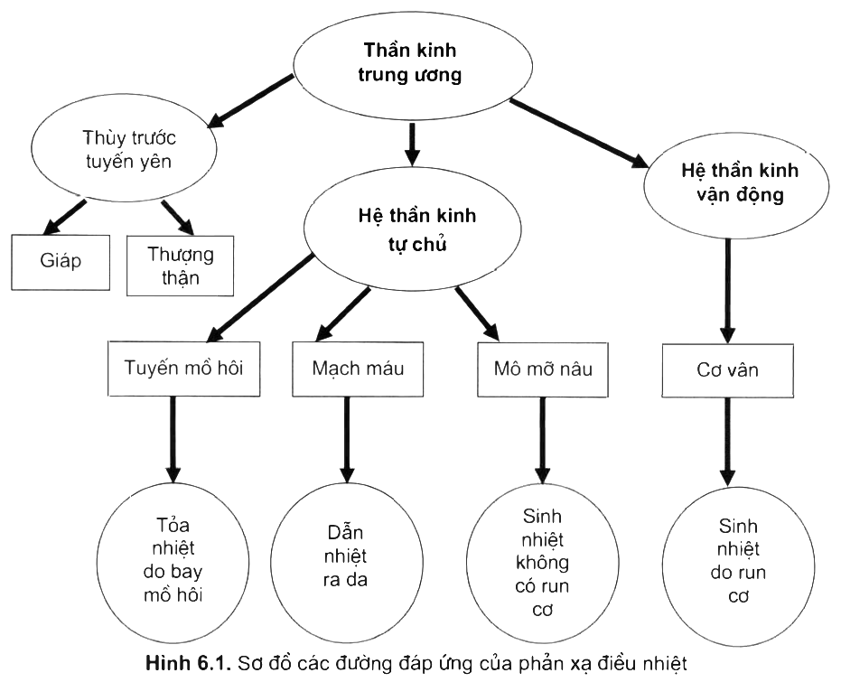

# BÀI 6: SINH LÝ ĐIỀU NHIỆT

## MỤC TIÊU
*Sau khi học xong bài này, sinh viên có khả năng:*
1. Trình bày được các nguyên nhân sinh nhiệt và các phương thức thải nhiệt.
2. Trình bày được cung phản xạ điều nhiệt.
3. Trình bày được các cơ chế chống nóng và chống lạnh.
4. Trình bày được các biện pháp điều nhiệt riêng của loài người.

---

Người thuộc loài hằng nhiệt (còn được gọi là động vật máu nóng) tức là có nhiệt độ cơ thể luôn hằng định, không bị thay đổi theo nhiệt độ môi trường. Về mặt sinh lý học so sánh, đây là biểu hiện của tiến hóa. Thân nhiệt hằng định đảm bảo cho mọi quá trình chuyển hóa trong cơ thể diễn ra bình thường, không phụ thuộc vào nhiệt độ của môi trường. Thân nhiệt được hằng định nhờ sự điều nhiệt, đảm bảo cân bằng giữa sinh nhiệt và thải nhiệt.

---

## 1. THÂN NHIỆT

Thân nhiệt là nhiệt độ của cơ thể. Nhiệt độ cơ thể khác nhau tùy theo từng vùng. Nơi có nhiệt độ cao nhất là gan, nơi có nhiệt độ thấp nhất là da và nhiệt độ của da ở các nơi khác nhau cũng khác nhau. Nói một cách tổng quát thì các tạng ở sâu, có chuyển hóa mạnh thì có nhiệt độ cao, còn càng ra ngoại vi thì nhiệt độ giảm đi.

Thân nhiệt trung tâm là nhiệt độ ở các mô sâu (còn gọi là nhiệt độ vùng lõi hay nhiệt độ trung tâm). Thân nhiệt trung tâm là mục đích của hoạt động điều nhiệt, ít thay đổi theo nhiệt độ môi trường và luôn được giữ hằng định $36^\circ\text{C} - 37,5^\circ\text{C}$ để đảm bảo điều kiện tối ưu cho các phản ứng hóa sinh. Nhiệt độ đo được ở trực tràng, ở miệng, ở nách được coi là phản ánh thân nhiệt trung tâm. Nhiệt độ đo được ở trực tràng là ổn định nhất (nhiệt độ này đo ở điều kiện cơ sở là $36,3 - 37,1^\circ\text{C}$). Nhiệt độ đo được ở miệng thấp hơn nhiệt độ đo ở trực tràng $0,2^\circ\text{C} - 0,5^\circ\text{C}$; nhiệt độ đo được ở nách thấp hơn nhiệt độ đo ở trực tràng $0,5^\circ\text{C} - 1^\circ\text{C}$. Tuy kém chính xác hơn nhưng đo thân nhiệt ở nách và ở miệng lại được dùng nhiều hơn vì đơn giản và thuận tiện.

Thân nhiệt ngoại vi là nhiệt độ đo ở da và ở chi (còn gọi là nhiệt độ vùng vỏ hay nhiệt độ ngoại vi). Nhiệt độ này thấp hơn nhiệt độ vùng lõi, chịu nhiều ảnh hưởng của môi trường (nhiệt độ không khí, độ ẩm, gió, nhiệt độ các vật xung quanh...) và thay đổi theo vị trí đo; chỗ nào càng xa, càng hở, càng tiếp xúc với vật lạnh càng có nhiệt độ thấp. Ví dụ, nhiệt độ đo ở trán cao hơn ở lòng bàn tay, nhiệt độ ở mu bàn chân thấp hơn ở hai nơi trên.

*Thân nhiệt chịu ảnh hưởng của nhiều yếu tố.* Thân nhiệt giảm dần theo tuổi. Thân nhiệt dao động theo nhịp ngày đêm: thấp nhất vào lúc 3 - 6 giờ sáng, cao nhất lúc 14 - 17 giờ. Nhiệt độ của phụ nữ thay đổi trong chu kỳ kinh nguyệt: nhiệt độ đo được ở nửa sau chu kỳ kinh nguyệt cao hơn ở nửa trước $0,3^\circ\text{C} - 0,5^\circ\text{C}$; nhiệt độ trong tháng mang thai cuối có thể tăng thêm $0,5^\circ\text{C} - 0,8^\circ\text{C}$. Cần chú ý là điều nhiệt ở trẻ sơ sinh và trẻ nhỏ chưa hoàn thiện.

Vận cơ làm tăng thân nhiệt, cường độ vận cơ càng lớn thì thân nhiệt càng cao. Nhiệt độ môi trường quá nóng hoặc quá lạnh cũng có phần nào ảnh hưởng lên thân nhiệt tuy không nhiều. Đặc biệt, thân nhiệt thay đổi trong trường hợp bệnh lý. Sốt là triệu chứng rất thường gặp trong nhiều bệnh. Theo dõi tính chất của sốt (sốt hay giảm nhiệt, sốt cao hay sốt nhẹ, đột ngột hay từ từ, thành cơn hay không, thời gian sốt và lui sốt...) chẳng những giúp cho điều trị mà còn là triệu chứng có giá trị giúp cho chẩn đoán bệnh.

---

## 2. SINH NHIỆT

Nhiệt của cơ thể được sinh ra từ các phản ứng hóa học. Mọi nguyên nhân làm tăng tiêu hao năng lượng đều làm tăng sinh nhiệt, có thể làm tăng mức sinh nhiệt lên 150% so với bình thường.
- **Chuyển hóa cơ sở:** là mức tiêu hao năng lượng tối thiểu trong điều kiện không tiêu hóa, không vận cơ, không làm việc trí óc mặc dù tỉnh táo và ở trong môi trường có nhiệt độ thoải mái, không phải điều nhiệt (xem bài 5. Chuyển hóa năng lượng).
- **Vận cơ:** Mức độ sinh nhiệt do vận cơ tăng theo cả về số tuyệt đối cũng như tỷ lệ tương đối và có thể tới 90% lượng nhiệt sinh ra. Hiệu suất của co cơ chỉ là 25%; 75% năng lượng sinh ra trong co cơ bị biến thành nhiệt năng. Thân nhiệt đo được ở trực tràng khi lao động thể lực nặng có thể lên tới $38,5^\circ\text{C} - 40^\circ\text{C}$. Run cơ là một hình thức vận cơ không tạo ra công năng nhưng là một nguyên nhân sinh nhiệt vì khi run có tới 80% năng lượng bị chuyển thành nhiệt. Run vì lạnh có thể làm mức sinh nhiệt tăng từ 2 đến 4 lần.
- **Tiêu hóa:** Khi tiêu hóa thức ăn, cơ thể cũng phải tiêu hao năng lượng cho các động tác tiêu hóa (nhai, nuốt, nhu động...), cho việc sản xuất và bài tiết dịch tiêu hóa, cho hấp thu các chất (xem tác dụng động lực đặc hiệu của thức ăn).
- **Phát triển cơ thể ở người trẻ, phát triển bào thai ở phụ nữ có thai v.v...**

---

## 3. CÁC PHƯƠNG THỨC TRAO ĐỔI NHIỆT

### 3.1. Truyền nhiệt trực tiếp
Nhiệt được truyền từ vật có nhiệt độ cao sang vật có nhiệt độ thấp hơn qua bề mặt tiếp xúc giữa hai vật. Ví dụ, cơ thể truyền nhiệt cho quần áo, giày dép, mặt bàn ghế, vật cầm... Truyền nhiệt trực tiếp tỷ lệ thuận với diện tích tiếp xúc, mức chênh lệch nhiệt và thời gian tiếp xúc giữa hai vật. Quá trình này chấm dứt khi nhiệt độ của vật nhận nhiệt bằng nhiệt độ của vật truyền nhiệt; do đó, truyền nhiệt theo cơ chế này có giới hạn. Muốn tăng truyền nhiệt theo cơ chế này cần phải làm giảm nhiệt độ của vật nhận nhiệt; ví dụ, lau dội sàn nhà, lau ướt mặt tiếp xúc....

### 3.2. Truyền nhiệt đối lưu
Nhiệt được truyền cho lớp không khí tiếp xúc với bề mặt cơ thể. Hiện tượng đối lưu (lớp không khí này nóng lên và được thay thế bằng không khí mát hơn) làm tăng quá trình này. Vào mùa nóng, người ta cảm thấy dễ chịu hơn khi có gió thổi; vào mùa rét, người ta cảm thấy lạnh hơn khi có gió. Mức độ truyền nhiệt tỷ lệ với căn bậc hai của tốc độ gió ($v^{1/2}$).

### 3.3. Bức xạ nhiệt
Nhiệt được truyền từ vật nóng hơn sang vật kia mà không cần có chất dẫn truyền và ít chịu ảnh hưởng của nhiệt độ không khí. Ví dụ, nhiệt từ các bức xạ mặt trời đến được trái đất mặc dù có khoảng không vũ trụ hoặc từ một đèn hồng ngoại đến được cơ thể mặc dù không khí lạnh, nhiệt vẫn truyền được từ cơ thể sang các bức tường lạnh mặc dù không khí trong phòng nóng. Lượng nhiệt mất theo bức xạ tỷ lệ với mũ 1/4 của nhiệt độ của vật phát nhiệt ($t^{\circ\,1/4}$). Cơ thể nhận nhiệt bức xạ từ các vật khác có nhiệt độ cao hơn nhiệt độ cơ thể; ngược lại, nếu nhiệt độ cơ thể cao hơn thì cơ thể bức xạ nhiệt sang các vật có nhiệt độ thấp hơn. Màu sắc của vật nhận nhiệt ảnh hưởng lên lượng nhiệt được tiếp nhận. Vật nhận có màu sẫm tối thì nhận được nhiều nhiệt bức xạ, vật nhận có màu trắng sáng hấp thụ nhiệt bức xạ kém hơn. Đây là cơ sở để chọn màu quần áo theo mùa, quét vôi sơn tường nhà ở.

### 3.4. Bay hơi nước
Bay hơi nước qua đường mồ hôi: Khi bốc hơi, nước “kéo theo” một lượng nhiệt: $2428\text{ kJ}$ ($580\text{ Kcal}$)/1 lít nước. Khi các hình thức kể trên không đủ để thải nhiệt hoặc khi nhiệt độ môi trường cao hơn $36^\circ\text{C}$ thì cần phương thức này, cụ thể là ra mồ hôi. Nếu nhiệt độ môi trường cao hơn thân nhiệt thì cơ thể nhận nhiệt qua bức xạ và truyền nhiệt nên phải tăng cường thải nhiệt qua mồ hôi. Nhiệt độ môi trường càng tăng thì phương thức tỏa nhiệt này càng có hiệu quả. Ví dụ, khi nhiệt độ môi trường là $15^\circ\text{C} - 20^\circ\text{C}$ thì nhiệt mất đi bằng phương thức bay hơi chiếm 16,7% tổng số nhiệt được thải; khi nhiệt độ môi trường là $25^\circ\text{C} - 30^\circ\text{C}$ thì tỷ lệ này là 30,6%; khi nhiệt độ môi trường là $35^\circ\text{C} - 40^\circ\text{C}$ thì tỷ lệ này là 100%. Lượng mồ hôi được bài tiết trong một giờ có thể từ 1 lít (trong môi trường lạnh) đến 1,5 - 2,5 lít và lượng nhiệt được thải theo mồ hôi cũng tăng. Thải nhiệt qua phương thức bốc hơi nước (bay hơi mồ hôi) phụ thuộc vào độ ẩm không khí và gió. Độ ẩm không khí thấp và có gió thuận lợi cho thải nhiệt qua bay hơi mồ hôi. Ngược lại, nếu độ ẩm không khí cao thì tác dụng của bay mồ hôi bị kém. Người ta dùng khái niệm nhiệt độ hiệu dụng để thể hiện tác động tích hợp của nhiệt độ không khí, độ ẩm và tốc độ gió tới cảm giác của con người trong môi trường nóng. Bay hơi nước theo đường hô hấp và thấm nước qua da: ngay cả khi cơ thể không có mồ hôi vẫn có hiện tượng bay hơi nước không cảm thấy qua da và qua phổi (hơi thở). Lượng nước bay hơi qua da không cảm thấy là lượng nước thấm qua da, trung bình là 0,5 lít/ngày và hầu như không thay đổi theo nhiệt độ không khí. Lượng nước bay hơi theo đường hô hấp là nước do các tuyến tiết nước của niêm mạc đường hô hấp tiết ra để làm ẩm không khí hít vào. Lượng nước này phụ thuộc vào thể tích thông khí phổi, tuy có tăng khi sống trong môi trường nóng nhưng không quan trọng và có giới hạn. Bởi vậy nước thấm qua da và nước bay hơi theo đường hô hấp không có vai trò quan trọng trong cơ chế chống nóng.

Như vậy, phương thức thải nhiệt quan trọng nhất của cơ thể là thải nhiệt do bay mồ hôi.

### 3.5. Bilan nhiệt
Cân bằng giữa quá trình sinh nhiệt và quá trình thải nhiệt của cơ thể được thể hiện bằng bilan nhiệt:

$$\text{Bilan nhiệt} = \text{Nhiệt chuyển hóa} - \text{nhiệt bay hơi nước} \pm \text{nhiệt bức xạ} \pm \text{nhiệt truyền.}$$

Bilan càng dương thì lượng nhiệt được tích lại càng lớn, thân nhiệt tăng. Bilan càng âm thì cơ thể càng bị mất nhiệt và thân nhiệt giảm xuống. Bilan nhiệt, chỉ số tích nhiệt (body heat storage index - BHST) là các chỉ tiêu quan trọng trong sinh lý lao động khi nghiên cứu sức khỏe của người lao động trong môi trường nóng.

Cơ thể có khả năng điều nhiệt trong điều kiện nhiệt độ môi trường là từ $0^\circ\text{C}$ đến $50^\circ\text{C}$. Khả năng điều nhiệt của cơ thể phụ thuộc nhiều yếu tố: độ ẩm, gió... Ví dụ, khả năng điều nhiệt thậm chí vẫn còn khi nhiệt độ môi trường lên tới $100^\circ\text{C}$ nhưng môi trường phải rất khô. Mồ hôi chỉ có tác dụng khi bốc hơi từ từ nên trong môi trường vừa nóng lại vừa rất ẩm, mồ hôi không bay hơi được mà chảy thành giọt thì không có tác dụng thải nhiệt. Người ta gọi phạm vi nhiệt độ môi trường trong đó cơ thể điều nhiệt được bằng các quá trình sinh lý là “nhiệt độ dễ chịu” hay “nhiệt độ thoải mái”. Ngoài phạm vi này, con người có những hành vi nhằm điều nhiệt (ví dụ, tìm kiếm bóng mát, chọn quần áo mặc, sưởi ấm hoặc quạt gió, máy điều hoà nhiệt độ...). Dưới $0^\circ\text{C}$ và trên $50^\circ\text{C}$ thì điều nhiệt sinh lý không đủ và phải sử dụng các biện pháp mới đảm bảo được điều hoà thân nhiệt (quạt, sưởi, nhà, áo quần...).

Trẻ sơ sinh, trẻ nhỏ dưới ba tuổi chưa có cơ chế điều nhiệt hoàn chỉnh. Bọc, quấn trẻ sơ sinh quá kỹ trong chăn cũng có thể làm thân nhiệt trẻ tăng cao; ngược lại để trẻ ở nơi lạnh mà không mặc đủ quần áo ấm làm cho thân nhiệt trẻ hạ thấp. Cần chú ý không để trẻ nhỏ, nhất là trẻ dưới một tuổi bị mất nhiệt hoặc bị co giật do sốt cao vì có thể để lại những di chứng thần kinh - trí tuệ về sau này.

---

## 4. CUNG PHẢN XẠ ĐIỀU NHIỆT

Thân nhiệt được điều hòa theo nguyên tắc: lượng nhiệt mất đi bằng lượng nhiệt sinh ra trong cùng một khoảng thời gian. Để đảm bảo sự cân bằng này, cần phát động và điều hòa các cơ chế chống nóng hoặc chống lạnh phù hợp. Việc này được thực hiện nhờ một phản xạ là phản xạ điều nhiệt. Cung phản xạ điều nhiệt cũng gồm có 5 bộ phận.

### 4.1. Bộ phận nhận cảm
Ở da có các receptor nhiệt là các receptor với nóng và receptor với lạnh. Các receptor này có khả năng thích nghi (lúc mới bị kích thích thì hưng phấn mạnh, sau đó giảm hưng phấn rất nhanh và kéo dài). Số receptor nhiệt không được phân bố đồng đều trên da; có nơi số receptor với lạnh nhiều gấp mười số receptor với nóng. Như vậy, nhận biết về nhiệt độ môi trường bên ngoài chủ yếu là nhận biết lạnh. Phải có một diện tích đủ rộng bị kích thích mới gây ra được cảm giác về nhiệt vì cần phải có nhiều receptor bị kích thích đồng thời gây hiện tượng cộng kích thích.

### 4.2. Đường truyền vào
Xung động theo dây thần kinh về sừng sau tuỷ. Nơron thứ hai bắt chéo sang bên đối diện, đi theo bó gai - đồi thị, bó gai - lưới (dẫn truyền cảm giác nóng lạnh - đau) và tận cùng ở chất lưới của thân não, ở đồi thị. Nơron thứ ba từ đồi thị đi lên vùng nhận cảm cảm giác ở vỏ não.

### 4.3. Trung tâm
Trung tâm điều hoà thân nhiệt là vùng dưới đồi. Vùng trước thị - trước dưới đồi có các nơron nhạy cảm nóng và nơron nhạy cảm lạnh được gọi là các cơ quan phát hiện nhiệt (detector) ghi nhận nhiệt độ trung tâm. Đồng thời, phần sau và phần rìa vùng dưới đồi tiếp nhận các thông tin từ các receptor nhiệt từ da đưa lên và từ vùng trước thị - trước dưới đồi đưa tới. Phần sau vùng dưới đồi tích hợp các thông tin về nhiệt và phát động các đáp ứng thích hợp. Thông tin về nhiệt đã được tích hợp được so sánh với *nhiệt độ đối chiếu* (hay *nhiệt độ chuẩn*). Nếu có sự khác biệt thì có thể sẽ có những cơ chế điều chỉnh sự cân bằng nhiệt. Ta có thể ví “nhiệt độ chuẩn” này như nhiệt độ được chọn ở một rơ le nhiệt: Nếu nhiệt độ cao hơn mức đã chọn thì điện bị ngắt và ngược lại, khi nhiệt độ xuống thấp hơn nhiệt độ đã chọn thì điện lại tự động đóng lại. Nhiệt độ đối chiếu được coi là $37^\circ\text{C}$. Các chất gây sốt tác động lên vùng dưới đồi, làm “nhiệt độ chuẩn” tăng lên. Ngoài ra, các nơron của vùng dưới đồi có các receptor với nhiệt độ, nhận biết nhiệt độ của dòng máu đi tới; do đó thay đổi nhiệt độ dòng máu tiếp lưu cho vùng dưới đồi cũng có thể gây ra biến đổi về thân nhiệt. Vùng dưới đồi và các trung tâm bên dưới còn chịu ảnh hưởng điều hòa của vỏ não, tổn thương vỏ não (ví dụ, chảy máu não) cũng có thể gây sốt cao.

Kích thích phần trước vùng dưới đồi gây ra các đáp ứng chống nóng; kích thích phần sau vùng dưới đồi gây ra các đáp ứng chống lạnh.

### 4.4. Đường truyền ra
Đường truyền ra của phản xạ điều nhiệt gồm cả đường thần kinh và đường thể dịch bởi vậy phản xạ điều nhiệt là phản xạ phức tạp (*hình 6.1*).

#### 4.4.1. Đường thần kinh
Từ vùng dưới đồi, tín hiệu đi tới các trung tâm giao cảm ở sừng bên tủy sống gây co, giãn mạch, tăng chuyển hóa tế bào. Mặt khác, tín hiệu từ vùng dưới đồi đi tới các nơron vận động ở sừng trước tủy, làm thay đổi trương lực cơ, gây run, làm thay đổi thông khí phổi. Thuốc liệt hạch có tác dụng làm giảm phản xạ điều nhiệt nên được dùng trong hạ nhiệt nhân tạo.

#### 4.4.2. Đường thể dịch
Vùng dưới đồi liên hệ với thùy trước tuyến yên qua hệ mạch cửa của Popa và Fielding. Các hormon giải phóng của vùng dưới đồi TRH, CRH làm thay đổi mức bài tiết các hormon TSH, ACTH rồi các hormon này lại làm thay đổi hoạt động của tuyến giáp và tuyến vỏ thượng thận dẫn đến thay đổi mức độ chuyển hóa ở các mô.

### 4.5. Cơ quan đáp ứng
Cơ quan đáp ứng của cung phản xạ điều nhiệt là tất cả các tế bào của cơ thể, đặc biệt là các tế bào cơ, mạch máu, tuyến mồ hôi. Các cơ quan này đáp ứng khác nhau dưới sự chỉ huy của vùng dưới đồi, tùy theo yêu cầu là chống nóng hay chống lạnh.

---

## 5. CÁC CƠ CHẾ CHỐNG NÓNG

### 5.1. Bài tiết mồ hôi
Phần búi của tuyến mồ hôi nằm ở lớp hạ bì bài tiết dịch đầu là một chất lỏng có thành phần gần giống huyết tương, không có protein. Dịch đầu đi ra phía ngoài da theo phần ống thẳng của tuyến mồ hôi. Tại ống thẳng, một phần ion $\text{Na}^+$ và $\text{Cl}^-$ được tái hấp thu. Có sự thích nghi với môi trường trong bài tiết mồ hôi. Ở cùng một nhiệt độ cao như nhau, người vốn sống ở xứ nhiệt đới bài tiết ít mồ hôi hơn người vốn sống ở xứ lạnh. Từ môi trường lạnh sang môi trường nóng dài ngày thì lượng mồ hôi được bài tiết tăng lên, đồng thời lượng $\text{Na}^+$ và $\text{Cl}^-$ được tái hấp thu cũng tăng, nồng độ muối trong mồ hôi giảm. Như vậy, thải nhiệt qua mồ hôi có hiệu quả hơn (nhiều mồ hôi hơn) nhưng vẫn tiết kiệm được các điện giải cho cơ thể. Sự tăng tái hấp thu $\text{Na}^+$ xảy ra dưới tác dụng của aldosteron của vỏ thượng thận.

### 5.2. Tăng thông khí
Nhiệt độ máu tăng cao tác động lên trung tâm tăng thông khí (pneumotaxic center) ở hành não làm tăng lưu lượng thở, tăng dòng khí đi qua các đường dẫn khí để làm tăng sự đối lưu và bay hơi nước ở đường hô hấp trên chứ không phải tăng thông khí phế nang. Kiểu thở lúc này là thở nông và nhanh (thở hổn hển, thở dốc). Do không làm thay đổi thông khí phế nang nên cơ thể không bị rối loạn thăng bằng acid - base.

### 5.3. Giãn mạch da
Mạng mạch da rất phát triển, có tổng diện tích lớn nên thuận lợi cho việc trao đổi nhiệt với môi trường. Nhiệt lượng từ trung tâm theo máu được vận chuyển ra ngoại vi. Nhiệt độ trung tâm tăng có tác dụng kích thích các trung tâm kiểm soát phân bố máu ở vùng dưới đồi và ức chế trung tâm giao cảm gây co mạch ở phần sau vùng dưới đồi gây giãn mạch da (biểu hiện là da đỏ lên). Nhiệt lượng từ trung tâm được chuyển ra ngoại vi nhiều, có thể gấp tới tám lần so với lúc bình thường. Nhiệt độ của da tăng lên và nhiệt được truyền sang môi trường nhiều hơn. Nếu nhiệt độ trung tâm cao hơn “nhiệt độ chuẩn” (ví dụ, khi vận cơ nặng), thoạt đầu lượng máu tới da tăng, nhiệt được vận chuyển từ trung tâm ra ngoài da. Không phải chỉ có thể tích /thời gian tăng mà cả nhiệt lượng/thời gian cũng tăng và sự trao đổi nhiệt giữa động mạch và các tĩnh mạch đi kèm giảm, máu từ các tĩnh mạch sâu đi ra tĩnh mạch ngoại vi nhiều hơn. Tiếp theo đó, mồ hôi được bài tiết làm nhiệt độ da giảm, chênh lệch nhiệt độ giữa da và môi trường tăng nên tăng thải nhiệt. Phản ứng này là nhờ các receptor với nóng ở trung tâm. Lúc này các receptor nóng ở da chỉ cho thấy cảm giác da ấm lên (vì môi trường lạnh hơn so với da). Trong cơn sốt rét, “nhiệt độ chuẩn” được nâng lên (ví dụ là $39^\circ\text{C}$), nhiệt độ trung tâm cao dẫn đến nhiệt độ ngoài da cũng tăng. Chênh lệch nhiệt độ giữa da và môi trường khiến bệnh nhân có cảm giác rét và run cơ xuất hiện để đưa thân nhiệt lên mức mới là $39^\circ\text{C}$. Sau đó, “nhiệt độ chuẩn” lại trở về $37^\circ\text{C}$, có thể lại có các biểu hiện như vã mồ hôi, tăng thải nhiệt để đưa nhiệt độ về $37^\circ\text{C}$.

### 5.4. Giảm sinh nhiệt
Ức chế run cơ và ức chế sinh nhiệt hóa học dưới tác dụng của catecholamin (adrenalin và noradrenalin).

---

## 6. CÁC CƠ CHẾ CHỐNG LẠNH

Nếu thân nhiệt thấp hơn “nhiệt độ chuẩn” thì không những chỉ có giảm thải nhiệt mà còn có tăng sinh nhiệt, có khi tăng gấp bốn lần chuyển hóa cơ sở. Sinh nhiệt chủ yếu là do co cơ có ý thức và run. Trẻ sơ sinh rất dễ bị mất nhiệt do tỷ lệ diện tích da/thể tích cơ thể cao nhưng lại có khả năng sinh nhiệt hóa học do có lớp mỡ nâu nhưng điều hòa thân nhiệt ở trẻ sơ sinh và ở trẻ nhỏ chưa hoàn thiện. Khi nhiệt độ trung tâm tụt thấp thì kích thích giao cảm làm tăng chuyển hóa, sinh nhiệt tăng. Các đáp ứng này xảy ra khi các receptor với lạnh ở da bị kích thích và xuất hiện trước khi nhiệt độ trung tâm giảm thấp. Cơ thể được bao bọc bởi một lớp có tính cách nhiệt là da, mô dưới da và nhất là lớp mỡ dưới da. Nhờ có lớp cách nhiệt này mà nhiệt độ ngoại vi có thể xuống rất thấp ($20^\circ\text{C}$) nhưng nhiệt độ trung tâm vẫn được giữ ở $37^\circ\text{C}$.

### 6.1. Co mạch da
Ngược với trường hợp giãn mạch khi cần tăng thải nhiệt, co mạch da làm nhiệt lượng được vận chuyển từ trung tâm ra ngoại vi giảm, nhiệt độ ở bề mặt cơ thể thấp nên giảm thải nhiệt ra môi trường.

### 6.2. Dựng chân lông
Dưới tác dụng của kích thích giao cảm, cơ dựng lông co làm tăng bề dày lớp không khí giữa da và môi trường. Do không khí là vật dẫn nhiệt kém nên cơ thể đỡ mất nhiệt. Ở người, cơ chế này không còn quan trọng nhưng vẫn còn dấu vết (“nổi da gà” khi bị lạnh).

### 6.3. Run cơ
Khi bị kích thích lạnh, có thể có phản xạ run cơ. Lúc này, trương lực của toàn bộ các cơ tăng và khi trương lực vượt quá một ngưỡng nhất định thì phát sinh run cơ. Run cơ không tạo ra công cơ học nhưng sinh ra nhiều nhiệt. Khi cơ thể bị mất đột ngột một lượng nhiệt nhất định thì có hiện tượng rùng mình (run mạnh cơ trong một thời gian rất ngắn) để bù lại lượng nhiệt vừa bị mất.

### 6.4. Sinh nhiệt hóa học
Sinh nhiệt hóa học là sinh nhiệt do tăng chuyển hóa tế bào dưới tác dụng của các catecholamin trong máu và của kích thích giao cảm. Trong quá trình chuyển hóa này, ATP không được tạo ra mà chỉ có hiện tượng oxy hóa hoàn toàn, tạo nhiều nhiệt. Sinh nhiệt hóa học xảy ra chủ yếu ở loại mỡ đặc biệt là mỡ nâu có ở trẻ sơ sinh. Ty thể của tế bào mỡ nâu chỉ chứa các enzym oxy hóa. Mô mỡ này nhận nhiều sợi giao cảm tới chi phối. Lớp mỡ nâu chỉ có ở trẻ sơ sinh và trẻ nhỏ, không còn ở người trưởng thành. Sinh nhiệt do tăng chuyển hóa ở lớp mỡ nâu được gọi là sinh nhiệt không có run.

### 6.5. Tăng bài tiết hormon thyroxin
Khi bị lạnh, tuyến giáp tăng bài tiết thyroxin. Thyroxin làm tăng chuyển hóa chất toàn cơ thể theo hướng oxy hóa nên làm tăng sinh nhiệt.

---

## 7. BIỆN PHÁP ĐIỀU NHIỆT RIÊNG CỦA LOÀI NGƯỜI

Ngoài các phản ứng điều nhiệt chung của mọi sinh vật hằng nhiệt, loài người còn có những biện pháp để giúp cho việc giữ cho thân nhiệt hằng định, đồng thời đảm bảo cho lao động và sinh hoạt trong môi trường thoải mái hơn.

### 7.1. Tạo vi khí hậu
Người ta kiến trúc và xây dựng nhà ở và làm việc phù hợp với điều kiện khí hậu, làm việc và sinh hoạt. Để giúp chống nóng, người ta tăng lưu chuyển không khí trong nhà bằng nhiều cách: mở cửa, dùng quạt thông gió, dùng máy điều hòa nhiệt độ, ngăn các nguồn bức xạ, chọn màu sơn vôi cho mặt ngoài nhà, trong phòng, trồng cây xanh để có bóng mát, đội mũ nón khi ra đường... Để giúp chống lạnh: đóng bớt cửa, dùng lò sưởi, dùng máy điều hòa nhiệt độ......

### 7.2. Chọn quần áo thích hợp
Quần áo mặc mùa hè thường có màu trắng hoặc màu sáng để phản chiếu các tia bức xạ nhiệt, mặc quần áo mỏng, rộng, chất vải dễ thấm mồ hôi. Ngược lại, quần áo mặc mùa đông thường có màu thẫm, chất vải dày và xốp để có lớp không khí dày cách nhiệt bao quanh.

### 7.3. Chọn chế độ ăn thích hợp
Chế độ ăn mùa hè thường nhiều nước (để bù lượng mồ hôi), ít protid và lipid động vật. Ngược lại, chế độ ăn về mùa đông có nhiều lipid và protid động vật. Tùy theo dân tộc, địa phương, các gia vị gây “nóng” (ớt, hạt tiêu, gừng...) hoặc các thứ gây “mát” (các loại rau, quả...) được thêm vào các món ăn tùy theo mùa.

### 7.4. Rèn luyện
Rèn luyện để tăng khả năng chịu nóng và chịu lạnh là một biện pháp tốt, chủ động. Nhờ thích nghi với môi trường lạnh và môi trường nóng mà người ta có thể làm việc lâu và có hiệu quả hơn.

---

## 8. RỐI LOẠN THÂN NHIỆT

### 8.1. Sốt
Sốt là trạng thái thân nhiệt cao hơn bình thường. Có nhiều nguyên nhân gây sốt. Sốt có thể do rối loạn hoạt động của bản thân não (sốt trong u não), do các chất gây sốt tác động lên trung tâm điều nhiệt làm tăng “nhiệt độ chuẩn” ở vùng dưới đồi. Trong các chất này, có chất tác động trực tiếp lên vùng dưới đồi, có chất tác dụng gián tiếp sau vài giờ. Sốt là một phản ứng của cơ thể, có tác dụng làm tăng tốc độ các phản ứng hóa học để bảo vệ cơ thể khi cần thiết nhưng sốt cao quá và kéo dài lại gây ra nhiều hậu quả xấu đối với cơ thể nên cần phải dùng thuốc hoặc các biện pháp giảm thân nhiệt. Thuốc hạ sốt là thuốc có tác dụng lên vùng dưới đồi, điều chỉnh lại “nhiệt độ chuẩn” tại đó. Các biện pháp vật lý hạ thân nhiệt như đắp khăn lạnh lên trán, bỏ bớt lớp áo quần cũng có tác dụng.

### 8.2. Say nóng
Khi sống trong môi trường có nhiệt độ quá cao, cơ thể không thải được nhiệt, nhất là khi môi trường ẩm. Nhiệt độ môi trường $34^\circ\text{C}$ nhưng độ ẩm của không khí là 100% thì thân nhiệt đã có thể tăng. Nếu thân nhiệt lên mức $41,5 - 42^\circ\text{C}$ thì bị say nóng. Lúc này, tác dụng điều nhiệt của vùng dưới đồi giảm càng làm cho thân nhiệt bị rối loạn. Bệnh nhân thấy hoa mắt, chóng mặt, choáng váng, da nóng, mê sảng và bất tỉnh. Nặng hơn nữa, bệnh nhân có thể bị sốc tuần hoàn do mất nước và điện giải. Say nắng là một dạng say nóng có tác dụng của bức xạ mặt trời lên trung tâm.

---

## 9. THÍCH NGHI KHI SỐNG TRONG MÔI TRƯỜNG NÓNG VÀ MÔI TRƯỜNG LẠNH

### 9.1. Thích nghi với môi trường nóng
Sau vài tuần sống hoặc làm việc trong môi trường nóng, cơ thể có biểu hiện thích nghi: tăng tiết mồ hôi, tăng thể tích huyết tương, mồ hôi chứa ít $\text{Na}^+$ và $\text{Cl}^-$. Tuy vậy, lao động trong môi trường nóng ẩm là lao động nặng nhọc bởi vậy cần cải tạo điều kiện lao động và công nghệ hơn là trông mong vào sự thích nghi của cơ thể.

### 9.2. Sống trong môi trường rất lạnh
Trong môi trường lạnh, cơ thể có thể bị lạnh cục bộ hoặc bị lạnh toàn thân. Những phần cơ thể bị phơi lạnh có thể bị cóng, nhất là các phần xa như ngón chân, ngón tay, vành tai, cảm giác rất lạnh có khi chuyển thành cảm giác đau rát. Thậm chí nếu bị lạnh lâu, các tinh thể băng có thể được hình thành dẫn đến hoại tử. Khi toàn bộ cơ thể ở lâu trong môi trường lạnh (ví dụ, rơi xuống biển) cơ thể bị mất nhiệt nhanh chóng, thân nhiệt giảm. Khi thân nhiệt xuống còn $29 - 30^\circ\text{C}$ thì vùng dưới đồi không còn tác dụng điều nhiệt nữa và thân nhiệt biến đổi theo nhiệt độ môi trường. Bệnh nhân buồn ngủ, giảm hoạt động trí tuệ và rơi vào hôn mê.

---

## 10. ỨNG DỤNG

### 10.1. Hạ nhiệt nhân tạo
Khi thân nhiệt hạ thấp thì chuyển hóa giảm, nhu cầu oxy và các chất dinh dưỡng giảm, tim đập chậm do đó cơ thể có thể chịu đựng được thiếu máu trong một thời gian dài hơn mà không bị nguy hiểm, đồng thời cơ thể lại chịu đựng được stress tốt hơn. Người ta ứng dụng điều này trong một số trường hợp phẫu thuật nặng (mổ tim, gan, não, ghép tạng...) gây sang chấn mạnh và đòi hỏi phải ngừng hoặc giảm tuần hoàn. Người ta cũng áp dụng hạ nhiệt nhân tạo trong điều trị sốc nội khoa, uốn ván, nhiễm độc thyroxin sau phẫu thuật giáp. Để hạ nhiệt nhân tạo, người ta cho bệnh nhân dùng thuốc an thần và ủ lạnh cơ thể để thân nhiệt bệnh nhân hạ thấp (ví dụ tới mức $30 - 31^\circ\text{C}$).

Hạ nhiệt nhân tạo toàn thân có nhược điểm là thân nhiệt càng hạ thì các chức năng sinh mạng (tim mạch, hô hấp) càng giảm, có thể gây những rối loạn nặng, ảnh hưởng tới tính mạng. Hiện nay, người ta nghiên cứu hạ nhiệt cục bộ ở những phần cần thiết. Phương pháp này đơn giản và an toàn hơn hạ nhiệt toàn thân.

### 10.2. Tăng nhiệt nhân tạo
Khi thân nhiệt tăng (sốt), chuyển hóa tăng, tiêu thụ oxy tăng, glucose máu, số lượng bạch cầu, khả năng thực bào của bạch cầu, bổ thể trong máu đều tăng làm tăng sức đề kháng của cơ thể. Người ta ứng dụng điều này để điều trị một số bệnh và đôi khi để làm bộc lộ rõ hơn các triệu chứng của bệnh ở người quá yếu.

Để gây tăng thân nhiệt, người ta có thể tiêm chất gây sốt (protid lạ như sữa, xác vi khuẩn...) hoặc các thuốc gây sốt (propidon, tetrahydronaphtalen, dinitrophtalein) cho bệnh nhân.

Phương pháp tăng nhiệt nhân tạo cục bộ được dùng rộng rãi hơn do tăng nhiệt nhân tạo toàn thân có những nguy hiểm. Chữa bệnh bằng sóng ngắn, tia hồng ngoại, bơm nước nóng vào vùng có khối u... có thể được coi là phương pháp điều trị bằng gây tăng nhiệt cục bộ.

---

## TỰ LƯỢNG GIÁ

1. Trình bày các nguyên nhân sinh nhiệt.
2. Trình bày về phương thức truyền nhiệt trực tiếp, truyền nhiệt đối lưu và bức xạ nhiệt.
3. Trình bày về phương thức truyền nhiệt bằng bay hơi nước.
4. Trình bày về bộ phận nhận cảm và đường truyền vào của cung phản xạ điều nhiệt.
5. Trình bày về trung tâm điều hòa thân nhiệt.
6. Trình bày về đường truyền ra của cung phản xạ điều nhiệt.
7. Vẽ sơ đồ các đường đáp ứng của phản xạ điều nhiệt.
8. Trình bày cơ chế chống nóng của cơ thể.
9. Trình bày cơ chế chống lạnh của cơ thể.
10. Trình bày các biện pháp điều nhiệt riêng của loài người.
