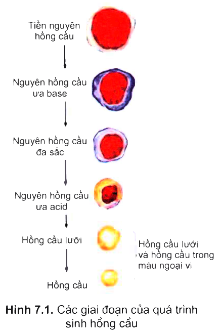
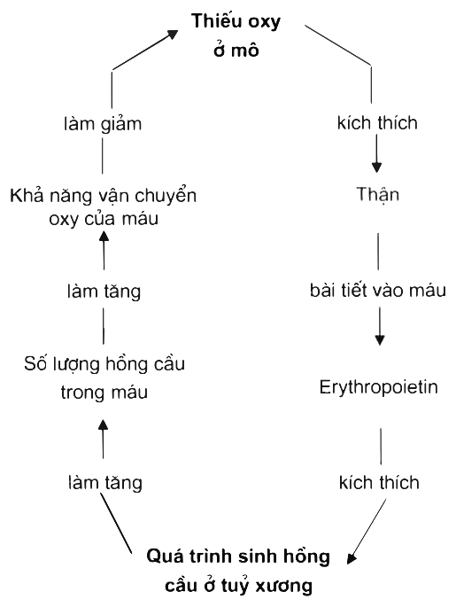
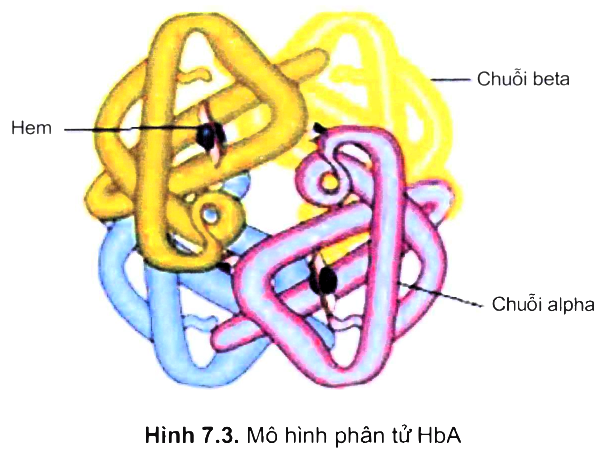
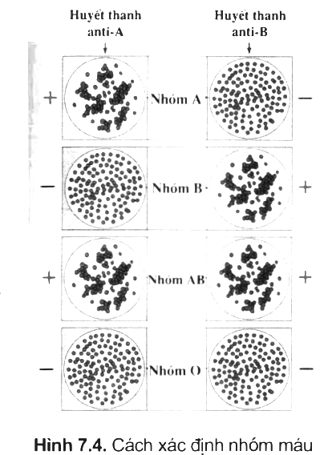
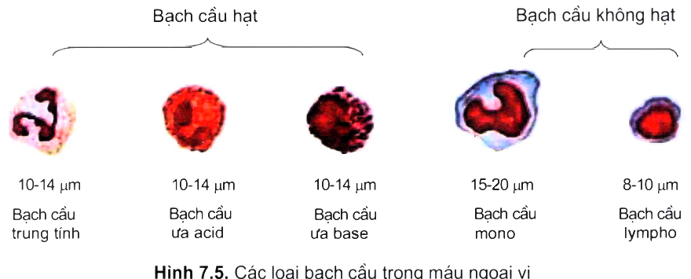
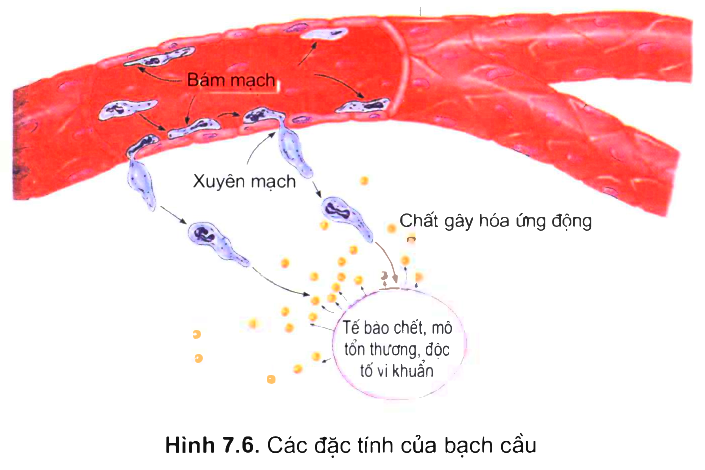
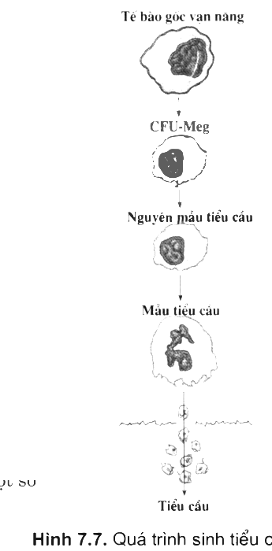
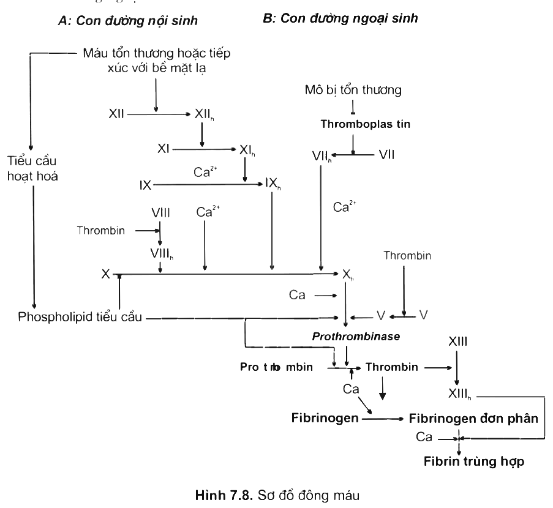

# BÀI 7: SINH LÝ MÁU

## MỤC TIÊU
*Sau khi học xong bài này, sinh viên có khả năng:*
1. Trình bày được các chức năng của máu.
2. Trình bày được chức năng của hồng cầu, bạch cầu và tiểu cầu.
3. Trình bày được nơi sản xuất, các yếu tố tham gia tạo hồng cầu và điều hoà sản sinh hồng cầu.
4. Trình bày về đặc điểm kháng nguyên, kháng thể của hệ thống nhóm máu ABO và ứng dụng trong truyền máu.
5. Trình bày về đặc điểm kháng nguyên, kháng thể của hệ thống nhóm máu Rh, các tai biến trong sản khoa và truyền máu do bất đồng nhóm máu Rh.
6. Trình bày các giai đoạn của quá trình cầm máu.
7. Nêu được ý nghĩa của các xét nghiệm đánh giá chức năng các tế bào máu.

---

Máu là một dịch lỏng màu đỏ bao gồm các tế bào máu như hồng cầu, bạch cầu, tiểu cầu và một dịch vàng chanh là huyết tương. Máu chảy trong hệ thống tuần hoàn. Máu cùng với hệ tuần hoàn tạo thành một hệ thống vận chuyển và liên lạc giữa các tế bào của cơ thể, giúp duy trì sự hằng định nội môi, là điều kiện tối thuận cho hoạt động của các tế bào.

---

## 1. NHỮNG CHỨC NĂNG CHUNG CỦA MÁU

### 1.1. Máu vận chuyển các phân tử và nhiệt từ nơi này đến nơi khác của cơ thể
Các chất dinh dưỡng như glucose, acid amin, acid béo, các chất điện giải và nước hấp thu từ ống tiêu hóa sẽ được máu cung cấp cho các mô khác. Khi máu qua phổi, máu sẽ lấy oxy và mang đến các mô, đồng thời carbonic, sản phẩm của hô hấp tế bào, sẽ được máu vận chuyển đến phổi và đào thải ra ngoài qua động tác hô hấp. Máu cũng vận chuyển hormon và các chất truyền tin từ nơi sản xuất đến các tế bào đích.

Quá trình chuyển hóa trong cơ thể sản xuất ra một lượng nhiệt rất lớn. Máu vận chuyển nhiệt từ các bộ phận sâu trong cơ thể đến da và đường hô hấp trên để nhiệt được khuếch tán ra ngoài.

### 1.2. Máu bảo vệ cơ thể chống lại các tác nhân lạ
Một số tế bào máu có khả năng thực bào. Chúng tiêu hóa và khử độc các chất lạ, chất độc và vi khuẩn. Một số tế bào có khả năng sinh kháng thể để trung hoà tác dụng độc hại của các tác nhân lạ. Một số tế bào khác và protein huyết tương có vai trò trong quá trình cầm máu - một cơ chế bảo vệ quan trọng của cơ thể.

### 1.3. Máu góp phần duy trì sự hằng định của pH và áp lực thẩm thấu của dịch ngoại bào
Các hệ thống đệm trong máu chuyển các acid và base mạnh thành các acid và base yếu làm hạn chế đến mức tối thiểu những thay đổi rất lớn của pH trong quá trình chuyển hóa. Máu cũng vận chuyển các chất có tính acid và tính base đến các cơ quan bài tiết. Nhờ các hệ đệm này mà pH của dịch ngoại bào được duy trì hằng định trong khoảng từ 7,35 đến 7,45.

Các protein của huyết tương do không qua được thành mao mạch, tạo ra một áp suất thẩm thấu gọi là áp suất keo. Áp suất keo đóng vai trò quan trọng trong sự vận động của nước giữa máu và dịch kẽ, do đó ảnh hưởng đến áp lực thẩm thấu của dịch ngoại bào.

---

## 2. NHỮNG ĐẶC TÍNH CỦA MÁU
- **Trọng lượng riêng:** Máu chiếm khoảng 6 đến 8% trọng lượng cơ thể.
- **Thể tích máu của người trưởng thành:** Vào khoảng 4,5 đến 5,5 lít ở phụ nữ và 5 đến 6 lít ở nam giới.
- **Tỷ trọng của máu:** Là 1,050 đến 1,060. Tỷ trọng của máu phụ thuộc vào số lượng tế bào và nồng độ các chất trong huyết tương.
- **Độ nhớt của máu:** Nếu coi độ nhớt của nước tinh khiết là 1 thì độ nhớt của máu toàn phần là 4,5 và của huyết tương là 2,2. Khi số lượng tế bào của máu tăng hoặc khi nồng độ protein huyết tương tăng, độ nhớt của máu sẽ tăng. Khi đó tim phải làm việc nhiều hơn để duy trì sự lưu thông của máu. Nếu tình trạng này kéo dài sẽ gây suy tim và tăng huyết áp.
- **Tốc độ lắng huyết cầu:** Cho máu có chống đông vào một ống nghiệm chia độ, để thẳng đứng và giữ yên một thời gian thì các tế bào máu sẽ lắng xuống đáy ống. Kết quả được đọc sau 1 giờ và sau 2 giờ:

*Tốc độ lắng huyết cầu bình thường:*

| Thời gian | Nam | Nữ |
| :--- | :---: | :---: |
| Sau 1 giờ | 4,70 ± 3,2 mm | 7,35 ± 3,94 mm |
| Sau 2 giờ | 16,73 ± 5,3 mm | 19,86 ± 15 mm |

Tốc độ lắng huyết cầu tăng trong các trường hợp viêm nhiễm cấp tính và mạn tính như viêm khớp, thấp khớp cấp, lao, nhiễm độc máu và trong những trường hợp bị chấn thương nặng. Giảm trong bệnh đa hồng cầu, dị ứng, đái tháo đường.

- **Hematocrit:** Là tỷ lệ giữa thể tích hồng cầu và thể tích máu toàn phần.

*Hematocrit của người trưởng thành:*

| Thời gian | Nam | Nữ |
| :--- | :---: | :---: |
| Sau 1 giờ | 44% ± 3% | 41% ± 3% |

Hematocrit giảm trong bệnh thiếu máu và tăng trong bệnh đa hồng cầu.

---

## 3. HỒNG CẦU

### 3.1. Hình thái và số lượng hồng cầu
Hồng cầu là những tế bào có hình dạng và cấu trúc đặc biệt. Chúng là những tế bào không có nhân và các bào quan. Có thể coi hồng cầu như những túi nhỏ chứa hemoglobin và một mạng lưới lỏng lẻo các chất xơ và protein tạo thành khung xương của tế bào. Khung xương này gắn vào mặt trong màng tế bào làm cho hồng cầu có hình đĩa lõm hai mặt, có đường kính trung bình khoảng 7,5 µm, chiều dày là 1 µm ở trung tâm và 2 µm ở ngoại vi.

Hình đĩa lõm hai mặt làm tăng diện tích tiếp xúc của màng hồng cầu lên khoảng 30% so với hồng cầu hình cầu và tạo điều kiện thuận lợi cho chức năng vận chuyển khí của chúng. Hình đĩa lõm hai mặt cũng làm cho hồng cầu trở nên mềm dẻo: chúng có thể uốn cong, xoắn lại, gập lại khi đi qua các mao mạch rất nhỏ. Sau đó chúng trở lại hình dạng ban đầu.

Trong một số bệnh, hồng cầu có hình dạng bất thường như hồng cầu hình cầu, hồng cầu hình liềm. Các tế bào này bị phá huỷ nhanh gây thiếu máu.

**Số lượng hồng cầu bình thường trong máu ngoại vi:**
- Nam giới: 5,05 ± 0,38 T/l ($\times 10^{12}$ tế bào/lít).
- Nữ giới: 4,66 ± 0,36 T/l ($\times 10^{12}$ tế bào/lít).

### 3.2. Chức năng của hồng cầu
Thành phần chủ yếu của hồng cầu là hemoglobin (Hb), là một phân tử protein có sắc tố Hem làm cho hồng cầu có màu đỏ. Mỗi hồng cầu chứa khoảng 200 đến 300 triệu phân tử Hb, chiếm 1/3 khối lượng hồng cầu. Hb có khả năng kết hợp và phân ly với oxy và $\text{CO}_2$, do đó chúng đóng vai trò vận chuyển các khí này.

- Khi máu đến phổi, Hb gắn với oxy để trở thành oxyhemoglobin ($\text{HbO}_2$) và máu có màu đỏ tươi. Khoảng 98% oxy được máu vận chuyển dưới dạng oxyhemoglobin. Mỗi phân tử Hb có thể gắn với 4 phân tử oxy. 1g Hb gắn với 1,34 ml oxy. Nồng độ Hb trong máu vào khoảng 15 gam/100ml máu. Như vậy khả năng vận chuyển oxy tối đa của máu là khoảng 20 ml oxy/100ml.
- Khi máu đi qua các mô, một số oxy phân ly khỏi Hb tạo thành Hb khử, máu trở nên đỏ sẫm. Oxy được cung cấp cho các mô và các phân tử Hb sẽ gắn với $\text{CO}_2$ là sản phẩm của hô hấp tế bào để thành carbaminohemoglobin ($\text{HbCO}_2$). Ở phổi carbaminohemoglobin phân ly, $\text{CO}_2$ được giải phóng ra ngoài qua động tác hô hấp.
- Hb cũng đóng vai trò như một hệ đệm góp phần điều hoà cân bằng acid - base của cơ thể. Khả năng đệm của hồng cầu bằng khoảng 70% khả năng đệm của máu toàn phần.

### 3.3. Quá trình sinh hồng cầu
Quá trình sinh hồng cầu là quá trình tăng sinh và chín của dòng hồng cầu từ các tế bào gốc sinh máu vạn năng (Pluripotential Hemopoietic Stem Cell - PHSC).

#### 3.3.1. Nơi sinh hồng cầu
Trong những tuần đầu của thời kỳ bào thai, hồng cầu được sinh ra từ nội mô mạch máu trong các tiểu đảo Wolff và Pander. Từ tháng thứ ba quá trình sinh hồng cầu được thực hiện ở gan và lách. Từ tháng thứ năm đến lúc trẻ ra đời, tuỷ xương là nơi duy nhất tạo hồng cầu.

Trong tuỷ xương, người ta phân biệt tuỷ đỏ và tuỷ vàng. Chỉ tuỷ đỏ mới có chức năng tạo máu. Ở trẻ sơ sinh toàn bộ các xương dài đều chứa tuỷ đỏ. Sau đó tuỷ dần dần bị nhiễm mỡ trở thành tuỷ vàng chứa các tế bào mỡ, các mạch máu, các sợi xơ và các tế bào liên võng. Từ năm 20 tuổi, các xương dài chỉ chứa tuỷ vàng trừ đầu trên của xương đùi và xương cánh tay. Ở người trưởng thành, tuỷ đỏ khu trú ở các xương dẹt như xương sống, xương ức, xương sườn, xương sọ và xương chậu.

Trong một số bệnh về máu, hồng cầu có thể được tạo ra ở bên ngoài tuỷ xương như ở gan và ở lách.

#### 3.3.2. Nguồn gốc của các tế bào máu
Trong tuỷ xương, tổ tiên của các tế bào máu là các tế bào gốc sinh máu vạn năng. Đó là những tế bào có khả năng sinh sản trong suốt cuộc đời. Một phần tế bào này được giữ lại trong tuỷ xương để duy trì nguồn cung cấp tế bào gốc nhưng số lượng những tế bào này giảm dần theo tuổi tác. Một phần lớn hơn của tế bào gốc sẽ biệt hóa để tạo ra các dòng khác nhau của tế bào máu gọi là các tế bào gốc biệt hóa. Các tế bào gốc biệt hóa được nuôi cấy trong môi trường thích hợp sẽ tạo ra các cụm tế bào máu gọi là đơn vị tạo cụm (Colony Forming Unit). Ví dụ, đơn vị tạo cụm sinh ra dòng hồng cầu gọi là đơn vị tạo cụm hồng cầu (Colony Forming Unit - Erythrocyte) viết tắt là CFU-E.

Sự tăng trưởng và sinh sản của các tế bào gốc được kiểm soát bởi các chất kích thích tăng trưởng có bản chất là protein. Trong những chất này interleukin - 3 đóng vai trò rất quan trọng vì nó kích thích sự tăng trưởng và sinh sản của nhiều loại tế bào gốc biệt hóa.

Các tế bào gốc sẽ biệt hóa qua nhiều giai đoạn để trở thành các tế bào máu trưởng thành dưới tác dụng của các chất gây biệt hóa. Bản thân sự sản xuất các chất gây tăng trưởng và gây biệt hóa được kiểm soát bởi các yếu tố ở bên ngoài tuỷ xương. Ví dụ, tình trạng thiếu oxy kéo dài của cơ thể sẽ kích thích sản xuất các yếu tố gây tăng trưởng và gây biệt hóa dòng hồng cầu. Kết quả là số lượng hồng cầu trong máu ngoại vi tăng lên.

#### 3.3.3. Các giai đoạn của quá trình sinh hồng cầu
Tế bào đầu dòng của hồng cầu mà ta có thể nhận biết được là tiền nguyên hồng cầu do các CFU-E sinh ra trong những điều kiện thích hợp. Sau đó các tiền nguyên hồng cầu sẽ phân chia và biệt hóa qua các giai đoạn sau (*hình 7.1*):

*(Hình 7.1: Các giai đoạn của quá trình sinh hồng cầu)*

Trong quá trình sinh hồng cầu, kích thước các tế bào giảm dần; tỷ lệ giữa nhân và bào tương giảm dần. Nhân tế bào dần dần bị đông đặc và bị đẩy ra ngoài ở giai đoạn nguyên hồng cầu ưa acid. Đồng thời sự tổng hợp hemoglobin trong bào tương bắt đầu từ giai đoạn nguyên hồng cầu ưa base sẽ tăng dần lên và chiếm tỷ lệ 34% khối lượng hồng cầu trưởng thành. Hồng cầu lưới và hồng cầu trưởng thành được tuỷ xương giải phóng vào máu ngoại vi. Sau khi vào máu, hồng cầu lưới cần khoảng 1 đến 2 ngày để phát triển thành hồng cầu. Bình thường, tỷ lệ giữa hồng cầu lưới và hồng cầu trong máu là 1-2%. Tỷ lệ này được dùng để đánh giá hoạt động sinh hồng cầu của tuỷ xương. Tỷ lệ hồng cầu lưới càng cao, tốc độ tạo hồng cầu của tuỷ xương càng lớn.

Trong máu ngoại vi, hồng cầu tồn tại khoảng 4 tháng. Sau đó chúng bị các đại thực bào của lách, gan và tuỷ xương thực bào và phá huỷ. Bình thường tốc độ phá huỷ và tốc độ tạo hồng cầu xấp xỉ bằng nhau giữ cho số lượng hồng cầu trong máu ngoại vi được hằng định.

### 3.4. Điều hoà quá trình sinh hồng cầu - Vai trò của erythropoietin
Số lượng hồng cầu trong máu ngoại vi được kiểm soát chặt chẽ nhằm cung cấp đủ lượng oxy cho các tế bào mà số lượng hồng cầu cũng không quá nhiều để ảnh hưởng đến sự lưu thông của máu.

#### 3.4.1. Yếu tố kiểm soát tốc độ sinh hồng cầu là sự oxy hóa ở các mô
Bất cứ một nguyên nhân nào làm giảm lượng oxy đến các mô đều làm tăng quá trình sinh hồng cầu và ngược lại (*hình 7.2*). Ví dụ: ở vùng cao, nồng độ oxy trong không khí thấp, lượng oxy cung cấp cho các mô không đủ sẽ kích thích quá trình sinh hồng cầu làm cho số lượng hồng cầu tăng lên rất nhiều so với bình thường để bù đắp sự thiếu oxy. Suy tim hoặc các bệnh mạn tính của phổi gây thiếu oxy ở mô cũng làm tăng sản xuất hồng cầu.

*(Hình 7.2: Vai trò của erythropoietin trong điều hoà sinh hồng cầu)*

#### 3.4.2. Vai trò của erythropoietin
Erythropoietin là hormon điều hoà quá trình sinh hồng cầu. Đó là một glycoprotein có trọng lượng phân tử 34.000. Ở người bình thường, khoảng 80 đến 90% erythropoietin do thận sản xuất, phần còn lại là do gan.

Sự giảm oxy ở các mô sẽ kích thích thận sản xuất ra erythropoietin. Hormon này theo máu đến tuỷ xương. Ở tuỷ xương erythropoietin kích thích sự biệt hóa của các tế bào tiền thân dòng hồng cầu và rút ngắn thời gian chín của các tế bào này, do đó làm tăng tốc độ sinh hồng cầu và tăng giải phóng hồng cầu ra máu ngoại vi. Ngoài ra erythropoietin cũng làm tăng tổng hợp Hb trong bào tương. Khi mô bị thiếu oxy nặng, tốc độ sinh hồng cầu có thể tăng gấp 5 lần để bù lại sự thiếu hụt này.

Sự tổng hợp erythropoietin chịu ảnh hưởng của hormon sinh dục. Hormon sinh dục nam testosteron kích thích sự sản xuất erythropoietin. Đó cũng là một trong những lý do làm cho số lượng hồng cầu, nồng độ hemoglobin và hematocrit của nam cao hơn của nữ.

Sự sản xuất erythropoietin giảm trong bệnh suy thận và các bệnh viêm nhiễm cấp tính hoặc mạn tính.

### 3.5. Những chất cần cho quá trình sinh hồng cầu
Một số chất rất cần cho quá trình sinh hồng cầu và hemoglobin như acid amin, sắt, đồng, vitamin B2 (riboflavin), vitamin B12 và acid folic. Thiếu một trong những chất này có thể dẫn đến thiếu máu.

#### 3.5.1. Sắt
Sắt cần cho sự tổng hợp của hem là sắc tố của phân tử hemoglobin. Khoảng 2/3 lượng sắt của cơ thể nằm trong các phân tử hemoglobin, 4% nằm trong myoglobin, 15 đến 30% dự trữ trong hệ thống võng nội mô và các tế bào nhu mô gan, tế bào biểu mô ruột dưới dạng ferritin. Khoảng 0,1% sắt gắn với transferrin huyết tương. Transferrin cũng vận chuyển sắt được giải phóng trong quá trình phân huỷ hồng cầu về tuỷ xương để tạo hồng cầu mới.

Mỗi ngày có khoảng 4 mg sắt được bài tiết theo mồ hôi, phân và nước tiểu. Phụ nữ bị mất nhiều hơn do có kinh nguyệt. Sắt được bù lại bằng thức ăn. Người ta khuyên mỗi ngày nên ăn khoảng 15 mg sắt mặc dù chỉ có khoảng 4 mg sắt được hấp thu ở ruột non. Sắt được hấp thu ở ruột non theo cơ chế vận chuyển tích cực. Quá trình này xảy ra cho đến khi tất cả transferrin trong huyết tương được bão hoà sắt thì sự hấp thu sắt ngừng lại. Sắt còn lại trong thức ăn được bài xuất theo phân. Ngược lại, khi dự trữ sắt giảm, sự hấp thu sắt tăng lên cho đến khi các kho dự trữ sắt và sắt huyết tương được bù lại. Như vậy, có một cơ chế điều hoà feedback trong quá trình hấp thu, vận chuyển và dự trữ sắt nhằm duy trì sự cung cấp sắt ổn định cho quá trình tổng hợp hemoglobin.

#### 3.5.2. Vitamin B12 và acid folic
- Vitamin B12 và acid folic rất cần cho sự chín của các hồng cầu non trong tuỷ xương. Cả hai đều cần cho sự tổng hợp thymidin triphosphat, một thành phần quan trọng của ADN. Thiếu vitamin B12, thiếu acid folic hoặc thiếu cả hai sẽ làm giảm ADN, làm rối loạn quá trình chín của hồng cầu. Tuỷ xương giải phóng vào máu ngoại vi những hồng cầu to, có nhân gọi là nguyên bào khổng lồ (megaloblast). Các tế bào này chứa nhiều hemoglobin hơn hồng cầu bình thường nhưng lại không thực hiện được chức năng vận chuyển khí và dễ bị vỡ gây thiếu máu. Người ta cũng gọi thiếu máu hồng cầu khổng lồ là thiếu máu ác tính.
- Nguyên nhân gây thiếu vitamin B12 có thể là do thức ăn không có vitamin này nhưng nguyên nhân thường gặp là rối loạn hấp thu vitamin B12. Thiếu máu ác tính xảy ra khi một bệnh tự miễn làm mất yếu tố nội của dạ dày: hệ thống miễn dịch của bệnh nhân sản xuất ra kháng thể tấn công những tế bào viền của dạ dày là tế bào sản xuất yếu tố nội. Yếu tố nội rất cần cho sự hấp thu vitamin B12. Ở ruột non vitamin B12 gắn với yếu tố nội để được hấp thu vào máu và vận chuyển đến tuỷ xương để kích thích sự chín của các hồng cầu non. Cắt dạ dày toàn bộ hoặc teo niêm dạ dày cũng gây hậu quả tương tự.
- Nhu cầu vitamin B12 mỗi ngày vào khoảng 1 đến 3 microgam. Dự trữ B12 của gan và các mô khác cao gấp 1000 lần số này.
- Thiếu acid folic có thể do cung cấp thiếu (suy dinh dưỡng, không ăn các loại rau xanh, nghiện rượu) hoặc do tăng nhu cầu như trường hợp đa thai, thiếu máu tan máu, ung thư hoặc do dùng các thuốc ức chế miễn dịch như methotrexat, hydantoin. Acid folic có nhiều trong rau xanh, hoa quả và thịt.

### 3.6. Hemoglobin (Hb)

#### 3.6.1. Cấu trúc của phân tử Hb
Mỗi phân tử Hb gồm một phân tử globin (gồm 4 chuỗi polypeptid) và 4 nhân hem (*hình 7.3*). Sự tổng hợp Hb bắt đầu từ giai đoạn tiền nguyên hồng cầu đến giai đoạn hồng cầu lưới.

Quá trình tổng hợp Hb diễn ra theo những bước sau:
- 2 succinyl CoA + 2 glycin $\rightarrow$ pyrrol
- 4 pyrrol $\rightarrow$ protoporphyrin IX
- protoporphyrin IX + Fe $\rightarrow$ hem
- 1 hem + 1 chuỗi polypeptid $\rightarrow$ chuỗi hemoglobin.
- 4 chuỗi hemoglobin $\rightarrow$ hemoglobin.

Phần globin của Hb gồm 4 chuỗi polypeptid giống nhau thành từng cặp, ký hiệu bằng chữ Hy Lạp là α, β, γ, δ. Hb của người trưởng thành là HbA, của bào thai là HbF.

*(Hình 7.3: Mô hình phân tử HbA)*

Hemoglobin của người trưởng thành bình thường có tỷ lệ như sau:
- 96% HbA thuộc type A1 - gồm 2 chuỗi α và 2 chuỗi β.
- 2% HbA thuộc type A2 - gồm 2 chuỗi α và 2 chuỗi δ.
- 2% Hb là HbF gồm 2 chuỗi α và 2 chuỗi γ.

HbF chiếm ưu thế trong máu bào thai. HbF có ái lực với oxy cao hơn HbA, cho phép hồng cầu bào thai vận chuyển được một lượng oxy thích hợp trong điều kiện phân áp oxy thấp của môi trường thai. Khi đứa bé ra đời, phổi của nó trở thành cơ quan trao đổi khí, HbA sẽ dần dần thay thế cho HbF. Khi đứa trẻ được 6 tháng tuổi, sự thay thế này sẽ hoàn tất.

Các bệnh hemoglobin là sự bất thường của các loại Hb, thường do sự biến đổi các khuôn mẫu ADN gây ra những thay đổi rất nhỏ trong thứ tự hoặc thành phần acid amin của chuỗi β (bệnh hồng cầu hình liềm) hoặc của chuỗi α (bệnh hemoglobin H). Ví dụ, trong bệnh hồng cầu hình liềm, ở vị trí thứ 6 của chuỗi β, acid glutamic bị thay thế bởi valin và HbA trở thành HbS. HbS ở dạng oxy hóa (oxy hemoglobin S) vẫn hoà tan trong dịch nội bào của hồng cầu như các loại HbA và HbF, nhưng ở dạng khử HbS trở nên không hoà tan tạo thành những đám kết tủa xơ làm cho hồng cầu từ hình đĩa lõm hai mặt trở thành hình liềm. Hồng cầu hình liềm bị phá huỷ nhanh hơn hồng cầu bình thường gây thiếu máu. Hồng cầu hình liềm cũng bị giữ lại trong mao mạch, cản trở sự lưu thông của máu gây thiếu oxy ở mô và gây đau.

#### 3.6.2. Nồng độ Hb
Nồng độ Hb trong máu của người trưởng thành là:
- Nam giới: 15,1 ± 6 gam/100ml.
- Nữ giới: 13,5 ± 5 gam/100ml.

### 3.7. Sự phá huỷ của hồng cầu và số phận của Hb
Hồng cầu không có nhân và các bào quan cần thiết cho sự duy trì của tế bào, vì vậy đời sống hồng cầu thường ngắn. Trong máu ngoại vi, hồng cầu sống khoảng 120 ngày. Các hồng cầu già bị thực bào và phá huỷ ở gan, lách và tuỷ xương. Vào khoảng 230 tỷ hồng cầu bị phá huỷ mỗi ngày.

Khi hồng cầu bị tiêu huỷ, Hb bị phá vỡ, các thành phần của chúng được tái tuần hoàn và sử dụng lại trong cơ thể. Các chuỗi peptid phân giải thành các acid amin, có thể được dùng để tổng hợp protein trong các tế bào khác. Phần hem được phân giải thành sắt ($\text{Fe}^{3+}$) và biliverdin. Sắt được giải phóng vào huyết tương được transferrin vận chuyển đến các kho dự trữ hoặc đến tuỷ xương để tạo hồng cầu mới. Biliverdin bị khử thành bilirubin và được giải phóng vào huyết tương rồi được vận chuyển đến gan. Các tế bào gan gắn bilirubin với acid glucuronic và bài xuất vào hệ thống ống mật rồi vào ruột non. Tại đây các vi khuẩn đường ruột chuyển bilirubin thành urobilinogen. Hầu hết urobilinogen được đào thải theo phân dưới dạng stercobilin, một số nhỏ được hấp thu vào máu rồi đào thải qua nước tiểu dưới dạng urobilin. Bilirubin rất độc với hệ thần kinh. Khi bị tích luỹ trong cơ thể nó có thể làm tổn thương các tế bào thần kinh. Tăng bilirubin trong máu gây vàng da, vàng mắt và niêm mạc. Tăng bilirubin trong máu hay gặp ở trẻ sơ sinh do một số hồng cầu bị vỡ giải phóng bilirubin trong khi gan của đứa trẻ chưa đủ khả năng bài xuất bilirubin thông qua phản ứng kết hợp với acid glucuronic. Rất may bilirubin là một sắc tố nhạy cảm với ánh sáng và bị phân huỷ khi tiếp xúc với ánh sáng có bước sóng gần tia cực tím. Vì thế cho trẻ bị vàng da sơ sinh tiếp xúc với ánh sáng có bước sóng thích hợp trong lồng kính, bilirubin được giữ ở nồng độ thấp cho đến khi gan của đứa trẻ đủ khả năng bài xuất bilirubin.

### 3.8. Các rối loạn lâm sàng dòng hồng cầu

#### 3.8.1. Thiếu máu
Thiếu máu là sự giảm khả năng vận chuyển oxy của máu do giảm số lượng hồng cầu hoặc giảm số lượng Hb trong máu hoặc giảm cả hai. Theo Tổ chức Y tế Thế giới, người bị thiếu máu là người có lượng Hb giảm dưới những giá trị sau:
- Nam giới: < 13 gam/100ml máu.
- Nữ giới: < 12 gam/100ml máu.
- Trẻ sơ sinh: < 14 gam/100ml máu.

Do khả năng vận chuyển oxy của máu giảm, bệnh nhân dễ bị mệt mỏi, thở nhanh và khó thực hiện công việc trí óc. Mệt mỏi về thể chất và trí tuệ là hình ảnh điển hình của người thiếu máu.

Thiếu máu có thể do giảm sản xuất hồng cầu, do mất máu hoặc do cả hai nguyên nhân. Thiếu máu có thể được phân loại dựa trên hình thái tế bào và các chỉ số hồng cầu.

Dựa trên kích thước có thể gặp thiếu máu hồng cầu to, hồng cầu nhỏ hoặc hồng cầu bình thường. Về màu sắc có thiếu máu nhược sắc, thiếu máu đẳng sắc, thiếu máu ưu sắc. Hồng cầu có nhiều kích thước to nhỏ khác nhau gọi là anisocytosis. Hồng cầu có nhiều hình dáng khác nhau gọi là poikilocytosis. Tiên lượng thiếu máu sẽ tốt nếu hồng cầu có kích thước và màu sắc bình thường.

Các chỉ số hồng cầu được dùng để phát hiện những bất thường về kích thước, hình dáng và màu sắc của hồng cầu. Ba chỉ số thường dùng là thể tích hồng cầu trung bình (mean corpuscular volume - MCV), hemoglobin hồng cầu trung bình (mean corpuscular hemoglobin - MCH) và nồng độ hemoglobin hồng cầu trung bình (mean corpuscular hemoglobin concentration - MCHC).

- **MCV (thể tích hồng cầu trung bình):** Là chỉ số đánh giá về số lượng của thể tích hồng cầu, được tính theo công thức sau:
$$\text{MCV} = \frac{\text{Hematocrit} \times 1000}{\text{Số lượng HC } (\text{triệu/mm}^3)} = \frac{0,45 \times 1000}{5} = 90 \text{ femtolit}$$
  *Giá trị bình thường của MCV:*
  - Nam: 88 ± 4 femtolit
  - Nữ: 87 ± 4 femtolit
  
  MCV thấp là hồng cầu nhỏ, MCV cao là hồng cầu to.

- **MCH (Hb hồng cầu trung bình):** Là chỉ số được dùng để xác định nồng độ Hb bên trong hồng cầu. Công thức tính MCH:
$$\text{MCH} = \frac{\text{Hemoglobin (gam/100ml)} \times 10}{\text{Số lượng HC } (\text{triệu/mm}^3)} = \frac{15 \times 10}{5} = 30 \text{ picogam}$$
  *Giá trị bình thường của MCH:*
  - Nam: 30 ± 2 picogam
  - Nữ: 29 ± 2 picogam
  
  MCH thấp chứng tỏ hồng cầu nhỏ, nhược sắc hoặc cả hai. Nếu MCH cao thì có thể là ưu sắc.

- **MCHC (nồng độ Hb hồng cầu trung bình):** Là tỷ lệ giữa hemoglobin và hematocrit, được tính bằng đơn vị gam/100ml theo công thức:
$$\text{MCHC} = \frac{\text{Hemoglobin (gam/100ml)}}{\text{Hematocrit}} = \frac{15}{0,45} = 33,3 \text{ gam/100ml}$$
  *Giá trị bình thường:*
  - Nam: 33,9 ± 1,7 gam/100ml.
  - Nữ: 33,6 ± 1,5 gam/100ml.
  
  MCHC thấp là nhược sắc, chỉ số MCHC cao chứng tỏ sự mất thể tích hồng cầu không tương ứng với sự mất hemoglobin (hồng cầu nhỏ).

- Ngoài ra người ta cũng dùng tỷ lệ hồng cầu lưới trong máu ngoại vi để đánh giá hoạt động tạo hồng cầu của tuỷ xương. Tỷ lệ hồng cầu lưới tăng hay gặp trong thiếu máu tan máu.

#### Bảng 7.1. Các giá trị bình thường của dòng hồng cầu ở người trưởng thành

| Các thông số | Đơn vị | Nam | Nữ |
| :--- | :---: | :---: | :---: |
| Số lượng hồng cầu | T/l | 5,05 ± 0,38 | 4,66 ± 0,66 |
| Hemoglobin | gam/100ml | 15,1 ± 6 | 13,5 ± 5 |
| Hematocrit | % | 44 ± 3 | 41 ± 3 |
| MCV | femtolit | 88 ± 4 | 87 ± 4 |
| MCH | picogam | 30 ± 2 | 29 ± 2 |
| MCHC | gam/100ml | 33,9 ± 1,7 | 33,6 ± 1,5 |
| Hồng cầu lưới | % | 1,2 ± 0,4 | 1,7 ± 0,7 |

#### 3.8.2. Những nguyên nhân thiếu máu thường gặp
- **Thiếu máu do thiếu sắt:** do mất máu kéo dài trong bệnh trĩ, polyp đại tràng, loét hoặc ung thư ống tiêu hóa, giun móc... Ngoài ra, những rối loạn hấp thu sắt, mất sắt dự trữ hoặc cơ thể tăng sử dụng sắt một cách bất thường cũng có thể gây thiếu máu thiếu sắt. Thiếu sắt gây giảm tổng hợp Hb, tuỷ xương sẽ giải phóng những hồng cầu nhỏ, nhược sắc vào máu.
- **Thiếu máu do mất máu cấp:** như trĩ, băng kinh, chảy máu dạ dày. Nếu không có chảy máu tiếp tục, số lượng hồng cầu sẽ trở lại bình thường trong vòng 3 đến 4 tuần. Hồng cầu có kích thước bình thường, đẳng sắc.
- **Thiếu máu nguyên hồng cầu khổng lồ (thiếu máu ác tính):** do thiếu acid folic, vitamin B12 hoặc thiếu yếu tố nội trong các bệnh teo niêm mạc dạ dày, loét ruột hoặc cắt toàn bộ dạ dày.
- **Thiếu máu suy tuỷ:** tuỷ xương giảm hoặc không có khả năng tạo máu do bị nhiễm tia γ (bị bom hạt nhân), do điều trị bằng tia X quá liều, do một số hóa chất công nghiệp (arsenic, DDT, benzen) gây độc tuỷ xương, do mẫn cảm với một số thuốc.
- **Những dạng bất thường của hồng cầu:** làm chúng bị vỡ ra khi đi qua các mao mạch của lách. Mặc dù số lượng hồng cầu được tạo ra vẫn bình thường, thậm chí cao hơn bình thường nhưng do đời sống hồng cầu quá ngắn nên vẫn gây thiếu máu. Ví dụ:
  - *Bệnh thiếu máu hồng cầu hình cầu:* hồng cầu có kích thước khác nhau và hình cầu rất dễ bị vỡ khi qua lách. Đây là một bệnh di truyền.
  - *Bệnh thiếu máu hồng cầu hình liềm:* Phân tử Hb của hồng cầu là HbS. Khi tiếp xúc với phân áp oxy thấp, các HbS sẽ kết tủa thành những tinh thể dài bên trong hồng cầu làm cho hồng cầu có hình lưỡi liềm và màng hồng cầu dễ bị vỡ. Khoảng 0,3 đến 1% người Tây Phi và người Mỹ da đen bị mắc bệnh này.
  - Hồng cầu cũng có thể bị vỡ do các chất độc, kháng thể hoặc ký sinh trùng sốt rét.

Thiếu máu tan máu thường kèm theo vàng da và tăng bilirubin trong máu.

#### 3.8.3. Đa hồng cầu
- **Đa hồng cầu thứ phát:** Khi các mô bị thiếu oxy sẽ kích thích thận và gan sản xuất ra erythropoietin thúc đẩy quá trình tạo hồng cầu ở tuỷ xương. Nguyên nhân gây ra thiếu oxy ở mô có thể là do sống ở vùng cao, suy tim, các bệnh đường hô hấp mạn tính. Những điều kiện này sẽ gây tăng hồng cầu thứ phát và số lượng hồng cầu có thể tăng lên tới 6-8 triệu/mm^3 máu. Một nguyên nhân hay gặp nhất của tăng hồng cầu thứ phát gọi là tăng hồng cầu sinh lý của những dân tộc sống ở độ cao 4000-5000 mét so với mặt biển. Những người này có số lượng hồng cầu là 6-8 triệu/mm^3 máu.
- **Đa hồng cầu thực sự (bệnh Vaquez):** Trong bệnh này tuỷ xương sản xuất ra quá nhiều hồng cầu giống như một khối u của ngực sản xuất ra quá nhiều tế bào tuyến vú. Ngoài ra số lượng bạch cầu và tiểu cầu cũng tăng.

Những người bị bệnh tăng hồng cầu thực sự có số lượng hồng cầu từ 7-8 triệu/mm^3; hematocrit từ 60-70% và thể tích máu cũng tăng, có thể gấp đôi bình thường. Đa hồng cầu có thể gây nguy hiểm đến tính mạng vì chúng làm tăng độ nhớt của máu do đó gây trở ngại cho sự lưu thông của máu và hoạt động của tim. Chúng cũng làm cho bệnh nhân có nguy cơ bị huyết khối hoặc đông máu rải rác trong lòng mạch.

---

## 4. NHÓM MÁU VÀ TRUYỀN MÁU
Máu của những người khác nhau có những đặc tính kháng nguyên và kháng thể khác nhau, vì thế kháng thể trong huyết tương của người này có thể phản ứng với kháng nguyên trên hồng cầu người khác và gây tai biến.

Trên màng hồng cầu người, người ta đã tìm ra khoảng 30 kháng nguyên thường gặp và hàng trăm kháng nguyên hiếm khác. Hầu hết những kháng nguyên này là kháng nguyên yếu, nghĩa là không gây ra đáp ứng miễn dịch trên người nhận và thường được dùng để nghiên cứu về di truyền gen nhằm xác định quan hệ cha con. Có hai nhóm kháng nguyên quan trọng có thể gây ra các phản ứng trong truyền máu, đó là hệ thống ABO và hệ thống Rh.

### 4.1. Hệ thống nhóm máu ABO
Hệ thống này do Karl Landsteiner tìm ra lần đầu tiên vào năm 1901. Ông đã phát hiện ra sự có mặt của các kháng nguyên A và B trên màng hồng cầu và các kháng thể tương ứng anti-A và anti-B trong huyết tương.

#### 4.1.1. Các kháng nguyên A và B
Các kháng nguyên A và B có trên màng hồng cầu là những kháng nguyên tan trong rượu. Một người có thể có cả hai loại kháng nguyên A và B; có thể chỉ có một loại kháng nguyên A hoặc B; có thể không có cả hai kháng nguyên này trên màng hồng cầu. Sự có mặt hay vắng mặt của kháng nguyên A và B là do di truyền. Các kháng nguyên của nhóm máu cũng được gọi là ngưng kết nguyên vì các kháng thể tương ứng có thể gắn với các kháng nguyên trên hồng cầu làm cho nhiều hồng cầu ngưng kết lại với nhau. Dựa trên sự có mặt hay vắng mặt của kháng nguyên A và B người ta phân thành 4 loại nhóm máu chính:
- Nhóm O không có kháng nguyên A và B trên hồng cầu.
- Nhóm B có kháng nguyên B trên hồng cầu.
- Nhóm A có kháng nguyên A trên hồng cầu.
- Nhóm AB có cả kháng nguyên A và kháng nguyên B trên hồng cầu.

#### Bảng 7.2. Tần suất của các nhóm máu hệ ABO (%)

| Nhóm máu | Người da trắng | Người Việt Nam |
| :---: | :---: | :---: |
| **O** | 47 | 45 |
| **A** | 41 | 21,2 |
| **B** | 9 | 28,3 |
| **AB** | 3 | 5,5 |

- **Cách xác định gen của các kháng nguyên:** Có 2 gen đồng dạng nằm trên cặp nhiễm sắc thể số 9 quy định nhóm máu ABO. Chúng xuất hiện ở bào thai 37 ngày tuổi và đạt đến mức tối đa ở lứa tuổi lên ba. Hai gen đồng dạng này có thể là một trong ba loại A, B, O trên mỗi nhiễm sắc thể. Gen O hầu như không hoạt động, do đó không tạo được kháng nguyên trên hồng cầu trong khi gen A và B tạo ra các kháng nguyên mạnh A và B. Các gen này tạo ra 6 khả năng kết hợp là: OO, OA, OB, AA, BB, và AB gọi là các genotyp và mỗi người có 1 trong 6 genotyp này. Những người có genotyp OO không có kháng nguyên trên hồng cầu thì có nhóm máu O; người có genotyp OA hoặc AA có nhóm máu A; người có genotyp OB hoặc BB có nhóm máu B; người có genotyp AB có nhóm máu AB.

Ngoài ra, tuỳ theo cường độ của phản ứng ngưng kết hồng cầu nhóm A với kháng thể anti-A, người ta lại chia nhóm A thành hai phân nhóm $\text{A}_1$ (80%) và $\text{A}_2$ (20%), do đó nhóm AB cũng được chia thành hai phân nhóm $\text{A}_1\text{B}$ và $\text{A}_2\text{B}$.

- Các kháng nguyên A và B cũng có thể khu trú ở những nơi khác ngoài hồng cầu như trong nước bọt, trong các tế bào bạch cầu và tiểu cầu, tế bào biểu mô, tế bào nội mô mạch máu. Khoảng 80% số người có kháng nguyên A và B trong nước bọt. Các kháng nguyên này là những kháng nguyên tan trong nước.

#### 4.1.2. Các kháng thể của hệ thống ABO
Trong huyết tương của người nhóm A có kháng thể anti-B; huyết tương của người nhóm B có kháng thể anti-A; huyết tương của người nhóm O có cả kháng thể anti-A và anti-B; huyết tương của người nhóm AB không có các kháng thể này.

- Khi đứa trẻ ra đời, nồng độ kháng thể của nó hầu như bằng 0. Ở giai đoạn 6 đến 8 tháng tuổi đứa trẻ bắt đầu sản xuất ra kháng thể và nồng độ kháng thể đạt mức tối đa ở giai đoạn 8 đến 10 tuổi rồi giảm dần trong những năm còn lại. Các kháng thể của nhóm ABO cũng được gọi là các ngưng kết tố, là những kháng thể tự nhiên thuộc loại IgM và không qua được nhau thai. Chính những kháng thể này gây ra tai biến truyền máu khi truyền nhầm nhóm máu.
- Một số ít người có trong huyết tương các kháng thể nhóm máu miễn dịch sau khi truyền máu khác nhóm, ví dụ: truyền máu nhóm A cho người nhóm O hoặc không hoà hợp nhóm máu mẹ con ở phụ nữ có thai ví dụ mẹ nhóm O, thai nhóm A hoặc B. Các kháng thể miễn dịch này thuộc loại IgG có khả năng gây vỡ hồng cầu rất mạnh và qua được rau thai.

#### 4.1.3. Ứng dụng của nhóm máu
Những hiểu biết về nhóm máu đã được áp dụng rộng rãi trong lâm sàng ở các lĩnh vực sau:

##### 4.1.3.1. Truyền máu
- **Nguyên tắc truyền máu:** Để đảm bảo an toàn trong truyền máu phải truyền cùng nhóm máu để tránh kháng nguyên và kháng thể tương ứng gặp nhau, do vậy cần truyền máu nhóm A cho người nhóm A, truyền máu AB cho người nhóm AB....
- **Tai biến truyền máu:** Truyền máu không hoà hợp, ví dụ: truyền máu nhóm A, B hoặc AB cho người nhóm O; truyền máu nhóm B cho người nhóm A... có thể gây ra các tai biến cho người được truyền máu. Trong vòng hai giờ đầu bệnh nhân bị đau dữ dội ở thắt lưng, khó thở, vã mồ hôi, rét run, nôn hoặc buồn nôn, tụt huyết áp, trụy mạch. Tuỳ theo số lượng máu được truyền vào, các biến chứng nặng hơn bao gồm tổn thương thận, tim, phổi, gan và não dẫn đến tử vong sau vài ngày.

*Cơ chế của tai biến truyền máu:* Người nhận nhóm O có kháng thể anti-A. Nếu nhận máu của người nhóm A thì các kháng thể anti-A này sẽ gây ngưng kết hồng cầu người cho ngay trong mạch máu của người nhận và phá huỷ những hồng cầu này. Sự phá huỷ hồng cầu giải phóng các protein màng, các lipid màng và hemoglobin vào mao mạch. Các protein màng có thể gây đông máu rải rác trong mạch máu với những hậu quả nặng nề trong khi hemoglobin có thể gây tắc mạch, gây sốc nặng hoặc suy thận. Tuy nhiên, sự ngưng kết hồng cầu rộng rãi chỉ xảy ra khi có phản ứng giữa hồng cầu người cho với kháng thể người nhận nên về mặt lý thuyết những người nhóm AB không có kháng thể anti-A và anti-B trong huyết tương có thể nhận được máu của các nhóm máu O, A và B. Trước đây người ta gọi nhóm AB là nhóm "nhận phổ thông". Nhóm O không có kháng nguyên A và B trên màng hồng cầu nên có thể cho được các nhóm khác và gọi là nhóm "cho phổ thông". Ngày nay khái niệm "cho phổ thông" và "nhận phổ thông" đã bị loại bỏ do sự có mặt của những kháng nguyên thuộc các hệ thống nhóm máu khác ngoài kháng nguyên A và B trên màng hồng cầu và những kháng thể khác chống hồng cầu trong huyết tương. Ví dụ 85% người da trắng có kháng nguyên D (yếu tố Rh trên màng hồng cầu). Tuy nhiên trong những trường hợp cấp cứu mà người cần truyền máu lại có nhóm máu thuộc loại hiếm, khi đó bắt buộc phải truyền máu khác nhóm thì phải tuân theo nguyên tắc "kháng nguyên người cho không bị ngưng kết bởi kháng thể người nhận" và chỉ được truyền ít, truyền từ từ.

Hiện nay ở Việt Nam cũng như ở nhiều nước trên thế giới, nhu cầu máu là rất lớn trong khi sự cung cấp chỉ có hạn, một phần do số người cho máu quá ít, một phần do sự không hoà hợp giữa máu người cho và máu người nhận. Để khắc phục tình trạng này, người ta thay thế việc truyền máu toàn phần bằng truyền máu từng phần. Máu được tách ra thành các thành phần riêng rẽ như hồng cầu, bạch cầu, tiểu cầu, huyết tương và các sản phẩm của huyết tương như albumin, immunoglobulin, các yếu tố đông máu, các yếu tố chống đông. Như vậy, một đơn vị máu có thể truyền cho nhiều bệnh nhân với những nhu cầu khác nhau và cũng hạn chế được các tai biến truyền máu. Ví dụ: truyền hồng cầu rửa cho bệnh nhân thiếu máu, truyền huyết tương cho bệnh nhân bị bỏng, truyền tiểu cầu cho bệnh nhân bị xuất huyết giảm tiểu cầu, truyền yếu tố VIII cho bệnh nhân bị hemophilia A. Truyền máu toàn phần chỉ được chỉ định khi mất máu cấp tính với một khối lượng lớn (30% lượng máu toàn phần) dẫn tới tình trạng choáng nặng.

##### 4.1.3.2. Ghép cơ quan
Các kháng nguyên của nhóm ABO có ở nhiều nơi trong cơ thể kể cả trên màng nội mô của các mạch máu thận. Nếu ghép thận của người nhóm A cho người nhóm O thì các kháng thể anti-A của người nhận sẽ cố định trên các kháng nguyên A của thận ghép và lập tức gây thải ghép.

##### 4.1.3.3. Trong sản khoa
Khi có sự không hoà hợp giữa máu mẹ và máu con, ví dụ mẹ nhóm máu O có trong huyết tương kháng thể miễn dịch anti-A và mang thai nhóm A. Các kháng thể miễn dịch anti-A có thể qua được rau thai để vào tuần hoàn thai nhi gây ngưng kết và vỡ hồng cầu của thai. Hậu quả là đứa trẻ bị vàng da vài giờ sau khi sinh. Nhìn chung mức độ vàng da thường nhẹ và có thể điều trị bằng quang liệu pháp mà không cần truyền máu thay thế.

*(Hình 7.4: Cách xác định nhóm máu hệ ABO bằng huyết thanh mẫu)*

#### 4.1.4. Cách xác định nhóm máu
- **Phương pháp Beth-Vincent (phương pháp huyết thanh mẫu):** trộn huyết thanh mẫu chứa kháng thể đã biết với máu người thử. Dựa vào phản ứng ngưng kết hồng cầu để xác định kháng nguyên trên hồng cầu người thử và suy ra nhóm máu (*hình 7.4*).
- **Phương pháp Simonin (phương pháp hồng cầu mẫu):** trộn hồng cầu mẫu đã biết rõ kháng nguyên với huyết tương hoặc huyết thanh người thử. Dựa vào phản ứng ngưng kết hồng cầu để xác định kháng thể trong máu người thử và suy ra nhóm máu của người thử.

*Bảng phản ứng ngưng kết xác định nhóm máu:*

| Nhóm máu | Hồng cầu mẫu A | Hồng cầu mẫu B |
| :---: | :---: | :---: |
| **A** | - | + |
| **B** | + | - |
| **AB** | - | - |
| **O** | + | + |

*(+ : Phản ứng ngưng kết dương tính; - : Phản ứng ngưng kết âm tính)*

- **Phản ứng chéo:** Mặc dù đã biết nhóm máu của người nhận và người cho nhưng trước khi truyền máu người ta vẫn phải làm phản ứng chéo ngay tại giường người bệnh để đảm bảo an toàn trong truyền máu. Phản ứng chéo được thực hiện bằng cách lấy máu của người cho và người nhận, chống đông rồi tách riêng lấy huyết tương và hồng cầu, rửa hồng cầu. Trộn huyết tương của người nhận với hồng cầu rửa của người cho và ngược lại. Truyền máu chỉ được phép thực hiện khi không có hiện tượng ngưng kết hồng cầu ở cả hai trường hợp.

### 4.2. Hệ thống nhóm máu Rh
Năm 1940, Landsteiner và cộng sự tìm ra kháng nguyên của hệ thống Rh trên loài khỉ Rhesus. Giống như kháng nguyên A và B của hệ thống ABO, sự có mặt hay vắng mặt kháng nguyên Rh là do di truyền.

Hầu hết kháng nguyên Rh (được ký hiệu bằng các chữ C, D, E, c, d, e) là kháng nguyên yếu nên ít có ý nghĩa về mặt lâm sàng trừ kháng nguyên D. Kháng nguyên D cũng được gọi là yếu tố Rh. Người có kháng nguyên D trên hồng cầu được gọi là người Rh dương tính ($\text{Rh}^+$). Người không có kháng nguyên D trên hồng cầu được gọi là Rh âm tính ($\text{Rh}^-$).

Nếu kết hợp cả hai hệ thống ABO và Rh thì ta có các ký hiệu sau: $\text{A}^+, \text{B}^+, \text{AB}^+, \text{O}^+$ và $\text{A}^-, \text{B}^-, \text{AB}^-$ và $\text{O}^-$.

Kháng thể anti-D là kháng thể miễn dịch, bình thường không có trong huyết tương của cả người $\text{Rh}^+$ và người $\text{Rh}^-$. Khi truyền máu $\text{Rh}^+$ cho người $\text{Rh}^-$ thì những người $\text{Rh}^-$ sẽ sản xuất ra kháng thể anti-D. Sự tạo thành kháng thể anti-D xảy ra rất chậm, nghĩa là khoảng 2 đến 4 tháng sau nồng độ kháng thể mới đạt đến mức tối đa. Nếu lần sau những người $\text{Rh}^-$ này lại nhận máu $\text{Rh}^+$ thì các kháng thể anti-D trong cơ thể họ sẽ làm ngưng kết các hồng cầu cho $\text{Rh}^+$ và sẽ xảy ra phản ứng truyền máu. Như vậy, không được truyền máu $\text{Rh}^+$ cho người nhận $\text{Rh}^-$ nhưng có thể truyền máu $\text{Rh}^-$ cho người nhận $\text{Rh}^+$.

Một hậu quả khác của nhóm Rh có thể xảy ra trong sản khoa khi không có sự hoà hợp trong nhóm Rh giữa máu mẹ $\text{Rh}^-$ và máu thai nhi $\text{Rh}^+$. Trong lần có thai đầu tiên không có biến chứng về máu nào xảy ra nếu trước đó người mẹ chưa bao giờ nhận máu của người $\text{Rh}^+$. Trong lúc sinh, hàng rào rau thai bị phá huỷ và có sự trộn lẫn máu mẹ và máu thai nhi, hồng cầu $\text{Rh}^+$ của thai đi vào tuần hoàn máu mẹ, kích thích hệ thống miễn dịch của mẹ sản xuất kháng thể anti-D, những kháng thể này có thể tồn tại trong cơ thể mẹ vài năm. Khi người mẹ có thai lần sau mà thai cũng có nhóm $\text{Rh}^+$, các kháng thể anti-D trong máu mẹ đi qua rau thai vào máu bào thai làm cho hồng cầu bào thai ngưng kết gây thiếu máu tan máu ở bào thai. Hậu quả là sảy thai, thai chết lưu hoặc đứa trẻ sinh ra bị thiếu máu tan máu tăng hồng cầu non (erythroblastosis fetalis). Nếu không được truyền máu thay thế, trẻ sơ sinh sẽ chết do thiếu oxy và các biến chứng khác. Nguy cơ thiếu máu tan máu bào thai có thể được khắc phục nếu trong vòng 72 giờ sau khi sinh một đứa con $\text{Rh}^+$ người mẹ được tiêm kháng thể anti-D. Những kháng thể này sẽ phản ứng với những hồng cầu $\text{Rh}^+$ bào thai đi vào máu mẹ. Nghiệm pháp giải mẫn cảm này hạn chế sự sản xuất kháng thể ở người mẹ và không gây nguy hiểm cho những thai $\text{Rh}^+$ tiếp theo.

Tỷ lệ $\text{Rh}^+$ ở người da trắng là 85%. Những người Mỹ da đen có tỷ lệ $\text{Rh}^+$ là 95%. Tỷ lệ này ở người châu Phi là 100%. Ở người Việt Nam tỷ lệ $\text{Rh}^+$ là 99,92% do đó những tai biến do không hoà hợp của nhóm máu Rh rất hiếm gặp.

---

## 5. BẠCH CẦU
Bạch cầu là những tế bào có chức năng chống lại các tác nhân lạ đi vào cơ thể. Chúng là một phần của hệ thống bảo vệ cơ thể. Các tế bào này sẽ thực bào các chất hoặc vi khuẩn, khử độc, sản xuất kháng thể, giải phóng các chất truyền tin hóa học, các enzym và những chất khác. Trong quá trình bảo vệ cơ thể, mỗi loại bạch cầu thực hiện những chức năng khác nhau nhưng mỗi chức năng này đều cần thiết để cho sự bảo vệ được thống nhất và có hiệu quả.

### 5.1. Phân loại bạch cầu
Bằng các phương pháp nhuộm đặc hiệu, người ta có thể nhận biết và đếm được các loại bạch cầu. Người ta phân loại bạch cầu dựa trên hình dáng của nhân và sự có mặt hay vắng mặt các hạt trong bào tương của tế bào. Các hạt này chủ yếu là các tiêu thể (lysosome). Những bạch cầu chứa những hạt lớn trong bào tương được gọi là bạch cầu hạt (granulocyte). Nhân của bạch cầu hạt chia làm nhiều thuỳ nên chúng còn được gọi là bạch cầu đa nhân. Tuỳ theo sự bắt màu của các hạt trong bào tương, bạch cầu hạt lại được chia thành bạch cầu hạt trung tính, bạch cầu hạt ưa acid, bạch cầu hạt ưa base.

Những bạch cầu không có hạt trong bào tương là bạch cầu không hạt (agranulocyte). Chúng có nhân không chia thành các thuỳ nên còn được gọi là bạch cầu đơn nhân. Có hai loại bạch cầu không hạt là bạch cầu mono và bạch cầu lympho (*hình 7.5*).

*(Hình 7.5: Các loại bạch cầu trong máu ngoại vi)*

### 5.2. Số lượng bạch cầu và công thức bạch cầu

#### 5.2.1. Số lượng bạch cầu trong máu ngoại vi
Số lượng bạch cầu trong máu ngoại vi thay đổi trong khoảng 4,0 - 11,0 G/l (Giga/lít).
- Nam: 8,0 ± 2 G/l ($\times 10^9$ tế bào/lít).
- Nữ: 8,1 ± 2 G/l ($\times 10^9$ tế bào/lít).

Dùng phương pháp nhuộm đặc hiệu người ta có thể nhận biết và đếm được số lượng của từng loại bạch cầu (BC) trong 100 bạch cầu, gọi là định công thức bạch cầu.

*Công thức bạch cầu của người trưởng thành:*
- BC hạt trung tính: 57,4 ± 8,4%
- BC hạt ưa acid: 3,2 ± 2,6%
- BC hạt ưa base: rất hiếm gặp
- BC mono: 3,8 ± 0,5%
- BC lympho: 35 ± 7,2%

Không có sự khác biệt giữa công thức bạch cầu của nam và của nữ.

#### 5.2.2. Thay đổi sinh lý và bệnh lý của số lượng bạch cầu
Khi số lượng bạch cầu tăng trên 11,0 G/L thì gọi là tăng bạch cầu, giảm dưới 4,0 G/L gọi là giảm bạch cầu.

### 5.2.2.1. Thay đổi sinh lý
Số lượng bạch cầu thường tăng sau khi ăn, sau khi lao động, tập luyện, trong thời kỳ kinh nguyệt. Bạch cầu cũng tăng trong những tháng cuối của thời kỳ có thai. Lúc sắp sinh, bạch cầu có thể tăng tới 17,0 G/l. Số lượng bạch cầu của trẻ sơ sinh rất cao, khoảng 20,0 G/l. Sau 2 tuần số lượng bạch cầu giảm dần và bằng số bạch cầu của người lớn khi đứa trẻ ở lứa tuổi 5 đến 10 tuổi.

### 5.2.2.2. Thay đổi bệnh lý
- Tăng bạch cầu bệnh lý thường gặp trong các bệnh nhiễm khuẩn cấp tính hoặc nhiễm virus, các bệnh rối loạn chuyển hóa hoặc rối loạn hormon, dị ứng và một số bệnh ác tính.
Leukemia là một bệnh ác tính do sự tăng rất cao số lượng bạch cầu bất thường trong máu ngoại vi. Có hai loại leukemia là leukemia thể lympho và leukemia thể tuỷ.
Leukemia thể lympho là sự quá sản của bạch cầu lympho thường bắt đầu trong các hạch bạch huyết hoặc các mô bạch huyết khác rồi lan khắp cơ thể. Leukemia thể tuỷ là sự quá sản của các tuỷ bào non trong tuỷ xương rồi lan khắp cơ thể đến mức bạch cầu có thể được sinh ra ở các cơ quan ngoài tuỷ. Trong leukemia thể tuỷ, quá trình ung thư có thể tạo ra những tế bào đã biệt hóa một phần, do đó có thể có leukemia bạch cầu hạt trung tính, leukemia bạch cầu hạt ưa acid, leukemia bạch cầu mono. Nhưng thông thường các tế bào leukemia thường dị dạng, không biệt hóa và không giống bất kỳ loại bạch cầu nào. Tế bào càng không biệt hóa leukemia càng cấp tính và bệnh nhân chết trong vài tháng nếu không được điều trị. Nếu các tế bào đã biệt hóa, bệnh thường là mạn tính và có thể kéo dài từ 10 đến 20 năm.
- Giảm bạch cầu: xảy ra khi tuỷ xương giảm hoặc ngừng sản xuất bạch cầu. Trong điều kiện này cơ thể không có khả năng chống đỡ lại sự xâm nhập của vi khuẩn và các tác nhân khác.
Bình thường cơ thể người sống cộng sinh với nhiều loại vi khuẩn. Các vi khuẩn có mặt ở mắt, miệng, đường hô hấp, đường tiêu hóa... Khi số lượng bạch cầu giảm, các vi khuẩn này lập tức xâm nhập vào các mô. Hai ngày sau khi tuỷ xương ngừng sản xuất bạch cầu, các vết loét có thể xuất hiện ở miệng, đại tràng hoặc bệnh nhân bị nhiễm khuẩn đường hô hấp. Vi khuẩn từ những vết loét nhanh chóng xâm nhập vào các mô xung quanh và vào máu. Nếu không được điều trị, bệnh nhân có thể chết trong vòng 3 đến 6 ngày sau khi giảm bạch cầu hoàn toàn.
Nguyên nhân của giảm bạch cầu là nhiễm tia γ, dùng thuốc hoặc tiếp xúc với các chất hóa học có nhân benzen hoặc nhân anthracen. Các thuốc chloramphenicol, thiouracil, thuốc ngủ cũng có thể gây giảm bạch cầu.

### 5.3. Những đặc tính của bạch cầu
Bạch cầu không chỉ khu trú trong máu hoặc bạch huyết. Chúng cũng ở trong các mô khác, đặc biệt là trong các mô liên kết lỏng lẻo.
Bạch cầu là những tế bào có khả năng vận động. Chúng di chuyển theo kiểu amíp: tế bào phóng ra các tua bào tương bám vào một điểm nào đó rồi kéo toàn bộ tế bào đi theo. Bạch cầu hạt trung tính và bạch cầu mono có thể vận động theo kiểu amíp trong các mô với tốc độ 40 μm trong 1 phút. Bạch cầu có khả năng đi qua các lỗ của thành mao mạch (cho dù các lỗ này nhỏ hơn kích thước của bạch cầu) bằng quá trình xuyên mạch để vào các khoang quanh mạch máu khi cần thiết.
Bạch cầu di chuyển đến các mô bị viêm nhiễm, bị tổn thương do chúng bị hấp dẫn bởi các hóa chất của tế bào tổn thương hoặc của vi khuẩn giải phóng ra hoặc do các phức hợp miễn dịch tạo ra trong đáp ứng miễn dịch. Bạch cầu di chuyển theo sự hấp dẫn của các chất hóa học được gọi là hiện tượng hóa ứng động (chemotaxis) (*hình 7.6*). Hóa ứng động phụ thuộc vào bậc thang nồng độ của chất gây hóa ứng. Nồng độ cao nhất ở gần nguồn sẽ hấp dẫn bạch cầu rời các mao mạch chuyển động về hướng đó.

### 5.4. Chức năng của các loại bạch cầu

#### 5.4.1. Bạch cầu hạt trung tính
Bạch cầu hạt trung tính được huy động nhanh chóng đến vùng viêm, tạo thành hàng rào bảo vệ thứ hai chống lại sự xâm nhập của các tác nhân gây viêm, đặc biệt là các vi khuẩn sinh mủ.
- Đầu tiên tế bào phải lựa chọn những chất hoặc vật để ăn. Có ba cách chọn vật bị thực bào: (1) Nếu bề mặt của vật xù xì, chúng dễ bị thực bào; (2) Các mô chết, các vật lạ không có vỏ bọc và tích điện mạnh thường dễ bị thực bào; (3) Cơ thể có những phương tiện để nhận biết vật lạ - đó là chức năng của hệ thống miễn dịch. Hệ thống miễn dịch sản xuất ra kháng thể. Các kháng thể này gắn vào màng vi khuẩn làm chúng dễ bị thực bào. Đó là quá trình opsonin hóa.
- Sau đó bạch cầu trung tính gắn vào vật lạ rồi phóng chân giả bao vây tạo thành một túi kín chứa vật lạ. Túi này xâm nhập vào khoang bào tương, tách khỏi màng ngoài của tế bào tạo thành túi thực bào trôi tự do trong bào tương.
- Các hạt lysosom và các hạt khác trong bào tương sẽ đến tiếp xúc và hoà màng với túi thực bào rồi trút các enzym tiêu hóa vào túi thực bào. Như vậy, túi thực bào trở thành túi tiêu hóa và sự tiêu hóa của vật bị thực bào bắt đầu ngay lập tức. Các hạt của bạch cầu trung tính cũng chứa những tác nhân giết vi khuẩn có khả năng giết hầu hết các vi khuẩn ngay cả khi chúng không bị tiêu hóa bởi các enzym của lysosom. Điều này rất quan trọng vì một số vi khuẩn có vỏ bọc bảo vệ hoặc có các yếu tố khác ngăn cản tác dụng của các enzym tiêu hóa. Các chất này giết khuẩn gồm các tác nhân oxy hóa mạnh như superoxid ($O^{2-}$), hydrogen peroxid ($H_2O_2$), ion hydroxyl, chúng giết vi khuẩn với liều lượng rất nhỏ. Ngoài ra, enzym myeloperoxydase của lysosom có tác dụng xúc tác cho phản ứng giữa $H_2O_2$ và ion $Cl^-$ để tạo ra hypoclorit là chất giết khuẩn rất mạnh. Lysozym của lysosom cũng có tác dụng giết khuẩn vì nó làm tan màng lipid của vi khuẩn.
Mặc dù vậy, một số vi khuẩn, chủ yếu là vi khuẩn lao có vỏ bọc chống lại các enzym của lysosom, đồng thời bài tiết những chất chống lại các tác nhân giết khuẩn của bạch cầu trung tính. Các vi khuẩn này thường gây ra các bệnh mạn tính.
Bạch cầu trung tính có thể thực bào một số loại vi khuẩn, các tiểu hạt, các tơ fibrin của cục máu đông. Trong quá trình bảo vệ cơ thể, một số bạch cầu hạt bị chết tạo thành mủ ở nơi vi khuẩn xâm nhập. Các bạch cầu hạt bị chết cũng giải phóng những enzym tiêu hóa vào mô liên kết xung quanh gây ra triệu chứng sưng và đau tại chỗ viêm. Sau khi yếu tố xâm nhập và gây chấn thương đã được kiểm soát, nhiều bạch cầu trung tính ở lại tham gia vào quá trình làm lành chỗ tổn thương.

#### 5.4.2. Bạch cầu hạt ưa acid
So với bạch cầu hạt trung tính, bạch cầu hạt ưa acid ít có khả năng vận động và thực bào. Bình thường, bạch cầu ưa acid không thực bào vi khuẩn. Các hạt lysosom của bạch cầu ưa acid chứa các enzym oxidase, peroxidase và phosphatase. Điều đó chứng tỏ rằng chức năng đầu tiên của bạch cầu ưa acid là khử độc các protein lạ và các chất khác. Bạch cầu ưa acid cũng có khả năng hóa ứng động nhưng yếu tố hấp dẫn chúng là sự có mặt của các kháng thể đặc hiệu với các protein lạ. Phức hợp kháng nguyên - kháng thể hấp dẫn bạch cầu ưa acid di chuyển từ máu vào các mô liên kết. Ở đó chúng thực bào và phá huỷ các phức hợp này. Bạch cầu hạt ưa base và dưỡng bào (mastocyte) cũng giải phóng yếu tố hấp dẫn bạch cầu ưa acid đến vùng mô tổn thương.
Bình thường, bạch cầu ưa acid có nhiều ở mô liên kết hơn ở trong máu, đặc biệt là ở phổi, tuyến vú, mạc treo, thành trong của ruột non. Số lượng bạch cầu ưa acid tăng cao trong các phản ứng miễn dịch và tự miễn dịch, trong quá trình phân huỷ protein của cơ thể và trong một số bệnh nhiễm ký sinh trùng. Mặc dù ký sinh trùng có kích thước rất lớn so với bạch cầu hạt ưa acid nhưng bạch cầu hạt ưa acid tấn công được ký sinh trùng và giải phóng ra nhiều chất để giết ký sinh trùng. Ví dụ, trong bệnh sán lá máng là bệnh rất phổ biến ở các nước nhiệt đới, ký sinh trùng xâm nhập khắp nơi trong cơ thể. Bạch cầu hạt ưa acid tấn công ấu trùng của sán máng và diệt chúng bằng cách: (1) Giải phóng các enzym thuỷ phân từ các hạt của tế bào; (2) Giải phóng ra những dạng hoạt động của oxy có thể giết ký sinh trùng; (3) Giải phóng ra một polypeptid giết ấu trùng.

#### 5.4.3. Bạch cầu hạt ưa base
Bạch cầu hạt ưa base là loại hiếm nhất trong các loại bạch cầu và thường khu trú bên ngoài mạch máu, trong các mô liên kết lỏng lẻo với số lượng lớn hơn gọi là các dưỡng bào. Chúng ít có khả năng vận động và không chứa các hạt lysosom. Các hạt của bạch cầu ưa base thường chứa heparin và histamin. Cả bạch cầu ưa base và dưỡng bào đều giải phóng heparin vào máu. Heparin là một chất chống đông máu có tác dụng làm tan các cục máu đông rất nhỏ ở các mao mạch. Dưỡng bào và bạch cầu ưa base cũng giải phóng histamin, một lượng nhỏ bradykinin và serotonin. Chính các dưỡng bào trong các mô bị viêm đã giải phóng ra các chất kể trên. Dưỡng bào và bạch cầu ưa base đóng vai trò cực kỳ quan trọng trong một số phản ứng dị ứng vì kháng thể IgE gây phản ứng dị ứng rất hay gắn vào dưỡng bào và bạch cầu ưa base. Khi có kháng nguyên đặc hiệu phản ứng với kháng thể, kháng nguyên sẽ gắn vào kháng thể làm cho dưỡng bào và bạch cầu ưa base vỡ ra và giải phóng một lượng lớn histamin, bradykinin, serotonin, heparin, chất phản ứng chậm của sốc phản vệ và một số enzym thuỷ phân của lysosom. Những chất này gây ra các phản ứng của mạch và phản ứng mô tại chỗ để gây ra các biểu hiện của dị ứng.

#### 5.4.4. Bạch cầu lympho
Dưới kính hiển vi quang học, các bạch cầu lympho trông rất giống nhau, nhưng chúng thực sự khác nhau về sự phát triển, chức năng và đời sống. Có hai loại bạch cầu lympho là lympho T ($CD8^+$, $CD4^+$) và bạch cầu lympho B.

*Bạch cầu lympho T ($CD8^+$) và ($CD4^+$)*
Bạch cầu lympho T bắt nguồn từ những tế bào gốc sinh máu vạn năng trong tuỷ xương. Chúng đi vào máu và hoàn thành sự phát triển của chúng trong tuyến ức (một cơ quan bạch huyết trong lồng ngực). Bạch cầu lympho T là loại bạch cầu lympho có nhiều nhất trong máu. Chúng liên tục di chuyển giữa lách, hạch bạch huyết và các mô liên kết. Khi các bạch cầu lympho T đi qua tuyến ức, những receptor bề mặt ký hiệu CD4 và CD8 được cài vào màng tế bào. Bạch cầu lympho T mang receptor CD4 được gọi là $CD4^+$, bạch cầu lympho T mang receptor CD8 được gọi là $CD8^+$. Các recepor bề mặt này cho phép bạch cầu lympho T nhận biết được các kháng nguyên peptid. Đó là những tế bào có thẩm quyền (competent) miễn dịch hoặc các tế bào hoạt hóa. Các bạch cầu lympho T hoạt hóa này đáp ứng với kháng nguyên bằng cách tấn công trực tiếp hoặc bằng cách giải phóng ra các hóa chất gọi là lymphokin. Những lymphokin này hấp dẫn bạch cầu hạt đến vùng xâm nhập và cũng kích thích bạch cầu lympho B và các bạch cầu lympho T khác. Thông qua quá trình phân bào, các bạch cầu lympho T hoạt hóa này cũng tạo ra những dòng (clone) bạch cầu lympho đáp ứng với sự hoạt hóa kháng nguyên. Một số bạch cầu lympho T mới được tạo thành trở thành tế bào nhớ, có khả năng nhận biết kháng nguyên nếu sau đó kháng nguyên này lại xâm nhập cơ thể. Bạch cầu lympho T cũng đóng vai trò quan trọng trong hoạt động chức năng của bạch cầu lympho B.
Chức năng đáp ứng miễn dịch của bạch cầu lympho T được gọi là miễn dịch qua trung gian tế bào. Những người bị hội chứng suy giảm miễn dịch mắc phải (AIDS) có số lượng bạch cầu lympho T ($CD4^+$) rất giảm.

*Bạch cầu lympho B*: Bạch cầu lympho B phát triển trong tuỷ xương rồi theo máu đến các mô bạch huyết trong lách, hạch amygdal, hạch bạch huyết và thành của ruột non. Chúng ở lại đó một số thời gian trước khi trở lại máu và bạch huyết. Khi bị kích thích bởi một kháng nguyên đặc hiệu, một số bạch cầu lympho B được hoạt hóa để thành nguyên bào lympho. Một số nguyên bào lympho này tiếp tục biệt hóa thành nguyên tương bào (plasmoblast). Các nguyên tương bào phân chia và biệt hóa rất nhanh thành tương bào là những tế bào sản xuất ra kháng thể. Kháng thể được bài tiết vào bạch huyết rồi được đưa vào máu tuần hoàn để phản ứng với kháng nguyên và phá hủy chúng. Các nguyên bào lympho khác phân chia và biệt hóa thành bạch cầu lympho B hoạt hóa. Một số bạch cầu lympho B được đặc hiệu hóa để trở thành tế bào nhớ. Bạch cầu lympho B có thể sống nhiều năm và thực hiện chức năng miễn dịch dịch thể của cơ thể hay còn gọi là miễn dịch qua trung gian kháng thể.

#### 5.4.5. Bạch cầu mono
Bạch cầu mono là một loại tế bào lớn nhất trong các loại bạch cầu. Một số bạch cầu mono có kích thước gấp 3 lần kích thước hồng cầu. Bạch cầu mono được sinh ra trong tuỷ xương và cần khoảng 3 ngày để phát triển trước khi được giải phóng vào máu. Chúng ở lại trong máu tuần hoàn vài ngày rồi di chuyển đến các mô liên kết của các cơ quan khác nhau. Tại đây chúng phát triển thành các đại thực bào của mô như đại thực bào trong gan (tế bào Kupffer), đại thực bào trong phổi (đại thực bào phế nang), đại thực bào của lách và tuỷ xương góp phần bảo vệ cơ thể chống lại vi khuẩn và các hóa chất độc hại.
Một số các đại thực bào của mô không di chuyển nhiều như các đại thực bào trong các mô liên kết lỏng lẻo nhưng tất cả các đại thực bào đều có khả năng vận động và thực bào rất mạnh. So với bạch cầu hạt trung tính, đại thực bào có thể thực bào nhiều vi khuẩn hơn và ăn các phần tử có kích thước lớn hơn kể cả bản thân bạch cầu hạt trung tính và một số lượng lớn các mô hoại tử. Do đó chúng có tác dụng dọn sạch các vùng mô tổn thương. Ngoài ra đại thực bào còn đóng vai trò quan trọng trong sự khởi động quá trình sản xuất kháng thể của bạch cầu lympho B. Khi các kháng nguyên xâm nhập vào các mô bạch huyết, các đại thực bào có mặt ở đó sẽ thực bào và tiêu hóa kháng nguyên rồi chuyển các tín hiệu của kháng nguyên cho các bạch cầu lympho B và T ở bên cạnh để các bạch cầu lympho B và T này nhận biết được kháng nguyên và sản xuất ra các kháng thể đặc hiệu (lympho B) hoặc hoạt hóa lympho T.

### 5.5. Quá trình sinh bạch cầu
Bạch cầu có nguồn gốc từ các tế bào gốc sinh máu vạn năng (*Pluripotential Hemopoietic Stem Cell - PHSC*) trong tuỷ xương. Các tế bào gốc sinh máu vạn năng phát triển thành những tế bào tiền thân dòng lympho và các tế bào tiền thân dòng tuỷ.
- Các tế bào tiền thân dòng lympho sinh ra các tế bào tiền bạch cầu lympho T và tiền bạch cầu lympho B. Hầu hết bạch cầu lympho rời khỏi tuỷ xương trước khi chín. Bạch cầu lympho T trưởng thành trong tuyến ức, bạch cầu lympho B phát triển và trưởng thành trong các mô bạch huyết ở ruột, lách và tuỷ xương. Sự tạo thành bạch cầu lympho được điều hoà bởi các lymphokin (interleukin).
- Các tế bào tiền thân dòng tuỷ gồm:
  + Đơn vị tạo cụm - bạch cầu hạt, bạch cầu mono (Colony Forming Unit - Granulocyte monocyte: CFU-GM).
  + Đơn vị tạo cụm bạch cầu ưa acid (Colony Forming Unit – Eosinophil: CFU-Eo).
  + Đơn vị tạo cụm dưỡng bào (Colony Forming Unit – Mastocyte: CFU - Ma).
Những tế bào tiền thân này sẽ tăng sinh và biệt hóa qua các giai đoạn để tạo ra bạch cầu hạt trung tính, bạch cầu hạt ưa acid, dưỡng bào và bạch cầu ưa base, bạch cầu mono...
Các bạch cầu hạt và bạch cầu mono phát triển và trưởng thành trong tuỷ xương. Quá trình sinh bạch cầu hạt được kích thích bởi yếu tố gây tăng bạch cầu, một yếu tố đặc hiệu được tìm thấy trong huyết tương khi có giảm bạch cầu. Nhiều chất hóa học khác được giải phóng vào máu khi mô bị tổn thương cũng kích thích quá trình sinh bạch cầu.
Sự sinh bạch cầu hạt, bạch cầu mono, mẫu tiểu cầu cũng được điều hoà bởi các chất hóa học gọi là yếu tố kích thích cụm (*Colony Stimulating Factor - CSF*), đó là những glycoprotein do nhiều loại tế bào bên trong và bên ngoài tuỷ xương bài tiết.

### 5.6. Đời sống của bạch cầu
Đời sống của bạch cầu phụ thuộc vào vai trò của chúng trong quá trình bảo vệ cơ thể. Bạch cầu trung tính và những bạch cầu có khả năng vận động và thực bào mạnh thường chỉ sống từ vài phút đến vài ngày vì chúng liên tục bảo vệ cơ thể chống lại sự xâm nhập của vi khuẩn và bị chết trong quá trình này. Ngược lại, các bạch cầu lympho B và một số bạch cầu lympho T có thể sống và thực hiện chức năng liên tục một cách bình thường trong vài năm trước khi bị phá huỷ. Các bạch cầu già bị phá huỷ ở gan, lách, tuỷ xương và các hạch bạch huyết.

**Bảng 7.3. Các yếu tố kích thích cụm (CSF)**

| Tên yếu tố | Tế bào đích | Cụm được điều hoà |
| :--- | :--- | :--- |
| Yếu tố kích thích cụm BC mono (M-CSF) | Đơn vị tạo cụm BC mono (CFU-M) | BC mono |
| Yếu tố kích thích cụm BC hạt (G-CSF) | Đơn vị tạo cụm BC hạt (CFU-G) | BC hạt trung tính |
| Yếu tố kích thích cụm BC hạt, bạch cầu mono (GM-CSF) | Đơn vị tạo cụm BC hạt, BC mono (CFU-GM) | BC hạt trung tính và BC mono. |
| Interleukin-3 (IL-3) | Đơn vị tạo cụm của nhiều dòng tế bào máu | BC trung tính, BC ưa acid, BC mono, mẫu tiểu cầu. |
| Yếu tố kích thích cụm mẫu tiểu cầu (Meg-CSF) | Đơn vị tạo cụm mẫu tiểu cầu (CFU-Meg) | Mẫu tiểu cầu |
| Erythropoietin | Đơn vị tạo cụm hồng cầu (CFU-E) | Hồng cầu |

---

## 6. TIỂU CẦU

### 6.1. Cấu trúc và chức năng của tiểu cầu
Tiểu cầu là những mảnh tế bào không có nhân, hình đĩa, đường kính khoảng 2 đến 4 μm, có màng bao bọc. Bên trong tiểu cầu có nhiều ống vi ti tạo thành một khung xương duy trì hình dáng tiểu cầu. Một hệ thống ống nhỏ do màng tiểu cầu luồn vào bên trong tạo thành. Hệ thống này giúp cho sự trao đổi của tiểu cầu với môi trường bên ngoài. Trong bào tương của tiểu cầu có:
- Những di tích của mạng nội bào tương và bộ máy Golgi có khả năng tổng hợp nhiều enzym và dự trữ một lượng lớn ion canxi.
- Ty thể và hệ thống enzym tạo ra ATP, ADP, serotonin.
- Hệ thống enzym tổng hợp prostaglandin, đó là thromboxan $A_2$ (một chất gây co mạch và kết tụ tiểu cầu) và prostaglandin $E_2$ (một chất gây kết tụ tiểu cầu).
- Một protein co (thrombosthenin) có vai trò trong sự co cục máu đông.
- Yếu tố ổn định fibrin.
- Yếu tố tăng trưởng của tiểu cầu làm tăng sinh và phát triển tế bào nội mạc, tế bào cơ trơn của thành mạch, các nguyên bào xơ... để sửa chữa thành mạch.
Trên bề mặt của màng tiểu cầu có một lớp glycoprotein. Lớp này ngăn cản tiểu cầu kết dính vào nội mạc bình thường nhưng lại cho phép tiểu cầu dính vào các sợi collagen ở lớp dưới nội mạc bộc lộ ra khi thành mạch bị tổn thương. Màng tiểu cầu chứa phospholipid trong đó có yếu tố III của tiểu cầu có vai trò hoạt hóa quá trình đông máu.
Như vậy, tiểu cầu là một cấu trúc rất hoạt động và có vai trò quan trọng trong quá trình cầm máu. Số lượng tiểu cầu bình thường trong máu ngoại vi dao động trong khoảng 150,0 G/l đến 300,0 G/l.
- Nam: $263,0 \pm 61,0\text{ G/l}$.
- Nữ: $274,0 \pm 63,0\text{ G/l}$.
Đời sống của tiểu cầu vào khoảng 1 đến 2 tuần. Nếu không bị tiêu thụ trong quá trình đông máu, tiểu cầu sẽ bị các đại thực bào tiêu hóa và phá huỷ ở gan và lách.

### 6.2. Quá trình sinh tiểu cầu
Tiểu cầu là những mảnh tế bào được tách ra từ một tế bào rất lớn là mẫu tiểu cầu. Một mẫu tiểu cầu có thể sinh ra khoảng 6000 tiểu cầu.
Mẫu tiểu cầu có nguồn gốc từ tế bào gốc sinh máu vạn năng trong tuỷ xương. Tế bào gốc phát triển thành tế bào tiền thân của dòng tiểu cầu gọi là đơn vị tạo cụm mẫu tiểu cầu (*Colony Forming Unit-Megacaryocyte: CFU-Meg*). Các CFU-Meg phát triển thành những cụm mẫu tiểu cầu trưởng thành. Sự phát triển của mẫu tiểu cầu được điều hoà bởi một số interleukin (IL): IL-3, IL-6, IL-11 và hormon thrombopoietin. Hormon này kích thích sự phát triển mẫu tiểu cầu và giải phóng tiểu cầu ra máu ngoại vi. Hầu hết mẫu tiểu cầu ở lại tuỷ xương và giải phóng tiểu cầu vào máu (*hình 7.7*). Một số mẫu tiểu cầu vào máu rồi đến khu trú ở các cơ quan khác đặc biệt là phổi. Chúng ở lại đó và sản xuất ra tiểu cầu. Lách cũng là một cơ quan dự trữ tiểu cầu. Trong một số trường hợp bị stress như chảy máu, bỏng, sự kích thích giao cảm làm lách giải phóng một số lượng lớn tiểu cầu dự trữ vào máu.

---

## 7. CẦM MÁU
Cầm máu là những cơ chế hạn chế hoặc ngăn cản sự mất máu khi thành mạch bị tổn thương. Cầm máu có tính chất sinh mạng bởi vì sự chảy máu nếu không được kiểm soát sẽ dẫn đến trụy tim mạch và chết. Có 4 cơ chế tham gia vào quá trình cầm máu hay người ta còn gọi là 4 giai đoạn: co mạch tại chỗ, tạo nút tiểu cầu, tạo cục máu đông, co cục máu đông và tan cục máu đông.

### 7.1. Co mạch tại chỗ
Khi thành mạch bị tổn thương, mạch máu lập tức co lại để làm giảm lưu lượng máu và hạn chế sự mất máu. Co mạch là do sự co thắt của cơ trơn trong thành mạch tại chỗ và do các phản xạ giao cảm. Trong các mạch máu nhỏ, co mạch được duy trì nhờ sự giải phóng các chất gây co mạch do các tiểu cầu bắt đầu kết tụ lại ở vị trí tổn thương và giải phóng ra một số chất. Một trong những chất đó là serotonin. Co mạch tại chỗ làm hạn chế lượng máu chảy và tạo điều kiện hình thành nút tiểu cầu.

### 7.2. Tạo nút tiểu cầu
Các tế bào tổn thương của thành mạch giải phóng ra ADP. ADP hấp dẫn tiểu cầu đến tiếp xúc với các sợi collagen được bộc lộ ở thành mạch. Các tiểu cầu trở nên hoạt hóa và khử hạt, giải phóng ADP, serotonin và những yếu tố tiểu cầu cần cho sự đông máu. Sự giải phóng ADP của tiểu cầu hấp dẫn thêm các tiểu cầu khác, làm chúng phồng lên và trở nên kết dính (tiểu cầu hoạt hóa). Một số lớn tiểu cầu kết tụ ở chỗ tổn thương tạo thành nút tiểu cầu để bịt miệng vết thương và tạo ra một bộ khung cho cục máu đông hình thành. Các tiểu cầu hoạt hóa cũng giải phóng ra thromboxan $A_2$, một chất gây co mạch rất mạnh và kết tụ tiểu cầu, đồng thời cũng giải phóng ra prostaglandin $E_2$, một chất kết dính tiểu cầu. Khi nút tiểu cầu được tạo ra máu sẽ ngừng chảy đối với những tổn thương nhỏ và tạo điều kiện để hình thành cục máu đông.

### 7.3. Tạo cục máu đông
Đông máu phát triển trong vòng 15 đến 20 giây nếu là tổn thương nặng và trong 1 đến 2 phút nếu là tổn thương nhẹ. Những chất hóa học do thành mạch tổn thương và do tiểu cầu giải phóng ra sẽ cùng với các yếu tố đông máu trong huyết tương khởi động quá trình đông máu. Nếu vết thương không quá rộng, trong vòng 3 đến 6 phút, cục máu đông sẽ bịt kín chỗ tổn thương một cách vững chắc.
Đông máu là một quá trình, trong đó một số máu từ thể lỏng biến thành thể đặc (cục đông) do sự chuyển fibrinogen, một protein hoà tan của huyết tương thành các sợi fibrin không hoà tan dưới tác dụng của thrombin. Các sợi fibrin kết lại với nhau thành một mạng lưới giam giữ các tế bào máu và huyết tương tạo ra cục máu đông.
Đông máu là một chuỗi các phản ứng hóa học của các yếu tố đông máu có trong huyết tương, các mô tổn thương và tiểu cầu.

#### 7.3.1. Các yếu tố đông máu
Hầu hết các yếu tố đông máu có trong huyết tương dưới dạng tiền chất không hoạt động. Một khi được hoạt hóa nó sẽ đóng vai trò của một enzym xúc tác cho sự hoạt hóa của yếu tố đông máu khác làm cho các phản ứng của đông máu xảy ra theo kiểu dây chuyền cho đến khi mạng lưới fibrin được tạo ra.
Theo danh pháp Quốc tế, các yếu tố đông máu được đặt tên bằng các chữ số La Mã, ngoài những tên gọi thông thường của chúng.

**Bảng 7.4. Các yếu tố đông máu**

| Danh pháp Quốc tế | Tên thông thường | Nơi khu trú |
| :--- | :--- | :--- |
| Yếu tố I | Fibrinogen | Huyết tương |
| Yếu tố II | Prothrombin | Huyết tương |
| Yếu tố III | Thromboplastin của mô | Mô |
| Yếu tố IV | Ion canxi | Huyết tương |
| Yếu tố V | Proaccelerin Yếu tố không bền | Huyết tương |
| Yếu tố VII | Proconvertin Yếu tố bền vững | Huyết tương |
| Yếu tố VIII | Yếu tố chống hemophilia A | Huyết tương |
| Yếu tố IX | Yếu tố Christmas Yếu tố chống hemophilia B | Huyết tương |
| Yếu tố X | Yếu tố Stuart Yếu tố Stuart - Prower | Huyết tương |
| Yếu tố XI | Tiền thromboplastin huyết tương Yếu tố chống hemophilia C | Huyết tương |
| Yếu tố XII | Yếu tố Hageman Yếu tố tiếp xúc | Huyết tương |
| Yếu tố XIII | Yếu tố ổn định fibrin | Huyết tương |
| Yếu tố tiểu cầu | Yếu tố III của tiểu cầu | Tiểu cầu |

#### 7.3.2. Các giai đoạn của quá trình đông máu
Các chuỗi phản ứng hóa học của đông máu được chia thành ba giai đoạn (*hình 7.8*):

##### 7.3.2.1. Giai đoạn tạo prothrombinase (cũng được gọi là thromboplastin hoạt động hoặc yếu tố chuyển prothrombin):
giai đoạn này bắt đầu khi máu tiếp xúc với mô tổn thương (con đường ngoại sinh) hoặc được khởi động khi tiếp xúc với mô tổn thương (con đường nội sinh).
- **Đông máu ngoại sinh**: khi máu tiếp xúc với mô tổn thương, yếu tố III của mô được giải phóng ra sẽ tương tác với yếu tố VII có trong huyết tương và ion canxi tạo thành một tác nhân hoạt hóa yếu tố X. Yếu tố X hoạt hóa (Xh) với sự có mặt của ion canxi, tương tác với yếu tố V trên các hạt mixen phospholipid của mô tạo ra phức hợp prothrombinase.
- **Đông máu nội sinh**: có thể xảy ra bên trong hoặc bên ngoài cơ thể với bước đầu tiên là sự hoạt hóa của yếu tố XII. Trong cơ thể, sự hoạt hóa của yếu tố XII xảy ra khi tiếp xúc với collagen, fibrin, màng tiểu cầu trong quá trình kết tụ tiểu cầu. Yếu tố XII cũng có thể được hoạt hóa trong một số trạng thái như stress, lo lắng, sợ hãi... Ở bên ngoài cơ thể (trong ống nghiệm) yếu tố XII được hoạt hóa khi máu tiếp xúc với bề mặt lạ. Yếu tố XIIh xúc tác cho sự hoạt hóa của yếu tố XI. Với sự có mặt của ion canxi, yếu tố XIh sẽ hoạt hóa yếu tố IX. Yếu tố IXh tương tác với yếu tố VIIIh trên bề mặt các hạt mixen phospholipid của tiểu cầu, với sự có mặt của ion canxi tạo ra một phức hợp enzym để hoạt hóa yếu tố X. Yếu tố Xh, với sự có mặt của ion canxi, tương tác với yếu tố V trên bề mặt các hạt mixen phospholipid tiểu cầu tạo ra phức hợp prothrombinase như con đường ngoại sinh.

##### 7.3.2.2. Giai đoạn chuyển prothrombin thành thrombin
Prothrombin là một globulin có trong huyết tương và do gan sản xuất. Nó là tiền chất không hoạt động của một enzym tiêu protein rất mạnh là thrombin. Với sự có mặt của ion canxi, prothrombinase sẽ chuyển prothrombin thành thrombin. Lúc đầu, sự chuyển prothrombin xảy ra rất chậm để tạo ra một lượng thrombin cần cho máu đông. Sau đó thrombin sẽ làm tăng tốc độ của quá trình tạo ra bản thân nó bằng cách hoạt hóa yếu tố V và yếu tố VIII. Yếu tố VIIIh là thành phần của phức hợp enzym hoạt hóa yếu tố X. Yếu tố Vh là thành phần của prothrombinase. Như vậy cả hai yếu tố này góp phần làm tăng quá trình chuyển prothrombin thành thrombin. Thrombin cũng hoạt hóa yếu tố XIII để ổn định mạng lưới fibrin.

##### 7.3.2.3. Giai đoạn chuyển fibrinogen thành fibrin
Fibrinogen là một protein hoà tan trong huyết tương, do gan sản xuất. Thrombin chuyển fibrinogen thành sợi fibrin đơn phân. Sau đó các fibrin đơn phân tự trùng hợp hóa tạo thành mạng fibrin không hoà tan. Thrombin cũng hoạt hóa yếu tố XIII. Yếu tố XIIIh, với sự có mặt của ion canxi làm mạng lưới fibrin trở nên ổn định nhờ các dây nối đồng hóa trị giữa các sợi fibrin.

#### 7.3.3. Mối liên quan giữa đông máu nội sinh và đông máu ngoại sinh
Khi mạch máu bị tổn thương, đông máu được khởi động đồng thời bởi cả hai con đường: thromboplastin của mô khởi động con đường ngoại sinh trong khi sự tiếp xúc của yếu tố XII và tiểu cầu với các sợi collagen của thành mạch khởi động con đường nội sinh.
Mối liên quan giữa hai con đường thể hiện ở tác dụng của thrombin làm hoạt hóa các yếu tố trong cơ chế nội sinh. Khi thrombin hoạt hóa yếu tố VIII nó cũng tác dụng trực tiếp trên tiểu cầu làm cho tiểu cầu kết tụ với nhau và giải phóng ra các hạt chứa những yếu tố gây đông ở dạng chưa hoạt động. Như vậy sự khởi động của con đường đông máu ngoại sinh cũng gây hoạt hóa con đường nội sinh.
Khi máu được lấy vào trong ống nghiệm thì đông máu trong ống nghiệm chỉ thực hiện theo cơ chế nội sinh do yếu tố XII và tiểu cầu được hoạt hóa khi tiếp xúc với thành ống nghiệm. Nếu thành ống nghiệm được tráng silicon, thời gian đông máu sẽ kéo dài tới 1 giờ hoặc hơn nữa.
Đông máu trong lòng mạch đôi khi là do một số yếu tố làm hoạt hóa con đường nội sinh. Ví dụ, các phản ứng kháng nguyên - kháng thể có thể phát động quá trình đông máu. Một số thuốc khi được đưa vào hệ tuần hoàn cũng gây đông máu.
Sự khác nhau quan trọng giữa con đường nội sinh và ngoại sinh là ở chỗ con đường ngoại sinh một khi được phát động có bản chất bùng nổ, tốc độ của phản ứng đông máu chỉ bị giới hạn bởi lượng thromboplastin của mô do các mô tổn thương giải phóng và bởi số lượng của các yếu tố X, VII, V trong máu. Với những chấn thương nặng của các mô, đông máu xảy ra chỉ trong vòng 15 giây trong khi con đường nội sinh diễn ra với tốc độ chậm hơn rất nhiều, thường là cần thời gian từ 1 đến 6 phút mới gây ra đông máu.

### 7.4. Co cục máu đông và tan cục máu đông

#### 7.4.1. Co cục máu đông
Ít phút sau khi cục đông được hình thành, nó bắt đầu co lại và giải phóng hầu hết các dịch trong cục đông trong vòng 20 đến 60 phút. Dịch đó gọi là huyết thanh. Huyết thanh chính là huyết tương đã bị lấy đi fibrinogen và hầu hết các yếu tố đông máu khác, do đó huyết thanh không đông được.
Tiểu cầu rất cần cho sự co cục máu. Nếu cục đông không co lại được chứng tỏ số lượng tiểu cầu trong máu ngoại vi giảm. Vai trò của tiểu cầu như sau: tiểu cầu làm cho các sợi fibrin gắn chặt vào nhau. Ngoài ra tiểu cầu bị giam trong mạng lưới fibrin tiếp tục giải phóng ra yếu tố ổn định fibrin. Yếu tố này tạo ra nhiều dây nối bắt chéo giữa các sợi fibrin ở cạnh nhau. Bản thân tiểu cầu tham gia trực tiếp vào sự co cục máu bằng cách hoạt hóa thrombosthenin. Các protein co này làm co các gai tiểu cầu đang gắn vào fibrin. Tất cả các hiện tượng trên có tác dụng ép mạng lưới fibrin lại làm cho nó nhỏ hơn và huyết thanh bị tiết ra ngoài. Sự co cục máu đông được hoạt hóa bởi thrombin và các ion canxi. Ion canxi do tiểu cầu giải phóng.
Sự co cục máu đông kéo các bề mặt vết thương lại làm lòng mạch máu được mở ra nếu trước đó nó bị tắc nghẽn bởi cục đông làm cho sự lưu thông của máu trở lại bình thường, kích thích sự sửa chữa các mô tổn thương và làm tan cục máu đông.

#### 7.4.2. Tan cục máu đông - Vai trò của plasmin
Trong huyết tương có một euglobulin gọi là plasminogen. Khi được hoạt hóa nó sẽ trở thành plasmin. Plasmin là enzym tiêu protein giống như trypsin có tác dụng tiêu hóa các sợi fibrin và tiêu hóa cả các chất khác ở xung quanh như fibrinogen, yếu tố V, yếu tố VIII, yếu tố II và yếu tố XII. Khi plasmin được hình thành bên trong cục máu đông nó có thể làm tan cục đông và cũng phá huỷ nhiều yếu tố đông máu có thể gây chảy máu.

##### 7.4.2.1. Sự hình thành plasmin và sự tan cục máu đông
Khi cục đông được hình thành, một lượng lớn plasminogen bị giam giữ trong cục đông cùng với những protein khác của huyết tương. Các mô tổn thương và nội mô mạch máu giải phóng ra một chất hoạt hóa rất mạnh gọi là chất hoạt hóa plasminogen của mô. Khoảng một ngày sau khi máu đông, chất hoạt hóa này có tác dụng chuyển plasminogen thành plasmin và làm tan cục đông. Nhiều mạch máu nhỏ bị tắc nghẽn do các cục đông có thể được khai thông trở lại nhờ cơ chế này. Ngày nay các chất hoạt hóa plasminogen đã được tổng hợp bằng kỹ thuật tái tổ hợp gen và được dùng để điều trị huyết khối mạch vành.

##### 7.4.2.2. Chất ức chế plasmin: $\alpha_2$-antiplasmin
Plasmin không chỉ tiêu hóa fibrin mà còn tiêu hóa fibrinogen và một số yếu tố đông máu khác. Tuy nhiên, máu cũng chứa một yếu tố khác gọi là $\alpha_2$-antiplasmin, yếu tố này gắn với plasmin và ức chế tác dụng của plasmin.

##### 7.4.2.3. Ý nghĩa của hệ thống plasmin
Sự tan cục máu đông cho phép làm sạch những cục máu đông hình thành ở các mô trong một số ngày. Tuy nhiên, đôi khi nó cũng làm cho vết thương của mạch máu đã được bịt bằng cục đông mở miệng trở lại. Một chức năng đặc biệt quan trọng của hệ thống plasmin là lấy đi những cục đông rất nhỏ từ hàng ngàn mao mạch ngoại vi có thể gây tắc mạch nếu như không có cơ chế dọn sạch chúng đi.

### 7.5. Sự ngăn cản đông máu trong hệ thống mạch máu bình thường - Vai trò của các yếu tố trên bề mặt nội mô và các chất chống đông trong mạch máu

#### 7.5.1. Các yếu tố trên bề mặt nội mô
Các yếu tố ngăn cản đông máu quan trọng nhất là:
- Sự trơn nhẵn của nội mô ngăn cản sự hoạt hóa do tiếp xúc của con đường đông máu nội sinh.
- Lớp glycocalyx là một chất mucopolysaccharid được hấp phụ vào mặt trong của nội mô, có tác dụng đẩy các yếu tố đông máu và tiểu cầu, do đó ngăn cản sự hoạt hóa của đông máu.
- Thrombomodulin là một protein của nội mô có tác dụng chống đông theo cơ chế sau: phân tử này gắn với thrombin làm cho thrombin mất tác dụng. Ngoài ra, phức hợp thrombomodulin - thrombin còn có tác dụng hoạt hóa protein C là một protein của huyết tương. Protein C hoạt hóa sẽ làm cho yếu tố Vh và yếu tố VIIIh trở thành không hoạt động.
Khi mạch máu bị tổn thương, cả tính trơn nhẵn và lớp glycocalyx, thrombomodulin đều bị mất đi. Yếu tố XII và tiểu cầu được hoạt hóa gây ra đông máu nội sinh. Nếu yếu tố XII và tiểu cầu tiếp xúc với các sợi collagen ở lớp dưới nội mô thì sự hoạt hóa đông máu lại càng gia tăng.

#### 7.5.2. Tác dụng chống đông của fibrin và antithrombin III
Khi cục đông được hình thành, khoảng 85-90% thrombin được hấp phụ vào mạng lưới fibrin. Điều này ngăn cản sự lan truyền của thrombin vào máu xung quanh và như thế ngăn cản sự lan rộng của cục đông. Phần thrombin không bị hấp phụ sẽ nhanh chóng kết hợp với antithrombin III và trở thành không hoạt động sau 12 đến 20 phút.

#### 7.5.3. Tác dụng chống đông của heparin
Heparin là một chất chống đông mạnh, tuy nhiên nồng độ của nó trong máu bình thường rất thấp nên chỉ trong một số điều kiện bệnh lý nó mới có tác dụng chống đông. Heparin cũng được sử dụng rộng rãi trong lâm sàng để ngăn cản đông máu trong lòng mạch.
Phân tử heparin là một polysaccharid kết hợp tích điện âm rất mạnh. Bản thân heparin không có tác dụng chống đông nhưng khi kết hợp với antithrombin III nó làm tăng tác dụng chống đông của phân tử này lên hàng trăm thậm chí hàng ngàn lần. Vì vậy với sự có mặt của một lượng lớn heparin, sự bất hoạt của thrombin xảy ra ngay lập tức.
Phức hợp heparin - antithrombin III cũng làm cho một số yếu tố đông máu khác như yếu tố XII, XI, IX và X trở thành không hoạt động.
Heparin do nhiều loại tế bào của cơ thể sản xuất đặc biệt là các dưỡng bào khu trú trong các mô liên kết ở xung quanh mao mạch trên toàn cơ thể. Các tế bào này liên tục bài tiết một lượng nhỏ heparin và heparin sẽ khuếch tán vào hệ tuần hoàn. Các dưỡng bào tập trung rất nhiều trong các mô ở xung quanh các mao mạch ở phổi và ở một số mao mạch của gan. Mao mạch ở các vùng này luôn phải nhận rất nhiều cục đông được hình thành trong máu tĩnh mạch chảy rất chậm, vì vậy chúng cần một lượng lớn heparin để ngăn cản sự phát triển của các cục đông này.

#### 7.5.4. Tác dụng chống đông của $\alpha_2$ - macroglobulin
$\alpha_2$ - macroglobulin là một phân tử globulin lớn có trọng lượng phân tử là 360.000. Nó giống phức hợp heparin - antithrombin III ở chỗ có thể kết hợp với các yếu tố gây đông và làm bất hoạt các yếu tố này. Tuy nhiên, hoạt tính chống đông của $\alpha_2$ - macroglobulin không tăng lên khi có mặt heparin.
$\alpha_2$ - macroglobulin tác dụng như một tác nhân gắn với một số yếu tố đông máu và ngăn cản tác dụng tiêu protein của các yếu tố này cho đến khi chúng bị phá huỷ bởi những con đường khác chứ không phải bởi bản thân $\alpha_2$ - macroglobulin.

### 7.6. Những chất chống đông sử dụng trong lâm sàng

#### 7.6.1. Chống đông trong cơ thể
Hai chất thường hay được sử dụng để chống huyết khối hoặc đông máu trong lòng mạch là heparin và coumarin.
- Heparin chiết xuất từ các mô động vật hoặc từ một số cơ quan. Ngày nay người ta đã tổng hợp được heparin. Tiêm heparin với liều 0,5 - 1 mg/kg trọng lượng cơ thể có thể kéo dài thời gian đông máu tới trên 30 phút. Heparin có tác dụng tức thời nên nhanh chóng ngăn cản sự phát triển của huyết khối. Tác dụng của heparin kéo dài trong 3 - 4 giờ rồi bị phá huỷ bởi enzym heparinase có trong máu. Điều trị cho bệnh nhân quá nhiều heparin có thể dẫn đến chảy máu nặng. Trong trường hợp này phải dùng protamin là một antiheparin để khôi phục lại cơ chế đông máu.
- Coumarin: khi điều trị cho bệnh nhân bằng coumarin, nồng độ của các yếu tố II, VII, IX, X trong huyết tương bệnh nhân bắt đầu giảm vì coumarin ức chế gan tổng hợp các yếu tố đông máu trên. Cơ chế như sau: coumarin tác dụng cạnh tranh với vitamin K những vị trí hoạt động trong các phản ứng enzym để dẫn đến sự tạo thành bốn yếu tố trên. 12 giờ sau khi cho coumarin, hoạt tính đông máu giảm xuống còn 50% và sau 24 giờ chỉ còn bằng 20% so với bình thường. Như vậy, coumarin không có tác dụng chống đông ngay tức thời vì còn phải đợi cho các yếu tố đông máu có sẵn trong huyết tương bị tiêu thụ hết. Ba ngày sau khi chấm dứt điều trị bằng coumarin thời gian đông máu mới trở lại bình thường.

#### 7.6.2. Chống đông trong ống nghiệm
Khi lấy máu ra khỏi cơ thể người ta có thể chống đông bằng những cách sau:
- Ống nghiệm hoặc lọ chứa máu được tráng silicon. Silicon sẽ ngăn cản sự hoạt hóa do tiếp xúc của yếu tố XII và tiểu cầu, do đó ức chế đông máu nội sinh.
- Heparin là chất chống đông máu cả ở bên trong và bên ngoài cơ thể. Người ta thường dùng heparin trong phẫu thuật trong đó máu phải đi qua máy tim phổi nhân tạo hoặc thận nhân tạo rồi lại trở về cơ thể.
- Các chất làm giảm nồng độ ion canxi như kali oxalat hoặc amoni oxalat khi trộn với máu sẽ tạo ra canxi oxalat. Máu bị mất ion canxi nên không đông được.
Natri citrat hoặc amoni citrat khi trộn với máu sẽ tạo ra canxi citrat và làm mất ion canxi của máu. Các hợp chất citrat thường được sử dụng rộng rãi hơn vì chúng không độc như oxalat. Người ta cũng có thể tiêm một lượng citrat vào tĩnh mạch. Sau khi vào máu citrat được chuyển đến gan và được chuyển hóa thành glucose hoặc được chuyển hóa trực tiếp thành năng lượng vì thế người ta dùng natri citrat làm chất chống đông trong các túi máu lưu trữ.

### 7.7. Những rối loạn cầm máu ở lâm sàng

#### 7.7.1. Giảm phức hệ prothrombin (II, VII, IX, X) do thiếu hụt vitamin K
Hầu như các yếu tố đông máu đều được tạo ra ở gan. Vì vậy các bệnh ở gan như xơ gan, viêm gan, teo gan vàng da cấp tính sẽ làm giảm hệ thống đông máu đến mức bệnh nhân có thể bị chảy máu.
Một nguyên nhân nữa gây giảm các yếu tố đông máu là sự thiếu hụt vitamin K. Vitamin K rất cần cho sự tạo thành 4 yếu tố đông máu quan trọng là yếu tố II, VII, IX, X. Vitamin K liên tục được các vi khuẩn đường ruột tổng hợp nên rất hiếm khi xảy ra thiếu vitamin K cho dù không có vitamin này trong thức ăn. Tuy nhiên thiếu hụt vitamin K lại xảy ra khi quá trình hấp thu mỡ ở ruột non bị giảm vì vitamin K hoà tan trong mỡ và thường được hấp thu vào máu cùng với mỡ. Một trong những nguyên nhân thiếu vitamin K là gan không bài tiết mật vào ống tiêu hóa (do tắc ống dẫn mật, các bệnh của gan). Thiếu mật, sự tiêu hóa và hấp thu của mỡ bị giảm và kéo theo sự giảm hấp thu vitamin K. Như vậy bệnh của gan gây giảm sản xuất phức hệ prothrombin vì cả hai nguyên nhân: Giảm hấp thu vitamin K và tế bào gan bị tổn thương. Trước khi mổ cho bệnh nhân bị bệnh gan hoặc tắc đường dẫn mật từ 4 đến 8 giờ người ta tiêm cho bệnh nhân vitamin K để giúp cho sự tổng hợp các yếu tố đông máu và hạn chế sự chảy máu trong lúc mổ. Cần chú ý thêm là lúc mới sinh, trẻ không có dự trữ vitamin K vì vitamin K thường do các vi khuẩn đường ruột sản xuất mà trẻ lại sinh ra với một ống tiêu hóa vô trùng. Vì thế giảm prothrombin trong máu có thể phát triển ở trẻ sơ sinh gây chảy máu.

#### 7.7.2. Hemophilia
Là bệnh ưa chảy máu do thiếu yếu tố VIII (hemophilia A) hoặc thiếu yếu tố IX (hemophilia B). Hemophilia là bệnh di truyền có liên quan giới tính. Bệnh chỉ gặp ở nam giới, nữ giới mang gen bệnh nhưng không bị bệnh. Vào khoảng 85% hemophilia thuộc type A. Hemophilia C do thiếu yếu tố XI là bệnh ưa chảy máu không liên quan giới tính. Bệnh này hiếm gặp.
Những bệnh nhân hemophilia thường bị chảy máu dưới da tự phát hoặc do chấn thương, chảy máu ở miệng, môi, lưỡi và ở các khớp. Chảy máu có thể kéo dài hàng tuần sau khi nhổ một cái răng. Cách điều trị hữu hiệu duy nhất là tiêm yếu tố VIII tinh khiết.

#### 7.7.3. Giảm tiểu cầu
Giảm tiểu cầu trong máu thường gây chảy máu. Sự khác nhau giữa chảy máu do giảm tiểu cầu và chảy máu do hemophilia là trong hemophilia máu chảy từ các mạch máu lớn còn trong giảm tiểu cầu máu chảy từ nhiều tĩnh mạch nhỏ và mao mạch nên xuất hiện nhiều nốt chảy máu trên toàn cơ thể. Chảy máu xảy ra khi số lượng tiểu cầu giảm dưới 50 G/L máu. Khi tiểu cầu chỉ còn 10 G/L máu thì bệnh nhân sẽ chết vì chảy máu nặng. Người ta có thể nghĩ đến giảm tiểu cầu mà không cần đếm số lượng tiểu cầu bằng cách quan sát sự co cục máu đông vì sự co cục máu đông phụ thuộc vào số lượng tiểu cầu bị giam giữ trong mạng lưới fibrin của cục máu đông.

#### 7.7.4. Huyết khối
*Thrombus* và *emboli*: một cục đông bất thường phát triển trong mạch máu gọi là thrombus (huyết khối). Khi dòng máu bứt cục đông ra khỏi thành mạch, cục đông trôi tự do trong máu gọi là emboli. Emboli chỉ dừng lại khi nó trôi đến những chỗ hẹp của hệ tuần hoàn. Các emboli bắt nguồn từ các động mạch lớn hoặc ở tim trái thường làm tắc động mạch nhỏ hơn hoặc các tiểu động mạch của não, thận... Emboli bắt nguồn trong hệ tĩnh mạch và tim phải chảy vào các mạch máu của phổi gây tắc động mạch phổi.
Nguyên nhân của huyết khối:
- Bề mặt lớp tế bào nội mô của mạch máu trở nên xù xì do xơ vữa động mạch, nhiễm trùng, chấn thương... làm khởi động quá trình đông máu.
- Máu thường bị đông khi máu chảy rất chậm trong các mạch máu do một lượng nhỏ thrombin và một số yếu tố đông máu ở dạng chưa hoạt động luôn được tạo ra và khi nồng độ của các yếu tố này tăng lên, quá trình đông máu được khởi động.
Để điều trị huyết khối, hiện nay người ta dùng ống thông (catheter) để đưa các chất hoạt hóa plasminogen của mô vào vùng có huyết khối và đạt được kết quả khả quan.

#### 7.7.5. Đông máu rải rác trong huyết quản
Đông máu rải rác trong huyết quản là do sự có mặt của các mô chết hoặc mô bị tổn thương trong cơ thể. Các mô này giải phóng thromboplastin của mô vào máu. Các cục đông thường nhỏ nhưng rất nhiều. Chúng làm tắc một phần lớn các mạch máu nhỏ ngoại vi. Đông máu rải rác cũng thường gặp trong sốc nhiễm khuẩn, khi đó hoặc vi khuẩn, hoặc các độc tố của vi khuẩn, nhất là nội độc tố (endotoxin) sẽ hoạt hóa quá trình đông máu. Các mạch máu bị tắc nghẽn sẽ làm giảm sự cung cấp oxy và các chất dinh dưỡng cho các mô làm cho bệnh cảnh sốc càng thêm trầm trọng. Do đó tỷ lệ tử vong của sốc nhiễm khuẩn là trên 85%.
Một đặc trưng của đông máu rải rác trong huyết quản là bệnh thường bắt đầu bằng triệu chứng chảy máu do trong quá trình đông máu, quá nhiều yếu tố đông máu bị tiêu thụ, số còn lại không đủ để duy trì sự cầm máu.

---

## TỰ LƯỢNG GIÁ VÀ HƯỚNG DẪN TRẢ LỜI CHI TIẾT

### Câu 1: Nêu các chức năng chung của máu.
**Hướng dẫn trả lời:**
Máu đảm nhiệm 5 chức năng sinh lý cốt lõi duy trì sự sống:
1. **Chức năng hô hấp:** Vận chuyển khí $O_2$ từ phế nang phổi đến mô và vận chuyển $CO_2$ từ mô về phổi đào thải qua hemoglobin của hồng cầu và huyết tương.
2. **Chức năng dinh dưỡng:** Vận chuyển các chất dinh dưỡng hấp thu từ ống tiêu hóa (glucose, acid amin, acid béo, vitamin, chất khoáng) đến nuôi dưỡng tất cả tế bào trong cơ thể.
3. **Chức năng đào thải:** Đưa các sản phẩm cặn bã thoái hóa từ quá trình chuyển hóa tế bào (urê, acid uric, creatinin, bilirubin, ion thừa...) đến các cơ quan bài tiết (thận, phổi, da, tuyến mồ hôi).
4. **Chức năng bảo vệ:**
   - Bảo vệ miễn dịch: Hệ thống bạch cầu đa nhân, mono - đại thực bào (thực bào) và các tế bào lympho T, lympho B (miễn dịch tế bào và dịch thể) cùng hệ thống bổ thể, kháng thể tiêu diệt mầm bệnh.
   - Bảo vệ cầm máu: Hệ thống tiểu cầu và các yếu tố đông máu phản ứng nhanh chóng để tạo cục máu đông bít kín thành mạch rách, ngăn ngừa mất máu.
5. **Chức năng điều nhiệt và duy trì hằng tính nội môi:** Máu chứa lượng nước lớn với nhiệt dung cao giúp phân phối nhiệt đều trong cơ thể và điều hòa thân nhiệt qua giãn/co mạch ngoại vi; duy trì pH ổn định (các hệ đệm bicarbonat, phosphat, hemoglobin, protein), cân bằng nước, áp suất thẩm thấu và vận chuyển các hormon, enzym, chất truyền tin điều hòa thống nhất hoạt động cơ thể.

---

### Câu 2: Trình bày về cấu tạo của hemoglobin.
**Hướng dẫn trả lời:**
Hemoglobin (Hb) là một protein màu (chromoprotein) nằm trong hồng cầu, trọng lượng phân tử khoảng 64.000 Da, cấu tạo gồm hai phần: **Hem** (chiếm 4%) và **Globin** (chiếm 96%).
1. **Phần Hem (nhóm ngoại mang màu):**
   - Mỗi phân tử Hb chứa 4 nhân Hem.
   - Cấu trúc một nhân Hem: Gồm một vòng Porphyrin (Protoporphyrin IX) liên kết với một ion sắt hóa trị hai ($Fe^{2+}$) ở chính giữa.
   - Ion $Fe^{2+}$ có 6 liên kết phối trí: 4 liên kết nối với 4 nguyên tử nitơ của các vòng pyrrol, liên kết thứ 5 gắn với gốc histidin của chuỗi polypeptid globin, và liên kết thứ 6 là vị trí kết hợp lỏng lẻo, thuận nghịch với phân tử oxy ($O_2$).
2. **Phần Globin (protein):**
   - Cấu tạo bởi 4 chuỗi polypeptid liên kết với nhau bằng các liên kết hydro, liên kết ion và lực Van der Waals.
   - Ở người trưởng thành bình thường ($HbA_1$ chiếm 96-98%), phân tử gồm hai chuỗi $\alpha$ (mỗi chuỗi gồm 141 acid amin) và hai chuỗi $\beta$ (mỗi chuỗi gồm 146 acid amin), ký hiệu $\alpha_2\beta_2$.
   - Ở thai nhi có HbF gồm hai chuỗi $\alpha$ và hai chuỗi $\gamma$ ($\alpha_2\gamma_2$), có ái lực với oxy cao hơn HbA giúp lấy oxy dễ dàng từ máu mẹ qua nhau thai.

---

### Câu 3: Trình bày về chức năng của hồng cầu.
**Hướng dẫn trả lời:**
Hồng cầu thực hiện các chức năng sống còn:
1. **Chức năng vận chuyển $O_2$:**
   - Vận chuyển oxy từ phổi đến các mô dưới dạng kết hợp lỏng lẻo với hemoglobin tạo thành oxyhemoglobin ($Hb + O_2 \rightleftharpoons HbO_2$).
   - Mỗi phân tử Hb có 4 nhân Hem nên có thể gắn tối đa 4 phân tử $O_2$ (1g Hb gắn kết hợp được $1,34\text{ ml } O_2$).
   - Sự kết hợp và phân ly $HbO_2$ tuân theo đồ thị phân ly Barcroft, phụ thuộc vào phân áp oxy ($PO_2$), phân áp $CO_2$ ($PCO_2$), nồng độ ion $H^+$ (pH), nhiệt độ và nồng độ chất 2,3-diphosphoglycerat (2,3-DPG).
2. **Chức năng vận chuyển $CO_2$:**
   - Vận chuyển khí carbonic từ mô về phổi theo 3 hình thức:
     + Dạng hòa tan vật lý trong huyết tương (khoảng 7%).
     + Dạng kết hợp với nhóm amin của phân tử globin tạo thành carbaminohemoglobin ($Hb + CO_2 \rightleftharpoons HbCO_2$, chiếm khoảng 23%).
     + Dạng muối kiềm bicarbonat ($HCO_3^-$, chiếm khoảng 70%): Nhờ enzym carbonic anhydrase (CA) có trong hồng cầu xúc tác phản ứng $CO_2 + H_2O \rightleftharpoons H_2CO_3 \rightleftharpoons H^+ + HCO_3^-$.
3. **Chức năng đệm:**
   - Hệ đệm hemoglobin chiếm khoảng 70% toàn bộ dung lượng đệm của máu toàn phần.
   - Nhờ gốc imidazol của histidin trong chuỗi globin có khả năng nhường hoặc nhận $H^+$, đặc biệt dạng khử deoxyhemoglobin có tính kiềm cao hơn oxyhemoglobin nên đệm rất tốt khi máu đi qua mô nhận thêm $CO_2$ và $H^+$.
4. **Tạo áp suất keo và xác định nhóm máu:**
   - Số lượng hồng cầu lớn góp phần tạo độ nhớt máu và áp suất keo nhỏ; các kháng nguyên glycolipid/glycoprotein trên màng hồng cầu xác định nhóm máu hệ ABO, Rh...

---

### Câu 4: Trình bày về điều hoà sản sinh hồng cầu.
**Hướng dẫn trả lời:**
1. **Yếu tố quyết định cơ bản:** Mức độ cung cấp oxy cho mô (nồng độ oxy mô).
   - Khi mô bị thiếu oxy (sống ở vùng núi cao, mất máu, tan máu, suy tim, bệnh phổi tắc nghẽn, suy hô hấp...), thận sẽ phản ứng bằng cách tăng tổng hợp và bài tiết hormon **erythropoietin (EPO)** vào máu (thận sản xuất 85-90%, gan sản xuất 10-15%).
2. **Tác dụng của Erythropoietin:**
   - Erythropoietin tác động lên tủy xương, kích thích các tế bào tiền thân dòng hồng cầu (CFU-E):
     + Kích thích tăng sinh và biệt hóa tế bào gốc thành tiền nguyên hồng cầu.
     + Rút ngắn thời gian phân chia và trưởng thành của các giai đoạn nguyên hồng cầu.
     + Tăng tốc độ tổng hợp hemoglobin trong bào tương hồng cầu non.
   - Nhờ tác dụng của EPO, sau vài ngày tủy xương đẩy mạnh sản xuất hồng cầu ra máu ngoại vi, làm tăng số lượng hồng cầu lưới và hồng cầu trưởng thành, bù đắp sự thiếu hụt oxy tại mô. Khi lượng oxy mô trở lại bình thường, bài tiết EPO giảm theo cơ chế điều hòa ngược âm tính (negative feedback).
3. **Các yếu tố kích thích hỗ trợ khác:**
   - Hormon androgen (testosteron ở nam giới) kích thích bài tiết EPO và tác động trực tiếp lên tủy xương (giải thích tại sao số lượng hồng cầu ở nam cao hơn nữ).
   - Hormon tuyến giáp ($T_3, T_4$), hormon tăng trưởng (GH), glucocorticoid cũng làm tăng sản sinh hồng cầu thông qua tăng tốc độ chuyển hóa cơ bản.

---

### Câu 5: Trình bày vai trò của vitamin $B_{12}$ và acid folic trong quá trình sản sinh hồng cầu.
**Hướng dẫn trả lời:**
1. **Cơ chế tác dụng chung:**
   - Cả vitamin $B_{12}$ (cyanocobalamin) và acid folic đều là các coenzym thiết yếu tham gia vào quá trình tổng hợp **thymidin triphosphat**, một trong bốn nucleotide cơ bản để cấu tạo nên DNA của nhân tế bào.
   - Khi có đủ vitamin $B_{12}$ và acid folic, quá trình nhân đôi DNA diễn ra bình thường, giúp tế bào tiền thân dòng hồng cầu phân chia nhân đều đặn và trưởng thành đúng chu kỳ.
2. **Hậu quả khi thiếu hụt (Bệnh thiếu máu hồng cầu to / Megaloblastic anemia):**
   - Khi thiếu một trong hai chất, quá trình tổng hợp DNA bị đình trệ, nhân tế bào không thể phân chia bình thường trong khi sự phát triển bào tương và tổng hợp hemoglobin vẫn tiếp diễn.
   - Kết quả tạo ra các nguyên hồng cầu khổng lồ (*megaloblast*) có kích thước to bất thường, màng tế bào mỏng, dị dạng, đời sống rất ngắn và dễ bị vỡ ngay trong tủy xương hoặc khi vừa ra máu ngoại vi.
3. **Đặc điểm riêng của Vitamin $B_{12}$:**
   - Vitamin $B_{12}$ được hấp thu tại hồi tràng nhưng bắt buộc phải có sự gắn kết với **yếu tố nội** (*intrinsic factor*) do tế bào viền của tuyến dạ dày bài tiết.
   - Các tổn thương teo niêm mạc dạ dày hoặc phẫu thuật cắt dạ dày làm mất yếu tố nội, dẫn đến không hấp thu được vitamin $B_{12}$, gây bệnh **thiếu máu ác tính Biermer**, kèm theo các tổn thương thần kinh thoái hóa tủy sống.

---

### Câu 6: Trình bày vai trò của sắt trong quá trình sản sinh hồng cầu.
**Hướng dẫn trả lời:**
1. **Vai trò sinh học của sắt:**
   - Sắt ($Fe$) là nguyên liệu trung tâm bắt buộc để tổng hợp nhân **Hem** của hemoglobin. Mỗi phân tử Hb cần 4 ion sắt ($Fe^{2+}$).
   - Ngoài ra sắt còn có trong myoglobin của cơ và các enzym cytochrom hô hấp tế bào.
2. **Quá trình hấp thu, vận chuyển và dự trữ sắt:**
   - **Hấp thu:** Thức ăn cung cấp sắt dưới dạng $Fe^{3+}$ hữu cơ. Nhờ acid dịch vị ($HCl$) và vitamin C khử thành $Fe^{2+}$, sắt được hấp thu chủ động tại niêm mạc tá tràng và đầu hỗng tràng.
   - **Vận chuyển:** Trong máu, ion sắt gắn với protein vận chuyển chuyên biệt là **transferrin** ($Fe^{3+}$-transferrin) đưa đến tủy xương để tổng hợp hemoglobin, phần dư thừa được đưa về dự trữ.
   - **Dự trữ:** Sắt dự trữ ở dạng **ferritin** (chủ yếu) và **hemosiderin** trong tế bào gan, lách và hệ thống đại thực bào võng nội mô.
3. **Hậu quả của thiếu sắt:**
   - Thiếu cung cấp (suy dinh dưỡng, ăn kiêng), kém hấp thu (cắt dạ dày, viêm ruột) hoặc mất máu mạn tính (giun móc, trĩ, rong kinh...) dẫn đến cạn kiệt sắt dự trữ, tủy xương không đủ nguyên liệu tổng hợp Hem.
   - Dẫn đến bệnh lý **thiếu máu thiếu sắt**: Số lượng hồng cầu giảm ít nhưng nồng độ Hb giảm nặng, hồng cầu có đặc điểm **nhỏ, nhược sắc** (giảm MCV, MCH, MCHC).

---

### Câu 7: Trình bày về các kháng nguyên và kháng thể của hệ thống nhóm máu ABO.
**Hướng dẫn trả lời:**
1. **Kháng nguyên (Ngưng kết nguyên - Agglutinogen):**
   - Nằm trên bề mặt màng tế bào hồng cầu, bản chất là các oligosaccharid liên kết với lipid hoặc protein.
   - Có hai kháng nguyên chính là **kháng nguyên A** và **kháng nguyên B**. Sự có mặt hay vắng mặt của chúng xác định 4 nhóm máu:
     + Nhóm **A**: Trên hồng cầu chỉ có kháng nguyên A.
     + Nhóm **B**: Trên hồng cầu chỉ có kháng nguyên B.
     + Nhóm **AB**: Trên hồng cầu có cả kháng nguyên A và kháng nguyên B.
     + Nhóm **O**: Trên hồng cầu không có cả kháng nguyên A lẫn kháng nguyên B.
2. **Kháng thể (Ngưng kết tố - Agglutinin):**
   - Tồn tại tự nhiên trong huyết tương/huyết thanh của người, bản chất là globulin miễn dịch (chủ yếu là lớp **IgM**, không đi qua được hàng rào nhau thai bình thường).
   - Cơ chế sinh ra tự nhiên trong những tháng đầu đời do tiếp xúc với các kháng nguyên tương tự từ thức ăn và vi khuẩn đường ruột.
   - Tương ứng với kháng nguyên theo quy tắc Landsteiner (trong huyết tương của một cá thể chỉ chứa kháng thể chống lại kháng nguyên mà hồng cầu của họ không có):
     + Nhóm **A**: Huyết tương có kháng thể **anti-B** ($\beta$).
     + Nhóm **B**: Huyết tương có kháng thể **anti-A** ($\alpha$).
     + Nhóm **AB**: Huyết tương **không có** kháng thể anti-A và anti-B.
     + Nhóm **O**: Huyết tương có **cả hai** loại kháng thể anti-A và anti-B.

---

### Câu 8: Trình bày về các ứng dụng lâm sàng của hệ thống nhóm máu ABO.
**Hướng dẫn trả lời:**
1. **Nguyên tắc truyền máu:**
   - **Nguyên tắc tối thượng:** Không để kháng nguyên trên màng hồng cầu người cho bị ngưng kết và phá hủy bởi kháng thể tương ứng có trong huyết tương của người nhận.
   - **Truyền cùng nhóm máu:** Là nguyên tắc cơ bản và an toàn nhất (A truyền cho A, B cho B, AB cho AB, O cho O).
   - **Truyền khác nhóm trong trường hợp cấp cứu (truyền lượng ít $\le 250\text{ ml}$ hoặc truyền khối hồng cầu rửa):**
     + Nhóm O là "nhóm cho phổ thông" (vì hồng cầu O không có kháng nguyên A và B nên không bị kháng thể người nhận ngưng kết).
     + Nhóm AB là "nhóm nhận phổ thông" (vì huyết tương AB không có kháng thể anti-A và anti-B nên có thể nhận hồng cầu từ các nhóm khác).
   - **Thực hiện phản ứng chéo tại giường (Cross-match):** Bắt buộc làm phản ứng giữa hồng cầu người cho với huyết thanh người nhận (chính) và hồng cầu người nhận với huyết thanh người cho (phụ).
2. **Tai biến truyền máu nhầm nhóm ABO:**
   - Gây ngưng kết hồng cầu tức thì trong lòng mạch, hoạt hóa bổ thể gây tan máu cấp nội mạch, giải phóng lượng lớn hemoglobin tự do làm tắc ống thận (suy thận cấp vô niệu), giải phóng các chất trung gian gây sốc phản vệ, đông máu rải rác trong lòng mạch (DIC) và dẫn đến tử vong nhanh chóng.
3. **Ứng dụng trong ghép cơ quan:**
   - Bắt buộc hòa hợp nhóm máu ABO giữa người hiến và người nhận để ngăn ngừa phản ứng thải ghép tối cấp (hyperacute rejection).
4. **Ứng dụng trong y pháp và di truyền học:**
   - Hệ ABO di truyền theo quy luật Men-đen với 3 alen $I^A, I^B, I^O$. Ứng dụng xác định huyết thống loại trừ cha con và nhận dạng vết máu trong điều tra hình sự.

---

### Câu 9: Trình bày về các kháng nguyên và kháng thể của hệ thống nhóm máu Rh.
**Hướng dẫn trả lời:**
1. **Kháng nguyên hệ Rh:**
   - Có ít nhất 6 loại kháng nguyên phổ biến ký hiệu là **C, D, E, c, d, e**.
   - Trong đó, **kháng nguyên D** có hoạt tính miễn dịch mạnh nhất và có ý nghĩa lâm sàng quyết định.
   - Quy ước phân loại:
     + Người có kháng nguyên D trên bề mặt màng hồng cầu được gọi là **$Rh$ dương ($Rh^+$)** (ở người Việt Nam chiếm tỷ lệ rất cao, khoảng 99,9%).
     + Người không có kháng nguyên D trên màng hồng cầu được gọi là **$Rh$ âm ($Rh^-$)** (ở người Việt Nam rất hiếm, chỉ khoảng 0,04 - 0,1%).
2. **Kháng thể hệ Rh (anti-D):**
   - Hệ Rh **không có kháng thể tự nhiên** trong huyết tương của người bình thường.
   - Kháng thể anti-D chỉ là **kháng thể miễn dịch mắc phải**, hình thành khi một người mang nhóm máu $Rh^-$ tiếp xúc với kháng nguyên D của hồng cầu $Rh^+$ qua 2 con đường:
     + Truyền nhầm máu $Rh^+$ cho người nhận $Rh^-$.
     + Mẹ có nhóm máu $Rh^-$ mang thai thai nhi mang nhóm máu $Rh^+$.
   - Đặc điểm kháng thể anti-D: Bản chất chủ yếu là globulin miễn dịch lớp **IgG**, có trọng lượng phân tử nhỏ nên **có khả năng đi xuyên qua hàng rào nhau thai** từ máu mẹ sang máu thai nhi.

---

### Câu 10: Trình bày về tai biến do không phù hợp nhóm máu Rh trong truyền máu và trong sản khoa. Cách phòng ngừa.
**Hướng dẫn trả lời:**
1. **Tai biến trong truyền máu:**
   - Khi truyền máu $Rh^+$ cho người nhận $Rh^-$ lần thứ nhất: Chưa có kháng thể nên không xảy ra phản ứng ngưng kết ngay; tuy nhiên hồng cầu $Rh^+$ sẽ kích thích hệ miễn dịch người nhận sản sinh kháng thể anti-D sau 2 - 4 tháng.
   - Khi truyền máu $Rh^+$ cho người đó ở lần tiếp theo: Nồng độ kháng thể anti-D có sẵn trong máu người nhận sẽ ngưng kết và phá hủy ồ ạt hồng cầu người cho, gây tai biến tan máu cấp tương tự truyền nhầm nhóm máu ABO.
2. **Tai biến trong sản khoa (Bệnh tan máu ở trẻ sơ sinh - Erythroblastosis fetalis):**
   - Xảy ra khi mẹ nhóm máu $Rh^-$, bố $Rh^+$, con mang nhóm máu $Rh^+$.
   - **Lần mang thai đầu:** Bình thường máu mẹ và con cách biệt bởi hàng rào nhau thai nên mẹ chưa có kháng thể. Khi sinh con, nhau thai bong ra làm một lượng hồng cầu $Rh^+$ của thai nhi tràn vào tuần hoàn mẹ, kích thích hệ miễn dịch của mẹ tổng hợp kháng thể miễn dịch anti-D (lớp IgG).
   - **Các lần mang thai tiếp theo mang con $Rh^+$:** Kháng thể anti-D (IgG) từ mẹ khuếch tán dễ dàng qua nhau thai vào máu thai nhi, gắn lên hồng cầu thai nhi gây ngưng kết và tan máu ồ ạt trong tử cung. Hậu quả gây thiếu máu nặng, phù thai, sảy thai, thai chết lưu, hoặc trẻ sinh ra bị vàng da nhân não nặng (Kernicterus) dẫn đến tử vong hoặc di chứng tổn thương thần kinh vĩnh viễn.
3. **Cách phòng ngừa:**
   - **Trong truyền máu:** Định nhóm máu Rh thường quy cho bệnh nhân; tuyệt đối tuân thủ nguyên tắc chỉ truyền máu $Rh^-$ cho người mang nhóm máu $Rh^-$.
   - **Trong sản khoa:**
     + Quản lý thai nghén chặt chẽ ở các bà mẹ mang nhóm máu $Rh^-$, theo dõi hiệu giá kháng thể anti-D bằng nghiệm pháp Coombs gián tiếp.
     + Tiêm dự phòng kháng thể kháng D đặc hiệu (**Anti-D immunoglobulin / RhoGAM**) cho sản phụ $Rh^-$ trong vòng 72 giờ sau khi sinh đứa con $Rh^+$ đầu tiên (hoặc sau khi sảy thai, nạo hút thai, chọc ối). Anti-D tiêm vào sẽ trung hòa và phá hủy nhanh các hồng cầu $Rh^+$ của con lọt vào máu mẹ trước khi hệ miễn dịch của mẹ bị mẫn cảm, ngăn chặn hoàn toàn việc cơ thể mẹ tự sinh kháng thể anti-D.

---

### Câu 11: Trình bày công thức bạch cầu phổ thông và ý nghĩa.
**Hướng dẫn trả lời:**
Công thức bạch cầu phổ thông (công thức Schilling) biểu thị tỷ lệ phần trăm của từng loại bạch cầu trong tổng số 100 bạch cầu ở máu ngoại vi người trưởng thành bình thường:
1. **Bạch cầu hạt trung tính (Neutrophil):** $57,4 \pm 8,4\%$ (khoảng 50 - 70%).
   - *Ý nghĩa:* Tăng cao trong các bệnh nhiễm khuẩn cấp tính (viêm phổi, viêm ruột thừa, áp xe sinh mủ...), chấn thương, hoại tử mô. Giảm trong suy tủy xương, nhiễm virus nặng (sốt xuất huyết, cúm, sốt rét), dùng thuốc độc tủy.
2. **Bạch cầu hạt ưa acid (Eosinophil):** $3,2 \pm 2,6\%$ (khoảng 1 - 4%).
   - *Ý nghĩa:* Tăng cao trong các bệnh nhiễm ký sinh trùng (giun, sán), các bệnh dị ứng (hen phế quản, mày đay, viêm mũi dị ứng) và bệnh tự miễn. Giảm khi dùng corticoid kéo dài, hội chứng Cushing, stress cấp.
3. **Bạch cầu hạt ưa base (Basophil):** Rất hiếm gặp ($0 - 1\%$).
   - *Ý nghĩa:* Tham gia phản ứng dị ứng giải phóng histamin, heparin; tăng trong bệnh lý tăng sinh tủy (bạch cầu mạn dòng tủy).
4. **Bạch cầu mono (Monocyte):** $3,8 \pm 0,5\%$ (khoảng 2 - 8%).
   - *Ý nghĩa:* Tăng trong các bệnh nhiễm khuẩn mạn tính (lao, viêm nội tâm mạc nhiễm khuẩn), nhiễm virus, sốt rét, giai đoạn hồi phục sau nhiễm khuẩn cấp.
5. **Bạch cầu lympho (Lymphocyte):** $35 \pm 7,2\%$ (khoảng 20 - 40%).
   - *Ý nghĩa:* Tăng trong nhiễm trùng mạn tính, nhiễm virus (sởi, quai bị, thủy đậu, viêm gan virus), bệnh bạch cầu dòng lympho. Giảm trong suy giảm miễn dịch bẩm sinh hoặc mắc phải (HIV/AIDS), dùng thuốc ức chế miễn dịch.

---

### Câu 12: Trình bày về số lượng bình thường của bạch cầu, những thay đổi sinh lý và bệnh lý của bạch cầu.
**Hướng dẫn trả lời:**
1. **Số lượng bình thường:**
   - Trong máu ngoại vi dao động từ **4,0 đến 11,0 G/l** ($4.000 - 11.000/\text{mm}^3$).
   - Nam: $8,0 \pm 2,0\text{ G/l}$; Nữ: $8,1 \pm 2,0\text{ G/l}$.
2. **Thay đổi sinh lý:**
   - Tăng sau bữa ăn giàu protein, sau khi lao động nặng nhọc, luyện tập thể thao gắng sức, khi bị lạnh hoặc căng thẳng cảm xúc.
   - Tăng trong thời kỳ kinh nguyệt, những tháng cuối thời kỳ có thai và khi sắp chuyển dạ (có thể lên tới $17,0\text{ G/l}$).
   - Ở trẻ sơ sinh số lượng bạch cầu rất cao (khoảng $20,0\text{ G/l}$), sau 2 tuần giảm dần và đạt mức người lớn ở lứa tuổi 5 - 10 tuổi.
3. **Thay đổi bệnh lý:**
   - **Tăng bạch cầu bệnh lý (> 11,0 G/l):** Gặp trong nhiễm trùng vi khuẩn cấp tính, viêm nhiễm cục bộ hoặc toàn thân, ngộ độc chuyển hóa (toan ceton đái tháo đường, suy thận ure máu cao), ung thư.
   - **Bệnh bạch cầu (Leukemia):** Tăng rất cao số lượng bạch cầu bất thường, ác tính và kém biệt hóa. Chia làm leukemia dòng lympho và leukemia dòng tủy; thể cấp tính (tế bào không biệt hóa, tiến triển nhanh và tử vong sau vài tháng nếu không điều trị) và thể mạn tính (tế bào biệt hóa một phần, tiến triển chậm 10 - 20 năm).
   - **Giảm bạch cầu bệnh lý (< 4,0 G/l):** Do tủy xương giảm hoặc ngừng sản xuất bạch cầu. Nguyên nhân do nhiễm tia xạ ($\gamma$), nhiễm độc hóa chất có nhân benzen/anthracen, dùng thuốc độc tế bào hoặc thuốc gây ức chế tủy (chloramphenicol, thiouracil, thuốc ngủ). Cơ thể mất sức đề kháng, vi khuẩn cộng sinh xâm nhập gây viêm loét hoại tử niêm mạc miệng, họng, đại tràng, nhiễm trùng huyết; có thể tử vong trong 3 - 6 ngày nếu bạch cầu hạt giảm hoàn toàn.

---

### Câu 13: Trình bày về đặc tính xuyên mạch, chuyển động kiểu amíp và hóa ứng động của bạch cầu.
**Hướng dẫn trả lời:**
Bạch cầu có 3 đặc tính vận động chức năng vô cùng quan trọng giúp chúng rời lòng mạch để đến bảo vệ mô:
1. **Vận động kiểu amíp:**
   - Bạch cầu thò các chân giả (tua bào tương) bám vào bề mặt giá đỡ rồi kéo toàn bộ tế bào di chuyển tới.
   - Tốc độ vận động kiểu amíp của bạch cầu trung tính và bạch cầu mono có thể đạt tới **$40\ \mu\text{m/phút}$** (gấp nhiều lần chiều dài thân tế bào trong một phút).
2. **Hiện tượng xuyên mạch (Diapedesis):**
   - Nhờ khả năng biến đổi hình dáng linh hoạt, bạch cầu có thể co thắt cơ thể để chui lọt qua các khe gian bào và lỗ nhỏ giữa các tế bào nội mạc thành mao mạch (dù kích thước lỗ nội mạc nhỏ hơn nhiều so với đường kính bạch cầu) để đi từ lòng mạch vào các khoang kẽ quanh mạch máu khi có tín hiệu viêm.
3. **Hiện tượng hóa ứng động (Chemotaxis):**
   - Là sự di chuyển có định hướng của bạch cầu theo lực hấp dẫn của các hóa chất được giải phóng ra từ mô bị tổn thương, sản phẩm độc tố của vi khuẩn, các mảnh bổ thể hoạt hóa ($C3a, C5a$) hoặc phức hợp kháng nguyên - kháng thể.
   - Sự vận động phụ thuộc chặt chẽ vào **bậc thang nồng độ**: Bạch cầu sẽ chuyển động ngược chiều građien nồng độ hướng thẳng về nơi có nồng độ chất hóa ứng động cao nhất (ổ viêm nhiễm).

---

### Câu 14: Trình bày về hoạt động thực bào của bạch cầu đa nhân trung tính.
**Hướng dẫn trả lời:**
Bạch cầu trung tính là hàng rào bảo vệ tế bào đầu tiên chống vi khuẩn sinh mủ, thực hiện quá trình thực bào qua 3 bước chặt chẽ:
1. **Nhận biết và tiếp xúc vật lạ:**
   - Lựa chọn vật lạ dựa vào: Bề mặt thô ráp, xù xì; các mô chết không có vỏ bọc tích điện âm mạnh; hoặc vật lạ đã được gắn kháng thể và bổ thể (quá trình **opsonin hóa** giúp bạch cầu dễ dàng nhận biết và bám dính qua thụ thể Fc và thụ thể bổ thể).
2. **Bắt giữ và tạo túi thực bào (Phagosome):**
   - Bạch cầu trung tính phóng các chân giả bao quanh vật lạ, khép kín lại và tách khỏi màng sinh chất đưa vào trong bào tương tạo thành túi thực bào trôi tự do.
3. **Tiêu hóa và diệt khuẩn trong túi thực bào:**
   - Các hạt lysosom đến hòa màng với túi thực bào, trút các enzym tiêu hóa protein và đường vào tiêu hủy mầm bệnh.
   - **Cơ chế giết khuẩn bằng các tác nhân oxy hóa cực mạnh:** Phóng thích các gốc tự do như superoxid ($O^{2-}$), hydrogen peroxid ($H_2O_2$), ion hydroxyl ($OH^\bullet$) gây độc tế bào vi khuẩn ngay ở liều rất nhỏ.
   - Enzym **myeloperoxidase** xúc tác phản ứng giữa $H_2O_2$ và ion $Cl^-$ tạo ra **hypoclorit ($OCl^-$)** có tính sát trùng cực mạnh.
   - Enzym **lysozym** phân giải thành lipid màng vi khuẩn.
   - Sau khi thực bào, nhiều bạch cầu trung tính bị chết tạo thành mủ tại ổ viêm, giải phóng enzym tiêu hóa gây sưng đau mô xung quanh, đồng thời tham gia tái tạo làm lành tổn thương.

---

### Câu 15: Trình bày về chức năng diệt ký sinh trùng và chức năng chống dị ứng của bạch cầu đa nhân ưa acid.
**Hướng dẫn trả lời:**
1. **Chức năng diệt ký sinh trùng:**
   - Do ấu trùng ký sinh trùng (sán máng, giun xoắn...) có kích thước quá lớn nên bạch cầu ưa acid không thể thực bào trọn vẹn.
   - Thay vào đó, bạch cầu ưa acid hóa ứng động đến gắn bám vào bề mặt ấu trùng ký sinh trùng nhờ các thụ thể gắn với kháng thể IgE hoặc IgG bao bọc quanh ấu trùng.
   - Tại đây tế bào khử hạt, giải phóng trực tiếp các chất độc diệt ký sinh trùng:
     + Các enzym thủy phân từ hạt lysosom (phosphatase, peroxidase).
     + Các gốc oxy hoạt tính gây độc tế bào.
     + Giải phóng một polypeptid đặc hiệu là **protein cơ bản chính (Major Basic Protein - MBP)** phá thủng lớp vỏ bảo vệ và giết chết ấu trùng ký sinh trùng.
2. **Chức năng chống dị ứng:**
   - Bạch cầu ưa acid có vai trò kiểm soát và làm giảm phản ứng viêm dị ứng:
     + Thực bào và tiêu hóa các phức hợp kháng nguyên - kháng thể (đặc biệt phức hợp liên quan IgE), ngăn chặn phản ứng dị ứng lan rộng.
     + Hạt của bạch cầu ưa acid chứa enzym **histaminase** giúp trung hòa và phá hủy histamin do dưỡng bào và bạch cầu ưa base giải phóng.
     + Tiết enzym **arylsulfatase** làm bất hoạt chất phản ứng chậm của sốc phản vệ (SRS-A / leukotrien), hạn chế co thắt phế quản và phù nề mô.

---

### Câu 16: Trình bày chức năng của bạch cầu mono.
**Hướng dẫn trả lời:**
Bạch cầu mono sau khi sinh ra ở tủy xương sẽ lưu hành trong máu 1 - 3 ngày rồi xuyên mạch vào các mô, phát triển thành hệ thống **đại thực bào mô** (tế bào Kupffer ở gan, đại thực bào phế nang ở phổi, đại thực bào vi tế bào đệm thần kinh, đại thực bào ở hạch bạch huyết, lách, tủy xương và mô liên kết):
1. **Khả năng thực bào mạnh mẽ và dọn sạch mô:**
   - Là hàng rào phòng thủ vững chắc và bền bỉ thứ hai sau bạch cầu trung tính.
   - Có kích thước lớn, khả năng vận động và thực bào cực mạnh: Một đại thực bào có thể nuốt tới 100 vi khuẩn, ăn các mảnh hoại tử mô lớn, các hạt sắc tố vô cơ, thậm chí nuốt cả xác các bạch cầu hạt trung tính thoái hóa, giúp dọn sạch hoàn toàn ổ viêm và mô tổn thương.
2. **Chức năng xử lý và trình diện kháng nguyên:**
   - Sau khi bắt giữ và tiêu hóa kháng nguyên, đại thực bào không phân hủy hoàn toàn mà giữ lại các đoạn peptid kháng nguyên đặc hiệu rồi gắn với phân tử MHC lớp II đưa lên màng tế bào để "trình diện" cho tế bào lympho T ($CD4^+$) và lympho B.
   - Tiết ra interleukin-1 (IL-1) và các cytokin kích hoạt lympho T và B tăng sinh, khởi động toàn bộ đáp ứng miễn dịch đặc hiệu của cơ thể.
3. **Tiết các chất trung gian hóa học:**
   - Tiết cytokin (TNF-$\alpha$, IL-1, IL-6), các yếu tố tăng trưởng kích thích tạo máu và các yếu tố thúc đẩy tăng sinh nguyên bào sợi, sinh mạch máu mới để phục hồi mô sẹo.

---

### Câu 17: Trình bày về chức năng của bạch cầu lympho.
**Hướng dẫn trả lời:**
Bạch cầu lympho là trung tâm của hệ thống miễn dịch đặc hiệu, chia thành 2 dòng chính:
1. **Bạch cầu lympho T (chịu trách nhiệm Miễn dịch qua trung gian tế bào):**
   - Có nguồn gốc từ tủy xương, đến biệt hóa và trưởng thành tại **tuyến ức** (Thymus).
   - Di chuyển liên tục giữa máu, lách, hạch bạch huyết; mang các thụ thể màng CD4 hoặc CD8:
     + **T giúp đỡ (T helper - $CD4^+$):** Nhận diện kháng nguyên trình diện trên MHC lớp II, bài tiết các **lymphokin (interleukin)** kích hoạt lympho B biệt hóa thành tương bào sản xuất kháng thể, kích thích lympho T độc và lôi kéo các bạch cầu hạt.
     + **T độc (Cytotoxic T - $CD8^+$):** Nhận diện kháng nguyên kết hợp với MHC lớp I, bài tiết perforin và granzym tiêu diệt trực tiếp các tế bào đích mang mầm bệnh (tế bào nhiễm virus, tế bào ung thư, mô ghép lạ).
     + **T nhớ:** Tồn tại nhiều năm trong cơ thể, nhận diện tức thì kháng nguyên khi tái xâm nhập để tạo đáp ứng miễn dịch thứ phát nhanh và mạnh.
2. **Bạch cầu lympho B (chịu trách nhiệm Miễn dịch thể dịch / trung gian kháng thể):**
   - Trưởng thành ngay tại **tủy xương**, cư trú tại hạch bạch huyết, lách, mảng Peyer của ruột non.
   - Khi tiếp xúc với kháng nguyên đặc hiệu (dưới sự hỗ trợ của lympho T giúp đỡ), lympho B hoạt hóa biến thành nguyên bào lympho rồi phân chia thành:
     + **Tương bào (Plasma cell):** Là "nhà máy" chuyên biệt tổng hợp và tiết hàng ngàn phân tử kháng thể (IgG, IgM, IgA, IgE, IgD) mỗi giây vào máu và dịch bạch huyết để trung hòa kháng nguyên, làm ngưng kết vi khuẩn và hoạt hóa bổ thể tiêu diệt vi khuẩn.
     + **Tế bào B nhớ:** Sống kéo dài hàng chục năm, giúp cơ thể ghi nhớ miễn dịch lâu dài.

---

### Câu 18: Trình bày chức năng của tiểu cầu.
**Hướng dẫn trả lời:**
Tiểu cầu đóng vai trò then chốt trong quá trình cầm máu và bảo vệ tính toàn vẹn của mạch máu:
1. **Tham gia vào giai đoạn thành mạch:**
   - Tiểu cầu giải phóng các chất gây co mạch mạnh như **serotonin**, **thromboxan $A_2$** làm tăng cường và duy trì sự co thắt của cơ trơn thành mạch tại vị trí tổn thương, làm giảm lưu lượng máu mất.
2. **Tạo nút tiểu cầu (Cầm máu ban đầu):**
   - Tiểu cầu kết dính vào sợi collagen dưới nội mạc bị bộc lộ, hoạt hóa và khử hạt giải phóng **ADP**, **thromboxan $A_2$**, **prostaglandin $E_2$** lôi kéo các tiểu cầu khác đến kết tụ chồng chất lên nhau tạo thành **nút tiểu cầu (đinh cầm máu Hayem)** bịt kín các vết rách mạch máu nhỏ.
3. **Tham gia vào quá trình đông máu (Tạo cục máu đông):**
   - Màng tiểu cầu cung cấp phospholipid (yếu tố III tiểu cầu) là giá đỡ xúc tác cho sự hình thành phức hợp enzym hoạt hóa yếu tố X và phức hệ prothrombinase.
   - Giải phóng các yếu tố đông máu dự trữ trong các hạt tiểu cầu.
4. **Tham gia làm co cục máu đông:**
   - Nhờ protein co **thrombosthenin** (và actin, myosin của tiểu cầu), các chân giả tiểu cầu co rút lại kéo các sợi fibrin sít lại gần nhau, làm cục máu đông co nhỏ và tống huyết thanh ra ngoài.
5. **Nuôi dưỡng và sửa chữa thành mạch:**
   - Tiểu cầu giải phóng yếu tố tăng trưởng có nguồn gốc tiểu cầu (**PDGF**) và yếu tố tăng trưởng nội mạc (**VEGF**) kích thích tế bào cơ trơn, tế bào nội mạc và nguyên bào sợi tăng sinh để làm lành tổn thương thành mạch.

---

### Câu 19: Trình bày cơ chế, ý nghĩa của giai đoạn thành mạch trong quá trình cầm máu.
**Hướng dẫn trả lời:**
1. **Cơ chế của hiện tượng co mạch tại chỗ:**
   Ngay khi thành mạch bị tổn thương hoặc đứt rách, cơ chế co thắt mạch lập tức được kích hoạt bởi 3 yếu tố:
   - **Co thắt cơ học trực tiếp:** Do kích thích cơ học làm co giật trực tiếp các sợi cơ trơn tại thành mạch máu bị tổn thương.
   - **Phản xạ thần kinh giao cảm:** Cung phản xạ xuất phát từ các thụ cảm thể cảm giác đau tại chỗ tổn thương truyền về tủy sống rồi phát xung giao cảm ly tâm gây co mạch.
   - **Tác dụng của các chất co mạch thể dịch:** Khi tiểu cầu bám vào chỗ rách, chúng hoạt hóa và giải phóng ra các chất co mạch cực mạnh tại chỗ, quan trọng nhất là **serotonin** và **thromboxan $A_2$**, ngoài ra mô tổn thương tiết ra **endothelin**.
2. **Ý nghĩa sinh lý:**
   - Làm giảm tức thì đường kính lòng mạch tại vị trí thương tổn.
   - Làm giảm đáng kể lưu lượng máu chảy qua chỗ rách, giúp hạn chế lượng máu mất ra ngoài.
   - Làm chậm tốc độ dòng máu cục bộ, tạo điều kiện thuận lợi cơ bản cho tiểu cầu kết dính vào lớp collagen dưới nội mạc để hình thành nút tiểu cầu và phát động đông máu.

---

### Câu 20: Trình bày cơ chế, ý nghĩa của giai đoạn tạo nút tiểu cầu trong quá trình cầm máu.
**Hướng dẫn trả lời:**
1. **Cơ chế tạo nút tiểu cầu (3 giai đoạn):**
   - **Kết dính tiểu cầu (Adhesion):** Khi lớp tế bào nội mạc mạch máu bị rách, các sợi collagen ở lớp dưới nội mạc bị bộc lộ. Nhờ có yếu tố von Willebrand (vWF), tiểu cầu trong máu lưu thông lập tức bám dính vào các sợi collagen qua thụ thể glycoprotein Ib trên màng tiểu cầu.
   - **Hoạt hóa và khử hạt tiểu cầu (Activation & Secretion):** Sự gắn kết làm tiểu cầu biến dạng, phồng to, thò ra các tua gai chân giả dài và phóng thích các hạt trong bào tương: Giải phóng **ADP**, **serotonin**, **thromboxan $A_2$** và **prostaglandin $E_2$**.
   - **Kết tụ tiểu cầu (Aggregation):** ADP và thromboxan $A_2$ được giải phóng ra sẽ kích hoạt các tiểu cầu khác đang trôi trong dòng máu đến bám dính vào lớp tiểu cầu đầu tiên; các thụ thể glycoprotein IIb/IIIa trên màng tiểu cầu bộc lộ và gắn kết chéo với nhau qua các cầu nối fibrinogen huyết tương, hình thành một khối kết tụ ngày càng lớn gọi là **nút tiểu cầu** (nút hemostatic plug).
2. **Ý nghĩa sinh lý:**
   - Nút tiểu cầu có khả năng bịt kín hoàn toàn các tổn thương ở mao mạch và mạch máu nhỏ chỉ trong vòng vài phút, làm ngừng chảy máu ban đầu.
   - Cung cấp bề mặt phospholipid tích điện âm (yếu tố III tiểu cầu) và giá đỡ không gian vững chắc cho các yếu tố đông máu huyết tương gắn vào, khởi động và thúc đẩy phản ứng đông máu huyết tương tạo sợi fibrin.

---

### Câu 21: Kể tên các yếu tố đông máu.
**Hướng dẫn trả lời:**
Theo quy ước danh pháp Quốc tế, các yếu tố đông máu được đánh số bằng chữ số La Mã từ I đến XIII:
1. **Yếu tố I:** Fibrinogen (tiền sợi huyết - do gan tổng hợp).
2. **Yếu tố II:** Prothrombin (tiền thrombin - do gan tổng hợp phụ thuộc vitamin K).
3. **Yếu tố III:** Thromboplastin của mô (yếu tố mô - Tissue Factor, có ở các màng tế bào mô).
4. **Yếu tố IV:** Ion canxi ($Ca^{2+}$ - có sẵn trong huyết tương).
5. **Yếu tố V:** Proaccelerin (yếu tố không bền / yếu tố gia tốc - do gan tổng hợp).
6. **Yếu tố VII:** Proconvertin (yếu tố bền vững - do gan tổng hợp phụ thuộc vitamin K).
7. **Yếu tố VIII:** Yếu tố chống hemophilia A (yếu tố kháng hemophilia A / globulin chống hemophilia).
8. **Yếu tố IX:** Yếu tố Christmas (yếu tố chống hemophilia B - do gan tổng hợp phụ thuộc vitamin K).
9. **Yếu tố X:** Yếu tố Stuart (yếu tố Stuart - Prower - do gan tổng hợp phụ thuộc vitamin K).
10. **Yếu tố XI:** Tiền thromboplastin huyết tương (PTA / yếu tố chống hemophilia C).
11. **Yếu tố XII:** Yếu tố Hageman (yếu tố tiếp xúc).
12. **Yếu tố XIII:** Yếu tố ổn định fibrin (yếu tố Laki-Lorand).
13. **Yếu tố tiểu cầu:** Yếu tố III của tiểu cầu (phospholipid màng tiểu cầu).
*(Lưu ý: Yếu tố VI đã được loại bỏ khỏi danh pháp quốc tế vì bản chất chính là dạng hoạt hóa của yếu tố V).*

---

### Câu 22: Trình bày tóm tắt các giai đoạn của quá trình đông máu (có thể trình bày bằng sơ đồ).
**Hướng dẫn trả lời:**
Quá trình đông máu là một chuỗi các phản ứng enzym dây chuyền gồm 3 giai đoạn kế tiếp nhau:
1. **Giai đoạn 1: Tạo phức hợp enzym prothrombinase (yếu tố chuyển prothrombin):**
   - Xảy ra theo hai con đường: **Con đường ngoại sinh** (khởi động bởi yếu tố mô giải phóng khi mô dập nát) và **con đường nội sinh** (khởi động khi máu tiếp xúc với collagen hoặc bề mặt lạ). Cả hai con đường đều dẫn đến việc hoạt hóa yếu tố X thành Xh, sau đó kết hợp với yếu tố V, $Ca^{2+}$ và phospholipid tạo ra **phức hệ prothrombinase**.
2. **Giai đoạn 2: Chuyển prothrombin thành thrombin:**
   - Dưới tác dụng xúc tác của phức hệ prothrombinase và ion $Ca^{2+}$, phân tử tiền chất prothrombin hòa tan trong huyết tương được cắt đoạn để chuyển thành enzym tiêu protein hoạt động là **thrombin**.
3. **Giai đoạn 3: Chuyển fibrinogen thành fibrin (Tạo cục máu đông):**
   - Thrombin tác động cắt các chuỗi peptid của fibrinogen tạo thành các sợi **fibrin đơn phân** (fibrin monomer).
   - Các fibrin đơn phân tự trùng hợp thành mạng lưới sợi **fibrin trùng hợp** (chưa bền).
   - Dưới tác dụng của yếu tố XIII đã được hoạt hóa bởi thrombin (XIIIh) cùng ion $Ca^{2+}$, các sợi fibrin tạo liên kết đồng hóa trị bền vững, giam giữ các tế bào máu và tiểu cầu tạo nên **cục máu đông**.

**Sơ đồ tóm tắt:**
$$\text{Mô tổn thương (Ngoại sinh) / Tiếp xúc bề mặt lạ (Nội sinh)} \longrightarrow \text{Phức hệ Prothrombinase}$$
$$\text{Prothrombin } \xrightarrow[\text{Phức hệ Prothrombinase}]{Ca^{2+}} \text{ Thrombin}$$
$$\text{Fibrinogen } \xrightarrow[\text{Thrombin}]{} \text{Fibrin đơn phân } \longrightarrow \text{Fibrin trùng hợp } \xrightarrow[\text{Yếu tố XIIIh}]{Ca^{2+}} \text{Cục máu đông Fibrin bền vững}$$

---

### Câu 23: Trình bày sự hình thành phức hệ prothrombinase theo cơ chế ngoại sinh.
**Hướng dẫn trả lời:**
1. **Khởi động:**
   - Bắt đầu khi thành mạch và các mô xung quanh bị dập nát, tổn thương làm giải phóng ra **yếu tố mô (yếu tố III / thromboplastin mô)**. Yếu tố này là một phức hợp gồm lipoprotein và phospholipid màng.
2. **Các bước phản ứng:**
   - Yếu tố III của mô tương tác trực tiếp với **yếu tố VII** có sẵn trong huyết tương với sự hiện diện của **ion canxi ($Ca^{2+}$)** tạo thành phức hợp enzym hoạt hóa.
   - Phức hợp này tác động hoạt hóa **yếu tố X** thành **yếu tố X hoạt hóa (Xh)**.
   - Yếu tố Xh lập tức kết hợp với **yếu tố V** trên nền các hạt mixen phospholipid của mô tổn thương, dưới sự xúc tác của ion canxi ($Ca^{2+}$), hình thành nên **phức hợp prothrombinase ngoại sinh**.
3. **Đặc điểm:**
   - Con đường ngoại sinh có bản chất **bùng nổ cực kỳ nhanh chóng**: Thời gian từ khi mô bị tổn thương cho đến khi hình thành prothrombinase và đông máu chỉ diễn ra trong vòng **15 giây** (đối với chấn thương nặng). Tốc độ của phản ứng chỉ bị giới hạn bởi lượng yếu tố mô giải phóng ra và số lượng các yếu tố VII, X, V có sẵn trong máu.

---

### Câu 24: Trình bày cơ chế, ý nghĩa sự hình thành phức hệ prothrombinase theo cơ chế nội sinh.
**Hướng dẫn trả lời:**
1. **Cơ chế phản ứng:**
   - **Bước 1:** Máu bị tổn thương hoặc tiếp xúc với bề mặt lạ tích điện âm (như thành ống nghiệm thủy tinh, hoặc các sợi collagen dưới nội mạc, màng tiểu cầu khi thành mạch rách), làm **yếu tố XII** bị hoạt hóa thành **XIIh**. Đồng thời tiểu cầu tiếp xúc collagen cũng bị hoạt hóa giải phóng phospholipid màng tiểu cầu (yếu tố III tiểu cầu).
   - **Bước 2:** Yếu tố XIIh xúc tác hoạt hóa **yếu tố XI** thành **XIh**.
   - **Bước 3:** Yếu tố XIh có sự tham gia của ion $Ca^{2+}$ sẽ hoạt hóa **yếu tố IX** thành **IXh**.
   - **Bước 4:** Yếu tố IXh tương tác với **yếu tố VIII đã hoạt hóa (VIIIh)** trên bề mặt các hạt mixen phospholipid tiểu cầu, cùng sự có mặt của ion $Ca^{2+}$, tạo thành một phức hợp enzym hoạt hóa **yếu tố X** thành **Xh**.
   - **Bước 5:** Yếu tố Xh kết hợp với **yếu tố V** trên bề mặt mixen phospholipid của màng tiểu cầu với sự có mặt của ion $Ca^{2+}$, tạo thành **phức hợp prothrombinase nội sinh**.
2. **Ý nghĩa:**
   - Đảm bảo khả năng tự đông máu của huyết tương ngay cả khi tổn thương chỉ xảy ra hoàn toàn trong lòng mạch mà không có sự giải phóng yếu tố mô từ bên ngoài.
   - Diễn ra với tốc độ chậm hơn nhiều so với ngoại sinh (thường mất từ **1 đến 6 phút**), nhưng tạo ra lượng prothrombinase rất lớn và bền bỉ, giúp củng cố và duy trì sự đông máu vững chắc.

---

### Câu 25: Trình bày về mối liên quan giữa đông máu nội sinh và đông máu ngoại sinh.
**Hướng dẫn trả lời:**
Trong thực tế cơ thể sống, con đường nội sinh và ngoại sinh không hoạt động biệt lập mà có sự gắn kết và tương tác tương hỗ chặt chẽ:
1. **Khởi động đồng thời:** Khi thành mạch máu bị rách, mô xung quanh tổn thương giải phóng thromboplastin mô khởi động con đường ngoại sinh, đồng thời sự lộ ra của collagen và tiểu cầu tiếp xúc khởi động con đường nội sinh cùng một lúc.
2. **Tác dụng kích hoạt chéo thông qua Thrombin (Cơ chế điều hòa ngược dương tính):**
   - Con đường ngoại sinh diễn ra với tốc độ bùng nổ cực nhanh (15 giây), nhanh chóng tạo ra một lượng nhỏ thrombin ban đầu.
   - Thrombin ban đầu này quay trở lại tác động ngược:
     + Kích hoạt mạnh mẽ **yếu tố VIII** thành VIIIh và **yếu tố V** thành Vh (những yếu tố chủ chốt tăng tốc tạo phức hợp enzym con đường nội sinh).
     + Kích thích trực tiếp các tiểu cầu kết tụ và khử hạt phóng thích phospholipid tiểu cầu.
   - Do đó, sự khởi động chớp nhoáng của con đường ngoại sinh đóng vai trò "mồi lửa" làm bùng phát và tăng tốc độ hoạt hóa của con đường nội sinh.
3. **Điểm chung:** Cả hai con đường đều hội tụ tại bước hoạt hóa yếu tố X thành Xh để hình thành phức hệ prothrombinase chung, dẫn đến chuyển prothrombin thành thrombin và chuyển fibrinogen thành mạng lưới fibrin.

---

### Câu 26: Trình bày cơ chế, ý nghĩa của hiện tượng co cục máu đông.
**Hướng dẫn trả lời:**
1. **Cơ chế co cục máu đông:**
   - Sau khi cục máu đông hình thành khoảng vài phút, nó bắt đầu co lại và hoàn tất quá trình co trong vòng từ **20 đến 60 phút**.
   - **Vai trò trung tâm của tiểu cầu:** Cục máu đông chỉ co lại được khi có đủ số lượng và chất lượng tiểu cầu bình thường.
     + Các tiểu cầu bị giam giữ trong mạng lưới sợi fibrin phóng các chân giả bám chặt vào các sợi fibrin lân cận.
     + Trong bào tương tiểu cầu có chứa một lượng lớn protein co thắt là **thrombosthenin** (cùng actin và myosin). Khi được kích thích bởi thrombin và ion canxi ($Ca^{2+}$) do chính tiểu cầu giải phóng, các protein co này co rút cực mạnh, kéo các chân gai tiểu cầu rút ngắn lại.
     + Sự co rút của hàng triệu gai tiểu cầu làm co rúm và siết chặt toàn bộ mạng lưới fibrin, ép dịch lỏng bên trong cục đông ra ngoài.
     + Dịch lỏng tiết ra gọi là **huyết thanh** (huyết tương đã bị loại bỏ fibrinogen và các yếu tố đông máu khác nên không thể đông được nữa).
2. **Ý nghĩa:**
   - Kéo hai mép thành mạch bị rách sát lại gần nhau, làm giảm diện tích tổn thương và cố định nút chặn chắc chắn hơn.
   - Khơi thông bớt lòng mạch bị tắc nghẽn bởi cục đông, giúp dòng máu bắt đầu lưu thông trở lại ở phần lòng mạch còn lại.
   - Kích thích quá trình phân bào của nguyên bào sợi và tế bào nội mạc để sửa chữa, tái tạo tổ chức mô tổn thương, đồng thời tạo điều kiện thuận lợi cho sự tiếp cận của hệ thống tiêu sợi huyết làm tan cục đông sau này.

---

### Câu 27: Trình bày cơ chế, ý nghĩa của giai đoạn tan cục máu đông.
**Hướng dẫn trả lời:**
1. **Cơ chế tan cục máu đông (Tiêu sợi huyết - Fibrinolysis):**
   - Trong huyết tương có sẵn một euglobulin bất hoạt gọi là **plasminogen**. Khi cục đông hình thành, một lượng lớn plasminogen bị giam giữ nằm sẵn bên trong khối fibrin.
   - Tế bào nội mạc mạch máu và các mô tổn thương xung quanh bài tiết dần chất hoạt hóa plasminogen của mô (**t-PA: tissue Plasminogen Activator**).
   - Khoảng 1 ngày sau khi máu đông, t-PA chuyển hóa plasminogen nằm trong cục đông thành enzym hoạt động là **plasmin**.
   - **Tác dụng của plasmin:** Plasmin là một enzym tiêu protein cực mạnh tương tự trypsin, có tác dụng thủy phân và cắt đứt các sợi fibrin không tan thành các đoạn peptid hòa tan (FDP/D-dimer), làm cục máu đông tan rã hoàn toàn. Ngoài ra plasmin còn phân hủy cả fibrinogen, yếu tố V, VIII, II và XII.
   - Quá trình được điều hòa kiểm soát bởi chất ức chế **$\alpha_2$-antiplasmin** để tránh tiêu sợi huyết lan tràn toàn thân.
2. **Ý nghĩa sinh lý:**
   - Tái thông hoàn toàn lòng mạch máu sau khi vết thương đã được sửa chữa và biểu mô hóa lành lặn.
   - Dọn sạch các cục đông vi mạch hình thành rải rác ở hàng ngàn mao mạch nhỏ ngoại vi hàng ngày, bảo vệ vi tuần hoàn khỏi tắc nghẽn nguy hiểm.

---

### Câu 28: Trình bày về vai trò chống đông của heparin và $\alpha_2$ - macroglobulin có sẵn trong máu.
**Hướng dẫn trả lời:**
1. **Vai trò chống đông của Heparin tự nhiên:**
   - Heparin là một polysaccharid liên kết mang điện tích âm rất mạnh do các dưỡng bào (mastocyte) ở mô liên kết quanh các mao mạch (đặc biệt ở phổi và gan) liên tục tiết một lượng nhỏ vào máu tuần hoàn.
   - Bản thân phân tử heparin không có hoặc có rất ít tác dụng chống đông trực tiếp.
   - Tác dụng chống đông mạnh mẽ của nó phát huy khi **kết hợp với antithrombin III**: Heparin gắn làm thay đổi cấu hình không gian của antithrombin III, làm **tăng tốc độ ức chế thrombin của antithrombin III lên hàng trăm đến hàng ngàn lần**. Phức hợp heparin - antithrombin III lập tức bất hoạt thrombin và làm tê liệt các yếu tố đông máu hoạt hóa khác như XIIh, XIh, IXh, Xh.
   - Giúp ngăn ngừa đông máu trong hệ tĩnh mạch chảy chậm tại gan và phổi.
2. **Vai trò chống đông của $\alpha_2$-macroglobulin:**
   - Là một globulin trọng lượng phân tử lớn (khoảng 360.000 Da) lưu hành trong huyết tương.
   - Hoạt động như một "bẫy" phân tử: Nó kết hợp trực tiếp với các enzym đông máu có hoạt tính protease (như thrombin) và bao bọc lấy vị trí hoạt động của chúng, ngăn cản các enzym này tiếp cận và thủy phân các cơ chất đông máu.
   - Khác với antithrombin III, hoạt tính ức chế của $\alpha_2$-macroglobulin **không tăng lên** khi có mặt của heparin.

---

### Câu 29: Giải thích tại sao trong trường hợp bình thường máu là một chất lỏng lưu thông trong mạch máu (không bị đông).
**Hướng dẫn trả lời:**
Bình thường máu không bị đông trong lòng mạch nhờ sự phối hợp đồng bộ của 5 cơ chế sinh lý bảo vệ:
1. **Đặc tính trơn nhẵn của lớp nội mạc mạch máu:** Mặt trong của tế bào nội mạc hoàn toàn nguyên vẹn và trơn láng, che phủ các sợi collagen dưới nội mạc, ngăn ngừa sự tiếp xúc kích hoạt yếu tố XII và ngăn cản sự kết dính tiểu cầu.
2. **Lớp áo Glycocalyx tích điện âm:** Lớp mucopolysaccharid phủ trên bề mặt tế bào nội mạc tích điện âm rất mạnh, có tác dụng đẩy lùi các tiểu cầu và các yếu tố đông máu (cũng tích điện âm) không cho bám vào thành mạch.
3. **Hệ thống Thrombomodulin - Protein C trên màng nội mạc:** Thrombomodulin gắn và bất hoạt thrombin tự do; đồng thời phức hợp này hoạt hóa protein C huyết tương, protein C hoạt hóa sẽ phân hủy và làm mất hoạt tính của yếu tố Vh và VIIIh.
4. **Sự hiện diện liên tục của các chất chống đông tự nhiên trong máu:**
   - Mạng lưới hấp phụ thrombin của fibrin và tác dụng ức chế của **antithrombin III** khử hoạt tính thrombin tự do.
   - Lượng nhỏ **heparin** do dưỡng bào tiết ra phối hợp với antithrombin III dập tắt tức thì bất kỳ mầm mống hoạt hóa đông máu nào.
   - Vai trò khóa enzym của **$\alpha_2$-macroglobulin**.
5. **Dòng máu lưu thông liên tục với tốc độ cao:** Dòng chảy cuốn trôi và pha loãng nhanh chóng bất kỳ lượng nhỏ yếu tố đông máu nào vừa bị hoạt hóa, đưa về gan và hệ võng nội mô của lách để thực bào và phân hủy, không cho chúng tích tụ đủ nồng độ để gây đông máu. Đồng thời hệ thống **plasmin** luôn túc trực tiêu hủy các sợi fibrin vi thể xuất hiện rải rác.

---

### Câu 30: Trình bày cơ chế chống đông của heparin và coumarin trong lâm sàng.
**Hướng dẫn trả lời:**
1. **Cơ chế chống đông của Heparin:**
   - Là chất chống đông tác dụng **trực tiếp và tức thì** trong lòng mạch.
   - Cơ chế: Khi tiêm vào cơ thể, heparin gắn đặc hiệu vào antithrombin III làm thay đổi cấu hình phân tử này, làm tăng ái lực và tốc độ bất hoạt thrombin của antithrombin III lên hàng ngàn lần. Đồng thời phức hợp này cũng bất hoạt nhanh chóng các yếu tố Xh, IXh, XIh, XIIh. Nhờ đó, ngăn chặn sự tạo thành fibrin ngay lập tức.
   - Khi quá liều gây xuất huyết, được giải độc đặc hiệu bằng **protamin sulfat** (một protein kiềm tích điện dương sẽ gắn và trung hòa heparin tích điện âm).
2. **Cơ chế chống đông của Coumarin (Warfarin, Sintrom):**
   - Là chất chống đông tác dụng **gián tiếp và chậm**, dùng qua đường uống.
   - Cơ chế: Coumarin có cấu trúc hóa học tương tự vitamin K, tác dụng cạnh tranh vị trí hoạt động của vitamin K tại tế bào gan (ức chế enzym vitamin K epoxide reductase), làm cho gan **không thể tổng hợp được dạng hoạt động chức năng sinh học của 4 yếu tố đông máu phụ thuộc vitamin K là yếu tố II, VII, IX, X**.
   - Coumarin không có tác dụng trên các yếu tố đông máu đã được gan tổng hợp và đang lưu hành trong máu; thuốc chỉ phát huy tác dụng chống đông khi các yếu tố đông máu có sẵn này bị thoái hóa và tiêu thụ hết (sau 12 - 24 giờ bắt đầu có tác dụng, đạt tối đa sau 36 - 72 giờ).

---

### Câu 31: So sánh tác dụng chống đông và ứng dụng lâm sàng của heparin và coumarin.
**Hướng dẫn trả lời:**

| Đặc điểm so sánh | Heparin | Coumarin (Warfarin, Sintrom) |
| :--- | :--- | :--- |
| **Bản chất hóa học** | Mucopolysaccharid tích điện âm lớn. | Dẫn xuất của coumarin (chất hữu cơ nhỏ hòa tan). |
| **Cơ chế tác dụng** | Gắn với Antithrombin III, tăng tốc độ bất hoạt thrombin, Xh, IXh, XIh, XIIh. | Cạnh tranh ức chế tác dụng của Vitamin K tại gan, ngăn tổng hợp yếu tố II, VII, IX, X. |
| **Nơi tác dụng** | Cả trong cơ thể (in vivo) và trong ống nghiệm (in vitro). | Chỉ có tác dụng trong cơ thể sống (in vivo) vì cần chuyển hóa tại gan. |
| **Khởi phát tác dụng** | **Tức thì** (ngay sau khi tiêm tĩnh mạch). | **Chậm** (sau 12 - 24 giờ, tối đa sau 2 - 3 ngày). |
| **Thời gian tác dụng** | Ngắn (3 - 4 giờ, bị phân hủy bởi enzym heparinase). | Kéo dài (vài ngày sau khi ngừng thuốc). |
| **Đường dùng** | Tiêm tĩnh mạch hoặc tiêm dưới da (không uống được vì bị tiêu hóa). | Đường uống (hấp thu tốt qua đường tiêu hóa). |
| **Chất đối kháng / Giải độc** | **Protamin sulfat** (trung hòa điện tích lập tức). | **Vitamin K** (tiêm tĩnh mạch) hoặc truyền huyết tương tươi đông lạnh. |
| **Xét nghiệm theo dõi** | Thời gian thromboplastin từng phần hoạt hóa (**aPTT**). | Thời gian prothrombin (**PT**), tỷ số bình thường hóa quốc tế (**INR**). |
| **Ứng dụng lâm sàng** | - Chống đông cấp cứu: Nhồi máu cơ tim cấp, thuyên tắc mạch phổi cấp, huyết khối tĩnh mạch sâu cấp. - Chống đông trong tuần hoàn ngoài cơ thể: Phẫu thuật tim hở, máy tim phổi nhân tạo, chạy thận nhân tạo (lọc máu). - Dự phòng huyết khối sau phẫu thuật lớn. | - Điều trị và dự phòng huyết khối mạn tính dài hạn: Rung nhĩ phòng đột quỵ, bệnh nhân mang van tim nhân tạo cơ học. - Dự phòng tái phát huyết khối tĩnh mạch sâu và thuyên tắc phổi kéo dài sau giai đoạn cấp. - Điều trị ngoại trú lâu dài tại nhà. |
