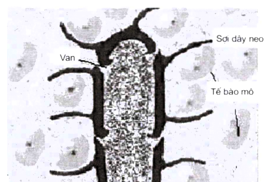
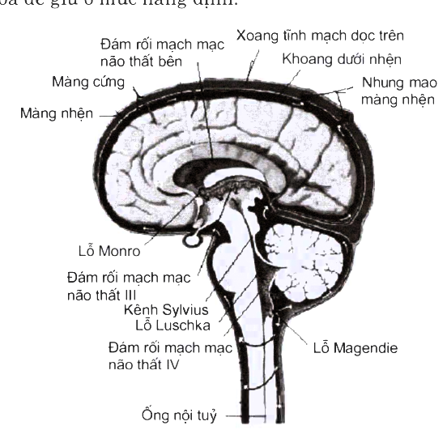
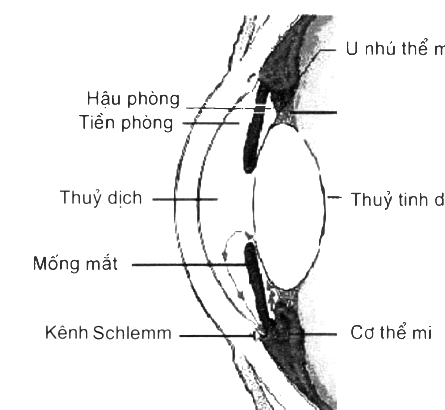

# BÀI 8: SINH LÝ CÁC DỊCH CỦA CƠ THỂ

## MỤC TIÊU HỌC TẬP
*Sau khi học xong bài này, sinh viên có khả năng:*
1. Nêu được thành phần hóa học và các chức năng của huyết tương.
2. Trình bày được chức năng của dịch kẽ, sự tạo thành dịch kẽ và tái hấp thu dịch trở lại huyết tương.
3. Trình bày được thành phần hóa học của dịch bạch huyết, chức năng của hệ thống bạch huyết và các yếu tố ảnh hưởng tới lưu lượng bạch huyết.
4. Trình bày được hàng rào máu - dịch não tuỷ, hàng rào máu - não, thành phần hóa học và chức năng của dịch não tuỷ.
5. Trình bày được sự tạo thành, sự tái hấp thu và áp suất dịch nhãn cầu.

---

## ĐẠI CƯƠNG VỀ CÁC DỊCH CỦA CƠ THỂ

Khoảng hai phần ba lượng dịch của cơ thể nằm ở bên trong các tế bào được gọi là **dịch nội bào** (intracellular fluid - ICF). Phần còn lại nằm bên ngoài tế bào là **dịch ngoại bào** (extracellular fluid - ECF). Hai loại dịch này ngăn cách nhau bởi màng tế bào.

Dịch ngoại bào chủ yếu và lưu thông khắp cơ thể gồm huyết tương, dịch kẽ và dịch bạch huyết:
- **Huyết tương:** là thành phần lỏng của máu, ngăn cách với dịch kẽ bởi màng mao mạch.
- **Dịch kẽ:** là dịch trực tiếp bao quanh các tế bào.
- **Dịch bạch huyết:** nằm trong các mạch bạch huyết.

Ngoài ra còn có một loại dịch ngoại bào đặc biệt gọi là **dịch xuyên bào** (transcellular fluid) gồm: dịch não tuỷ, dịch nhãn cầu, dịch ổ khớp, dịch màng phổi, dịch màng bụng, dịch màng ngoài tim... Dịch xuyên bào chiếm tỷ lệ rất nhỏ nhưng có những chức năng sinh lý đặc thù và vô cùng quan trọng.

Dịch của cơ thể chứa nước và các chất hoà tan, trong đó **nước là thành phần quan trọng nhất**. Tỷ lệ thành phần của nước so với trọng lượng cơ thể dao động trong khoảng từ 45% đến 75% tuỳ thuộc chủ yếu vào số lượng mỡ của cơ thể:
- Tỷ lệ nước chỉ chiếm khoảng 10% trong các mô mỡ, nhưng lại chiếm tới 70% đến 75% trong các mô khác (đặc biệt là mô cơ).
- Do đó, người béo có tỷ lệ nước ít hơn người gầy.
- Nữ giới có tỷ lệ nước ít hơn nam giới vì khối cơ của họ nhỏ hơn và lượng mỡ dưới da nhiều hơn nam giới.
- Tuổi càng cao, tỷ lệ nước của cơ thể càng giảm vì mô cơ giàu nước bị thay thế dần bằng mô mỡ chứa ít nước.

Ở một người đàn ông còn trẻ, khoẻ mạnh, cân nặng 70 kg, có tỷ lệ nước chiếm khoảng 60% trọng lượng cơ thể, nghĩa là có khoảng 42 lít nước. Các dịch của người này được phân bổ như sau:
- **Dịch nội bào:** Chiếm 40% trọng lượng cơ thể (khoảng 28 lít nước).
- **Dịch ngoại bào:** Chiếm 20% trọng lượng cơ thể (khoảng 14 lít nước), gồm:
  - *Dịch kẽ:* 15% trọng lượng cơ thể (khoảng 10,5 lít nước).
  - *Huyết tương:* 5% trọng lượng cơ thể (khoảng 3,5 lít nước).

---

## 1. THÀNH PHẦN CỦA DỊCH NỘI BÀO VÀ DỊCH NGOẠI BÀO

Thành phần các chất thẩm thấu và ion trong dịch nội bào và dịch ngoại bào có sự khác biệt rất lớn, tạo nên cơ sở điện thế màng và môi trường tối ưu cho các phản ứng sinh hoá của sự sống.

**Bảng 8.1. Các chất thẩm thấu trong dịch ngoại bào và dịch nội bào**

| Chất thẩm thấu | Huyết tương<br>*(mosm/lít nước)* | Dịch kẽ<br>*(mosm/lít)* | Dịch nội bào<br>*(mosm/lít)* |
| :--- | :---: | :---: | :---: |
| $\text{Na}^+$ | 142 | 139 | 14 |
| $\text{K}^+$ | 4,2 | 4,0 | 140 |
| $\text{Ca}^{2+}$ | 1,3 | 1,2 | 0 |
| $\text{Mg}^{2+}$ | 0,8 | 0,7 | 20 |
| $\text{Cl}^-$ | 108 | 108 | 4 |
| $\text{HCO}_3^-$ | 24 | 28,3 | 10 |
| $\text{HPO}_4^{2-}$, $\text{H}_2\text{PO}_4^-$ | 2 | 2 | 11 |
| $\text{SO}_4^{2-}$ | 0,5 | 0,5 | 1 |
| Phosphocreatin | 0 | 0 | 45 |
| Carnosin | 0 | 0 | 14 |
| Acid amin | 2 | 2 | 8 |
| Creatin | 0,2 | 0,2 | 9 |
| Lactate | 1,2 | 1,2 | 1,5 |
| ATP | 0 | 0 | 5 |
| Hexomonophosphat | 0 | 0 | 3,7 |
| Glucose | 5,6 | 5,6 | 0,0 |
| Protein | 1,2 | 0,2 | 4 |
| Urê | 4 | 4 | 4 |
| Các chất khác | 4,8 | 3,9 | 10 |
| **Tổng mosm/lít** | **301,8** | **300,8** | **301,2** |
| **Áp suất thẩm thấu toàn phần ở $37^\circ\text{C}$ (mmHg)** | **5443** | **5423** | **5423** |

### Nhận xét so sánh về thành phần giữa các khoang dịch:
1. **Giữa huyết tương và dịch kẽ:**
   - Ngăn cách nhau bởi thành mao mạch.
   - Sự trao đổi giữa nước và các phân tử nhỏ (chất điện giải, glucose, urê...) diễn ra rất nhanh: trong một phút có tới khoảng 70% dịch huyết tương được trao đổi qua lại với dịch kẽ. Do đó, nồng độ nước và các chất điện giải của huyết tương và dịch kẽ gần như giống hệt nhau.
   - **Sự khác nhau duy nhất và quan trọng nhất:** Nồng độ protein trong huyết tương cao hơn rất nhiều so với trong dịch kẽ ($1,2\text{ mosm/lít}$ so với $0,2\text{ mosm/lít}$, tương đương khoảng $6 - 8\text{ g/dL}$ so với $2\text{ g/dL}$). Do các phân tử protein có kích thước quá lớn nên không thể dễ dàng vượt qua thành mao mạch bình thường. Protein ở lại trong lòng mạch tạo nên **áp suất keo** (áp suất thẩm thấu do protein), đóng vai trò quyết định trong việc giữ nước và phân bố thể tích nước giữa lòng mạch và dịch kẽ.

2. **Dịch ngoại bào (Huyết tương và dịch kẽ):**
   - Chứa một lượng rất lớn ion natri ($\text{Na}^+$), ion clo ($\text{Cl}^-$) và một số lượng vừa phải ion bicarbonat ($\text{HCO}_3^-$).
   - Chỉ chứa một lượng rất nhỏ ion kali ($\text{K}^+$), ion canxi ($\text{Ca}^{2+}$), ion magiê ($\text{Mg}^{2+}$), ion phosphat và các acid hữu cơ.
   - Thành phần dịch ngoại bào được điều hoà cực kỳ chặt chẽ bởi các hệ thống hằng tính nội môi, đặc biệt là hệ tiết niệu (thận). Nhờ đó, tất cả các tế bào trong cơ thể luôn được "tắm" trong một môi trường dịch ổn định về dinh dưỡng và điện giải, tối ưu cho sự sống.

3. **Dịch nội bào:**
   - Màng tế bào ngăn cách giữa dịch nội bào và dịch ngoại bào có tính thấm chọn lọc: cho nước thấm qua tự do nhưng ngăn cản hầu hết các chất điện giải khuếch tán thụ động.
   - Dù khu trú riêng biệt trong từng tế bào, thành phần cơ bản của dịch nội bào ở tất cả các loại tế bào đều có đặc tính chung: chứa lượng ion $\text{Na}^+$ và $\text{Cl}^-$ rất thấp, hầu như không có $\text{Ca}^{2+}$ tự do trong dịch bào tương; ngược lại chứa nồng độ ion kali ($\text{K}^+$) cực kỳ cao, lượng vừa phải ion phosphat, magiê, sulphat, và nồng độ protein nội bào cao gấp 4 lần so với huyết tương.
   - **Cơ chế duy trì sự chênh lệch:**
     - Nồng độ $\text{K}^+$ cao và $\text{Na}^+$ thấp trong tế bào là do sự hoạt động liên tục của bơm $\text{Na}^+\text{-K}^+\text{-ATPase}$ (tiêu tốn ATP để bơm $3\text{ Na}^+$ ra ngoài và đưa $2\text{ K}^+$ vào trong).
     - Nồng độ ion $\text{Cl}^-$ và $\text{HCO}_3^-$ thấp là do lực đẩy tĩnh điện từ điện thế nghỉ màng tế bào bên trong mang điện tích âm (khoảng $-90\text{ mV}$ ở cơ và thần kinh lớn).
     - Sự phân bố ion giữa các bào quan cũng khác nhau: nhân tế bào có nồng độ $\text{Na}^+$ cao hơn các bào quan khác; trong tế bào cơ xương, hầu hết ion $\text{Ca}^{2+}$ được dự trữ và giam giữ trong mạng nội cơ tương (sarcoplasmic reticulum) và ty thể, nồng độ $\text{Ca}^{2+}$ tự do trong bào tương khi nghỉ ngơi gần như bằng không ($< 10^{-7}\text{ mol/L}$).

4. **Cân bằng thẩm thấu:**
   - Cả ba loại dịch (huyết tương, dịch kẽ và dịch nội bào) đều có **cùng một áp suất thẩm thấu toàn phần** (xấp xỉ $300\text{ mosm/lít}$ hay $\sim 5423 - 5443\text{ mmHg}$). Nước tự do thẩm thấu qua lại giữa các khoang để duy trì sự cân bằng thẩm thấu hoàn hảo này.

---

## 2. HUYẾT TƯƠNG

### 2.1. Thành phần của huyết tương
Huyết tương là thành phần dịch lỏng của máu toàn phần, có màu vàng nhạt, trong suốt.
- **Tách huyết tương:** Có thể tách huyết tương bằng cách chống đông máu toàn phần rồi quay ly tâm để lắng các tế bào máu xuống dưới. Nếu giữ yên huyết tương bình thường trong ống nghiệm không chống đông, nó sẽ tự đông lại trong vòng vài phút do có chứa các yếu tố đông máu.
- **Phân biệt huyết tương và huyết thanh:** Huyết thanh (serum) là dịch lỏng được tiết ra sau khi khối máu đã đông lại hoàn toàn và co cục máu đông. Về cơ bản, thành phần hoá học của huyết thanh tương tự như huyết tương, nhưng trong huyết thanh **không còn fibrinogen và các yếu tố đông máu đã bị tiêu thụ** (yếu tố II, V, VIII), do đó huyết thanh không thể đông được nữa.

Trong 1 lít huyết tương của người bình thường có:
- Khoảng **930 gam nước**.
- Khoảng **70 gam chất hoà tan**, bao gồm:
  - 60 g protein huyết tương.
  - 8 g ion vô cơ (natri, kali, clo, bicarbonat, canxi, magnesi...).
  - 2 g chất hữu cơ không phải protein (glucose, lipid, acid amin...).
  - Các chất khí hoà tan ($\text{O}_2$, $\text{CO}_2$, $\text{N}_2$), enzym, hormon, vitamin, sắc tố (như bilirubin), các sản phẩm chuyển hóa của tế bào (urê, creatinin, acid uric...).

**Bảng 8.2. Các thành phần chủ yếu của huyết tương**

| Thành phần | Nồng độ bình thường |
| :--- | :--- |
| **Protein** | |
| - Protein toàn phần | 6 - 8 g/dL (60 - 80 g/L) |
| - Albumin | 3,5 - 5,5 g/dL (35 - 55 g/L) |
| - Globulin | 1,5 - 3,0 g/dL (15 - 30 g/L) |
| - Acid amin | 300 mg/dL |
| **Lipid** | |
| - Lipid toàn phần | 450 - 650 mg/dL |
| - Cholesterol | 150 - 240 mg/dL |
| - Phospholipid | 145 - 225 mg/dL |
| - Triglycerid | 125 - 200 mg/dL |
| **Các chất hữu cơ khác** | |
| - Glucose | 70 - 100 mg/dL (3,9 - 5,6 mmol/L) |
| - Urê | 8 - 25 mg/dL (2,5 - 7,5 mmol/L) |
| - Creatinin | 0,7 - 1,5 mg/dL (62 - 115 $\mu\text{mol/L}$) |
| - Acid uric | 3 - 7 mg/dL (180 - 420 $\mu\text{mol/L}$) |
| - Bilirubin toàn phần | $\sim 0,5\text{ mg/dL}$ ($< 17\;\mu\text{mol/L}$) |
| **Các chất điện giải** | |
| - $\text{Na}^+$ | 142 mmol/L |
| - $\text{K}^+$ | 4,2 mmol/L |
| - $\text{Ca}^{2+}$ | 1,3 mmol/L |
| - $\text{Mg}^{2+}$ | 0,8 mmol/L |
| - $\text{Cl}^-$ | 108,0 mmol/L |
| - $\text{HCO}_3^-$ | 24 mmol/L |
| - $\text{HPO}_4^{2-}$, $\text{H}_2\text{PO}_4^-$ | 2 mmol/L |
| - $\text{SO}_4^{2-}$ | 0,5 mmol/L |

---

### 2.2. Chức năng của các protein huyết tương
Bằng phương pháp điện di trên gel hoặc màng cellulose acetate, người ta tách các protein huyết tương thành các phân đoạn chính:
- **Albumin**
- **Globulin** (gồm $\alpha_1$, $\alpha_2$, $\beta_1$, $\beta_2$ và $\gamma$)
- **Fibrinogen**

Vì có kích thước phân tử lớn, protein huyết tương được xếp vào nhóm hệ keo (colloid). Các chức năng sinh lý chung quan trọng của protein huyết tương bao gồm:

1. **Nguồn dự trữ acid amin của cơ thể:**
   Khi cơ thể bị đói protein kéo dài hoặc nhu cầu tổng hợp tăng cao, các đại thực bào ở gan, ruột, lách, phổi và hệ lưới nội mô có khả năng ẩm bào/thực bào các phân tử protein huyết tương, thoái hoá chúng thành các acid amin tự do rồi đưa trở lại tuần hoàn để các tế bào khác sử dụng tổng hợp các protein thiết yếu.

2. **Chức năng vận chuyển (protein mang):**
   Nhiều chất không tan hoặc khó tan trong nước (như acid béo, cholesterol, hormon steroid, bilirubin gián tiếp, các cation kim loại sắt, đồng, và nhiều loại thuốc) phải gắn với các phân tử protein huyết tương để được vận chuyển an toàn và hiệu quả trong lòng mạch từ nơi hấp thu/sản xuất đến các cơ quan chuyển hóa hoặc cơ quan đích.
   - Ví dụ: Sắt gắn với transferrin; đồng gắn với ceruloplasmin; thyroxin gắn với TBG và albumin; thuốc kháng sinh như penicillin, barbiturat gắn với albumin.

3. **Chức năng đệm pH:**
   Protein huyết tương hoạt động như một hệ đệm quan trọng, đóng góp khoảng 7% khả năng đệm của máu toàn phần, giúp duy trì pH máu ổn định trong phạm vi hẹp $7,35 - 7,45$.
   - Các phân tử protein có cấu trúc lưỡng tính (amphoteric): ở môi trường pH sinh lý ($7,4$), các gốc carboxyl và amino cho phép protein hoạt động như một base yếu, gắn kết với các ion $\text{H}^+$ dư thừa để giữ cho máu có tính kiềm nhẹ ổn định.

4. **Chức năng đông máu và cầm máu:**
   Nhiều protein huyết tương là các yếu tố đông máu tồn tại dưới dạng tiền enzym (zymogen) không hoạt động như fibrinogen, prothrombin, các yếu tố VII, IX, X, XI, XII... Khi thành mạch tổn thương, dòng thác đông máu được kích hoạt làm các yếu tố này tương tác dây chuyền để biến fibrinogen thành mạng lưới sợi fibrin vững chắc, cầm máu và ngăn chặn sự xâm nhập của vi sinh vật gây bệnh.

5. **Tạo áp suất thẩm thấu do keo (áp suất keo - Oncotic Pressure):**
   - Áp suất thẩm thấu toàn phần của huyết tương xấp xỉ $7,3\text{ atm}$ ($5.550\text{ mmHg}$).
   - Trong đó, **99,5%** áp suất thẩm thấu là do các phân tử nhỏ (các chất điện giải $\text{Na}^+, \text{Cl}^-$, glucose, urê...). Các chất này khuếch tán tự do qua lỗ mao mạch nên nồng độ của chúng ở huyết tương và dịch kẽ bằng nhau, do đó không tạo ra chênh lệch áp suất thẩm thấu để dịch chuyển nước qua thành mạch.
   - **0,5%** còn lại (tương đương **28 mmHg**) là do các phân tử protein tạo ra (**áp suất keo**). Do không thể vượt qua màng mao mạch, protein bị giữ lại trong lòng mạch, tạo ra một bậc thang nồng độ thẩm thấu hút nước từ khoảng kẽ trở lại lòng mao mạch. Đây là yếu tố then chốt ngăn chặn sự tích tụ dịch trong các khoảng kẽ, chống phù nề.

> [!NOTE]
> **Định nghĩa phân loại dung dịch theo áp suất thẩm thấu:**
> - **Dung dịch đẳng trương (Isotonic):** Có áp suất thẩm thấu bằng áp suất thẩm thấu của huyết tương (ví dụ dung dịch $\text{NaCl } 0,9\%$, Glucose $5\%$).
> - **Dung dịch ưu trương (Hypertonic):** Có áp suất thẩm thấu cao hơn huyết tương (làm tế bào teo lại do mất nước).
> - **Dung dịch nhược trương (Hypotonic):** Có áp suất thẩm thấu thấp hơn huyết tương (làm nước tràn vào tế bào, gây phù trương và vỡ tế bào).

---

### Đặc tính và chức năng riêng biệt của các phân đoạn protein huyết tương:

#### 2.2.1. Albumin
- Chiếm tỷ lệ lớn nhất: khoảng **60%** tổng lượng protein huyết tương.
- Kích thước phân tử tương đối nhỏ (trọng lượng phân tử khoảng $69.000\text{ Da}$), nhưng số lượng phân tử cực kỳ lớn. Do đó, **albumin tạo ra khoảng 80% tổng áp suất keo của huyết tương** (đóng góp tới $\sim 22\text{ mmHg}$ trong tổng số $28\text{ mmHg}$).
- **Ý nghĩa lâm sàng:** Trong các bệnh lý như suy dinh dưỡng nặng giảm cung cấp protein (Kwashiorkor), xơ gan suy chức năng gan giảm tổng hợp albumin, hoặc hội chứng thận hư làm mất lượng lớn albumin qua nước tiểu, nồng độ albumin máu hạ thấp rõ rệt $\rightarrow$ áp suất keo suy giảm nghiêm trọng $\rightarrow$ nước từ lòng mạch thoát ồ ạt ra mô kẽ gây hiện tượng **phù toàn thân** (phù mềm, đối xứng, tràn dịch các màng).
- Ngoài ra, albumin là phương tiện vận chuyển chính không đặc hiệu của nhiều chất: bilirubin gián tiếp, acid béo tự do, hormon steroid, hormon tuyến giáp (thyroxin), ion canxi, và các loại thuốc điều trị như sulfonamid, aspirin, barbiturat, penicillin...

#### 2.2.2. Globulin
Chiếm khoảng **40%** protein toàn phần, được chia thành:
- **$\alpha_1\text{-globulin}$ ($4\%$):**
  - Tạo thành các glycoprotein và lipoprotein tỷ trọng cao (**HDLC** - High-Density Lipoprotein Cholesterol). HDLC làm nhiệm vụ vận chuyển cholesterol dư thừa từ các mô ngoại vi quay trở về gan để chuyển hóa và đào thải, do đó có vai trò dọn dẹp mỡ máu, bảo vệ chống xơ vữa động mạch.
  - Ngoài ra nhóm này còn có $\alpha_1\text{-antitrypsin}$ ức chế các enzym tiêu protein (elastase).
- **$\alpha_2\text{-globulin}$ ($8\%$):**
  - Gồm **haptoglobin** (có chức năng gắn với phân tử hemoglobin tự do giải phóng từ hồng cầu vỡ để ngăn ngừa mất sắt qua thận và chống độc cho ống thận), **ceruloplasmin** (vận chuyển đồng), **prothrombin** (yếu tố đông máu II), **erythropoietin** (hormon kích thích sinh hồng cầu) và **angiotensinogen** (tiền chất hệ RAAS điều hòa huyết áp).
- **$\beta\text{-globulin}$ (gồm $\beta_1$ chiếm $7\%$, $\beta_2$ chiếm $4\%$):**
  - Đóng vai trò chủ yếu trong vận chuyển lipid và ion kim loại.
  - **$\beta_1\text{-lipoprotein}$ hay lipoprotein tỷ trọng thấp (LDLC):** Vận chuyển cholesterol từ gan đến các mô ngoại vi. Khi nồng độ LDLC trong máu cao, nó dễ bị oxy hóa và lắng đọng tại lớp dưới nội mạc động mạch, khởi phát quá trình hình thành mảng xơ vữa động mạch, dẫn đến bệnh lý mạch vành và đột quỵ não.
  - Phân đoạn này cũng chứa **transferrin** chuyên chở sắt tự do trong huyết tương.
- **$\gamma\text{-globulin}$ ($17\%$):**
  - Bản chất là các **globulin miễn dịch (immunoglobulin - Ig)** hay kháng thể dịch thể do các tương bào (plasma cell, biệt hóa từ lympho bào B) sản xuất: gồm các lớp **IgA, IgG, IgM, IgD, IgE**.
  - Trong huyết tương bình thường, trên $99\%$ globulin miễn dịch thuộc ba lớp: **IgG, IgA và IgM**. Chúng giữ vai trò nòng cốt trong đáp ứng miễn dịch dịch thể chống lại vi khuẩn, virus và các kháng nguyên lạ.

#### 2.2.3. Tỷ lệ Albumin/Globulin (A/G)
- Nồng độ protein huyết tương toàn phần ở người trưởng thành thường được giữ hằng định ở mức $6 - 8\text{ g/dL}$. Nồng độ albumin bình thường gấp khoảng 1,5 đến 2 lần globulin, do đó tỷ lệ **$\text{A/G} \approx 1,5 - 2,0$**.
- Mỗi ngày cơ thể một người trưởng thành chuyển hóa và tái tổng hợp khoảng 15 gam albumin và 5 gam globulin.
- **Biến đổi trong bệnh lý:** Khi cơ thể bị nhiễm trùng mạn tính, bệnh tự miễn hoặc viêm mạn kéo dài, hệ thống miễn dịch tăng cường sản xuất globulin kháng thể, trong khi gan lại phản ứng bằng cách giảm sản xuất albumin. Kết quả là **tỷ lệ A/G bị đảo ngược ($< 1$)**, trong khi tổng lượng protein huyết tương ($A + G$) có thể vẫn nằm trong giới hạn bình thường.

#### 2.2.4. Fibrinogen
- Chiếm khoảng $4\%$ tổng lượng protein huyết tương (khoảng $0,2 - 0,4\text{ g/dL}$ hay $2 - 4\text{ g/L}$).
- Là yếu tố đông máu số I, được tổng hợp hoàn toàn tại gan.
- Fibrinogen là protein hình sợi hoà tan. Khi dòng thác đông máu được kích hoạt, enzym thrombin sẽ cắt các mẩu peptid từ fibrinogen để tạo thành các monome fibrin; các monome này sau đó trùng hợp tự nhiên dưới sự ổn định của yếu tố XIIIa tạo thành mạng lưới sợi fibrin không tan, giam giữ các tế bào máu để hình thành cục máu đông vĩnh viễn.

---

## 3. DỊCH KẼ

Dịch kẽ là khoang dịch nằm ngay giữa các tế bào trong các mô, chiếm thể tích khoảng **15% trọng lượng cơ thể** (tương đương khoảng **10,5 lít** ở người 70 kg).

Dịch kẽ chính là môi trường nội môi trực tiếp của các tế bào, nơi cung cấp dưỡng chất, oxy và tiếp nhận các chất bài tiết chuyển hóa. Thể tích và thành phần của dịch kẽ phụ thuộc vào động học của quá trình trao đổi chất và dịch qua thành mao mạch, tuân theo định luật cân bằng Starling.

### Động học trao đổi dịch qua thành mao mạch (Cân bằng Starling):
Thành mao mạch hoạt động như một màng lọc bán thấm. Sự dịch chuyển của nước và chất hoà tan qua thành mao mạch được điều hòa bởi 4 lực chính:
1. **Áp suất thủy tĩnh trong mao mạch ($P_c$):** Xu hướng đẩy dịch từ lòng mạch ra khoảng kẽ.
2. **Áp suất thủy tĩnh của dịch kẽ ($P_{if}$):** Bình thường có giá trị âm nhẹ ($-3\text{ mmHg}$ do lực hút của hệ bạch mạch), tạo ra một lực hút dịch từ lòng mạch ra khoảng kẽ (tương đương tác dụng $+3\text{ mmHg}$).
3. **Áp suất keo của huyết tương ($\pi_p$):** Có giá trị $28\text{ mmHg}$, xu hướng hút dịch từ khoảng kẽ trở lại lòng mao mạch.
4. **Áp suất keo của dịch kẽ ($\pi_{if}$):** Do một lượng nhỏ protein lọt qua màng mao mạch ($2\text{ g/dL}$) tạo ra áp suất khoảng $8\text{ mmHg}$, có xu hướng kéo dịch từ lòng mạch ra khoảng kẽ.

```
       Đầu tiểu động mạch                           Đầu tiểu tĩnh mạch
    [ Mao mạch: 30 mmHg ]                       [ Mao mạch: 10 mmHg ]
           │                                           ▲
      Lực đẩy: 41 mmHg                            Lực hút: 28 mmHg
      Lực hút: 28 mmHg                            Lực đẩy: 21 mmHg
           ▼                                           │
  Áp suất lọc: +13 mmHg                       Áp suất tái hấp thu: +7 mmHg
  (Đẩy dịch ra dịch kẽ)                       (Hút dịch về mao tĩnh mạch)
```

#### Phân tích lực tại đầu tiểu động mạch:
- **Các lực đẩy dịch ra khỏi mao mạch:**
  - Áp suất thủy tĩnh mao mạch: $30\text{ mmHg}$
  - Áp suất âm của dịch kẽ: $-3\text{ mmHg}$ *(lực hút ra ngoài tương đương $3\text{ mmHg}$)*
  - Áp suất keo của dịch kẽ: $8\text{ mmHg}$
  - **Tổng lực đẩy:** $30 + 3 + 8 = 41\text{ mmHg}$
- **Lực hút dịch vào mao mạch:**
  - Áp suất keo của huyết tương: $28\text{ mmHg}$
- **Áp suất lọc hữu dụng (Net Filtration Pressure):**
  $$P_{\text{lọc}} = 41\text{ mmHg} - 28\text{ mmHg} = +13\text{ mmHg}$$
  *Lực này đẩy nước và các chất hòa tan nhỏ từ lòng mao mạch vào khoảng kẽ.*

#### Phân tích lực tại đầu tiểu tĩnh mạch:
- Khi máu chảy đến đầu mao tĩnh mạch, áp suất thủy tĩnh lòng mạch giảm mạnh xuống chỉ còn $10\text{ mmHg}$.
- **Các lực đẩy dịch ra khỏi mao mạch:**
  - Áp suất thủy tĩnh mao tĩnh mạch: $10\text{ mmHg}$
  - Áp suất âm của dịch kẽ: $3\text{ mmHg}$
  - Áp suất keo dịch kẽ: $8\text{ mmHg}$
  - **Tổng lực đẩy:** $10 + 3 + 8 = 21\text{ mmHg}$
- **Lực hút dịch vào mao mạch:**
  - Áp suất keo của huyết tương: $28\text{ mmHg}$
- **Áp suất tái hấp thu hữu dụng (Net Reabsorption Pressure):**
  $$P_{\text{tái hấp thu}} = 28\text{ mmHg} - 21\text{ mmHg} = +7\text{ mmHg}$$
  *Lực này kéo dịch từ khoảng kẽ trở lại lòng mao mạch.*

#### Tái phân bố dịch kẽ:
Mặc dù áp suất tái hấp thu ($7\text{ mmHg}$) nhỏ hơn áp suất lọc ($13\text{ mmHg}$), nhưng do:
- Diện tích bề mặt và số lượng mao tĩnh mạch lớn hơn mao động mạch.
- Tính thấm của thành mao mạch ở phía tĩnh mạch cao hơn phía động mạch.
Vì vậy, **khoảng 9/10 (90%)** lượng dịch đã lọc ra ở đầu động mạch sẽ được tái hấp thu trở lại mao tĩnh mạch.
**Còn lại 1/10 (10%)** lượng dịch thừa cùng với toàn bộ các phân tử protein lọt ra mô kẽ sẽ theo hệ thống mao mạch bạch huyết đổ vào hệ tuần hoàn bạch mạch.

- **Chức năng của dịch kẽ:** Dịch kẽ là môi trường trực tiếp trao đổi chất giữa máu và tế bào: cung cấp oxy, glucose, acid amin, vitamin và các chất điện giải cho tế bào; đồng thời thu nhận khí carbonic ($\text{CO}_2$), acid lactic, urê, creatinin và các sản phẩm chuyển hóa để đưa vào mao mạch máu hoặc mao mạch bạch huyết, vận chuyển tới phổi và thận để đào thải ra ngoài.

---

## 4. DỊCH BẠCH HUYẾT

Dịch bạch huyết (lymph) bản chất là phần dịch kẽ dư thừa chảy vào hệ thống mạch bạch huyết. Mạng lưới bạch mạch tập hợp dần thành các mạch lớn hơn, cuối cùng dẫn toàn bộ bạch huyết của cơ thể đổ về hệ thống tĩnh mạch lớn qua hai đường dẫn chính:
- **Ống ngực (Thoracic duct):** Thu nhận bạch huyết của toàn bộ nửa dưới cơ thể và nửa trên bên trái, đổ vào hội lưu tĩnh mạch cảnh trong trái và tĩnh mạch dưới đòn trái.
- **Ống bạch huyết phải (Right lymphatic duct):** Thu nhận bạch huyết của nửa trên bên phải cơ thể, đổ vào hội lưu tĩnh mạch dưới đòn phải.

### 4.1. Thành phần của dịch bạch huyết
- Dịch bạch huyết bắt nguồn trực tiếp từ dịch kẽ nên có thành phần điện giải gần như tương đương dịch kẽ.
- **Nồng độ protein:**
  - Ở hầu hết các mô thông thường (cơ vân, da), nồng độ protein dịch kẽ và bạch huyết là $\sim 2\text{ g/dL}$.
  - Bạch huyết xuất phát từ gan có nồng độ protein rất cao, lên tới **$6\text{ g/dL}$** (do mao mạch gan có cấu trúc kiểu xoang dạng cửa sổ rất rộng).
  - Bạch huyết ở ruột có nồng độ protein khoảng **$3 - 4\text{ g/dL}$**.
  - Bạch huyết hỗn hợp trong ống ngực có nồng độ protein trung bình từ **$3 - 5\text{ g/dL}$**.
- **Chất dinh dưỡng:** Hệ bạch huyết là con đường vận chuyển chủ yếu của các phân tử lipid hấp thu từ ống tiêu hóa (chylomicron). Sau một bữa ăn giàu chất béo, dịch bạch huyết trong ống ngực có màu trắng như sữa (dưỡng chấp - chyle) và có thể chứa từ **$1\%$ đến $2\%$ mỡ**.
- **Bạch cầu:** Dịch bạch huyết ống ngực chứa lượng lớn các tế bào lympho (chủ yếu là lympho T và B) trên đường tuần hoàn trở lại máu.
- **Loại bỏ dị vật:** Các phân tử kích thước lớn, mảnh vụn tế bào, vi khuẩn xâm nhập đều được mao mạch bạch huyết hấp thu và đưa qua các hạch bạch huyết (lymph nodes), nơi có mạng lưới đại thực bào dày đặc để thực bào và trình diện kháng nguyên.

### 4.2. Cấu tạo đặc biệt của mao mạch bạch huyết



Mao mạch bạch huyết có cấu trúc giải phẫu - mô học đặc biệt thích nghi hoàn hảo với chức năng hấp thu các chất có trọng lượng phân tử lớn:
- **Sợi dây neo (Anchoring filaments):** Các tế bào nội mô của mao mạch bạch huyết được neo giữ vững chắc vào các sợi collagen của mô liên kết xung quanh bằng các sợi dây neo siêu nhỏ. Khi dịch ứ đọng làm khoảng kẽ căng phồng, các sợi dây neo này sẽ kéo căng các tế bào nội mô ra ngoài, làm mở rộng lòng mao mạch thay vì làm bẹp lòng mạch.
- **Cấu trúc van một chiều:** Ở vị trí tiếp giáp giữa hai tế bào nội mô liền kề, mép tế bào này gối lên mép tế bào kia tạo thành một cấu trúc nắp van vi thể mở tự do vào lòng ống. Khi áp suất dịch kẽ cao hơn áp suất trong lòng mao mạch bạch huyết, nắp van mở ra để dịch, protein và thậm chí cả vi khuẩn đi vào bên trong. Ngược lại, khi áp suất trong lòng mạch bạch huyết tăng lên, dịch sẽ ép mép tế bào khép chặt lại, ngăn không cho dịch rò rỉ ngược trở lại khoảng kẽ (*hình 8.1*).

### 4.3. Lưu lượng bạch huyết
Ở một người bình thường đang trong trạng thái nghỉ ngơi, tổng lưu lượng bạch huyết chảy vào tuần hoàn chỉ khoảng **$120\text{ ml/giờ}$** (tương đương khoảng $2 - 3\text{ lít/ngày}$), tức là chỉ bằng $1/120.000$ tốc độ khuếch tán trao đổi dịch qua thành mao mạch.

Lưu lượng bạch huyết chịu sự chi phối chặt chẽ của hai nhóm yếu tố chính:
1. **Áp suất dịch kẽ:**
   Mọi yếu tố làm tăng áp suất dịch kẽ sẽ làm tăng lưu lượng bạch huyết:
   - Tăng áp suất thủy tĩnh mao mạch ($P_c$).
   - Giảm áp suất keo huyết tương ($\pi_p$).
   - Tăng nồng độ protein trong dịch kẽ ($\pi_{if}$).
   - Tăng tính thấm của thành mao mạch (như trong phản ứng viêm dị ứng do histamin).
2. **Hoạt động của các bơm bạch huyết:**
   - **Bơm bạch huyết nội tại:** Các tế bào nội mô mao mạch bạch huyết có chứa các sợi protein co rút actomyosin có thể co bóp nhịp nhàng; các đoạn mạch bạch huyết lớn hơn có các van một chiều phân bố dọc theo chiều dài và có cơ trơn thành mạch co bóp tự động khi bị căng giãn.
   - **Bơm bạch huyết ngoại lai:** Các yếu tố từ bên ngoài cơ thể ép lên thành mạch tạo động lực tống dịch đi: sự co cơ vân khi vận động, nhịp đập của các động mạch nằm sát cạnh mạch bạch huyết, sự thay đổi áp suất khoang lồng ngực khi hít thở, hoặc lực xoa bóp nén ép từ bên ngoài.

### 4.4. Chức năng của hệ bạch huyết
Hệ bạch huyết đóng vai trò là một cơ chế bù trừ và cân bằng sinh tử:
- **Kiểm soát nồng độ protein, thể tích và áp suất dịch kẽ:**
  Đây là con đường duy nhất để các phân tử protein lọt ra khoảng kẽ có thể quay trở lại máu. Nếu protein ứ lại trong mô kẽ, nó sẽ làm tăng áp suất keo dịch kẽ $\rightarrow$ kéo dịch ra khỏi mao mạch $\rightarrow$ thể tích và áp suất dịch kẽ tăng vọt. Sự gia tăng áp suất này kích hoạt hệ bạch huyết tăng lưu lượng bơm để cuốn trôi protein và dịch ứ đọng về tuần hoàn. Nếu tắc mạch bạch huyết (như do giun chỉ *Wuchereria bancrofti* hoặc nạo vét hạch trong phẫu thuật ung thư), protein và dịch sẽ ứ đọng nghiêm trọng gây **phù bạch huyết** (phù voi - elephantiasis).
- **Hấp thu chất béo từ ruột:** Hấp thu phần lớn triglyceride và các vitamin tan trong dầu (A, D, E, K).
- **Miễn dịch bảo vệ:** Vận chuyển tế bào miễn dịch và kháng nguyên đến các hạch lympho để kích hoạt đáp ứng bảo vệ cơ thể.

---

## 5. DỊCH NÃO TỦY

### 5.1. Nhắc lại về giải phẫu hệ thống dịch não tuỷ



Hệ thống khoang chứa bao quanh não và tuỷ sống trong hộp sọ và ống sống có tổng thể tích từ $1.600$ đến $1.700\text{ ml}$.
- Trong đó, mô não và tuỷ sống chiếm phần lớn thể tích.
- **Dịch não tuỷ (Cerebrospinal fluid - CSF)** chiếm thể tích ổn định khoảng **$150\text{ ml}$**.

Dịch não tuỷ được chứa trong các não thất, các bể chứa quanh não và khoang dưới nhện. Các khoang này thông thương liên tục với nhau:
- **Tốc độ sản xuất:** Dịch não tuỷ được tiết ra với tốc độ khoảng **$500\text{ ml/ngày}$**, nghĩa là toàn bộ thể tích dịch não tuỷ được đổi mới liên tục từ **3 đến 4 lần mỗi ngày**.
- **Nguồn gốc:** Khoảng **2/3** lượng dịch não tuỷ được bài tiết tích cực từ các **đám rối mạch mạc (choroid plexus)** nằm trong các não thất (chủ yếu ở hai não thất bên, một phần ở não thất III và IV). Phần còn lại (khoảng 1/3) được tiết ra từ bề mặt màng não thất, màng nhện và từ nhu mô não thông qua các khoang quanh mạch.
- **Đường lưu thông của dịch não tuỷ:**
  $$\text{Hai não thất bên} \xrightarrow{\text{Lỗ Monro}} \text{Não thất III} \xrightarrow{\text{Cống Sylvius}} \text{Não thất IV} \xrightarrow{\text{Lỗ Luschka & Magendie}} \text{Bể lớn (Cisterna magna)}$$
  Từ bể lớn, dịch não tuỷ chảy lên trên vào **khoang dưới nhện** bao quanh toàn bộ bề mặt vỏ não và chảy xuống khoang dưới nhện tủy sống.
- **Nơi hấp thu:** Dịch não tuỷ từ khoang dưới nhện đi qua các **nhung mao màng nhện (arachnoid villi)** để đổ trực tiếp vào dòng máu tĩnh mạch trong các xoang tĩnh mạch màng cứng (đặc biệt là **xoang tĩnh mạch dọc trên**).

### 5.2. Sự bài tiết dịch não tuỷ ở đám rối mạch mạc
Đám rối mạch mạc là những cấu trúc dạng chùm hoa lơ gồm các búi mao mạch được bao bọc bởi một lớp tế bào biểu mô chuyên biệt:
- **Cơ chế vận chuyển tích cực:** Các tế bào biểu mô đám rối mạch mạc vận chuyển tích cực ion $\text{Na}^+$ từ máu vào não thất. Ion $\text{Cl}^-$ bị kéo theo để cân bằng điện tích. Sự tích tụ của $\text{NaCl}$ tạo ra lực thẩm thấu hút nước từ mao mạch vào lòng não thất.
- Glucose cũng được vận chuyển có chọn lọc vào dịch não tuỷ.
- Ngược lại, ion $\text{K}^+$ và $\text{HCO}_3^-$ được vận chuyển tích cực từ dịch não tuỷ ngược trở lại vào máu mao mạch.

### 5.3. Sự hấp thu của dịch não tuỷ qua nhung mao màng nhện
Nhung mao màng nhện là những chỗ nhô hình ngón tay của màng nhện đâm xuyên qua màng cứng vào trong các xoang tĩnh mạch. Các chùm nhung mao tụ lại thành các hạt lớn gọi là **hạt màng nhện (Pacchionian bodies)**:
- Tế bào biểu mô bao phủ các nhung mao có những kênh hoặc hốc nội bào lớn (vesicular channels). Các cấu trúc này hoạt động như **những chiếc van một chiều**: cho phép dòng dịch não tuỷ, các protein và các mảnh tế bào (thậm chí cả hồng cầu) chảy một chiều từ khoang dưới nhện vào máu xoang tĩnh mạch khi áp suất dịch não tuỷ cao hơn áp suất xoang tĩnh mạch khoảng **$1,5\text{ mmHg}$**.
- Van hoàn toàn ngăn chặn dòng máu tĩnh mạch chảy ngược vào khoang dưới nhện.

### 5.4. Các khoang quanh mạch (Khoang Virchow-Robin) và dịch não tuỷ
Khi các mạch máu lớn đi từ bề mặt não đâm sâu vào nhu mô não, chúng kéo theo một lớp màng nuôi bọc xung quanh. Giữa thành mạch máu và màng nuôi tồn tại một khoảng hẹp gọi là **khoang quanh mạch (Virchow-Robin space)**.
- Màng nuôi chỉ đi theo mạch máu đến mức tiểu động mạch và tiểu tĩnh mạch; ở mức mao mạch não, màng nuôi biến mất hoàn toàn.
- **Vai trò như hệ bạch huyết của não:** Vì trong nhu mô não không có mạch bạch huyết thực thụ, các protein nhỏ và chất thải rò rỉ vào khoang kẽ não sẽ trôi theo các khoang quanh mạch này để đổ ra khoang dưới nhện, rồi được nhung mao màng nhện hấp thu vào máu tĩnh mạch. Khoang quanh mạch cũng giúp dọn sạch các mảnh vụn mô, xác bạch cầu trong các phản ứng viêm của hệ thần kinh.

### 5.5. Tính chất và thành phần hoá học của dịch não tuỷ
- **Đặc tính vật lý:** Dịch não tuỷ bình thường hoàn toàn trong suốt, không màu. Thể tích $60 - 150\text{ ml}$. Tỷ trọng $1,001 - 1,010$. $\text{pH} = 7,30 - 7,40$.
- **Thành phần sinh hóa so với huyết tương:**
  - **Protein:** Rất thấp, chỉ khoảng **$15 - 22\text{ mg/dL}$** (chỉ bằng khoảng $0,2 - 0,3\%$ protein huyết tương).
  - **Glucose:** Thấp hơn khoảng **$30\%$** so với đường huyết ($2,8 - 4,2\text{ mmol/L}$ hay khoảng $50 - 75\text{ mg/dL}$).
  - **Điện giải:**
    - $\text{Na}^+$ tương đương huyết tương.
    - $\text{Cl}^-$ **cao hơn khoảng 15%** so với huyết tương.
    - $\text{K}^+$ **thấp hơn khoảng 40%** so với huyết tương.
    - $\text{Ca}^{2+}$ chỉ bằng khoảng 1/2 nồng độ trong huyết tương.
  - **Tế bào:** Bình thường rất hiếm tế bào, chỉ có khoảng **$1 - 3\text{ tế bào lympho/mm}^3$** dịch và một vài tế bào nội mô. Không có hồng cầu.

### 5.6. Áp suất dịch não tuỷ
- **Giá trị bình thường:** Ở tư thế nằm ngang, áp suất dịch não tuỷ đo được qua chọc dò tủy sống thắt lưng là từ **$100$ đến $150\text{ mmH}_2\text{O}$** (tương đương $7 - 11\text{ mmHg}$). Ở tư thế ngồi, áp suất có thể tăng thêm từ $10$ đến $50\text{ mmH}_2\text{O}$.
- **Cơ chế điều hòa:** Tốc độ sản xuất dịch não tuỷ ở đám rối mạch mạc gần như cố định ($500\text{ ml/ngày}$). Vì vậy, sự điều hòa áp suất dịch não tuỷ phụ thuộc hoàn toàn vào **tốc độ hấp thu qua nhung mao màng nhện**. Khi áp suất tăng, các van của nhung mao mở toang ra để tăng thoát dịch vào xoang tĩnh mạch, giữ cho áp suất luôn hằng định.
- **Tình trạng tăng áp lực nội sọ:**
  - **U não:** Chèn ép dòng lưu thông dịch não tuỷ hoặc cản trở dòng chảy lên các nhung mao màng nhện.
  - **Xuất huyết dưới nhện hoặc viêm màng não:** Sự xuất hiện đột ngột của một lượng lớn hồng cầu hoặc xác bạch cầu và dịch mủ làm tắc nghẽn các kênh lọc của nhung mao màng nhện. Khi đó áp suất dịch não tuỷ có thể tăng vọt lên tới **$400 - 600\text{ mmH}_2\text{O}$**, đe dọa tụt kẹt não và tử vong.

### 5.7. Chức năng của dịch não tuỷ
1. **Chức năng bảo vệ và cơ học (lót đệm chống sang chấn):**
   Não bộ có trọng lượng thực tế khoảng $1.400\text{ g}$, nhưng vì tỷ trọng của não và dịch não tuỷ gần như bằng nhau (khoảng $1,040$), nên theo định luật Archimedes, não nổi lơ lửng trong hộp sọ và trọng lượng hiệu dụng của nó chỉ còn tương đương **$50\text{ g}$**. Khi đầu bị va đập, dịch não tuỷ đóng vai trò như một lớp đệm thủy tĩnh giảm chấn, phân tán đều xung lực giúp nhu mô não không bị biến dạng hoặc va đập trực tiếp vào bản xương sọ cứng.
2. **Thích nghi thể tích hộp sọ (Định luật Monro-Kellie):**
   Hộp sọ là một khoang kín có thể tích cố định gồm: nhu mô não, máu và dịch não tuỷ. Khi một trong các thành phần này tăng lên (như khối u não, giãn mạch máu não), dịch não tuỷ sẽ nhanh chóng bị đẩy xuống ống sống và tăng tái hấp thu để bù trừ, tránh làm tăng áp lực nội sọ tức thời.
3. **Cân bằng dinh dưỡng và nội môi:**
   Là môi trường trao đổi trực tiếp một số chất chuyển hóa và dẫn truyền thần kinh cho hệ thần kinh trung ương.

### 5.8. Hàng rào máu - dịch não tuỷ và hàng rào máu - não
Để bảo vệ mô não khỏi các chất độc hại và sự biến động điện giải của tuần hoàn chung, cơ thể có hai hàng rào sinh lý cực kỳ nghiêm ngặt:

1. **Hàng rào máu - dịch não tuỷ (Blood - CSF Barrier):**
   - Vị trí: Tại các đám rối mạch mạc của các não thất.
   - Cấu tạo: Được tạo nên bởi các **mối nối vòng bịt rất chặt (tight junctions)** giữa các tế bào biểu mô đám rối mạch mạc bao quanh búi mao mạch.
2. **Hàng rào máu - não (Blood - Brain Barrier - BBB):**
   - Vị trí: Nằm tại thành của tất cả các mao mạch đi vào nhu mô não.
   - Cấu tạo:
     - Tế bào nội mô của mao mạch não liên kết với nhau bằng các **mối liên kết bịt chặt chẽ (tight junctions)**, không có khe hở hay lỗ thủng nội mô như mao mạch thông thường.
     - Phía ngoài là màng đáy dày và các **chân tế bào sao (astrocytic end-feet)** bao bọc kín bề mặt mao mạch.
   - **Vùng không có hàng rào máu - não:** Một số vùng chuyên biệt của não không có hàng rào máu - não (gọi là các cơ quan quanh não thất - circumventricular organs) gồm: vùng hạ đồi (**hypothalamus**), tuyến tùng (**pineal gland**), vùng cực sau (**area postrema** ở sàn não thất IV)... Tại đây, mao mạch có tính thấm cao, cho phép các thụ thể thần kinh tiếp xúc trực tiếp với máu để cảm nhận nồng độ glucose, áp suất thẩm thấu, nồng độ hormon và các độc chất trong máu (ví dụ area postrema là trung tâm kích hoạt phản xạ nôn khi máu nhiễm độc).

#### Tính thấm sinh lý của các hàng rào:
- **Tính thấm rất cao:** Với nước, $\text{CO}_2$, $\text{O}_2$ và các chất hoà tan trong lipid (rượu, nicotin, các thuốc gây mê hô hấp, thuốc hướng thần tan trong mỡ). Các chất điện giải như $\text{Na}^+, \text{Cl}^-, \text{K}^+$ đi qua được nhờ các kênh và bơm đặc hiệu.
- **Tính thấm rất thấp hoặc không thấm:** Với protein huyết tương, các phân tử hữu cơ lớn không tan trong mỡ, và hầu hết các kháng thể, các thuốc kháng sinh thông thường (như penicillin, aminoglycosid). Do đó, điều trị nhiễm khuẩn thần kinh trung ương đòi hỏi dùng các kháng sinh đặc hiệu có khả năng thấm tốt qua màng não (hoặc tiêm trực tiếp vào khoang dịch não tuỷ).
- Giữa dịch não tuỷ và dịch kẽ của nhu mô não có tính thấm rất tự do qua lớp màng nuôi mỏng, nên các thuốc tiêm vào dịch não tuỷ sẽ khuếch tán nhanh chóng vào nhu mô não.

---

## 6. DỊCH NHÃN CẦU

Dịch nhãn cầu nằm trong khoang nhãn cầu, có vai trò duy trì độ căng phồng hình cầu của mắt, đảm bảo cho hệ thống quang học của mắt luôn hội tụ hình ảnh chính xác trên võng mạc.

Dịch nhãn cầu gồm hai loại chính:
1. **Thuỷ dịch (Aqueous humor):** Là dịch lỏng trong suốt, nằm ở phần trước của mắt (tiền phòng và hậu phòng), nằm phía trước và hai bên của thuỷ tinh thể. Thuỷ dịch lưu thông tuần hoàn liên tục.
2. **Thuỷ tinh dịch hay dịch kính (Vitreous humor):** Là một khối chất keo gelatin trong suốt chiếm toàn bộ khoang sau nhãn cầu giữa mặt sau thuỷ tinh thể và võng mạc. Thuỷ tinh dịch hầu như không lưu thông, các chất chỉ có thể khuếch tán qua nó một cách rất chậm chạp.

### 6.1. Quá trình sản xuất thuỷ dịch



- **Nơi sản xuất:** Thuỷ dịch được bài tiết liên tục bởi các **nếp thể mi (ciliary processes)** của thể mi.
- Nếp thể mi là những nếp gấp nhô ra từ thể mi vào hậu phòng (ngay sau mống mắt), nơi bám của các dây chằng treo thuỷ tinh thể (dây chằng Zinn). Toàn bộ bề mặt nếp thể mi có diện tích khoảng $6\text{ cm}^2$, được bao phủ bởi lớp tế bào biểu mô thể mi giàu hoạt động chuyển hóa và có mạng lưới mao mạch phong phú bên dưới.
- **Tốc độ sản xuất:** Khoảng **$2 - 3\;\mu\text{l/phút}$**.
- **Cơ chế bài tiết:**
  - Bắt đầu bằng sự **vận chuyển tích cực của ion $\text{Na}^+$** từ máu mao mạch qua tế bào biểu mô thể mi vào các khoang gian bào.
  - Các ion $\text{Cl}^-$ và $\text{HCO}_3^-$ khuếch tán theo để trung hòa điện tích.
  - Nồng độ ion tăng cao tạo ra áp suất thẩm thấu hút nước từ mô đệm thể mi vào lòng hậu phòng.
  - Ngoài ra, các chất dinh dưỡng như acid amin, glucose và đặc biệt là **acid ascorbic (vitamin C)** được vận chuyển tích cực vào thuỷ dịch với nồng độ cao gấp nhiều lần huyết tương để chống oxy hóa bảo vệ thuỷ tinh thể và giác mạc.

### 6.2. Đường lưu thông và thoát ra khỏi mắt của thuỷ dịch
Sau khi được tiết vào **hậu phòng** (posterior chamber), thuỷ dịch lưu thông theo lộ trình sau:
$$\text{Nếp thể mi} \rightarrow \text{Hậu phòng} \xrightarrow{\text{Qua khe đồng tử}} \text{Tiền phòng} \rightarrow \text{Góc tiền phòng (góc giác mạc - mống mắt)}$$
Tại góc tiền phòng:
- Dịch lọc qua một hệ thống mạng lưới các cột sợi đan xen gọi là **mạng bè (trabecular meshwork)**.
- Sau đó đổ vào **kênh Schlemm** (Schlemm's canal) - một xoang tĩnh mạch vòng có thành mỏng, nội mô có các lỗ lọc lớn cho phép cả các phân tử protein và mảnh tế bào lọt qua.
- Từ kênh Schlemm, thuỷ dịch đi vào các nhánh tĩnh mạch nhỏ chứa đầy thuỷ dịch (gọi là **"tĩnh mạch nước"** - aqueous veins), rồi đổ ra các tĩnh mạch ngoài nhãn cầu để hòa vào hệ tuần hoàn tĩnh mạch chung (*hình 8.3*).
- **Tốc độ thoát thuỷ dịch:** Bình thường cân bằng tuyệt đối với tốc độ bài tiết, đạt khoảng **$2,5\;\mu\text{l/phút}$**.

### 6.3. Áp suất nhãn cầu (Nhãn áp)
- **Trị số bình thường:** Nhãn áp trung bình ở người bình thường vào khoảng **$15\text{ mmHg}$** (dao động trong khoảng sinh lý từ **$12$ đến $20\text{ mmHg}$**).
- **Cơ chế tự điều hòa:** Khi nhãn áp tăng lên, áp lực thuỷ tĩnh sẽ đẩy mở rộng các khe lỗ của mạng bè và kênh Schlemm, làm tăng tốc độ thoát thuỷ dịch ra khỏi nhãn cầu, từ đó đưa nhãn áp trở lại mức cân bằng.
- **Bệnh tăng nhãn áp (Glaucoma - Thiên đầu thống):**
  - Là bệnh lý nhãn khoa nguy hiểm, một trong những nguyên nhân hàng đầu gây mù loà không thể hồi phục.
  - **Cơ chế:** Do tắc nghẽn dòng chảy thoát của thuỷ dịch tại vùng góc tiền phòng và mạng bè kênh Schlemm (các lỗ nhỏ đường kính $2 - 3\;\mu\text{m}$ bị tắc nghẽn bởi dịch xuất tiết, bạch cầu và mảnh vụn tế bào trong viêm mống mắt thể mi cấp, hoặc do xơ hóa thoái hóa ở người cao tuổi trong glaucoma góc mở, hoặc do chân mống mắt áp sát vào mặt sau giác mạc gây nghẽn trong glaucoma góc đóng).
  - Thuỷ dịch tiếp tục được sản xuất nhưng không thoát ra được làm nhãn áp tăng rất cao (có thể lên tới $40 - 70\text{ mmHg}$).
  - Nhãn áp cao chèn ép cơ học và gây thiếu máu nuôi dưỡng đĩa thị giác, làm tổn thương và teo các sợi thần kinh thị giác cùng tế bào hạch võng mạc, dẫn đến thu hẹp thị trường hình ống và cuối cùng gây mù loà vĩnh viễn nếu không được hạ nhãn áp kịp thời.

---

## TỰ LƯỢNG GIÁ VÀ HƯỚNG DẪN TRẢ LỜI

### Câu 1: So sánh sự khác nhau giữa dịch nội bào và dịch ngoại bào.
**Hướng dẫn trả lời:**
- **Về phân bố và thể tích:**
  - Dịch nội bào (ICF) nằm bên trong tế bào, chiếm tỷ lệ lớn nhất (khoảng 40% trọng lượng cơ thể, tương đương 28 lít ở người 70 kg).
  - Dịch ngoại bào (ECF) nằm ngoài tế bào, chiếm khoảng 20% trọng lượng cơ thể (khoảng 14 lít ở người 70 kg), gồm dịch kẽ (15%, 10,5 lít), huyết tương (5%, 3,5 lít) và một lượng nhỏ dịch xuyên bào.
- **Về thành phần ion và chất thẩm thấu:**
  - *Dịch ngoại bào:* Cation chính là $\text{Na}^+$ ($142\text{ mmol/L}$); anion chính là $\text{Cl}^-$ ($108\text{ mmol/L}$) và $\text{HCO}_3^-$ ($24\text{ mmol/L}$). Nồng độ $\text{K}^+$, $\text{Ca}^{2+}$, $\text{Mg}^{2+}$ và phosphat rất thấp.
  - *Dịch nội bào:* Cation chính là $\text{K}^+$ ($140\text{ mmol/L}$) và $\text{Mg}^{2+}$ ($20\text{ mmol/L}$); anion chính là $\text{HPO}_4^{2-}$, $\text{H}_2\text{PO}_4^-$ ($11\text{ mmol/L}$), phosphocreatin ($45\text{ mmol/L}$) và protein nội bào. Nồng độ $\text{Na}^+$ ($14\text{ mmol/L}$) và $\text{Cl}^-$ ($4\text{ mmol/L}$) rất thấp, hầu như không có canxi tự do trong bào tương.
- **Về nồng độ protein:** Protein dịch nội bào cao gấp khoảng 4 lần so với protein huyết tương.
- **Điểm giống nhau quan trọng:** Cả hai dịch đều có cùng một áp suất thẩm thấu toàn phần (xấp xỉ $300\text{ mosm/lít}$ tương đương $\sim 5.423\text{ mmHg}$ ở $37^\circ\text{C}$).

---

### Câu 2: Thế nào là huyết tương, thế nào là huyết thanh? Trình bày tóm tắt các chức năng của huyết tương.
**Hướng dẫn trả lời:**
- **Khái niệm:**
  - *Huyết tương:* Là phần dịch lỏng của máu toàn phần thu được sau khi chống đông và ly tâm loại bỏ tế bào máu. Nếu để yên tự nhiên không chống đông, huyết tương sẽ tự đông lại do có đầy đủ các yếu tố đông máu.
  - *Huyết thanh:* Là phần dịch lỏng trong suốt tách ra sau khi máu toàn phần đã đông lại và cục máu co rút hoàn toàn. Huyết thanh có thành phần cơ bản như huyết tương nhưng **không còn fibrinogen và các yếu tố đông máu đã bị tiêu thụ** (II, V, VIII).
- **Tóm tắt các chức năng của huyết tương:**
  1. *Chức năng dinh dưỡng:* Vận chuyển acid amin, glucose, acid béo, vitamin, khoáng chất đến mô.
  2. *Chức năng bài tiết:* Vận chuyển các sản phẩm chuyển hóa (urê, creatinin, acid uric, $\text{CO}_2$) đến thận, phổi, da để đào thải.
  3. *Chức năng điều hòa và truyền tin:* Vận chuyển các hormon, enzym, cytokin điều hòa hoạt động của các cơ quan.
  4. *Chức năng duy trì hằng định nội môi:* Nhờ hệ đệm protein và bicarbonat duy trì pH máu $7,35 - 7,45$; duy trì áp suất thẩm thấu toàn phần và áp suất keo ($28\text{ mmHg}$).
  5. *Chức năng bảo vệ và miễn dịch:* Chứa các globulin miễn dịch (kháng thể) và hệ thống bổ thể chống nhiễm trùng; chứa các yếu tố đông máu giúp cầm máu khi tổn thương mạch.

---

### Câu 3: Trình bày về chức năng của albumin huyết tương.
**Hướng dẫn trả lời:**
- Albumin chiếm khoảng 60% tổng lượng protein huyết tương ($3,5 - 5,5\text{ g/dL}$), do gan tổng hợp.
- **Tạo áp suất keo của máu:** Vì có số lượng phân tử rất lớn và trọng lượng phân tử nhỏ ($69.000\text{ Da}$), albumin tạo nên khoảng **80% tổng áp suất keo của huyết tương** (đóng góp $\sim 22\text{ mmHg}$ trong tổng số $28\text{ mmHg}$). Áp suất này giữ nước trong lòng mạch. Khi albumin giảm (xơ gan, suy dinh dưỡng, hội chứng thận hư), áp suất keo giảm gây thoát dịch vào mô kẽ dẫn đến phù toàn thân và tràn dịch các màng.
- **Chức năng vận chuyển:** Là chất mang không đặc hiệu quan trọng cho nhiều chất nội sinh và ngoại sinh khó tan trong nước: bilirubin gián tiếp, acid béo tự do, hormon steroid, thyroxin, ion canxi, và các thuốc (penicillin, sulfonamid, aspirin, barbiturat...).
- **Nguồn dự trữ acid amin:** Cung cấp nguồn acid amin khi cơ thể bị thiếu hụt protein kéo dài thông qua quá trình ẩm bào và thoái hóa ở các đại thực bào.

---

### Câu 4: Trình bày về chức năng của globulin huyết tương.
**Hướng dẫn trả lời:**
Globulin chiếm khoảng 40% protein huyết tương ($1,5 - 3,0\text{ g/dL}$), gồm các phân đoạn với chức năng chuyên biệt:
- **$\alpha_1\text{-globulin}$:** Vận chuyển lipid dưới dạng HDLC (thu gom cholesterol ngoại vi về gan, chống xơ vữa); chứa $\alpha_1\text{-antitrypsin}$ chống tiêu protein.
- **$\alpha_2\text{-globulin}$:** Chứa haptoglobin (gắn và vận chuyển hemoglobin tự do, chống mất sắt qua thận), ceruloplasmin (vận chuyển đồng), prothrombin (yếu tố đông máu II), erythropoietin (kích thích sinh hồng cầu) và angiotensinogen.
- **$\beta\text{-globulin}$:** Vận chuyển lipid dưới dạng LDLC (đưa cholesterol đến mô, liên quan đến nguy cơ xơ vữa động mạch); chứa transferrin (vận chuyển sắt).
- **$\gamma\text{-globulin}$ (Globulin miễn dịch - Ig):** Gồm các kháng thể IgA, IgG, IgM, IgD, IgE do tương bào sản xuất (chủ yếu là IgG, IgA, IgM chiếm $>99\%$), thực hiện đáp ứng miễn dịch dịch thể đặc hiệu bảo vệ cơ thể chống vi khuẩn, virus và độc tố.

---

### Câu 5: Trình bày về các lực tác động lên quá trình tạo thành dịch kẽ ở mao mạch phía đầu tiểu động mạch.
**Hướng dẫn trả lời:**
Tại đầu tiểu động mạch của mao mạch, dịch được lọc từ lòng mạch vào khoảng kẽ nhờ sự chênh lệch giữa các lực Starling:
- **Các lực đẩy dịch ra khỏi lòng mạch (vào khoảng kẽ):**
  1. Áp suất thủy tĩnh trong mao mạch ($P_c$): $+30\text{ mmHg}$
  2. Áp suất âm của dịch kẽ ($P_{if}$): $-3\text{ mmHg}$ (tương đương lực hút ra $+3\text{ mmHg}$)
  3. Áp suất keo của dịch kẽ ($\pi_{if}$): $+8\text{ mmHg}$
  - **Tổng lực đẩy:** $30 + 3 + 8 = 41\text{ mmHg}$
- **Lực hút dịch giữ lại trong lòng mạch:**
  - Áp suất keo của huyết tương ($\pi_p$): $28\text{ mmHg}$
- **Áp suất lọc hữu dụng:**
  $$P_{\text{lọc}} = 41\text{ mmHg} - 28\text{ mmHg} = +13\text{ mmHg}$$
- **Kết quả:** Áp suất lọc dương ($+13\text{ mmHg}$) đẩy nước, các chất điện giải và phân tử nhỏ từ lòng mạch qua các khe gian bào vào khoảng kẽ, tạo thành dịch kẽ mới.

---

### Câu 6: Trình bày về các lực tác động lên quá trình tái hấp thu dịch trở lại huyết tương ở mao mạch phía đầu tiểu tĩnh mạch.
**Hướng dẫn trả lời:**
Tại đầu tiểu tĩnh mạch của mao mạch, dịch được tái hấp thu từ khoảng kẽ trở lại lòng mạch:
- **Lực hút dịch vào lòng mao mạch:**
  - Áp suất keo của huyết tương ($\pi_p$): $28\text{ mmHg}$
- **Các lực đẩy dịch ra khỏi mao mạch:**
  1. Áp suất thủy tĩnh mao mạch ở đầu tĩnh mạch ($P_c$): giảm xuống còn $+10\text{ mmHg}$
  2. Áp suất âm của dịch kẽ ($P_{if}$): $+3\text{ mmHg}$
  3. Áp suất keo của dịch kẽ ($\pi_{if}$): $+8\text{ mmHg}$
  - **Tổng lực đẩy ra:** $10 + 3 + 8 = 21\text{ mmHg}$
- **Áp suất tái hấp thu hữu dụng:**
  $$P_{\text{tái hấp thu}} = 28\text{ mmHg} - 21\text{ mmHg} = +7\text{ mmHg}$$
- **Kết quả:** Lực tái hấp thu ($+7\text{ mmHg}$) hút dịch từ khoảng kẽ trở lại lòng mao mạch. Khoảng 90% (9/10) dịch đã lọc ở đầu động mạch được tái hấp thu ở đây; 10% còn lại cùng các phân tử protein sẽ được hấp thu qua hệ bạch huyết.

---

### Câu 7: Trình bày về các yếu tố ảnh hưởng đến lưu lượng bạch huyết.
**Hướng dẫn trả lời:**
Lưu lượng bạch huyết bình thường khoảng $120\text{ ml/giờ}$ ($2 - 3\text{ lít/ngày}$), chịu ảnh hưởng bởi 2 nhóm yếu tố:
1. **Các yếu tố làm tăng áp suất dịch kẽ:** Mọi nguyên nhân làm tăng áp suất dịch kẽ đều đẩy dịch vào mao mạch bạch huyết và làm tăng lưu lượng bạch huyết:
   - Tăng áp suất thủy tĩnh mao mạch (suy tim ứ huyết, ứ trệ tĩnh mạch).
   - Giảm áp suất keo huyết tương (suy dinh dưỡng, xơ gan, hội chứng thận hư).
   - Tăng nồng độ protein trong dịch kẽ (thoát protein trong viêm).
   - Tăng tính thấm thành mao mạch (phản ứng dị ứng, viêm, bỏng).
2. **Hoạt động của các bơm bạch huyết:**
   - *Bơm nội tại:* Sự co bóp nhịp nhàng của các tế bào nội mô mao mạch bạch huyết (nhờ actomyosin) và sự co bóp tự động của cơ trơn thành các ống bạch huyết khi bị căng giãn kết hợp hệ thống van một chiều.
   - *Bơm ngoại lai:* Các lực chèn ép nhịp nhàng từ ngoài vào mạch bạch huyết: sự co cơ vân khi vận động thể lực, mạch đập của các động mạch nằm sát cạnh, cử động hô hấp làm thay đổi áp suất âm trong lồng ngực, và sự xoa bóp cơ học từ bên ngoài.

---

### Câu 8: Trình bày về hàng rào máu - dịch não tuỷ và hàng rào máu - não.
**Hướng dẫn trả lời:**
- **Hàng rào máu - dịch não tuỷ:**
  - Vị trí: Đám rối mạch mạc trong các não thất.
  - Cấu tạo: Các tế bào biểu mô đám rối mạch mạc liên kết với nhau bằng các mối nối bịt rất chặt (tight junctions), ngăn cách máu trong mao mạch đám rối với dịch não tuỷ trong não thất.
- **Hàng rào máu - não (BBB):**
  - Vị trí: Thành mao mạch trong toàn bộ nhu mô não.
  - Cấu tạo gồm 3 lớp: Tế bào nội mô mao mạch não gắn kết chặt chẽ bằng tight junctions không có khe hở $\rightarrow$ màng đáy liên tục $\rightarrow$ các mấu chân của tế bào hình sao (astrocytes) bọc kín mặt ngoài.
  - *Ngoại lệ:* Một số vùng không có BBB (vùng hạ đồi, tuyến tùng, thể tích tụ cực sau - area postrema) để tế bào thần kinh có thể cảm nhận trực tiếp thay đổi hóa học và nội tiết trong máu.
- **Tính thấm sinh lý:** Cho phép nước, $\text{O}_2$, $\text{CO}_2$, các chất tan trong mỡ (rượu, thuốc mê) đi qua dễ dàng; cho phép glucose và các ion qua nhờ vận chuyển đặc hiệu; nhưng **ngăn cản hầu như hoàn toàn protein, các phân tử lớn không tan trong mỡ, kháng thể và nhiều loại thuốc kháng sinh**.

---

### Câu 9: Trình bày về chức năng của dịch não tuỷ.
**Hướng dẫn trả lời:**
Dịch não tuỷ có thể tích khoảng $150\text{ ml}$, thay mới 3 - 4 lần/ngày với các chức năng chính:
1. **Chức năng đệm cơ học (bảo vệ não):** Nhờ tỷ trọng dịch não tuỷ tương đương nhu mô não ($1,007$ so với $1,040$), lực đẩy Archimedes làm trọng lượng hiệu dụng của não giảm từ $1.400\text{ g}$ xuống chỉ còn khoảng $50\text{ g}$. Não nổi lơ lửng trong dịch giúp phân tán xung lực, bảo vệ não khỏi bị sang chấn và biến dạng khi có va đập vào hộp sọ.
2. **Điều hòa thể tích và áp suất nội sọ:** Thể tích dịch não tuỷ thay đổi linh hoạt để bù trừ cho sự thay đổi thể tích của máu hoặc nhu mô não trong hộp sọ cứng kín (theo thuyết Monro-Kellie), giúp duy trì áp suất nội sọ ổn định ($100 - 150\text{ mmH}_2\text{O}$).
3. **Chức năng như hệ bạch huyết của não:** Nhu mô não không có mạch bạch huyết; dịch não tuỷ qua các khoang quanh mạch (Virchow-Robin) cuốn trôi các protein thất thoát, các chất chuyển hóa thừa, mảnh vụn tế bào và vi sinh vật đổ vào khoang dưới nhện để hấp thu vào các xoang tĩnh mạch qua nhung mao màng nhện.
4. **Môi trường nội môi:** Đảm bảo môi trường trao đổi chất và ion ổn định cho các nơron thần kinh.

---

### Câu 10: Trình bày về dịch nhãn cầu.
**Hướng dẫn trả lời:**
Dịch nhãn cầu gồm thuỷ dịch và thuỷ tinh dịch:
- **Thuỷ tinh dịch (dịch kính):** Khối keo gelatin trong suốt ở khoang sau nhãn cầu, không lưu thông, duy trì hình dạng cầu của mắt.
- **Thuỷ dịch:**
  - *Sản xuất:* Tiết liên tục tại nếp thể mi vào hậu phòng với tốc độ $2 - 3\;\mu\text{l/phút}$ nhờ vận chuyển tích cực $\text{Na}^+$, kéo theo $\text{Cl}^-$, $\text{HCO}_3^-$ và nước. Chứa nhiều vitamin C, glucose, acid amin nuôi dưỡng giác mạc và thuỷ tinh thể (hai cơ quan không có mạch máu).
  - *Lưu thông và đào thải:* Hậu phòng $\rightarrow$ lỗ đồng tử $\rightarrow$ tiền phòng $\rightarrow$ góc tiền phòng $\rightarrow$ mạng bè (trabecular meshwork) $\rightarrow$ kênh Schlemm $\rightarrow$ các tĩnh mạch nước $\rightarrow$ hệ tuần hoàn tĩnh mạch ngoài nhãn cầu. Tốc độ thoát cân bằng với tốc độ tiết ($2,5\;\mu\text{l/phút}$).
- **Nhãn áp:** Bình thường từ $12 - 20\text{ mmHg}$ (trung bình $15\text{ mmHg}$). Khi nhãn áp tăng (do tắc nghẽn mạng bè hoặc góc tiền phòng trong bệnh glaucoma), sẽ chèn ép động mạch võng mạc và thần kinh thị giác tại đĩa thị, gây teo gai thị và mù loà nếu không điều trị kịp thời.
