# BÀI 9: SINH LÝ HỆ TUẦN HOÀN

## MỤC TIÊU HỌC TẬP
*Sau khi học xong bài này, người học có khả năng:*
1. Nêu được các đặc tính sinh lý cơ bản của cơ tim.
2. Mô tả được chu kỳ hoạt động của tim, các biểu hiện bên ngoài và cơ chế của chu kỳ tim.
3. Trình bày được các cơ chế điều hòa hoạt động tim.
4. Trình bày được đặc tính sinh lý của động mạch, các loại huyết áp động mạch, các yếu tố ảnh hưởng và cơ chế điều hòa huyết áp động mạch.
5. Trình bày được chức năng của mao mạch và cơ chế trao đổi chất, điều hòa tuần hoàn mao mạch.
6. Trình bày được các nguyên nhân tạo nên tuần hoàn tĩnh mạch.
7. Trình bày được các đặc điểm sinh lý học của tuần hoàn vành, tuần hoàn phổi và tuần hoàn não.
8. Trình bày được nguyên tắc, ý nghĩa của một số kỹ thuật thăm dò chức năng tim mạch thường dùng trên lâm sàng.

---

## ĐẠI CƯƠNG HỆ TUẦN HOÀN

Hệ thống tuần hoàn gồm có tim và mạng lưới mạch máu, đảm bảo chức năng duy trì dòng máu lưu thông liên tục nhằm cung cấp oxy, các chất dinh dưỡng, hormon đến từng tế bào và vận chuyển các sản phẩm chuyển hóa, khí carbonic đến các cơ quan bài tiết. Nếu ngừng tuần hoàn, sự sống bị đe dọa nghiêm trọng; ngừng tuần hoàn quá 4 phút sẽ dẫn đến tổn thương không hồi phục của tế bào não.

Hệ thống tuần hoàn được chia thành hai vòng tuần hoàn hoạt động nối tiếp nhau:
- **Vòng đại tuần hoàn (tuần hoàn hệ thống hay tuần hoàn lớn):** Xuất phát từ tâm thất trái, máu giàu oxy và chất dinh dưỡng được bơm vào động mạch chủ, qua các phân nhánh động mạch lớn đến các tiểu động mạch rồi vào mạng lưới mao mạch tại các cơ quan và mô. Tại đây diễn ra sự trao đổi chất và khí. Máu nhận $\text{CO}_2$ và các sản phẩm chuyển hóa trở thành máu tĩnh mạch, tập trung theo hệ thống tĩnh mạch lớn dần rồi theo tĩnh mạch chủ trên và tĩnh mạch chủ dưới đổ về tâm nhĩ phải.
- **Vòng tiểu tuần hoàn (tuần hoàn phổi hay tuần hoàn nhỏ):** Xuất phát từ tâm thất phải, máu tĩnh mạch nghèo oxy được bơm qua thân động mạch phổi lên hai phổi. Tại mạng mao mạch phế nang, máu thải $\text{CO}_2$ và nhận oxy để trở thành máu động mạch giàu oxy, sau đó theo 4 tĩnh mạch phổi đổ về tâm nhĩ trái.

Trong toàn bộ hệ thống, tim đóng vai trò là một động lực cơ học chính (bơm kép hút và đẩy máu). Động mạch dẫn máu từ tim đến mô với áp lực cao; tiểu động mạch đóng vai trò các van kiểm soát lưu lượng; mao mạch là nơi diễn ra sự trao đổi dịch và chất; tĩnh mạch vừa dẫn máu trở về tim vừa là hồ chứa dung tích lớn của hệ tuần hoàn.

---

## 1. SINH LÝ TIM

Tim hoạt động như một cái bơm vừa hút vừa đẩy máu, tạo động lực chính duy trì dòng tuần hoàn. Cấu trúc giải phẫu và mô học của tim thích nghi hoàn hảo với chức năng này.

### 1.1. Đặc điểm cấu trúc - chức năng của tim

#### 1.1.1. Sự phân buồng tim
Tim người gồm 4 buồng, chia làm hai nửa riêng biệt bởi vách liên nhĩ và vách liên thất:
- **Nửa tim phải:** Chứa máu tĩnh mạch (nghèo oxy), gồm tâm nhĩ phải và tâm thất phải.
- **Nửa tim trái:** Chứa máu động mạch (giàu oxy), gồm tâm nhĩ trái và tâm thất trái.
- **Tâm nhĩ:** Thành mỏng, có phần nhô ra gọi là tiểu nhĩ, chức năng chủ yếu là buồng chứa tiếp nhận máu từ các tĩnh mạch trước khi đổ xuống thất.
- **Tâm thất:** Khối cơ dày khỏe, chức năng bơm máu vào hệ động mạch. Thành tâm thất trái dày gấp khoảng 3 lần thành tâm thất phải do phải bơm máu thắng sức cản lớn của đại tuần hoàn.

#### 1.1.2. Hệ thống van tim
Hệ thống van tim định hướng cho dòng máu chảy theo một chiều duy nhất:
- **Van nhĩ - thất (Atrioventricular valves - AV):** 
  - Van hai lá (van mũ ni, bicuspid/mitral valve) nằm giữa tâm nhĩ trái và tâm thất trái.
  - Van ba lá (tricuspid valve) nằm giữa tâm nhĩ phải và tâm thất phải.
  - Khi áp suất nhĩ cao hơn thất, van mở cho máu chảy xuống thất; khi thất co bóp làm áp suất thất tăng vọt, các lá van áp sát đóng kín, ngăn máu trào ngược về nhĩ.
- **Van bán nguyệt (van tổ chim, Semilunar valves):**
  - Van động mạch chủ nằm ở gốc động mạch chủ xuất phát từ tâm thất trái.
  - Van động mạch phổi nằm ở gốc thân động mạch phổi xuất phát từ tâm thất phải.
  - Van mở khi áp suất thất vượt quá áp suất động mạch tương ứng trong thời kỳ tống máu, và đóng kín khi tâm thất bắt đầu giãn để ngăn máu trào ngược từ động mạch về buồng thất.

#### 1.1.3. Đặc điểm sợi cơ tim (tế bào cơ tim)
Cơ tim vừa mang đặc tính của cơ vân vừa mang đặc tính của cơ trơn:
- Có các sợi tơ cơ actin và myosin sắp xếp thành các vân sáng tối (sarcomere) giúp cơ tim co rút mạnh mẽ như cơ vân.
- Nhân tế bào nằm ở chính giữa sợi cơ giống cơ trơn.
- **Cấu trúc hợp bào (Syncytium):** Mặc dù mỗi tế bào có màng riêng, nhưng các tế bào cơ tim liên kết chặt chẽ với nhau qua các đĩa xen (intercalated discs). Tại đây có các liên kết khe (gap junctions) với điện trở rất thấp, cho phép các ion khuếch tán tự do từ tế bào này sang tế bào khác. Khi một tế bào hưng phấn, điện thế hoạt động nhanh chóng lan truyền khắp toàn bộ khối cơ. Toàn bộ tim gồm hai hợp bào chức năng riêng biệt: hợp bào nhĩ và hợp bào thất, ngăn cách bởi vòng mô xơ quanh lỗ van nhĩ - thất (chỉ nối dẫn truyền qua bó His).
- Cơ tim giàu ty thể, chứa lượng lớn myoglobin và glycogen, có nhu cầu tiêu thụ oxy rất cao để tạo năng lượng liên tục.
- Màng tế bào cơ tim có hệ thống kênh canxi chậm ($L\text{-type } \text{Ca}^{2+}$ channel) đóng vai trò then chốt trong điện học và co cơ.

#### 1.1.4. Hệ thống nút tự động của tim
Tim có khả năng tự phát xung động và dẫn truyền xung nhịp nhịp nhàng nhờ hệ thống tế bào biệt hóa (hệ hưng phấn - dẫn truyền):
- **Nút xoang (Sinoatrial node - SA node, nút Keith - Flack):** Nằm ở thành tâm nhĩ phải, gần lỗ đổ của tĩnh mạch chủ trên. Đây là chủ nhịp bình thường của tim vì có tần số tự phát xung nhanh nhất (70 - 80 xung/phút). Nhận sự chi phối của cả thần kinh giao cảm và phó giao cảm (dây X).
- **Nút nhĩ - thất (Atrioventricular node - AV node, nút Tawara):** Nằm ở phần dưới vách liên nhĩ, sát vách sau của tâm nhĩ phải gần lỗ xoang tĩnh mạch vành. Tần số phát xung tự nhiên khoảng 40 - 60 xung/phút. Tại đây, tốc độ dẫn truyền xung động bị chậm lại (khoảng 0,05 - 0,1 giây) để đảm bảo tâm nhĩ hoàn tất co bóp tống máu trước khi thất bắt đầu co.
- **Bó His (Bó Atrioventricular - A-V bundle):** Đi từ nút nhĩ - thất qua vách xơ nhĩ - thất xuống vách liên thất, chia thành hai nhánh: nhánh phải và nhánh trái chạy dưới nội tâm mạc đến hai thất. Tần số tự phát xung khoảng 30 - 40 xung/phút.
- **Mạng lưới Purkinje:** Phân nhánh từ bó His tỏa rộng vào sâu trong khối cơ tâm thất, có đường kính lớn và tốc độ dẫn truyền rất cao (khoảng 1,5 - 4 m/s), giúp khử cực tâm thất đồng bộ gần như tức thì. Tần số tự phát xung khoảng 15 - 40 xung/phút.

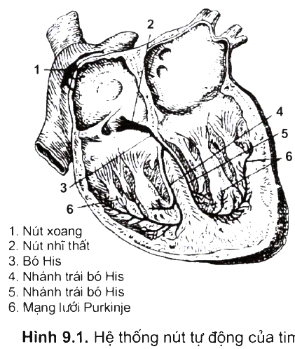

---

### 1.2. Các đặc tính sinh lý của cơ tim

Cơ tim sở hữu 4 đặc tính sinh lý cơ bản đảm bảo chức năng bơm máu tuần hoàn:

#### 1.2.1. Tính hưng phấn
Là khả năng đáp ứng với kích thích bằng cách phát sinh điện thế hoạt động, khởi động quá trình co cơ.

*Đặc điểm đáp ứng theo quy luật "tất cả hoặc không" (All-or-None Law):*
- Ở cơ vân, kích thích dưới ngưỡng không gây co; kích thích trên ngưỡng làm tăng lực co tỷ lệ thuận với cường độ kích thích (do huy động thêm số lượng đơn vị vận động).
- Ở cơ tim, do cấu trúc hợp bào và các liên kết khe dẫn truyền dòng điện khắp khối cơ:
  - Khi kích thích dưới ngưỡng: toàn bộ cơ tim hoàn toàn không co.
  - Khi kích thích đạt hoặc vượt ngưỡng: toàn bộ khối cơ tim lập tức co với biên độ tối đa (Hình 9.2).

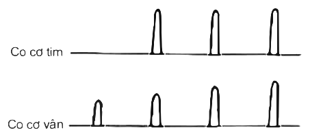

*Đặc điểm điện thế hoạt động của cơ tâm thất:*
- Điện thế nghỉ của sợi cơ tâm thất khoảng $-85$ đến $-90\text{ mV}$.
- Khi bị kích thích đạt ngưỡng, kênh $\text{Na}^+$ nhanh mở ra làm khử cực nhanh chóng đưa điện thế màng lên khoảng $+20\text{ mV}$ (pha 0).
- Sau đó, điện thế đỉnh được duy trì kéo dài khoảng 0,2 - 0,3 giây tạo nên giai đoạn **cao nguyên (plateau)** trước khi tái cực chậm (pha 2).
- Cơ chế tạo đường cao nguyên:
  1. Sự mở kéo dài của kênh canxi chậm ($L\text{-type } \text{Ca}^{2+}\text{-Na}^+$ channel), cho phép dòng ion $\text{Ca}^{2+}$ đi vào tế bào, duy trì trạng thái khử cực và kích thích giải phóng thêm $\text{Ca}^{2+}$ từ lưới nội cơ tương.
  2. Sự giảm tính thấm tức thời của màng tế bào đối với ion $\text{K}^+$, làm giảm dòng ion $\text{K}^+$ khuếch tán ra ngoài, ngăn cản tái cực sớm.

#### 1.2.2. Tính trơ có chu kỳ
Là đặc tính cơ tim không đáp ứng với kích thích lặp lại trong một khoảng thời gian nhất định của chu kỳ co bóp:
- Trong suốt thời kỳ tâm thu (co bóp), cơ tim rơi vào **giai đoạn trơ tuyệt đối**: dù kích thích với cường độ cực mạnh cơ tim cũng không co thêm.
- Giai đoạn trơ tương đối diễn ra ở cuối pha tái cực: kích thích mạnh hơn bình thường có thể tạo ra co bóp mới.
- Thời gian trơ của cơ thất kéo dài khoảng 0,25 - 0,30 giây (ở tâm nhĩ ngắn hơn, khoảng 0,15 giây).
- **Ý nghĩa sinh lý:** Nhờ thời gian trơ kéo dài suốt thời kỳ co, cơ tim không bao giờ bị co cứng (uốn ván / tetanus) như cơ vân, đảm bảo tim luôn luân phiên co và giãn nhịp nhàng để hút và bơm máu.

*Hiện tượng ngoại tâm thu và nghỉ bù:*
- Nếu kích thích tác động vào thời kỳ tim đang giãn (tâm trương), cơ tim sẽ đáp ứng bằng một nhịp co bóp phụ gọi là **ngoại tâm thu**.
- Sau ngoại tâm thu, tim giãn ra và nghỉ một khoảng thời gian dài hơn bình thường, gọi là **giai đoạn nghỉ bù** (Hình 9.3).
- **Cơ chế nghỉ bù:** Xung động bình thường tiếp theo phát ra từ nút xoang truyền đến tâm thất rơi đúng vào thời kỳ trơ của nhịp ngoại tâm thu vừa diễn ra, do đó xung này bị dập tắt không gây co bóp. Cơ thất phải đợi xung động kế tiếp của nút xoang mới đập lại, tạo nên khoảng nghỉ bù.

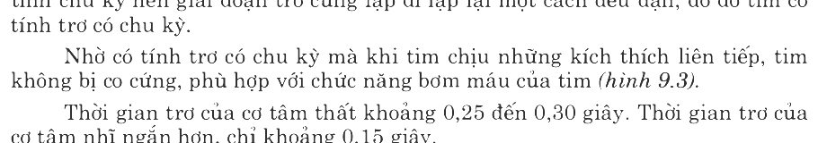

#### 1.2.3. Tính nhịp điệu
Là khả năng của hệ thống nút tự phát xung động nhịp nhàng mà không cần kích thích từ bên ngoài.
- **Cơ chế:** Tế bào nút xoang có điện thế nghỉ kém âm hơn (khoảng $-55$ đến $-60\text{ mV}$). Màng tế bào tự động có hiện tượng "rò rỉ" ion $\text{Na}^+$ và $\text{Ca}^{2+}$ đi vào tế bào (dòng $I_f$ hay dòng "funny"), làm điện thế màng tự động khử cực chậm trong thời kỳ tâm trương (prepotential) cho đến khi đạt ngưỡng kích thích ($-40\text{ mV}$), phát sinh điện thế hoạt động mới.
- Tần số phát nhịp giảm dần theo bậc thang tự động học:
  - Nút xoang: 70 - 80 lần/phút (chủ nhịp bình thường).
  - Nút nhĩ - thất: 40 - 60 lần/phút.
  - Bó His: 30 - 40 lần/phút.
  - Mạng Purkinje: 15 - 40 lần/phút.
- Do nút xoang có tần số phát xung cao nhất nên nó áp đặt nhịp đập cho toàn tim theo hiện tượng "chỉ huy nhịp" (overdrive suppression).

#### 1.2.4. Tính dẫn truyền
Là khả năng truyền đạt xung động điện học qua cơ tim và hệ thống nút:
- Cơ tâm nhĩ và cơ tâm thất: tốc độ khoảng 0,3 - 0,5 m/s.
- Nút nhĩ - thất: tốc độ chậm nhất, khoảng 0,05 - 0,2 m/s (tạo khoảng trễ sinh lý cần thiết cho tống máu nhĩ).
- Bó His và mạng Purkinje: tốc độ nhanh nhất, đạt 1,5 - 4 m/s (giúp kích thích hai tâm thất khử cực đồng thì từ trong ra ngoài, từ mỏm lên đáy).

---

### 1.3. Chu kỳ hoạt động của tim (Chu chuyển tim)

Chu kỳ tim là một chuỗi các biến cố điện học, cơ học, áp suất và thể tích lặp đi lặp lại một cách nhịp nhàng theo một trình tự xác định.

#### 1.3.1. Thí nghiệm chứng minh chu kỳ tim
Năm 1861, Chauveau và Marey đã luồn hai ống thông qua tĩnh mạch cảnh vào tâm nhĩ phải và tâm thất phải ở ngựa, gắn với trống ghi Marey để vẽ nên **tâm động đồ**, chứng minh các buồng tim co giãn theo trình tự nối tiếp nhĩ thu -> thất thu -> tâm trương toàn bộ.

#### 1.3.2. Các giai đoạn của chu kỳ tim (ở người bình thường tần số 75 nhịp/phút, chu kỳ kéo dài 0,80 giây)

1. **Giai đoạn tâm nhĩ thu (0,10 giây):**
   - Nút xoang phát xung làm cơ hai tâm nhĩ co lại. Áp suất trong nhĩ tăng lên (khoảng 4 - 6 mmHg ở nhĩ phải, 7 - 8 mmHg ở nhĩ trái).
   - Máu được bơm nốt từ nhĩ xuống thất qua van nhĩ - thất mở. Lượng máu này đóng góp khoảng 20 - 35% lượng máu đổ đầy thất (gọi là "nhát bóp nhĩ").
   - Sau khi nhĩ thu xong, nhĩ bắt đầu giãn suốt 0,70 giây còn lại của chu kỳ để tiếp nhận máu từ các tĩnh mạch lớn.

2. **Giai đoạn tâm thất thu (0,30 giây):**
   Gồm hai thời kỳ:
   - *Thời kỳ tăng áp (co đẳng tích / co đẳng trường, 0,05 giây):*
     - Cơ tâm thất bắt đầu co mạnh, áp suất trong thất tăng vọt vượt qua áp suất trong tâm nhĩ làm van nhĩ - thất đóng lại ngay lập tức (gây nên thành phần chính của tiếng tim thứ nhất $T_1$).
     - Lúc này van bán nguyệt vẫn chưa mở (vì áp suất thất chưa vượt áp suất động mạch chủ ~80 mmHg và động mạch phổi ~10 mmHg).
     - Toàn bộ các van đều đóng, tâm thất là buồng kín; thể tích máu trong thất không đổi, chiều dài sợi cơ không đổi, nhưng sức căng cơ và áp suất tăng cực nhanh.
   - *Thời kỳ tống máu (0,25 giây):*
     - Khi áp suất tâm thất trái vượt áp suất động mạch chủ (>80 mmHg) và thất phải vượt động mạch phổi (>10 mmHg), van tổ chim mở toang. Máu được phun mạnh vào động mạch.
     - Chia làm hai thì:
       + *Thì tống máu nhanh (0,09 giây):* Tống khoảng 4/5 (80%) lượng máu của thể tích tâm thu; áp suất thất trái đạt đỉnh (khoảng 120 mmHg).
       + *Thì tống máu chậm (0,16 giây):* Tống khoảng 1/5 (20%) lượng máu còn lại; cơ tim bắt đầu giảm sức co, áp suất thất hạ dần.
     - Lượng máu mỗi tâm thất tống ra trong một lần co bóp lúc nghỉ ngơi gọi là **thể tích tâm thu** ($Q_s$ hay SV - Stroke Volume), khoảng 60 - 70 ml.

3. **Giai đoạn tâm trương toàn bộ (0,40 giây):**
   - Sau khi co xong, tâm thất bắt đầu giãn ra. Áp suất trong buồng thất hạ xuống nhanh chóng.
   - Khi áp suất thất hạ thấp hơn áp suất trong động mạch, dòng máu có xu hướng dội ngược lại làm đóng sập các van bán nguyệt (tạo nên tiếng tim thứ hai $T_2$).
   - *Thời kỳ giãn đẳng tích (0,08 giây):* Thất tiếp tục giãn, cả van bán nguyệt và van nhĩ - thất đều đóng kín. Thể tích buồng thất không đổi, áp suất hạ dốc đứng.
   - *Thời kỳ đầy thất (0,32 giây):*
     - Khi áp suất thất hạ thấp hơn áp suất trong tâm nhĩ, van nhĩ - thất mở toang. Máu từ nhĩ ùa xuống thất.
     - Chia làm hai thì:
       + *Thì đầy thất nhanh (0,11 giây):* Máu ùa xuống nhanh chóng, chiếm khoảng 65 - 70% tổng lượng máu đổ đầy thất.
       + *Thì đầy thất chậm (0,21 giây):* Dòng máu từ tĩnh mạch chảy trực tiếp qua nhĩ xuống thất với tốc độ chậm hơn.
   - Cuối giai đoạn tâm trương toàn bộ, tâm nhĩ lại co bóp mở đầu cho chu kỳ tim kế tiếp.

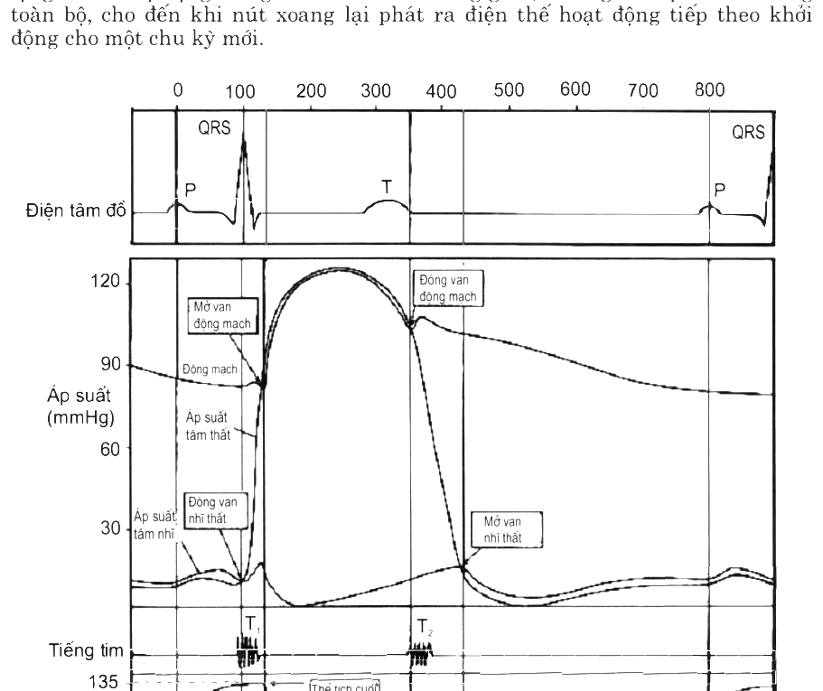

---

### 1.4. Lưu lượng và công của tim

#### 1.4.1. Lưu lượng tim (Cardiac Output - $Q^\bullet$ hay CO)
- **Thể tích tâm thu ($Q_s$ hay SV):** Lượng máu tống ra trong một nhát bóp (~60 - 70 ml lúc nghỉ). Thể tích máu trong tâm thất cuối kỳ tâm trương (EDV) khoảng 110 - 120 ml; thể tích máu còn lại cuối kỳ tâm thu (ESV) khoảng 40 - 50 ml. Phân suất tống máu (Ejection Fraction - EF):
  $$\text{EF} = \frac{\text{SV}}{\text{EDV}} = \frac{Q_s}{\text{EDV}} \approx 60 - 70\%$$
- **Lưu lượng tim ($Q^\bullet$):** Lượng máu mỗi tâm thất bơm vào động mạch trong 1 phút:
  $$Q^\bullet = Q_s \times f$$
  Trong đó:
  - $Q_s$: thể tích tâm thu (ml/nhịp).
  - $f$: tần số tim (nhịp/phút).
  - Lúc nghỉ ngơi: $Q^\bullet = 70\text{ ml} \times 75\text{ nhịp/phút} \approx 5000\text{ ml/phút} = 5\text{ lít/phút}$. Khi vận động thể lực nặng, $Q^\bullet$ có thể tăng lên 20 - 25 lít/phút.

*Đo lưu lượng tim theo nguyên lý Fick:*
Lưu lượng tim được xác định dựa trên mức tiêu thụ oxy toàn thân và độ chênh oxy máu động - tĩnh mạch:
$$Q^\bullet = \frac{V_{\text{O}_2}}{V_{\text{O}_2\text{a}} - V_{\text{O}_2\text{v}}}$$
Trong đó:
- $V_{\text{O}_2}$: Thể tích oxy cơ thể tiêu thụ trong 1 phút (ml/phút).
- $V_{\text{O}_2\text{a}}$: Nồng độ oxy trong máu động mạch (ml/lít).
- $V_{\text{O}_2\text{v}}$: Nồng độ oxy trong máu tĩnh mạch trộn (lấy từ động mạch phổi) (ml/lít).

#### 1.4.2. Công của tim
Tim tiêu hao năng lượng hóa học để thực hiện công cơ học dưới hai dạng:
1. **Công thể tích - áp suất (công ngoài):** Công chuyển một thể tích máu từ hệ tĩnh mạch áp suất thấp sang hệ động mạch áp suất cao:
   $$A = Q^\bullet \times \Delta P$$
   hoặc tính cho một nhát bóp:
   $$A_{\text{nhát}} = Q_s \times \Delta P$$
   Trong đó: $\Delta P$ là hiệu số áp suất tâm thu trung bình và áp suất tâm trương trung bình của buồng thất. Công của tâm thất phải xấp xỉ bằng $1/6$ công của tâm thất trái do áp lực tuần hoàn phổi thấp hơn nhiều.
2. **Công động học của dòng máu:** Công gia tốc khối lượng máu đạt vận tốc chảy:
   $$E_k = \frac{m v^2}{2}$$
   Trong điều kiện bình thường, công động học chỉ chiếm khoảng 1% tổng công của thất. Tuy nhiên, trong các bệnh lý hẹp van động mạch, máu phun qua lỗ hẹp với vận tốc cực lớn ($v$ rất cao), công động học có thể chiếm tới 50% tổng công tiêu hao của cơ tim.

---

### 1.5. Những biểu hiện bên ngoài của chu kỳ tim và thăm dò chức năng tim

#### 1.5.1. Mỏm tim đập
Khi tâm thất co bóp, tim vặn xoắn và mỏm tim bật ra phía trước đập vào thành ngực. Vị trí bình thường sờ hoặc nhìn thấy ở khoang liên sườn V trên đường giữa đòn trái. Thay đổi vị trí gõ mỏm tim giúp nhận biết phì đại thất hoặc dãn buồng tim trên lâm sàng.

#### 1.5.2. Tiếng tim và tâm thanh đồ (Phonocardiogram)
- **Tiếng thứ nhất ($T_1$):** 
  - Âm sắc trầm, dài (khoảng 0,10 - 0,12 giây), nghe rõ nhất ở vùng mỏm tim.
  - Cơ chế: Do đóng van nhĩ - thất (hai lá và ba lá), rung cơ tâm thất khi co và mở van tổ chim kèm dòng máu tống vào động mạch. Van hai lá đóng trước van ba lá một khoảng rất ngắn.
- **Tiếng thứ hai ($T_2$):**
  - Âm sắc thanh, ngắn, đanh (khoảng 0,08 giây), nghe rõ nhất ở đáy tim (khoang liên sườn II hai bên xương ức).
  - Cơ chế: Do đóng sập van bán nguyệt (động mạch chủ $A_2$ và động mạch phổi $P_2$).
  - Hiện tượng tách đôi sinh lý: Ở thì hít vào, lồng ngực âm hơn hút máu về tim phải nhiều hơn, làm thất phải tống máu kéo dài hơn khiến van động mạch phổi đóng muộn hơn van động mạch chủ, nghe thấy $T_2$ tách đôi nhẹ.
- **Tiếng thứ ba ($T_3$):** Tiếng trầm, xuất hiện đầu thì tâm trương lúc đổ đầy thất nhanh làm căng đột ngột thành tâm thất. Có thể gặp sinh lý ở người trẻ.
- **Tiếng thứ tư ($T_4$):** Tiếng tiền tâm thu, xuất hiện khi tâm nhĩ co tống máu vào tâm thất giảm độ đàn hồi (thường là bệnh lý phì đại cơ thất).
- Tiếng thổi và tiếng rung bệnh lý: Xuất hiện khi dòng máu chảy xoáy qua các van tim bị hẹp hoặc hở.

#### 1.5.3. Điện tâm đồ (Electrocardiography - ECG)
Là đồ thị ghi lại các biến thiên điện thế hoạt động của tim truyền ra bề mặt cơ thể theo thời gian.

*Hệ thống các chuyển đạo thông dụng (12 chuyển đạo):*
- **3 chuyển đạo mẫu song cực chi (Bipolar limb leads):** Dựa trên tam giác đều Einthoven (Hình 9.5):
  - Chuyển đạo DI: Điện cực cổ tay phải (-) và cổ tay trái (+).
  - Chuyển đạo DII: Cổ tay phải (-) và cổ chân trái (+). Trục dẫn truyền gần trùng nhất với trục giải phẫu của tim.
  - Chuyển đạo DIII: Cổ tay trái (-) và cổ chân trái (+).
  - Định luật Einthoven: $\text{DII} = \text{DI} + \text{DIII}$.
- **3 chuyển đạo đơn cực chi tăng cường (Augmented unipolar limb leads):** aVR (cổ tay phải), aVL (cổ tay trái), aVF (cổ chân trái).
- **6 chuyển đạo đơn cực trước tim (Precordial leads):** Đặt trên thành ngực thăm dò trực tiếp điện thế thất:
  - $V_1$: Liên sườn IV bờ phải xương ức.
  - $V_2$: Liên sườn IV bờ trái xương ức. ($V_1, V_2$ phản ánh thành trước thất phải).
  - $V_3$: Điểm giữa $V_2$ và $V_4$.
  - $V_4$: Giao điểm liên sườn V với đường giữa đòn trái. ($V_3, V_4$ phản ánh vách liên thất).
  - $V_5$: Liên sườn V trên đường nách trước trái.
  - $V_6$: Liên sườn V trên đường nách giữa trái. ($V_5, V_6$ phản ánh thành bên thất trái).

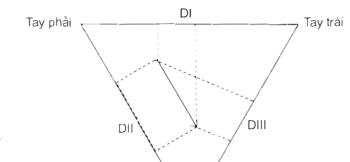

*Phân tích các sóng trên điện tâm đồ bình thường (ở chuyển đạo DII - Hình 9.6):*
- **Sóng P:** Sóng khử cực hai tâm nhĩ. Sóng dương, tròn, biên độ 0,15 - 0,20 mV, thời gian 0,08 - 0,10 giây.
- **Khoảng PR (hoặc PQ):** Thời gian dẫn truyền xung động từ tâm nhĩ qua nút nhĩ - thất xuống cơ tâm thất. Kéo dài 0,12 - 0,20 giây (trung bình 0,15 giây). Nếu $\text{PR} > 0,20$ giây biểu hiện block nhĩ - thất.
- **Phức bộ QRS:** Sóng khử cực hai tâm thất. 
  - Gồm sóng Q âm nhỏ (khử cực vách liên thất), sóng R dương nhọn cao (khử cực mỏm và thành tự do hai thất), sóng S âm (khử cực vùng đáy).
  - Biên độ cao nhất ở DII (1,0 - 1,5 mV), thời gian ngắn: 0,06 - 0,10 giây (trung bình 0,07 giây). Nếu giãn rộng $> 0,12$ giây chứng tỏ chậm dẫn truyền trong thất (block nhánh).
- **Đoạn ST:** Giai đoạn hai thất hoàn toàn khử cực (tương ứng pha cao nguyên của điện thế hoạt động), bình thường nằm trên đường đẳng điện. Chênh lên hoặc chênh xuống có giá trị chẩn đoán thiếu máu cục bộ hoặc nhồi máu cơ tim.
- **Sóng T:** Sóng tái cực hai tâm thất. Sóng dương, sườn lên thoai thoải, sườn xuống dốc, biên độ $\ge 1/4$ sóng R (~0,30 mV), thời gian khoảng 0,20 giây.
- **Khoảng QT:** Thời gian tâm thu điện học của tâm thất (toàn bộ khử cực và tái cực thất), kéo dài 0,35 - 0,42 giây tùy theo tần số tim.

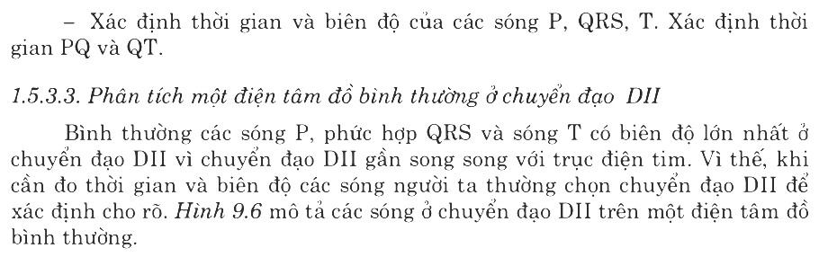

---

### 1.6. Điều hòa hoạt động tim

Hoạt động tim biến đổi linh hoạt nhằm đáp ứng nhu cầu oxy và chuyển hóa của cơ thể thông qua các cơ chế tự điều hòa nội tại, thần kinh và thể dịch:

#### 1.6.1. Cơ chế tự điều hòa theo định luật Frank - Starling
- **Phát biểu:** Trong giới hạn sinh lý, lực co của cơ tim tỷ lệ thuận với chiều dài sợi cơ tim trước khi co (tức là tỷ lệ với thể tích cuối tâm trương hay mức độ đổ đầy thất).
- **Cơ chế:** Khi lượng máu tĩnh mạch trở về tâm thất nhiều làm các sợi cơ tim bị kéo giãn tới mức tối ưu, các đầu cầu nối actin - myosin ăn khớp hoàn hảo nhất, giải phóng nhiều ion $\text{Ca}^{2+}$ hơn tạo lực co tâm thu mạnh hơn, tống hết lượng máu thừa vào động mạch, ngăn ứ đọng máu trong tim.
- Tuy nhiên, nếu giãn quá mức giới hạn sinh lý, các cầu nối bị trượt tách rời, lực co cơ tim sẽ suy giảm đột ngột (gặp trong suy tim mất bù).

#### 1.6.2. Điều hòa theo cơ chế thần kinh
Hệ thần kinh tự chủ (Autonomic Nervous System) chi phối chặt chẽ hoạt động tim:

1. **Hệ thần kinh phó giao cảm (dây X - dây phế vị):**
   - Trung tâm nằm ở nhân lưng dây X tại hành não. Sợi trước hạch theo dây X đến các hạch cạnh tim, sợi sau hạch phân nhánh chủ yếu tới nút xoang và nút nhĩ - thất (ít chi phối cơ thất).
   - Chất dẫn truyền thần kinh: **Acetylcholin**, tác động lên thụ thể muscarinic ($M_2$).
   - Tác dụng:
     - Giảm tần số phát xung nút xoang (làm tim đập chậm).
     - Giảm tốc độ dẫn truyền qua nút nhĩ - thất (kéo dài khoảng PR).
     - Giảm lực co bóp tâm nhĩ.
     - Giảm trương lực và tính hưng phấn cơ tim.
   - Thí nghiệm kích thích dây X ở cổ chó: làm tim đập chậm, yếu dần rồi ngừng đập. Nếu duy trì kích thích liên tục, tim sẽ tự đập trở lại sau vài giây do bó His tự phát nhịp - gọi là **hiện tượng thoát ức chế (vagal escape)**.

2. **Hệ thần kinh giao cảm:**
   - Trung tâm nằm ở sừng bên chất xám tủy sống đoạn ngực $T_1 - T_5$. Các sợi trước hạch đến hạch giao cảm cạnh cột sống (chuỗi hạch giao cảm cổ và ngực, tạo thành hạch sao). Sợi sau hạch phân phối phong phú đến nút xoang, nút nhĩ - thất, bó His và toàn bộ khối cơ tâm thất.
   - Chất dẫn truyền thần kinh: **Noradrenalin**, tác động lên thụ thể $\beta_1\text{-adrenergic}$.
   - Tác dụng:
     - Tăng tần số phát xung nút xoang (tim đập nhanh).
     - Tăng tốc độ dẫn truyền qua hệ thống nút và cơ tim.
     - Tăng mạnh lực co bóp của cả cơ tâm nhĩ và cơ tâm thất (tăng thể tích tâm thu).
     - Tăng tính hưng phấn và trương lực cơ tim.

3. **Các phản xạ điều hòa tim:**
   - *Phản xạ giảm áp (phản xạ xoang cảnh và quai động mạch chủ):* Khi huyết áp động mạch tăng làm căng thành xoang cảnh và quai động mạch chủ, kích thích các thụ thể áp suất (baroreceptor). Xung động truyền theo dây thần kinh Hering (nhánh dây IX) và dây Cyon (nhánh dây X) về hành não, kích thích trung tâm dây X và ức chế trung tâm giao cảm, làm tim đập chậm và yếu, giúp hạ huyết áp về bình thường.
   - *Phản xạ tăng nhịp tim do hóa cảm thụ quan:* Khi nồng độ $\text{O}_2$ máu giảm, $\text{CO}_2$ hoặc $\text{H}^+$ tăng, các thụ thể hóa học ở xoang cảnh và tiểu thể động mạch chủ bị kích thích, truyền xung về ức chế dây X và hưng phấn giao cảm, làm tim đập nhanh để tăng cung cấp máu.
   - *Phản xạ tim - tim (Phản xạ Bainbridge):* Khi máu tĩnh mạch đổ về nhĩ phải nhiều làm căng vùng tiếp giáp tĩnh mạch chủ - nhĩ phải, kích thích các thụ thể căng truyền tín hiệu về hành não ức chế dây X, làm tim đập nhanh tống máu đi, giải tỏa ứ trệ tim phải.
   - *Phản xạ mắt - tim (Nghiệm pháp Dagnini - Aschner):* Ép mạnh vào hai nhãn cầu kích thích đầu mút dây V, truyền xung về hành não kích thích dây X làm tim đập chậm lại (dùng để cắt cơn nhịp nhanh kịch phát trên thất).
   - *Phản xạ Goltz:* Đánh mạnh vào vùng thượng vị hoặc co kéo các tạng trong ổ bụng kích thích đám rối tạng, truyền xung theo dây giao cảm về hành não kích thích dữ dội dây X, có thể làm tim ngừng đập hoàn toàn do phản xạ ức chế tim.

4. **Ảnh hưởng của vỏ não và các trung tâm thần kinh cao cấp:** Cảm xúc mạnh (lo lắng, sợ hãi, hồi hộp) tác động qua hệ viền (limbic) và vùng dưới đồi làm thay đổi nhịp tim; trung tâm hô hấp và trung tâm nuốt ở hành não cũng ảnh hưởng nhẹ lên nhịp tim (nhịp tim tăng nhẹ khi hít vào hoặc khi nuốt).

#### 1.6.3. Điều hòa theo cơ chế thể dịch
- **Hormon tuyến tủy thượng thận:** Adrenalin và Noradrenalin được tiết vào máu gắn lên thụ thể $\beta_1$, làm tim đập nhanh và co bóp rất mạnh.
- **Hormon tuyến giáp ($T_3, T_4$):** Tăng nhịp tim, tăng nhạy cảm của thụ thể tim với catecholamine, tăng chuyển hóa tiêu thụ oxy.
- **Nồng độ khí máu:** Thiếu oxy hoặc tăng $\text{CO}_2$ mức độ vừa phải làm tim đập nhanh; nhưng nếu thiếu oxy nặng hoặc tích lũy $\text{CO}_2$ quá cao kéo dài sẽ ức chế chuyển hóa tế bào cơ tim làm tim đập chậm, yếu và ngừng tim.
- **Nồng độ ion dịch ngoại bào:**
  - Nồng độ ion $\text{Ca}^{2+}$ tăng: tăng trương lực và lực co cơ tim, nếu tăng quá cao gây ngừng tim ở thì tâm thu.
  - Nồng độ ion $\text{K}^+$ tăng: làm giảm điện thế màng, giảm tính hưng phấn và tốc độ dẫn truyền, cơ tim giãn ra mềm nhũn, nhịp chậm, nếu tăng cao gây ngừng tim ở thì tâm trương.
- **Nhiệt độ cơ thể:** Thân nhiệt tăng (sốt, vận động) làm tăng tốc độ khử cực nút xoang khiến nhịp tim tăng (tăng $1^\circ\text{C}$ nhịp tim tăng khoảng 10 nhịp/phút); hạ thân nhiệt nhân tạo làm tim đập chậm giúp giảm tiêu hao oxy trong phẫu thuật tim mạch.

---

## 2. SINH LÝ TUẦN HOÀN ĐỘNG MẠCH

Động mạch là hệ thống ống dẫn có tính chun giãn và co thắt, vận chuyển máu giàu oxy từ tim với áp lực cao đến khắp các mô.

### 2.1. Đặc điểm cấu trúc - chức năng của động mạch
- Càng đi xa tim, động mạch chia nhánh nhỏ dần, tổng thiết diện của toàn hệ mạch tăng lên rõ rệt (tổng thiết diện mao mạch gấp khoảng 1000 lần động mạch chủ), do đó vận tốc máu giảm dần từ trung tâm ra ngoại vi.
- Thành động mạch cấu tạo gồm 3 lớp:
  - Lớp trong cùng: Tế bào nội mô trơn láng, giảm ma sát.
  - Lớp giữa: Gồm sợi cơ trơn và sợi chun đàn hồi. Ở động mạch lớn (động mạch chủ, động mạch cảnh), sợi chun chiếm ưu thế; ở các tiểu động mạch, sợi cơ trơn chiếm ưu thế.
  - Lớp ngoài: Mô liên kết giàu sợi collagen và có mạng mạch nuôi mạch (vasa vasorum) cùng các sợi thần kinh vận mạch.

### 2.2. Đặc tính sinh lý của động mạch

#### 2.2.1. Tính đàn hồi
Là khả năng thành động mạch dãn rộng ra khi có áp lực máu tác động trong thời kỳ tâm thu và tự co hồi về kích thước ban đầu trong thời kỳ tâm trương.

*Thí nghiệm Marey (Hình 9.7):*
Marey dùng bình nước có áp suất không đổi, đáy nối với hai ống có cùng đường kính: ống I bằng cao su đàn hồi và ống II bằng thủy tinh cứng.
- Khi mở khóa cho nước chảy liên tục: lượng nước chảy ra từ hai ống xấp xỉ nhau.
- Khi điều chỉnh khóa đóng ngắt nhịp nhàng: nước chảy ra từ ống thủy tinh ngắt quãng theo từng nhịp đóng mở; còn nước chảy ra từ ống cao su lại thành dòng liên tục và lưu lượng lớn hơn hẳn.
- **Ý nghĩa sinh lý:** Nhờ tính đàn hồi của động mạch lớn, một phần động năng của tim trong thì tâm thu được chuyển thành thế năng đàn hồi tích lũy làm căng thành mạch. Trong thì tâm trương khi tim không bơm máu, thế năng này giải phóng ép vào dòng máu, đẩy máu tiếp tục chảy liên tục về phía ngoại vi với áp lực ổn định, đồng thời làm giảm tải sức cản và tiết kiệm công bơm máu cho cơ tim.

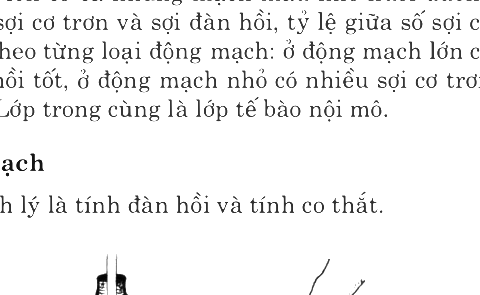

#### 2.2.2. Tính co thắt
Là khả năng co nhỏ lại của lòng động mạch nhờ các sợi cơ trơn ở lớp áo giữa, đặc biệt là ở các tiểu động mạch.
- **Ý nghĩa sinh lý:** Tiểu động mạch hoạt động như những "vòi khóa", có thể thay đổi đường kính để điều hòa sức cản ngoại vi, phân phối lưu lượng máu thích hợp đến từng cơ quan tùy theo trạng thái chức năng (ví dụ dãn mạch ở cơ vân khi vận động, co mạch ở tạng tiêu hóa lúc đói và dãn mạch sau khi ăn).

---

### 2.3. Huyết áp động mạch

Huyết áp là áp lực của máu tác động lên một đơn vị diện tích thành động mạch, là kết quả của sự tương tác giữa lực bơm máu của tim và sức cản của hệ mạch.

#### 2.3.1. Thí nghiệm đo huyết áp trực tiếp
Bộc lộ động mạch cảnh của động vật nối với huyết áp kế Ludwig chứa thủy ngân, mặt thoáng cột thủy ngân dao động theo nhịp tim và nhịp hô hấp tạo nên đường cong huyết áp với 3 loại sóng (Hình 9.8):
- **Sóng $\alpha$ (sóng cấp I):** Các sóng nhỏ, lăn tăn, tần số trùng với nhịp co bóp của tim (tăng ở thì tâm thu, giảm ở thì tâm trương).
- **Sóng $\beta$ (sóng cấp II):** Sóng lượn lớn bao trùm nhiều sóng $\alpha$, trùng với nhịp hô hấp (huyết áp tăng nhẹ ở thì hít vào do máu về tim nhiều, giảm ở thì thở ra).
- **Sóng $\gamma$ (sóng cấp III):** Sóng rất lớn, chậm chạp, nối các đỉnh sóng $\beta$, do dao động trương lực của trung tâm vận mạch ở hành não.

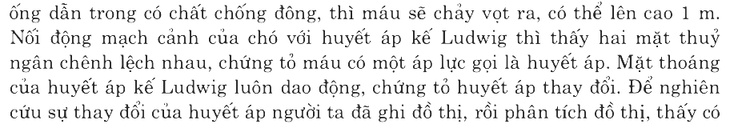

#### 2.3.2. Các loại trị số huyết áp động mạch
1. **Huyết áp tâm thu ($HA_{\text{TT}}$ hay Huyết áp tối đa):**
   - Áp lực máu cao nhất đạt được trong chu kỳ tim, tương ứng với thì tâm thất thu tống máu.
   - Phụ thuộc chủ yếu vào lực co bóp của cơ tim và thể tích tâm thu.
   - Bình thường ở người trưởng thành: 90 đến dưới 140 mmHg (tối ưu khoảng 110 - 120 mmHg).
2. **Huyết áp tâm trương ($HA_{\text{TTr}}$ hay Huyết áp tối thiểu):**
   - Áp lực máu thấp nhất ở cuối thì tâm trương của tim trước nhát bóp kế tiếp.
   - Phụ thuộc chủ yếu vào sức cản ngoại vi và tính đàn hồi của thành mạch.
   - Bình thường ở người trưởng thành: 60 đến dưới 90 mmHg (tối ưu khoảng 70 - 80 mmHg).
3. **Huyết áp hiệu số (Huyết áp kẹt / Pulse Pressure - $HA_{\text{HS}}$):**
   $$HA_{\text{HS}} = HA_{\text{TT}} - HA_{\text{TTr}}$$
   - Bình thường khoảng 40 - 50 mmHg.
   - Là điều kiện cho máu lưu thông liên tục. Khi $HA_{\text{HS}} \le 20$ mmHg gọi là huyết áp kẹt, dòng máu lưu thông bị trở ngại nghiêm trọng, thường gặp trong sốc hoặc suy tim.
4. **Huyết áp trung bình ($HA_{\text{TB}}$ - Mean Arterial Pressure - MAP):**
   - Áp suất trung bình tạo ra trong suốt chu kỳ tim, phản ánh hiệu lực tưới máu thực sự cho các cơ quan. Do thì tâm trương kéo dài gấp đôi thì tâm thu nên tính theo công thức:
   $$HA_{\text{TB}} = HA_{\text{TTr}} + \frac{1}{3} HA_{\text{HS}}$$
   - Ví dụ huyết áp 120/80 mmHg thì $HA_{\text{TB}} = 80 + \frac{1}{3}(120 - 80) \approx 93,3\text{ mmHg}$.

#### 2.3.3. Các yếu tố ảnh hưởng lên huyết áp động mạch

Theo định luật Poiseuille trong thủy động học, lưu lượng chất lỏng chảy qua ống hình trụ (Hình 9.9):
$$Q^\bullet = \Delta P \cdot \frac{\pi r^4}{8 \eta L} = \frac{P_1 - P_2}{R}$$
Trong đó:
- $Q^\bullet$: Lưu lượng chất lỏng.
- $\Delta P = P_1 - P_2$: Hiệu số áp suất hai đầu ống.
- $r$: Bán kính lòng ống.
- $L$: Chiều dài ống.
- $\eta$: Độ nhớt (độ quánh) của chất lỏng.
- Sức cản dòng chảy $R$ được xác định bởi:
  $$R = \frac{8 \eta L}{\pi r^4}$$

Áp dụng vào hệ tuần hoàn đại tuần hoàn, coi áp suất cuối tĩnh mạch chủ $P_2 \approx 0\text{ mmHg}$, ta có phương trình huyết động học cơ bản:
$$P = Q^\bullet \times R$$
hoặc:
$$HA_{\text{TB}} = \text{CO} \times \text{TPR}$$
*(Trong đó $\text{CO}$ là lưu lượng tim, $\text{TPR}$ là tổng sức cản ngoại vi).*

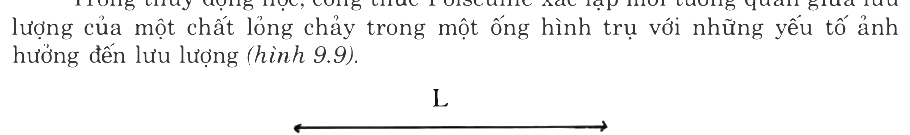

Từ công thức trên, các yếu tố quyết định huyết áp gồm:
1. **Lưu lượng tim ($Q^\bullet = Q_s \times f$):**
   - Lực co cơ tim tăng làm tăng thể tích tâm thu $Q_s \implies HA_{\text{TT}}$ tăng.
   - Nhịp tim tăng ở mức độ vừa phải (dưới 140 nhịp/phút) làm tăng lưu lượng tim $\implies$ huyết áp tăng. Nếu nhịp tim quá nhanh (>140 - 160 nhịp/phút), thời gian tâm trương bị rút ngắn quá nhiều, máu không kịp về thất làm $Q_s$ giảm mạnh, dẫn đến lưu lượng tim giảm và huyết áp tụt.
2. **Thể tích máu toàn phần:** Thể tích máu tăng (truyền dịch nhiều) làm tăng huyết áp; mất máu, mất nước nặng do nôn, tiêu chảy làm tụt huyết áp gây sốc.
3. **Độ nhớt (độ quánh) của máu ($\eta$):** Do số lượng hồng cầu (hematocrit) và nồng độ protein huyết tương quyết định. Đa hồng cầu làm máu đặc, sức cản $R$ tăng gây tăng huyết áp; thiếu máu nặng làm huyết áp giảm.
4. **Đường kính và sức cản của mạch máu ($R \propto \frac{1}{r^4}$):**
   - Sức cản mạch tỷ lệ nghịch với lũy thừa bậc 4 của bán kính. Khi mạch co lại một nửa, sức cản tăng gấp 16 lần làm huyết áp tăng vọt. Đây là cơ chế điều hòa huyết áp tức thời quan trọng nhất của cơ thể.
5. **Tính đàn hồi của thành mạch:** Ở người cao tuổi, thành mạch bị xơ cứng, mất tính đàn hồi làm huyết áp tâm thu tăng cao và huyết áp tâm trương giảm.

#### 2.3.4. Biến đổi sinh lý của huyết áp
- **Theo tuổi:** Càng lớn tuổi huyết áp càng tăng dần do xơ cứng thành mạch sinh lý.
- **Theo vận động thể lực:** Vận động làm tăng lưu lượng tim khiến huyết áp tâm thu tăng cao; huyết áp tâm trương ít thay đổi hoặc giảm nhẹ do dãn mạch cơ vân.
- **Theo chế độ ăn:** Ăn nhiều muối tăng áp suất thẩm thấu kéo nước vào lòng mạch làm tăng thể tích máu $\implies$ tăng huyết áp.
- **Theo nhịp ngày đêm và cảm xúc:** Huyết áp thấp nhất vào ban đêm khi ngủ, cao nhất vào ban ngày khi hoạt động; căng thẳng, lo âu, giận dữ kích thích giao cảm làm huyết áp tăng vọt.

---

### 2.4. Điều hòa tuần hoàn động mạch

#### 2.4.1. Cơ chế thần kinh
Tác dụng nhanh chóng, tức thì trong vòng vài giây:
1. **Trung tâm vận mạch ở hành não:** Gồm vùng co mạch (tiết noradrenalin kích thích tủy sống gây co mạch) và vùng dãn mạch (ức chế vùng co mạch). Duy trì một trương lực co mạch thường trực.
2. **Hệ giao cảm vận mạch:** Các sợi giao cảm hậu hạch giải phóng Noradrenalin tác động lên thụ thể $\alpha_1\text{-adrenergic}$ ở cơ trơn tiểu động mạch gây co mạch mạnh mẽ, tăng sức cản ngoại vi và nâng huyết áp.
3. **Các phản xạ điều hòa huyết áp:**
   - *Phản xạ thụ thể áp suất (Baroreceptor reflex):* Thụ thể ở xoang cảnh và quai động mạch chủ phản ứng cực kỳ nhạy với sự thay đổi huyết áp (hoạt động hiệu quả trong khoảng 60 - 180 mmHg). Huyết áp tăng $\implies$ xung động truyền về hành não kích thích dây X và ức chế trung tâm co mạch $\implies$ dãn mạch, tim đập chậm $\implies$ huyết áp hạ về bình thường. Ngược lại khi tụt huyết áp (như đổi tư thế đứng đột ngột), phản xạ làm co mạch và tăng nhịp tim để duy trì tưới máu não.
   - *Phản xạ thụ thể hóa học (Chemoreceptor reflex):* Khi huyết áp hạ dưới 80 mmHg làm giảm tưới máu tiểu thể cảnh và quai chủ, gây thiếu oxy và tích tụ $\text{CO}_2, \text{H}^+$, kích thích trung tâm co mạch làm tăng mạnh huyết áp.
   - *Phản xạ thiếu máu hệ thần kinh trung ương (Cushing response):* Khi áp lực nội sọ tăng cao chèn ép tưới máu trung tâm vận mạch não gây thiếu máu não nặng, trung tâm này hưng phấn cực độ làm co toàn bộ mạch ngoại vi, huyết áp tăng vọt lên mức rất cao.

#### 2.4.2. Cơ chế thể dịch
Tác dụng chậm hơn nhưng duy trì lâu dài:
1. **Các chất gây co mạch làm tăng huyết áp:**
   - **Hệ thống Renin - Angiotensin - Aldosteron (RAAS):** Khi huyết áp thận giảm hoặc lưu lượng máu đến thận giảm, tế bào cạnh cầu thận tiết enzyme **Renin** vào máu. Renin biến đổi Angiotensinogen thành Angiotensin I. Khi qua mao mạch phổi, enzyme chuyển (ACE) biến đổi Angiotensin I thành **Angiotensin II**. Angiotensin II là chất co mạch cực mạnh (mạnh gấp 30 lần noradrenalin), đồng thời kích thích vỏ thượng thận tiết **Aldosteron** làm tăng tái hấp thu ion $\text{Na}^+$ và nước ở ống lượn xa, làm tăng thể tích tuần hoàn và tăng huyết áp bền vững.
   - **Vasopressin (ADH - Hormon chống bài niệu):** Do vùng dưới đồi tổng hợp, thùy sau tuyến yên bài tiết khi áp suất thẩm thấu tăng hoặc thể tích máu giảm mạnh. Gây co mạch trực tiếp và tăng tái hấp thu nước ở ống góp.
   - **Adrenalin và Noradrenalin:** Tuyến tủy thượng thận tiết ra khi hưng phấn giao cảm.
   - **Endothelin:** Peptide do tế bào nội mô mạch máu tiết ra khi bị tổn thương, gây co mạch tại chỗ cực mạnh.
2. **Các chất gây dãn mạch làm hạ huyết áp:**
   - **Bradykinin và Histamin:** Gây dãn mạnh các tiểu động mạch và tăng tính thấm mao mạch, làm hạ huyết áp (đặc biệt trong phản vệ và viêm).
   - **Prostaglandin ($PGE_2, PGI_2$ - Prostacyclin):** Gây dãn mạch tại chỗ ở nhiều cơ quan.
   - **Nitric Oxide (NO - EDRF):** Do tế bào nội mô mạch máu liên tục tiết ra dưới tác động của dòng chảy trượt (shear stress), làm dãn cơ trơn thành mạch.
   - **Peptide lợi niệu tâm nhĩ (ANP):** Do tâm nhĩ tiết ra khi buồng nhĩ bị căng do ứ máu, có tác dụng dãn mạch, tăng bài tiết muối nước qua thận làm hạ huyết áp.

---

## 3. SINH LÝ TUẦN HOÀN TĨNH MẠCH

Tĩnh mạch dẫn máu từ mao mạch trở về tim với áp suất thấp, đồng thời là bể chứa máu chính của cơ thể (chứa khoảng 64% tổng thể tích máu tuần hoàn).

### 3.1. Đặc điểm cấu trúc - chức năng tĩnh mạch
- Thành tĩnh mạch mỏng hơn thành động mạch, ít sợi cơ trơn và sợi chun hơn nhưng có độ giãn nở (compliance) rất lớn, dễ dàng phình to chứa lượng máu lớn mà áp suất lòng mạch thay đổi rất ít.
- Các tĩnh mạch ở chi dưới có hệ thống **van tĩnh mạch một chiều** (cấu tạo bởi các nếp gấp hình bán nguyệt của lớp nội mạc), chỉ cho phép máu chảy từ ngoại vi về tim, ngăn chặn dòng máu chảy ngược do trọng lực.
- Một số cơ quan đóng vai trò kho chứa máu dự trữ: lách (chứa ~150 ml), gan (chứa hàng trăm ml), các tĩnh mạch lớn trong ổ bụng (~300 ml) và các đám rối tĩnh mạch dưới da.

### 3.2. Những nguyên nhân của tuần hoàn tĩnh mạch (Động lực đưa máu về tim)
Máu chảy trong tĩnh mạch nhờ sự phối hợp của các động lực sau:
1. **Động lực do tim:**
   - *Sức đẩy còn lại từ tâm thất:* Áp suất máu ở đầu mao mạch còn khoảng 30 mmHg, cuối mao mạch đầu tiểu tĩnh mạch còn khoảng 10 - 15 mmHg, trong khi áp suất tại tâm nhĩ phải xấp xỉ bằng $0\text{ mmHg}$. Sự chênh lệch áp suất này là động lực cơ bản đẩy máu chảy về tim.
   - *Sức hút của tim:* Trong thì tâm thất thu, sàn van nhĩ - thất bị kéo hạ xuống làm thể tích tâm nhĩ giãn to ra, áp suất nhĩ giảm hút máu về. Trong thì tâm trương toàn bộ, thất giãn tạo áp suất âm hút máu từ nhĩ xuống thất, gián tiếp hút máu từ các tĩnh mạch lớn về tim.
2. **Động lực do lồng ngực (Bơm hô hấp):**
   - Áp suất trong khoang màng phổi luôn âm so với khí quyển (khoảng $-2$ đến $-4\text{ mmHg}$ thì thở ra và xuống $-6$ đến $-8\text{ mmHg}$ thì hít vào).
   - Khi hít vào, lồng ngực mở rộng, áp suất âm lồng ngực càng sâu hơn làm các tĩnh mạch lớn trong ngực giãn ra, hút mạnh máu từ tĩnh mạch ngoại vi về tim. Đồng thời cơ hoành hạ xuống ép vào các tạng ổ bụng làm tăng áp suất tĩnh mạch bụng, càng đẩy máu ngược lên ngực.
3. **Động lực do co cơ (Bơm cơ - "Tim ngoại vi"):**
   - Các tĩnh mạch chi dưới nằm xen giữa các khối cơ vân. Khi cơ vận động co bóp, nó ép vào thành tĩnh mạch đẩy máu đi; nhờ hệ thống van một chiều, máu chỉ có thể chảy lên phía trên về tim. Khi cơ giãn ra, van dưới mở ra đón máu mới đổ về. Đây là cơ chế chủ đạo chống lại ứ trệ máu chi dưới khi đi lại.
4. **Động lực do động mạch đi kèm:** Các tĩnh mạch sâu đi kèm trong cùng một bao xơ với các động mạch lớn. Mỗi lần động mạch đập nở ra sẽ ép vào tĩnh mạch bên cạnh, tạo xung lực đẩy máu tĩnh mạch về tim.
5. **Ảnh hưởng của trọng lực:**
   - Đối với các phần cơ thể phía trên tim (đầu, mặt, cổ), trọng lực là yếu tố thuận lợi giúp máu tĩnh mạch tự động chảy dốc về tim.
   - Đối với các phần phía dưới tim, trọng lực cản trở dòng máu về tim. Khi đứng lâu bất động, áp lực thủy tĩnh tăng cao làm ứ máu ở tĩnh mạch chân (có thể tích tụ 500 ml máu), dễ gây dãn tĩnh mạch và tụt huyết áp tư thế do giảm lưu lượng máu về tim.

---

### 3.3. Động học tuần hoàn tĩnh mạch

#### 3.3.1. Huyết áp tĩnh mạch
- **Huyết áp tĩnh mạch trung tâm (CVP - Central Venous Pressure):** Là áp suất máu tại tâm nhĩ phải hoặc tĩnh mạch chủ sát tim. Bình thường có giá trị khoảng $0\text{ mmHg}$ (dao động từ $-4$ đến $+4\text{ mmHg}$, tương đương 0 - 6 $\text{cmH}_2\text{O}$).
- CVP phản ánh sự cân bằng giữa thể tích tuần hoàn trở về tim và khả năng bơm máu của tâm thất phải. CVP tăng cao (>10 - 15 $\text{cmH}_2\text{O}$) trong suy tim phải, tràn dịch màng ngoài tim, ứ trệ dịch; CVP giảm âm sâu trong giảm thể tích tuần hoàn nặng hoặc sốc.

#### 3.3.2. Nhĩ đồ (Đồ thị huyết áp trong tâm nhĩ)
Đồ thị ghi áp suất tĩnh mạch cảnh hoặc áp suất trong buồng tâm nhĩ gồm các sóng đặc trưng (Hình 9.10):
- **Sóng a:** Sóng lồi, xuất hiện do tâm nhĩ thu làm tăng áp suất buồng nhĩ, dội ngược nhẹ vào tĩnh mạch lớn. Sóng a biến mất trong rung nhĩ và tăng cao trong hẹp van nhĩ - thất.
- **Sóng z:** Sóng lõm nhỏ, tương ứng lúc cơ nhĩ bắt đầu giãn ra.
- **Sóng c:** Sóng lồi, xuất hiện ở đầu thì tâm thất thu (thời kỳ tăng áp), do cơ thất co đẩy phồng sàn van nhĩ - thất lồi vào buồng nhĩ.
- **Sóng x:** Sóng lõm sâu, xuất hiện khi thất tống máu nhanh kéo hạ sàn van nhĩ - thất xuống làm giảm đột ngột áp suất buồng nhĩ, hút máu về.
- **Sóng v:** Sóng lồi, xuất hiện ở cuối thì tâm thu do máu tĩnh mạch đổ về đầy nhĩ trong lúc van nhĩ - thất vẫn đang đóng.
- **Sóng y:** Sóng lõm, xuất hiện đầu thì tâm trương khi van nhĩ - thất mở toang, máu từ nhĩ ùa xuống thất làm áp suất nhĩ hạ nhanh.

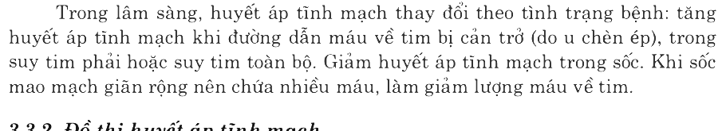

#### 3.3.3. Điều hòa tuần hoàn tĩnh mạch
- Nhiệt độ lạnh gây co tĩnh mạch; nhiệt độ nóng gây dãn tĩnh mạch da để thải nhiệt.
- Hormon: Adrenalin và Noradrenalin gây co tĩnh mạch mạnh qua thụ thể $\alpha$, dồn máu từ các kho chứa về tim.
- Giảm oxy máu gây co tĩnh mạch tạng để ưu tiên cấp máu cho não và vành.

---

## 4. SINH LÝ VI TUẦN HOÀN (MAO MẠCH)

Mao mạch là những vi mạch nối giữa tiểu động mạch và tiểu tĩnh mạch. Mặc dù chỉ chứa khoảng 5% tổng thể tích máu cơ thể tại một thời điểm, vi tuần hoàn là nơi diễn ra toàn bộ chức năng sống còn của hệ tuần hoàn: trao đổi dịch, khí và các chất dinh dưỡng giữa máu và dịch kẽ tế bào.

### 4.1. Đặc điểm cấu trúc - chức năng mao mạch
- Toàn bộ cơ thể có khoảng 10 tỷ mao mạch, tổng diện tích bề mặt trao đổi chất khổng lồ lên tới $5000 - 7000\text{ m}^2$. Đường kính mao mạch rất nhỏ ($4 - 9\;\mu\text{m}$), vừa đủ cho từng hồng cầu ép mình biến dạng đi qua. Chiều dài trung bình mỗi mao mạch khoảng 0,5 - 1 mm.
- Mạng vi tuần hoàn gồm hai loại kênh dẫn (Hình 9.11):
  - **Kênh ưu tiên (kênh thông nối / thoroughfare channel):** Nối thẳng từ tiểu động mạch tận cùng đến tiểu tĩnh mạch, lòng mạch luôn mở, máu lưu thông liên tục.
  - **Mao mạch thực sự:** Tách ra từ kênh ưu tiên, tại gốc có **cơ thắt tiền mao mạch (precapillary sphincter)** cấu tạo bởi các tế bào cơ trơn. Cơ thắt này đóng mở luân phiên để điều hòa lượng máu thực tế đi vào mao mạch.
- **Cấu tạo thành mao mạch:** Thành cực mỏng (~$0,5\;\mu\text{m}$), chỉ gồm một lớp tế bào nội mô đặt trên màng đáy mỏng. Giữa các tế bào nội mô có các **khe gian bào (intercellular clefts)** rộng khoảng 6 - 7 nm, cho phép nước và các chất hòa tan nhỏ đi qua tự do, nhưng giữ lại các phân tử protein lớn (như Albumin).

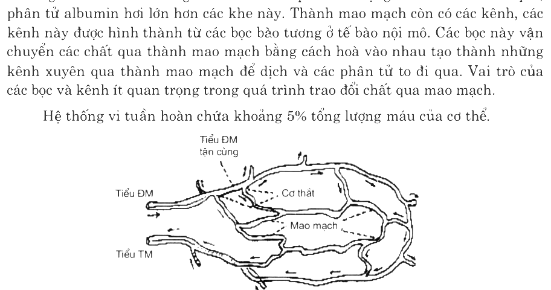

---

### 4.2. Cơ chế trao đổi chất qua mao mạch

Trao đổi chất qua thành mao mạch diễn ra theo 3 cơ chế:

#### 1. Khuếch tán đơn thuần (Diffusion)
Là cơ chế quan trọng nhất để vận chuyển khí và chất dinh dưỡng:
- Các chất tan trong lipid (như $\text{O}_2, \text{CO}_2$, acid béo): Khuếch tán trực tiếp qua lớp màng kép phospholipid của tế bào nội mô với tốc độ cực nhanh theo gradient nồng độ.
- Các chất hòa tan trong nước (như glucose, acid amin, ure, các ion $\text{Na}^+, \text{Cl}^-, \text{K}^+$): Khuếch tán qua các khe gian bào hoặc qua các kênh protein xuyên màng.

#### 2. Ẩm bào và chuyển túi (Pinocytosis / Transcytosis)
Các đại phân tử protein lớn hoặc lipoprotein được tế bào nội mô bọc vào các túi bọc bào tương và vận chuyển qua màng sang dịch kẽ.

#### 3. Cơ chế lọc và tái hấp thu dịch (Cân bằng Starling)
Sự di chuyển của dịch qua thành mao mạch được điều chỉnh bởi sự chênh lệch giữa 4 áp suất cơ bản (áp suất Starling):
- $P_c$: Áp suất thủy tĩnh mao mạch (Capillary hydrostatic pressure) - đẩy dịch ra khỏi lòng mạch.
- $P_{if}$: Áp suất thủy tĩnh dịch kẽ (Interstitial fluid pressure) - bình thường có giá trị âm nhẹ (~$-3\text{ mmHg}$).
- $\Pi_p$: Áp suất keo huyết tương (Plasma colloid osmotic pressure) - do protein huyết tương (chủ yếu là Albumin) tạo nên, hút dịch vào lòng mạch (~$28\text{ mmHg}$).
- $\Pi_{if}$: Áp suất keo dịch kẽ (Interstitial fluid colloid osmotic pressure) - do lượng nhỏ protein lọt vào dịch kẽ tạo nên (~$8\text{ mmHg}$), hút dịch ra dịch kẽ.

**Áp suất lọc hữu hiệu (Net Filtration Pressure - NFP):**
$$\text{NFP} = (P_c - P_{if}) - (\Pi_p - \Pi_{if})$$

*Tại đầu tiểu động mạch của mao mạch:*
- Các lực đẩy dịch ra:
  - Áp suất thủy tĩnh mao mạch ($P_c$): $30\text{ mmHg}$
  - Áp suất âm dịch kẽ (lực hút ra): $3\text{ mmHg}$ (tương ứng $P_{if} = -3\text{ mmHg}$)
  - Áp suất keo dịch kẽ ($\Pi_{if}$): $8\text{ mmHg}$
  - *Tổng lực đẩy ra:* $30 + 3 + 8 = 41\text{ mmHg}$
- Lực hút dịch vào:
  - Áp suất keo huyết tương ($\Pi_p$): $28\text{ mmHg}$
- **Áp suất lọc thực tế tại đầu động mạch:**
  $$\text{NFP}_{\text{đầu}} = 41 - 28 = +13\text{ mmHg}$$
  $\implies$ Dịch được lọc ra khỏi lòng mạch vào khoang kẽ.

*Tại đầu tiểu tĩnh mạch của mao mạch:*
- Áp suất thủy tĩnh mao mạch giảm xuống do ma sát dòng chảy: $P_c \approx 10\text{ mmHg}$.
- Các lực đẩy dịch ra: $10 + 3 + 8 = 21\text{ mmHg}$.
- Lực hút dịch vào: $\Pi_p = 28\text{ mmHg}$.
- **Áp suất tái hấp thu thực tế tại đầu tĩnh mạch:**
  $$\text{NFP}_{\text{cuối}} = 21 - 28 = -7\text{ mmHg}$$
  $\implies$ Lực hướng vào trong chiếm ưu thế, dịch từ dịch kẽ được tái hấp thu trở lại lòng mao mạch.

*Cân bằng toàn cục:* Khoảng 9/10 lượng dịch được lọc ra sẽ được tái hấp thu ở đầu tĩnh mạch mao mạch; 1/10 lượng dịch còn lại cùng toàn bộ các phân tử protein rò rỉ sẽ theo hệ tuần hoàn bạch huyết thu hồi trở về tĩnh mạch dưới đòn. Khi mất cân bằng (tăng $P_c$ do suy tim, giảm $\Pi_p$ do suy dinh dưỡng/xơ gan, tắc mạch bạch huyết hoặc tăng tính thấm thành mạch) sẽ dẫn đến **phù nề (edema)**.

---

### 4.3. Điều hòa tuần hoàn mao mạch
- **Cơ chế tự điều hòa chuyển hóa tại chỗ (Metabolic autoregulation):** Đây là cơ chế quan trọng nhất. Khi nồng độ $\text{O}_2$ trong mô giảm hoặc khi các chất chuyển hóa acid (acid lactic, adenosin, $\text{CO}_2, \text{H}^+, \text{K}^+$) tích tụ, cơ thắt tiền mao mạch dãn ra làm máu ùa vào các mao mạch thực sự. Khi mô được cung cấp đủ oxy, các chất chuyển hóa bị đào thải, cơ thắt tiền mao mạch co lại. Nhờ đó, các mao mạch đóng mở luân phiên, dòng máu mao mạch chảy ngắt quãng (vasomotion).
- Thần kinh giao cảm ít chi phối trực tiếp lên mao mạch mà chi phối lên các tiểu động mạch trước mao mạch.

---

## 5. TUẦN HOÀN ĐỊA PHƯƠNG (CÁC VÙNG TUẦN HOÀN ĐẶC BIỆT)

### 5.1. Tuần hoàn mạch vành

Nuôi dưỡng chính cơ tim, có ý nghĩa sống còn đối với hoạt động của bơm tim.

#### 5.1.1. Đặc điểm cấu trúc và động học tưới máu
- Gồm hai động mạch vành chính xuất phát từ xoang Valsalva ngay sau van động mạch chủ (Hình 9.12):
  - **Động mạch vành trái:** Chia nhánh liên thất trước (LAD) và nhánh mũ (Cx), nuôi mặt trước và bên thất trái.
  - **Động mạch vành phải:** Chạy ở rãnh vành, nuôi thất phải và mặt dưới thất trái.
- Hệ mạch vành có rất ít vòng nối thông chức năng; do đó khi một nhánh động mạch vành bị tắc nghẽn cấp tính do huyết khối, vùng cơ tim tương ứng sẽ hoại tử không hồi phục gây **nhồi máu cơ tim (Myocardial Infarction)**.
- **Động học tưới máu đặc biệt ở tâm thất trái:** 
  - Trong thì tâm thu, cơ tâm thất co rất mạnh ép chặt vào các mạch máu trong thành cơ tim, khiến lưu lượng máu nuôi thất trái giảm xuống rất thấp hoặc gần như bằng không.
  - Do đó, **tâm thất trái chủ yếu được tưới máu trong thì tâm trương** khi cơ tim giãn hoàn toàn. Vì vậy, khi tim đập quá nhanh làm rút ngắn thì tâm trương, nguy cơ thiếu máu cơ tim tăng lên rõ rệt.
  - Ngược lại, thất phải mỏng hơn nên được tưới máu tương đối đều cả hai thì.
- Lưu lượng mạch vành lúc nghỉ khoảng 225 ml/phút (~4 - 5% lưu lượng tim hay 80 ml/100g mô tim/phút). Lúc gắng sức có thể tăng gấp 4 - 5 lần.
- Tim sử dụng oxy rất triệt để: lấy tới 65 - 75% lượng oxy trong máu động mạch vành (hiệu số động - tĩnh mạch là 11 - 12 ml $\text{O}_2$/100 ml máu, cao nhất cơ thể). Do đó khi cơ tim tăng hoạt động, nó không thể lấy thêm oxy bằng cách tăng trích xuất oxy mà bắt buộc phải tăng lưu lượng dòng máu vành.

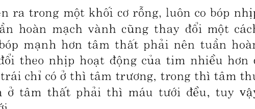

#### 5.1.2. Điều hòa lưu lượng mạch vành
- **Cơ chế chuyển hóa (vai trò của nồng độ oxy và adenosin):** Là yếu tố quyết định hàng đầu. Khi thiếu oxy cơ tim, phân giải ATP tạo ra nồng độ cao chất dãn mạch cực mạnh là **Adenosin**. Adenosin cùng với ion $\text{K}^+, \text{H}^+, \text{CO}_2$, bradykinin gây dãn mạnh tiểu động mạch vành để tăng tưới máu bù trừ.
- **Vai trò thần kinh tự chủ:** Kích thích giao cảm vừa gây co mạch vành nhẹ trực tiếp qua thụ thể $\alpha$, nhưng tác dụng gián tiếp lại vượt trội: làm tăng nhịp và tăng lực co bóp tim $\implies$ tăng chuyển hóa và tiêu thụ oxy $\implies$ gây dãn mạch vành mạnh mẽ.

---

### 5.2. Tuần hoàn phổi (Tiểu tuần hoàn)

Tuần hoàn phổi là tuần hoàn chức năng trao đổi khí, đưa toàn bộ lưu lượng tim từ thất phải qua phổi để nhận $\text{O}_2$ và thải $\text{CO}_2$.

#### 5.2.1. Đặc điểm cấu trúc và áp suất
- Thành tâm thất phải rất mỏng (chỉ dày bằng 1/3 thành thất trái - Hình 9.13). Động mạch phổi ngắn, thành mỏng và phân nhánh mạng mao mạch bao bọc quanh các phế nang với diện tích trao đổi khí khoảng $100 - 140\text{ m}^2$.
- **Áp lực thấp và sức cản thấp:** 
  - Áp suất tâm thu động mạch phổi khoảng 22 - 25 mmHg, tâm trương khoảng 8 - 10 mmHg; áp suất trung bình động mạch phổi chỉ khoảng 15 mmHg (bằng $1/6$ đại tuần hoàn).
  - Áp suất mao mạch phổi trung bình khoảng $7\text{ mmHg}$ (thấp hơn nhiều so với áp suất keo huyết tương $28\text{ mmHg}$).
  - **Ý nghĩa sinh lý:** Áp suất mao mạch phổi thấp là cơ chế bảo vệ sinh lý then chốt giúp phế nang luôn khô ráo để trao đổi khí. Nếu áp suất mao mạch phổi tăng cao $>25 - 30\text{ mmHg}$ (trong suy tim trái cấp, hẹp van hai lá nặng), dịch sẽ ùa vào lòng phế nang gây **phù phổi cấp (Acute Pulmonary Edema)** đe dọa tử vong do ngạt thở.

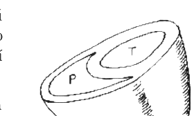

#### 5.2.2. Điều hòa tuần hoàn phổi: Cơ chế co mạch do thiếu oxy (Hypoxic Pulmonary Vasoconstriction - HPV)
- Khác với tuần hoàn đại thể (nơi thiếu oxy gây dãn mạch), ở phổi: **khi phân áp oxy phế nang giảm thấp, các tiểu động mạch phổi tại vùng đó sẽ co lại**.
- **Ý nghĩa sinh lý sống còn:** Cơ chế này giúp chuyển hướng dòng máu từ những phế nang kém thông khí (thiếu oxy) sang những phế nang thông khí tốt (giàu oxy), tối ưu hóa tỷ lệ thông khí/tưới máu ($V_A/Q$). Tuy nhiên, khi thiếu oxy toàn thân kéo dài (sống trên núi cao, bệnh phổi tắc nghẽn mạn tính COPD), co mạch phổi toàn thể sẽ dẫn đến tăng áp lực động mạch phổi mạn tính và suy tim phải (tâm phế mạn).

---

### 5.3. Tuần hoàn não

Não là cơ quan cực kỳ nhạy cảm với tình trạng thiếu máu và thiếu oxy: não chiếm 2% trọng lượng cơ thể nhưng tiêu thụ 15% lưu lượng tim và 20% lượng oxy toàn thân. Ngừng tuần hoàn não 5 - 10 giây gây mất ý thức; ngừng quá 4 phút gây tổn thương vỏ não không hồi phục.

#### 5.3.1. Đặc điểm giải phẫu và tuần hoàn não
- Máu được cung cấp bởi 4 động mạch lớn: 2 động mạch cảnh trong và 2 động mạch đốt sống (hợp thành động mạch thân nền).
- Ở đáy não, các động mạch nối với nhau tạo thành **Đa giác Willis (Circle of Willis)**. Đây là vòng nối bàng hệ quan trọng giúp duy trì tưới máu não đồng đều khi một động mạch cảnh bị tắc hẹp.
- Hộp sọ là một khoang kín cứng (thuyết Monro - Kellie: tổng thể tích não + máu + dịch não tủy là hằng định). Do đó, lưu lượng máu não toàn phần luôn phải được duy trì cực kỳ ổn định (khoảng 700 - 750 ml/phút hay 50 - 55 ml/100g não/phút).

#### 5.3.2. Cơ chế điều hòa tuần hoàn não
1. **Vai trò của nồng độ $\text{CO}_2$ và ion $\text{H}^+$:** Là yếu tố điều hòa mạnh mẽ nhất. 
   - Khi $\text{CO}_2$ máu động mạch tăng, $\text{CO}_2$ khuếch tán nhanh qua hàng rào máu - não kết hợp với $\text{H}_2\text{O}$ tạo thành acid carbonic dưới xúc tác của carbonic anhydrase (CA):
     $$\text{CO}_2 + \text{H}_2\text{O} \xrightarrow{\text{CA}} \text{H}_2\text{CO}_3 \rightarrow \text{H}^+ + \text{HCO}_3^-$$
   - Ion $\text{H}^+$ tác động trực tiếp lên cơ trơn thành mạch não gây dãn mạch cực mạnh, tăng nhanh lưu lượng máu để rửa trôi $\text{CO}_2$.
   - Ngược lại khi tăng thông khí quá mức làm hạ $\text{CO}_2$ máu ($P_{\text{CO}_2}$ giảm), mạch não co lại gây thiếu máu não thoáng qua (chóng mặt, choáng váng).
2. **Vai trò của nồng độ $\text{O}_2$:** Khi $P_{\text{O}_2}$ giảm xuống dưới 30 mmHg, các mạch não dãn ra để tăng bù trừ lượng máu lên não.
3. **Cơ chế tự điều hòa lưu lượng máu não (Hiệu ứng Bayliss - Myogenic Autoregulation):**
   - Cơ trơn mạch não có khả năng tự động đáp ứng với áp lực thành mạch: khi huyết áp tăng, cơ trơn tự co lại để giữ lưu lượng không tăng quá mức; khi huyết áp giảm, cơ trơn tự dãn ra để duy trì lưu lượng.
   - Nhờ hiệu ứng Bayliss, **lưu lượng máu não được giữ hoàn toàn ổn định trong khoảng huyết áp động mạch trung bình từ 60 đến 140 mmHg**. Nếu huyết áp vượt ra ngoài khoảng này (quá thấp $<60\text{ mmHg}$ gây thiếu máu não; quá cao $>140\text{ mmHg}$ làm vỡ hàng rào máu não gây phù não, tai biến mạch máu não).

---

## TỰ LƯỢNG GIÁ VÀ CÂU HỎI ÔN TẬP BÀI 9

1. Trình bày cấu trúc và chức năng của hệ thống nút tự động của tim.
2. Giải thích cơ sở ion tạo nên giai đoạn cao nguyên của điện thế hoạt động ở sợi cơ tâm thất.
3. Phân tích ý nghĩa sinh lý của tính trơ có chu kỳ của cơ tim. Giải thích hiện tượng ngoại tâm thu và giai đoạn nghỉ bù.
4. Trình bày các giai đoạn của một chu kỳ tim về mặt thời gian, biến đổi áp suất buồng tim và sự đóng mở các van tim.
5. Định nghĩa thể tích tâm thu, lưu lượng tim và phân suất tống máu (EF). Trình bày nguyên lý Fick đo lưu lượng tim.
6. Trình bày nguyên nhân tạo nên tiếng tim thứ nhất ($T_1$) và tiếng tim thứ hai ($T_2$). Nêu cơ chế hiện tượng tách đôi tiếng $T_2$.
7. Mô tả các sóng và khoảng trên điện tâm đồ bình thường ở chuyển đạo DII và nêu ý nghĩa sinh lý của từng sóng.
8. Trình bày nội dung và cơ chế của định luật Frank - Starling đối với hoạt động của tim.
9. So sánh tác dụng của hệ thần kinh giao cảm và phó giao cảm lên hoạt động của tim.
10. Mô tả cung phản xạ điều hòa huyết áp của thụ thể áp suất (baroreceptor) ở xoang cảnh và quai động mạch chủ.
11. Nêu ý nghĩa sinh lý của tính đàn hồi và tính co thắt của thành động mạch.
12. Định nghĩa huyết áp tâm thu, huyết áp tâm trương, huyết áp hiệu số và huyết áp trung bình. Nêu công thức tính huyết áp trung bình.
13. Phân tích các yếu tố ảnh hưởng lên huyết áp động mạch dựa trên phương trình Poiseuille.
14. Trình bày vai trò của hệ Renin - Angiotensin - Aldosteron (RAAS) trong điều hòa huyết áp dài hạn.
15. Trình bày các nguyên nhân (động lực) giúp máu tĩnh mạch trở về tim. Nêu khái niệm và ý nghĩa của áp suất tĩnh mạch trung tâm (CVP).
16. Phân tích các sóng trên đường ghi nhĩ đồ (sóng a, z, c, x, v, y).
17. Phân tích cơ chế trao đổi dịch qua thành mao mạch theo định luật cân bằng Starling (lực đẩy ra, lực hút vào tại đầu động mạch và đầu tĩnh mạch mao mạch). Nêu các cơ chế gây phù.
18. Trình bày đặc điểm động học tưới máu mạch vành ở tâm thất trái trong chu kỳ tim và vai trò của adenosin trong điều hòa mạch vành.
19. Trình bày đặc điểm huyết động của tuần hoàn phổi và phân tích cơ chế co mạch do thiếu oxy phế nang.
20. Trình bày cơ chế tự điều hòa lưu lượng máu não (hiệu ứng Bayliss) và ảnh hưởng của nồng độ $\text{CO}_2, \text{H}^+$ lên mạch não.
