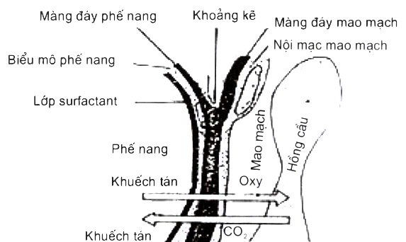
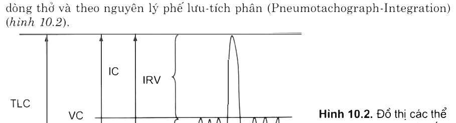
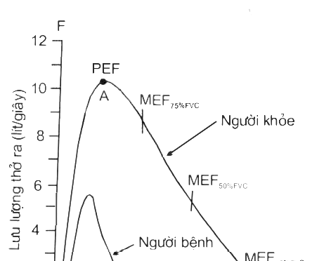
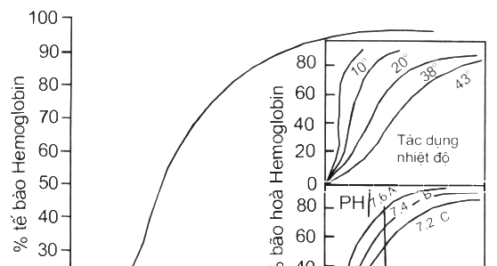
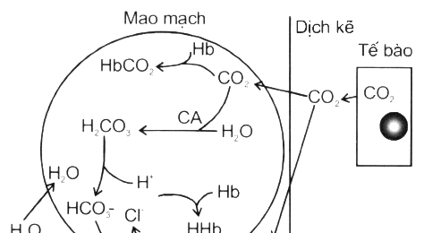
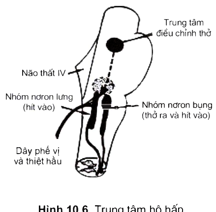
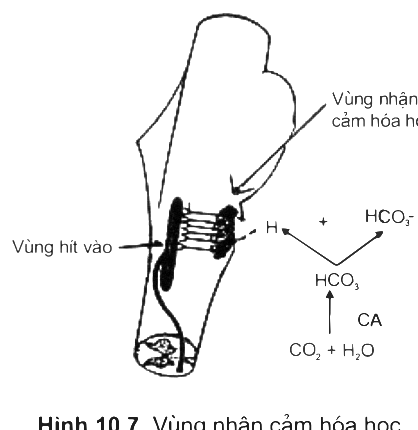

# BÀI 10: SINH LÝ HÔ HẤP

## MỤC TIÊU HỌC TẬP
*Sau khi học xong bài này, người học có khả năng:*
1. Trình bày được cấu tạo màng hô hấp và cơ chế, ý nghĩa của áp suất âm trong khoang màng phổi.
2. Trình bày được chức năng thông khí của phổi, các thể tích, dung tích và lưu lượng hô hấp.
3. Trình bày được quá trình vận chuyển oxy và carbonic của máu giữa phổi và mô.
4. Mô tả được tổ chức hoạt động của các trung tâm hô hấp và các yếu tố tham gia điều hòa hô hấp.
5. Nêu được nguyên tắc, ý nghĩa của một số kỹ thuật thăm dò chức năng thông khí phổi trên lâm sàng.

---

## ĐẠI CƯƠNG BỘ MÁY HÔ HẤP

Mọi tế bào trong cơ thể sống đều đòi hỏi được cung cấp oxy liên tục để thực hiện quá trình oxy hóa các chất hữu cơ giải phóng năng lượng (ATP), đồng thời đào thải khí carbonic ($\text{CO}_2$) - sản phẩm cặn bã của quá trình chuyển hóa - ra khỏi cơ thể nhằm duy trì hằng tính nội môi.

Ở động vật bậc cao và con người, quá trình trao đổi khí không thể diễn ra trực tiếp giữa tế bào sâu bên trong cơ thể với không khí bên ngoài mà phải thông qua một hệ thống cơ quan chuyên biệt là bộ máy hô hấp, phối hợp nhịp nhàng với hệ tuần hoàn máu.

Chức năng hô hấp gồm 4 giai đoạn nối tiếp nhau:
1. **Thông khí phổi (Pulmonary ventilation):** Quá trình lưu chuyển không khí giữa khí quyển bên ngoài và các phế nang.
2. **Khuếch tán khí qua màng hô hấp (Alveolar gas exchange):** Quá trình trao đổi $\text{O}_2$ và $\text{CO}_2$ giữa phế nang và máu mao mạch phổi.
3. **Vận chuyển khí trong máu (Gas transport):** Máu vận chuyển oxy từ phổi đến các mô và đưa $\text{CO}_2$ từ mô trở về phổi.
4. **Hô hấp tế bào (Cellular respiration):** Tế bào sử dụng oxy trong chuỗi hô hấp ty thể và giải phóng năng lượng kèm sản sinh $\text{CO}_2$.

---

## 1. ĐẶC ĐIỂM HÌNH THÁI - CHỨC NĂNG CỦA BỘ MÁY HÔ HẤP

### 1.1. Đường dẫn khí

Đường dẫn khí được chia làm hai phần:
- **Đường hô hấp trên:** Gồm mũi, miệng, hầu (họng) và thanh quản.
- **Đường hô hấp dưới:** Bắt đầu từ khí quản, phế quản gốc đến các tiểu phế quản tận và tiểu phế quản hô hấp.

Theo phân loại giải phẫu thế hệ phân nhánh (Weibel):
- Khí quản là thế hệ số 0.
- Hai phế quản gốc phải và trái là thế hệ thứ 1.
- Cây phế quản tiếp tục phân chia lưỡng phân liên tiếp thành 23 thế hệ:
  - Từ thế hệ 0 đến thế hệ 16 (tiểu phế quản tận) là **vùng dẫn khí đơn thuần (conducting zone)**, không có phế nang nên không tham gia trao đổi khí (tạo nên khoảng chết giải phẫu).
  - Từ thế hệ 17 đến thế hệ 23 (tiểu phế quản hô hấp, ống phế nang, túi phế nang) là **vùng hô hấp (respiratory zone)**, bắt đầu xuất hiện phế nang để trao đổi khí.

#### Chức năng sinh lý của đường dẫn khí:
1. **Chức năng dẫn khí:**
   - Dẫn không khí từ ngoài vào phế nang và ngược lại. Bình thường lực cản đường dẫn khí rất nhỏ; chỉ cần chênh lệch áp suất $< 1\text{ cmH}_2\text{O}$ là đủ để tạo dòng khí lưu thông.
   - Sức cản đường thở phụ thuộc vào đường kính lòng ống: cơ trơn tiểu phế quản co thắt (dưới tác dụng của phó giao cảm, histamin, leukotriene) làm tăng mạnh sức cản, gây khó thở (gặp trong hen phế quản). Kích thích giao cảm qua thụ thể $\beta_2\text{-adrenergic}$ làm dãn cơ trơn tiểu phế quản, giảm sức cản.
2. **Chức năng làm sạch và bảo vệ:**
   - Hệ thống lông mũi giữ lại các hạt bụi lớn ($>10\;\mu\text{m}$).
   - Lớp niêm mạc đường dẫn khí phủ biểu mô trụ giả tầng có lông chuyển, xen kẽ các tuyến tiết nhầy và tế bào hình đài. Các hạt bụi nhỏ ($2 - 10\;\mu\text{m}$) và vi sinh vật bị bám dính vào lớp chất nhầy. Lớp lông chuyển đập đồng bộ với tần số 10 - 20 lần/giây theo hướng ngược lên phía hầu họng để tống chất nhầy ra ngoài (thang máy biểu mô lông chuyển - mucociliary escalator). Khói thuốc lá làm liệt cử động lông chuyển, làm tăng nguy cơ nhiễm trùng phế quản phổi mạn tính.
   - Các hạt bụi mịn $<2\;\mu\text{m}$ (bụi hô hấp) vào tận phế nang sẽ bị các đại thực bào phế nang thực bào và tiêu hóa.
3. **Chức năng sưởi ấm và bão hòa hơi nước:**
   - Mạng mao mạch dày đặc dưới niêm mạc mũi và đường dẫn khí truyền nhiệt làm ấm không khí hít vào đạt xấp xỉ nhiệt độ cơ thể ($37^\circ\text{C}$).
   - Các tuyến nhầy và tuyến nước làm ẩm bão hòa hơi nước ($100\%$ độ ẩm tương đối), bảo vệ màng hô hấp không bị khô khốc.
4. **Chức năng phát âm và biểu lộ cảm xúc:** Thanh quản chứa dây thanh âm, phối hợp với cử động môi, lưỡi, vòm họng và các xoang mặt để tạo nên giọng nói, tiếng cười, tiếng khóc.

---

### 1.2. Phổi - Phế nang và màng hô hấp

#### 1.2.1. Phế nang
Phế nang là đơn vị cấu trúc và chức năng trao đổi khí cuối cùng của phổi. Ở người trưởng thành có khoảng 300 - 500 triệu phế nang, tổng diện tích bề mặt trao đổi khí lên tới $70 - 120\text{ m}^2$.

Biểu mô phế nang gồm hai loại tế bào chính:
- **Tế bào phế nang type I (Pneumocyte type I):** Tế bào biểu mô dẹt mỏng, chiếm khoảng 95% diện tích bề mặt phế nang, tạo điều kiện thuận lợi nhất cho khí khuếch tán qua. Tế bào này rất nhạy cảm với các chất độc hại và không có khả năng phân chia.
- **Tế bào phế nang type II (Pneumocyte type II):** Tế bào hình khối, bào tương giàu thể phiến (lamellar bodies), có khả năng phân chia để tái tạo biểu mô phế nang khi bị tổn thương, và đặc biệt có chức năng tổng hợp, bài tiết **chất hoạt diện (Surfactant)**.

*Bản chất và vai trò của Surfactant:*
- Là phức hợp gồm phospholipid (chủ yếu là dipalmitoylphosphatidylcholine - DPPC), apoprotein surfactant và ion canxi.
- Surfactant trải thành lớp mỏng đơn phân tử trên bề mặt dịch lót phế nang, có tác dụng **làm giảm sức căng bề mặt** của lớp dịch lót lòng phế nang.
- Theo định luật Laplace: 
  $$P = \frac{2T}{r}$$
  *(Trong đó $P$ là áp suất có xu hướng làm xẹp phế nang, $T$ là sức căng bề mặt, $r$ là bán kính phế nang).*
  Nếu không có surfactant, các phế nang nhỏ ($r$ nhỏ) sẽ có áp suất $P$ rất lớn và có xu hướng xẹp xuống, dồn khí vào các phế nang lớn làm phế nang lớn căng vỡ.
- Nhờ surfactant, khi phế nang co nhỏ, các phân tử surfactant ép sát nhau làm giảm sức căng bề mặt $T$ mạnh hơn, giữ cho áp suất trong các phế nang kích thước khác nhau luôn cân bằng.
- **Ý nghĩa sinh lý của Surfactant:**
  1. Ngăn ngừa xẹp các phế nang nhỏ ở thì thở ra, ổn định thể tích phế nang.
  2. Giảm công hô hấp (tăng độ giãn nở compliance của phổi).
  3. Ngăn ngừa hút dịch từ mao mạch vào lòng phế nang, chống phù phổi cấp.
  4. Trẻ sơ sinh đẻ non (dưới 28 - 32 tuần) chưa tổng hợp đủ surfactant sẽ mắc **Hội chứng suy hô hấp sơ sinh cấp (bệnh màng trong)** gây xẹp phổi lan tỏa và tử vong nhanh chóng nếu không được điều trị kịp thời bằng surfactant ngoại sinh.

#### 1.2.2. Màng hô hấp (Màng phế nang - mao mạch)
Màng hô hấp là vách ngăn tiếp xúc giữa không khí trong phế nang và máu trong mao mạch phổi. Dưới kính hiển vi điện tử, màng hô hấp cực mỏng (bề dày trung bình chỉ $0,2 - 0,6\;\mu\text{m}$), gồm 6 lớp từ phế nang sang mao mạch (Hình 10.1):
1. Lớp dịch lót phế nang chứa chất hoạt diện Surfactant.
2. Lớp biểu mô phế nang (tế bào type I).
3. Màng đáy biểu mô phế nang.
4. Khoảng kẽ hẹp giữa phế nang và mao mạch (chứa sợi collagen, sợi chun và một lượng tối thiểu dịch kẽ).
5. Màng đáy mao mạch phổi (nhiều nơi hòa lẫn với màng đáy biểu mô phế nang tạo thành màng liên kết duy nhất cực mỏng).
6. Lớp tế bào nội mô mao mạch phổi.

---

### 1.3. Lồng ngực và các cơ hô hấp

Lồng ngực là một khoang xương - cơ hoàn toàn kín, chứa phổi, tim và các mạch máu lớn. Giới hạn trên là lối vào ngực qua nền cổ; giới hạn dưới được ngăn cách hoàn toàn với ổ bụng bởi cơ hoành; xung quanh là cột sống ngực phía sau, 12 đôi xương sườn và các cơ liên sườn hai bên, cùng xương ức phía trước.

Các cơ hô hấp:
- **Các cơ hít vào:**
  - *Cơ hít vào thông thường:* Cơ hoành (cơ hô hấp quan trọng nhất, đóng góp 75% thông khí lúc nghỉ), các cơ liên sườn ngoài, cơ bậc thang.
  - *Cơ hít vào gắng sức:* Cơ ức đòn chũm, cơ ngực lớn, cơ ngực bé, cơ răng trước.
- **Các cơ thở ra:**
  - *Thở ra thông thường:* Quá trình thụ động, không cần cơ co.
  - *Cơ thở ra gắng sức:* Các cơ thành bụng (cơ thẳng bụng, cơ chéo bụng trong, cơ chéo bụng ngoài, cơ ngang bụng) ép tạng bụng đẩy cơ hoành lên cao; các cơ liên sườn trong kéo xương sườn xuống dưới và ra sau.

---

### 1.4. Màng phổi và áp suất âm trong khoang màng phổi

#### 1.4.1. Cấu trúc màng phổi
Gồm hai lá liên tục với nhau ở rốn phổi:
- **Lá thành (Parietal pleura):** Lót sát mặt trong lồng ngực, mặt trên cơ hoành và hai bên trung thất.
- **Lá tạng (Visceral pleura):** Bao bọc chặt chẽ mặt ngoài của phổi và lách sâu vào các khe gian thùy.
- **Khoang màng phổi:** Là một **khoang ảo** nằm giữa hai lá, bên trong chỉ chứa một lớp dịch thanh dịch mỏng (~5 - 10 ml) có tác dụng bôi trơn giúp hai lá trượt trơn tru lên nhau theo các cử động hô hấp mà không thể tách rời nhau.

#### 1.4.2. Cơ chế tạo áp suất âm trong khoang màng phổi
Áp suất trong khoang màng phổi luôn thấp hơn áp suất khí quyển, gọi là **áp suất âm khoang màng phổi**. Cơ chế hình thành dựa trên các yếu tố sau:
1. **Lực đàn hồi hồi quy của mô phổi:** Phổi có tính chun dãn rất lớn do các sợi chun ở nhu mô và sức căng bề mặt dịch phế nang luôn có xu hướng co rút phổi nhỏ lại về phía rốn phổi.
2. **Khuynh hướng nở rộng của lồng ngực:** Khung lồng ngực có tính đàn hồi luôn có xu hướng nở rộng ra phía ngoài. Sau khi sinh, lồng ngực của trẻ phát triển nhanh hơn phổi khiến lá thành bị kéo căng ra ngoài trong khi lá tạng bị nhu mô phổi kéo vào trong.
3. Sự co kéo ngược chiều nhau giữa lá thành và lá tạng làm khoang màng phổi có xu hướng bị giãn rộng ra, tạo nên áp suất âm (theo định luật Boyle-Mariotte).
4. Hệ thống bạch huyết màng phổi liên tục hút dịch và protein ra khỏi khoang màng phổi, duy trì trạng thái áp suất âm liên tục.

#### 1.4.3. Biến thiên trị số áp suất âm màng phổi
- Cuối thì thở ra bình thường: khoảng $-4\text{ mmHg}$ (tương đương $-5\text{ cmH}_2\text{O}$).
- Cuối thì hít vào bình thường: khoảng $-7\text{ mmHg}$ (tương đương $-10\text{ cmH}_2\text{O}$).
- Khi hít vào hết sức: áp suất âm có thể xuống tới $-30\text{ mmHg}$ (hoặc $-40\text{ cmH}_2\text{O}$).
- Khi thở ra hết sức: áp suất vẫn âm nhẹ, khoảng $-1$ đến $-2\text{ mmHg}$.

#### 1.4.4. Ý nghĩa sinh lý của áp suất âm khoang màng phổi
1. **Đối với hô hấp:** Làm cho phổi luôn áp sát và giãn nở đồng thì theo mọi kích thước biến đổi của lồng ngực; làm giảm lực cản nở phổi, tiết kiệm tối đa công cơ học cho các cơ hô hấp.
2. **Đối với tuần hoàn:** Áp suất âm trong lồng ngực tạo sức hút làm các tĩnh mạch lớn trong ngực giãn rộng, hút máu tĩnh mạch ngoại vi đổ về tim phải dễ dàng; đồng thời hỗ trợ tuần hoàn mao mạch phổi, giảm gánh nặng cho tâm thất phải.
3. Khi màng phổi bị rách (tràn khí màng phổi), không khí tràn vào làm mất áp suất âm, phổi sẽ co cụm lại về phía rốn phổi gây xẹp phổi hoàn toàn và suy hô hấp cấp tính.

---

## 2. CHỨC NĂNG THÔNG KHÍ CỦA PHỔI (CNTKP)

Thông khí phổi là quá trình cơ học đưa không khí giàu oxy từ ngoài vào phế nang và đưa không khí giàu $\text{CO}_2$ từ phế nang ra ngoài.

### 2.1. Các động tác hô hấp

#### 2.1.1. Động tác hít vào
1. **Hít vào thông thường (Động tác tích cực, chủ động):**
   - Đòi hỏi tiêu tốn năng lượng do co các cơ hít vào:
     - *Cơ hoành:* Khi co, vòm hoành phẳng ra và hạ thấp xuống phía ổ bụng khoảng 1,5 cm (làm tăng kích thước lồng ngực theo chiều thẳng đứng). Mỗi lần cơ hoành hạ 1 cm làm tăng thể tích lồng ngực thêm khoảng $250\text{ cm}^3$.
     - *Các cơ liên sườn ngoài:* Co lại làm các xương sườn quay quanh trục khớp sống sườn nâng lên trên và ra ngoài theo kiểu "quai xô", làm tăng đường kính trước - sau và đường kính ngang của lồng ngực.
   - Kết quả: Thể tích lồng ngực tăng lên $\implies$ áp suất âm màng phổi càng âm hơn (hạ từ $-4$ xuống $-7\text{ mmHg}$) $\implies$ phổi nở rộng $\implies$ áp suất trong phế nang giảm xuống thấp hơn áp suất khí quyển ($-1\text{ cmH}_2\text{O}$) $\implies$ không khí ngoài khí quyển tự động ùa vào phổi.
2. **Hít vào gắng sức:** Huy động thêm các cơ hô hấp phụ (cơ ức đòn chũm nâng xương ức, cơ ngực nâng lồng ngực, cơ bậc thang). Cơ hoành có thể hạ sâu 7 - 8 cm, thể tích lồng ngực có thể tăng thêm 1500 - 2000 ml.

#### 2.1.2. Động tác thở ra
1. **Thở ra thông thường (Động tác thụ động):**
   - Không đòi hỏi tiêu tốn năng lượng co cơ.
   - Các cơ hít vào giãn ra; dưới tác dụng của lực đàn hồi hồi quy của mô phổi, lồng ngực và sức ép của các tạng bụng đẩy vòm hoành lồi lên, lồng ngực trở về vị trí nghỉ ngơi ban đầu.
   - Thể tích lồng ngực giảm $\implies$ phổi co lại $\implies$ áp suất trong phế nang tăng lên cao hơn áp suất khí quyển ($+1\text{ cmH}_2\text{O}$) $\implies$ đẩy không khí từ phế nang thoát ra ngoài.
2. **Thở ra gắng sức (Động tác chủ động, tích cực):**
   - Huy động các cơ thành bụng co mạnh ép các tạng bụng dồn cơ hoành lên cao, và các cơ liên sườn trong kéo xương sườn hạ thấp tối đa, ép không khí ra ngoài thêm 1000 - 1500 ml.

#### 2.1.3. Một số động tác hô hấp đặc biệt
- **Rặn:** Hít vào sâu, đóng thanh môn rồi co cơ thành bụng và cơ hoành tối đa tạo áp lực rất cao trong ổ bụng để tống phân, nước tiểu hoặc thai nhi ra ngoài.
- **Ho:** Phản xạ bảo vệ đường hô hấp dưới. Hít vào sâu, đóng thanh môn, co mạnh các cơ thở ra tạo áp suất rất cao trong lồng ngực, sau đó thanh môn đột ngột mở toang tạo luồng khí vận tốc cực lớn bật qua miệng tống đờm và dị vật ra ngoài.
- **Hắt hơi:** Tương tự ho nhưng luồng khí áp lực cao bật qua đường mũi để làm sạch niêm mạc mũi.

---

### 2.2. Các thể tích, dung tích hô hấp và lưu lượng thở

Được đo lường bằng phương pháp phế dung ký (Spirometry) (Hình 10.2).

#### 2.2.1. Các thể tích hô hấp (Pulmonary Volumes)
1. **Thể tích khí lưu thông (Tidal Volume - TV):**
   - Thể tích khí hít vào hoặc thở ra trong một nhịp thở bình thường lúc nghỉ ngơi.
   - Ở người trưởng thành khỏe mạnh: khoảng 400 - 500 ml (chiếm ~12% dung tích sống).
2. **Thể tích khí dự trữ hít vào (Inspiratory Reserve Volume - IRV):**
   - Thể tích khí hít thêm vào tối đa sau khi đã hít vào bình thường.
   - Trị số bình thường: 1500 - 2000 ml (chiếm ~56% dung tích sống).
3. **Thể tích khí dự trữ thở ra (Expiratory Reserve Volume - ERV):**
   - Thể tích khí thở ra thêm tối đa sau khi đã thở ra bình thường.
   - Trị số bình thường: 1100 - 1500 ml (chiếm ~32% dung tích sống).
4. **Thể tích khí cặn (Residual Volume - RV):**
   - Thể tích khí còn lại trong phổi sau khi đã thở ra hết sức.
   - Trị số bình thường: 1000 - 1200 ml.
   - RV không thể đo được bằng phế dung kế thông thường mà phải đo bằng phương pháp pha loãng khí (khí Heli hoặc Nitơ) hoặc thể tích ký thân (Body plethysmography).
   - **Ý nghĩa sinh lý:** Giữ cho các phế nang không bao giờ bị xẹp hoàn toàn ở cuối thì thở ra, giúp việc trao đổi khí giữa phế nang và máu mao mạch phổi diễn ra liên tục cả trong thì thở ra.

#### 2.2.2. Các dung tích hô hấp (Pulmonary Capacities)
Dung tích hô hấp là tổng của hai hay nhiều thể tích hô hấp:
1. **Dung tích sống (Vital Capacity - VC hoặc Slow Vital Capacity - SVC):**
   - Thể tích khí tối đa thở ra được sau khi đã hít vào hết sức:
     $$\text{VC} = \text{TV} + \text{IRV} + \text{ERV}$$
   - Ở người Việt Nam bình thường: Nam giới 3,5 - 4,0 lít; Nữ giới 2,5 - 3,0 lít.
   - Phụ thuộc vào giới tính, tuổi, chiều cao và thể lực rèn luyện.
   - Giảm trong các bệnh phổi hạn chế (tràn dịch màng phổi, xơ phổi, gù vẹo cột sống, u phổi). Giảm $\ge 20\%$ so với trị số lý thuyết là có **rối loạn thông khí hạn chế**.
2. **Dung tích sống gắng sức (Forced Vital Capacity - FVC):**
   - Thể tích khí thở ra thật nhanh, thật mạnh và hết sức sau khi hít vào hết sức. Ở người bình thường, $\text{FVC} \approx \text{VC}$. Trong bệnh lý tắc nghẽn đường dẫn khí (COPD, hen), FVC giảm nhiều hơn VC.
3. **Dung tích hít vào (Inspiratory Capacity - IC):**
   $$\text{IC} = \text{TV} + \text{IRV} \approx 2000 - 2500\text{ ml}$$
4. **Dung tích cặn chức năng (Functional Residual Capacity - FRC):**
   - Thể tích khí còn lại trong phổi ở cuối thì thở ra bình thường:
     $$\text{FRC} = \text{ERV} + \text{RV} \approx 2000 - 3000\text{ ml}$$
   - Đóng vai trò là "vùng đệm không khí" để hòa trộn khí mới hít vào, giữ cho nồng độ khí phế nang tương đối ổn định.
5. **Dung tích toàn phổi (Total Lung Capacity - TLC):**
   - Tổng thể tích khí có trong phổi sau khi hít vào hết sức:
     $$\text{TLC} = \text{VC} + \text{RV} \approx 5000\text{ ml} = 5\text{ lít}$$

#### 2.2.3. Các lưu lượng thở (Pulmonary Flow Rates)
Lưu lượng thở là thể tích khí lưu chuyển trong một đơn vị thời gian (lít/giây hoặc lít/phút), phản ánh tốc độ vận chuyển khí và độ thông thoáng của đường thở (Hình 10.3).

1. **Thể tích thở ra tối đa trong giây đầu tiên ($\text{FEV}_1$ hay VEMS):**
   - Lượng khí thở ra được trong giây đầu tiên của nghiệm pháp FVC.
   - Bình thường $\text{FEV}_1$ chiếm khoảng $\ge 75 - 80\%$ dung tích sống.
2. **Chỉ số Tiffeneau và Chỉ số Gaensler:**
   - **Chỉ số Tiffeneau:**
     $$\text{Chỉ số Tiffeneau} = \frac{\text{FEV}_1}{\text{VC}} \times 100\%$$
   - **Chỉ số Gaensler:**
     $$\text{Chỉ số Gaensler} = \frac{\text{FEV}_1}{\text{FVC}} \times 100\%$$
   - Tiêu chuẩn chẩn đoán: Bình thường $\ge 75\%$. Khi chỉ số $< 70 - 75\%$ chứng tỏ có **rối loạn thông khí tắc nghẽn** (đặc trưng trong Hen phế quản và Bệnh phổi tắc nghẽn mạn tính - COPD).
3. **Lưu lượng đỉnh (Peak Expiratory Flow - PEF):**
   - Lưu lượng thở ra tối đa đạt được ngay ở phần đầu của nhát thở FVC (điểm A trên đồ thị lưu lượng - thể tích). Rất hữu ích để theo dõi điều trị cơn hen tại nhà bằng máy đo lưu lượng đỉnh cầm tay.
4. **Các lưu lượng trung bình và tức thời:**
   - $\text{FEF}_{25-75}$ (hay MMEF): Lưu lượng thở ra ở đoạn giữa $25 - 75\%$ của FVC, phản ánh độ thông thoáng của các phế quản nhỏ.
   - $\text{MEF}_{75}, \text{MEF}_{50}, \text{MEF}_{25}$: Lưu lượng thở ra tại các thời điểm còn lại $75\%, 50\%, 25\%$ thể tích FVC.
5. **Thông khí phút ($\dot{V}$):**
   $$\dot{V} = \text{TV} \times f$$
   Lúc nghỉ: $\dot{V} = 500\text{ ml} \times 14 - 16\text{ nhịp/phút} \approx 6 - 8\text{ lít/phút}$.
6. **Thông khí phế nang ($\dot{V}_A$ - Alveolar Ventilation):**
   - Là lượng khí thực sự đi vào các phế nang tham gia trao đổi khí với máu trong 1 phút:
     $$\dot{V}_A = (\text{TV} - V_D) \times f$$
   - Trong đó $V_D$ là thể tích khoảng chết (Dead space). Khoảng chết giải phẫu ở người lớn trung bình khoảng $140 - 150\text{ ml}$.
   - **Ý nghĩa sinh lý sống còn của thông khí phế nang:**
     - Giả sử một người có $\dot{V} = 6000\text{ ml/phút}$:
       + Nếu thở nông và nhanh: $\text{TV} = 250\text{ ml}, f = 24\text{ nhịp/phút} \implies \dot{V}_A = (250 - 150) \times 24 = 2400\text{ ml/phút}$.
       + Nếu thở sâu và chậm: $\text{TV} = 600\text{ ml}, f = 10\text{ nhịp/phút} \implies \dot{V}_A = (600 - 150) \times 10 = 4500\text{ ml/phút}$.
     - Rõ ràng kiểu thở chậm và sâu làm giảm tỷ lệ khí đọng trong khoảng chết, tăng gấp đôi thông khí phế nang hữu hiệu, nâng cao hiệu suất trao đổi khí. Đây là cơ sở khoa học của các phương pháp thở dưỡng sinh và khí công.

---

## 3. CHỨC NĂNG VẬN CHUYỂN KHÍ CỦA MÁU

Máu là phương tiện trung gian tiếp nhận $\text{O}_2$ từ phổi đem tới mô, đồng thời tiếp nhận $\text{CO}_2$ từ mô đưa về phổi để đào thải.

### 3.1. Quá trình vận chuyển Oxy từ phổi đến mô

Oxy được vận chuyển trong máu dưới hai dạng:

#### 3.1.1. Dạng hòa tan vật lý
- Chiếm tỷ lệ rất nhỏ: chỉ khoảng 1,5 - 3% tổng lượng oxy máu.
- Ở phân áp oxy máu động mạch bình thường ($P_{\text{O}_2} = 100\text{ mmHg}$), mỗi 100 ml máu chỉ hòa tan khoảng $0,3\text{ ml } \text{O}_2$.
- Dù chiếm tỷ lệ nhỏ nhưng dạng hòa tan có ý nghĩa sống còn: trực tiếp tạo nên phân áp oxy ($P_{\text{O}_2}$) của máu, quyết định hướng khuếch tán giữa máu với phế nang và giữa máu với tế bào mô.

#### 3.1.2. Dạng kết hợp hóa học (Oxyhemoglobin - $\text{HbO}_2$)
- Chiếm tới 97 - 98,5% tổng lượng oxy vận chuyển trong máu.
- Phản ứng gắn oxy diễn ra tại nhóm hem của Hemoglobin (Hb) trong hồng cầu:
  $$\text{Hb} + \text{O}_2 \xrightleftharpoons[\text{ở mô}]{\text{ở phổi}} \text{HbO}_2$$
- Mỗi phân tử Hb có 4 nhân hem, mỗi hem chứa một nguyên tử sắt hóa trị hai ($\text{Fe}^{2+}$) có thể gắn lỏng lẻo với một phân tử $\text{O}_2$. Đây là phản ứng **gắn oxy (oxygenation)** chứ không phải oxy hóa (oxidation), vì sắt vẫn giữ nguyên hóa trị 2 ($\text{Fe}^{2+}$). Nếu $\text{Fe}^{2+}$ bị oxy hóa thành $\text{Fe}^{3+}$ sẽ tạo thành **Methemoglobin (MetHb)** mất hoàn toàn khả năng gắn oxy.
- $1\text{ gam Hb}$ gắn tối đa được $1,34\text{ ml } \text{O}_2$.
- Với nồng độ Hb bình thường là $15\text{ g/100 ml}$ máu: lượng oxy kết hợp tối đa (dung tích oxy của máu) là:
  $$15 \times 1,34 \approx 20\text{ ml } \text{O}_2 / 100\text{ ml máu}$$
  (gấp gần 70 lần dạng hòa tan).

#### 3.1.3. Đồ thị Barcroft (Đồ thị phân ly Oxyhemoglobin)
Đồ thị biểu diễn mối tương quan giữa phân áp oxy ($P_{\text{O}_2}$) và tỷ lệ phần trăm bão hòa oxy của Hemoglobin ($\% \text{HbO}_2$ hay $S_{\text{aO}_2}$) có **dạng hình chữ S (đường cong sigmoid)** (Hình 10.4).

*Cơ chế tạo dạng chữ S:* Hiện tượng hợp tác gắn kết (cooperativity) - khi một phân tử $\text{O}_2$ đầu tiên gắn vào một nhân hem sẽ làm thay đổi cấu hình không gian bậc 4 của phân tử Hb, làm tăng vọt ái lực của các nhân hem còn lại với oxy.

*Ý nghĩa sinh lý của đồ thị chữ S:*
- **Đoạn nằm ngang trên cao ($P_{\text{O}_2}$ từ 70 đến 100 mmHg):**
  - Tương ứng với vùng trao đổi khí tại phế nang.
  - Khi $P_{\text{O}_2}$ giảm từ 100 mmHg xuống 80 - 70 mmHg (như khi lên độ cao $2000 - 3000\text{ m}$ hoặc ở bệnh nhân có tổn thương phổi nhẹ), độ bão hòa $\text{HbO}_2$ chỉ giảm rất ít (từ $98\%$ xuống $96 - 93\%$). Điều này tạo ra một "khoảng bảo vệ an toàn" giúp cơ thể vẫn duy trì đủ oxy cung cấp cho mô khi sống ở môi trường không khí loãng.
- **Đoạn dốc đứng ($P_{\text{O}_2}$ từ 20 đến 40 mmHg):**
  - Tương ứng với vùng mao mạch tại các mô.
  - Ở mô lúc nghỉ ngơi ($P_{\text{O}_2} \approx 40\text{ mmHg}$), độ bão hòa $\text{HbO}_2$ hạ xuống khoảng $75\%$, máu giải phóng khoảng $5\text{ ml } \text{O}_2$ cho mỗi 100 ml máu (hiệu suất sử dụng oxy đạt $5/20 = 25\%$).
  - Khi mô hoạt động nặng ($P_{\text{O}_2}$ hạ sâu xuống 15 - 20 mmHg), đường dốc đứng giúp Hb phân ly cực nhanh, giải phóng ồ ạt lượng lớn oxy cho mô tiêu thụ; hiệu suất sử dụng oxy có thể tăng lên tới 75 - 100%.

#### 3.1.4. Các yếu tố ảnh hưởng lên sự phân ly $\text{HbO}_2$
Sự dịch chuyển của đường cong phân ly Barcroft thể hiện sự thay đổi ái lực của Hb đối với oxy:
- **Đồ thị chuyển phải:** Giảm ái lực của Hb với $\text{O}_2 \implies$ Hb dễ dàng nhả oxy cho mô.
- **Đồ thị chuyển trái:** Tăng ái lực của Hb với $\text{O}_2 \implies$ Hb gắn chặt oxy hơn, khó nhả oxy.

Các yếu tố gây chuyển dịch đồ thị:
1. **Nồng độ khí $\text{CO}_2$ và pH (Hiệu ứng Bohr):**
   - Khi mô hoạt động, sản sinh nhiều $\text{CO}_2$ và acid lactic $\implies P_{\text{CO}_2}$ tăng, pH giảm $\implies$ đồ thị chuyển phải $\implies$ Hb giải phóng thêm nhiều oxy cho mô.
   - Tại phổi, $\text{CO}_2$ được đào thải ra ngoài $\implies P_{\text{CO}_2}$ giảm, pH tăng $\implies$ đồ thị chuyển trái $\implies$ tạo điều kiện cho Hb gắn tối đa oxy.
2. **Nhiệt độ:** Nhiệt độ tăng (sốt, cơ bắp co mạnh tỏa nhiệt) làm đồ thị chuyển phải, tăng giải phóng oxy. Nhiệt độ hạ làm đồ thị chuyển trái.
3. **Chất 2,3-DPG (2,3-diphosphoglycerate):** Là sản phẩm chuyển hóa glucose kỵ khí bên trong hồng cầu. Nồng độ 2,3-DPG tăng khi thiếu oxy mạn tính (lên vùng cao, thiếu máu) làm đồ thị chuyển phải, giúp tăng nhả oxy cho mô bù trừ.
4. **Khí Carbon Monoxide (CO):** Ái lực của CO với Hb mạnh gấp 210 - 250 lần so với oxy, tạo thành Carboxyhemoglobin (HbCO). CO vừa chiếm chỗ gắn oxy vừa làm đồ thị chuyển trái dữ dội, khiến phần Hb còn lại gắn chặt oxy không thể nhả cho mô, gây ngạt mô tế bào dẫn đến tử vong nhanh chóng.

---

### 3.2. Quá trình vận chuyển $\text{CO}_2$ từ mô đến phổi

$\text{CO}_2$ được vận chuyển trong máu dưới 3 dạng:

#### 3.2.1. Dạng hòa tan vật lý
- Chiếm khoảng 7% tổng lượng $\text{CO}_2$ máu.
- Do $\text{CO}_2$ tan trong nước gấp 20 lần oxy nên lượng hòa tan đạt khoảng $0,3\text{ ml } \text{CO}_2 / 100\text{ ml máu}$ ở tĩnh mạch ($P_{\text{CO}_2} = 46\text{ mmHg}$).

#### 3.2.2. Dạng hợp chất Carbamin ($\text{HbCO}_2$)
- Chiếm khoảng 20 - 23% tổng lượng $\text{CO}_2$.
- $\text{CO}_2$ gắn trực tiếp vào các nhóm amin ($\text{NH}_2$) tự do của phân tử Globin (không gắn vào hem):
  $$\text{Hb-NH}_2 + \text{CO}_2 \xrightleftharpoons[\text{ở phổi}]{\text{ở mô}} \text{Hb-NH-COOH}$$
- Phản ứng này thuận nghịch, liên kết lỏng lẻo, tạo điều kiện cho $\text{CO}_2$ phân ly dễ dàng khi máu lên tới phổi.

#### 3.2.3. Dạng muối kiềm Bicarbonate ($\text{HCO}_3^-$)
- Là dạng vận chuyển chủ yếu nhất, chiếm khoảng 70% tổng lượng $\text{CO}_2$ máu.
- Diễn ra theo chuỗi phản ứng sinh hóa bên trong hồng cầu:
  $$\text{CO}_2 + \text{H}_2\text{O} \xrightleftharpoons{\text{CA}} \text{H}_2\text{CO}_3 \rightleftharpoons \text{H}^+ + \text{HCO}_3^-$$
  Trong hồng cầu có lượng lớn enzyme **Carbonic Anhydrase (CA)** làm tăng tốc độ phản ứng thủy hóa này lên tới 5000 lần so với huyết tương.

#### 3.2.4. Hiện tượng di chuyển ion Clorua (Hiện tượng Hamburger / Chloride Shift)
Tại mao mạch mô (Hình 10.5):
1. $\text{CO}_2$ từ tế bào khuếch tán vào hồng cầu, kết hợp với $\text{H}_2\text{O}$ nhờ enzyme CA tạo thành $\text{H}_2\text{CO}_3$, sau đó phân ly thành $\text{H}^+$ và $\text{HCO}_3^-$.
2. Ion $\text{H}^+$ sinh ra được Hemoglobin đệm ngay lập tức ($\text{H}^+ + \text{Hb}^- \rightarrow \text{HHb}$), giúp pH máu không bị toan hóa.
3. Nồng độ $\text{HCO}_3^-$ tích tụ cao trong hồng cầu sẽ khuếch tán ra ngoài huyết tương theo gradient nồng độ qua protein vận chuyển màng hồng cầu (Band 3 / anion exchanger 1).
4. Để duy trì cân bằng điện tích âm giữa trong và ngoài màng, **ion $\text{Cl}^-$ từ huyết tương di chuyển ùa vào bên trong hồng cầu**. Hiện tượng tráo đổi $\text{HCO}_3^-$ ra ngoài và $\text{Cl}^-$ vào trong này chính là **hiện tượng Hamburger**.
5. Trong huyết tương, $\text{HCO}_3^-$ kết hợp với ion $\text{Na}^+$ tạo thành muối kiềm $\text{NaHCO}_3$, là hệ đệm kiềm toan quan trọng nhất của cơ thể.
6. Khi vào hồng cầu, $\text{Cl}^-$ làm tăng áp suất thẩm thấu nội bào kéo nước vào theo, khiến hồng cầu ở máu tĩnh mạch phồng to hơn một chút so với hồng cầu máu động mạch.
7. Khi máu lên tới mao mạch phổi, mọi phản ứng và sự di chuyển ion diễn ra theo chiều ngược lại hoàn toàn: $\text{Cl}^-$ rời hồng cầu ra huyết tương, $\text{HCO}_3^-$ ùa vào trong kết hợp $\text{H}^+$ tạo $\text{CO}_2$ thoát ra phế nang.

#### 3.2.5. Hiệu ứng Haldane
- Là hiện tượng nồng độ oxy máu ảnh hưởng trực tiếp đến khả năng vận chuyển $\text{CO}_2$:
  - Khi Hb gắn oxy tạo $\text{HbO}_2$ (ở phổi), $\text{HbO}_2$ có tính acid mạnh hơn, giải phóng nhiều $\text{H}^+$ hơn $\implies$ đẩy phản ứng phân ly carbamin và bicarbonate, giúp $\text{CO}_2$ thoát ra phế nang dễ dàng gấp đôi.
  - Ngược lại ở mô, khi khử oxy tạo Deoxy-Hb, Deoxy-Hb gắn kết tốt hơn với $\text{CO}_2$ và đệm $\text{H}^+$ tốt hơn, làm tăng khả năng tiếp nhận $\text{CO}_2$ từ mô vào máu.

---

### 3.3. Quá trình trao đổi khí tại màng hô hấp

Trao đổi khí giữa phế nang và mao mạch phổi diễn ra hoàn toàn thụ động theo cơ chế **khuếch tán đơn thuần** tuân theo định luật Fick:
$$D = \frac{\Delta P \times A \times S}{d \times \sqrt{\text{PTL}}}$$
Trong đó:
- $D$: Tốc độ (cường độ) khuếch tán khí.
- $\Delta P$: Hiệu số phân áp chất khí hai bên màng hô hấp.
- $A$: Diện tích bề mặt trao đổi của màng hô hấp ($70 - 100\text{ m}^2$).
- $S$: Hệ số hòa tan của chất khí trong dịch màng.
- $d$: Bề dày của màng hô hấp ($0,2 - 0,6\;\mu\text{m}$).
- $\text{PTL}$: Phân tử lượng của chất khí.

*So sánh khả năng khuếch tán của các khí:*
- Tỷ lệ $\frac{S}{\sqrt{\text{PTL}}}$ gọi là hệ số khuếch tán của chất khí.
- Nếu lấy hệ số khuếch tán của $\text{O}_2$ làm chuẩn bằng 1,0:
  - Khí carbonic ($\text{CO}_2$): **20,3** (khuếch tán nhanh gấp 20 lần oxy nhờ độ hòa tan $S$ trong nước cực cao).
  - Khí Carbon monoxide ($\text{CO}$): 0,81.
  - Khí Nitơ ($\text{N}_2$): 0,55.

*Phân áp khí hai bên màng hô hấp:*
- **Đối với Oxy:**
  - $P_{\text{O}_2}$ trong phế nang: $104\text{ mmHg}$.
  - $P_{\text{O}_2}$ trong máu đầu mao mạch phổi (máu tĩnh mạch): $40\text{ mmHg}$.
  - Hiệu số phân áp $\Delta P_{\text{O}_2} = 104 - 40 = 64\text{ mmHg}$. Nhờ độ chênh lớn này, oxy khuếch tán ồ ạt từ phế nang vào máu mao mạch, đạt trạng thái cân bằng hoàn toàn ($P_{\text{O}_2} = 104\text{ mmHg}$) chỉ sau 0,25 giây (khoảng $1/3$ chiều dài mao mạch phổi).
- **Đối với Carbonic:**
  - $P_{\text{CO}_2}$ trong phế nang: $40\text{ mmHg}$.
  - $P_{\text{CO}_2}$ trong máu đầu mao mạch phổi: $46\text{ mmHg}$.
  - Hiệu số phân áp $\Delta P_{\text{CO}_2} = 46 - 40 = 6\text{ mmHg}$. Mặc dù độ chênh rất nhỏ, nhưng do $\text{CO}_2$ khuếch tán nhanh gấp 20 lần oxy nên $\text{CO}_2$ vẫn đào thải hoàn toàn qua phế nang chỉ trong 0,25 giây đầu của mao mạch.

*Khả năng khuếch tán của màng hô hấp ($D_L$):*
- Khả năng khuếch tán oxy ($D_{L\text{O}_2}$) là thể tích khí oxy đi qua màng hô hấp trong 1 phút dưới tác dụng của độ chênh phân áp $1\text{ mmHg}$.
- Lúc nghỉ ngơi ở nam giới trẻ: $D_{L\text{O}_2} \approx 20 - 21\text{ ml/phút/mmHg}$. Khi vận động thể lực, diện tích mao mạch nở rộng và thông khí tăng làm $D_{L\text{O}_2}$ tăng gấp 3 lần, đạt tới 60 - 65 ml/phút/mmHg.

---

## 4. ĐIỀU HÒA HÔ HẤP

Hô hấp được điều hòa tự động, nhịp nhàng nhằm duy trì phân áp khí máu ($P_{\text{O}_2}, P_{\text{CO}_2}$) và pH nội môi ổn định trong mọi điều kiện sinh hoạt và lao động.

### 4.1. Cấu tạo và hoạt động của các trung tâm hô hấp

Các thí nghiệm kinh điển (Legallois 1810, Flourens 1842, Ranson - Magoun, Rosenthal 1865) đã chứng minh trung tâm phát nhịp hô hấp cơ bản nằm ở hành - cầu não (Hình 10.6):

Hệ thống điều hòa trung ương gồm 3 cụm nơ-ron chính:
1. **Nhóm nơ-ron hô hấp lưng (Dorsal Respiratory Group - DRG):**
   - Nằm ở phần lưng của hành não (thuộc bó nhân đơn độc).
   - Đóng vai trò là **trung tâm hít vào cơ bản**, phát xung tự động nhịp nhàng.
   - Đặc điểm phát xung: Xung động phát ra theo kiểu **tín hiệu tăng dần (Ramp signal)**. Tín hiệu hít vào bắt đầu yếu, tăng dần đều đặn trong vòng 2 giây làm cơ hoành và cơ liên sườn co đều đặn đưa khí vào phổi êm ả; sau đó đột ngột ngắt xung trong 3 giây tiếp theo để lồng ngực tự thở ra thụ động, rồi lại lặp lại chu kỳ mới (tạo nhịp thở bình thường 12 - 16 nhịp/phút).
2. **Trung tâm điều chỉnh thở (Pneumotaxic Center):**
   - Nằm ở phần lưng trên của cầu não (nhân parabrachialis).
   - Chức năng: Phát xung liên tục truyền xuống kiểm soát điểm ngắt của tín hiệu hít vào (DRG).
   - Nếu trung tâm này phát xung mạnh: tín hiệu hít vào bị ngắt sớm (thì hít vào chỉ kéo dài 0,5 giây), nhịp thở trở nên nông và nhanh (lên tới 30 - 40 nhịp/phút).
   - Nếu trung tâm này bị ức chế hoặc tổn thương: thì hít vào kéo dài đến 5 giây, nhịp thở trở nên rất sâu và chậm.
3. **Nhóm nơ-ron hô hấp bụng (Ventral Respiratory Group - VRG):**
   - Nằm ở hai bên phần bụng của hành não.
   - Bình thường khi hô hấp êm dịu lúc nghỉ ngơi, nhóm này hoàn toàn yên lặng không hoạt động.
   - Khi nhu cầu thông khí tăng cao (vận động gắng sức), các tín hiệu từ DRG tràn sang kích hoạt VRG, chỉ huy các cơ hô hấp phụ làm tăng cả lực hít vào và lực thở ra chủ động.

---

### 4.2. Các yếu tố điều hòa hô hấp

#### 4.2.1. Điều hòa theo cơ chế hóa học
Là cơ chế điều hòa hô hấp quan trọng và nhạy bén nhất, thông qua hai vùng cảm thụ hóa học:

1. **Vùng nhận cảm hóa học trung ương (Central Chemoreceptors):**
   - Nằm ở mặt bụng của hành não, sát bề mặt não thất IV (Hình 10.7).
   - Cực kỳ nhạy cảm với sự thay đổi nồng độ ion $\text{H}^+$ trong dịch kẽ não và dịch não tủy.
   - Tuy nhiên, ion $\text{H}^+$ trong máu không thể đi qua hàng rào máu - não. Ngược lại, **khí $\text{CO}_2$ hòa tan trong máu khuếch tán qua hàng rào máu - não cực kỳ nhanh chóng**.
   - Khi vào dịch kẽ não, $\text{CO}_2$ kết hợp với nước nhờ enzyme CA tạo thành $\text{H}_2\text{CO}_3$, phân ly giải phóng ion $\text{H}^+$ tại chỗ:
     $$\text{CO}_2 + \text{H}_2\text{O} \xrightarrow{\text{CA}} \text{H}_2\text{CO}_3 \rightarrow \text{H}^+ + \text{HCO}_3^-$$
   - Chính ion $\text{H}^+$ nội sinh này kích thích trực tiếp vùng cảm nhận hóa học, truyền xung động hưng phấn trung tâm hít vào, làm tăng mạnh cả tần số và biên độ thở để đào thải $\text{CO}_2$.
   - **Tác dụng của $\text{CO}_2$:** $\text{CO}_2$ là chất kích thích hô hấp tự nhiên mạnh nhất. Phân áp $\text{CO}_2$ chỉ cần tăng nhẹ vài mmHg là thông khí phế nang đã tăng vọt gấp nhiều lần. Khi cấp cứu ngừng thở hoặc ngạt, dùng hỗn hợp **Carbogen** ($95\% \text{ O}_2 + 5\% \text{ CO}_2$) có tác dụng kích thích trung tâm hô hấp tốt hơn nhiều so với thở oxy nguyên chất $100\%$. Nếu nồng độ $\text{CO}_2$ tăng quá cao ($>70 - 80\text{ mmHg}$) sẽ gây ức chế trung tâm hô hấp, hôn mê và tử vong (nhiễm độc $\text{CO}_2$).

2. **Các thụ thể hóa học ngoại vi (Peripheral Chemoreceptors):**
   - Nằm ở các tiểu thể cảnh (Carotid bodies) ở chỗ chia đôi động mạch cảnh chung và tiểu thể động mạch chủ (Aortic bodies) ở quai động mạch chủ. Xung động truyền về hành não theo dây Hering (dây IX) và dây X.
   - **Vai trò của Oxy:** Khác với thụ thể trung ương, thụ thể ngoại vi phản ứng trực tiếp với sự giảm phân áp oxy hòa tan ($P_{\text{O}_2}$) trong máu động mạch.
   - Tuy nhiên, thụ thể chỉ bị kích thích mạnh khi $P_{\text{O}_2}$ giảm xuống dưới **$60\text{ mmHg}$** (tương ứng độ bão hòa $\text{HbO}_2 < 90\%$). Khi đó, xung động truyền về kích thích trung tâm hô hấp làm tăng thông khí để bù đắp oxy.
   - Thụ thể ngoại vi cũng đáp ứng với sự tăng $\text{CO}_2$ và tăng ion $\text{H}^+$ nhưng tác dụng yếu hơn vùng trung ương; tuy nhiên nó phản ứng nhanh gấp 5 lần vùng trung ương (đóng vai trò báo động khẩn cấp).

#### 4.2.2. Điều hòa theo cơ chế phản xạ thần kinh
1. **Phản xạ Hering - Breuer (Phản xạ căng phổi):**
   - Ở cơ trơn thành các tiểu phế quản và phế nang có các thụ thể căng (Stretch receptors).
   - Khi hít vào sâu làm phổi căng phồng quá mức (thể tích khí lưu thông $> 1,0 - 1,5\text{ lít}$), các thụ thể căng bị kích thích phát xung động theo dây X về hành não ức chế trung tâm hít vào, làm ngừng động tác hít vào và chuyển sang thì thở ra.
   - Đây là phản xạ bảo vệ ngăn ngừa phổi bị căng rách quá mức khi thở gắng sức.
2. **Ảnh hưởng từ thụ thể áp suất tuần hoàn (Baroreceptors):** Huyết áp động mạch tăng cao kích thích xoang cảnh và quai chủ truyền xung ức chế hô hấp (thở chậm, nông); huyết áp tụt kích thích thở nhanh sâu.
3. **Kích thích các dây thần kinh cảm giác ngoại vi:** Kích thích đau nhẹ, kích thích lạnh đột ngột vào da kích thích hô hấp làm hít sâu; kích thích đau dữ dội có thể gây ngừng thở tạm thời. Vận động khớp kích thích các thụ thể cảm thụ bản thể (proprioceptors) gửi tín hiệu kích thích trung tâm hô hấp tăng thông khí ngay khi vừa bắt đầu vận động.
4. **Phản xạ nuốt:** Khi nuốt, thanh môn đóng kín và trung tâm hô hấp bị ức chế tạm thời để ngăn thức ăn lọt vào khí phế quản.
5. **Điều hòa từ vỏ não:** Vỏ não có thể chủ động can thiệp vào nhịp thở (nhịn thở, thở nhanh, hát, nói) qua đường dẫn truyền tháp trực tiếp xuống tủy sống; tuy nhiên sự can thiệp này chỉ có giới hạn: khi $\text{CO}_2$ tích tụ đạt ngưỡng kích thích cao, trung tâm hô hấp tự động sẽ phá vỡ sự kiểm soát của vỏ não và buộc cơ thể phải thở lại.

---

## TỰ LƯỢNG GIÁ VÀ CÂU HỎI ÔN TẬP BÀI 10

1. Mô tả cấu tạo 6 lớp của màng hô hấp. Nêu các yếu tố ảnh hưởng đến tốc độ khuếch tán khí qua màng theo định luật Fick.
2. Phân tích nguồn gốc, bản chất và các vai trò sinh lý của chất hoạt diện Surfactant. Nêu hậu quả khi thiếu hụt surfactant ở trẻ sơ sinh.
3. Trình bày cơ chế hình thành và trị số của áp suất âm trong khoang màng phổi. Nêu ý nghĩa của áp suất âm đối với hô hấp và tuần hoàn.
4. Phân biệt động tác hít vào thông thường và hít vào gắng sức, thở ra thông thường và thở ra gắng sức về mặt cơ học và tiêu hao năng lượng.
5. Định nghĩa và nêu trị số bình thường của các thể tích hô hấp: TV, IRV, ERV, RV.
6. Trình bày công thức tính và ý nghĩa của các dung tích hô hấp: VC, FVC, IC, FRC, TLC.
7. Định nghĩa chỉ số Tiffeneau và chỉ số Gaensler. Nêu giá trị bình thường và ứng dụng trong chẩn đoán rối loạn thông khí tắc nghẽn và hạn chế.
8. Phân biệt thông khí phút ($\dot{V}$) và thông khí phế nang ($\dot{V}_A$). Giải thích tại sao kiểu thở chậm sâu có lợi hơn kiểu thở nhanh nông.
9. Trình bày các dạng vận chuyển oxy trong máu. Nêu đặc điểm phản ứng gắn oxy với hemoglobin.
10. Phân tích ý nghĩa sinh lý dạng hình chữ S của đồ thị Barcroft phân ly $\text{HbO}_2$.
11. Trình bày các yếu tố làm chuyển dịch đường cong Barcroft sang phải và sang trái (Hiệu ứng Bohr, nhiệt độ, 2,3-DPG).
12. Trình bày 3 dạng vận chuyển khí carbonic ($\text{CO}_2$) trong máu.
13. Giải thích cơ chế và ý nghĩa sinh lý của hiện tượng di chuyển ion Clorua (hiện tượng Hamburger).
14. Trình bày nội dung hiệu ứng Haldane và vai trò của hệ đệm Bicarbonate trong điều hòa thăng bằng kiềm toan.
15. So sánh tốc độ khuếch tán qua màng hô hấp của khí $\text{CO}_2$ và $\text{O}_2$. Nêu nguyên nhân tạo nên sự khác biệt đó.
16. Trình bày vị trí và chức năng của các nhóm nơ-ron hô hấp tại hành não và cầu não (DRG, VRG, trung tâm điều chỉnh thở).
17. Giải thích cơ chế kích thích hô hấp của khí $\text{CO}_2$ và ion $\text{H}^+$ tại vùng nhận cảm hóa học trung ương ở hành não.
18. Trình bày vai trò của phân áp oxy ($P_{\text{O}_2}$) và các thụ thể hóa học ngoại vi (tiểu thể cảnh và động mạch chủ) trong điều hòa hô hấp.
19. Nêu cơ chế và ý nghĩa sinh lý của phản xạ căng phổi Hering - Breuer.
20. Phân tích ảnh hưởng của cử động nuốt, vận động thể lực và vỏ não lên hoạt động hô hấp.
