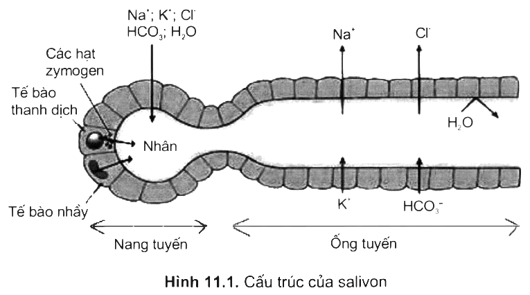
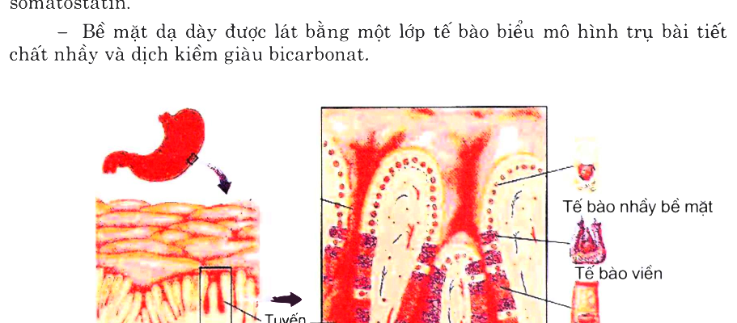
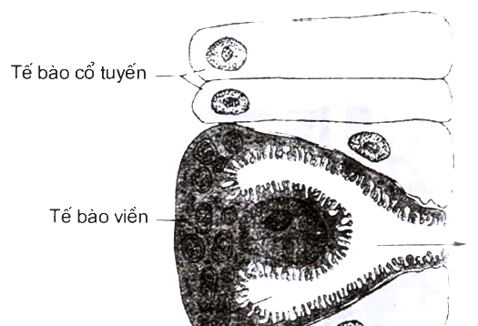
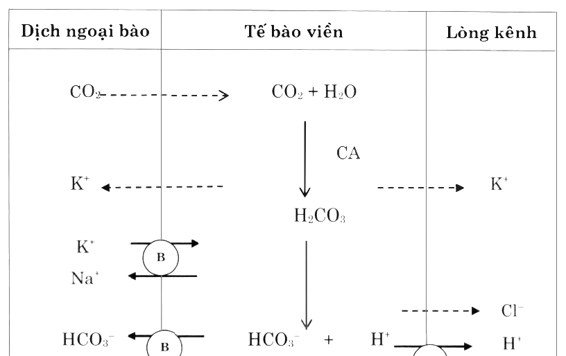
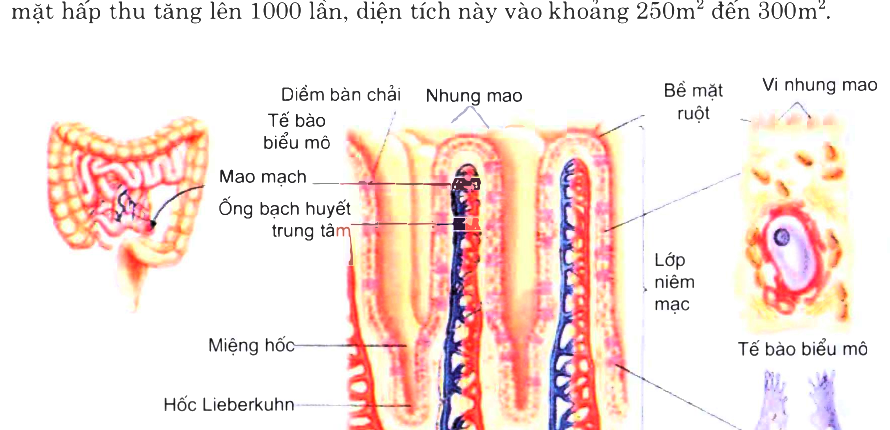
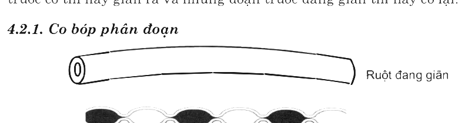
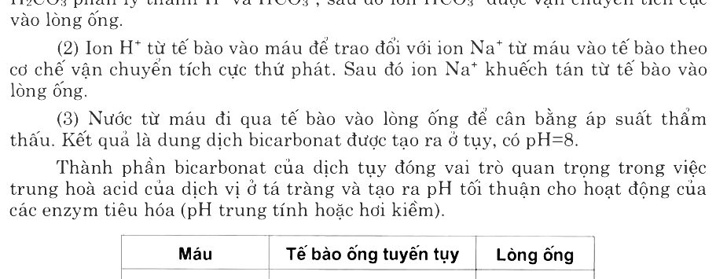
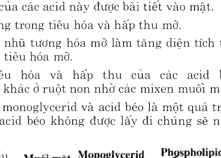
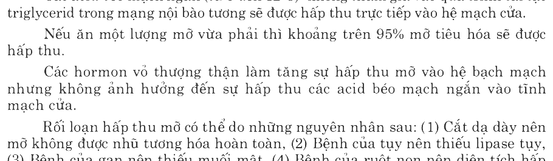

# BÀI 11: SINH LÝ BỘ MÁY TIÊU HÓA

## MỤC TIÊU HỌC TẬP
Sau khi học xong bài này, sinh viên có khả năng:
1. Trình bày được các hiện tượng cơ học ở các đoạn khác nhau của ống tiêu hóa (miệng, thực quản, dạ dày, ruột non, ruột già).
2. Phân tích được thành phần, tính chất, tác dụng sinh học và cơ chế điều hòa bài tiết của các dịch tiêu hóa (nước bọt, dịch vị, dịch tụy, dịch mật, dịch ruột).
3. Trình bày chi tiết cơ chế tiêu hóa và hấp thu các chất dinh dưỡng (glucid, protid, lipid), các chất điện giải, nước và vitamin tại ruột non và ruột già.
4. Trình bày được các chức năng sinh lý cơ bản của gan trong cơ thể.

---

## ĐẠI CƯƠNG VỀ BỘ MÁY TIÊU HÓA
Bộ máy tiêu hóa của cơ thể người bao gồm ống tiêu hóa và các tuyến tiêu hóa phụ trợ:
- **Ống tiêu hóa:** Bắt đầu từ miệng, qua họng, thực quản, dạ dày, ruột non (tá tràng, hỗng tràng, hồi tràng), ruột già (manh tràng, đại tràng lên, đại tràng ngang, đại tràng xuống, đại tràng sigma, trực tràng) và kết thúc ở ống hậu môn.
- **Tuyến tiêu hóa:** Bao gồm các tuyến nước bọt (tuyến mang tai, dưới hàm, dưới lưỡi và các tuyến rải rác ở niêm mạc miệng), tuyến dạ dày, tuyến tụy ngoại tiết, gan cùng hệ thống dẫn và dự trữ mật (ống mật, túi mật), và các tuyến ở niêm mạc ruột (tuyến Brünner, hốc Lieberkühn).

Chức năng căn bản của bộ máy tiêu hóa là tiếp nhận thức ăn từ môi trường ngoài, chuyển hóa các đại phân tử dinh dưỡng phức tạp (glucid, lipid, protein) thành các phân tử đơn giản dễ hấp thu, đồng thời tái hấp thu nước và các chất điện giải, đưa vào hệ tuần hoàn máu và bạch huyết để nuôi dưỡng toàn bộ tế bào trong cơ thể. Các chức năng hoạt động chính bao gồm:
- **Chức năng cơ học (vận động):** Do các lớp cơ trơn ở thành ống tiêu hóa thực hiện, tạo các cử động nhào trộn thức ăn với dịch tiêu hóa, nghiền nhỏ và đẩy thức ăn dọc theo ống tiêu hóa theo một chiều nhất định nhờ hoạt động của các cơ thắt sinh lý.
- **Chức năng bài tiết:** Tiết các dịch chứa nước, chất điện giải, chất nhầy và hệ thống enzym tiêu hóa đặc hiệu để biến đổi hóa học thức ăn và bảo vệ niêm mạc.
- **Chức năng tiêu hóa hóa học:** Phân giải glucid thành monosaccharid; phân giải protein thành oligopeptid và acid amin; phân giải lipid (chủ yếu là triglycerid) thành acid béo và monoglycerid.
- **Chức năng hấp thu:** Vận chuyển có chọn lọc các chất dinh dưỡng, ion và nước từ lòng ống tiêu hóa qua lớp tế bào biểu mô niêm mạc vào hệ mạch máu hoặc mạch bạch huyết.
- **Chức năng nội tiết:** Các tế bào nội tiết rải rác ở niêm mạc đường tiêu hóa (hệ thống APUD/tế bào nội tiết đường ruột) bài tiết nhiều loại hormon tại chỗ điều hòa hoạt động vận động và bài tiết (gastrin, secretin, cholecystokinin, GIP...).

---

## 1. ĐẶC ĐIỂM PHÂN BỐ MẠCH MÁU VÀ THẦN KINH Ở BỘ MÁY TIÊU HÓA

### 1.1. Hệ thống thần kinh chi phối ống tiêu hóa
Hoạt động của ống tiêu hóa được điều hòa bởi hệ thần kinh tự chủ (giao cảm và phó giao cảm) kết hợp chặt chẽ với hệ thần kinh ruột (enteric nervous system - ENS):

- **Hệ phó giao cảm:**
  + Các sợi trước hạch xuất phát từ nhân vận động dây X (dây X) ở hành não, phân nhánh đến thực quản, dạ dày, ruột non, manh tràng, đại tràng lên và đại tràng ngang.
  + Các sợi xuất phát từ các đốt cùng tuỷ sống ($S_2 - S_4$) đi qua các dây thần kinh chậu đến chi phối nửa dưới đại tràng (đại tràng xuống, đại tràng sigma), trực tràng và hậu môn.
  + Các sợi phó giao cảm tạo synap với nơron hạch của hệ thần kinh ruột; chất truyền đạt thần kinh chủ yếu ở tận cùng sợi là acetylcholin. Tác dụng chung của kích thích phó giao cảm là tăng trương lực cơ trơn, tăng nhu động và tăng tiết dịch tiêu hóa.
- **Hệ giao cảm:** Xuất phát từ tủy sống đoạn thắt lưng, đi qua các hạch giao cảm trước cột sống (hạch tạng, hạch mạc treo tràng trên, mạc treo tràng dưới). Các sợi sau hạch phân nhánh đến mạng lưới thần kinh ruột, hệ mạch máu và các cơ thắt trơn. Chất truyền đạt thần kinh là noradrenalin. Kích thích giao cảm thường gây giảm trương lực cơ thành ruột, ức chế nhu động, co thắt các cơ thắt và co mạch làm giảm lưu lượng máu đến ruột.
- **Hệ thần kinh ruột (ENS - "Bộ não nhỏ của ruột"):**
  + Gồm khoảng $10^8$ tế bào thần kinh nằm hoàn toàn trong thành ống tiêu hóa, hình thành hai đám rối chính:
    * **Đám rối Auerbach (Myenteric plexus):** Nằm giữa lớp cơ dọc và cơ vòng của thành ống tiêu hóa, giữ vai trò chủ đạo trong việc điều hòa vận động co bóp và trương lực cơ trơn.
    * **Đám rối Meissner (Submucosal plexus):** Nằm ở lớp dưới niêm mạc, kiểm soát trực tiếp hoạt động bài tiết dịch, lưu lượng máu vi tuần hoàn tại chỗ và cảm giác niêm mạc.
  + Hệ thần kinh ruột có khả năng hoạt động độc lập tự chủ thông qua các cung phản xạ nội sinh tại chỗ (cảm giác, trung gian, vận động) ngay cả khi bị cắt đứt hoàn toàn liên hệ với hệ thần kinh trung ương.

### 1.2. Tuần hoàn máu đường tiêu hóa (Tuần hoàn cửa)
Máu nuôi dưỡng các cơ quan tiêu hóa (dạ dày, ruột non, ruột già, tụy, lách) sau khi đi qua lưới mao mạch sẽ tập trung vào hệ thống tĩnh mạch mạc treo và hợp lưu thành **tĩnh mạch cửa** dẫn trực tiếp về gan. Tại gan, máu chảy qua các xoang mạch (sinusoid) tiếp xúc mật thiết với các tế bào gan và hệ thống tế bào võng nội mô (đại thực bào Kupffer) giúp thanh lọc vi khuẩn, độc tố ngoại lai từ ruột trước khi đổ vào tĩnh mạch gan và trở về tuần hoàn chung qua tĩnh mạch chủ dưới.

---

## 2. TIÊU HÓA Ở MIỆNG VÀ THỰC QUẢN

### 2.1. Hoạt động cơ học: Nhai và Nuốt

#### 2.1.1. Động tác nhai
- Nhai là quá trình cơ học nghiền nhỏ thức ăn dưới sự phối hợp của răng, lưỡi, môi và các cơ nhai (cơ cắn, cơ thái dương, cơ chân bướm trong và ngoài), do nhánh vận động của dây thần kinh sọ số V (dây sinh ba) chi phối dưới sự kiểm soát của trung tâm nhai ở thân não.
- Phản xạ nhai mang tính chất tự động: Thức ăn kích thích niêm mạc miệng gây ức chế cơ nhai làm hàm dưới hạ xuống; sự căng giãn thụ thể cơ hàm lập tức kích hoạt phản xạ co cơ hàm, kéo hàm dưới lên ép thức ăn vào răng; chu trình này lặp đi lặp lại nhịp nhàng.
- Ý nghĩa: Nghiền nhỏ thức ăn làm tăng diện tích tiếp xúc với các enzym tiêu hóa, phá vỡ vỏ bọc cellulose ở thực vật, bôi trơn khối thức ăn, tránh gây tổn thương cơ học cho thực quản và dạ dày.

#### 2.1.2. Động tác nuốt
Nuốt là một quá trình phức tạp gồm 3 giai đoạn liên tiếp:
1. **Giai đoạn miệng (có ý thức):** Lưỡi nâng lên ép vào vòm miệng, đẩy viên thức ăn đã được nghiền và thấm đẫm nước bọt ra phía sau eo họng.
2. **Giai đoạn họng (hoàn toàn tự động, phản xạ không ý thức):** Kéo dài 1 - 2 giây. Viên thức ăn chạm vào các thụ thể ở vùng vòm họng kích thích các xung động truyền về trung tâm nuốt ở hành não qua dây V và IX. Trung tâm phát lệnh qua các dây V, IX, X, XII điều khiển một chuỗi động tác bảo vệ đường thở và đẩy thức ăn:
   - Khẩu cái mềm nâng lên bịt kín lỗ mũi sau.
   - Các nếp gấp hầu áp sát tạo khe hẹp ngăn thức ăn kích thước lớn.
   - Thanh quản bị kéo lên trên và ra trước, nắp thanh môn hạ xuống che kín đường thở.
   - Cơ thắt hầu - thực quản (cơ thắt thực quản trên) mở rộng, đồng thời các cơ khép hầu co bóp ép viên thức ăn vào thực quản.
3. **Giai đoạn thực quản (tự động):** Sóng nhu động nguyên phát (tiếp nối từ họng) và nhu động thứ phát (do kích thích thành thực quản khi còn sót thức ăn) đẩy viên thức ăn di chuyển xuống dạ dày trong khoảng 5 - 10 giây. Khi sóng nhu động đến gần dạ dày, cơ thắt thực quản dưới (LES) giãn ra phối hợp với sự giãn tiếp nhận của phần đáy dạ dày, cho phép thức ăn đi vào lòng dạ dày, sau đó co chặt lại để chống trào ngược acid.

### 2.2. Bài tiết nước bọt và tiêu hóa hóa học tại miệng

#### 2.2.1. Cấu trúc và đơn vị bài tiết của tuyến nước bọt
Ba đôi tuyến nước bọt lớn gồm:
- **Tuyến mang tai:** Chỉ bài tiết thanh dịch giàu enzym $\alpha$-amylase (ptyalin).
- **Tuyến dưới hàm:** Tuyến hỗn hợp bài tiết cả thanh dịch và chất nhầy (chiếm khoảng 70% tổng lượng nước bọt).
- **Tuyến dưới lưỡi:** Tuyến hỗn hợp nhưng chủ yếu tiết chất nhầy.

Đơn vị chức năng cơ bản của tuyến nước bọt là **salivon** (*hình 11.1*), gồm một nang tiết (acinus) và ống dẫn:
- **Tại nang tuyến:** Tế bào thanh dịch tiết dịch nguyên thuỷ có thành phần điện giải ($\text{Na}^+, \text{K}^+, \text{Cl}^-, \text{HCO}_3^-$) tương đương huyết tương đẳng trương cùng các hạt enzym.
- **Tại biểu mô ống dẫn:** Các tế bào ống thực hiện tái hấp thu tích cực ion $\text{Na}^+$ và $\text{Cl}^-$, đồng thời bài tiết tích cực ion $\text{K}^+$ và $\text{HCO}_3^-$. Do màng ống dẫn ít thấm nước, nước bọt bài xuất ra khoang miệng trở thành dịch nhược trương với nồng độ $\text{K}^+$ cao gấp khoảng 7 lần và $\text{HCO}_3^-$ cao gấp 3 lần huyết tương.

Lưu lượng bài tiết nước bọt trung bình từ 800 - 1500 ml/ngày, pH trong khoảng 6,0 - 7,4.

#### 2.2.2. Tác dụng sinh học của nước bọt
- **Tiêu hóa glucid:** Enzym $\alpha$-amylase nước bọt thuỷ phân các liên kết $\alpha$-1,4 glucosid trong phân tử tinh bột chín thành maltose, maltotriose và dextrin. Mặc dù thời gian thức ăn ở miệng ngắn, enzym vẫn tiếp tục hoạt động sâu bên trong khối thức ăn ở dạ dày cho đến khi dịch vị thấm sâu và bất hoạt enzym ở môi trường acid mạnh ($\text{pH} < 4$).
- **Bảo vệ và vệ sinh răng miệng:**
  + Cuốn trôi cơ học các mảnh vụn thức ăn và vi sinh vật.
  + Chứa lysozym phá vỡ màng tế bào vi khuẩn, ion thiocyanat ($\text{SCN}^-$) có tính sát trùng, và các kháng thể miễn dịch tiết (IgA).
  + Nồng độ $\text{HCO}_3^-$ cao giúp trung hòa acid sinh ra từ vi khuẩn lên men hoặc dịch trào ngược từ dạ dày, bảo vệ men răng.
- **Bôi trơn và hỗ trợ phát âm:** Mucin trong nước bọt làm ẩm niêm mạc, tạo thuận lợi cho các cử động nuốt và phát âm.

#### 2.2.3. Cơ chế điều hòa bài tiết nước bọt
Tuyến nước bọt hoàn toàn chịu sự điều khiển của hệ thần kinh thực vật (không chịu sự điều hòa của hormon tiêu hóa):
- **Phó giao cảm (chủ đạo):** Xuất phát từ nhân nước bọt trên và dưới ở cầu - hành não, qua dây VII và IX đến các hạch ngoại vi rồi tới tuyến. Kích thích phó giao cảm làm tăng tiết lượng lớn nước bọt loãng giàu enzym và điện giải.
- **Giao cảm:** Làm tăng tiết lượng nhỏ nước bọt đặc, giàu chất nhầy mucin.
- Các phản xạ điều hòa:
  + Phản xạ không điều kiện: Kích thích cơ học, vị giác (đặc biệt là chất chua kích thích tiết gấp nhiều lần) lên niêm mạc miệng.
  + Phản xạ có điều kiện: Tín hiệu thị giác, khứu giác hoặc suy nghĩ về thức ăn hấp dẫn.

---

## 3. TIÊU HÓA Ở DẠ DÀY

### 3.1. Hoạt động cơ học của dạ dày

#### 3.1.1. Chức năng chứa đựng và phản xạ giãn tiếp nhận
Về mặt chức năng sinh lý, dạ dày chia làm 2 phần:
- **Phần gần (vùng đáy và nửa trên thân vị):** Thành mỏng, có chức năng chính là chứa đựng thức ăn.
- **Phần xa (nửa dưới thân vị và hang môn vị):** Thành cơ dày, có chức năng co bóp, nhào trộn và tống thức ăn.

Khi thức ăn từ thực quản xuống dạ dày, vùng đáy vị thực hiện **phản xạ giãn tiếp nhận** (receptive relaxation) thông qua dây thần kinh X, làm giảm trương lực cơ trơn thành dạ dày. Cơ chế này cho phép dạ dày tiếp nhận thể tích thức ăn lên đến 1,5 lít mà áp suất trong lòng dạ dày hầu như không tăng.

#### 3.1.2. Hoạt động nhào trộn và sóng nhu động
- Các sóng co bóp nhu động bắt đầu từ vùng giữa thân vị lan dần về phía hang vị với tần số khoảng 3 chu kỳ/phút (nhịp điện cơ bản tạo bởi các tế bào tạo nhịp Cajal).
- Khi sóng co bóp lan đến hang vị, lớp cơ dày co bóp mạnh ép thức ăn vào dịch vị. Khi sóng đến môn vị, cơ thắt môn vị co chặt lại làm khối thức ăn bị đẩy dội ngược trở lại thân vị (hiện tượng dội ngược - retropulsion). Hoạt động này nghiền nát các phần tử thức ăn thành kích thước nhỏ ($< 2\text{ mm}$) và tạo thành khối bán lỏng đồng nhất gọi là **vị trấp (chyme)**.
- **Co bóp đói:** Xuất hiện khi dạ dày rỗng nhiều giờ giữa các bữa ăn, biểu hiện bằng các đợt sóng co bóp trương lực mạnh kéo dài 2 - 3 phút, gây cảm giác cồn cào, đau đói thượng vị.

#### 3.1.3. Cơ chế thoát thức ăn khỏi dạ dày (Tống vị trấp)
Tốc độ thoát thức ăn phụ thuộc vào sự chênh lệch áp suất giữa hang vị và tá tràng cùng trương lực cơ thắt môn vị:
- **Các yếu tố thúc đẩy tống vị trấp:**
  + Độ căng thành dạ dày: Thể tích thức ăn làm căng thành dạ dày kích hoạt các phản xạ dây X và phản xạ nội sinh làm tăng tần số và biên độ bơm môn vị.
  + Hormon gastrin: Tiết ra từ tế bào G vùng hang vị kích thích nhu động dạ dày và tăng cường lực co bóp môn vị.
- **Các yếu tố ức chế tống vị trấp (Cơ chế ức chế ngược từ tá tràng - đóng vai trò quyết định):**
  + **Phản xạ ruột - dạ dày (Enterogastric reflex):** Khi tá tràng bị căng quá mức, hoặc môi trường quá toan ($\text{pH} < 3,5 - 4$), chứa sản phẩm phân giải protein, hoặc dung dịch ưu/nhược trương, các thụ thể tại tá tràng truyền tín hiệu ức chế qua hệ thần kinh ruột và dây X làm tăng co thắt môn vị và giảm nhu động dạ dày.
  + **Các hormon tá tràng:** Sự hiện diện của acid béo và mỡ ở tá tràng kích thích tế bào I tiết **cholecystokinin (CCK)**; ion $\text{H}^+$ kích thích tế bào S tiết **secretin**; ngoài ra còn có **GIP** (Gastric Inhibitory Peptide). Các hormon này ức chế trực tiếp lực bơm hang vị và làm chậm quá trình thoát thức ăn, đảm bảo tá tràng có đủ thời gian tiêu hóa và trung hòa dịch vị.

### 3.2. Bài tiết dịch vị

Dạ dày bài tiết từ 1 - 3 lít dịch vị/ngày. Dịch vị là dịch trong suốt, có tính acid rất mạnh ($\text{pH} \approx 1,0$), thành phần bao gồm acid clohydric (HCl), enzym pepsinogen, yếu tố nội, lipase dịch vị và chất nhầy kiềm.

Niêm mạc dạ dày có các tuyến chính (*hình 11.2*):
- **Tuyến oxyntic (tuyến sinh acid):** Chiếm đa số ở vùng thân và đáy vị, gồm:
  + *Tế bào viền (Parietal cells):* Bài tiết HCl và yếu tố nội (Intrinsic Factor - IF).
  + *Tế bào chính (Chief cells):* Bài tiết pepsinogen.
  + *Tế bào cổ tuyến:* Bài tiết chất nhầy.
  + *Tế bào giống ưa crôm (ECL cells):* Bài tiết histamin.
  + *Tế bào D:* Bài tiết somatostatin.
- **Tuyến môn vị:** Nằm ở hang môn vị, chứa tế bào tiết chất nhầy, tế bào G bài tiết hormon gastrin và tế bào D bài tiết somatostatin.

#### 3.2.1. Cơ chế bài tiết Acid Clohydric (HCl) tại tế bào viền

Tế bào viền có cấu trúc chuyên biệt với hệ thống vi quản nội bào mở thông ra lòng tuyến (*hình 11.3*).

Cơ chế tạo HCl diễn ra qua các bước (*sơ đồ 11.1*):
1. Bên trong bào tương tế bào viền, $\text{CO}_2$ (khuếch tán từ máu hoặc chuyển hóa nội bào) kết hợp với nước nhờ xúc tác của enzym **carbonic anhydrase (CA)** tạo thành acid carbonic:
   $$\text{CO}_2 + \text{H}_2\text{O} \xrightarrow{\text{CA}} \text{H}_2\text{CO}_3 \rightleftharpoons \text{H}^+ + \text{HCO}_3^-$$
2. Ion $\text{H}^+$ được bơm chủ động qua màng vi quản vào lòng kênh trao đổi với ion $\text{K}^+$ đi vào qua bơm **$\text{H}^+ - \text{K}^+ - \text{ATPase}$ (bơm proton)**. Đây là quá trình vận chuyển tích cực nguyên phát tiêu tốn năng lượng ATP, tạo chênh lệch nồng độ $\text{H}^+$ gấp hàng triệu lần giữa lòng kênh và máu.
3. Bơm $\text{Na}^+ - \text{K}^+ - \text{ATPase}$ ở màng đáy - bên duy trì gradient ion nội bào; ion $\text{K}^+$ sau đó thoát ra lòng vi quản qua các kênh riêng để tiếp tục tái cung cấp cho bơm proton.
4. Ion $\text{HCO}_3^-$ tạo thành trong tế bào được đưa ra ngoài tuần hoàn máu qua chất mang trao đổi ngược chiều với ion $\text{Cl}^-$ ở màng đáy - bên ($\text{HCO}_3^-/\text{Cl}^-$ exchanger). Lượng $\text{HCO}_3^-$ giải phóng vào máu tĩnh mạch dạ dày sau bữa ăn tạo nên hiện tượng **"kiềm triều" (alkaline tide)**.
5. Ion $\text{Cl}^-$ khuếch tán thụ động từ bào tương qua màng đỉnh vào lòng vi quản, tại đây kết hợp với ion $\text{H}^+$ tạo thành dung dịch HCl nồng độ khoảng $150\text{ mmol/L}$. Nước thẩm thấu theo gradient áp suất từ dịch ngoại bào vào lòng kênh.
*(Thuốc ức chế bơm proton như Omeprazol, Esomeprazol tác động khóa không hồi phục bơm $\text{H}^+ - \text{K}^+ - \text{ATPase}$, là thuốc ức chế tiết acid mạnh nhất hiện nay).*

**Tác dụng sinh học của HCl:**
- Hoạt hóa pepsinogen thành enzym hoạt tính pepsin và duy trì môi trường pH tối thuận ($1,8 - 3,5$) cho hoạt tính của pepsin.
- Thủy phân chuỗi mô liên kết protein và màng cellulose thực vật non, tạo điều kiện cho các enzym tiêu hóa ngấm sâu.
- Diệt khuẩn trong thức ăn, ngăn ngừa nhiễm khuẩn qua đường tiêu hóa.
- Kích thích cơ chế đóng mở tâm vị và môn vị, phối hợp điều hòa bài tiết dịch tụy và dịch mật khi xuống tá tràng.

#### 3.2.2. Sự bài tiết và vai trò của các thành phần dịch vị khác
- **Pepsinogen và Pepsin:** Pepsinogen là tiền chất không hoạt động do tế bào chính tiết ra. Khi gặp HCl, liên kết peptid ức chế bị cắt đứt tạo thành pepsin. Pepsin hoạt động tự xúc tác chuyển nhanh các phân tử pepsinogen khác thành pepsin. Là một endopeptidase, pepsin cắt các liên kết peptid bên trong phân tử protein (đặc biệt liên quan đến acid amin thơm) tạo các đoạn peptid ngắn (pepton, proteose). Pepsin có khả năng tiêu hóa đặc hiệu các sợi collagen của mô thịt.
- **Lipase dịch vị:** Tiết ra từ tế bào chính, hoạt động ở dải pH acid yếu ($4 - 6$), chỉ có khả năng thủy phân các triglycerid đã nhũ tương hóa sẵn (như chất béo trong sữa, lòng đỏ trứng) thành acid béo và diglycerid.
- **Yếu tố nội (Intrinsic Factor - IF):** Glycoprotein do tế bào viền bài tiết. IF gắn với vitamin $\text{B}_{12}$ tạo phức hợp bền vững chống lại sự phá hủy của các enzym tiêu hóa, cho phép vitamin $\text{B}_{12}$ được hấp thu đặc hiệu qua quá trình ẩm bào tại niêm mạc đoạn cuối hồi tràng. Thiếu yếu tố nội (do teo niêm mạc dạ dày hoặc cắt dạ dày) dẫn đến bệnh thiếu máu ác tính (thiếu máu hồng cầu to Biermer).
- **Chất nhầy và hàng rào bảo vệ niêm mạc dạ dày:**
  Các tế bào biểu mô bề mặt bài tiết lớp gel nhầy glycoprotein không hòa tan dày khoảng 1 mm bao phủ toàn bộ niêm mạc. Lớp nhầy bẫy các ion $\text{HCO}_3^-$ do biểu mô tiết ra, tạo nên **hàng rào nhầy - bicarbonat** duy trì vi môi trường trung tính ($\text{pH} \approx 7$) ngay sát bề mặt tế bào biểu mô, ngăn chặn sự tiếp xúc trực tiếp của acid HCl ($\text{pH} \approx 1 - 2$) và enzym pepsin. Quá trình tổng hợp chất nhầy và phục hồi tế bào được bảo vệ mạnh mẽ bởi prostaglandin ($\text{PGE}_2, \text{PGI}_2$). Các thuốc kháng viêm non-steroid (NSAIDs) và aspirin ức chế tổng hợp prostaglandin làm suy yếu hàng rào này, dễ gây loét dạ dày.

#### 3.2.3. Điều hòa bài tiết dịch vị
Quá trình kích thích bài tiết acid HCl tại tế bào viền được phối hợp điều hòa bởi 3 chất kích thích trực tiếp:
1. **Acetylcholin (thần kinh):** Tiết từ tận cùng phó giao cảm gắn lên thụ thể $M_3$, kích hoạt dòng canxi nội bào ($\text{IP}_3/\text{Ca}^{2+}$).
2. **Gastrin (thể dịch):** Tiết từ tế bào G hang vị gắn lên thụ thể $\text{CCK}_B$, cũng hoạt hóa đường truyền tín hiệu qua canxi nội bào.
3. **Histamin (cận tiết):** Tiết từ tế bào ECL gắn lên thụ thể $H_2$, làm tăng nồng độ $\text{cAMP}$ nội bào.
Ba con đường này có tác dụng **hiệp đồng tương hỗ mạnh mẽ**; thuốc ức chế thụ thể $H_2$ (như Cimetidin, Ranitidin) làm giảm đáng kể đáp ứng acid của tế bào viền đối với cả 3 chất.

*Cơ chế điều hòa ngược âm tính:* Khi nồng độ acid trong lòng hang vị tăng cao ($\text{pH} < 3,0$), ion $\text{H}^+$ kích thích tế bào D tiết somatostatin. Somatostatin ức chế trực tiếp tế bào G (giảm tiết gastrin) và ức chế tế bào viền, giúp ngăn ngừa tình trạng tăng toan quá mức.

**Ba giai đoạn bài tiết dịch vị trong bữa ăn:**
1. **Giai đoạn đầu (Cephalic phase - 20%):** Xuất hiện trước khi thức ăn vào dạ dày do ngửi, nhìn, nếm, nhai nuốt hoặc suy nghĩ về thức ăn. Dẫn truyền hoàn toàn qua phản xạ thần kinh phó giao cảm (dây X).
2. **Giai đoạn dạ dày (Gastric phase - 70%):** Lượng dịch vị tiết lớn nhất, kích hoạt khi thức ăn vào dạ dày làm căng thành cơ và các sản phẩm peptid kích thích tế bào G tiết lượng lớn gastrin, kết hợp phản xạ dây X - dây X tại chỗ.
3. **Giai đoạn ruột (Intestinal phase - 10%):** Vị trấp vào tá tràng lúc đầu kích thích tiết lượng nhỏ gastrin ruột; sau đó các cơ chế ức chế ngược từ tá tràng (secretin, CCK, somatostatin) chiếm ưu thế làm giảm bài tiết dịch vị.

---

## 4. TIÊU HÓA Ở RUỘT NON

### 4.1. Đặc điểm cấu tạo thích nghi của ruột non
Ruột non là cơ quan quan trọng nhất của quá trình tiêu hóa và hấp thu, có chiều dài khoảng 2,8 mét ở người trưởng thành, gồm 3 đoạn: tá tràng (22 cm), hỗng tràng và hồi tràng.

Diện tích bề mặt tiếp xúc của niêm mạc ruột non được tăng cường đến cực đại (tổng diện tích khoảng 250 - 300 m²) nhờ 3 cấu trúc giải phẫu - mô học đặc biệt:
1. **Các nếp gấp Kerckring (van ruột):** Tăng diện tích lên gấp 3 lần.
2. **Nhung mao ruột (villi):** Dài khoảng 1 mm, mật độ dày đặc phủ kín niêm mạc, làm tăng diện tích tiếp xúc lên 10 lần. Ở trục giữa mỗi nhung mao có mạng mao mạch máu phong phú và một mạch dưỡng chấp trung tâm (ống bạch huyết trung tâm) để hấp thu mỡ.
3. **Diềm bàn chải vi nhung mao (microvilli):** Khoảng 1.000 vi nhung mao trên cực đỉnh của mỗi tế bào biểu mô ruột (enterocyte), làm tăng diện tích bề mặt lên thêm 20 lần nữa. Trên màng vi nhung mao gắn dày đặc các enzym tiêu hóa và các protein tải vận chuyển chuyên biệt.

### 4.2. Hoạt động cơ học ở ruột non

#### 4.2.1. Co bóp phân đoạn (Co bóp nhào trộn)
- Là hình thức vận động cơ bản của ruột non trong giai đoạn tiêu hóa. Từng đoạn cơ vòng cách quãng khoảng 1 cm đồng thời co bóp làm khối nhũ trấp bị chia thành nhiều đoạn nhỏ như các khúc dồi (*hình 11.5*).
- Sau đó đoạn đang co sẽ giãn ra, đoạn đang giãn lại co bóp, nhào nặn liên tục nhũ trấp với các dịch tiêu hóa (dịch tụy, mật, dịch ruột) và đưa các phần tử thức ăn mới đến tiếp xúc sát với diềm bàn chải vi nhung mao.

#### 4.2.2. Co bóp nhu động (Co bóp đẩy)
Các sóng nhu động di chuyển với vận tốc 0,5 - 2 cm/giây từ phía tá tràng dọc dần xuống phía hồi tràng. Các sóng nhu động bình thường chỉ đi được vài cm rồi tự tắt, mất khoảng 3 - 5 giờ để đẩy dần nhũ trấp qua toàn bộ chiều dài ruột non đến van hồi - manh tràng.

#### 4.2.3. Phức hợp vận động di chuyển (Migrating Motor Complex - MMC)
- Xảy ra trong giai đoạn ruột rỗng (khi đói giữa các bữa ăn), lặp lại chu kỳ sau mỗi 90 phút.
- Là các đợt sóng co bóp nhu động mạnh mẽ quét liên tục từ dạ dày dọc suốt chiều dài ruột non tới hồi manh tràng. MMC hoạt động như một "người quét dọn" dọn sạch các vụn thức ăn sót lại, dịch tiêu hóa thừa, tế bào niêm mạc bong tróc và ngăn ngừa vi khuẩn ruột già phát triển tràn ngược vào ruột non.
- MMC bị ức chế ngay khi có thức ăn vào dạ dày và được kích thích bởi hormon motilin.

#### 4.2.4. Vận động của nhung mao và cơ thắt hồi manh tràng
- Các sợi cơ trơn đi vào nhung mao co bóp nhịp nhàng (ngắn lại rồi dài ra) giúp bơm hút dịch bạch huyết trong ống bạch huyết trung tâm và khuấy động lớp dịch sát bề mặt tế bào ruột.
- **Cơ thắt hồi manh tràng:** Duy trì trương lực nhẹ ngăn cản chất bã và vi khuẩn từ manh tràng trào ngược lên hồi tràng. Áp lực và dịch tại hồi tràng làm giãn cơ thắt, trong khi áp lực và kích thích tại manh tràng làm co chặt cơ thắt.

---

### 4.3. Bài tiết các dịch tiêu hóa tại ruột non

#### 4.3.1. Dịch tụy ngoại tiết

Tuyến tụy ngoại tiết bài tiết khoảng 1.000 ml dịch/ngày, đổ vào tá tràng qua ống tụy chính (ống Wirsung) tại bóng Vater (có cơ vòng Oddi kiểm soát).

- **Thành phần dung dịch kiềm bicarbonat:**
  Các tế bào biểu mô ống dẫn tụy bài tiết lượng lớn dung dịch giàu $\text{HCO}_3^-$ với nồng độ lên tới $120 - 140\text{ mEq/L}$, $\text{pH} \approx 8,0 - 8,3$. Dịch kiềm này có nhiệm vụ tối quan trọng là trung hòa hoàn toàn acid clohydric của dịch vị đưa xuống tá tràng, bảo vệ niêm mạc tá tràng và tạo pH môi trường tối thuận ($7 - 8$) cho các enzym tụy hoạt động.

- **Hệ thống enzym tiêu hóa của dịch tụy:**
  Các tế bào nang tụy tổng hợp và bài tiết đầy đủ các enzym tiêu hóa 3 nhóm chất dinh dưỡng chính:
  + **Tiêu hóa protein:** Bài tiết dưới dạng tiền enzym (zymogen) chưa hoạt động. Khi vào tá tràng, enzym **enterokinase** của tế bào biểu mô ruột hoạt hóa *trypsinogen* thành **trypsin**. Sau đó trypsin tự hoạt hóa các trypsinogen còn lại và hoạt hóa hàng loạt các tiền enzym khác: *chymotrypsinogen* thành *chymotrypsin*, *procarboxypeptidase* thành *carboxypeptidase*, *proelastase* thành *elastase*. Trypsin và chymotrypsin là endopeptidase cắt đứt các liên kết peptid bên trong chuỗi protein tạo thành các polypeptid ngắn; carboxypeptidase là exopeptidase cắt rời từng acid amin ở đầu carboxyl của chuỗi peptid.
  + **Tiêu hóa glucid:** *Amylase tụy* bài tiết dưới dạng hoạt động, thủy phân tinh bột chín và sống thành maltose, maltotriose và oligosaccharid.
  + **Tiêu hóa lipid:** *Lipase tụy* thủy phân triglycerid thành 2 acid béo tự do và 1 phân tử monoglycerid; *cholesterol esterase* thủy phân cholesterol ester; *phospholipase A2* thủy phân phospholipid tạo lysolecithin.

**Bảng 11.2. Tác dụng các enzym tiêu hóa của dịch tụy**

| Enzym | Cơ chất | Tác dụng | Sản phẩm tiêu hóa |
| :--- | :--- | :--- | :--- |
| **Trypsin và Chymotrypsin** | Protein và Polypeptid | Thủy phân các liên kết peptid bên trong chuỗi | Các peptid ngắn |
| **Elastase** | Sợi elastin | Tiêu hóa các sợi elastin mô liên kết | Peptid nhỏ |
| **Carboxypeptidase** | Protein và Polypeptid | Thủy phân liên kết peptid ở đầu tận carboxyl | Peptid và acid amin tự do |
| **Amylase tụy** | Polysaccharid (tinh bột) | Thủy phân liên kết $\alpha$-1,4 glucosid | Oligosaccharid, maltose, maltotriose |
| **Lipase tụy** | Triglycerid | Cắt liên kết ester ở vị trí 1 và 3 của glycerol | Acid béo tự do, 2-monoglycerid |
| **Phospholipase A2** | Phospholipid (Lecithin) | Cắt acid béo ở vị trí 2 | Lysolecithin và acid béo |
| **Cholesterol esterase** | Cholesterol ester | Thủy phân liên kết ester | Cholesterol tự do, acid béo |
| **Ribonuclease / Desoxyribonuclease** | ARN và ADN | Thủy phân liên kết phosphodiester | Mononucleotid và oligonucleotid |

*Cơ chế tự bảo vệ của tụy:* Tụy không bị tự tiêu hóa nhờ: (1) Enzym phân giải protein và phospholipase được tiết dưới dạng zymogen không hoạt động; (2) Enzym được bọc trong các hạt zymogen có màng ngăn cách; (3) Tế bào nang tiết chất ức chế trypsin (trypsin inhibitor) phối hợp ngăn chặn sự hoạt hóa sớm của trypsin ngay trong mô tụy. Trong bệnh viêm tụy cấp, ống tụy bị tắc nghẽn hoặc tế bào tụy bị tổn thương làm hoạt hóa trypsin ngay trong lòng tụy, dẫn tới tự tiêu mô tụy hàng loạt và hoại tử xung quanh.

- **Điều hòa bài tiết dịch tụy:**
  + **Secretin:** Được tế bào S tá tràng tiết ra khi tiếp xúc với acid HCl ($\text{pH} < 4,5$). Secretin theo máu đến kích thích tế bào ống tụy bài tiết lượng lớn dung dịch nước giàu $\text{HCO}_3^-$.
  + **Cholecystokinin (CCK):** Được tế bào I tá tràng và hỗng tràng tiết ra khi tiếp xúc với acid béo, peptid và acid amin. CCK kích thích mạnh tế bào nang tụy bài tiết dịch giàu các enzym tiêu hóa.
  + **Dây thần kinh X (Acetylcholin):** Kích thích cả tế bào nang và tế bào ống, gia tăng tiết enzym trong các giai đoạn tâm thể và dạ dày.

---

#### 4.3.2. Dịch mật

Gan sản xuất liên tục khoảng 500 - 1000 ml mật mỗi ngày. Mật được tiết vào các vi quản mật, theo ống gan đổ vào túi mật để dự trữ và cô đặc, sau đó bài xuất vào tá tràng khi có kích thích tiêu hóa.

- **Thành phần của mật:** Mật gồm nước, muối mật, sắc tố mật (bilirubin), cholesterol, lecithin và các chất điện giải.

**Bảng 11.3. Bảng so sánh thành phần của mật ở gan và mật trong túi mật**

| Thành phần | Mật ở gan | Mật trong túi mật |
| :--- | :---: | :---: |
| **Nước** | $97{,}5\text{ g/dL}$ | $92{,}0\text{ g/dL}$ |
| **Muối mật** | $1{,}1\text{ g/dL}$ | $6{,}0\text{ g/dL}$ |
| **Bilirubin** | $0{,}04\text{ g/dL}$ | $0{,}3\text{ g/dL}$ |
| **Cholesterol** | $0{,}1\text{ g/dL}$ | $0{,}3 - 0{,}9\text{ g/dL}$ |
| **Acid béo** | $0{,}12\text{ g/dL}$ | $0{,}3 - 1{,}2\text{ g/dL}$ |
| **Lecithin** | $0{,}04\text{ g/dL}$ | $0{,}3\text{ g/dL}$ |
| **$\text{Na}^+$** | $145\text{ mEq/L}$ | $130\text{ mEq/L}$ |
| **$\text{K}^+$** | $5\text{ mEq/L}$ | $12\text{ mEq/L}$ |
| **$\text{Ca}^{2+}$** | $5\text{ mEq/L}$ | $23\text{ mEq/L}$ |
| **$\text{Cl}^-$** | $100\text{ mEq/L}$ | $25\text{ mEq/L}$ |
| **$\text{HCO}_3^-$** | $28\text{ mEq/L}$ | $10\text{ mEq/L}$ |

- **Quá trình cô đặc tại túi mật:** Thể tích túi mật chỉ khoảng 20 - 60 ml, nhưng có thể chứa lượng mật bài tiết trong 12 giờ (khoảng 450 ml) do niêm mạc túi mật tái hấp thu chủ động $\text{Na}^+$, kéo theo $\text{Cl}^-$, nước và các chất điện giải, cô đặc mật gấp 5 đến 20 lần.
- **Tác dụng sinh học của muối mật:**
  + **Nhũ tương hóa lipid:** Muối mật là các phân tử lưỡng cực (đầu nhân sterol tan trong mỡ, đầu cực tan trong nước) làm giảm sức căng bề mặt của giọt mỡ, giúp nhu động ruột dễ dàng phân cắt khối mỡ lớn thành hàng tỷ giọt mỡ vi thể, tăng diện tích tiếp xúc với lipase tụy lên hàng ngàn lần.
  + **Tạo hạt mixen (micelle):** Các phân tử muối mật tụ hợp tạo hạt mixen hình cầu (đường kính 2 - 6 nm). Đầu kỵ nước hướng vào tâm ôm lấy acid béo, monoglycerid, cholesterol và vitamin tan trong mỡ; đầu ưa nước quay ra ngoài tương tác với môi trường nước của nhũ trấp. Hạt mixen vận chuyển các sản phẩm lipid qua lớp nước tĩnh đến sát màng diềm bàn chải để hấp thu (*hình 11.6*). Nếu không có muối mật, khoảng 40 - 50% lipid ăn vào sẽ bị thất thoát theo phân (phân mỡ).
  + **Tuần hoàn ruột - gan:** Khoảng 94% muối mật sau khi hoàn thành nhiệm vụ tiêu hóa sẽ được tái hấp thu tích cực tại đoạn cuối hồi tràng, theo tĩnh mạch cửa về gan để được tái bài tiết vào mật. Chỉ khoảng 5% mất theo phân và được bù đắp bởi lượng muối mật mới do gan tổng hợp mỗi ngày ($0{,}5\text{ g/ngày}$).

- **Cơ chế bài xuất mật vào tá tràng:** Khi mỡ và protein vào tá tràng, tế bào niêm mạc tiết **cholecystokinin (CCK)**. CCK gây co bóp mạnh túi mật đồng thời làm giãn hoàn toàn cơ thắt Oddi, tống mật ồ ạt vào lòng tá tràng. Kích thích dây X phối hợp làm tăng co bóp túi mật.

---

#### 4.3.3. Dịch ruột

Được bài tiết bởi các tuyến Brünner ở tá tràng (tiết dịch nhầy kiềm bảo vệ niêm mạc tá tràng khỏi acid dịch vị) và các hốc Lieberkühn nằm giữa các nhung mao ruột non. Mỗi ngày tiết khoảng 1800 ml dịch ruột đẳng trương, pH 7,5 - 8,0.

- **Cơ chế bài tiết dịch ở hốc Lieberkühn:** Tế bào hốc ruột chủ động bơm $\text{Cl}^-$ và $\text{HCO}_3^-$ vào lòng hốc, kéo theo $\text{Na}^+$ và nước qua lực thẩm thấu. Dòng dịch này tạo môi trường chất lỏng để hòa tan và đưa các chất dinh dưỡng đến tiếp xúc với nhung mao. Độc tố vi khuẩn tả (*Vibrio cholerae*) kích hoạt liên tục adenylate cyclase làm tăng vọt cAMP trong tế bào ruột, bơm ồ ạt ion $\text{Cl}^-$ và nước ra lòng ruột, gây mất 5 - 10 lít nước/ngày dẫn đến sốc giảm thể tích tử vong nếu không bù đủ dịch kịp thời.
- **Hệ thống enzym tiêu hóa tại diềm bàn chải vi nhung mao:**
  Các enzym của dịch ruột không được tiết tự do vào lòng ống mà gắn cố định trên màng tế bào biểu mô vi nhung mao, thực hiện quá trình **tiêu hóa màng (tiêu hóa tiếp xúc)**:
  + **Enzym tiêu hóa protid:** *Aminopeptidase* cắt acid amin ở đầu amin; *dipeptidase* và *tripeptidase* phân giải các đoạn dipeptid và tripeptid thành các acid amin tự do.
  + **Enzym tiêu hóa glucid:**
    * *Maltase:* Thủy phân maltose thành 2 phân tử glucose.
    * *Sucrase:* Thủy phân sucrose (đường mía) thành glucose và fructose.
    * *Lactase:* Thủy phân lactose (đường sữa) thành glucose và galactose.
    * *Isomaltase ($lpha$-dextrinase):* Cắt các nhánh $lpha$-1,6 glucosid.
    *(Hội chứng bất dung nạp lactose do thiếu hụt enzym lactase: Lactose không được phân giải sẽ ứ đọng trong ruột, tạo áp suất thẩm thấu kéo nước gây tiêu chảy, đồng thời bị vi khuẩn đại tràng lên men sinh khí $\text{H}_2, \text{CO}_2$ gây chướng bụng, đầy hơi, đau bụng).*
  + **Enzym tiêu hóa lipid:** Một lượng nhỏ lipase ruột phân giải triglycerid thành acid béo và glycerol.

---

### 4.4. Cơ chế hấp thu các chất tại ruột non

#### 4.4.1. Hấp thu Glucid
Mọi phân tử glucid đều phải được chuyển hóa thành các đường đơn (monosaccharid) mới có thể hấp thu qua biểu mô ruột non (chủ yếu tại hỗng tràng):
- **Glucose và Galactose:** Được vận chuyển tích cực thứ phát qua màng đỉnh nhờ chất đồng vận chuyển **SGLT-1** (Sodium-Glucose Linked Transporter 1), lợi dụng gradient nồng độ $\text{Na}^+$ (do bơm $\text{Na}^+ - \text{K}^+ - \text{ATPase}$ ở màng đáy bên tạo ra). Sau đó, glucose và galactose khuếch tán thuận hóa qua màng đáy bên vào máu nhờ chất tải **GLUT-2**.
- **Fructose:** Vận chuyển qua màng đỉnh hoàn toàn bằng cơ chế khuếch tán thuận hóa nhờ chất tải **GLUT-5** (không phụ thuộc $\text{Na}^+$), rồi qua màng đáy bên vào máu qua **GLUT-2**.

#### 4.4.2. Hấp thu Protein
- Protein được hấp thu dưới dạng acid amin tự do, dipeptid và tripeptid:
  + Các acid amin tự do được vận chuyển qua màng đỉnh bằng các chất mang đồng vận chuyển với $\text{Na}^+$ (tương tự glucose) nhờ năng lượng từ bơm $\text{Na}^+ - \text{K}^+ - \text{ATPase}$.
  + Các dipeptid và tripeptid được vận chuyển tích cực qua màng đỉnh nhờ chất đồng vận chuyển với ion $\text{H}^+$ (**PepT1**). Khi vào trong bào tương enterocyte, các peptidase nội bào thủy phân chúng hoàn toàn thành các acid amin tự do.
  + Sau đó các acid amin khuếch tán thuận hóa qua màng đáy bên vào mao mạch máu mạc treo về gan.
- Ở trẻ sơ sinh, các globulin miễn dịch (kháng thể từ sữa mẹ) có thể được hấp thu nguyên vẹn qua cơ chế ẩm bào (pinocytosis), cung cấp miễn dịch thụ động.

#### 4.4.3. Hấp thu Lipid

Cơ chế hấp thu lipid (*hình 11.7*):
1. Các hạt mixen mang acid béo tự do, 2-monoglycerid và cholesterol đến tiếp xúc với màng diềm bàn chải. Do bản chất lipid tan trong mỡ, các acid béo và monoglycerid tách khỏi mixen và khuếch tán thụ động qua lớp màng lipid kép vào bào tương.
2. Tại lưới nội chất trơn (SER), các acid béo chuỗi dài ($\ge 12\text{ C}$) và monoglycerid được tái ester hóa trở lại thành triglycerid, đồng thời cholesterol được ester hóa.
3. Triglycerid, cholesterol ester và phospholipid được bao bọc bởi một lớp vỏ apolipoprotein (chủ yếu là Apo B-48) tạo thành các phân tử hình cầu gọi là **chylomicron**.
4. Chylomicron được bài xuất qua màng đáy bên bằng cơ chế xuất bào (exocytosis). Do kích thước lớn ($100 - 500\text{ nm}$), chylomicron không thể lọt qua màng đáy mao mạch máu mà đi vào các mao mạch bạch huyết trung tâm (lacteal), theo ống ngực đổ vào tĩnh mạch dưới đòn trái đi vào tuần hoàn chung.
5. Riêng các acid béo chuỗi ngắn và trung bình ($< 10 - 12\text{ C}$) tan tốt hơn trong nước sẽ khuếch tán trực tiếp vào mao mạch máu mạc treo đổ về tĩnh mạch cửa tới gan.

#### 4.4.4. Hấp thu Nước, Điện giải và Vitamin
- **Nước:** Khoảng 7 - 8 lít nước/ngày được hấp thu thụ động ở ruột non theo gradient thẩm thấu tạo ra bởi sự hấp thu tích cực các chất hòa tan ($\text{Na}^+$, glucose, acid amin).
- **Ion $\text{Na}^+$:** Được hấp thu tích cực nhờ bơm $\text{Na}^+ - \text{K}^+ - \text{ATPase}$ ở màng đáy bên; ở màng đỉnh qua đồng vận chuyển với glucose/acid amin hoặc trao đổi với $\text{H}^+$.
- **Ion $\text{Cl}^-$ và $\text{HCO}_3^-$:** $\text{Cl}^-$ hấp thu thụ động theo $\text{Na}^+$ hoặc trao đổi với $\text{HCO}_3^-$ tại hồi tràng.
- **Ion $\text{Ca}^{2+}$:** Hấp thu chủ động tại tá tràng và hỗng tràng dưới sự điều hòa của hormon cận giáp (PTH) và dạng hoạt tính của vitamin D ($1,25-(\text{OH})_2\text{D}_3$) thông qua việc kích thích tổng hợp protein gắn canxi nội bào calbindin.
- **Ion $\text{Fe}^{2+}$:** Hấp thu chủ động tại tá tràng theo nhu cầu cơ thể, gắn với ferritin dự trữ trong tế bào hoặc qua ferroportin gắn với transferrin trong máu.
- **Vitamin:** Các vitamin tan trong dầu (A, D, E, K) hấp thu cùng lipid qua hạt mixen. Các vitamin tan trong nước (nhóm B, C) hấp thu qua khuếch tán thuận hóa hoặc đồng vận chuyển với $\text{Na}^+$. Riêng vitamin $\text{B}_{12}$ gắn với yếu tố nội (IF) tạo phức hợp bền vững được hấp thu đặc hiệu qua ẩm bào tại đoạn cuối hồi tràng.

---

## 5. SINH LÝ TIÊU HÓA Ở RUỘT GIÀ

### 5.1. Hoạt động cơ học ở ruột già
- **Co bóp rãnh ngang (Haustration):** Cơ vòng từng đoạn phối hợp với 3 dải cơ dọc co bóp tạo thành các túi phình rãnh ngang. Nhũ trấp được đảo trộn chậm chạp, tiếp xúc lâu với niêm mạc đại tràng, tạo thuận lợi cho sự tái hấp thu nước triệt để.
- **Co bóp khối (Mass movement):** Xảy ra 1 - 3 lần mỗi ngày, đặc biệt sau bữa ăn sáng (nhờ phản xạ dạ dày - đại tràng và tá tràng - đại tràng qua dây X). Một đoạn đại tràng co bóp mạnh mẽ đẩy khối phân di chuyển nhanh một đoạn dài về phía đại tràng sigma và trực tràng.
- **Động tác đại tiện:**
  + Khi phân đi vào trực tràng làm căng thành cơ, các thụ thể nhận cảm cơ học kích hoạt cung phản xạ đại tiện nội sinh (qua đám rối Auerbach) và phản xạ tống phân phó giao cảm (qua dây thần kinh chậu từ đoạn tủy $S_2 - S_4$).
  + Cơ thắt trong hậu môn (cơ trơn vô thức) giãn ra.
  + Cơ thắt ngoài hậu môn (cơ vân do dây thần kinh thẹn chi phối) chịu sự kiểm soát có ý thức của vỏ não. Nếu hoàn cảnh phù hợp, cơ thắt ngoài tự ý giãn ra phối hợp rặn (đóng thanh môn, hạ cơ hoành, co cơ thành bụng làm tăng áp lực ổ bụng) để tống phân ra ngoài.

### 5.2. Chức năng bài tiết và hấp thu của ruột già
- **Bài tiết:** Niêm mạc đại tràng không có enzym tiêu hóa, chỉ tiết chất nhầy giàu $\text{HCO}_3^-$ có tính kiềm để bảo vệ thành ruột chống acid do vi khuẩn sinh ra và kết dính các chất bã thành khuôn phân.
- **Hấp thu:** Tiếp nhận khoảng 1,5 lít dịch từ hồi tràng đổ xuống mỗi ngày và tái hấp thu khoảng 90% nước cùng các ion $\text{Na}^+, \text{Cl}^-$, chỉ đào thải khoảng 100 - 200 ml nước theo phân.
- **Vai trò của hệ vi khuẩn chí đường ruột:** Các vi khuẩn kỵ khí tại đại tràng lên men các chất xơ cellulose không tiêu hóa được tạo các acid béo chuỗi ngắn, tổng hợp một số vitamin thiết yếu cho cơ thể (vitamin K, vitamin $\text{B}_{12}$, thiamin, riboflavin) và tạo các sản phẩm chuyển hóa có mùi đặc trưng cho phân (indol, scatol, mercaptan, $\text{H}_2\text{S}$).

---

## 6. MỘT SỐ RỐI LOẠN LÂM SÀNG CỦA ỐNG TIÊU HÓA
1. **Loét dạ dày - tá tràng:** Xảy ra do sự mất cân bằng giữa các yếu tố tấn công (HCl, pepsin, vi khuẩn *Helicobacter pylori*, NSAIDs, rượu, căng thẳng thần kinh) và các yếu tố bảo vệ (hàng rào chất nhầy - bicarbonat, prostaglandin, lưu lượng máu niêm mạc). Vi khuẩn *H. pylori* sinh enzym urease phá hủy lớp nhầy bảo vệ và gây viêm mạn tính. Điều trị phối hợp kháng sinh diệt HP cùng thuốc ức chế bơm proton (PPI).
2. **Táo bón:** Phân lưu giữ quá lâu trong ruột già dẫn đến nước bị hấp thu cạn kiệt, phân trở nên khô cứng và khó bài xuất. Nguyên nhân do nhịn đại tiện làm mất phản xạ tự nhiên, chế độ ăn thiếu chất xơ, ít vận động hoặc dùng thuốc giảm nhu động.
3. **Tiêu chảy:** Tăng nhu động ruột và tăng tiết dịch quá mức, phân nhiều nước và tống xuất nhanh. Nguy cơ lớn nhất là mất nước và rối loạn điện giải nghiêm trọng (hạ $\text{K}^+$, toan chuyển hóa do mất nhiều $\text{HCO}_3^-$).
4. **Động tác nôn:** Phản xạ tống xuất các chất chứa trong dạ dày và ruột non qua miệng dưới sự điều khiển của trung tâm nôn ở hành não. Phối hợp nhịp nhàng giữa hít sâu, đóng thanh môn, co cơ thành bụng và cơ hoành làm tăng áp suất ổ bụng trong khi cơ thắt thực quản dưới giãn ra tống thức ăn ngược lên.

---

## 7. CÁC CHỨC NĂNG SINH LÝ CỦA GAN
Gan là tạng đặc lớn nhất cơ thể, có hệ mạch kép tiếp nhận máu từ động mạch gan (giàu oxy) và tĩnh mạch cửa (giàu dưỡng chất từ ruột). Các chức năng sinh lý chủ yếu gồm:
1. **Chức năng tuần hoàn:** Là cơ quan chứa máu lớn của cơ thể (khoảng 500 ml máu), có khả năng giãn nở hoặc co bóp để điều hòa thể tích máu tuần hoàn chung.
2. **Chức năng chuyển hóa:**
   - *Glucid:* Đóng vai trò then chốt ổn định đường huyết thông qua tổng hợp và thoái hóa glycogen, tân tạo glucose từ acid amin, glycerol và lactat.
   - *Lipid:* Oxy hóa acid béo tạo năng lượng; tổng hợp triglycerid, cholesterol, phospholipid và các lipoprotein (VLDL, HDL, LDL); chuyển hóa cholesterol thành acid mật.
   - *Protein:* Khử amin và khử carboxyl của acid amin; tổng hợp urê từ amoniac ($\text{NH}_3$) để thải trừ độc tố; tổng hợp hầu hết các protein huyết tương quan trọng (albumin, $\alpha$ và $\beta$-globulin, các yếu tố đông máu: fibrinogen, prothrombin, yếu tố VII, IX, X).
3. **Chức năng dự trữ:** Dự trữ glycogen, sắt (dưới dạng ferritin), đồng, các vitamin tan trong dầu (A, D, E, K) và vitamin $\text{B}_{12}$ (đủ dùng cho cơ thể trong nhiều năm).
4. **Chức năng bài tiết mật:** Bài tiết acid mật và muối mật phục vụ quá trình tiêu hóa và bài xuất các chất thải nội sinh như sắc tố mật (bilirubin - sản phẩm giáng hóa của hemoglobin).
5. **Chức năng chống độc và bảo vệ:**
   - Đại thực bào Kupffer nằm trong các xoang mạch thực bào vi khuẩn, kháng nguyên lạ từ ống tiêu hóa.
   - Tế bào gan khử độc các chất ngoại lai (thuốc, cồn) và nội sinh (hormon thừa) thông qua các phản ứng oxy hóa khử hóa, liên hợp với acid glucuronic, glycin, sulfat để biến chúng thành dạng không độc và dễ đào thải qua thận hoặc mật.

---

## TỰ LƯỢNG GIÁ BÀI 11
1. Trình bày đặc điểm thành phần và vai trò tiêu hóa, bảo vệ của nước bọt. Phân tích cơ chế thần kinh điều hòa bài tiết nước bọt.
2. Phân tích cơ chế bài tiết acid clohydric (HCl) ở tế bào viền và cơ chế tác dụng của các thuốc ức chế bài tiết acid (thuốc ức chế bơm proton, kháng thụ thể $H_2$).
3. Trình bày nguồn gốc, vai trò của chất nhầy và hàng rào bảo vệ niêm mạc dạ dày.
4. Nêu các cơ chế điều hòa bài tiết dịch vị theo cơ chế thần kinh và thể dịch. Phân tích 3 giai đoạn bài tiết dịch vị trong bữa ăn.
5. Giải thích cơ chế điều hòa tống vị trấp từ dạ dày xuống tá tràng. Vai trò của phản xạ ruột - dạ dày và các hormon tá tràng.
6. Trình bày thành phần và tác dụng của các enzym trong dịch tụy ngoại tiết. Giải thích tại sao tuyến tụy bình thường không bị tự tiêu hóa.
7. Phân tích thành phần của dịch mật và vai trò của muối mật trong quá trình nhũ tương hóa, tạo hạt mixen và hấp thu mỡ.
8. Mô tả cấu trúc vi nhung mao và cơ chế hấp thu glucose, galactose, acid amin tại ruột non.
9. Trình bày chi tiết các giai đoạn tiêu hóa và hấp thu lipid từ lòng ruột qua tế bào biểu mô vào hệ tuần hoàn bạch huyết.
10. Nêu các chức năng sinh lý cơ bản của gan đối với chuyển hóa, chống độc, dự trữ và bài tiết mật.
