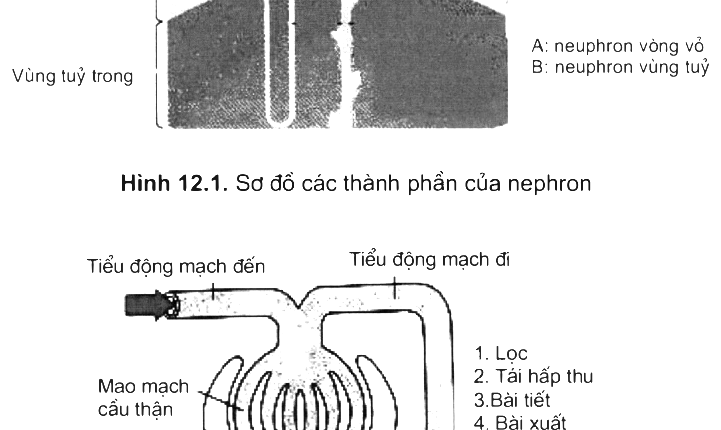
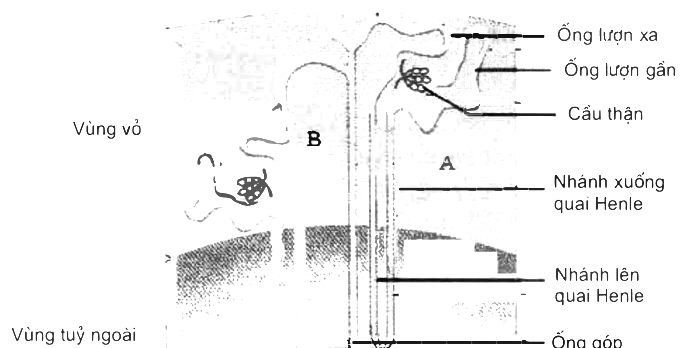
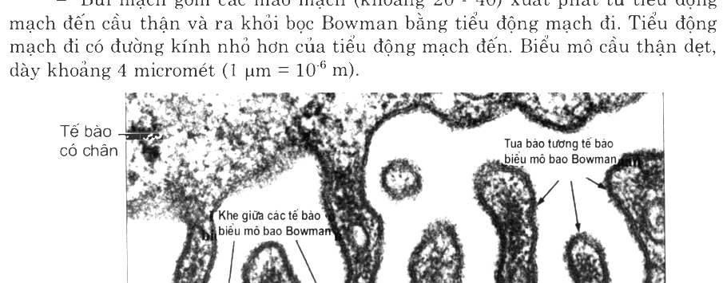
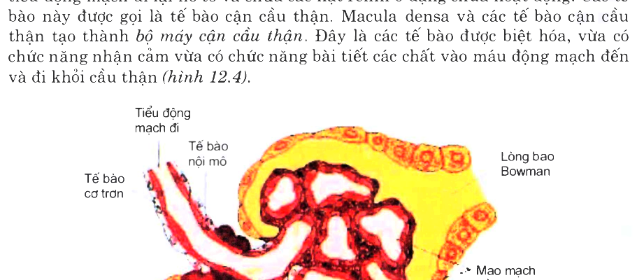
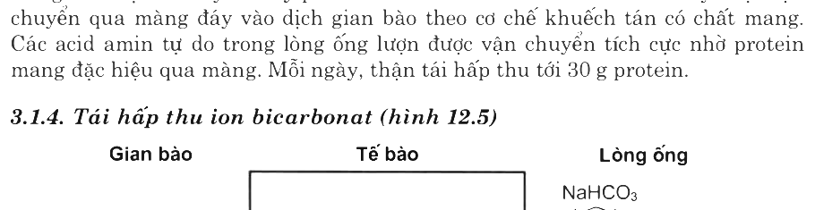
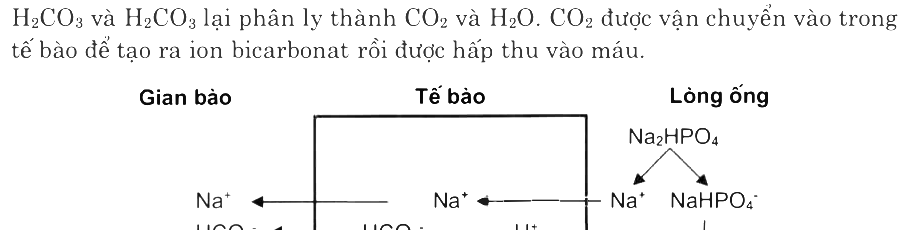
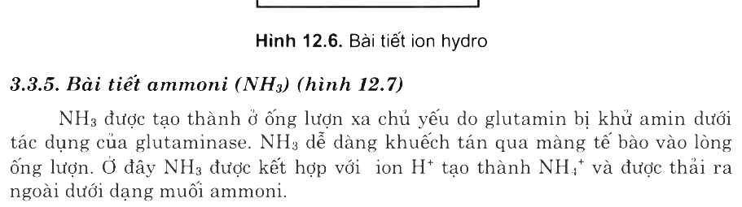

# BÀI 12: SINH LÝ BÀI TIẾT NƯỚC TIỂU

## MỤC TIÊU HỌC TẬP
Sau khi học xong bài này, sinh viên có khả năng:
1. Trình bày được đặc điểm cấu trúc chức năng của nephron, màng lọc cầu thận và cơ chế quá trình lọc tại cầu thận.
2. Phân tích được các hiện tượng tái hấp thu và bài tiết các chất (nước, $\text{Na}^+$, $\text{K}^+$, $\text{Cl}^-$, $\text{HCO}_3^-$, glucose, acid amin, urê, $\text{H}^+$, $\text{NH}_3$) tại từng đoạn của ống thận (ống lượn gần, quai Henle, ống lượn xa, ống góp).
3. Trình bày được các yếu tố huyết động, thần kinh, thể dịch ảnh hưởng đến quá trình tạo thành nước tiểu và cơ chế tác dụng của các nhóm thuốc lợi niệu.
4. Trình bày được nguyên lý, công thức tính và ý nghĩa lâm sàng của các phương pháp thăm dò chức năng lọc cầu thận và chức năng ống thận (độ thanh thải inulin, creatinin, PAH, FENa...).

---

## ĐẠI CƯƠNG VỀ CHỨC NĂNG CỦA THẬN
Thận đóng vai trò cơ quan bài tiết và điều hòa nội môi quan trọng bậc nhất của cơ thể sống:
- **Duy trì hằng tính nội môi:** Điều hòa chặt chẽ thể tích dịch ngoại bào, áp suất thẩm thấu, nồng độ các chất điện giải huyết tương và cân bằng acid - base của cơ thể thông qua việc bài xuất các chất dư thừa và nước.
- **Đào thải các chất cặn bã chuyển hóa:** Thải trừ các sản phẩm thoái hóa cuối cùng độc hại như urê (từ thoái hóa protein), creatinin (từ chuyển hóa phosphocreatin cơ), acid uric (từ chuyển hóa acid nucleic), bilirubin (từ thoái hóa hemoglobin) cùng các chất ngoại lai (thuốc, chất phụ gia thực phẩm, chất độc sinh học).
- **Chức năng nội tiết sinh học:**
  + Bài tiết hormon **renin** từ bộ máy cận cầu thận, khởi động hệ thống Renin - Angiotensin - Aldosteron (RAAS) điều hòa huyết áp và cân bằng natri - nước.
  + Sản xuất **erythropoietin (EPO)** kích thích tủy xương tăng sinh dòng hồng cầu khi phân áp oxy mô tại thận giảm.
  + Chuyển hóa 25-hydroxycholecalciferol thành **1,25-dihydroxycholecalciferol (Calcitriol - vitamin $\text{D}_3$ hoạt tính)** tham gia điều hòa hấp thu và chuyển hóa canxi, phosphat trong cơ thể.
- **Tân tạo glucose:** Thận có khả năng tân tạo glucose từ các acid amin và cơ chất không phải carbohydrate trong tình trạng đói ăn kéo dài hoặc toan chuyển hóa mạn tính.

Quá trình tạo thành nước tiểu là kết quả phối hợp của 4 quá trình cơ bản diễn ra liên tục tại các nephron: **Lọc ở cầu thận**, **Tái hấp thu ở ống thận**, **Bài tiết ở ống thận** và **Bài xuất nước tiểu** (*hình 12.2*).

---

## 1. ĐẶC ĐIỂM CẤU TRÚC - CHỨC NĂNG CỦA THẬN

### 1.1. Đơn vị thận (Nephron)
Mỗi thận người chứa khoảng 1 triệu đến 1,2 triệu đơn vị chức năng gọi là **nephron**. Thận có khả năng bù trừ rất lớn: chỉ cần 25% số lượng nephron hoạt động bình thường cũng đủ duy trì chức năng sống của cơ thể. Mỗi nephron gồm hai phần chính: **Cầu thận (tiểu cầu thận)** và **Hệ thống ống thận** (*hình 12.1*).

#### 1.1.1. Cầu thận
Gồm búi mao mạch Malpighi (chứa từ 20 đến 40 quai mao mạch nối tiếp) nằm lọt trong một khoang bọc hình chén hai lớp gọi là **bọc Bowman**. Máu theo **tiểu động mạch đến** vào búi mao mạch và rời khỏi cầu thận qua **tiểu động mạch đi**. Đường kính của tiểu động mạch đi nhỏ hơn đáng kể so với tiểu động mạch đến, tạo nên một sức cản ngoại vi lớn giúp duy trì áp suất thủy tĩnh rất cao trong búi mao mạch cầu thận.

#### 1.1.2. Hệ thống ống thận
Bao gồm các đoạn nối tiếp nhau:
1. **Ống lượn gần:** Nối tiếp từ bọc Bowman, gồm đoạn cong lượn và đoạn thẳng (pars recta) cắm xuống tủy thận. Biểu mô là tế bào hình lập phương đơn với diềm bàn chải vi nhung mao cực kỳ phong phú và nhiều ty thể, chuyên biệt hóa cho việc tái hấp thu tích cực khối lượng lớn các chất.
2. **Quai Henle:** Hình chữ U gồm:
   - *Nhánh xuống:* Thành biểu mô mỏng, rất thấm nước nhưng không thấm natri.
   - *Nhánh lên:* Gồm đoạn mỏng và đoạn dày. Thành tế bào đoạn dày không thấm nước nhưng tích cực bơm hút $\text{Na}^+, \text{K}^+, \text{Cl}^-$ ra dịch kẽ tủy.
3. **Ống lượn xa:** Bắt đầu từ đoạn dày nhánh lên đi qua góc kẹp giữa tiểu động mạch đến và đi của chính cầu thận đó (tạo thành vết đặc - macula densa).
4. **Ống góp:** Nhiều ống lượn xa đổ vào ống góp vỏ, sau đó đi thẳng qua tủy thận thành ống góp tủy và đổ vào các đài thận qua nhú thận.

Tổng chiều dài của một nephron khoảng 35 - 50 mm. Tổng diện tích bề mặt trong của toàn bộ hệ thống ống thận ở hai thận lên tới 5 - 8 $\text{m}^2$.

**Hai loại nephron sinh lý:**
- **Nephron vỏ (chiếm 80 - 85%):** Cầu thận nằm ở vùng vỏ nông, quai Henle ngắn chỉ cắm vào lớp ngoài của tủy thận, mạng mao mạch bao quanh ống thận dạng lưới. Giữ vai trò chủ yếu trong quá trình lọc và tái hấp thu thông thường.
- **Nephron cận tủy (chiếm 15 - 20%):** Cầu thận nằm sâu sát ranh giới vỏ - tủy, quai Henle rất dài cắm sâu đến tận chóp nhú tủy thận. Các tiểu động mạch đi cho ra các mạch thẳng **vasa recta** chạy song song với quai Henle. Loại nephron này giữ vai trò quyết định trong việc thiết lập cơ chế nhân nồng độ ngược dòng để cô đặc nước tiểu.

#### 1.1.3. Cấu tạo màng lọc cầu thận
Dịch từ lòng mao mạch muốn vào bọc Bowman phải đi qua **màng lọc cầu thận** gồm 3 lớp hàng rào vi thể (*hình 12.3*):
1. **Lớp tế bào nội mô mao mạch:** Có hàng ngàn lỗ thủng nội mô (fenestrae) đường kính lớn khoảng 160 Å, ngăn các tế bào máu (hồng cầu, bạch cầu, tiểu cầu) nhưng cho huyết tương tự do đi qua.
2. **Lớp màng đáy (Basement membrane):** Lưới sợi collagen và proteoglycan mang điện tích âm mạnh (chủ yếu là heparan sulfat), có các lỗ lọc hiệu dụng đường kính 110 Å.
3. **Lớp tế bào có chân (Podocyte - lá tạng bao Bowman):** Các tua bào tương đan xen nhau tạo nên các khe lọc (filtration slits) có đường kính tinh tế 70 - 75 Å. Khe này được che bởi màng khe lọc (slit diaphragm) tích điện âm.

*Tính chọn lọc của màng lọc cầu thận:*
- **Chọn lọc theo kích thước phân tử:** Các phân tử có đường kính $< 70\text{ Å}$ (trọng lượng phân tử $< 15.000\text{ Da}$) đi qua tự do; các phân tử có kích thước $> 80.000\text{ Da}$ (như globulin, fibrinogen) bị giữ lại hoàn toàn.
- **Chọn lọc theo điện tích:** Do màng đáy và khe podocyte phủ đầy điện tích âm, các phân tử mang điện tích âm (như albumin huyết tương, dù đường kính chỉ khoảng 71 Å và trọng lượng phân tử 69.000 Da) bị đẩy lùi mạnh mẽ và hầu như không thể lọt qua màng lọc. Trong các bệnh viêm cầu thận mạn, sự mất các điện tích âm của màng đáy làm albumin thoát ồ ạt vào nước tiểu gây **protein niệu (albumin niệu)**.

---

### 1.2. Mạch máu và tuần hoàn thận
Thận là cơ quan được tưới máu giàu nhất cơ thể xét theo trọng lượng. Lưu lượng máu qua hai thận khoảng 1200 ml/phút (chiếm 20 - 25% cung lượng tim lúc nghỉ ngơi, đạt mức tưới máu $420\text{ ml/100g mô/phút}$).

Đặc điểm tuần hoàn thận có **hai mạng lưới mao mạch nối tiếp độc đáo**:
1. **Mạng mao mạch thứ nhất (Mao mạch cầu thận):** Nằm giữa tiểu động mạch đến và tiểu động mạch đi, có áp suất thủy tĩnh rất cao ($P_H \approx 60\text{ mmHg}$) và tương đối hằng định, chuyên trách cho chức năng lọc dịch.
2. **Mạng mao mạch thứ hai (Mao mạch quanh ống thận):** Xuất phát từ tiểu động mạch đi tỏa ra ôm lấy các ống lượn và quai Henle (mạch vasa recta), có áp suất thủy tĩnh rất thấp ($13\text{ mmHg}$) nhưng áp suất keo huyết tương lại rất cao ($32 - 34\text{ mmHg}$), tạo lực hút cực mạnh để tái hấp thu nước và các chất hòa tan từ dịch kẽ vào máu.

---

### 1.3. Bộ máy cận cầu thận (Juxtaglomerular Apparatus - JGA)
Nằm tại vị trí ống lượn xa tiếp xúc trực tiếp với góc kẹp giữa tiểu động mạch đến và tiểu động mạch đi của chính nephron đó (*hình 12.4*), gồm:
- **Vết đặc (Macula densa):** Các tế bào biểu mô ống lượn xa biến đổi thành biểu mô hình trụ cao, dày đặc, có chức năng như các cảm thụ quan hóa học theo dõi nồng độ ion $\text{Na}^+$ và $\text{Cl}^-$ trong dịch ống lượn xa.
- **Tế bào cận cầu thận (Juxtaglomerular cells):** Tế bào cơ trơn thành tiểu động mạch đến biến đổi thành các tế bào dạng biểu mô chứa các hạt hạt dự trữ **renin** chưa hoạt hóa.
- **Tế bào gian mạch ngoài cầu thận (Lacis cells).**

Khi dòng chảy dịch lọc giảm hoặc nồng độ $\text{NaCl}$ tại vết đặc giảm (do huyết áp toàn thân hạ hoặc mất dịch), vết đặc phát tín hiệu làm giãn tiểu động mạch đến và kích hoạt tế bào cận cầu thận giải phóng enzym **renin** vào máu, khởi phát chuỗi phản ứng RAAS giúp duy trì huyết áp và mức lọc cầu thận.

---

## 2. QUÁ TRÌNH LỌC Ở CẦU THẬN

Quá trình lọc ở cầu thận là một quá trình vận chuyển thụ động hoàn toàn, chịu sự chi phối của gradient áp suất thủy tĩnh và áp suất keo giữa lòng mao mạch cầu thận và khoang Bowman. Dịch lọc thu được trong khoang Bowman gọi là **nước tiểu đầu (dịch lọc cầu thận)**.

### 2.1. Các áp suất chi phối quá trình lọc và Áp suất lọc ($P_L$)
Áp suất lọc thực sự ($P_L$ hay $P_{\text{lọc}}$) là hiệu số giữa các lực thúc đẩy lọc và các lực cản trở lọc:

$$P_L = P_H - (P_K + P_B)$$

Trong đó:
1. **Lực thúc đẩy quá trình lọc:**
   - $P_H$ (**Áp suất thủy tĩnh mao mạch cầu thận**): Có tác dụng đẩy nước và các chất hòa tan qua màng lọc sang bọc Bowman. Trị số bình thường $P_H \approx 60\text{ mmHg}$ (cao hơn nhiều so với mao mạch thông thường là 15 - 30 mmHg).
   - $P_{KB}$ (**Áp suất keo của bọc Bowman**): Bình thường protein không lọt qua màng lọc nên $P_{KB} = 0\text{ mmHg}$.
2. **Lực chống lại quá trình lọc:**
   - $P_K$ (**Áp suất keo của protein huyết tương trong mao mạch cầu thận**): Giữ nước và các chất hòa tan lại trong lòng mạch. Trị số đầu vào khoảng 28 mmHg, càng về phía tiểu động mạch đi nồng độ protein càng đặc nên tăng lên 34 mmHg; trị số trung bình $P_K \approx 32\text{ mmHg}$.
   - $P_B$ (**Áp suất thủy tĩnh trong bọc Bowman**): Do dịch lọc trong khoang tạo nên, chống lại sự di chuyển dịch từ mao mạch vào bọc. Trị số bình thường $P_B \approx 18\text{ mmHg}$.

**Tính toán áp suất lọc hiệu dụng ($P_L$):**
$$P_L = 60 - (32 + 18) = 60 - 50 = 10\text{ mmHg}$$

> **Ý nghĩa sinh lý và lâm sàng:**
> Áp suất lọc bình thường là $10\text{ mmHg}$. Quá trình lọc chỉ có thể xảy ra khi $P_L > 0$. Nếu huyết áp tâm thu toàn thân giảm dưới 50 mmHg dẫn tới $P_H \le 50\text{ mmHg}$, lúc đó $P_L = 0$ và thận rơi vào tình trạng **thiểu niệu** hoặc **vô niệu cấp tính**.

---

### 2.2. Các chỉ số đánh giá chức năng lọc cầu thận

#### 2.2.1. Hệ số lọc ($K_f$)
Hệ số lọc $K_f$ biểu thị số ml dịch lọc tạo thành trong 1 phút dưới tác dụng của 1 mmHg áp suất lọc hiệu dụng ($K_f = \text{GFR} / P_L$). $K_f$ phụ thuộc vào diện tích màng lọc và tính thấm của màng.
Trị số bình thường:
$$K_f = 12{,}5\text{ ml/phút/mmHg}$$
(Cao hơn tính thấm mao mạch cơ vân từ 50 đến 100 lần).

#### 2.2.2. Mức lọc cầu thận (Glomerular Filtration Rate - GFR)
Mức lọc cầu thận là thể tích dịch lọc được tạo ra bởi toàn bộ các cầu thận của hai thận trong một phút:
$$\text{GFR} = K_f \times P_L = 12{,}5 \times 10 = 125\text{ ml/phút}$$
- Ở người trưởng thành khỏe mạnh (diện tích bề mặt cơ thể chuẩn $1{,}73\text{ m}^2$), $\text{GFR} \approx 125\text{ ml/phút}$ ở nam và khoảng $110 - 115\text{ ml/phút}$ ở nữ.
- Tổng lượng dịch lọc cầu thận trong 24 giờ lên tới:
  $$125\text{ ml/phút} \times 60\text{ phút} \times 24\text{ giờ} = 180\text{ lít/ngày}$$
  Khối lượng này gấp khoảng 4 lần tổng lượng nước trong cơ thể và gấp 60 lần tổng thể tích huyết tương, chứng tỏ hầu như toàn bộ huyết tương được thanh lọc nhiều lần mỗi ngày.

#### 2.2.3. Phân số lọc cầu thận (Filtration Fraction - $F_F$)
Là tỷ số phần trăm giữa mức lọc cầu thận (GFR) và dòng huyết tương qua thận (Renal Plasma Flow - RPF $\approx 650\text{ ml/phút}$):
$$F_F = \frac{\text{GFR}}{\text{RPF}} = \frac{125\text{ ml/phút}}{650\text{ ml/phút}} \approx 19 - 21\% \approx \frac{1}{5}$$
Nghĩa là trung bình cứ mỗi vòng tuần hoàn qua thận có khoảng 20% lượng huyết tương được lọc vào khoang Bowman.

---

### 2.3. Các yếu tố điều hòa mức lọc cầu thận

1. **Lưu lượng máu qua thận:** Khi lưu lượng máu tăng, áp suất thủy tĩnh $P_H$ tăng và protein huyết tương không bị cô đặc quá sớm, làm tăng áp suất lọc $P_L$ và tăng GFR.
2. **Ảnh hưởng của áp suất keo huyết tương ($P_K$):** Nồng độ protein máu giảm (suy dinh dưỡng, xơ gan, hội chứng thận hư) làm giảm $P_K$, dẫn tới tăng GFR (và ngược lại).
3. **Ảnh hưởng của co giãn tiểu động mạch:**
   - *Tiểu động mạch đến:* Co tiểu động mạch đến làm giảm lưu lượng máu vào búi mao mạch $\rightarrow$ giảm $P_H$ $\rightarrow$ giảm GFR. Giãn tiểu động mạch đến gây tác dụng ngược lại.
   - *Tiểu động mạch đi:* Co nhẹ tiểu động mạch đi làm tăng ứ máu ở búi mạch $\rightarrow$ tăng $P_H$ $\rightarrow$ tăng GFR. Nhưng nếu co thắt quá mạnh kéo dài, huyết tương bị giữ lại lọc cạn kiệt làm $P_K$ tăng vọt $\rightarrow$ GFR cuối cùng lại giảm.
4. **Cơ chế tự điều hòa nội tại của thận (Thần kinh tự chủ và Phức hợp cận cầu thận):**
   Trong khoảng huyết áp động mạch trung bình biến thiên rộng từ $75\text{ mmHg}$ đến $160\text{ mmHg}$, lưu lượng máu thận và GFR vẫn được duy trì gần như không đổi nhờ hai cơ chế tự điều hòa:
   - *Cơ chế cơ trơn thành mạch (Phản xạ Myogenic):* Huyết áp tăng kéo căng thành mạch làm mở các kênh canxi gây co cơ trơn tiểu động mạch đến tự động.
   - *Cơ chế điều hòa ngược cầu - ống (Tubuloglomerular feedback):* Khi GFR tăng, dòng dịch lọc chảy nhanh qua quai Henle làm giảm thời gian tái hấp thu, nồng độ $\text{NaCl}$ đến vết đặc tăng. Tế bào vết đặc bài tiết adenosin làm co tiểu động mạch đến, đưa GFR trở về mức bình thường. Ngược lại khi $\text{NaCl}$ đến vết đặc giảm, tế bào cận cầu thận giải phóng renin tạo angiotensin II gây co tiểu động mạch đi, nâng $P_H$ lên.
5. **Điều hòa thể dịch và hormon:**
   - *Các chất gây co mạch làm giảm GFR:* Adrenalin, Noradrenalin (khi sốc, stress cấp), Endothelin, Angiotensin II nồng độ cao.
   - *Các chất gây giãn mạch làm tăng GFR:* Prostaglandin ($	ext{PGE}_2, 	ext{PGI}_2$), NO (Nitric Oxide), Bradykinin, Peptid lợi niệu tâm nhĩ (ANP).

---

## 3. HOẠT ĐỘNG TÁI HẤP THU VÀ BÀI TIẾT TẠI CÁC ĐOẠN ỐNG THẬN

Mỗi ngày có khoảng 180 lít dịch lọc nhưng cơ thể chỉ đào thải khoảng 1,2 - 1,5 lít nước tiểu chính thức. Hơn 99% lượng nước và các chất hòa tan quan trọng đã được tái hấp thu chọn lọc qua hệ thống ống thận.

### 3.1. Tái hấp thu và bài tiết tại Ống lượn gần (PCT)
Ống lượn gần đảm nhiệm khối lượng tái hấp thu lớn nhất trong toàn bộ nephron: tái hấp thu khoảng 65 - 70% lượng nước và $\text{Na}^+$, toàn bộ glucose và acid amin, 85 - 90% $\text{HCO}_3^-$, và hầu hết ion $\text{K}^+$. Dịch trong lòng ống lượn gần luôn **đẳng trương** so với huyết tương.

#### 3.1.1. Tái hấp thu Natri và Nước
- Động lực chính là bơm $\text{Na}^+ - \text{K}^+ - \text{ATPase}$ ở màng đáy bên tế bào ống thận, liên tục bơm 3 $\text{Na}^+$ ra dịch kẽ và đưa 2 $\text{K}^+$ vào trong, duy trì nồng độ $\text{Na}^+$ nội bào rất thấp và điện thế nội bào âm ($-70\text{ mV}$).
- Ở màng đỉnh, $\text{Na}^+$ từ lòng ống khuếch tán vào tế bào theo bậc thang điện hóa thông qua các cơ chế:
  + Đồng vận chuyển với glucose (**SGLT-2** và **SGLT-1**) và các acid amin.
  + Trao đổi ngược chiều với ion $\text{H}^+$ qua kênh **NHE3** (Sodium-Hydrogen Exchanger 3).
- Nước tái hấp thu thụ động qua kênh aquaporin-1 (AQP1) theo gradient thẩm thấu do $\text{Na}^+$ tạo ra (hiện tượng kéo theo dung môi - solvent drag).

#### 3.1.2. Tái hấp thu Glucose và Ngưỡng đường của thận
- Glucose được đồng vận chuyển tích cực thứ phát với $\text{Na}^+$ qua màng đỉnh, sau đó khuếch tán thuận hóa qua màng đáy bên vào dịch kẽ nhờ chất tải **GLUT2**.
- **Khả năng tái hấp thu tối đa của ống thận với glucose ($Tm_G$):** Đạt khoảng $375\text{ mg/phút}$ ở nam giới.
- **Ngưỡng glucose của thận:** Nồng độ glucose huyết tương bình thường là $0{,}8 - 1{,}1\text{ g/L}$ ($4{,}4 - 6{,}1\text{ mmol/L}$). Khi nồng độ đường huyết vượt quá **$1{,}8\text{ g/L}$ ($180\text{ mg/dL}$ hay $10\text{ mmol/L}$)**, lượng glucose lọc qua cầu thận vượt quá khả năng tái hấp thu của các protein mang tại ống lượn gần, dẫn tới xuất hiện đường trong nước tiểu (**đường niệu**).

#### 3.1.3. Tái hấp thu Bicarbonat ($	ext{HCO}_3^-$)

Cơ chế tái hấp thu $\text{HCO}_3^-$ (*hình 12.5*):
1. $\text{HCO}_3^-$ trong lòng ống lượn gần kết hợp với ion $\text{H}^+$ (do bơm NHE3 bài tiết ra) tạo thành $\text{H}_2\text{CO}_3$.
2. Enzym **carbonic anhydrase dạng gắn màng (CA-IV)** ở diềm bàn chải nhanh chóng phân giải:
   $$\text{H}_2\text{CO}_3 \xrightarrow{\text{CA}} \text{CO}_2 + \text{H}_2\text{O}$$
3. $\text{CO}_2$ là chất không phân cực, khuếch tán tức thì qua màng tế bào vào bào tương.
4. Trong bào tương, enzym **carbonic anhydrase nội bào (CA-II)** tái tổng hợp:
   $$\text{CO}_2 + \text{H}_2\text{O} \xrightarrow{\text{CA}} \text{H}_2\text{CO}_3 \rightleftharpoons \text{H}^+ + \text{HCO}_3^-$$
5. Ion $\text{H}^+$ lại được bơm NHE3 đẩy ra lòng ống để tiếp tục chu trình; còn $\text{HCO}_3^-$ được vận chuyển qua màng đáy bên cùng $\text{Na}^+$ (nhờ chất đồng vận chuyển $\text{NBCe1}$) vào tuần hoàn máu.
*(Thuốc lợi niệu Acetazolamid ức chế enzym carbonic anhydrase, ngăn cản tái hấp thu $\text{HCO}_3^-$, gây kiềm hóa nước tiểu và tăng thải natri).*

#### 3.1.4. Tái hấp thu Protein, Acid amin và các chất khác
- Các phân tử protein kích thước nhỏ lọt qua màng lọc được tế bào ống lượn gần bắt giữ bằng cơ chế ẩm bào (endocytosis), hòa màng với lysosom để phân giải thành acid amin rồi đưa về máu. Thận tái hấp thu tới 30g protein mỗi ngày theo con đường này.
- **Urê:** Được tái hấp thu thụ động khoảng 50% ở ống lượn gần đi kèm theo dòng nước.
- **Creatinin:** Không được tái hấp thu; ngược lại, tế bào ống lượn gần còn bài tiết thêm một lượng nhỏ creatinin vào lòng ống.

---

### 3.2. Tái hấp thu tại Quai Henle và Cơ chế nhân nồng độ ngược dòng

Quai Henle chịu trách nhiệm tái hấp thu khoảng 20 - 25% lượng $\text{Na}^+, \text{K}^+, \text{Cl}^-$ và 15% lượng nước lọc, có nhiệm vụ thiết lập nồng độ thẩm thấu cao ở vùng tủy thận:
- **Nhánh xuống mảnh:** Có tính thấm rất cao với nước (nhờ giàu kênh AQP1) nhưng hầu như không thấm $\text{NaCl}$ và urê. Khi dịch lọc đi sâu vào tủy thận có áp suất thẩm thấu tăng dần, nước bị hút ra dịch kẽ, làm dịch trong lòng quai càng lúc càng ưu trương, đạt đỉnh tại chóp quai Henle ($1200 - 1400\text{ mOsm/L}$).
- **Nhánh lên dày:** Hoàn toàn **không thấm nước**, nhưng màng đỉnh tế bào biểu hiện rất đậm đặc chất đồng vận chuyển **$	ext{Na}^+ - 	ext{K}^+ - 2	ext{Cl}^-$ (kênh NKCC2)**. Kênh này chủ động bơm hút $\text{Na}^+, \text{K}^+, 2\text{Cl}^-$ từ lòng ống ra dịch kẽ tủy, làm tăng độ ưu trương của dịch kẽ tủy thận nhưng làm dịch trong lòng ống bị pha loãng dần. Khi dịch lên đến đầu ống lượn xa, nồng độ thẩm thấu giảm xuống mức **nhược trương** ($100 - 150\text{ mOsm/L}$).
*(Thuốc lợi niệu quai như Furosemid tác động ức chế đặc hiệu kênh NKCC2, làm mất độ ưu trương tủy thận và gây bài niệu lượng lớn nước và điện giải).*

**Hệ thống nhân nồng độ ngược dòng:**
Sự phối hợp giữa dòng chảy ngược chiều của quai Henle và các quai mạch thẳng vasa recta giúp duy trì tháp áp suất thẩm thấu tăng dần từ vỏ thận ($300\text{ mOsm/L}$) vào đến sâu trong chóp tủy thận ($1200 - 1400\text{ mOsm/L}$). Môi trường tủy ưu trương này là động lực thẩm thấu duy nhất để cô đặc nước tiểu tại ống góp dưới tác dụng của ADH.

---

### 3.3. Tái hấp thu và bài tiết tại Ống lượn xa và Ống góp

Đoạn này chịu trách nhiệm điều chỉnh tinh tế thành phần dịch bài xuất theo nhu cầu hằng định nội môi của cơ thể dưới sự kiểm soát chặt chẽ của các hormon:

#### 3.3.1. Đoạn đầu ống lượn xa
Tái hấp thu tiếp khoảng 5% $\text{NaCl}$ qua kênh đồng vận chuyển **$\text{Na}^+ - \text{Cl}^-$ (NCC)** ở màng đỉnh (bị ức chế bởi thuốc lợi niệu nhóm **Thiazid**). Đoạn này hoàn toàn không thấm nước nên tiếp tục làm loãng nước tiểu.

#### 3.3.2. Đoạn cuối ống lượn xa và Ống góp vỏ
Gồm 2 loại tế bào chuyên biệt:
1. **Tế bào chính (Principal cells):**
   - Tái hấp thu $\text{Na}^+$ qua kênh biểu mô natri (**ENaC**) và bài tiết ion $\text{K}^+$ vào lòng ống qua kênh ROMK.
   - Hoạt động này chịu sự kích thích trực tiếp của hormon **Aldosteron** (hormon vỏ thượng thận): Aldosteron hoạt hóa tổng hợp và cắm thêm các kênh ENaC, kênh ROMK và bơm $\text{Na}^+ - \text{K}^+ - \text{ATPase}$, làm **tăng tái hấp thu $\text{Na}^+$ và nước, tăng đào thải $\text{K}^+$**.
   *(Thuốc Spironolacton là chất đối kháng cạnh tranh thụ thể aldosteron; Amilorid ức chế trực tiếp kênh ENaC, đều là thuốc lợi niệu giữ kali).*
2. **Tế bào kẽ (Intercalated cells):**
   - Giữ vai trò quyết định trong việc cân bằng kiềm - toan của máu.

#### 3.3.3. Cơ chế bài tiết ion $	ext{H}^+$ và $	ext{NH}_3$ tại ống lượn xa

- **Bài tiết $	ext{H}^+$ (*hình 12.6*):** Tế bào kẽ loại A sử dụng bơm **$	ext{H}^+ - 	ext{ATPase}$** và **$	ext{H}^+ - 	ext{K}^+ - 	ext{ATPase}$** chủ động bơm $	ext{H}^+$ vào lòng ống chống lại gradient nồng độ rất dốc. Trong lòng ống, $	ext{H}^+$ tự do kết hợp với hệ đệm phosphat:
  $$	ext{H}^+ + 	ext{HPO}_4^{2-} 
ightarrow 	ext{H}_2	ext{PO}_4^-$$
  Giúp đào thải acid mà không làm pH nước tiểu giảm xuống quá thấp (giới hạn pH tối thiểu của nước tiểu là 4,5).

- **Bài tiết $	ext{NH}_3$ (*hình 12.7*):** Tế bào ống phân giải glutamin tạo $	ext{NH}_3$. $	ext{NH}_3$ là chất khí hòa tan lipid dễ dàng khuếch tán vào lòng ống kết hợp với $	ext{H}^+$ tạo ion amoni không khuếch tán:
  $$	ext{NH}_3 + 	ext{H}^+ 
ightarrow 	ext{NH}_4^+$$
  $	ext{NH}_4^+$ kết hợp với $	ext{Cl}^-$ đào thải dưới dạng muối amoni clorid ($	ext{NH}_4	ext{Cl}$). Đây là con đường chủ lực giúp thận đào thải acid cố định và tân tạo $	ext{HCO}_3^-$ mới cho máu trong tình trạng toan chuyển hóa.

#### 3.3.4. Tái hấp thu Nước tại Ống góp dưới tác dụng của ADH
- Màng tế bào ống góp bình thường không thấm nước.
- Khi cơ thể thiếu nước (áp suất thẩm thấu huyết tương tăng), vùng dưới đồi phát tín hiệu kích thích thùy sau tuyến yên tiết **ADH (Vasopressin)**.
- ADH gắn vào thụ thể $V_2$ ở màng đáy bên, hoạt hóa enzym adenylate cyclase làm tăng cAMP nội bào, thúc đẩy các bóng túi chứa kênh nước **Aquaporin-2 (AQP2)** di chuyển và hòa màng vào màng đỉnh tế bào ống góp. Nước trong lòng ống góp lập tức được hút ồ ạt qua các kênh AQP2 sang dịch kẽ tủy ưu trương, làm giảm thể tích nước tiểu và cô đặc nước tiểu tối đa (nước tiểu có thể đạt $1200 - 1400\text{ mOsm/L}$).
- Khi thừa nước hoặc uống nhiều bia rượu (cồn ức chế tiết ADH), các kênh AQP2 bị thu hồi về bào tương, ống góp không thấm nước dẫn tới bài xuất lượng lớn nước tiểu rất loãng (bài niệu nước).

---

## 4. KHẢ NĂNG VẬN CHUYỂN TỐI ĐA CỦA ỐNG THẬN ($Tm$)

1. **Khả năng vận chuyển tối đa ($Tm$ hay $Tr, Ts$):**
   Là lượng tối đa của một chất mà các tế bào biểu mô ống thận có thể tái hấp thu ($Tr$) hoặc bài tiết ($Ts$) trong thời gian một phút khi toàn bộ các protein mang vận chuyển đặc hiệu đã bị bão hòa.
   - Các chất có $Tm$ tái hấp thu ($Tr$): Glucose ($Tm_G \approx 375\text{ mg/phút}$), phosphat, sulfat, acid amin, urat, albumin.
   - Các chất có $Tm$ bài tiết ($Ts$): Para-aminohippuric acid ($Tm_{\text{PAH}} \approx 80\text{ mg/phút}$), creatinin, penicillin, salicylat.
2. **Khả năng lọc của ống thận với chất X:**
   Là lượng chất X được lọc qua cầu thận vào khoang Bowman trong 1 phút:
   $$\text{Lượng lọc} = \text{GFR} \times P_X = C_{\text{Inulin}} \times P_X \quad (\text{mg/phút})$$
3. **Tốc độ bài xuất của chất X:**
   Là lượng chất X thực tế có trong nước tiểu chính thức đào thải ra ngoài trong 1 phút:
   $$\text{Lượng bài xuất} = U_X \times V \quad (\text{mg/phút})$$
4. **Xác định cơ chế vận chuyển ống thận:**
   - Nếu $U_X \times V < \text{GFR} \times P_X$ (hoặc $C_X < C_{\text{Inulin}}$): Chất X **được tái hấp thu** ở ống thận.
     $$Tr = (\text{GFR} \times P_X) - (U_X \times V)$$
   - Nếu $U_X \times V > \text{GFR} \times P_X$ (hoặc $C_X > C_{\text{Inulin}}$): Chất X **được bài tiết thêm** ở ống thận.
     $$Ts = (U_X \times V) - (\text{GFR} \times P_X)$$

---

## 5. CÁC PHƯƠNG PHÁP THĂM DÒ CHỨC NĂNG THẬN

### 5.1. Thăm dò chức năng lọc cầu thận bằng Hệ số thanh thải (Clearance)

#### 5.1.1. Khái niệm và công thức tính độ thanh thải
**Độ thanh thải ($C_X$ - Clearance)** của một chất X là thể tích huyết tương ảo (tính bằng ml) được thận lọc sạch hoàn toàn chất đó trong thời gian 1 phút:

$$C_X = \frac{U_X \times V}{P_X} \quad (\text{ml/phút})$$

Trong đó:
- $C_X$: Độ thanh thải của chất X (ml/phút).
- $U_X$: Nồng độ chất X trong nước tiểu (mg/ml hoặc mmol/L).
- $P_X$: Nồng độ chất X trong huyết tương (mg/ml hoặc mmol/L).
- $V$: Thể tích nước tiểu tạo thành trong 1 phút (ml/phút).

#### 5.1.2. Đo mức lọc cầu thận bằng Độ thanh thải Inulin ($C_{\text{In}}$)
Inulin (một polysaccharid ngoại sinh chiết xuất từ rễ củ cây thược dược) là **chất chuẩn vàng** lý tưởng để đo GFR vì:
- Lọc tự do hoàn toàn qua màng lọc cầu thận.
- Không bị ống thận tái hấp thu dù chỉ một lượng nhỏ.
- Không bị ống thận bài tiết thêm.
- Không bị chuyển hóa, không gắn với protein huyết tương và không độc.
Do đó:
$$\text{GFR} = C_{\text{Inulin}} = \frac{U_{\text{In}} \times V}{P_{\text{In}}} \approx 125\text{ ml/phút}$$

#### 5.1.3. Đánh giá GFR bằng Độ thanh thải Creatinin nội sinh ($C_{\text{Cr}}$)
Creatinin là sản phẩm thoái hóa từ phosphocreatin của cơ bắp, giải phóng vào máu với tốc độ tương đối hằng định hàng ngày.
- **Ưu điểm:** Là chất nội sinh, không cần tiêm truyền tĩnh mạch phức tạp như inulin.
- **Nhược điểm:** Ống lượn gần bài tiết thêm khoảng 10 - 15% creatinin, nên trị số $C_{\text{Cr}}$ thường hơi cao hơn GFR thực tế.
- Trị số bình thường ở người lớn: $100 - 120\text{ ml/phút/1,73 m}^2$ (ở nữ nhân hệ số 0,85). Giảm theo tuổi sau 30 tuổi (mỗi 10 năm giảm khoảng $6{,}5\text{ ml/phút}$).

#### 5.1.4. Đo lưu lượng máu thận bằng Độ thanh thải PAH ($C_{\text{PAH}}$)
Para-aminohippuric acid (PAH) là chất ngoại sinh được lọc ở cầu thận (20%) và 80% còn lại được bài tiết tích cực triệt để tại ống lượn gần. Sau một vòng tuần hoàn qua thận, hầu như 90 - 95% PAH bị thanh lọc sạch khỏi máu.
Do đó, độ thanh thải PAH phản ánh **Dòng huyết tương hiệu dụng qua thận (ERPF)**:
$$\text{ERPF} = C_{\text{PAH}} = \frac{U_{\text{PAH}} \times V}{P_{\text{PAH}}} \approx 580 - 650\text{ ml/phút}$$
Dựa vào chỉ số dung tích hồng cầu (Hematocrit - Hct), ta tính được **Lưu lượng máu toàn phần qua thận (RBF)**:
$$\text{RBF} = \frac{\text{RPF}}{1 - \text{Hct}} = \frac{650}{1 - 0{,}45} \approx 1200\text{ ml/phút}$$

---

### 5.2. Thăm dò chức năng ống thận
1. **Phân số đào thải Natri (Fractional Excretion of Sodium - FENa):**
   Là tỷ lệ phần trăm giữa lượng natri đào thải qua nước tiểu so với lượng natri được lọc tại cầu thận:
   $$\text{FENa} = \frac{U_{\text{Na}} \times P_{\text{Cr}}}{P_{\text{Na}} \times U_{\text{Cr}}} \times 100\%$$
   - $\text{FENa} < 1\%$: Gặp trong suy thận cấp trước thận (giảm tưới máu thận, ống thận còn nguyên vẹn tăng tái hấp thu natri để giữ nước).
   - $\text{FENa} > 2 - 3\%$: Gặp trong suy thận cấp tại thận do hoại tử ống thận cấp (ATN) (tế bào ống thận bị tổn thương mất khả năng tái hấp thu natri).
2. **Nghiệm pháp cô đặc và pha loãng nước tiểu:** Đánh giá khả năng đáp ứng của quai Henle và ống góp đối với tình trạng hạn chế hoặc tải nước. Tỷ trọng nước tiểu bình thường dao động linh hoạt từ 1,001 (pha loãng) đến 1,030 (cô đặc).
3. **Nghiệm pháp acid hóa nước tiểu:** Cho uống ammonium clorid ($	ext{NH}_4	ext{Cl}$) để đánh giá khả năng bài tiết $	ext{H}^+$ của ống lượn xa; phân biệt toan hóa ống thận type 1 (tại ống xa) và type 2 (tại ống gần).

---

## 6. PHÂN LOẠI VÀ CƠ CHẾ TÁC DỤNG CỦA CÁC THUỐC LỢI NIỆU

Các thuốc lợi niệu làm tăng thể tích bài xuất nước tiểu thông qua việc ức chế tái hấp thu $\text{Na}^+$ và các ion tại các đoạn khác nhau của nephron:

1. **Thuốc lợi niệu thẩm thấu (Mannitol):**
   Là các phân tử đường được lọc tự do qua cầu thận nhưng không được ống thận tái hấp thu. Sự hiện diện nồng độ cao của mannitol trong lòng ống lượn gần và quai Henle làm tăng áp suất thẩm thấu lòng ống, giữ nước lại không cho tái hấp thu, gây bài niệu nước mạnh mẽ. Dùng trong cấp cứu phù não, tăng áp lực nội sọ và hạ nhãn áp.
2. **Thuốc lợi niệu quai (Furosemid, Bumetanid):**
   Tác động tại đoạn dày nhánh lên của quai Henle, ức chế đặc hiệu chất đồng vận chuyển **$	ext{Na}^+ - 	ext{K}^+ - 2	ext{Cl}^-$ (NKCC2)**. Là nhóm thuốc lợi niệu có hiệu lực bài niệu mạnh nhất (lợi niệu trần cao), ức chế tái hấp thu tới 25% lượng natri lọc. Làm tăng bài xuất $\text{Na}^+, \text{K}^+, \text{Cl}^-, \text{Ca}^{2+}, \text{Mg}^{2+}$ và nước.
3. **Thuốc lợi niệu nhóm Thiazid (Hydrochlorothiazid, Indapamid):**
   Tác động tại đoạn đầu ống lượn xa, ức chế chất đồng vận chuyển **$\text{Na}^+ - \text{Cl}^-$ (NCC)**. Tác dụng lợi niệu mức độ trung bình (ức chế tái hấp thu 5% natri lọc). Làm tăng bài xuất $\text{Na}^+, \text{K}^+$ nhưng làm giảm bài xuất $\text{Ca}^{2+}$ qua nước tiểu. Thường dùng điều trị tăng huyết áp nguyên phát và suy tim nhẹ.
4. **Thuốc lợi niệu giữ Kali:**
   Tác động tại đoạn cuối ống lượn xa và ống góp vỏ:
   - *Kháng aldosteron (Spironolacton):* Đối kháng cạnh tranh thụ thể mineralocorticoid trong bào tương tế bào chính, ngăn chặn tác dụng giữ natri và thải kali của aldosteron.
   - *Chẹn kênh natri màng đỉnh (Amilorid, Triamteren):* Chẹn trực tiếp kênh ENaC, ức chế tái hấp thu natri và làm giảm bài tiết kali.
5. **Thuốc ức chế enzym Carbonic Anhydrase (Acetazolamid):**
   Tác động chủ yếu tại ống lượn gần, ức chế enzym CA làm giảm tái hấp thu $\text{HCO}_3^-$ và $\text{Na}^+$, gây kiềm hóa nước tiểu và toan chuyển hóa nhẹ. Hiện ít dùng làm thuốc lợi niệu đơn thuần, chủ yếu dùng điều trị glaucom (hạ nhãn áp) và chứng say độ cao cấp.

---

## TỰ LƯỢNG GIÁ BÀI 12
1. Trình bày cấu tạo siêu vi thể của màng lọc cầu thận và phân tích tính chọn lọc của màng đối với kích thước và điện tích của các phân tử.
2. Viết công thức tính áp suất lọc hiệu dụng ($P_L$) tại cầu thận. Phân tích các yếu tố ảnh hưởng đến quá trình lọc và giải thích cơ chế vô niệu khi huyết áp hạ nặng.
3. Nêu định nghĩa và trị số bình thường của mức lọc cầu thận (GFR), hệ số lọc ($K_f$) và phân số lọc ($F_F$).
4. Trình bày cơ chế tự điều hòa lưu lượng máu thận và GFR thông qua cơ chế cơ trơn thành mạch và cơ chế điều hòa ngược cầu - ống tại bộ máy cận cầu thận.
5. Phân tích cơ chế tái hấp thu ion natri, glucose và ion bicarbonat tại ống lượn gần. Nêu khái niệm và ý nghĩa của ngưỡng đường của thận.
6. Mô tả cấu trúc chức năng của hai nhánh quai Henle và giải thích cơ chế nhân nồng độ ngược dòng tạo độ ưu trương tủy thận.
7. Trình bày vai trò và cơ chế tác dụng của hormon Aldosteron và ADH trong việc điều hòa tái hấp thu natri và nước tại ống lượn xa và ống góp.
8. Trình bày cơ chế bài tiết ion $\text{H}^+$ và $\text{NH}_3$ tại ống thận trong việc điều hòa thăng bằng kiềm - toan của cơ thể.
9. Nêu định nghĩa độ thanh thải (clearance). Giải thích tại sao inulin được coi là chất chuẩn vàng để đo GFR và tại sao PAH được dùng để đo dòng huyết tương qua thận.
10. Phân tích cơ chế tác dụng sinh học và vị trí tác động của 4 nhóm thuốc lợi niệu chính: lợi niệu thẩm thấu, lợi niệu quai, thiazid và lợi niệu giữ kali.
