# BÀI 13: SINH LÝ NỘI TIẾT

## MỤC TIÊU
*Sau khi học xong bài này, sinh viên có khả năng:*
1. Trình bày được chất tiếp nhận hormon, cơ chế tác dụng và cơ chế điều hoà bài tiết của hormon.
2. Trình bày được bản chất hóa học, tác dụng và điều hoà bài tiết từng hormon của vùng dưới đồi, tuyến yên, tuyến giáp, tuyến cận giáp, tuyến tụy, tuyến thượng thận.
3. Trình bày được bản chất hóa học, tác dụng của các hormon tại chỗ.
4. Giải thích được các triệu chứng của các bệnh nội tiết thường gặp dựa trên tác dụng của các hormon.

---

Chức năng của cơ thể được điều hoà bằng hai hệ thống chủ yếu đó là hệ thống thần kinh và hệ thống thể dịch. Vai trò điều hoà của hệ thống thần kinh sẽ được đề cập đến trong các bài 15, 16, 17, 18.

Hệ thống thể dịch điều hoà chức năng của cơ thể bao gồm nhiều yếu tố như thể tích máu, các thành phần của máu và thể dịch như nồng độ các loại khí, nồng độ các ion và đặc biệt là nồng độ các hormon nội tiết. Chính vì vậy hệ thống thể dịch còn được gọi là hệ thống nội tiết.

Nhìn chung hệ thống nội tiết chủ yếu điều hoà các chức năng chuyển hóa của cơ thể như điều hoà tốc độ các phản ứng hóa học ở tế bào, điều hoà sự vận chuyển vật chất qua màng tế bào hoặc các quá trình chuyển hóa khác của tế bào như sự phát triển, sự bài tiết. Tuy nhiên, tác dụng điều hoà của các hormon thì không giống nhau. Một số hormon tác dụng xuất hiện sau vài giây trong khi một số hormon khác lại cần vài ngày nhưng sau đó tác dụng có thể kéo dài vài ngày, vài tuần thậm chí vài tháng.

Giữa hệ thống nội tiết và hệ thống thần kinh có mối liên quan tương hỗ. Ít nhất có hai tuyến bài tiết hormon dưới tác dụng của kích thích thần kinh như tuyến thượng thận và tuyến yên. Đồng thời các hormon vùng dưới đồi lại được điều hoà bài tiết bởi các tuyến nội tiết khác.

---

## 1. ĐẠI CƯƠNG VỀ HỆ NỘI TIẾT VÀ HORMON

### 1.1. Định nghĩa

#### 1.1.1. Định nghĩa tuyến nội tiết
Khác với tuyến ngoại tiết như tuyến nước bọt, tuyến tụy ngoại tiết, tuyến dạ dày... là những tuyến có ống dẫn, chất bài tiết được đổ vào một cơ quan nào đó qua ống tuyến, tuyến nội tiết lại là những tuyến không có ống dẫn, chất bài tiết được đưa vào máu rồi được máu đưa đến các cơ quan, các mô trong cơ thể và gây ra các tác dụng ở đó.

Các tuyến nội tiết chính của cơ thể gồm vùng dưới đồi, tuyến yên, tuyến giáp, tuyến cận giáp, tuyến tụy nội tiết, tuyến thượng thận, tuyến sinh dục nam và nữ, rau thai (*hình 13.1*).

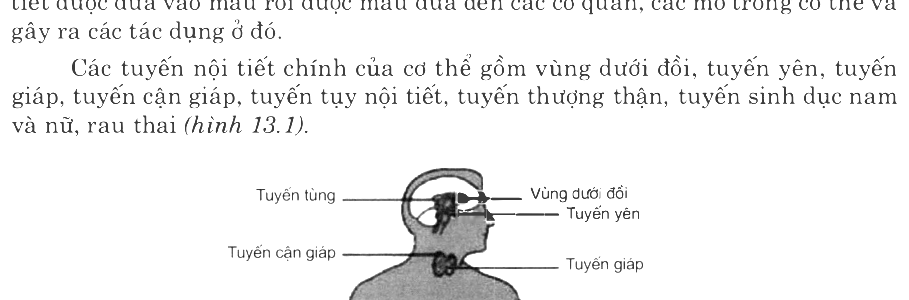

#### 1.1.2. Định nghĩa hormon
Hormon là những chất hóa học do một nhóm tế bào hoặc một tuyến nội tiết bài tiết vào máu rồi được máu đưa đến các tế bào hoặc mô khác trong cơ thể và gây ra các tác dụng sinh lý ở đó.

### 1.2. Phân loại hormon
Dựa vào nơi bài tiết và nơi tác dụng người ta phân các hormon thành hai loại đó là hormon tại chỗ (hormon địa phương) và hormon của các tuyến nội tiết.

#### 1.2.1. Hormon tại chỗ
Hormon tại chỗ là những hormon do một nhóm tế bào bài tiết vào máu rồi được máu đưa đến các tế bào khác ở gần nơi bài tiết để gây ra các tác dụng sinh lý.

Ví dụ: Secretin, cholecystokinin, histamin, prostaglandin...

#### 1.2.2. Hormon của các tuyến nội tiết
Khác với các hormon tại chỗ, các hormon của các tuyến nội tiết thường được máu đưa đến các mô, các cơ quan ở xa nơi bài tiết và gây ra các tác dụng sinh lý ở đó.

Các hormon do các tuyến nội tiết bài tiết lại được phân thành hai loại khác nhau:
- Một số hormon có tác dụng lên hầu hết các mô ở trong cơ thể như hormon GH của tuyến yên, T3, T4 của tuyến giáp, cortisol của tuyến vỏ thượng thận, insulin của tuyến tụy nội tiết...
- Một số hormon chỉ có tác dụng đặc hiệu lên một mô hoặc một cơ quan nào đó như hormon ACTH, TSH, FSH, LH... của tuyến yên. Các mô hoặc cơ quan chịu tác dụng đặc hiệu của những hormon này được gọi là mô hoặc cơ quan đích.

**Các hormon của tuyến nội tiết chính của cơ thể là:**
- Vùng dưới đồi: bài tiết các hormon giải phóng và ức chế, hai hormon khác được chứa ở thuỳ sau tuyến yên là ADH (vasopressin) và oxytocin.
- Tuyến yên: bài tiết GH, ACTH, TSH, FSH, LH, prolactin.
- Tuyến giáp: bài tiết T3, T4, canxitonin.
- Tuyến cận giáp: bài tiết parathormon (PTH).
- Tuyến tụy nội tiết: bài tiết insulin, glucagon.
- Vỏ thượng thận: bài tiết cortisol, aldosteron.
- Tuỷ thượng thận: bài tiết adrenalin, noradrenalin.
- Tuyến buồng trứng: bài tiết estrogen, progesteron.
- Tuyến tinh hoàn: bài tiết testosteron, inhibin.
- Rau thai: bài tiết hCG, estrogen, progesteron, hCS, relaxin.

### 1.3. Bản chất hóa học của hormon
Các hormon thường có bản chất hóa học thuộc một trong ba loại sau đây:
- **Steroid:** đây là những hormon có cấu trúc hóa học giống cholesterol và hầu hết được tổng hợp từ cholesterol như hormon của vỏ thượng thận (cortisol, aldosteron), từ tuyến sinh dục (estrogen, progesteron, testosteron).
- **Dẫn xuất của acid amin là tyrosin:** Hai nhóm hormon được tổng hợp từ tyrosin đó là hormon của tuỷ thượng thận (adrenalin, noradrenalin) và hormon của tuyến giáp (T3, T4).
- **Protein và peptid:** Hầu như tất cả các hormon còn lại của cơ thể là protein, peptid hoặc dẫn xuất của hai loại này như các hormon vùng dưới đồi, hormon tuyến yên, hormon tuyến cận giáp, hormon tuyến tụy nội tiết và hầu hết các hormon tại chỗ.

### 1.4. Chất tiếp nhận hormon (receptor) tại tế bào đích
Khi đến tế bào đích, các hormon thường không tác dụng trực tiếp vào các cấu trúc trong tế bào để điều hoà các phản ứng hóa học ở bên trong tế bào mà chúng thường gắn với các chất tiếp nhận - các receptor ở trên bề mặt hoặc ở trong tế bào đích. Phức hợp hormon - receptor sau đó sẽ phát động một chuỗi các phản ứng hóa học ở trong tế bào. Tất cả hoặc hầu như tất cả receptor đều là những phân tử protein có trọng lượng phân tử lớn. Mỗi tế bào đích thường có khoảng 2.000 - 100.000 receptor.

Mỗi receptor thường đặc hiệu với một hormon, chính điều này quyết định tác dụng đặc hiệu của hormon lên mô đích. Mô đích chịu tác dụng của hormon chính là mô có chứa các receptor đặc hiệu tiếp nhận hormon đó. Các receptor tiếp nhận các loại hormon khác nhau có thể nằm ở các vị trí sau:
- **Ở trên bề mặt hoặc ở trong màng tế bào:** đây là các receptor tiếp nhận hầu hết các hormon protein, peptid và catecholamin.
- **Ở trong bào tương:** các receptor nằm trong bào tương là những receptor tiếp nhận các hormon steroid.
- **Ở trong nhân tế bào:** đây là những receptor tiếp nhận hormon T3 – T4 của tuyến giáp. Người ta cho rằng các receptor này có thể nằm trên một hoặc nhiều chromosom trong nhân tế bào đích.

Số lượng các receptor ở tế bào đích có thể thay đổi từng ngày thậm chí từng phút bởi vì các phân tử protein receptor tự nó có thể bị bất hoạt hoặc bị phá huỷ trong quá trình hoạt động nhưng rồi chúng lại có thể được hoạt hóa trở lại hoặc hình thành các phân tử mới nhờ cơ chế tổng hợp protein trong tế bào.

### 1.5. Cơ chế tác dụng của hormon
Sau khi hormon gắn với receptor tại tế bào đích, hormon sẽ hoạt hóa receptor, nói cách khác là làm cho receptor tự nó thay đổi cấu trúc và chức năng. Chính những receptor này sẽ gây ra các tác dụng tiếp theo như làm thay đổi tính thấm màng tế bào (mở kênh hoặc đóng các kênh ion), hoạt hóa hệ thống enzym ở trong tế bào do hormon gắn với receptor trên màng tế bào, hoạt hóa hệ gen do hormon gắn với receptor ở nhân tế bào.

Tuỳ thuộc vào bản chất hóa học của hormon mà vị trí gắn của hormon với receptor sẽ xảy ra trên màng, trong bào tương hoặc trong nhân tế bào và do đó chúng cũng có những con đường tác động khác nhau vào bên trong tế bào hay nói cách khác, chúng có những cơ chế tác dụng khác nhau tại tế bào đích.

#### 1.5.1. Cơ chế tác dụng của các hormon gắn với receptor trên màng tế bào
Hầu hết các hormon có bản chất hóa học là protein, peptid, dẫn xuất của acid amin khi đến tế bào đích đều gắn với các receptor nằm ngay trên màng tế bào. Phức hợp hormon - receptor này sẽ tác động vào hoạt động của tế bào đích thông qua một chất trung gian được gọi là chất truyền tin thứ hai.

##### 1.5.1.1. Cơ chế tác dụng thông qua chất truyền tin thứ hai là AMP vòng
Sau khi gắn với receptor trên màng tế bào, phức hợp hormon - receptor sẽ hoạt hóa một enzym nằm trên màng tế bào là adenylcyclase. Sau khi được hoạt hóa, enzym này lập tức xúc tác phản ứng tạo ra các phân tử cyclic 3'-5' adenosin monophosphat (AMP vòng) từ các phân tử ATP. Phản ứng này xảy ra ở bào tương. Sau khi được tạo thành, ngay lập tức AMP vòng hoạt hóa một chuỗi các enzym khác theo kiểu dây chuyền. Ví dụ, enzym thứ nhất sau khi được hoạt hóa sẽ hoạt hóa tiếp enzym thứ hai, rồi enzym thứ hai lại hoạt hóa tiếp enzym thứ ba, cứ thế tiếp tục enzym thứ tư, thứ năm... Với kiểu tác dụng như vậy, chỉ cần một lượng rất nhỏ hormon tác động trên bề mặt tế bào đích cũng đủ gây ra một động lực hoạt hóa mạnh cho toàn tế bào. Hệ thống enzym đáp ứng với AMP vòng ở tế bào đích có thể khác nhau giữa tế bào này với tế bào khác nhưng chúng có cùng một họ chung là proteinkinase. Các tác dụng mà hormon gây ra ở tế bào đích có thể là tăng tính thấm của màng tế bào, tăng tổng hợp protein, tăng bài tiết, co hoặc giãn cơ (*hình 13.2*).

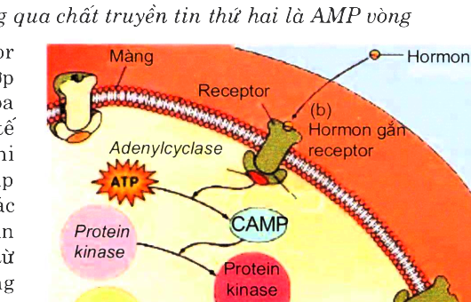

Sau khi gây ra các tác dụng sinh lý tại tế bào đích, AMP vòng bị bất hoạt để trở thành 5'AMP dưới tác dụng của enzym phosphodiesterase có trong bào tương tế bào đích.

Các hormon tác dụng tại tế bào đích thông qua AMP vòng bao gồm: ACTH, TSH, LH, FSH, vasopressin, parathormon, glucagon, catecholamin, secretin, hầu hết các hormon giải phóng của vùng dưới đồi.

##### 1.5.1.2. Cơ chế tác dụng thông qua chất truyền tin thứ hai là ion canxi và calmodulin
Một số trường hợp khi hormon hoặc chất truyền đạt thần kinh gắn với receptor (protein kênh) trên màng tế bào đích nó sẽ làm mở kênh ion canxi và canxi được vận chuyển vào trong tế bào.

Tại bào tương, canxi gắn với một loại protein là calmodulin. Loại protein này có 4 vị trí để gắn với ion canxi. Khi có 3 hoặc 4 vị trí gắn với canxi thì phân tử calmodulin được hoạt hóa và gây ra một loạt tác dụng trong tế bào tương tự như tác dụng của AMP vòng, đó là một chuỗi phản ứng dây chuyền hoạt hóa một loạt các enzym xảy ra (những enzym này khác với enzym đáp ứng với AMP vòng) trong tế bào. Một trong những tác dụng đặc hiệu của calmodulin là hoạt hóa enzym myosinkinase là enzym tác dụng trực tiếp lên sợi myosin của cơ trơn để làm co cơ trơn.

##### 1.5.1.3. Cơ chế tác dụng thông qua chất truyền tin thứ hai là các “mảnh” phospholipid
Một số hormon khi gắn với receptor trên màng tế bào lại hoạt hóa enzym phospholipase C trên màng tế bào. Enzym này có tác dụng cắt các phân tử phospholipid thành các phân tử nhỏ và hoạt động như những chất truyền tin thứ hai để gây ra tác dụng tại các tế bào đích như co cơ trơn, thay đổi sự bài tiết, thay đổi hoạt động của nhung mao, thúc đẩy sự phân chia và tăng sinh tế bào.

Những hormon tác dụng theo con đường này chủ yếu là các hormon tại chỗ, đặc biệt là các hormon được giải phóng do các phản ứng miễn dịch và dị ứng.

#### 1.5.2. Cơ chế tác dụng của các hormon gắn với receptor trong tế bào
Các hormon steroid đến tế bào đích thì khuếch tán qua màng vào bào tương gắn với receptor trong bào tương để tạo thành phức hợp hormon - receptor, phức hợp này sẽ được vận chuyển từ bào tương vào nhân tế bào. Tại nhân tế bào, phức hợp hormon - receptor sẽ gắn vào các vị trí đặc hiệu trên phân tử ADN của nhiễm sắc thể và hoạt hóa sự sao chép của gen đặc hiệu để tạo thành ARN thông tin. Sau khi được tạo thành, ARN thông tin sẽ khuếch tán ra bào tương và thúc đẩy quá trình dịch mã tại ribosom để tổng hợp các phân tử protein mới. Những phân tử protein này có thể là các phân tử enzym hoặc phân tử protein vận tải hoặc protein cấu trúc (*hình 13.3*).

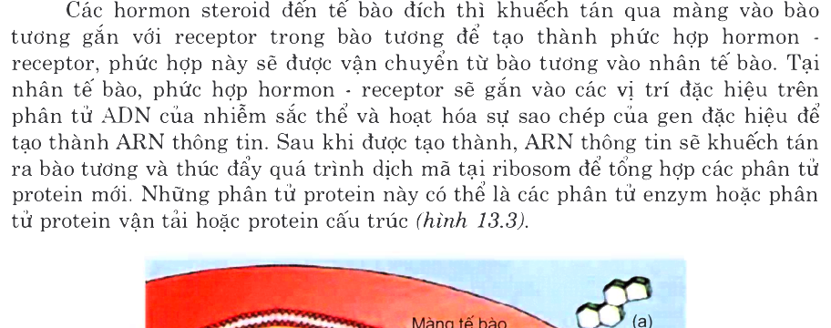

Ví dụ: aldosteron là hormon của vỏ thượng thận được máu đưa đến tế bào ống thận. Tại đây aldosteron khuếch tán vào bào tương và gắn với receptor. Phức hợp aldosteron - receptor sẽ thúc đẩy một chuỗi các sự kiện nói trên tại tế bào ống thận. Sau 45 phút, các protein vận tải bắt đầu xuất hiện ở tế bào ống thận nhằm làm tăng tái hấp thu ion natri và tăng bài xuất ion kali.

Chính vì kiểu tác dụng của hormon steroid có đặc điểm như đã trình bày ở trên nên tác dụng thường xuất hiện chậm sau vài chục phút đến vài giờ, thậm chí vài ngày nhưng tác dụng kéo dài, điều này thường trái ngược với tác dụng xảy ra tức khắc của các hormon tác dụng thông qua AMP vòng.

Hormon T3, T4 của tuyến giáp cũng tác động tại tế bào đích theo cơ chế này chỉ có khác là T3, T4 khuếch tán vào nhân tế bào và gắn trực tiếp vào receptor nằm trên phân tử ADN chứ không qua bước trung gian là gắn với receptor của bào tương.

### 1.6. Cơ chế điều hoà bài tiết hormon
Các hormon được bài tiết theo cơ chế điều khiển từ tuyến chỉ huy đến tuyến đích và theo cơ chế điều hoà ngược (feedback) từ tuyến đích đến tuyến chỉ huy. Ngoài cơ chế này, sự bài tiết hormon còn được điều hoà theo nhịp sinh học và chịu sự tác động của một số chất truyền đạt thần kinh (neurotransmitters). Tuy nhiên, cơ chế điều hoà ngược là cơ chế chủ yếu, nhanh và nhạy để duy trì nồng độ hormon luôn hằng định và thích ứng được với hoạt động của cơ thể khi sống trong môi trường luôn thay đổi.

#### 1.6.1. Điều hoà ngược âm tính
Là kiểu điều hoà mà khi nồng độ hormon tuyến đích giảm, nó sẽ kích thích tuyến chỉ huy bài tiết nhiều hormon để rồi hormon tuyến chỉ huy lại kích thích tuyến đích nhằm đưa nồng độ tuyến đích tăng trở lại mức bình thường. Ngược lại, khi nồng độ hormon tuyến đích tăng lại có tác dụng ức chế tuyến chỉ huy làm giảm bài tiết hormon tuyến chỉ huy.

Ví dụ: nồng độ hormon T3, T4 giảm thì ngay lập tức nó sẽ kích thích vùng dưới đồi, tuyến yên tăng bài tiết TRH và TSH. Chính hai hormon này quay trở lại kích thích tuyến giáp tăng bài tiết để đưa nồng độ T3, T4 trở về mức bình thường (*hình 13.4*).

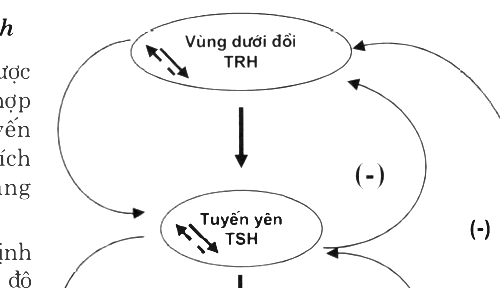

Điều hoà ngược âm tính là kiểu điều hoà thường gặp trong cơ thể nhằm duy trì nồng độ hormon nằm trong giới hạn bình thường.

Rối loạn cơ chế điều hoà ngược âm tính sẽ dẫn đến rối loạn hoạt động của hệ thống nội tiết. Trong thực hành điều trị các bệnh do rối loạn hoạt động của hệ thống nội tiết nếu không lưu ý đến đặc điểm này thì có thể dẫn từ rối loạn này sang rối loạn khác. Ví dụ, để điều trị bệnh nhược năng vỏ thượng thận (bệnh Addison) người ta thường dùng cortisol. Nếu sử dụng cortisol với liều lượng cao và kéo dài, nó sẽ gây tác dụng điều hoà ngược âm tính lên tuyến yên và làm tuyến yên giảm bài tiết ACTH, hậu quả là tuyến vỏ thượng thận vốn đã hoạt động kém nay lại càng nhược nặng hơn.

#### 1.6.2. Điều hoà ngược dương tính
Khác với kiểu điều hoà ngược âm tính, trong một số trường hợp người ta thấy nồng độ hormon tuyến đích tăng lại có tác dụng kích thích tuyến chỉ huy và càng làm tăng hormon tuyến chỉ huy.

Ví dụ: khi cơ thể bị stress, định lượng nồng độ hormon thấy nồng độ cortisol tăng cao đồng thời nồng độ ACTH cũng tăng cao (*hình 13.5*).

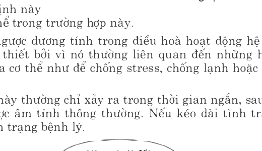

Như vậy, kiểu điều hoà ngược dương tính không những không làm ổn định nồng độ hormon mà ngược lại còn làm tăng thêm sự mất ổn định. Tuy nhiên, sự mất ổn định này là cần thiết nhằm bảo vệ cơ thể trong trường hợp này.

Mặc dù kiểu điều hoà ngược dương tính trong điều hoà hoạt động hệ nội tiết ít gặp nhưng lại rất cần thiết bởi vì nó thường liên quan đến những hiện tượng mang tính sống còn của cơ thể như để chống stress, chống lạnh hoặc gây phóng noãn.

Tuy vậy, kiểu điều hoà này thường chỉ xảy ra trong thời gian ngắn, sau đó lại trở lại kiểu điều hoà ngược âm tính thông thường. Nếu kéo dài tình trạng này chắc chắn sẽ dẫn đến tình trạng bệnh lý.

### 1.7. Định lượng hormon
Hầu như tất cả các hormon đều có mặt trong máu với một lượng rất nhỏ được tính bằng nanogam/ml máu ($10^{-9}$g) hoặc picogam/ml ($10^{-12}$g). Bởi vậy, nhìn chung khó có thể dùng các kỹ thuật định lượng hóa học thông thường để định lượng nồng độ hormon trong máu.

Từ 30 năm nay, người ta đã sử dụng một kỹ thuật có độ nhạy và độ đặc hiệu cao để định lượng hormon, tiền hormon hoặc các dẫn xuất của chúng, đó là phương pháp miễn dịch phóng xạ cạnh tranh (Radio Immuno Assay - RIA).

Ngoài phương pháp miễn dịch phóng xạ cạnh tranh (RIA) người ta còn dùng phương pháp miễn dịch enzym (Enzym Immuno Assay - EIA) để định lượng hormon hoặc dùng các phương pháp khác như đo độ thanh thải của hormon (Metabolic Clearance Rate), đo mức chế tiết hormon.

Tuy nhiên, hai phương pháp hiện nay hay dùng để định lượng hormon là phương pháp RIA và EIA (ELISA).

#### 1.7.1. Phương pháp định lượng miễn dịch phóng xạ cạnh tranh (RIA)
Nguyên tắc chung của phương pháp định lượng miễn dịch phóng xạ là dựa trên sự gắn cạnh tranh giữa hormon tự nhiên (hormon trong máu cần định lượng) và hormon đánh dấu phóng xạ với kháng thể đặc hiệu. Mức độ gắn của hai loại hormon này với kháng thể tỷ lệ thuận với nồng độ ban đầu của chúng. Đo phức hợp hormon gắn đồng vị phóng xạ - kháng thể bằng máy đếm phóng xạ rồi dựa vào đường cong chuẩn ta có thể tính được lượng hormon có trong dịch cần định lượng (*hình 13.6*).

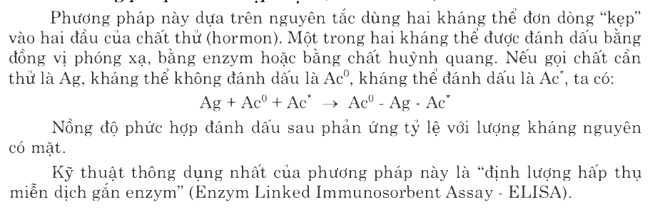

#### 1.7.2. Phương pháp “Bánh kẹp thịt” (“Sandwich”)
Phương pháp này dựa trên nguyên tắc dùng hai kháng thể đơn dòng "kẹp" vào hai đầu của chất thử (hormon). Một trong hai kháng thể được đánh dấu bằng đồng vị phóng xạ, bằng enzym hoặc bằng chất huỳnh quang. Nếu gọi chất cần thử là Ag, kháng thể không đánh dấu là $Ac^0$, kháng thể đánh dấu là $Ac^*$, ta có:
$$Ag + Ac^0 + Ac^* \rightarrow Ac^0 - Ag - Ac^*$$

Nồng độ phức hợp đánh dấu sau phản ứng tỷ lệ với lượng kháng nguyên có mặt.

Kỹ thuật thông dụng nhất của phương pháp này là “định lượng hấp thụ miễn dịch gắn enzym” (Enzym Linked Immunosorbent Assay - ELISA).

---

## 2. VÙNG DƯỚI ĐỒI

### 2.1. Đặc điểm cấu tạo
Vùng dưới đồi (hypothalamus) là một cấu trúc thuộc não trung gian, nằm quanh não thất III và nằm chính giữa hệ viền (limbic). Vùng dưới đồi có nhiều nơron tập trung thành nhiều nhóm nhân và chia thành ba vùng:
- Vùng dưới đồi trước gồm những nhóm nhân như nhóm nhân trên thị, nhân cạnh não thất, nhân trước thị.
- Vùng dưới đồi giữa có nhóm nhân lồi giữa, bụng giữa, lưng giữa...
- Vùng dưới đồi sau có nhóm nhân trước vú, trên vú, củ vú...

Các nơron của vùng dưới đồi ngoài chức năng dẫn truyền xung động thần kinh như các nơron của các cấu trúc thần kinh khác, còn có chức năng tổng hợp và bài tiết các hormon.

Vùng dưới đồi có mối liên hệ mật thiết qua đường mạch máu và đường thần kinh với tuyến yên (sẽ được trình bày ở phần tuyến yên). Các hormon do vùng dưới đồi bài tiết sẽ theo những con đường này đến dự trữ hoặc tác động (kích thích hoặc ức chế) đến chức năng của tuyến yên.

### 2.2. Các hormon giải phóng và ức chế của vùng dưới đồi
Các nơron của vùng dưới đồi mà thân của chúng có thể nằm ở các nhóm nhân khác nhau của vùng dưới đồi và tận cùng của nơron thì khu trú tại vùng lồi giữa có khả năng tổng hợp các hormon giải phóng (Releasing Hormone) và các hormon ức chế (Inhibitory Hormone) để kích thích hoặc ức chế hoạt động của các tế bào thuỳ trước tuyến yên.

Các hormon giải phóng và ức chế sau khi được tổng hợp từ thân nơron, chúng được vận chuyển theo sợi trục xuống tích trữ ở các túi nhỏ trong tận cùng thần kinh nằm ở vùng lồi giữa. Tại đây hormon khuếch tán vào mạng mao mạch thứ nhất rồi theo hệ mạch cửa dưới đồi - yên xuống thuỳ trước tuyến yên.

#### 2.2.1. Bản chất hóa học và tác dụng của các hormon giải phóng và ức chế

##### 2.2.1.1. Hormon giải phóng và ức chế GH: GHRH và GHIH (Growth Hormone Releasing Hormone và Growth Hormone Inhibitory Hormone)
- Cả hai đều là polypeptid gồm 44 acid amin.
- GHRH có tác dụng kích thích thuỳ trước tuyến yên bài tiết GH và ngược lại GHIH lại ức chế tế bào thuỳ trước tuyến yên làm giảm bài tiết hormon GH.

##### 2.2.1.2. Hormon giải phóng TSH: TRH (Thyrotropin Releasing Hormone)
- TRH là hormon có cấu trúc rất đơn giản, chỉ gồm ba acid amin.
- TRH kích thích tế bào thuỳ trước tuyến yên tổng hợp và bài tiết TSH. Ngoài ra TRH còn có tác dụng kích thích thuỳ trước tuyến yên bài tiết prolactin.

##### 2.2.1.3. Hormon giải phóng ACTH: CRH (Corticotropin Releasing Hormone)
- CRH là một peptid có 41 acid amin.
- CRH kích thích tế bào thuỳ trước tuyến yên tổng hợp và bài tiết ACTH.

##### 2.2.1.4. Hormon giải phóng FSH và LH: GnRH (Gonadotropin Releasing Hormone)
- GnRH là một peptid có 10 acid amin.
- GnRH kích thích tế bào thuỳ trước tuyến yên tổng hợp và bài tiết cả hai hormon FSH và LH. GnRH được bài tiết theo nhịp, tuy nhiên nhịp bài tiết GnRH liên quan chặt chẽ đến sự bài tiết LH hơn là FSH. Vắng mặt GnRH hay đưa GnRH vào dòng máu đến tuyến yên liên tục thì cả LH và FSH đều không được bài tiết.

##### 2.2.1.5. Hormon ức chế prolactin: PIH (Prolactin Inhibitory Hormone)
- Trước đây người ta cho rằng cấu trúc của PIH chưa rõ. Đến nay, người ta đã xác nhận rằng PIH do vùng dưới đồi bài tiết chính là dopamine. Trên động vật thực nghiệm, người ta đã tìm thấy các receptor tiếp nhận dopamine ở các tế bào bài tiết hormone hướng tuyến sữa của vùng dưới đồi.
- Tác dụng của PIH là ức chế sinh tổng hợp và bài tiết prolactin từ tế bào ưa acid của thuỳ trước tuyến yên.

#### 2.2.2. Điều hoà bài tiết các hormon giải phóng và ức chế
Cũng như các hormon khác trong hệ nội tiết, các hormon giải phóng và ức chế được điều hoà chủ yếu bằng cơ chế điều hoà ngược mà các tín hiệu điều hoà xuất phát từ tuyến yên hoặc các tuyến ngoại biên khác (*hình 13.7*):
- Cơ chế điều hoà ngược do các hormon tuyến đích ngoại biên điều khiển (tuyến giáp, tuyến vỏ thượng thận, tuyến sinh dục) được gọi là **cơ chế điều hoà ngược vòng dài**.
- Cơ chế điều hoà ngược do các hormon tuyến yên điều khiển (GH, TSH, ACTH, FSH, LH, prolactin) được gọi là **cơ chế điều hoà ngược vòng ngắn**.
- Cơ chế điều hoà ngược do chính nồng độ hormon của vùng dưới đồi điều khiển được gọi là **cơ chế điều hoà ngược vòng cực ngắn**. Cơ chế này mới chỉ tìm thấy ở hai hormon GnRH và TRH.

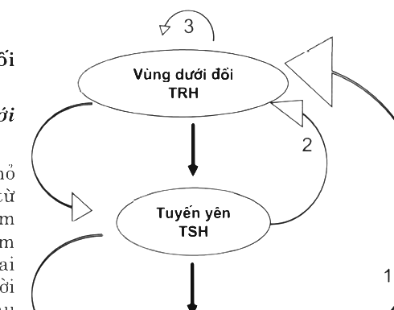

### 2.3. Các hormon khác
Ngoài các hormon giải phóng và ức chế, các nơron thuộc hai nhóm nhân trên thị và cạnh não thất còn tổng hợp hai hormon khác là ADH (vasopressin) và oxytocin. Hai hormon này được tổng hợp ở thân tế bào rồi theo sợi trục đến tích trữ ở thuỳ sau tuyến yên.

Bản chất hóa học, tác dụng và điều hoà bài tiết hai hormon này sẽ được trình bày ở phần các hormon thuỳ sau tuyến yên (xem mục 3.3).

---

## 3. TUYẾN YÊN

### 3.1. Đặc điểm cấu tạo và mối liên hệ với vùng dưới đồi

#### 3.1.1. Vị trí và mối liên hệ với vùng dưới đồi
Tuyến yên là một tuyến nhỏ đường kính khoảng 1 cm, nặng từ 0,5 - 1 gam. Tuyến yên nằm trong hố yên của xương bướm thuộc nền sọ. Tuyến yên gồm hai phần có nguồn gốc cấu tạo từ thời kỳ bào thai hoàn toàn khác nhau đó là thuỳ trước và thuỳ sau (*hình 13.8*). Tuyến yên liên quan mật thiết với vùng dưới đồi qua đường mạch máu và đường thần kinh đó là hệ thống cửa dưới đồi-yên và bó sợi thần kinh dưới đồi - yên.

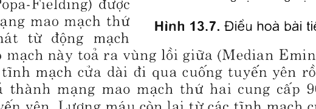

- **Hệ thống cửa dưới đồi-yên (hệ cửa Popa-Fielding)** được cấu tạo bởi mạng mao mạch thứ nhất xuất phát từ động mạch yên trên. Mao mạch này toả ra vùng lồi giữa (Median Eminence) rồi tập trung thành những tĩnh mạch cửa dài đi qua cuống tuyến yên rồi xuống thuỳ trước tuyến yên toả thành mạng mao mạch thứ hai cung cấp 90% lượng máu cho thuỳ trước tuyến yên. Lượng máu còn lại từ các tĩnh mạch cửa ngắn bắt đầu từ mạng mao mạch của động mạch yên dưới (*hình 13.9*).

Các hormon giải phóng và ức chế của vùng dưới đồi được bài tiết từ các tận cùng của vùng lồi giữa sẽ thấm vào các mao mạch lồi giữa rồi theo hệ thống cửa dưới đồi-yên xuống điều khiển sự bài tiết hormon của tuyến yên.

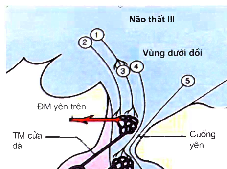

- **Bó sợi thần kinh dưới đồi-yên** là bó thần kinh gồm các sợi trục của các nơron mà thân nằm ở hai nhóm nhân trên thị và cạnh não thất còn tận cùng của chúng thì khu trú ở thuỳ sau tuyến yên (*hình 13.9*).

Hai hormon do các nơron của nhóm nhân trên thị và cạnh não thất tổng hợp và bài tiết sẽ theo bó sợi thần kinh này đến dự trữ ở thuỳ sau tuyến yên do vậy các tín hiệu kích thích vào vùng dưới đồi hoặc thuỳ sau tuyến yên đều gây bài tiết hai hormon này.

#### 3.1.2. Đặc điểm cấu tạo của tuyến yên

##### 3.1.2.1. Thuỳ trước tuyến yên (thuỳ tuyến)
Thuỳ trước tuyến yên được cấu tạo bởi những tế bào chế tiết. Những tế bào này có nhiều loại, mỗi loại tổng hợp và bài tiết một loại hormon. Khoảng 20% tế bào tuyến yên là những tế bào tổng hợp và bài tiết ACTH. Các tế bào tổng hợp và bài tiết các hormon khác của thuỳ trước tuyến yên mỗi loại chỉ chiếm từ 3-5% nhưng chúng có khả năng bài tiết hormon rất mạnh để điều hoà chức năng tuyến giáp, tuyến sinh dục và tuyến vú.

##### 3.1.2.2. Thuỳ sau tuyến yên (thuỳ thần kinh)
Thuỳ sau tuyến yên được cấu tạo chủ yếu bởi các tế bào giống tế bào thần kinh đệm (glial like cell). Những tế bào này không có khả năng chế tiết hormon mà chỉ có chức năng như một cấu trúc hỗ trợ cho một lượng lớn các sợi trục và cúc tận cùng sợi trục khu trú ở thuỳ sau tuyến yên mà thân nằm ở nhân trên thị và nhân cạnh não thất. Trong cúc tận cùng của những sợi thần kinh này có các túi chứa hai hormon là ADH và oxytocin.

### 3.2. Các hormon thuỳ trước tuyến yên
Thuỳ trước tuyến yên tổng hợp và bài tiết 6 hormon đó là:
- Hormon phát triển cơ thể - GH (Human Growth Hormone)
- Hormon kích thích tuyến giáp (Thyroid Stimulating Hormone - TSH)
- Hormon kích thích tuyến vỏ thượng thận - ACTH (Adreno Corticotropin Hormone)
- Hormon kích thích nang noãn - FSH (Follicle Stimulating Hormone)
- Hormon kích thích hoàng thể - LH (Luteinizing Hormone)
- Hormon kích thích bài tiết sữa PRL (Prolactin).

Ngoại trừ GH là hormon có tác dụng điều hoà trực tiếp chức năng chuyển hóa của toàn bộ cơ thể, các hormon còn lại chỉ tác dụng đặc hiệu lên một tuyến hoặc một mô nào đó. Thông qua tác dụng lên các tuyến nội tiết này để điều hoà các chức năng chuyển hóa của cơ thể như hormon TSH, ACTH, FSH, LH, PRL.

#### 3.2.1. Hormon phát triển cơ thể - GH (hGH)

##### 3.2.1.1. Bản chất hóa học
GH là một phân tử protein chứa 191 acid amin trong một chuỗi đơn và có trọng lượng phân tử là 22.005.

##### 3.2.1.2. Tác dụng
GH làm phát triển hầu hết các mô có khả năng tăng trưởng trong cơ thể. Nó vừa làm tăng kích thước tế bào vừa làm tăng quá trình phân chia tế bào do đó làm tăng trọng lượng cơ thể, làm tăng kích thước các phủ tạng.
- Kích thích mô sụn và xương phát triển:
  + Tăng lắng đọng protein ở các tế bào sụn và tế bào xương.
  + Tăng tốc độ sinh sản các tế bào sụn và tế bào xương.
  + Tăng chuyển các tế bào sụn thành các tế bào xương.
  GH làm xương phát triển nhờ hai cơ chế chính:
  + **Cơ chế làm dài xương:** GH làm phát triển sụn ở đầu xương dài, nơi mà đầu xương tách khỏi thân xương. Sự phát triển này bắt đầu bằng tăng phát triển mô sụn, sau đó mô sụn sẽ được chuyển thành mô xương mới, do đó thân xương dài ra và tự nó cũng dần dần được cốt hóa sao cho đến tuổi vị thành niên thì mô sụn ở đầu xương không còn nữa, lúc này đầu xương và thân xương sẽ hợp nhất lại với nhau và xương không dài ra nữa. Như vậy, GH kích thích cả sự phát triển mô sụn đầu xương và chiều dài xương nhưng khi mà đầu xương hợp nhất với thân xương thì GH không có khả năng làm dài xương nữa.
  + **Cơ chế làm dày xương:** GH kích thích mạnh tế bào tạo xương là tế bào thường nằm trên bề mặt xương, do vậy xương tiếp tục dày ra dưới ảnh hưởng của GH, đặc biệt là màng xương. Tác dụng này được thể hiện ngay cả khi cơ thể đã trưởng thành đặc biệt đối với các xương dẹt như xương hàm, xương sọ và những xương nhỏ như xương bàn tay và xương bàn chân. Khi GH được tiết ra quá nhiều ở những người đã trưởng thành thì xương hàm dày lên, làm cho đầu và mặt to ra, xương bàn chân hay bàn tay cũng dày lên làm bàn chân, bàn tay to ra.
- Kích thích sinh tổng hợp protein:
  + Tăng vận chuyển acid amin qua màng tế bào.
  + Tăng quá trình sao chép ADN của nhân tế bào để tạo ARN.
  + Tăng quá trình dịch mã ARN để làm tăng tổng hợp protein từ ribosom.
  + Giảm quá trình thoái hóa protein và acid amin.
- Tăng tạo năng lượng từ nguồn lipid:
  + Tăng giải phóng acid béo từ các mô mỡ dự trữ, do đó làm tăng nồng độ acid béo trong máu.
  + Chính vì tác dụng này mà người ta coi tác dụng huy động lipid của GH là một trong những tác dụng quan trọng nhất nhằm tiết kiệm protein để dùng nó cho sự phát triển cơ thể.
- Tác dụng lên chuyển hóa carbohydrat:
  + Giảm sử dụng glucose cho mục đích sinh năng lượng.
  + Tăng dự trữ glycogen ở tế bào.
  + Giảm vận chuyển glucose vào tế bào và tăng nồng độ glucose trong máu.
  + Tăng bài tiết insulin: Nồng độ glucose trong máu tăng dưới tác dụng của GH đã kích thích tuyến tụy nội tiết bài tiết insulin, đồng thời chính GH cũng có tác dụng kích thích trực tiếp lên tế bào bêta của tuyến tụy.

##### 3.2.1.3. Điều hoà bài tiết
- **Vùng dưới đồi:** GH được bài tiết dưới sự điều khiển gần như hoàn toàn của hai hormon vùng dưới đồi là GHRH và GHIH (xem mục 2. Vùng dưới đồi).
- Somatostatin là một hormon tại chỗ do nhiều vùng não và đường tiêu hóa bài tiết (xem mục 8. Hormon tại chỗ) cũng có tác dụng ức chế bài tiết GH.
- Nồng độ glucose trong máu giảm, nồng độ acid béo trong máu giảm, thiếu protein nặng và kéo dài sẽ làm tăng bài tiết GH.
- Tình trạng stress, chấn thương, luyện tập gắng sức sẽ làm tăng bài tiết GH.

Ở người Việt Nam, nồng độ GH trong máu cuống rốn trẻ sơ sinh là $28,38 \pm 10,03\text{ ng/ml}$, người trưởng thành là $3,94 \pm 2,09\text{ ng/ml}$.

#### 3.2.2. Hormon kích thích tuyến giáp - TSH

##### 3.2.2.1. Bản chất hóa học
TSH là một glycoprotein, có trọng lượng phân tử 28.000.

##### 3.2.2.2. Tác dụng
- Tác dụng lên cấu trúc tuyến giáp:
  + Tăng số lượng và kích thước tế bào tuyến giáp trong mỗi nang giáp.
  + Tăng biến đổi các tế bào nang giáp từ dạng khối sang dạng trụ (dạng bài tiết).
  + Tăng phát triển hệ thống mao mạch của tuyến giáp.
- Tác dụng lên chức năng tuyến giáp:
  + Tăng hoạt động bơm iod do đó làm tăng khả năng bắt iod của tế bào tuyến giáp.
  + Tăng gắn iod vào tyrosin để tạo hormon tuyến giáp.
  + Tăng phân giải thyroglobulin được dự trữ trong lòng nang để giải phóng hormon tuyến giáp vào máu và do đó làm giảm chất keo trong lòng nang giáp.

##### 3.2.2.3. Điều hoà bài tiết
Ở người Việt Nam bình thường nồng độ TSH ở trẻ sơ sinh (máu cuống rốn) là $6,24 \pm 2,69$ và người trưởng thành (16-60 tuổi) là $2,12 \pm 0,91\text{ mU/l}$.

Mức bài tiết TSH của tuyến yên chịu sự điều khiển từ trên xuống của TRH vùng dưới đồi và chịu sự điều hoà ngược của tuyến đích là tuyến giáp:
- Nếu nồng độ TRH vùng dưới đồi tăng thì tuyến yên sẽ bài tiết nhiều TSH và ngược lại nếu TRH giảm thì nồng độ TSH giảm. Khi hệ thống cửa dưới đồi-yên bị tổn thương, mức bài tiết TSH của tuyến yên có thể giảm tới mức bằng không.
- Nồng độ hormon tuyến giáp ảnh hưởng đến sự bài tiết TSH của tuyến yên theo cơ chế điều hoà ngược âm tính và dương tính (xem mục 1. Đại cương về hệ nội tiết và hormon).

#### 3.2.3. Hormon kích thích vỏ thượng thận - ACTH

##### 3.2.3.1. Bản chất hóa học
ACTH là một phân tử polypeptid lớn gồm 39 acid amin.

##### 3.2.3.2. Tác dụng
- **Tác dụng lên cấu trúc vỏ thượng thận:** ACTH làm tăng sinh tế bào vỏ thượng thận đặc biệt là tế bào của lớp bó và lưới, là những tế bào bài tiết cortisol và androgen do đó làm tuyến nở to. Thiếu ACTH vỏ thượng thận sẽ bị teo lại.
- **Tác dụng lên chức năng vỏ thượng thận:** ACTH có tác dụng kích thích vỏ thượng thận tổng hợp và bài tiết hormon do hoạt hóa các enzym proteinkinase A là enzym thúc đẩy chặng đầu tiên của quá trình sinh tổng hợp hormon vỏ thượng thận.
- **Tác dụng lên não:** ACTH có vai trò làm tăng quá trình học tập và trí nhớ, tăng cảm xúc sợ hãi.
- **Tác dụng lên tế bào sắc tố:** ACTH kích thích tế bào sắc tố sản xuất sắc tố melanin rồi phân tán sắc tố này trên bề mặt biểu bì da. Thiếu ACTH sẽ làm cho da không có sắc tố (người bạch tạng). Ngược lại thừa ACTH làm cho da có những mảng sắc tố.

##### 3.2.3.3. Điều hoà bài tiết
- Do nồng độ CRH của vùng dưới đồi quyết định, khi nồng độ CRH tăng thì ACTH được bài tiết nhiều ngược lại khi vắng mặt CRH, tuyến yên chỉ bài tiết một lượng rất ít ACTH.
- Do tác dụng điều hoà ngược âm tính và dương tính của cortisol.
- Nồng độ ACTH còn được điều hoà theo nhịp sinh học. Trong ngày, nồng độ ACTH cao nhất vào khoảng từ 6-8 giờ sáng, sau đó giảm dần và thấp nhất vào khoảng 23 giờ rồi lại tăng dần về sáng.

Bình thường nồng độ ACTH trong huyết tương vào buổi sáng khoảng $10\text{ - }50\text{ pg/ml}$, khi bị stress nồng độ tăng rất cao có thể lên tới $600\text{ pg/ml}$. Ở người Việt Nam trưởng thành (lấy máu lúc 8 giờ 30 sáng trên nam khỏe mạnh) nồng độ ACTH là $9,7773 \pm 4,599\text{ pg/ml}$.

#### 3.2.4. Hormon kích thích tuyến sinh dục: FSH và LH

##### 3.2.4.1. Bản chất hóa học
Cả FSH và LH đều là glycoprotein. FSH được cấu tạo bởi 236 acid amin với trọng lượng phân tử 32.000, còn LH có 215 acid amin và trọng lượng phân tử là 30.000.

##### 3.2.4.2. Tác dụng
- **Tác dụng lên tuyến sinh dục nam (tinh hoàn):**
  + FSH: Kích thích ống sinh tinh phát triển; Kích thích tế bào Sertoli nằm ở thành ống sinh tinh phát triển và bài tiết các chất tham gia vào quá trình sản sinh tinh trùng.
  + LH: Kích thích tế bào kẽ Leydig (nằm giữa các ống sinh tinh) phát triển; Kích thích tế bào kẽ Leydig bài tiết testosteron.
- **Tác dụng trên tuyến sinh dục nữ (buồng trứng):**
  + FSH: Kích thích các nang noãn phát triển đặc biệt là kích thích tăng sinh lớp tế bào hạt để từ đó tạo thành lớp vỏ (lớp áo) của nang noãn.
  + LH: Phối hợp với FSH làm phát triển nang noãn tiến tới chín; Phối hợp với FSH gây hiện tượng phóng noãn; Kích thích những tế bào hạt và lớp vỏ còn lại phát triển thành hoàng thể; Kích thích lớp tế bào hạt của nang noãn và hoàng thể bài tiết estrogen và progesteron.

##### 3.2.4.3. Nồng độ FSH và LH
Hai hormon FSH và LH chỉ bắt đầu được bài tiết từ tuyến yên của trẻ em ở lứa tuổi 9-10 tuổi. Lượng bài tiết hai hormon này tăng dần và có mức cao nhất vào tuổi dậy thì.

Bình thường nồng độ FSH và LH ở nữ dao động trong chu kỳ kinh nguyệt (CKKN) còn ở nam giới thì không thấy hiện tượng này. Nồng độ hai hormon này ở người Việt Nam được ghi trong bảng 13.1.

**Bảng 13.1. Nồng độ LH và FSH ở phụ nữ Việt Nam**

| Giai đoạn / Đối tượng | LH (IU/l) | FSH (IU/l) |
|---|:---:|:---:|
| GĐ I của CKKN | 3,94 - 7,66 | 1,45 - 2,33 |
| Nồng độ đỉnh | 44,12 - 59,60 | 8,87 - 11,43 |
| Ngày xuất hiện đỉnh | 16,54 ± 3,86 | 16,06 ± 2,89 |
| GĐ II của CKKN | 2,44 - 4,009 | 0,43 - 0,84 |
| Nam giới | 2,90 ± 2,12 | 4,60 ± 1,91 |

##### 3.2.4.4. Điều hoà bài tiết
- Do tác dụng kích thích của hormon vùng dưới đồi GnRH.
- Do tác dụng điều hoà ngược của hormon sinh dục: testosteron, estrogen, progesteron. Khi các hormon này tăng thì ức chế tuyến yên và ngược lại nếu nồng độ các hormon này giảm sẽ kích thích tuyến yên bài tiết nhiều FSH và LH.

#### 3.2.5. Hormon kích thích bài tiết sữa - Prolactin (PRL)

##### 3.2.5.1. Bản chất hóa học
Prolactin là một hormon protein có 198 acid amin với trọng lượng phân tử 22.500.

##### 3.2.5.2. Tác dụng
Prolactin có tác dụng kích thích bài tiết sữa trên tuyến vú đã chịu tác dụng của estrogen và progesteron.

Prolactin bình thường được bài tiết với nồng độ rất thấp nhưng khi người phụ nữ có thai, nồng độ prolactin được bài tiết tăng dần từ tuần thứ 5 của thai nhi cho tới lúc sinh. Nồng độ prolactin trong thời kỳ này tăng gấp 10-20 lần so với bình thường. Tuy nhiên do estrogen và progesteron có tác dụng ức chế bài tiết sữa nên trong khi có thai mặc dù nồng độ prolactin rất cao nhưng lượng sữa được bài tiết chỉ khoảng vài mililit mỗi ngày. Ngay sau khi đứa trẻ được sinh ra, cả hai hormon estrogen và progesteron giảm đột ngột tạo điều kiện cho prolactin phát huy tác dụng tiết sữa.

##### 3.2.5.3. Điều hoà bài tiết
Ở người Việt Nam bình thường, nồng độ prolactin ở nam giới vào khoảng 110-510 và ở nữ giới là 80-600 mU/l. Khi có thai nồng độ tăng cao, sau khi sinh vài tuần nồng độ prolactin trở lại mức cơ sở nếu không cho con bú, nếu cho con bú nồng độ prolactin vẫn cao. Sự bài tiết prolactin được điều hoà dưới ảnh hưởng của hormon vùng dưới đồi và một số yếu tố khác:
- **Vai trò của hormon vùng dưới đồi:** khác với các hormon khác của tuyến yên chủ yếu chịu tác dụng kích thích của hormon vùng dưới đồi, prolactin lại chịu tác dụng ức chế mạnh của PIH được bài tiết từ vùng dưới đồi. Khi tổn thương vùng dưới đồi hoặc tổn thương hệ mạch cửa dưới đồi - yên sự bài tiết prolactin tăng lên trong khi các hormon khác của tuyến yên lại giảm đi.
- Dopamin được bài tiết từ nhân cung (arcuate nuclei) của vùng dưới đồi có tác dụng ức chế bài tiết prolactin để duy trì một nồng độ thấp trong tình trạng bình thường. Khi đang cho con bú dopamin lại kích thích bài tiết prolactin.
- TRH ngoài tác dụng giải phóng hormon TSH nó còn là hormon có tác dụng mạnh trong việc kích thích tuyến yên bài tiết prolactin.
- Prolactin được bài tiết khi có các kích thích trực tiếp vào núm vú (động tác mút vú của trẻ).

### 3.3. Các hormon thuỳ sau tuyến yên
Hai hormon được bài tiết từ thuỳ sau tuyến yên có nguồn gốc từ vùng dưới đồi. Chúng được bài tiết từ các nơron mà thân khu trú ở nhân cạnh não thất và nhân trên thị. Sau khi được tổng hợp chúng được vận chuyển dọc theo sợi trục đến chứa ở các bọc nhỏ nằm trong tận cùng thần kinh khu trú ở thuỳ sau tuyến yên. Hai hormon đó là hormon oxytocin và ADH (Antidiuretic Hormone).

#### 3.3.1. Hormon ADH

##### 3.3.1.1. Bản chất hóa học
ADH hay còn gọi là vasopressin là một peptid có 9 acid amin.

##### 3.3.1.2. Tác dụng
- Với một lượng rất nhỏ chỉ 2 ng ADH khi tiêm cho người sẽ làm giảm bài tiết nước tiểu do ADH có tác dụng làm tăng tái hấp thu nước ở ống lượn xa và ống góp. Nếu không có ADH, ống góp và ống lượn xa hầu như không tái hấp thu nước làm cho một lượng lớn nước mất qua đường nước tiểu. Ngược lại, với sự có mặt của ADH tính thấm đối với nước của ống lượn xa và ống góp tăng lên nhiều lần, nước được tái hấp thu trở lại cơ thể làm cho nước tiểu được cô đặc.
- Với nồng độ cao, ADH có tác dụng làm co mạnh các tiểu động mạch ở toàn cơ thể, do đó làm tăng huyết áp. Chính vì lý do này mà ADH còn có tên thứ hai là vasopressin.

##### 3.3.1.3. Điều hoà bài tiết
- **Điều hoà bằng áp suất thẩm thấu:** Khi dịch thể đậm đặc (áp suất thẩm thấu tăng), nhân trên thị bị kích thích, các tín hiệu kích thích sẽ truyền đến thuỳ sau tuyến yên và gây bài tiết ADH. ADH được máu đưa đến tế bào làm tăng tính thấm đối với nước của tế bào ống thận đặc biệt ống góp do vậy hầu hết nước được tái hấp thu trong khi đó các chất điện giải vẫn được tiếp tục đưa ra nước tiểu do đó nước tiểu được cô đặc.
- **Điều hoà bằng thể tích máu:** Thể tích máu giảm là một tác nhân mạnh gây bài tiết ADH (vasopressin). Tác dụng này đặc biệt mạnh khi thể tích máu giảm từ 15-25%, khi đó nồng độ ADH có thể tăng tới 50 lần cao hơn bình thường.

#### 3.3.2. Oxytocin

##### 3.3.2.1. Bản chất hóa học
Oxytocin cũng là một peptid có 9 acid amin, chỉ có acid amin thứ 8 khác với phân tử ADH (thay arginin bằng leucin).

##### 3.3.2.2. Tác dụng
- **Tác dụng lên tử cung:** Oxytocin có tác dụng co tử cung mạnh khi đang mang thai đặc biệt càng gần cuối thời kỳ có thai tác dụng co tử cung của oxytocin càng mạnh. Vì tác dụng này mà nhiều người cho rằng oxytocin có liên quan đến cơ chế đẻ. Trên một số loài động vật nếu không có oxytocin động vật này không đẻ được. Ở người nồng độ oxytocin tăng trong khi đẻ đặc biệt tăng trong giai đoạn cuối. Ở những người đẻ khó do cơn co tử cung yếu người ta thường tiêm truyền oxytocin để làm tăng cơn co tử cung (đẻ chỉ huy).
- **Tác dụng bài xuất sữa:** Oxytocin có tác dụng co các tế bào biểu mô cơ (myoepithelial cells) là những tế bào nằm thành hàng rào bao quanh nang tuyến sữa. Những tế bào này co lại sẽ ép vào nang tuyến với áp lực 10 – 20 mmHg và đẩy sữa ra ống tuyến, khi đứa trẻ bú thì nhận được sữa. Tác dụng này của oxytocin được gọi là bài xuất sữa, khác với tác dụng gây bài tiết sữa của PRL.

##### 3.3.2.3. Điều hoà bài tiết
Bình thường nồng độ oxytocin huyết tương là 1 - 4 pmol/l. Oxytocin được bài tiết do kích thích cơ học và tâm lý:
- **Kích thích trực tiếp vào núm vú:** chính động tác mút núm vú của đứa trẻ là những tín hiệu kích thích được truyền về tuỷ sống rồi vùng dưới đồi làm kích thích các nơron ở nhân cạnh não thất và nhân trên thị. Những tín hiệu này được truyền xuống thuỳ sau tuyến yên để gây bài tiết oxytocin.
- **Kích thích tâm lý hoặc kích thích hệ giao cảm:** Vùng dưới đồi luôn nhận được các tín hiệu từ hệ limbic do vậy tất cả những kích thích tâm lý hoặc kích thích hệ giao cảm có liên quan đến hoạt động cảm xúc đều có ảnh hưởng đến vùng dưới đồi làm tăng bài tiết oxytocin và do vậy tăng bài xuất sữa. Tuy nhiên nếu những kích thích này quá mạnh hoặc kéo dài thì có thể ức chế bài tiết oxytocin và làm mất sữa ở các bà mẹ đang nuôi con.

### 3.4. Rối loạn hoạt động tuyến yên

#### 3.4.1. Suy giảm tuyến yên toàn bộ
Thuật ngữ suy giảm tuyến yên toàn bộ được dùng để chỉ tình trạng giảm bài tiết tất cả các hormon tuyến yên. Tình trạng này có thể do nguồn gốc bẩm sinh cũng có thể do mắc phải sau này.

##### 3.4.1.1. Bệnh lùn tuyến yên
Hầu hết các trường hợp lùn đều do thiếu hormon tuyến yên trong thời kỳ niên thiếu. Nhìn chung cơ thể phát triển cân đối nhưng mức độ phát triển thì giảm rõ rệt, đứa trẻ 10 tuổi chỉ bằng đứa trẻ 4-5 tuổi, người 20 tuổi chỉ bằng đứa trẻ 7-10 tuổi.

Người lùn tuyến yên không có dậy thì, hormon hướng sinh dục không được bài tiết đủ do vậy chức năng sinh dục không phát triển như người trưởng thành bình thường. Có khoảng một phần ba những người lùn loại này chỉ giảm bài tiết GH, do vậy chức năng sinh dục vẫn phát triển và vẫn có khả năng sinh sản.

##### 3.4.1.2. Bệnh suy tuyến yên ở người lớn
Suy tuyến yên toàn bộ ở người lớn thường do một trong ba nguyên nhân sau:
- U sọ hầu (craniopharyngioma).
- U tế bào không bắt màu ở tuyến yên (chromophobe tumor).
- Tắc mạch máu tuyến yên, đặc biệt hay xuất hiện ở các bà mẹ sau sinh con.

Các biểu hiện của suy tuyến yên ở người lớn là biểu hiện của:
- Suy tuyến giáp.
- Giảm bài tiết hormon chuyển hóa đường của vỏ thượng thận.
- Giảm bài tiết các hormon hướng sinh dục dẫn tới giảm hoặc mất chức năng sinh dục.

Hình ảnh chung của bệnh là một tình trạng lờ đờ, chậm chạp do thiếu hormon tuyến giáp; tăng cân do thiếu tác dụng thoái hóa mỡ của hormon GH, ACTH, vỏ thượng thận và hormon tuyến giáp; mất tất cả chức năng sinh dục.

Ngoại trừ chức năng sinh dục, các rối loạn khác có thể được điều trị khỏi nhờ hormon tuyến giáp và vỏ thượng thận.

#### 3.4.2. Bệnh khổng lồ
Nguyên nhân gây bệnh là do các tế bào bài tiết GH tăng cường hoạt động hoặc do u của tế bào ưa acid. Kết quả là hormon GH được bài tiết quá mức. Tuy nhiên bệnh khổng lồ chỉ xuất hiện khi tình trạng này xảy ra vào lúc còn trẻ (trước tuổi trưởng thành).

Biểu hiện của bệnh là tình trạng phát triển nhanh và quá mức của tất cả các mô trong cơ thể bao gồm cả xương và các phủ tạng làm cho người đó to cao quá mức bình thường nên được gọi là người khổng lồ, các phủ tạng to hơn bình thường.

Những người khổng lồ thường bị tăng đường máu và khoảng 10% có thể bị bệnh đái tháo đường.

Hầu hết các bệnh nhân khổng lồ thường chết khi còn trẻ trong tình trạng suy tuyến yên toàn bộ vì phần lớn nguyên nhân gây khổng lồ là do u tế bào bài tiết GH, khối u này càng phát triển thì càng chèn ép vào các tế bào bài tiết các hormon khác của tuyến yên. Tuy nhiên, nếu được chẩn đoán kịp thời, bệnh nhân có thể được ngăn chặn bằng vi phẫu thuật bóc tách khối u hoặc tia xạ.

#### 3.4.3. Bệnh to đầu ngón
Nếu u tế bào ưa acid xảy ra vào sau tuổi trưởng thành nghĩa là xảy ra khi các sụn ở đầu xương đã được cốt hóa thì bệnh nhân sẽ không có biểu hiện khổng lồ nhưng các mô mềm vẫn phát triển và các xương đặc biệt xương dẹt và xương nhỏ có thể dày lên.

Bệnh nhân bị bệnh này sẽ có hình ảnh đầu to, hàm nhô ra, trán nhô ra, mũi to, môi dày, lưỡi to và dày, bàn tay to, bàn chân to, phủ tạng to, đôi khi có cả sự biến dạng cột sống làm lưng gù.

#### 3.4.4. Bệnh đái tháo nhạt
Tổn thương vùng dưới đồi hoặc thuỳ sau tuyến yên sẽ làm giảm lượng bài tiết ADH. Triệu chứng chính của bệnh là đái nhiều nhưng nồng độ các chất điện giải trong nước tiểu lại rất thấp nên bệnh được gọi là bệnh đái tháo nhạt.

---

## 4. TUYẾN GIÁP

### 4.1. Đặc điểm cấu tạo
Tuyến giáp nằm ngay dưới thanh quản và ở trước khí quản, gồm hai thuỳ trái và phải. Ở người trưởng thành tuyến giáp nặng 20-50g.

Tuyến giáp gồm những đơn vị cấu tạo được gọi là nang giáp, có đường kính khoảng 100-300 micromet. Những nang này chứa đầy các chất bài tiết được gọi là chất keo trong lòng nang và được lót bằng một lớp tế bào hình khối là những tế bào bài tiết hormon vào lòng nang, đáy tế bào tiếp xúc với mao mạch, đỉnh tế bào tiếp xúc với lòng nang (*hình 13.11*).

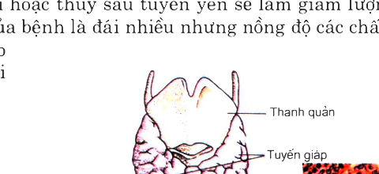

Các tế bào của nang giáp bài tiết hai hormon là triiodothyronin ($T_3$) và tetraiodothyronin ($T_4$). Những hormon này có nhiều chức năng quan trọng đặc biệt là chức năng chuyển hóa.

Ngoài ra cạnh các nang giáp, có các tế bào cạnh nang bài tiết ra hormon calcitonin là hormon tham gia trong chuyển hóa canxi.

### 4.2. Sinh tổng hợp hormon $T_3$ - $T_4$
Các hormon tuyến giáp được tổng hợp tại tế bào của nang giáp. Quá trình tổng hợp hormon trải qua 4 giai đoạn (*hình 13.12*).

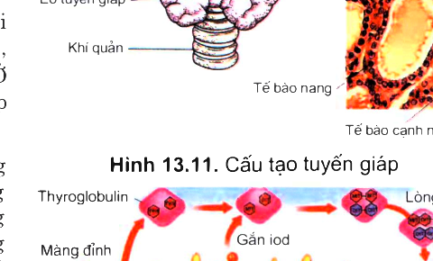

#### 4.2.1. Bắt iod
Iod của thức ăn được hấp thu vào máu và được máu đưa đến các tế bào tuyến giáp bằng cơ chế vận chuyển tích cực đó là bơm iod. Màng đáy tế bào nang giáp có khả năng đặc biệt đó là khả năng bơm iod vào tế bào nang giáp. Quá trình bơm iod từ máu vào tế bào nang giáp và giữ iod lại được gọi là quá trình bắt iod.

Dùng iod phóng xạ ($I^{131}$) để kiểm tra mức độ bắt iod ta có thể biết được tình trạng hoạt động của tế bào tuyến giáp. Ở những người ưu năng tuyến giáp hoặc bướu cổ do thiếu cung cấp iod, độ tập trung iod phóng xạ trong tuyến giáp thường cao.

Một số ion hóa trị một như perclorat, thyocyanat có khả năng ức chế cạnh tranh sự vận chuyển iod vào tế bào tuyến giáp do chúng sử dụng cạnh tranh cùng loại bơm với bơm iod.

#### 4.2.2. Oxy hóa ion iodua thành dạng oxy hóa của iod nguyên tử
Tại đỉnh của tế bào nang giáp, ion iodua được chuyển thành dạng oxy hóa của nguyên tử iod đó là iod mới sinh ($I^0$) hoặc $I_3^-$. Những dạng này có khả năng gắn trực tiếp với acid amin là tyrosin.

Phản ứng oxy hóa ion iodua được thúc đẩy nhờ enzym peroxidase và chất phối hợp với enzym này là hydrogen peroxidase. Khi hệ thống enzym peroxidase bị ức chế hoặc thiếu peroxidase bẩm sinh thì mức bài tiết $T_3$, $T_4$ có thể giảm bằng không. Các thuốc kháng giáp trạng thông thường loại thioure như methylthiouracil ức chế enzym peroxidase nên ức chế tổng hợp hormon $T_3$, $T_4$.

#### 4.2.3. Gắn iod nguyên tử ở dạng oxy hóa vào tyrosin để tạo thành hormon dưới dạng gắn với thyroglobulin
Trong tế bào nang giáp, iod ở dạng oxy hóa liên kết với enzym iodinase nên quá trình gắn với tyrosin xảy ra rất nhanh chỉ trong vài giây đến vài phút để tạo thành hai dạng tiền chất là monoiodotyrosin (MIT) và diiodotyrosin (DIT).

Hai tiền chất hormon là MIT và DIT sẽ trùng hợp với nhau để tạo thành hai hormon tuyến giáp là triiodothyronin ($T_3$) và tetraiodothyronin ($T_4$).

Ngay sau khi được tạo thành, cả MIT, DIT, $T_3$ và $T_4$ đều gắn với thyroglobulin và được vận chuyển qua thành tế bào nang giáp để dự trữ trong lòng nang. Lượng hormon dự trữ trong tuyến giáp đủ để cung cấp trong 2-3 tháng. Vì vậy, khi ngừng trệ quá trình sinh tổng hợp hormon $T_3$, $T_4$, ảnh hưởng của thiếu hormon thường chỉ quan sát được sau vài tháng.

#### 4.2.4. Giải phóng hormon tuyến giáp vào máu
Các giọt keo có gắn $T_3$, $T_4$ từ lòng nang được đưa vào tế bào nang giáp theo kiểu ẩm bào. Ngay sau đó các enzym tiêu hóa được tiết từ các bọc lysosom thấm vào các túi ẩm bào trộn lẫn với chất keo để tạo thành các túi tiêu hóa. Dưới tác dụng của các enzym phân giải protein, các phân tử thyroglobulin sẽ được tiêu hóa và giải phóng $T_3$ -$T_4$ ở dạng tự do. Hai hormon sẽ được khuếch tán qua màng của tế bào nang giáp để vào các mao mạch nằm quanh nang giáp.

### 4.3. Nhu cầu iod và phân bố iod trong tuyến giáp
Iod của tuyến giáp được cung cấp từ thức ăn. Nhu cầu iod khoảng 1mg cho một tuần. Ở trẻ em và phụ nữ có thai nhu cầu iod cao hơn bình thường. Để ngăn ngừa tình trạng thiếu iod, trong muối ăn có thể cho thêm một lượng iod với tỷ lệ NI/NaCl là 1/100.000.

Lượng hormon được dự trữ trong tuyến giáp có đủ khả năng duy trì tình trạng bình thường từ 2-3 tháng. Tổng lượng iod được chứa trong tuyến giáp khoảng 10mg trong đó 95% lượng iod nằm ngoài tế bào và 5% lượng iod nằm trong tế bào nang giáp.

### 4.4. Nồng độ hormon trong máu
93% hormon tuyến giáp ở trạng dạng $T_4$, chỉ có 7% là $T_3$. Tuy nhiên chỉ sau vài ngày hầu hết $T_4$ sẽ được chuyển thành $T_3$ và $T_3$ chính là dạng hoạt động tại tế bào.

**Bảng 13.2. Nồng độ $T_3$ -$T_4$ của người Việt Nam**

| Tuổi | $T_4$ (nMol/l) | $T_3$ (nMol/l) |
|---|:---:|:---:|
| Sơ sinh (máu cuống rốn) $n = 31$ | 130,87 ± 22,55 | 0,79 ± 0,28 |
| 1 - 5 tuổi $n = 22$ | 122,60 ± 23,66 | 2,49 ± 0,36 |
| 6 - 10 tuổi $n = 30$ | 119,24 ± 26,25 | 2,34 ± 0,51 |
| 11 - 15 tuổi $n = 30$ | 112,14 ± 23,54 | 2,13 ± 0,43 |
| 16 - 60 tuổi $n = 148$ | 106,92 ± 21,16 | 2,04 ± 0,41 |
| 61 - 88 tuổi $n = 30$ | 94,31 ± 16,94 | 1,50 ± 0,37 |

### 4.5. Tác dụng của $T_3$ -$T_4$

#### 4.5.1. Tác dụng lên sự phát triển cơ thể
- Làm tăng tốc độ phát triển:
  + Ở những đứa trẻ bị ưu năng tuyến giáp, sự phát triển của xương nhanh hơn nên đứa trẻ cao sớm hơn so với tuổi nhưng đồng thời xương cũng trưởng thành nhanh hơn, cốt hóa sớm hơn làm cho thời kỳ trưởng thành của đứa trẻ ngắn lại và đứa trẻ có chiều cao của người trưởng thành sớm hơn.
  + Ở những đứa trẻ bị nhược năng tuyến giáp, mức phát triển sẽ chậm lại, nếu không được phát hiện và điều trị sớm đứa trẻ sẽ bị lùn.
- Thúc đẩy sự trưởng thành và phát triển não trong thời kỳ bào thai và trong vài năm đầu sau khi sinh. Nếu lượng hormon tuyến giáp không được bài tiết đủ trong thời kỳ bào thai thì sự phát triển và trưởng thành của não sẽ chậm lại, não của đứa trẻ sẽ nhỏ hơn bình thường. Nếu không được điều trị bằng hormon tuyến giáp ngay vài ngày đến vài tuần sau khi sinh thì trí tuệ của đứa trẻ sẽ không phát triển.

#### 4.5.2. Tác dụng lên chuyển hóa tế bào
Hormon tuyến giáp làm tăng hoạt động chuyển hóa của hầu hết các mô trong cơ thể. Mức chuyển hóa cơ sở có thể tăng từ 60 - 100% trên mức bình thường nếu hormon tuyến giáp được bài tiết nhiều.
- Tăng tốc độ các phản ứng hóa học, tăng tiêu thụ và thoái hóa thức ăn để cung cấp năng lượng.
- Tăng số lượng và kích thước các ty thể, do đó làm tăng tổng hợp ATP để cung cấp năng lượng cho các hoạt động chức năng của cơ thể.
- Khi nồng độ hormon tuyến giáp quá cao, các ty thể phồng to sẽ gây ra tình trạng mất cân xứng giữa quá trình oxy hóa và phosphoryl hóa nên một lượng lớn năng lượng sẽ thải ra dưới dạng nhiệt chứ không được tổng hợp dưới dạng ATP.
- **Tăng vận chuyển ion qua màng tế bào:** Hormon tuyến giáp có tác dụng hoạt hóa enzym ATPase của bơm $Na^+ - K^+ - \text{ATPase}$ do đó làm tăng vận chuyển cả ion natri và kali qua màng tế bào của một số mô. Vì quá trình này cần sử dụng năng lượng và tăng sinh nhiệt nên người ta cho rằng đây chính là một trong những cơ chế làm tăng chuyển hóa cơ sở của hormon giáp.

#### 4.5.3. Tác dụng lên chuyển hóa carbohydrat
Hormon tuyến giáp tác dụng lên hầu như tất cả các giai đoạn của quá trình chuyển hóa carbohydrat bao gồm:
- Tăng nhanh thoái hóa glucose ở các tế bào.
- Tăng phân giải glycogen.
- Tăng tạo đường mới.
- Tăng hấp thu glucose ở ruột.
- Tăng bài tiết insulin.
Do những tác dụng trên nên hormon tuyến giáp làm tăng nồng độ glucose trong máu nhưng chỉ tăng nhẹ.

#### 4.5.4. Tác dụng lên chuyển hóa lipid
- Tăng thoái hóa lipid ở các mô mỡ dự trữ do đó làm tăng nồng độ acid béo tự do trong máu.
- Tăng oxy hóa acid béo tự do ở mô.
- Giảm lượng cholesterol, phospholipid, triglycerid ở huyết tương, do vậy người bị nhược năng tuyến giáp kéo dài có thể có tình trạng xơ vữa động mạch. Một trong những cơ chế làm giảm nồng độ cholesterol của hormon tuyến giáp đó là do làm tăng tốc độ bài xuất cholesterol qua mật rồi thải ra ngoài theo phân.
- Một trong những cơ chế khác nữa đó là hormon tuyến giáp làm tăng số lượng các receptor gắn đặc hiệu với lipoprotein tỷ trọng thấp trên tế bào gan do đó làm tăng quá trình lấy cholesterol ra khỏi máu.

#### 4.5.5. Tác dụng lên chuyển hóa protein
Hormon tuyến giáp vừa làm tăng tổng hợp protein vừa làm tăng thoái hóa protein. Trong thời kỳ đang phát triển, tác dụng tăng tổng hợp protein mạnh hơn nên làm tăng tốc độ phát triển. Ngược lại khi hormon tuyến giáp được bài tiết quá nhiều, các kho protein dự trữ bị huy động và giải phóng acid amin vào máu.

#### 4.5.6. Tác dụng lên chuyển hóa vitamin
Do hormon tuyến giáp làm tăng nồng độ và hoạt động của nhiều enzym, mà vitamin lại là thành phần cơ bản để cấu tạo enzym hoặc coenzym nên khi nồng độ hormon giáp tăng sẽ làm tăng nhu cầu tiêu thụ vitamin. Nếu cung cấp không đủ sẽ gây tình trạng thiếu vitamin.

#### 4.5.7. Tác dụng lên hệ thống tim mạch
- **Tác dụng lên mạch máu:** Hormon giáp làm tăng chuyển hóa của hầu hết tế bào do đó làm tăng mức tiêu thụ oxy đồng thời tăng giải phóng các sản phẩm chuyển hóa cuối cùng. Chính những chất này có tác dụng giãn mạch ở hầu hết các mô trong cơ thể, do vậy làm tăng lượng máu đặc biệt lượng máu đến da bởi vì cơ thể có nhu cầu tăng thải nhiệt. Khi lượng máu đến mô tăng thì lưu lượng tim cũng tăng, đôi khi có thể tăng 60% trên mức bình thường nếu hormon tuyến giáp được bài tiết quá nhiều.
- **Tác dụng lên nhịp tim:** Hormon tuyến giáp có tác dụng tăng nhịp tim rõ hơn là tăng lưu lượng tim. Tác dụng này có lẽ do hormon tuyến giáp kích thích trực tiếp lên tim do vậy, không chỉ làm tim đập nhanh mà còn làm tim đập mạnh hơn. Sự đáp ứng nhạy cảm của nhịp tim đối với hormon tuyến giáp là một dấu hiệu quan trọng mà các nhà lâm sàng hay dùng để đánh giá mức độ bài tiết hormon tuyến giáp.
- **Tác dụng lên huyết áp:** Dưới tác dụng của hormon tuyến giáp thì huyết áp trung bình không thay đổi. Tuy nhiên, do tim đập nhanh và mạnh hơn nên huyết áp tâm thu có thể tăng từ 10 - 15 mmHg, ngược lại huyết áp tâm trương lại giảm do giãn mạch ở những người bị ưu năng tuyến giáp.

#### 4.5.8. Tác dụng lên hệ thống thần kinh cơ
- **Tác dụng lên hệ thần kinh trung ương:** Hormon tuyến giáp kích thích sự phát triển cả về kích thước và về chức năng của não. Nhược năng tuyến giáp gây tình trạng chậm chạp trong suy nghĩ, ngủ nhiều. Nếu nhược năng xảy ra lúc mới sinh hoặc vài năm đầu sau khi sinh mà không được điều trị kịp thời sẽ dẫn đến kém phát triển về trí tuệ. Ưu năng tuyến giáp lại gây trạng thái căng thẳng và khuynh hướng rối loạn tâm thần như lo lắng quá mức, hoang tưởng, mệt mỏi, khó ngủ.
- **Tác dụng lên chức năng cơ:** Tăng nhẹ hormon tuyến giáp thường làm cơ tăng phản ứng (vigor) nhưng nếu lượng hormon được bài tiết quá nhiều thì cơ trở nên yếu vì tăng thoái hóa protein của cơ. Mặt khác nếu thiếu hormon tuyến giáp, cơ trở nên chậm chạp nhất là giãn ra chậm sau khi co. Một trong những dấu hiệu đặc trưng của ưu năng tuyến giáp là run cơ. Đây không phải là loại run cơ biên độ lớn như run cơ của Parkinson mà là loại run cơ nhanh nhưng nhẹ với tần số 10-15 lần trong một phút. Run cơ có lẽ do các synap của trung tâm điều hoà trương lực cơ ở tuỷ sống được hoạt hóa quá mức. Run là một dấu hiệu quan trọng để đánh giá mức độ tác dụng của hormon tuyến giáp đối với hệ thần kinh trung ương.

#### 4.5.9. Tác dụng lên cơ quan sinh dục
Hormon tuyến giáp cần cho sự phát triển và hoạt động bình thường của cơ quan sinh dục. Ở nam giới thiếu hormon tuyến giáp có thể mất dục tính hoàn toàn nhưng nếu bài tiết quá nhiều lại gây bất lực. Ở nữ giới thiếu hormon tuyến giáp thường gây băng kinh, đa kinh nhưng thừa hormon tuyến giáp lại gây ít kinh hoặc vô kinh và giảm dục tính.

### 4.6. Điều hoà bài tiết hormon tuyến giáp
- Do nồng độ TSH của tuyến yên: TSH của tuyến yên kích thích tuyến giáp bài tiết $T_3$, $T_4$, do vậy nếu TSH tăng thì $T_3$, $T_4$ sẽ được bài tiết nhiều và ngược lại nếu TSH giảm thì $T_3$, $T_4$ sẽ được bài tiết ít (xem mục 3.2.2).
- Khi bị lạnh hoặc stress nồng độ $T_3$, $T_4$ sẽ được bài tiết nhiều.
- Cơ chế tự điều hoà:
  + Nồng độ iod vô cơ cao trong tuyến giáp sẽ ức chế bài tiết $T_3$, $T_4$.
  + Nồng độ iod hữu cơ cao dẫn tới giảm thu nhận iod và do đó làm giảm tổng hợp $T_3$-$T_4$.

### 4.7. Rối loạn hoạt động tuyến giáp

#### 4.7.1. Ưu năng tuyến giáp (cường giáp)
Người bị hội chứng cường giáp thường có các biểu hiện như bướu cổ, lồi mắt (mắt khó khép mi), tay run, nhịp tim nhanh, hay hồi hộp lo lắng, khó ngủ, sút cân, chuyển hóa cơ sở tăng, độ tập trung $I^{131}$ cao, thời gian phản xạ gân gót giảm, nồng độ hormon $T_3$, $T_4$ tăng, nồng độ TSI (Thyroid Stimulating Immunoglobulin) tăng.

Nhìn chung các dấu hiệu lâm sàng của hội chứng cường giáp đều do nồng độ $T_3$-$T_4$ gây ra trừ dấu hiệu lồi mắt.

Dấu hiệu lồi mắt chỉ gặp ở 1/3 số bệnh nhân bị cường giáp. Nguyên nhân lồi mắt là do sự phù nề ở mô sau hốc mắt và giảm sản cơ ngoài ổ mắt. Yếu tố nào gây ra tình trạng trên cho đến nay còn chưa rõ. Ở những bệnh nhân này người ta tìm thấy các globulin miễn dịch và có sự tương xứng giữa nồng độ globulin miễn dịch này với nồng độ TSI. Nguyên nhân gây cường giáp cũng như triệu chứng lồi mắt là do quá trình tự miễn.

#### 4.7.2. Nhược năng tuyến giáp (suy giáp)
Các biểu hiện của suy giáp thường ngược lại với cường giáp. Bệnh nhân bị suy giáp thường chậm chạp, nhịp tim chậm, ngủ nhiều và hay buồn ngủ, chuyển hóa cơ sở giảm, giảm chức năng dinh dưỡng gây rụng tóc, da có vảy và có phù.

Dấu hiệu phù của người suy giáp được gọi là phù niêm vì đây là dạng phù do ứ đọng một lượng lớn acid hyaluronic và chrondoitin sulfat kết hợp với protein trong khoảng kẽ do đó làm tăng dịch trong khoảng kẽ. Cơ chế chưa rõ.

Ngoài các biểu hiện trên những người bị suy giáp có thể bị xơ vữa động mạch do thiếu $T_3$-$T_4$ nên làm tăng nồng độ cholesterol trong máu, đặc biệt những bệnh nhân bị suy giáp thể myxedema (thiếu hầu như toàn bộ chức năng tuyến giáp) dễ có biểu hiện này.

Cũng như cường giáp, nguyên nhân chủ yếu của suy giáp cũng là do quá trình tự miễn.

#### 4.7.3. Bệnh đần độn bẩm sinh
Đần độn là tình trạng xảy ra do suy giáp nặng trong thời kỳ bào thai, sơ sinh và trẻ em. Khi còn trong bụng mẹ do thai nhận được hormon của mẹ nên thai vẫn có thể phát triển bình thường. Sau khi sinh vài tuần cho đến vài năm đầu nếu không được phát hiện và điều trị kịp thời đứa trẻ kém phát triển về thể chất và trí tuệ. Nếu được điều trị, đứa trẻ có thể phát triển về thể chất bình thường nhưng trí tuệ vẫn chậm do chậm phát triển, chậm phân nhánh, chậm myelin hóa các nơron của hệ thần kinh trung ương (ngoại trừ được điều trị rất sớm ngay vài tuần sau khi sinh).

Ở những đứa trẻ này, sự phát triển của khung xương bị ức chế mạnh hơn so với mô mềm do đó tạo ra sự mất cân đối về hình thể. Bệnh nhân thường có hình dạng thấp lùn nhưng béo, đôi khi lưỡi to đến mức khó nuốt, khó thở.

#### 4.7.4. Bệnh bướu cổ do thiếu iod
Nguyên nhân chủ yếu là do thiếu iod trong thức ăn hoặc nước uống. Lượng iod cung cấp hằng ngày không đủ để tổng hợp hormon tuyến giáp nhưng quá trình tổng hợp thyroglobulin vẫn bình thường. Lượng hormon được bài tiết không đủ để ức chế bài tiết TSH làm cho tuyến giáp nở to và lượng thyroglobulin được sản xuất ra quá nhiều. Tuyến giáp có thể nặng tới 300 - 500 gam.

Thời kỳ đầu của bệnh, chức năng tuyến giáp vẫn bình thường nhưng nếu bệnh kéo dài không được điều trị sẽ dẫn tới suy giáp. Phòng ngừa và điều trị bằng cách cho uống, ăn muối iod, cho tiêm dầu iod.

### 4.8. Hormon calcitonin

#### 4.8.1. Nguồn gốc, bản chất hóa học
Calcitonin do các tế bào cạnh nang của tuyến giáp bài tiết hoặc còn được gọi là tế bào C. Đây là những tế bào nằm ở mô kẽ xen giữa các nang giáp, những tế bào này chỉ chiếm 0,1% tuyến giáp.

Calcitonin là một polypeptid có 32 acid amin với trọng lượng phân tử là 3.400.

#### 4.8.2. Tác dụng của calcitonin
- Tác dụng nhanh của calcitonin là làm giảm hoạt động của các tế bào huỷ xương do đó chuyển dịch sự cân bằng theo hướng lắng đọng các muối canxi ở xương. Tác dụng này đặc biệt quan trọng ở những động vật còn non và trẻ em vì ở lứa tuổi này quá trình thay đổi trong xương (giữa lắng đọng và tiêu huỷ) thường xảy ra nhanh chóng.
- Tác dụng thứ phát và kéo dài hơn đó là tác dụng làm giảm hình thành các tế bào huỷ xương mới.
- Calcitonin cũng có tác dụng điều hoà tái hấp thu ion canxi ở ống thận và hấp thu ion canxi ở ruột, tác dụng này yếu và ngược với tác dụng của parathormon.

Vì những tác dụng đã trình bày ở trên, calcitonin có tác dụng làm giảm nồng độ ion canxi huyết tương nhưng tác dụng này rất yếu ở người trưởng thành vì hai lý do:
- Tác dụng giảm nồng độ ion canxi huyết tương của calcitonin đã kích thích mạnh tuyến cận giáp bài tiết parathormon.
- Ở người trưởng thành tốc độ đổi mới xương hằng ngày thường rất chậm.

#### 4.8.3. Điều hoà bài tiết calcitonin
Sự bài tiết calcitonin được điều hoà bởi nồng độ ion canxi trong huyết tương. Khi nồng độ ion canxi tăng khoảng 10% thì ngay tức khắc calcitonin được bài tiết tăng gấp 2 - 3 lần. Tuy nhiên, cơ chế này thường yếu và xảy ra trong một thời gian ngắn.

---

## 5. TUYẾN THƯỢNG THẬN

### 5.1. Đặc điểm cấu tạo
Tuyến thượng thận gồm hai tuyến nhỏ nằm ở phía trên hai thận. Mỗi tuyến nặng khoảng 4 gam (*hình 13.13*). Tuyến thượng thận được cấu tạo bởi hai phần riêng biệt là phần vỏ thượng thận và phần tuỷ thượng thận.

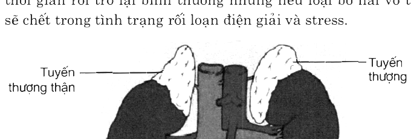

- **Tuỷ thượng thận** nằm ở phần trung tâm của tuyến và chiếm khoảng 20% trọng lượng tuyến. Có thể coi hai tuỷ thượng thận như hai hạch giao cảm lớn trong đó các nơron mất sợi trục và trở thành tế bào bài tiết. Chức năng của tuỷ thượng thận liên quan với hoạt động của hệ thần kinh giao cảm, các hormon của chúng được bài tiết nhiều khi hệ thần kinh giao cảm bị kích thích. Những hormon này gây ra tác dụng giống tác dụng của hệ thần kinh giao cảm.
- **Phần vỏ thượng thận** được cấu tạo bởi ba lớp riêng biệt đó là lớp cầu, lớp bó và lớp lưới (*hình 13.14*): lớp cầu là lớp tế bào rất mỏng nằm ở vùng ngoài cùng. Lớp này tiết các hormon vỏ chuyển hóa muối nước mà đại diện là aldosteron. Lớp thứ hai là lớp bó nằm ở giữa và lớp lưới nằm ở sát phía trong cùng. Cả hai lớp này bài tiết cortisol và các hormon khác thuộc nhóm hormon vỏ chuyển hóa đường và hormon sinh dục (androgen).

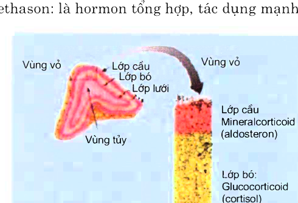

Tuyến thượng thận tuy nhỏ như vậy nhưng lại là tuyến sinh mạng. Trên động vật thực nghiệm nếu nạo bỏ hai tuỷ thượng thận, con vật sẽ rối loạn huyết áp một thời gian rồi trở lại bình thường nhưng nếu loại bỏ hai vỏ thượng thận con vật sẽ chết trong tình trạng rối loạn điện giải và stress.

### 5.2. Vỏ thượng thận

#### 5.2.1. Bản chất hóa học và phân loại hormon vỏ thượng thận
Các hormon vỏ thượng thận đều là hợp chất steroid. Chúng đều có một nhân chung là nhân sterol hay cyclopentanoperhydrophenanthren. Nhân này gồm ba vòng sáu cạnh và một vòng năm cạnh.

Hormon vỏ thượng thận được chia làm hai nhóm:
- Nhóm 19 carbon có nhân cơ bản là androstan. Các hormon sinh dục có nguồn gốc từ vỏ thượng thận thuộc nhóm này.
- Nhóm 21 carbon có nhân cơ bản là pregnan bao gồm các hormon vỏ chuyển hóa đường và chuyển hóa muối nước.

Hơn 30 loại hormon được tách chiết từ vỏ thượng thận. Tất cả các hormon này đều được tổng hợp từ những mẩu acetat theo con đường cholesterol, qua chặng trung gian là pregnenolon và progesteron và từ đó được hydrat hóa ở vị trí $C_{11}, C_{17}, C_{21}$ để tạo thành các hormon.

Dựa vào cấu tạo và tác dụng chính, các hormon vỏ thượng thận được phân chia thành ba nhóm trong đó hai nhóm đóng vai trò quan trọng là nhóm hormon vỏ chuyển hóa đường mà quan trọng nhất là cortisol và nhóm hormon vỏ chuyển hóa muối nước đại diện là aldosteron:
- **Nhóm hormon vỏ chuyển hóa đường gồm:**
  + Cortisol: tác dụng rất mạnh, chiếm 95% tổng hoạt tính.
  + Corticosteron: tác dụng yếu hơn cortisol, chiếm 4% tổng hoạt tính.
  + Cortison: là hormon tổng hợp, tác dụng cũng mạnh gần như cortisol.
  + Prednisolon: là hormon tổng hợp, tác dụng mạnh gấp bốn lần cortisol.
  + Dexamethason: là hormon tổng hợp, tác dụng mạnh gấp 30 lần cortisol.
- **Nhóm hormon vỏ chuyển hóa muối nước gồm:**
  + Aldosteron: tác dụng rất mạnh, chiếm 90% tổng hoạt tính của nhóm.
  + Desoxycorticosteron: hoạt tính yếu và lượng bài tiết rất ít.
  + Corticosteron: có tác dụng chuyển hóa muối nước yếu.
  + Cortisol: được bài tiết một lượng lớn nhưng tác dụng lên chuyển hóa muối nước rất yếu.
  + Cortison: là hormon tổng hợp, tác dụng lên chuyển hóa muối nước yếu.
- **Nhóm hormon sinh dục:** androgen.

#### 5.2.2. Vận chuyển và thoái hóa hormon vỏ thượng thận
Trong máu cortisol gắn chủ yếu với globulin, phức hợp này thường được gọi là transcortin. Chỉ một lượng nhỏ gắn với albumin. 94% lượng cortisol trong máu nằm dưới dạng kết hợp, chỉ 6% ở dạng tự do.

Khác với cortisol, aldosteron chỉ gắn lỏng lẻo với protein huyết tương và khoảng 50% ở dạng tự do.

Ở mô đích cortisol tác dụng và bị phá huỷ trong vòng 1-2 giờ còn aldosteron thì trong khoảng 30 phút.

Nồng độ aldosteron trong máu bình thường khoảng $6\text{ ng/dl}$, mức bài tiết trong 24 giờ là $150\text{ - }250\text{ }\mu\text{g}$. Nồng độ cortisol khoảng $12\text{ }\mu\text{g/dl}$ và mức bài tiết trung bình là $15\text{ - }20\text{ mg/ngày}$. Trên người Việt Nam trưởng thành nồng độ cortisol khoảng $150\text{ - }600\text{ nmol/l}$.

#### 5.2.3. Tác dụng và điều hoà bài tiết cortisol

##### 5.2.3.1. Tác dụng lên chuyển hóa carbohydrat
- **Tăng tạo đường mới ở gan** (tạo glucose từ nguồn nguyên liệu là protein và các chất khác). Mức tăng tạo đường mới dưới tác dụng của cortisol có thể tăng từ 6-10 lần. Tác dụng này là kết quả của hai tác dụng do cortisol gây ra:
  + Cortisol làm tăng tất cả các enzym tham gia trong quá trình chuyển hóa acid amin thành glucose ở gan.
  + Cortisol làm tăng huy động acid amin từ các mô ngoài gan mà chủ yếu từ cơ vào huyết tương rồi vào gan, do vậy thúc đẩy quá trình tạo glucose ở gan. Kết quả là làm tăng dự trữ glucose ở gan.
- **Giảm tiêu thụ glucose ở tế bào:** cortisol làm giảm nhẹ mức tiêu thụ glucose của tế bào khắp mọi nơi trong cơ thể. Cơ chế của hiện tượng này cho đến nay vẫn chưa rõ.

Do một mặt làm tăng tạo đường mới, một mặt làm giảm tiêu thụ glucose ở tế bào nên cortisol có tác dụng làm tăng đường huyết và có thể gây ra đái tháo đường.

##### 5.2.3.2. Tác dụng lên chuyển hóa protein
- **Giảm protein của tế bào:** Một trong những tác dụng chính của cortisol lên hệ thống chuyển hóa của cơ thể đó là giảm dự trữ protein của tất cả các tế bào trong cơ thể trừ tế bào gan. Tác dụng này là do cortisol một mặt làm tăng thoái hóa protein ở tế bào, mặt khác làm giảm sinh tổng hợp protein.
- **Tăng vận chuyển acid amin vào tế bào gan** đồng thời làm tăng hàm lượng enzym tham gia vào quá trình sinh tổng hợp protein ở gan do đó cortisol làm tăng sử dụng acid amin ở tế bào gan cho quá trình sinh tổng hợp protein và tạo đường mới.
- Tăng nồng độ acid amin huyết tương đồng thời làm giảm vận chuyển acid amin vào tế bào trừ gan.

##### 5.2.3.3. Tác dụng lên chuyển hóa lipid
- Tăng thoái hóa lipid ở các mô mỡ do đó làm tăng nồng độ acid béo tự do trong huyết tương.
- Tăng oxy hóa acid béo tự do ở tế bào để tạo năng lượng.

Mặc dù tác dụng của cortisol là làm tăng thoái hóa lipid nhưng khi cortisol được bài tiết quá nhiều thì lại có tác dụng làm tăng lắng đọng mỡ và rối loạn phân bố mỡ trong cơ thể. Trong những trường hợp này mỡ thường ứ đọng ở mặt, vùng ngực, bụng. Cơ chế cho đến nay vẫn chưa rõ, người ta cho rằng có lẽ do cortisol một mặt làm tăng sự ngon miệng mặt khác tăng bài tiết insulin.

##### 5.2.3.4. Tác dụng chống stress
Trong tình trạng stress, ngay lập tức nồng độ ACTH tăng trong máu, sau đó vài phút sự bài tiết cortisol cũng tăng lên nhờ đó mà có thể chống lại được các stress và đây là tác dụng có tính sinh mạng.

Những loại stress có tác dụng làm tăng nồng độ cortisol thường gặp là chấn thương, nhiễm khuẩn cấp, quá nóng hoặc quá lạnh, phẫu thuật, tiêm các chất gây hoại tử dưới da, hầu hết các bệnh gây suy nhược (debilitating), sự căng thẳng thần kinh quá mức.

Cơ chế chống stress của cortisol vẫn chưa rõ. Người ta cho rằng có lẽ cortisol huy động nhanh chóng nguồn acid amin và mỡ dự trữ để cung cấp năng lượng và nguyên liệu cho việc tổng hợp các chất khác bao gồm glucose là chất rất cần cho mọi tế bào hoặc một số hợp chất như purin, pyrimidin, creatin phosphat là những chất rất cần cho sự duy trì đời sống tế bào và sinh sản các tế bào mới.

Một giả thuyết khác lại cho rằng cortisol làm tăng vận chuyển nhanh dịch vào hệ thống mạch nên giúp cơ thể chống lại tình trạng shock.

##### 5.2.3.5. Tác dụng chống viêm
Cortisol có tác dụng làm giảm tất cả các giai đoạn của quá trình viêm do đó có tác dụng chống viêm mạnh và trên lâm sàng tác dụng này được ứng dụng nhiều. Tác dụng chống viêm của cortisol được giải thích bằng hai cơ chế sau:
- Cortisol làm vững bền màng lysosom do đó lysosom khó phồng căng và khó vỡ. Hầu hết các enzym phân giải protein được giải phóng ra từ mô viêm và làm tăng phản ứng viêm đều được dự trữ trong các lysosom. Một khi lysosom khó vỡ thì những sản phẩm trên sẽ không được bài tiết.
- Cortisol ức chế enzym phospholipase A2 là enzym tham gia trong quá trình tổng hợp prostaglandin, leukotrien, do vậy làm giảm phản ứng viêm bởi chính hai hợp chất này gây ra giãn mạch, tăng nhiệt độ, tăng tính thấm của mao mạch.

##### 5.2.3.6. Tác dụng chống dị ứng
Khi có dị nguyên xâm nhập vào cơ thể (các dị nguyên này là các kháng nguyên có khả năng phản ứng đặc hiệu với một loại kháng thể là IgE), phản ứng kết hợp giữa kháng nguyên và kháng thể sẽ tác động vào dưỡng bào hoặc bạch cầu ưa kiềm và làm thay đổi tính thấm của màng tế bào, tế bào phồng to, vỡ ra và giải phóng histamin. Histamin có tác dụng giãn mạch, tăng tính thấm của mao mạch gây nổi mẩn ngứa, đỏ hoặc hạ huyết áp tuỳ theo mức độ. Dùng các thuốc kháng histamin hoặc cortisol, các biểu hiện trên sẽ giảm.

Cortisol không làm ảnh hưởng đến phản ứng kết hợp giữa dị nguyên và kháng thể nhưng có tác dụng ức chế giải phóng histamin và do vậy làm giảm hiện tượng dị ứng. Trên lâm sàng, cortisol thường được dùng cho các trường hợp bị dị ứng do choáng phản vệ.

##### 5.2.3.7. Tác dụng lên tế bào máu và hệ thống miễn dịch
- Làm giảm bạch cầu ưa toan và bạch cầu lympho.
- Làm giảm kích thước các mô lympho trong cơ thể như giảm kích thước hạch, tuyến ức.
- Làm giảm sản xuất lympho T và kháng thể do vậy nếu dùng cortisol kéo dài sẽ gây nhiễm khuẩn, ngược lại dùng cortisol sẽ làm giảm hiện tượng loại bỏ mảnh ghép trong trường hợp ghép tim, thận và các mô khác.
- Làm tăng sản sinh hồng cầu.

##### 5.2.3.8. Các tác dụng khác
- Tăng bài tiết HCl của dịch vị do vậy dùng cortisol kéo dài có thể gây viêm loét dạ dày.
- Nồng độ cortisol tăng có thể làm tăng áp lực nhãn cầu.
- Khi nồng độ cortisol tăng nó sẽ ức chế hình thành xương bằng cách giảm quá trình tăng sinh tế bào, giảm sinh tổng hợp ARN, protein, collagen của xương.

##### 5.2.3.9. Điều hoà bài tiết cortisol
Cortisol được bài tiết nhiều hay ít phụ thuộc vào nồng độ ACTH của tuyến yên. Nếu nồng độ ACTH tăng thì cortisol được bài tiết nhiều, ngược lại nếu nồng độ ACTH giảm thì cortisol được bài tiết ít.

#### 5.2.4. Tác dụng và điều hoà bài tiết aldosteron

##### 5.2.4.1. Tác dụng
Thiếu toàn bộ hormon vỏ thượng thận sẽ dẫn tới chết trong vòng vài ngày đến vài tuần trừ khi người đó được tiếp muối liên tục hoặc tiêm hormon vỏ chuyển hóa muối nước. Đây là tác dụng có tính sinh mạng của aldosteron.
- **Tăng tái hấp thu ion natri và tăng bài xuất ion kali ở tế bào ống thận:** Aldosteron khi đến tế bào ống thận đặc biệt là tế bào ống lượn xa và ống góp sẽ hoạt hóa hệ gen ở nhân tế bào và làm tăng tổng hợp các enzym và các protein vận tải. Một trong những enzym tăng một cách đặc biệt đó là $Na^+, K^+ - \text{ATPase}$. Enzym này là thành phần chủ yếu của bơm $Na^+ - K^+$ ở màng đáy - bên của tế bào ống thận, do đó làm tăng tái hấp thu ion natri và tăng bài xuất ion kali. Chính vì cơ chế tác dụng như đã trình bày ở trên nên aldosteron không gây ra tác dụng ngay tức khắc mà thường phải sau 30 phút các ARN thông tin mới được tổng hợp và sau 45 phút mức vận chuyển ion natri mới tăng và phải sau nhiều giờ mới đạt hiệu quả tối đa.
- **Tác dụng lên thể tích dịch ngoại bào và huyết áp động mạch:** Nếu nồng độ aldosteron tăng cao có thể làm tăng thể tích dịch ngoại bào từ 5-15% và tăng huyết áp động mạch từ 15-25 mmHg. Ngược lại khi nồng độ aldosteron giảm xuống bằng không, một lượng lớn ion natri sẽ bị mất qua đường nước tiểu, không chỉ thế mà cả thể tích dịch ngoại bào cũng giảm. Mặt khác khi thiếu aldosteron, nồng độ ion kali trong dịch ngoại bào sẽ tăng cao. Khi kali tăng từ 60-100% trên mức bình thường thì sẽ gây ngộ độc tim, cơ tim không co được do đó không bơm được máu.
- **Tác dụng của aldosteron đối với tế bào ống tuyến mồ hôi và ống tuyến nước bọt:** Trên tế bào ống tuyến mồ hôi và ống tuyến nước bọt, aldosteron cũng làm tăng tái hấp thu ion natri và tăng bài xuất ion kali. Tác dụng này đặc biệt quan trọng khi cơ thể làm việc trong môi trường nóng. Nhờ có aldosteron mà việc mất muối qua con đường bay mồ hôi sẽ giảm bớt.

##### 5.2.4.2. Điều hoà bài tiết
Ba yếu tố chủ yếu tham gia điều hoà bài tiết aldosteron là:
- Tăng nồng độ ion kali trong dịch ngoại bào sẽ làm tăng bài tiết aldosteron.
- Tăng hoạt động của hệ thống renin-angiotensin trong trường hợp mất máu cũng làm tăng bài tiết aldosteron.
- Tăng nồng độ ion natri trong dịch ngoại bào làm giảm nhẹ aldosteron.

Trong ba yếu tố trên thì nồng độ ion kali và hệ thống renin-angiotensin có hiệu lực mạnh trong điều hoà bài tiết aldosteron. Nồng độ ion kali chỉ cần tăng nhẹ hoặc lưu lượng máu qua thận giảm đều tăng bài tiết aldosteron lên nhiều lần so với bình thường.

#### 5.2.5. Tác dụng của androgen
- **Ở nam giới:** Với chức năng bình thường của tuyến sinh dục thì testosteron và dihydrotestosteron có nguồn gốc vỏ thượng thận chỉ chiếm một lượng nhỏ trong tổng lượng hormon sinh dục nam do vậy tác dụng sinh học của nó không đáng kể. Ở nam trưởng thành, sự bài tiết quá mức của androgen vỏ thượng thận không gây ra biểu hiện lâm sàng nhưng ở trẻ con nó sẽ làm dương vật to trước tuổi trưởng thành, làm phát triển các đặc tính sinh dục thứ phát trước tuổi dậy thì.
- **Ở nữ giới:** Trong trường hợp chức năng của tuyến sinh dục nữ bình thường lượng androgen bình thường do tuyến vỏ thượng thận bài tiết sẽ không gây biểu hiện bất thường. Tuy nhiên nếu vỏ thượng thận bài tiết quá nhiều androgen như trong hội chứng Cushing, u tuyến thượng thận hoặc tăng sản thượng thận bẩm sinh thì sẽ gây hiện tượng nam hóa.

### 5.3. Tuỷ thượng thận

#### 5.3.1. Sinh tổng hợp hormon tuỷ thượng thận
Các hormon của tuỷ thượng thận được tổng hợp từ L-tyrosin (là một acid amin có trong thức ăn) theo sơ đồ dưới đây (*sơ đồ 13.1*):

$$\text{L-tyrosin} \xrightarrow[\text{Oxy hóa}]{\text{TH}} \text{L-DOPA} \xrightarrow[\text{Khử carboxyl}]{\text{DDC}} \text{Dopamin} \xrightarrow[\text{Oxy hóa}]{\text{DBH}} \text{Noradrenalin} \xrightarrow[\text{Methyl hóa}]{\text{PNMT}} \text{Adrenalin}$$

*Trong đó:*
- **TH:** Tyrosin hydroxylase
- **DDC:** Dopa Decarboxylase
- **DBH:** Dopamin $\beta$ hydroxylase
- **PNMT:** Phenethanolamin - N - Methyl - Transferase

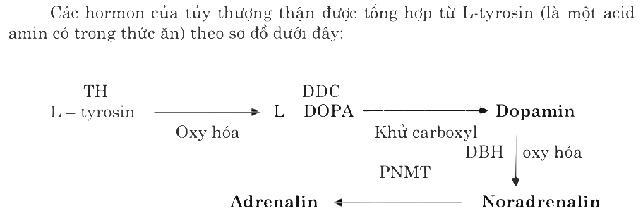

Trên lâm sàng tập hợp ba chất dopamin, adrenalin và noradrenalin được gọi là catecholamin. Bình thường trong máu khoảng 80% là adrenalin và 20% là noradrenalin.

#### 5.3.2. Tác dụng của các hormon tuỷ thượng thận
Adrenalin và noradrenalin trong máu khi được đưa đến các cơ quan đích chúng gây ra các tác dụng hầu như giống tác dụng của hệ thần kinh giao cảm. Điểm duy nhất khác đó là thời gian tác dụng từ 5-10 phút vì các hormon này thải trừ chậm hơn so với các hoạt động của hệ thần kinh giao cảm.

##### 5.3.2.1. Tác dụng của adrenalin
- Trên cơ tim: làm tim đập nhanh, làm tăng lực co bóp của cơ tim.
- Trên mạch máu: làm co mạch dưới da, giãn mạch vành, mạch não, mạch thận và mạch cơ vân do đó làm tăng huyết áp tối đa.
- Trên các cơ trơn khác: làm giãn cơ trơn ruột non, tử cung, phế quản, bàng quang, giãn đồng tử.
- Làm tăng mức chuyển hóa của toàn bộ cơ thể: làm tăng tiêu thụ oxy và tăng sinh nhiệt. Chính nhờ tác dụng này mà adrenalin làm tăng hoạt động và sự hưng phấn của cơ thể.
- Làm tăng phân giải glycogen thành glucose ở gan và cơ, do đó tăng giải phóng glucose vào máu.

##### 5.3.2.2. Tác dụng của noradrenalin
Nhìn chung noradrenalin có tác dụng giống adrenalin nhưng tác dụng trên mạch máu thì mạnh hơn, nó làm tăng cả huyết áp tối đa và cả huyết áp tối thiểu do làm co mạch toàn thân. Các tác dụng lên tim, lên cơ trơn đặc biệt là tác dụng lên chuyển hóa thì yếu hơn adrenalin.

#### 5.3.3. Cơ chế tác dụng
Cũng như các hormon khác, adrenalin và noradrenalin khi đến tế bào đích, trước tiên là gắn vào các receptor có trên màng tế bào đích. Phức hợp hormon - receptor hoạt hóa một chuỗi các phản ứng hóa học tiếp theo xảy ra tại bào tương của tế bào đích. Tại mô đích có hai loại receptor tiếp nhận adrenalin và noradrenalin đó là $\alpha$ receptor và $\beta$ receptor. Loại $\alpha$ và $\beta$ được chia thành $\alpha_1, \alpha_2, \beta_1, \beta_2$. Tác dụng của hai hormon này lên receptor ở mô đích không giống nhau, do:
- Noradrenalin kích thích chủ yếu lên $\alpha$ receptor. Tác dụng của nó lên $\beta$ receptor rất yếu.
- Adrenalin lại kích thích cả $\alpha$ và $\beta$ receptor với hiệu quả tương đương nhau.

Như vậy tác dụng của hai hormon này lên các cơ quan đích phụ thuộc chủ yếu vào receptor có ở cơ quan đó.

**Bảng 13.3. Đáp ứng chọn lọc của catecholamin tại các mô**

| Cơ quan hoặc mô | Receptor | Tác dụng |
|---|:---:|---|
| Cơ tim | $\beta_1$ | Tăng lực co bóp và nhịp |
| Mạch máu | $\alpha$ | Co mạch |
| | $\beta_2$ | Giãn mạch |
| Thận | $\beta$ | Tăng giải phóng renin |
| Ruột | $\alpha, \beta$ | Giảm vận động và tăng trương lực cơ thắt |
| Tụy | $\alpha$ | Giảm bài tiết insulin và glucagon |
| | $\beta$ | Tăng bài tiết insulin và glucagon |
| Gan | $\beta$ | Tăng phân giải glycogen |
| Mô mỡ | $\beta$ | Tăng phân giải lipid |
| Hầu hết các mô | $\beta$ | Tăng tạo năng lượng |
| Da | $\alpha$ | Tăng bài tiết mồ hôi |
| Phế quản | $\beta_2$ | Giãn phế quản |
| Tử cung | $\alpha$ | Co cơ |
| | $\beta_2$ | Giãn cơ |

#### 5.3.4. Điều hoà bài tiết
Trong điều kiện cơ sở hai hormon adrenalin và noradrenalin được bài tiết ít nhưng trong tình trạng stress, lạnh, đường máu giảm hoặc kích thích hệ giao cảm thì tuỷ thượng thận tăng bài tiết cả hai hormon này.

Nồng độ adrenalin trong máu ở điều kiện cơ sở là $170\text{ - }520\text{ pmol/l}$, còn nồng độ noradrenalin là $0,3\text{ - }28\text{ nmol/l}$ (Phạm Thị Minh Đức và CS, 1998).

### 5.4. Rối loạn hoạt động tuyến thượng thận - Bệnh Addison
80% trường hợp này có lẽ là do hiện tượng tự miễn. Một số trường hợp khác có thể do lao tuyến thượng thận hoặc do khối u chèn ép. Biểu hiện của bệnh là biểu hiện của sự thiếu hai hormon aldosteron và cortisol:
- **Do thiếu aldosteron:** giảm nồng độ ion natri trong máu, tăng nồng độ ion kali trong máu, giảm thể tích dịch ngoại bào. Vì thể tích dịch ngoại bào giảm, thể tích huyết tương giảm nên số lượng hồng cầu trong một đơn vị thể tích máu tăng lên rõ rệt, lưu lượng tim giảm và bệnh nhân sẽ chết trong tình trạng shock sau 4 ngày đến 2 tuần nếu không được điều trị bằng aldosteron.
- **Do thiếu cortisol:** giảm nồng độ glucose trong máu, giảm huy động protein và lipid từ các mô do đó làm giảm nhiều chức năng chuyển hóa khác của cơ thể. Thiếu cortisol làm cho cơ trở nên yếu, vận động kém, người mệt mỏi và khả năng chống stress kém.
- **Ứ đọng sắc tố melanin:** Ngoài những biểu hiện do thiếu aldosteron, thiếu cortisol người bị bệnh Addison còn có biểu hiện rối loạn sắc tố ở da và niêm mạc. Những mảng sắc tố này thường xuất hiện ở những vùng da mỏng và ở vùng niêm mạc. Nguyên nhân gây ra biểu hiện này là do nồng độ cortisol giảm đã gây tác dụng điều hoà ngược lên vùng dưới đồi và tuyến yên và làm tăng bài tiết ACTH. Chính hormon ACTH đã kích thích sản xuất nhiều sắc tố melanin và gây ứ đọng thành mảng sắc tố trên da và niêm mạc.

#### 5.4.1. Hội chứng Cushing
Hội chứng Cushing là hội chứng ưu năng vỏ thượng thận do u tế bào bài tiết cortisol, u vỏ thượng thận hoặc u tế bào chế tiết ACTH của tuyến yên.

Người bị bệnh thường có biểu hiện đặc biệt như ngực, bụng trên béo, tứ chi gầy do có hiện tượng tăng huy động mỡ ở phần thấp cơ thể nhưng lại gây ứ đọng mỡ ở ngực và bụng trên. Đi kèm với rối loạn phân bố mỡ của cơ thể, người bệnh còn có biểu hiện phù đặc biệt thể hiện trên mặt. Người bệnh thường có khuôn mặt căng tròn đôi khi có mụn trứng cá. Da dễ nứt, cơ yếu do giảm bớt protein và collagen ở da và cơ. Huyết áp tăng đồng thời có biểu hiện đái tháo đường. Hầu hết bệnh nhân có biểu hiện loãng xương.

#### 5.4.2. Hội chứng nam hóa
Hội chứng nam hóa là do u vỏ thượng thận (u tế bào bài tiết androgen). Bệnh thường gặp ở trẻ em và thường gặp ở trẻ trai. Từ 3-4 tuổi trẻ đã có dấu hiệu dậy thì như lớn nhanh; cơ bắp phát triển, giọng nói ồ; mọc trứng cá, lông nách, lông mu; dương vật to; tuổi xương phát triển nhanh hơn so với tuổi thực.

#### 5.4.3. Bệnh tăng sản thượng thận bẩm sinh (Congenital Adrenal Hyperplasia - CAH)
Bệnh tăng sản thượng thận bẩm sinh còn được gọi là hội chứng sinh dục - thượng thận.

Bệnh xuất hiện do có khuyết tật gen gây thiếu một số enzym tham gia trong quá trình sinh tổng hợp hormon vỏ thượng thận trong đó hay gặp nhất là thiếu enzym $21\beta\text{ hydroxylase}$. Do thiếu enzym $21\beta\text{ hydroxylase}$ nên không sản xuất được cortisol và aldosteron. Nồng độ cortisol giảm đã kích thích tuyến yên tăng bài tiết ACTH. Dưới tác dụng của ACTH, vỏ thượng thận nở to và tăng tổng hợp hormon sinh dục nam. Nồng độ androgen tăng làm nam hóa các em gái và dậy thì sớm các em trai.

#### 5.4.4. U tuỷ thượng thận
Nguyên nhân là do u các tế bào ưa crom của tuỷ thượng thận (pheochromocytoma). U tuỷ thượng thận là loại u lành tính nhưng nếu không được phẫu thuật cắt bỏ khối u thì bệnh nhân có thể chết vì tăng huyết áp và suy tim. Các dấu hiệu để chẩn đoán đó là nồng độ catecholamin trong máu tăng cao và nhìn thấy khối u trên siêu âm hoặc chụp cắt lớp ổ bụng.

---

## 6. TUYẾN TỤY NỘI TIẾT

### 6.1. Đặc điểm cấu tạo
Tụy nội tiết bao gồm các cấu trúc được gọi là các tiểu đảo Langerhans, mỗi tiểu đảo đường kính chỉ khoảng 0,3 mm. Bao quanh tiểu đảo có nhiều mao mạch (*hình 13.15*).

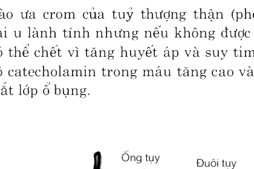

Mỗi tiểu đảo chứa 3 loại tế bào chính là tế bào alpha, beta và delta. Những tế bào này được phân biệt với nhau bằng cấu tạo hình thái và tính chất bắt màu khi nhuộm:
- Tế bào beta chiếm tổng số 60% các loại tế bào. Chúng nằm ở phần giữa của mỗi tiểu đảo và bài tiết insulin.
- Tế bào alpha chiếm 25%, bài tiết glucagon.
- Tế bào delta chiếm khoảng 10%, bài tiết somatostatin.
- Một số ít tế bào khác được gọi là tế bào PP, chúng bài tiết một hormon chưa rõ chức năng và được gọi là polypeptid của tụy.

### 6.2. Hormon insulin

#### 6.2.1. Bản chất hóa học và cấu tạo của phân tử insulin
Insulin là một protein nhỏ với trọng lượng phân tử 5.808. Nó được cấu tạo bởi hai chuỗi acid amin có nối với nhau bằng những cầu nối disulfua. Khi hai chuỗi acid amin này bị tách ra thì hoạt tính sẽ mất.

#### 6.2.2. Vận chuyển và thoái hóa insulin
Trong máu insulin hầu như hoàn toàn nằm dưới dạng tự do. Thời gian bán huỷ của insulin là 6 phút và sau 10-15 phút nó mới được bài xuất hoàn toàn ra khỏi máu.

Nồng độ insulin trung bình lúc đói là $69\text{ pmol/l}$. Ở người Việt Nam trưởng thành (16-36 tuổi) bình thường nồng độ insulin lúc đói là $0,178 \pm 0,077\text{ nmol/l}$.

#### 6.2.3. Tác dụng của insulin

##### 6.2.3.1. Tác dụng lên chuyển hóa carbohydrat
- **Tăng thoái hóa glucose ở cơ:** Màng tế bào cơ bình thường chỉ cho glucose khuếch tán qua rất ít trừ khi có tác dụng kích thích của insulin. Ngoài bữa ăn lượng insulin bài tiết rất ít nên glucose khó khuếch tán qua màng tế bào cơ. Tuy nhiên, khi lao động nặng hoặc luyện tập thì tế bào cơ có thể sử dụng một lượng lớn glucose mà không cần một lượng insulin tương ứng vì khi đó có một lý do nào đó chưa rõ đã làm cho màng tế bào cơ đang vận động tăng tính thấm đối với glucose. Trường hợp thứ hai tế bào cơ sử dụng nhiều glucose đó là trong thời gian vài giờ sau bữa ăn. Lúc này nồng độ glucose trong máu tăng cao, tuyến tụy bài tiết một lượng lớn insulin. Nồng độ insulin tăng đã làm vận chuyển glucose vào tế bào.
- **Tăng dự trữ glycogen ở cơ:** Nếu sau bữa ăn mà cơ không vận động thì glucose vẫn được vận chuyển vào tế bào cơ. Lượng glucose không được sử dụng sẽ được tích trữ lại dưới dạng glycogen và được dùng khi cần.
- **Tăng thu nhập, dự trữ và sử dụng glucose ở gan:**
  + Hầu hết glucose được hấp thu từ ruột vào máu sau bữa ăn trở thành dạng glycogen dự trữ hầu như ngay tức khắc tại gan. Khi đói nồng độ glucose giảm trong máu, tuyến tụy sẽ giảm bài tiết insulin, lúc này glycogen của gan sẽ được phân giải thành glucose làm cho nồng độ glucose trong máu không giảm xuống quá thấp.
  + Khi lượng glucose được đưa vào tế bào gan quá nhiều thì hoặc là chúng được dự trữ dưới dạng glycogen như đã trình bày ở trên hoặc là dưới tác dụng của insulin, lượng glucose thừa này sẽ được chuyển thành acid béo và được chuyển đến mô mỡ dưới dạng phân tử lipoprotein tỷ trọng thấp và lắng đọng dưới các mô mỡ dự trữ.
- **Ức chế quá trình tạo đường mới:**
  + Insulin làm giảm số lượng và hoạt tính của các enzym tham gia vào quá trình tạo đường mới.
  + Insulin làm giảm giải phóng acid amin từ các cơ và từ các mô khác vào gan do đó làm giảm nguyên liệu của quá trình tạo đường mới.

Chính vì các tác dụng đã nêu ở trên nên insulin là hormon có tác dụng làm giảm nồng độ glucose trong máu.

##### 6.2.3.2. Tác dụng lên chuyển hóa lipid
- **Tăng tổng hợp acid béo và vận chuyển acid béo đến mô mỡ:** Dưới tác dụng của insulin, một mặt lượng glucose được sử dụng nhiều cho mục đích sinh năng lượng nên đã "tiết kiệm" được lipid, mặt khác lượng glucose không được sử dụng hết sẽ được tổng hợp thành acid béo ở gan và được vận chuyển đến mô mỡ.
- Tăng tổng hợp triglycerid từ acid béo để tăng dự trữ lipid ở mô mỡ.

##### 6.2.3.3. Tác dụng lên chuyển hóa protein và sự tăng trưởng
- Tăng vận chuyển tích cực các acid amin vào trong tế bào.
- Tăng sao chép chọn lọc phân tử ADN mới ở nhân tế bào đích để tạo thành ARN thông tin.
- Tăng dịch mã ARN thông tin tại ribosom để tạo thành các phân tử protein mới.

Do các tác dụng trên nên insulin có tác dụng tăng tổng hợp và dự trữ protein và do vậy tham gia làm phát triển cơ thể.

#### 6.2.4. Điều hoà bài tiết insulin

##### 6.2.4.1. Cơ chế thể dịch
- **Nồng độ glucose:** Ở nồng độ glucose trong máu là $80\text{ - }90\text{ mg/dl}$, lượng insulin được bài tiết rất ít. Nếu nồng độ glucose đột ngột tăng lên 2-3 lần cao hơn bình thường và giữ ở mức này thì insulin được bài tiết nhiều. Nồng độ glucose tăng trên $100\text{ mg/dl}$, insulin có thể được bài tiết tăng từ 10-25 lần so với mức cơ sở. Đây là một cơ chế điều hoà rất quan trọng nhằm điều hoà nồng độ glucose của cơ thể.
- **Nồng độ acid amin:** Một số acid amin đặc biệt arginin, lysin cũng có tác dụng kích thích bài tiết insulin. Khi nồng độ các acid amin này tăng lên thì insulin cũng được bài tiết nhiều, tuy nhiên nếu chỉ đơn thuần acid amin thì tác dụng kích thích bài tiết insulin yếu hơn nhiều so với glucose hoặc phối hợp với glucose.
- **Nồng độ hormon do thành ống tiêu hóa bài tiết** như gastrin, secretin, cholecystokinin cũng có tác dụng bài tiết insulin. Những hormon này thường được bài tiết sau bữa ăn và nhờ có tác dụng làm tăng bài tiết insulin mà chúng tham gia làm cho glucose và acid amin được hấp thu dễ dàng hơn.

##### 6.2.4.2. Cơ chế thần kinh
Dưới những điều kiện nhất định, kích thích thần kinh giao cảm và phó giao cảm có thể làm tăng bài tiết insulin. Tuy nhiên, hình như hệ thần kinh tự chủ ít có vai trò điều hoà bài tiết insulin trong trường hợp bình thường.

### 6.3. Hormon glucagon

#### 6.3.1. Bản chất hóa học
Glucagon được bài tiết từ tế bào alpha của tiểu đảo Langerhans khi nồng độ glucose giảm trong máu. Glucagon có nhiều tác dụng ngược với tác dụng của insulin.

Glucagon là một polypeptid có 29 acid amin với trọng lượng phân tử là 3.485.

#### 6.3.2. Tác dụng của glucagon

##### 6.3.2.1. Tác dụng lên chuyển hóa glucid
- **Tăng phân giải glycogen ở gan:** Glucagon có khả năng làm tăng phân giải glycogen ở gan, do đó làm tăng nồng độ glucose máu sau vài phút.
- **Tăng tạo đường mới ở gan:** Ngay cả khi glycogen ở gan đã bị phân giải hết, nếu tiếp tục truyền glucagon vào cơ thể thì nồng độ glucose máu vẫn tiếp tục tăng. Có hiện tượng này là do glucagon làm tăng mức vận chuyển acid amin vào tế bào gan rồi sau đó lại tăng chuyển acid amin thành glucose.

##### 6.3.2.2. Các tác dụng khác của glucagon
Các tác dụng khác của glucagon chỉ xuất hiện khi glucagon được bài tiết quá mức:
- Tăng phân giải lipid ở mô mỡ dự trữ thành acid béo để tạo năng lượng do hoạt hóa lipase ở mô mỡ dự trữ.
- Ức chế tổng hợp triglycerid ở gan và ức chế vận chuyển acid béo từ máu vào gan. Chính tác dụng này cũng góp phần làm tăng lượng acid béo cung cấp cho các mô khác để tạo năng lượng.

#### 6.3.3. Điều hoà bài tiết
Nồng độ glucagon huyết tương bình thường là $50\text{ - }100\text{ pg/ml}$. Sự bài tiết glucagon phụ thuộc chủ yếu vào nồng độ glucose trong máu, ngoài ra nồng độ acid amin trong máu hoặc một số yếu tố khác cũng ảnh hưởng đến bài tiết glucagon:
- **Ảnh hưởng của nồng độ glucose máu:** Tác dụng của nồng độ glucose máu lên sự bài tiết glucagon thì hoàn toàn ngược với insulin. Nồng độ glucose máu giảm xuống dưới $70\text{ mg/dl}$ sẽ kích thích tế bào alpha của tiểu đảo Langerhans tăng bài tiết glucagon lên nhiều lần so với bình thường. Ngược lại nồng độ glucose tăng sẽ làm giảm bài tiết glucagon.
- **Ảnh hưởng của nồng độ acid amin máu:** Nồng độ acid amin tăng cao trong máu đặc biệt alanin và arginin (ví dụ, sau bữa ăn) sẽ kích thích tăng bài tiết glucagon.
- **Ảnh hưởng của vận động:** Luyện tập và lao động nặng, nồng độ glucagon có thể tăng từ 4-5 lần. Yếu tố nào làm tăng bài tiết glucagon thì chưa rõ bởi vì trong trường hợp này nồng độ glucose máu không giảm đến mức đủ để kích thích bài tiết nhiều glucagon như vậy.

### 6.4. Rối loạn hoạt động tuyến tụy nội tiết

#### 6.4.1. Bệnh đái tháo đường
Đái tháo đường là một hội chứng rối loạn chuyển hóa carbohydrat, lipid và protein do thiếu insulin hoặc giảm nhạy cảm của các tế bào đích với insulin. Có hai loại đái tháo đường:

##### 6.4.1.1. Đái tháo đường type 1 (Đái tháo đường phụ thuộc insulin)
Hầu hết các trường hợp bệnh xảy ra do giảm bài tiết insulin từ tế bào bêta của tiểu đảo Langerhans. Đôi khi có thể do tế bào bêta tăng nhạy cảm với tác dụng phá huỷ của virus hoặc có thể do các kháng thể tự miễn chống lại tế bào bêta gây ra bệnh. Trong một số trường hợp, bệnh xuất hiện do yếu tố di truyền ảnh hưởng đến sự sinh sản tế bào bêta.

Đái tháo đường type 1 thường xảy ra ở nam nhiều hơn nữ, ở người dưới 30 tuổi. Bệnh có thể xuất hiện đột ngột trong vài ngày hoặc vài tuần với ba đặc điểm chính là:
1. Tăng nồng độ glucose trong máu;
2. Tăng sử dụng lipid để sinh năng lượng và tạo thành cholesterol từ gan;
3. Thoái hóa protein của cơ thể.

Bệnh nhân thường ăn nhiều nhưng vẫn gầy và mệt mỏi do thiếu insulin nên glucose không được sử dụng ở tế bào. Trên lâm sàng, bệnh thường thể hiện với hội chứng “bốn nhiều”, đó là: ăn nhiều, uống nhiều, đái nhiều và gầy nhanh. Bệnh nhân đái tháo đường type 1 nếu không được điều trị có thể dẫn tới các biến chứng như dễ bị nhiễm khuẩn, có nguy cơ xơ vữa mạch và các bệnh về mạch vành.

##### 6.4.1.2. Đái tháo đường type 2 (Đái tháo đường không phụ thuộc insulin)
Đái tháo đường type 2 thường gặp hơn đái tháo đường type 1, chiếm khoảng 90-95% các trường hợp đái tháo đường. Hầu hết các trường hợp đái tháo đường type 2 thường xảy ra ở độ tuổi sau 30 tuổi. Bệnh cảnh thường khởi phát từ từ. Nhiều bệnh nhân được phát hiện bệnh một cách tình cờ từ một lần khám sức khỏe.

Đái tháo đường type 2 liên quan đến béo phì, hiện tượng kháng insulin và hội chứng chuyển hóa, trong đó béo phì là yếu tố nguy cơ quan trọng nhất của đái tháo đường type 2.

Khác với đái tháo đường type 1, trong đái tháo đường type 2, insulin tăng cao trong máu. Tăng bài tiết insulin vào máu là đáp ứng của tế bào bêta với sự kháng insulin và giảm nhạy cảm của mô đích với tác dụng của insulin. Chính sự giảm nhạy cảm với insulin của mô đích dẫn tới rối loạn sử dụng và dự trữ glucose. Kết quả là nồng độ glucose tăng trong máu.

Đái tháo đường type 2 diễn biến thường không ồ ạt như đái tháo đường type 1. Tuy nhiên, nếu đái tháo đường type 2 không được điều trị thì bệnh cảnh cuối cùng cũng giống đái tháo đường type 1 vì sau một thời gian dài tăng bài tiết insulin, tế bào bêta bị kiệt quệ hoặc tổn thương dẫn tới tình trạng không bài tiết insulin đủ để ngăn cản các hậu quả của rối loạn chuyển hóa carbohydrat.

#### 6.4.2. Hạ đường huyết do tăng bài tiết insulin
Bệnh thường do có khối u ở tế bào bêta nên lượng insulin được bài tiết quá mức đã làm giảm nồng độ glucose trong máu, những bệnh nhân này hằng ngày cần tiêm tới 1000g glucose. Hội chứng lâm sàng xuất hiện do thừa insulin được gọi là choáng insulin.

Khi nồng độ glucose giảm xuống mức $50\text{ - }70\text{ mg/dl}$, hệ thần kinh trung ương trở nên bị kích thích, dấu hiệu thường gặp là rất bồn chồn, run rẩy, vã mồ hôi. Nồng độ glucose trong máu giảm xuống mức $20\text{ - }50\text{ mg/dl}$ sẽ xuất hiện những cơn co giật và mất ý thức. Nếu nồng độ glucose tiếp tục giảm nữa bệnh nhân sẽ ngừng co giật nhưng lại rơi vào trạng thái hôn mê. Lúc này nếu chỉ dựa vào những quan sát lâm sàng đơn thuần thì sẽ khó phân biệt hôn mê toan huyết do thiếu insulin và hôn mê hạ đường huyết do thừa insulin. Tuy nhiên, kiểu nhịp thở nhanh, sâu, có mùi aceton sẽ là dấu hiệu quan trọng để phân biệt hai loại hôn mê vì dấu hiệu này chỉ có ở hôn mê đái tháo đường.

---

## 7. TUYẾN CẬN GIÁP

### 7.1. Đặc điểm cấu tạo
Bình thường mỗi người đều có bốn tuyến cận giáp và chúng nằm ngay sau tuyến giáp, 2 tuyến ở cực trên và 2 tuyến ở cực dưới (*hình 13.16*). Tuyến cận giáp có kích thước rất nhỏ, chỉ vào khoảng $6 \times 3 \times 2\text{ mm}$.

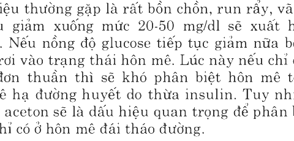

Khi phẫu thuật cắt bỏ tuyến giáp thường rất khó phân biệt giữa tuyến giáp và tuyến cận giáp bằng mắt vì màu sắc của mô hai tuyến này gần như nhau. Bởi vậy, cắt bỏ phần lớn tuyến giáp dễ dẫn đến lấy mất cả 4 tuyến cận giáp. Tuy nhiên, nếu chỉ còn lại phần nhỏ của tuyến cận giáp thì phần này sẽ tăng sinh tế bào để đảm bảo chức năng của toàn bộ tuyến.

Tuyến cận giáp ở người trưởng thành bao gồm hai loại tế bào là tế bào chính và tế bào ưa oxy. Tế bào chính là thành phần cấu tạo chủ yếu của tuyến cận giáp. Tế bào ưa oxy chỉ có ở người trưởng thành. Chức năng của tế bào chính là bài tiết parathormon, một hormon có tính sinh mạng. Còn chức năng của tế bào ưa oxy đến nay vẫn chưa rõ.

### 7.2. Bản chất hóa học của parathormon
Parathormon ở dạng hoạt động trong máu là một polypeptid có 84 acid amin, trọng lượng phân tử là 9.500.

### 7.3. Tác dụng của parathormon (PTH)
PTH đóng vai trò quan trọng trong điều hoà nồng độ ion canxi và ion phosphat của huyết tương. Dưới tác dụng của PTH nồng độ ion canxi huyết tương tăng nhưng ngược lại nồng độ phosphat lại giảm. PTH thực hiện chức năng này bằng các tác động trên xương, thận và ruột.

#### 7.3.1. Tác dụng của PTH trên xương
PTH làm tăng mức giải phóng ion canxi từ xương vào máu bằng cách tác động lên các tế bào xương (osteocyte), tế bào tạo xương (osteoblast) và tế bào huỷ xương (osteoclast).
- **Tác dụng lên tế bào xương và tạo xương:** Màng tế bào xương và tế bào tạo xương có các receptor tiếp nhận PTH. Phức hợp receptor - PTH hoạt hóa bơm canxi và ion canxi được bơm từ dịch xương vào dịch ngoại bào.
- **Tác dụng lên tế bào huỷ xương:** Trên màng tế bào huỷ xương không có receptor tiếp nhận PTH nên tế bào huỷ xương không chịu tác dụng kích thích trực tiếp của PTH mà phải thông qua các "tín hiệu" chuyển từ tế bào xương và tế bào tạo xương. Do vậy, tác dụng trên tế bào huỷ xương của PTH thường xảy ra chậm hơn. Tác dụng này thường trải qua hai giai đoạn:
  + Hoạt hóa ngay tức khắc các tế bào huỷ xương có sẵn do đó làm tăng quá trình huỷ xương để giải phóng ion canxi vào dịch xương.
  + Hình thành các tế bào huỷ xương mới. Sau vài ngày, dưới tác dụng của PTH số lượng của các tế bào huỷ xương tăng lên. Tác dụng này có thể kéo dài vài tháng dưới ảnh hưởng kích thích của PTH. Do sự huỷ xương mạnh làm cho xương rỗ, yếu nên lại kích thích sản sinh và hoạt động của tế bào tạo xương để làm nhiệm vụ sửa chữa các tổn thương ở xương. Như vậy ở thời điểm muộn cả tế bào huỷ xương và tạo xương đều tăng cả về số lượng và hoạt tính. Tuy nhiên, dưới tác dụng của PTH hiện tượng huỷ xương bao giờ cũng mạnh hơn tạo xương.

#### 7.3.2. Tác dụng trên thận
- Làm giảm bài xuất ion canxi ở thận.
- Làm tăng tái hấp thu ion canxi và magiê ở ống thận đặc biệt ở ống lượn xa và ống góp.
- Làm giảm tái hấp thu ion phosphat ở ống lượn gần do đó làm tăng đào thải ion phosphat ra nước tiểu.

#### 7.3.3. Tác dụng lên ruột
Do PTH hoạt hóa quá trình tạo 1,25 dihydroxycholecalciferol từ vitamin $D_3$ (cholecalciferol) nên PTH có những tác dụng lên ruột như sau:
- Tăng tạo enzym ATPase ở diềm bàn chải của tế bào biểu mô niêm mạc ruột.
- Tăng tạo chất vận tải ion canxi ở niêm mạc ruột.
- Tăng hoạt tính enzym phosphatase kiềm ở tế bào niêm mạc ruột.

Cả ba tác dụng trên dẫn tới kết quả là tăng hấp thu ion canxi và phosphat ở ruột.

### 7.4. Điều hoà bài tiết
Nồng độ PTH bình thường trong máu vào khoảng dưới $50\text{ pg/ml}$. PTH được bài tiết nhiều hay ít tuỳ thuộc vào nồng độ ion calci và phosphat trong máu đặc biệt là nồng độ ion canxi. Chỉ cần giảm nhẹ nồng độ ion canxi trong máu thì tuyến cận giáp đã tăng bài tiết PTH. Nếu tình trạng giảm nồng độ ion canxi kéo dài thì tuyến cận giáp sẽ nở to, đôi khi to gấp 5 lần hoặc hơn. Ngược lại nếu nồng độ ion canxi trong máu tăng thì hoạt động và kích thước của tuyến cận giáp sẽ giảm.

### 7.5. Rối loạn hoạt động tuyến cận giáp

#### 7.5.1. Nhược năng tuyến cận giáp
Khi tuyến cận giáp bài tiết không đủ lượng PTH do giảm hoạt động chức năng của tuyến hoặc do thiếu tuyến cận giáp thì sẽ dẫn tới rối loạn hoạt động chức năng do giảm nồng độ ion canxi trong máu.

##### 7.5.1.1. Dấu hiệu lâm sàng
Nồng độ ion canxi trong máu cần để đảm bảo cho sự hoạt động bình thường của hệ thần kinh - cơ. Khi nồng độ ion canxi trong máu giảm, ngưỡng kích thích của sợi thần kinh giảm xuống hay nói cách khác là sợi thần kinh dễ bị hưng phấn hơn. Chức năng không bình thường của hệ thần kinh xảy ra đồng thời với cả sợi thần kinh cảm giác và vận động và do đó làm tăng các đáp ứng thần kinh - cơ:
- **Thể nhẹ:** người ta thường dùng nghiệm pháp Chvosteck và Trousseau để phát hiện dấu hiệu co cơ:
  + *Nghiệm pháp Chvosteck:* gõ vào điểm giữa của đường nối tai ngoài với mép, nếu nồng độ ion canxi trong máu hạ do thiếu PTH ta sẽ thấy cơ mặt co làm cho mép môi bị kéo lên phía trên.
  + *Nghiệm pháp Trousseau hay nghiệm pháp bàn tay người đỡ đẻ:* đặt garo ở cánh tay sẽ gây co cơ tạo ra một bàn tay giống bàn tay người nữ hộ sinh chuẩn bị đón đứa trẻ ra đời.
- **Thể nặng:** xuất hiện các cơn co cứng cơ (cơn tetani). Hiện tượng co cơ thường xảy ra ở đầu chi, mặt. Bàn tay, cẳng tay, bàn chân co quắp nhưng nguy hiểm nhất là cơ thanh quản co thắt gây ngừng thở, nếu không được cấp cứu kịp thời bệnh nhân sẽ chết. Chính vì lý do này, người ta gọi tuyến cận giáp là tuyến sinh mạng.

##### 7.5.1.2. Xét nghiệm
Trong trường hợp này xét nghiệm máu và nước tiểu thấy nồng độ PTH huyết tương giảm, nồng độ ion canxi huyết tương giảm, nồng độ ion phosphat huyết tương tăng, nồng độ ion canxi nước tiểu giảm, nồng độ ion phosphat nước tiểu giảm.

#### 7.5.2. Ưu năng tuyến cận giáp
Ưu năng tuyến cận giáp thường do có khối u ở một trong số các tuyến cận giáp. Bệnh thường gặp ở phụ nữ hơn là nam giới và trẻ con bởi vì có thai và cho con bú thường kích thích tuyến cận giáp và đây là điều kiện để có thể phát triển thành khối u.

Ưu năng tuyến cận giáp gây ra sự phá huỷ xương mạnh do các tế bào huỷ xương hoạt động quá mạnh dẫn tới tăng nồng độ ion canxi trong máu.

Do tình trạng huỷ xương xảy ra mạnh nên xương bị rỗng và dễ gãy. Đồng thời do lượng ion canxi và phosphat được đào thải qua thận nhiều nên dễ gây ra sỏi thận.

---

## 8. CÁC HORMON TẠI CHỖ

### 8.1. Định nghĩa và phân loại
Hormon tại chỗ là những hormon do một nhóm tế bào bài tiết ra, thấm vào máu và có tác dụng sinh học ở tại chỗ hoặc ở những mô ngay gần nơi chúng được bài tiết. Dựa vào bản chất hóa học có thể phân hormon ra thành nhiều nhóm:
- Nhóm hormon có bản chất hóa học là polypeptid, những hormon này chủ yếu do niêm mạc ống tiêu hóa bài tiết. Ngoài ống tiêu hóa, não cũng bài tiết ra các hormon này như: gastrin, secretin, pancreozymin (cholecystokinin - CCK), VIP, bradykinin, chất P, glucagon, somatostatin, bombesin, motylin...
- Nhóm hormon là dẫn xuất của acid amin: histamin, serotonin, acid gamma amino butyric (GABA).
- Nhóm hormon có bản chất hóa học không phải là polypeptid: prostaglandin, erythropoietin...

### 8.2. Tác dụng của một số hormon

#### 8.2.1. Gastrin
Là polypeptid do niêm mạc hang vị bài tiết. Ngoài ra tiểu đảo tụy, tuyến yên, vùng dưới đồi cũng bài tiết gastrin:
- Kích thích bài tiết các dịch tiêu hóa như dịch vị (tăng bài tiết cả enzym pepsin và HCl), dịch tụy (tăng bài tiết cả enzym tụy, nước và bicarbonat).
- Làm tăng tiết một số hormon như insulin, glucagon, secretin.
- Co cơ trơn dạ dày, ruột, túi mật, cơ thắt tâm vị, giãn cơ Oddi.
- Chức năng gastrin của não chưa rõ.

#### 8.2.2. Secretin
Là polypeptid do niêm mạc tá tràng bài tiết, ngoài ra còn do vùng dưới đồi, thân não, vỏ não bài tiết:
- Kích thích tụy bài tiết dịch tụy loãng.
- Kích thích gan sản xuất mật, nước, bicarbonat tăng nhưng muối mật không tăng.
- Giãn cơ trơn dạ dày, ruột, cơ thắt tâm vị, cơ Oddi.
- Ức chế giải phóng gastrin.
- Kích thích giải phóng insulin.

#### 8.2.3. Cholecystokinin-pancreozymin (CCK)
Là polypeptid do niêm mạc tá tràng bài tiết, ngoài ra còn tìm thấy ở vỏ não, vùng dưới đồi, cấu trúc lưới:
- Co túi mật (có tên cholecystokinin).
- Kích thích tụy bài tiết dịch tụy có nhiều enzym (có tên pancreozymin).
- Tăng bài tiết glucagon và insulin.
- Chức năng ở vỏ não chưa rõ.

#### 8.2.4. Bombesin
Là polypeptid do niêm mạc dạ dày, tá tràng bài tiết, còn tìm thấy ở da, não, phổi:
- Tăng bài tiết dịch vị (HCl).
- Tăng bài tiết gastrin.
- Tăng co bóp ruột non và túi mật.
- Chức năng ở não: có lẽ liên quan tới điều hoà thân nhiệt.

#### 8.2.5. VIP (Vasoactive Intestinal Peptid)
Là polypeptid do niêm mạc ruột bài tiết, có thể tìm thấy ở vỏ não, vùng dưới đồi:
- Ức chế bài tiết HCl, ức chế co bóp dạ dày.
- Giãn phế quản dẫn đến tăng thông khí phổi.
- Giãn động mạch phổi, động mạch vành.
- Tác dụng lên não chưa rõ.

#### 8.2.6. Serotonin
Là sản phẩm chuyển hóa của tryptophan, do niêm mạc ruột, dạ dày bài tiết, còn tìm thấy ở tiểu cầu, vùng dưới đồi, tiểu não, hệ viền, tuỷ sống:
- Co mạch làm tăng huyết áp và tham gia trong cơ chế cầm máu.
- Co phế quản.
- Tăng nhu động ruột.

#### 8.2.7. Erythropoietin
Là một glycoprotein do các tế bào nội mô của mao mạch quanh ống thận sản xuất khi thận bị thiếu oxy. Erythropoietin có vai trò quan trọng trong quá trình sản sinh hồng cầu (xem bài 7).

#### 8.2.8. Histamin
Là sản phẩm khử carboxyl của histidin. Histamin là một hormon được sản xuất ở hầu hết các mô trong cơ thể như niêm mạc đường tiêu hóa, da, phổi, tế bào lympho, vùng dưới đồi, tuyến yên:
- Histamin đóng vai trò quan trọng trong phản ứng quá mẫn của hiện tượng dị ứng. Khi có dị nguyên xâm nhập vào cơ thể (các dị nguyên này là những kháng nguyên có khả năng phản ứng đặc hiệu với kháng thể IgE), phản ứng kết hợp giữa kháng nguyên và kháng thể sẽ tác động vào dưỡng bào hoặc bạch cầu ưa kiềm và làm thay đổi tính thấm của màng tế bào, tế bào phồng to, vỡ ra và giải phóng histamin. Histamin có tác dụng giãn mạch, tăng tính thấm của mao mạch gây nổi mẩn ngứa, đỏ hoặc hạ huyết áp tuỳ theo mức độ. Dùng các thuốc kháng histamin hoặc cortisol, các biểu hiện trên sẽ giảm.
- Histamin còn có tác dụng kích thích tế bào viền làm tăng bài tiết HCl của dịch vị do gắn vào receptor $H_2$ của tế bào viền. Hiện nay nhiều loại thuốc điều trị viêm loét dạ dày như ranitidin đều là loại ức chế receptor $H_2$ vì vậy những người loét dạ dày do cơ chế thần kinh hoặc nhiễm khuẩn thì các loại thuốc này không có tác dụng.

#### 8.2.9. Prostaglandin (PG)
Là một acid béo không no có vòng 5 cạnh và 2 mạch nhánh. Căn cứ vào vòng 5 cạnh người ta chia ra 5 loại prostaglandin là A, E, F, B, I. Mỗi loại được chia thành nhiều nhóm $A_1, A_2, A_3$. Prostaglandin có tác dụng trên nhiều cơ quan:
- **Tim:** điều hoà trương lực mạch vành, do đó người ta có thể dùng để điều trị bệnh nhồi máu cơ tim hoặc suy mạch vành.
- **Mạch máu:**
  + Gây giãn mạch và tăng tính thấm của mao mạch, do đó làm hạ huyết áp ($PGI_2, E_2, A_2$).
  + Co động mạch cảnh ngoài.
- **Phổi:**
  + $PGE_1, E_2$ làm giãn cơ phế quản.
  + $PGF_{2\alpha}$ làm co cơ phế quản.
  Cả hai loại này đều được tìm thấy trong phổi. Hen có thể do rối loạn tỷ lệ $PGE_2 / PGF_{2\alpha}$.
- **Cơ quan tiêu hóa:**
  + Làm giảm bài tiết dịch vị ($PGE, I_2$). Do đó các chất kháng PG như aspirin có thể gây loét dạ dày.
  + Làm tăng vận động dạ dày, ruột non. Ỉa chảy nếu dùng các chất kháng PG sẽ đỡ.
  + Ức chế bài tiết nước nhưng làm tăng tiết enzym của dịch tụy.
  + Tăng bài tiết mật.
- **Cơ quan sinh dục:** PG làm co cơ tử cung, tăng áp lực buồng ối, do đó kích thích chuyển dạ. Thai một tháng nếu đặt PG vào âm đạo sẽ kích thích gây co cơ tử cung và đẩy thai ra.
- **PG và cầm máu:**
  + $PGE_1, I_2$ ức chế kết dính tiểu cầu.
  + $PGE_2$ làm tăng kết dính tiểu cầu.
  Bình thường tiểu cầu chứa $PGE_2$ và $PGF_{2\alpha}$, những loại PG này được giải phóng khi tiểu cầu được hoạt hóa. Aspirin ức chế enzym PG synthetase, do đó ức chế tổng hợp PG (chất kháng PG). Người ta thường dùng aspirin để điều trị bệnh đông máu rải rác.
- **PG và quá trình viêm nhiễm:**
  Phản ứng viêm được đặc trưng bởi sự tăng tính thấm của thành mạch, giãn mạch và kèm theo sự xuyên mạch của bạch cầu đa nhân trung tính, dẫn đến những dấu hiệu kinh điển của viêm là sưng, nóng, đỏ, đau. PG đóng vai trò quan trọng trong cơ chế bệnh sinh của hội chứng viêm:
  + Prostaglandin loại E và A làm tăng tính thấm của thành mạch.
  + Prostaglandin E, $I_2$ gây sốt, giảm ngưỡng cảm giác đau của các receptor.
  Trong trường hợp viêm nhiễm nếu dùng aspirin ức chế enzym PG synthetase sẽ làm giảm sản xuất PG.
  Cortisol cũng là một chất chống viêm mạnh vì ức chế enzym phospholipase $A_2$ là enzym tham gia quá trình tổng hợp PG, do đó cũng làm giảm tạo PG.

---

## TỰ LƯỢNG GIÁ

1. Trình bày bản chất hóa học, vị trí và vai trò của chất tiếp nhận trong cơ chế tác dụng của hormon tại tế bào đích.
2. Trình bày cơ chế tác dụng của hormon thông qua chất truyền tin thứ hai, cho ví dụ.
3. Trình bày cơ chế tác dụng của hormon thông qua hoạt hóa hệ gen, cho ví dụ.
4. Trình bày cơ chế điều hoà ngược âm tính: định nghĩa, đặc điểm, cho ví dụ.
5. Trình bày cơ chế điều hoà ngược dương tính: định nghĩa, đặc điểm, cho ví dụ.
6. Trình bày nguồn gốc, bản chất hóa học, tác dụng và điều hoà bài tiết các hormon giải phóng và ức chế của vùng dưới đồi.
7. Trình bày nguồn gốc, bản chất hóa học, tác dụng lên mô sụn và xương của GH.
8. Trình bày tác dụng lên chuyển hóa protid, lipid, glucid của hormon GH.
9. Trình bày bản chất hóa học, tác dụng và điều hoà bài tiết TSH, ACTH.
10. Trình bày bản chất hóa học, tác dụng và điều hoà bài tiết FSH, LH, prolactin.
11. Trình bày nguồn gốc, bản chất hóa học, tác dụng và điều hoà bài tiết ADH (vasopressin) và oxytocin.
12. Giải thích về các triệu chứng của bệnh khổng lồ, to đầu ngón và lùn tuyến yên.
13. Trình bày tác dụng của $T_3, T_4$ đối với sự phát triển của cơ thể và so sánh với tác dụng của GH.
14. Trình bày tác dụng của $T_3, T_4$ lên chuyển hóa tế bào, chuyển hóa chất.
15. Trình bày tác dụng của $T_3, T_4$ lên hệ thống tim mạch và thần kinh cơ.
16. Nêu nguyên nhân và giải thích các biểu hiện của bệnh Basedow.
17. Trình bày tác dụng của calcitonin.
18. Trình bày tác dụng của cortisol lên chuyển hóa glucid, protid và lipid.
19. Trình bày tác dụng chống stress, chống viêm và chống dị ứng của cortisol.
20. Trình bày tác dụng của aldosteron.
21. Giải thích tại sao lại nói tuyến thượng thận là tuyến sinh mạng.
22. So sánh tác dụng của adrenalin và noradrenalin và giải thích tại sao hai hormon này lại có tác dụng khác nhau tại mô đích.
23. Nêu nguyên nhân và giải thích về các biểu hiện của bệnh Addison.
24. Trình bày tác dụng của insulin lên chuyển hóa glucid, lipid và protid.
25. Trình bày tác dụng của glucagon.
26. Trình bày tác dụng và điều hoà bài tiết hormon tuyến cận giáp.
27. Giải thích các biểu hiện của bệnh suy tuyến cận giáp và tại sao lại gọi tuyến cận giáp là tuyến sinh mạng.
28. Nguồn gốc, bản chất hóa học và tác dụng của histamin.
29. Nêu nguồn gốc, bản chất hóa học và tác dụng của prostaglandin lên quá trình cầm máu và viêm nhiễm.
30. Kể tên, nguồn gốc, bản chất hóa học của các hormon làm phát triển cơ thể.
31. Kể tên, nguồn gốc, bản chất hóa học của các hormon có tác dụng lên tim mạch.
32. Kể tên, nguồn gốc, bản chất hóa học của các hormon có tác dụng lên chuyển hóa glucid, nói rõ hormon nào làm tăng/giảm đường máu.
33. Kể tên, nguồn gốc, bản chất hóa học của các hormon có tác dụng lên chuyển hóa protid và lipid, nói rõ hormon nào làm tăng tổng hợp/tăng thoái hóa.
34. Kể tên, nguồn gốc, bản chất hóa học của các hormon có tác dụng lên chuyển hóa.