# BÀI 14: SINH LÝ SINH DỤC VÀ SINH SẢN

## MỤC TIÊU
*Sau khi học xong bài này, sinh viên có khả năng:*
1. Trình bày được chức năng ngoại tiết và nội tiết của tinh hoàn.
2. Trình bày được chức năng ngoại tiết và nội tiết của buồng trứng.
3. Trình bày được các giai đoạn của chu kỳ kinh nguyệt, cơ chế phóng noãn và cơ chế chảy máu.
4. Trình bày được các giai đoạn của thụ thai, mang thai và những thay đổi của bà mẹ đang mang thai.
5. Trình bày được các chức năng của rau thai.
6. Trình bày được hiện tượng sổ thai, bài tiết và bài xuất sữa.
7. Trình bày được nguyên nhân và những thay đổi trong giai đoạn dậy thì, mãn kinh.
8. Kể tên, nêu cơ chế tác dụng của các biện pháp tránh thai.

---

Sinh sản là một chức năng rất quan trọng của sinh vật nói chung và con người nói riêng nhằm duy trì nòi giống. Ngoài mục đích này, hoạt động chức năng của hệ thống sinh sản còn nhằm thoả mãn nhu cầu tình dục của con người - một trong những nhu cầu cơ bản nhất liên quan đến chất lượng cuộc sống của con người. Sinh sản là một hoạt động chức năng phức tạp với sự phối hợp hoạt động giữa hệ thống sinh sản với các hệ thống chức năng khác của cơ thể và chịu ảnh hưởng của nhiều yếu tố nội tại cũng như môi trường bên ngoài.

Khái niệm sinh sản được đề cập đến trong bài này là sự hoạt động chức năng của các cơ quan, bộ phận thuộc hệ thống sinh sản nam và nữ dẫn tới sự sinh ra giao tử, kết hợp giữa giao tử đực (tinh trùng) và giao tử cái (noãn) để tạo thành hợp tử rồi phát triển thành một cơ thể mới, cơ thể con. Để đảm bảo được chức năng sinh sản bình thường, cần có cấu trúc - chức năng bình thường của hệ thống sinh sản trong đó hai tuyến sinh dục nam (tinh hoàn) và nữ (buồng trứng) đóng vai trò rất quan trọng.

---

## 1. SINH LÝ SINH DỤC VÀ SINH SẢN NAM

### 1.1. Đặc điểm cấu tạo bộ máy sinh sản nam
Bộ máy sinh sản nam gồm dương vật, bìu trong có chứa tinh hoàn là tuyến sinh dục nam, ống dẫn tinh, túi tinh và một số tuyến sinh dục phụ như tuyến tiền liệt, tuyến hành niệu đạo (*hình 14.1*).

Tinh hoàn là một cơ quan nằm ngoài ổ bụng, nằm trong bìu. Mỗi cơ thể nam có hai tinh hoàn hình trứng có kích thước 4,5 × 2,5 cm. Ở cơ thể người lớn thể tích của tinh hoàn trung bình là 18,6 ± 4,8 ml.

Nếu bổ dọc tinh hoàn thì thấy mỗi tinh hoàn được chia thành nhiều thuỳ bằng các vách xơ. Trong mỗi thuỳ có nhiều ống nhỏ ngoằn ngoèo được gọi là ống sinh tinh, mỗi ống dài 0,5m. Tiếp nối với ống sinh tinh là ống mào tinh dài 6 m rồi đến ống dẫn tinh. Xen kẽ giữa các ống sinh tinh là các tế bào Leydig, chiếm khoảng 20% tổng khối lượng tinh hoàn (*hình 14.2*).

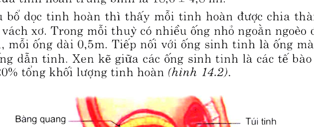

### 1.2. Chức năng của tinh hoàn
Tinh hoàn có hai chức năng, chức năng ngoại tiết là sản sinh tinh trùng, chức năng nội tiết là bài tiết hormon sinh dục nam mà chủ yếu là testosteron.

#### 1.2.1. Chức năng sản sinh tinh trùng và các yếu tố ảnh hưởng
Sự sản sinh tinh trùng xảy ra ở tất cả các ống sinh tinh trong suốt đời sống tình dục của nam giới. Dưới tác dụng của hormon hướng sinh dục của tuyến yên, khoảng 15 tuổi tinh hoàn bắt đầu sản sinh tinh trùng và chức năng này được duy trì suốt cuộc đời.

##### 1.2.1.1. Các giai đoạn của quá trình sản sinh tinh trùng
Thành ống sinh tinh chứa một lượng tế bào biểu mô được gọi là tinh nguyên bào (spermatogonia). Những tế bào này nằm thành 2-3 lớp từ ngoài vào phía lòng ống (*hình 14.2, 14.3*). Các tinh nguyên bào được tăng sinh liên tục để bổ sung về số lượng vì một phần trong số chúng được biệt hóa qua nhiều giai đoạn để trở thành các tế bào tinh.

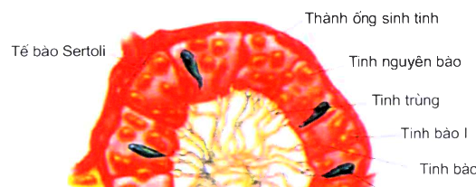

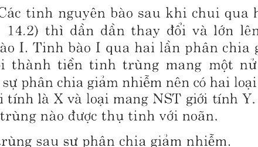

- Ở giai đoạn đầu của quá trình sản sinh tinh trùng, những tinh nguyên bào nằm sát màng đáy được gọi là tinh nguyên bào A phân chia 4 lần thành tinh nguyên bào B.
- **Sự phân chia giảm nhiễm.**
Thời kỳ này kéo dài 24 ngày. Các tinh nguyên bào sau khi chui qua hàng rào để vào lớp tế bào Sertoli (*hình 14.2*) thì dần dần thay đổi và lớn lên tạo thành những tế bào lớn đó là tinh bào I. Tinh bào I qua hai lần phân chia giảm nhiễm để tạo thành tinh bào II rồi thành tiền tinh trùng mang một nửa bộ nhiễm sắc thể (NST) (22-X, 22-Y). Do sự phân chia giảm nhiễm nên có hai loại tinh trùng đó là tinh trùng mang NST giới tính là X và loại mang NST giới tính Y. Giới tính của con phụ thuộc bởi loại tinh trùng nào được thụ tinh với noãn.
- **Sự phát triển của tiền tinh trùng sau sự phân chia giảm nhiễm.**
Trong vài tuần sau khi phân chia, tiền tinh trùng được nuôi dưỡng và thay đổi về chất dưới sự bao bọc của tế bào Sertoli để trở thành tinh trùng. Những sự thay đổi đó là:
Mất một ít bào tương, tổ chức lại chromatin của nhân để tạo ra đầu tinh trùng; phần bào tương và màng tế bào còn lại thay đổi hình dạng để tạo thành đuôi tinh trùng. Tất cả các giai đoạn tạo thành tinh bào, tiền tinh trùng và tinh trùng đều xảy ra trong tế bào Sertoli. Chính tế bào Sertoli nuôi dưỡng, bảo vệ và kiểm soát quá trình sản sinh tinh trùng.

Toàn bộ quá trình sản sinh tinh trùng từ tế bào mầm (tinh nguyên bào nguyên thuỷ) thành tinh trùng mất 64 ngày (*hình 14.4*).

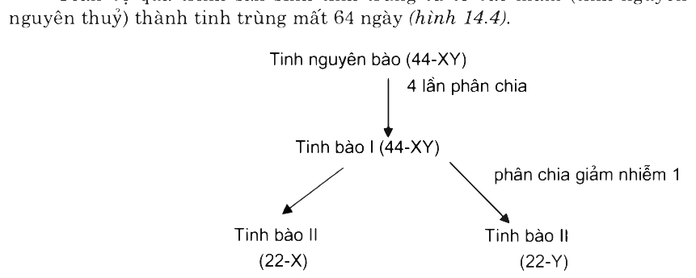

- **Sự tạo thành tinh trùng**
Tiền tinh trùng được tạo thành đầu tiên vẫn mang những đặc tính của tế bào biểu mô. Ngay sau đó các tiền tinh trùng bắt đầu dài ra để trở thành tinh trùng gồm đầu, cổ, thân và đuôi (*hình 14.5*).
Đầu được tạo thành từ nhân tế bào và chỉ có một lớp bào tương mỏng và màng tế bào bao quanh bề mặt. Phía trước đầu tinh trùng có một lớp dày lên gọi là cực đầu, bộ phận này được tạo thành chủ yếu từ bộ Golgi. Cấu trúc này chứa một lượng lớn enzym giống các enzym trong bọc lysosom bao gồm hyaluronidase là enzym phân giải các sợi proteoglycan của mô và các enzym phân giải protein. Đây là những enzym quan trọng vì nhờ chúng mà tinh trùng có thể phá vỡ tế bào hạt bao quanh nhân và đục thủng lớp màng trong suốt của noãn để thụ tinh được với noãn.
Đuôi của tinh trùng được gọi là lông roi (flagellum).

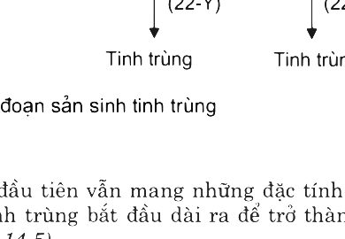

##### 1.2.1.2. Sự thành thục của tinh trùng ở mào tinh hoàn
Tinh trùng lấy từ ống sinh tinh hoặc phần đầu của mào tinh hoàn không có khả năng vận động và không thể thụ tinh với noãn. Sau khi tinh trùng ở trong mào tinh hoàn 18-24 giờ chúng sẽ có khả năng vận động mạnh mặc dù trong dịch mào tinh có những protein ức chế khả năng vận động cho đến khi chúng được phóng vào đường sinh dục nữ. Sau khi được tạo thành ở ống sinh tinh, tinh trùng cần một số ngày để di chuyển qua 6m chiều dài của ống mào tinh hoàn.

Tinh trùng di chuyển được là nhờ sự di động của đuôi. Tinh trùng thường chuyển động theo đường thẳng với tốc độ 4mm/phút. Chính kiểu vận động này cho phép tinh trùng di chuyển qua đường sinh dục nữ để tiếp cận với noãn ở vòi tử cung. Năng lượng cung cấp cho sự chuyển động này lấy từ ATP được tổng hợp ở ty thể và có nhiều ở phần thân của tinh trùng.

##### 1.2.1.3. Dự trữ tinh trùng
Hai tinh hoàn của đàn ông trẻ có khả năng sinh sản khoảng 120 triệu tinh trùng mỗi ngày. Một lượng nhỏ được giữ trong mào tinh hoàn nhưng phần lớn tinh trùng được dự trữ ở ống dẫn tinh. Tại nơi dự trữ, chúng có thể duy trì khả năng thụ tinh trong khoảng thời gian tối thiểu là 1 tháng. Trong thời gian này tinh trùng được giữ ở trạng thái không hoạt động nhờ nhiều chất ức chế được bài tiết từ hệ thống ống. Ngược lại, nếu hoạt động tình dục quá mức, thời gian dự trữ không quá vài ngày.

##### 1.2.1.4. Điều hoà sản sinh tinh trùng
Inhibin là một hormon do tế bào Sertoli bài tiết có tác dụng điều hoà ngược âm tính đối với FSH do đó có tác dụng điều hoà sản sinh tinh trùng (*xem mục 1.2.2.2*).

##### 1.2.1.5. Các yếu tố ảnh hưởng đến sản sinh tinh trùng
- **Vai trò của hormon**
  + $	ext{G}_n	ext{RH}$ của vùng dưới đồi tham gia điều hoà quá trình sản sinh tinh trùng thông qua các tác dụng bài tiết LH và FSH.
  + LH của tuyến yên kích thích tế bào Leydig ở khoảng kẽ của tinh hoàn bài tiết testosteron do đó có ảnh hưởng đến quá trình sản sinh tinh trùng.
  + FSH
    * Kích thích phát triển ống sinh tinh.
    * Kích thích tế bào Sertoli bài tiết dịch có chứa nhiều chất dinh dưỡng giúp cho tinh trùng thành thục.
    * Kích thích tế bào Sertoli bài tiết một loại protein gắn với androgen (ABP). Loại protein này gắn với testosteron và cả estrogen được tạo thành từ testosteron tại tế bào Sertoli dưới tác dụng kích thích của FSH rồi vận chuyển hai hormon này vào dịch lòng ống sinh tinh để giúp cho sự trưởng thành của tinh trùng.
  + GH kiểm soát các chức năng chuyển hóa của tinh hoàn và thúc đẩy sự phân chia các tinh nguyên bào. Ở người lùn tuyến yên, sự sản sinh tinh trùng giảm hoặc không xảy ra.
- **Vai trò của các yếu tố khác**
  + Nhiệt độ: tinh trùng được tạo ra ở môi trường có nhiệt độ thấp hơn nhiệt độ cơ thể từ 1 - 2 độ. Cơ Dartos của bìu co giãn tùy thuộc nhiệt độ môi trường nhằm đảm bảo nhiệt độ tối thuận cho sự sản sinh tinh trùng. Khi tinh hoàn không di chuyển từ ổ bụng xuống bìu các tế bào dòng tinh sẽ bị phá huỷ. Nhiệt độ trong đường sinh dục nữ cao hơn nhiệt độ ở bìu sẽ làm tăng chuyển hóa và tăng hoạt động của tinh trùng. Ngược lại, ở nhiệt độ thấp tinh trùng giảm chuyển hóa, giảm hoạt động do vậy để bảo quản tinh trùng người ta thường lưu trữ ở nhiệt độ rất thấp (-175°C).
  + Độ pH: tinh trùng hoạt động mạnh ở môi trường trung tính hoặc hơi kiềm và ngược lại chúng giảm hoạt động ở môi trường acid. Trong môi trường acid mạnh chúng sẽ bị giết chết.
  + Kháng thể: tinh trùng có thể bị tiêu diệt bởi kháng thể có trong máu và dịch thể. Nhờ có hàng rào của tế bào Sertoli mà kháng thể không thể xâm nhập được vào dịch của ống sinh tinh. Một số phụ nữ có kháng thể cố định tinh trùng nên rất dễ thụ thai. Một số khác lại có kháng thể tiêu diệt tinh trùng nên dễ dẫn tới vô sinh.
  + Rượu, ma tuý làm giảm khả năng sinh tinh trùng.
  + Tia X, phóng xạ hoặc virus quai bị làm tổn thương tế bào dòng tinh, do đó ảnh hưởng đến sự sản sinh tinh trùng.
  + Căng thẳng kéo dài cũng có thể là giảm sản sinh tinh trùng.

#### 1.2.2. Chức năng nội tiết của tinh hoàn
Tinh hoàn bài tiết một số hormon sinh dục nam mà thường được gọi bằng một tên chung là androgen. Các hormon này bao gồm testosteron, dihydrotestosteron và androstenedion trong đó testosteron được coi là hormon quan trọng nhất của tinh hoàn. Ngoài ra tinh hoàn còn bài tiết một hormon quan trọng khác nữa đó là inhibin.

##### 1.2.2.1. Testosteron
- **Nguồn gốc và bản chất hóa học**
Testosteron do tế bào Leydig bài tiết. Testosteron là một hợp chất steroid có 19C được tổng hợp từ cholesterol hoặc acetyl-CoA.
- **Vận chuyển và chuyển hóa testosteron**
Sau khi được bài tiết từ tinh hoàn, khoảng 97% lượng testosteron gắn lỏng lẻo với albumin huyết tương hoặc chặt hơn với bêta globulin và lưu hành trong máu trong khoảng 30 phút đến 1giờ hoặc hơn. Trong thời gian này, chúng được vận chuyển đến mô đích hoặc bị thoái hóa trở thành dạng bất hoạt rồi được bài xuất ra khỏi cơ thể.
Nồng độ testosteron bình thường ở nam giới trưởng thành là 19,1 ± 5,5 mU/l và ở nữ giới là 1,23 ± 1 mU/l.
- **Tác dụng của testosteron**
  + Trong thời kỳ bào thai, khoảng tuần thứ 7 tế bào Leydig của tinh hoàn thai nhi bài tiết một lượng đáng kể testosteron. Tác dụng của testosteron trong thời kỳ bào thai là:
    * Kích thích ống Wolf phát triển thành đường sinh dục trong của nam giới như mào tinh, ống dẫn tinh, túi tinh, ống phóng tinh.
    * Kích thích đưa tinh hoàn từ bụng xuống bìu. Tinh hoàn thường được chuyển xuống bìu vào 2-3 tháng cuối thời kỳ có thai. Nếu không đủ lượng testosteron, tinh hoàn vẫn nằm ở ổ bụng sẽ khó sản sinh tinh trùng.
  + Làm xuất hiện và bảo tồn đặc tính sinh dục nam thứ phát kể từ tuổi dậy thì bao gồm phát triển dương vật, tuyến tiền liệt, túi tinh, đường dẫn tinh; mọc lông mu, lông nách, mọc râu; gây hói đầu; giọng nói trầm do thanh quản mở rộng; da dày thô; mọc trứng cá.
  + Kích thích sản sinh tinh trùng:
    * Testosteron kích thích sự hình thành tinh nguyên bào và kích thích sự phân chia giảm nhiễm lần thứ hai từ tinh bào II thành tiền tinh trùng.
    * Testosteron kích thích sự tổng hợp protein và bài tiết dịch từ tế bào Sertoli.
  + Tác dụng lên chuyển hóa protein và cơ:
    Một trong những đặc tính nam quan trọng nhất đó là khối cơ phát triển mạnh sau dậy thì. Dưới tác dụng của testosteron, khối cơ có thể tăng hơn 50% so với nữ giới. Ngoài cơ, ở những vị trí khác của cơ thể cũng có hiện tượng tăng lượng protein. Ví dụ, tăng lắng đọng protein ở da làm cho da dày hơn, phì đại niêm mạc thanh quản, phì đại dây thanh âm làm giọng nói trầm hơn nữ. Tất cả những hiện tượng này đều liên quan đến tác dụng đồng hóa protein của testosteron.
    Chính do tác dụng đồng hóa protein đặc biệt ở cơ nên testosteron đã được một số vận động viên sử dụng để làm phát triển khối cơ bắp nhằm tăng thành tích thi đấu. Theo luật thi đấu hiện nay, việc sử dụng testosteron hoặc các androgen tổng hợp được coi là sử dụng chất kích thích (doping), vi phạm luật thi đấu.
    Testosteron cũng được sử dụng cho người già như một hormon "cải lão hoàn đồng" để làm tăng sức mạnh của cơ.
  + Tác dụng lên xương:
    * Làm tăng tổng hợp khung protein của xương.
    * Phát triển và cốt hóa sụn liên hợp ở đầu xương dài.
    * Làm dày màng xương.
    * Tăng lắng đọng muối canxi phosphat ở xương do đó làm tăng sức mạnh của xương.
    * Đối với xương chậu, testosteron có tác dụng đặc biệt đó là: Làm hẹp đường kính khung chậu; Tăng chiều dài của khung chậu làm cho khung chậu có hình ống khác với khung chậu mở rộng của nữ; Làm tăng sức mạnh của khung chậu.
    Do tác dụng làm tăng kích thước và sức mạnh của xương nên testosteron được dùng để điều trị loãng xương ở người đàn ông lớn tuổi.
  + Tác dụng lên chuyển hóa cơ sở:
    Với lượng testosteron được bài tiết hằng ngày ở tuổi thiếu niên và thanh niên, chuyển hóa cơ sở tăng từ 5-10% so với khi không có tác dụng của testosteron.
  + Các tác dụng khác:
    * Testosteron làm tăng số lượng hồng cầu trong $1	ext{mm}^3$ máu khoảng 20%. Vì lý do này nên số lượng hồng cầu của nam thường cao hơn nữ khoảng $700.000	ext{ tế bào/mm}^3$.
    * Testosteron làm tăng nhẹ sự tái hấp thu ion natri ở ống lượn xa.
- **Điều hoà bài tiết testosteron**
  + Thời kỳ bào thai: testosteron được bài tiết dưới tác dụng kích thích của hCG là một hormon do rau thai bài tiết.
  + Thời kỳ trưởng thành: testosteron được bài tiết dưới tác dụng kích thích của LH do tuyến yên bài tiết.

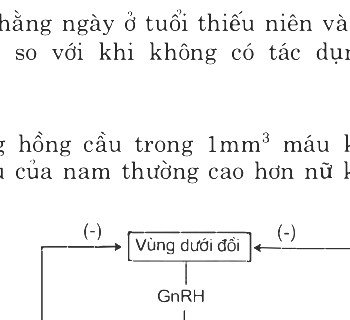

##### 1.2.2.2. Inhibin
Inhibin là một hợp chất glycoprotein có trọng lượng phân tử 10.000 - 30.000 dalton, do tế bào Sertoli bài tiết.

Inhibin có tác dụng điều hoà quá trình sản sinh tinh trùng thông qua cơ chế điều hoà ngược đối với sự bài tiết FSH của tuyến yên. Tác dụng ức chế bài tiết FSH của inhibin mạnh hơn tác dụng ức chế bài tiết $	ext{G}_n	ext{RH}$ từ vùng dưới đồi.

Khi ống sinh tinh sản sinh quá nhiều tinh trùng, tế bào Sertoli bài tiết inhibin. Dưới tác dụng ức chế của inhibin, lượng FSH được bài tiết từ tuyến yên giảm do đó làm giảm bớt quá trình sinh tinh trùng ở ống sinh tinh (*hình 14.6*).

### 1.3. Chức năng của túi tinh
Trước đây người ta cho rằng túi tinh là nơi chứa đựng tinh trùng. Thực ra cấu trúc của túi tinh là cấu trúc tuyến bài tiết.

Túi tinh là một ống khúc khuỷu chia ngăn, bên trong lót bởi một lớp tế bào biểu mô. Túi tinh bài tiết một chất dịch chứa nhiều fructose, acid citric, nhiều chất dinh dưỡng khác, fibrinogen, prostaglandin. Trong giai đoạn phóng tinh, túi tinh đổ dịch vào ống phóng tinh ngay sau khi tinh trùng được đổ vào từ ống dẫn tinh. Dịch của túi tinh chiếm 60% thể tích tinh dịch.

Dịch của túi tinh có những chức năng như sau:
- Đẩy tinh trùng ra khỏi ống phóng tinh.
- Cung cấp chất dinh dưỡng cho tinh trùng trong thời gian di chuyển ở đường sinh dục nữ cho đến khi thụ tinh với noãn.
- Prostaglandin trong túi tinh phản ứng với dịch cổ tử cung để làm tăng tiếp nhận tinh trùng đồng thời làm tăng co bóp tử cung và nhu động vòi tử cung để đẩy tinh trùng về phía loa vòi tử cung.

### 1.4. Chức năng của tuyến tiền liệt
Tuyến tiền liệt tiết dịch trắng, đục với pH khoảng 6,5 (kiềm hơn dịch âm đạo). Độ pH kiềm hơn của dịch tuyến tiền liệt đóng vai trò quan trọng trong việc bảo vệ tinh trùng cho đến khi thụ tinh. Lượng dịch do tuyến tiền liệt bài tiết chiếm khoảng 30% thể tích dịch phóng ra trong mỗi lần giao hợp.

Dịch tuyến tiền liệt chứa nhiều acid citric, ion calci, nhiều loại enzym đông đặc và tiền fibrinolysin, prostaglandin.

Các enzym đông đặc của dịch tuyến tiền liệt sẽ tác dụng vào fibrinogen làm đông nhẹ tinh dịch ở đường sinh dục nữ, do vậy có thể giữ tinh trùng nằm sát cổ tử cung. Sau 15-30 phút tinh dịch lại được làm loãng trở lại nhờ enzym fibrinolysin có trong dịch tuyến tiền liệt làm cho tinh trùng hoạt động trở lại.

Prostaglandin của dịch tuyến tiền liệt cũng như của dịch túi tinh sẽ làm co cơ tử cung, tăng nhu động vòi tử cung giúp tinh trùng di chuyển trong đường sinh dục nữ.

### 1.5. Tinh dịch
Tinh dịch là dịch được phóng ra khi giao hợp. Tinh dịch là một hỗn hợp dịch bao gồm dịch từ ống dẫn tinh (chiếm 10% tổng thể tích), dịch túi tinh (60%), dịch tuyến tiền liệt (30%) và một lượng nhỏ từ các tuyến niêm mạc đặc biệt là tuyến hành niệu đạo. Với một lượng lớn và lại được phóng ra cuối cùng, dịch túi tinh có tác dụng đẩy tinh trùng ra khỏi ống phóng tinh và niệu đạo. Độ pH trung bình của tinh dịch là 7,5. Với độ pH hơi kiềm này, tinh dịch sẽ trung hoà bớt tính acid của dịch âm đạo, tạo môi trường thích hợp cho tinh trùng hoạt động.

Trong ống sinh tinh, tinh trùng có thể sống vài tuần nhưng khi đã được phóng ra ngoài, tinh trùng sống tối đa chỉ từ 24-48 giờ. Với nhiệt độ thấp, chuyển hóa của tinh trùng giảm nên thời gian sống của tinh trùng kéo dài hơn.

Để thăm dò chức năng bài tiết dịch, sản sinh tinh trùng người ta thường làm một xét nghiệm được gọi là tinh dịch đồ trong đó một số thông số thường được kiểm tra là: thể tích tinh dịch được phóng ra một lần, số lượng tinh trùng, độ di động của tinh trùng, tỷ lệ tinh trùng còn sống, hình thái tinh trùng.

Kết quả nghiên cứu về tinh dịch đồ của người Việt Nam (nam giới ở ngoại thành Hà Nội) được trình bày ở bảng 14.1.

**Bảng 14.1. Tinh dịch đồ ở nam giới trưởng thành**

| Thông số đánh giá | 18 - 35 tuổi ($n=42$) | 36 - 55 tuổi ($n=64$) | WHO |
| :--- | :---: | :---: | :---: |
| | $ar{X} \pm 	ext{SD}$ | $ar{X} \pm 	ext{SD}$ | |
| Thể tích tinh dịch (ml) | 2,68 | 2,24 | > 2 |
| pH | 7,3 ± 0,8 | 7,6 ± 0,5 | 7,2 - 8,0 |
| Mật độ tinh trùng ($	imes 10^6/	ext{ml}$) | 89,4 ± 7,65 | 93,46 ± 14,29 | > 20 |
| Tỷ lệ tinh trùng sống (%) | 84,12 ± 9,44 | 81,95 ± 8,93 | > 75 |
| Tỷ lệ tinh trùng khoẻ (%) | 50,16 | 47,74 | > 50 |
| Tỷ lệ tinh trùng bất thường (%) | 14,16 | 13,08 | < 30 |

### 1.6. Giao hợp và phóng tinh
Dương vật có cấu trúc đặc biệt bao gồm hai thể hang và một thể xốp. Thể hang và thể xốp được cấu tạo bởi mô liên kết-cơ, chứa những hốc máu, những động mạch lò xo. Mô đặc biệt này được gọi là mô cương. Trong các tiểu động mạch cũng như tĩnh mạch có các cấu trúc hãm tạo thành các van.

Lúc bình thường khi dương vật mềm, ở thể hang các hốc máu có hình chữ V, H, X, Y. Khi dương vật bị kích thích bởi các tác nhân cơ học (sờ, nắn, đụng chạm tại chỗ) hoặc bởi các yếu tố tâm lý (nghĩ, nghe, nhìn) thì khi đó sợi cơ trơn của các tiểu động mạch co lại, kéo các vòng chun giãn ra làm cho máu từ các tiểu động mạch tràn vào trong các hốc máu do vậy dương vật to, dài ra. Lúc này các bó cơ ở xung quanh hốc máu co lại ép chặt vào các tĩnh mạch. Những sợi chun không bị các bó sợi cơ dọc kéo nữa nên chúng sẽ co lại và bịt các tĩnh mạch lại. Máu trong các hốc máu không thoát đi đâu được, lại bị ép bởi các bó cơ nên dương vật cương lên và rất cứng.

Trong khi giao hợp, khi khoái cảm lên tới cực điểm thì có hiện tượng phóng tinh do các cơ ngồi hang và các cơ hành hang co thắt nhịp nhàng. Tinh dịch được phóng vào âm đạo. Khi các bó cơ giãn ra, máu thoát bằng đường tĩnh mạch, dương vật mềm trở lại.

Cương dương vật và phóng tinh được điều hoà bởi cơ chế phản xạ tuỷ mà trung tâm phản xạ nằm ở đoạn thắt lưng cùng. Cơ chế phản xạ này được khởi phát bằng các kích thích tâm lý truyền xuống từ não hoặc kích thích vào bộ phận sinh dục nhưng thông thường thì phối hợp cả hai.

### 1.7. Dậy thì và suy giảm hoạt động tình dục nam

#### 1.7.1. Dậy thì
- Dậy thì là thời kỳ có những biến động lớn về thể chất, tâm lý và đặc biệt là hoạt động chức năng của hệ thống sinh sản.
- Ở trẻ trai, mốc để đánh dấu tuổi dậy thì bắt đầu đó là thể tích tinh hoàn tăng trên 4ml, còn mốc để đánh dấu tuổi dậy thì hoàn toàn đó là lần xuất tinh đầu tiên. Tuy nhiên rất khó xác định chính xác về thời điểm xuất tinh lần đầu tiên vì các em thường ít để ý. Tuổi dậy thì hoàn toàn của nam thường vào khoảng từ 15-16 tuổi (trẻ em Việt Nam).
- **Những biến đổi trong thời kỳ dậy thì:**
  + Vào thời kỳ này, dưới tác dụng của hormon sinh dục nam (testosteron) phối hợp cùng các hormon tăng trưởng khác (*xem bài 13*), cơ thể đứa trẻ phát triển nhanh, đặc biệt khối lượng cơ tăng nhanh.
  + **Hoạt động chức năng của hệ thống sinh sản:**
  Sau khi sinh, tuyến sinh dục nam (tinh hoàn) “im lặng” cho tới lúc này mới hoạt động. Tinh hoàn bắt đầu sản sinh tinh trùng và bài tiết testosteron. Dưới tác dụng của testosteron, cơ thể lớn nhanh và xuất hiện các đặc tính sinh dục nam thứ phát như dương vật to, túi tinh và tuyến tiền liệt phát triển, cơ nở nang, da thô dày, giọng nói trầm. Đứa trẻ bắt đầu có khả năng hoạt động tình dục và sinh sản.
- **Cơ chế dậy thì:**
Trước kia người ta cho rằng dậy thì là thời điểm tinh hoàn “chín”. Sau này khi phát hiện ra các hormon hướng sinh dục của tuyến yên người ta lại cho rằng nguyên nhân của dậy thì là “sự chín” của tuyến yên. Ngày nay với thực nghiệm ghép tinh hoàn và tuyến yên của động vật non vào động vật trưởng thành người ta thấy cả hai tuyến đó đều có khả năng hoạt động như của động vật trưởng thành nếu có những kích thích phù hợp. Không những thế, ngay cả vùng dưới đồi cũng có khả năng bài tiết đủ lượng $	ext{G}_n	ext{RH}$. Tuy nhiên trong thực tế cả ba vùng này đều không hoạt động trong suốt thời kỳ từ sau khi sinh đến trước tuổi dậy thì vì thiếu một tín hiệu kích thích đủ mạnh từ các trung tâm phía trên vùng dưới đồi, mà ngày nay người ta thường cho rằng trung tâm đó chính là vùng limbic (hệ viền).
Như vậy, dậy thì chính là quá trình trưởng thành hay quá trình “chín” của vùng limbic. Khi vùng limbic trưởng thành, những tín hiệu xuất phát từ vùng limbic sẽ đủ mạnh để kích thích vùng dưới đồi bài tiết đủ lượng $	ext{G}_n	ext{RH}$ và phát động hoạt động chức năng của trục vùng dưới đồi-tuyến yên-tuyến sinh dục, gây ra hiện tượng dậy thì.

#### 1.7.2. Suy giảm hoạt động tình dục nam
Kể từ tuổi dậy thì, hormon hướng sinh dục của tuyến yên được bài tiết liên tục trong suốt cuộc đời còn lại. Ở nam giới tuy không xuất hiện một giai đoạn suy giảm hoàn toàn chức năng tuyến sinh dục như ở nữ nhưng theo thời gian, tuổi càng cao hoạt động chức năng của tinh hoàn cũng suy giảm dần. Bắt đầu từ tuổi 40-50, sự bài tiết testosteron bắt đầu giảm tuy tốc độ giảm rất chậm. Nhìn chung tuổi trung bình chấm dứt quan hệ tình dục là 68. Tuy nhiên, có sự khác nhau rất lớn về nhu cầu tình dục giữa người này với người khác.

### 1.8. Rối loạn hoạt động chức năng sinh sản

#### 1.8.1. Suy giảm chức năng sinh dục
- **Suy giảm bẩm sinh:** nguyên nhân có thể là tinh hoàn không hoạt động ở thời kỳ bào thai hoặc không có các receptor tiếp nhận androgen ở các mô đích do rối loạn gen di truyền. Thiếu testosteron trong thời kỳ này dẫn đến rối loạn hình thành các cơ quan sinh dục phụ của nam. Thay thế vào đó các cơ quan sinh dục nữ sẽ được tạo thành.
- **Suy giảm trước tuổi dậy thì:** mất tinh hoàn hoặc tinh hoàn không hoạt động ở thời kỳ này dẫn tới tình trạng không xuất hiện các đặc tính sinh dục nam thứ phát hay nói cách khác các đặc tính giới tính trẻ em sẽ tồn tại suốt đời. Đứa trẻ bị mất tinh hoàn khi lớn lên thường cao hơn một chút so với người bình thường, xương mỏng, cơ không phát triển, cơ quan sinh dục giống của trẻ con, không mọc râu, giọng nói thanh và cao như nữ.
- **Suy giảm sau tuổi dậy thì:** Ít có những biến đổi về hình thể. Các cơ quan sinh dục có giảm kích thước nhưng không trở về tình trạng trẻ con. Ham muốn tình dục giảm nhưng không mất hoàn toàn. Vẫn có hiện tượng cương dương mặc dù khó khăn nhưng ít khi có hiện tượng phóng tinh vì các cơ quan tham gia bài tiết tinh dịch bị thoái hóa.

#### 1.8.2. U tinh hoàn và cường sinh dục
- **U tế bào Leydig:** trường hợp này rất hiếm gặp nhưng khi khối u loại này phát triển thì chúng bài tiết một lượng testosteron nhiều gấp 100 lần bình thường.
  + Nếu khối u phát triển ở trẻ em, cơ và xương của đứa trẻ phát triển nhanh nhưng xương cũng sớm cốt hóa do vậy lúc trưởng thành chúng thường thấp hơn so với bình thường. Các cơ quan sinh dục phát triển mạnh. Các đặc tính sinh dục thứ phát xuất hiện sớm.
  + Nếu khối u xuất hiện ở nam giới tuổi trưởng thành thì khó chẩn đoán vì các đặc tính giới tính đã có.
- **U tế bào mầm:** u tế bào biểu mô mầm thường gặp hơn u tế bào Leydig. Do các tế bào biểu mô mầm có khả năng biệt hóa thành hầu hết các loại tế bào khác nên những khối u này có thể chứa nhiều loại mô như mô rau thai, tóc, răng, xương, da... Tất cả những mô này thường được hình thành cùng với nhau nên người ta thường gọi loại u này là u quái (teratoma).
Thường thì các loại khối u không bài tiết hormon. Tuy nhiên nếu khối u có chứa một lượng rau thai đáng kể thì chúng sẽ bài tiết một lượng lớn HCG, cũng như vậy estrogen cũng được bài tiết nhiều và gây ra chứng vú to ở đàn ông.

### 1.9. Thăm dò chức năng tinh hoàn

#### 1.9.1. Thăm dò chức năng nội tiết của tinh hoàn
Ba xét nghiệm thường được dùng để thăm dò chức năng nội tiết của tinh hoàn là định lượng nồng độ testosteron, FSH và LH trong máu. Ngoài ba hormon trục tuyến yên - tinh hoàn này, nồng độ inhibin B trong máu cũng là một xét nghiệm rất quan trọng để thăm dò chức năng sản sinh tinh trùng. Kết quả xét nghiệm nội tiết tố cho biết nguyên nhân gây rối loạn sản sinh tinh trùng là tại tinh hoàn hay tuyến yên.

Nguyên lý và các kỹ thuật định lượng hormon đã được trình bày ở bài 13. Sinh lý Nội tiết (*xem mục Đại cương về hormon và các tuyến nội tiết*).

#### 1.9.2. Thăm dò chức năng ngoại tiết của tinh hoàn
Tinh dịch đồ là một xét nghiệm được dùng để đánh giá chức năng sản sinh tinh trùng là chức năng ngoại tiết của tinh hoàn.

Mẫu tinh dịch được lấy sau khi kiêng giao hợp tối thiểu từ 2-7 ngày, xét nghiệm được tiến hành trong vòng 1 giờ kể từ khi lấy được mẫu.

Hiện nay, tại các trung tâm hỗ trợ sinh sản của Việt Nam, xét nghiệm tinh dịch đồ được tiến hành theo quy chuẩn của Tổ chức Y tế Thế giới năm 2010.

##### 1.9.2.1. Các thông số của tinh dịch đồ và tiêu chuẩn theo Tổ chức Y tế Thế giới 2010
Kết quả xét nghiệm tinh dịch đồ cho biết chất lượng tinh trùng thông qua các thông số như: thời gian ly giải của tinh dịch, độ nhớt của tinh dịch, thể tích và độ pH của tinh dịch, tổng số và mật độ tinh trùng, khả năng di động của tinh trùng, tỷ lệ tinh trùng sống, tỷ lệ tinh trùng có hình dạng bình thường, tỷ lệ tế bào lạ xuất hiện trong tinh dịch... Nhìn chung các thông số này đều quan trọng, trong đó mật độ tinh trùng, độ di động của tinh trùng và hình dạng bình thường của tinh trùng là 3 thông số thường được quan tâm nhất (*bảng 14.2*).

**Bảng 14.2. Tinh dịch đồ theo tiêu chuẩn của WHO 2010 so sánh với giá trị của người Việt Nam 2003**

| Thông số đánh giá | 18-35 tuổi $ar{X} \pm 	ext{SD}$ ($n=42$) | 36-55 tuổi $ar{X} \pm 	ext{SD}$ ($n=64$) | WHO (1999) | WHO (2010) |
| :--- | :---: | :---: | :---: | :---: |
| Thời gian ly giải | | | | 15 - 60 phút |
| Thể tích tinh dịch (ml) | 2,68 | 2,24 | > 2 | $\ge 1,5$ |
| Độ pH | 7,3 ± 0,8 | 7,6 ± 0,5 | 7,2 - 8,0 | $\ge 7,2$ |
| Tổng số tinh trùng (triệu/ml) | | | | $\ge 39$ |
| Mật độ tinh trùng (triệu/ml) | 89,4 ± 7,65 | 93,46 ± 14,29 | > 20 | $\ge 15$ |
| Tỷ lệ di động (%) | | | > 75 | |
| Tỷ lệ di động tiến tới (%) (progressive - PR) | | | | $\ge 32$ |
| Tỷ lệ di động không tiến tới (%) (non progressive - NP) | | | | Hoặc $	ext{PR} + 	ext{PN} \ge 40$ |
| Tỷ lệ sống (%) | 84,12 ± 9,44 | 81,95 ± 8,93 | | $\ge 58$ |
| Tỷ lệ khỏe (%) | 50,16 | 47,74 | > 50 | |
| Tỷ lệ có hình dạng bình thường (%) | | | | $\ge 4$ |
| Tỷ lệ có hình dạng bất thường (%) | 14,16 | 13,08 | < 30 | |
| Tế bào lạ (triệu/ml) | | | | < 1 |

##### 1.9.2.2. Giá trị của xét nghiệm tinh dịch đồ
Hiện nay, với sự tiến bộ của các kỹ thuật hỗ trợ sinh sản thì chỉ với một vài tinh trùng đã có thể gây thụ thai, thậm chí ngay cả tinh trùng được lấy từ mào tinh hoàn nhờ vi phẫu thuật hoặc chọc hút lấy từ mô tinh hoàn cũng có thể gây thụ thai bằng kỹ thuật thụ tinh trong ống nghiệm. Mặc dù vậy, xét nghiệm tinh dịch đồ vẫn là xét nghiệm quan trọng luôn được chỉ định đầu tiên đối với một cặp vợ chồng vô sinh-hiếm muộn vì xét nghiệm này vừa đơn giản, vừa rẻ tiền nhưng có ý nghĩa quan trọng khi phối hợp với các kỹ thuật xét nghiệm khác trong chẩn đoán và theo dõi điều trị các bệnh lý liên quan đến vô sinh - hiếm muộn.
- Cho biết sơ bộ khả năng sinh sản, nhất là khả năng sinh sản tự nhiên của người chồng.
- Kết hợp với kết quả các xét nghiệm chuyên sâu thăm dò chức năng sinh sản của người vợ để xác định chính xác nguyên nhân gây vô sinh - hiếm muộn.
- Giúp các nhà lâm sàng định hướng trong việc chọn lọc các phương pháp điều trị tối ưu cho cặp vợ chồng vô sinh - hiếm muộn.

---

## 2. SINH LÝ SINH DỤC VÀ SINH SẢN NỮ

### 2.1. Đặc điểm cấu trúc bộ máy sinh sản nữ
Các cơ quan chính của bộ máy sinh sản nữ bao gồm hai buồng trứng, hai vòi tử cung, tử cung và âm đạo (*hình 14.7, 14.8*).

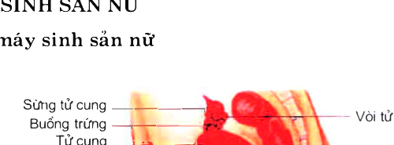

#### 2.1.1. Buồng trứng
Mỗi người phụ nữ có 2 buồng trứng. Kích thước mỗi buồng trứng trưởng thành là 2,5 × 2 × 1 cm và nặng từ 4 - 8 gam, trọng lượng của chúng thay đổi trong chu kỳ kinh nguyệt.

Ở tuần thứ 30 của thai nhi, cả hai buồng trứng có khoảng 6.000.000 nang noãn nguyên thuỷ. Sau đó phần lớn chúng bị thoái hóa chỉ để còn lại khoảng 2.000.000 nang noãn vào lúc mới sinh và đến tuổi dậy thì chỉ còn khoảng 300.000 - 400.000 nang noãn. Trong suốt thời kỳ sinh sản của phụ nữ (khoảng 30 năm) chỉ có khoảng 400 nang này phát triển tới chín và xuất noãn hằng tháng. Số còn lại bị thoái hóa.

#### 2.1.2. Tử cung
Tử cung là một cơ quan hình quả lê có kích thước 6 × 4 cm ở những phụ nữ chưa sinh đẻ và 7 - 8 × 5 cm ở những phụ nữ đã sinh đẻ nhiều lần. Tử cung gồm hai phần là thân tử cung và cổ tử cung có một chỗ thắt được gọi là eo tử cung (*hình 14.8*).

Từ ngoài vào trong, thành tử cung được cấu tạo bởi 3 lớp là lớp vỏ ngoài, lớp cơ và lớp niêm mạc tử cung hay còn được gọi là nội mạc tử cung.

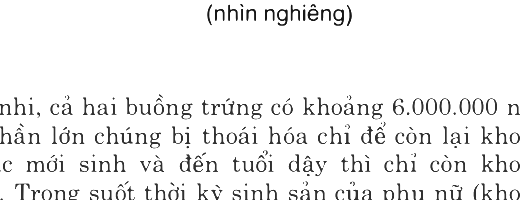

Cả lớp cơ và lớp niêm mạc của thân tử cung và cổ tử cung đều có những đặc điểm cấu trúc khác nhau.

Niêm mạc của thân tử cung là nơi trứng thụ tinh vào làm tổ và phát triển thành bào thai. Cấu trúc niêm mạc thân tử cung của các lứa tuổi khác nhau có những đặc điểm khác nhau.

Ở lứa tuổi hoạt động sinh sản, về hình thái học niêm mạc thân tử cung của phụ nữ được cấu tạo bởi hai lớp đó là lớp biểu mô và lớp đệm (*hình 14.9*).
- **Lớp biểu mô**
Lớp biểu mô phủ nội mạc thân tử cung là một lớp biểu mô đơn, có những chỗ lớp biểu mô đơn lõm sâu xuống lớp đệm tạo ra các tuyến của niêm mạc thân tử cung (*hình 14.9*). Những tuyến này có sự biến đổi về hình thái và chức năng trong chu kỳ kinh nguyệt (CKKN).

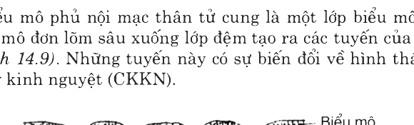

- **Lớp đệm**
Lớp đệm là lớp giàu tế bào liên kết. Lớp đệm chứa nhiều tuyến của niêm mạc tử cung. Trong lớp đệm còn có nhiều tế bào lympho có vai trò quan trọng trong các phản ứng miễn dịch có liên quan đến khả năng sinh đẻ. Trong lớp đệm cũng có rất nhiều mạch máu (động mạch, tĩnh mạch, mao mạch, bạch mạch).

Về phương diện chức năng, ở những người trong độ tuổi sinh đẻ, niêm mạc thân tử cung có hai lớp biến đổi khác nhau trong CKKN:
- **Lớp nền:** Lớp nền nằm sát cơ tử cung, ít có những biến đổi về cấu trúc trong CKKN.
- **Lớp chức năng:** Lớp chức năng là một lớp dày, nằm sát khoang tử cung. Chiều dày và cấu trúc của lớp này biến đổi mạnh theo từng giai đoạn của CKKN. Trong cơ thể, đây là mô duy nhất luôn biến đổi và biến đổi có chu kỳ hằng tháng.

### 2.2. Các hormon của buồng trứng
Hai hormon chính của buồng trứng là estrogen và progesteron. Ngoài ra hoàng thể còn bài tiết một hormon khác nữa đó là inhibin.

#### 2.2.1. Estrogen

##### 2.2.1.1. Nguồn gốc và bản chất hóa học
Ở phụ nữ bình thường không có thai, estrogen được bài tiết chủ yếu ở buồng trứng, chỉ một lượng rất nhỏ do tuyến vỏ thượng thận bài tiết. Khi có thai, rau thai bài tiết một lượng lớn estrogen. Ở buồng trứng, estrogen do các tế bào hạt của lớp áo trong của nang noãn bài tiết trong nửa đầu CKKN và nửa sau do hoàng thể bài tiết.

Có ba loại estrogen có mặt với một lượng đáng kể trong huyết tương đó là $\beta\text{ - estradiol}$, estron và estriol trong đó chủ yếu là $\beta\text{ - estradiol}$. Buồng trứng cũng bài tiết estron nhưng chỉ với một lượng nhỏ. Hầu hết estron được hình thành ở mô đích từ nguồn androgen do vỏ thượng thận và lớp áo của nang noãn bài tiết.

Tác dụng của $\beta\text{ - estradiol}$ mạnh gấp 12 lần estron và gấp 80 lần estriol vì vậy $\beta\text{ - estradiol}$ được coi là hormon chủ yếu.

Estrogen là hợp chất steroid và được tổng hợp ở buồng trứng từ cholesterol và cũng có thể từ acetyl coenzym A.

##### 2.2.1.2. Vận chuyển và thoái hóa
Trong máu, estrogen gắn lỏng lẻo chủ yếu với albumin của huyết tương và globulin gắn đặc hiệu với estrogen. Máu sẽ vận chuyển và giải phóng estrogen cho mô đích trong khoảng thời gian 30 phút.

Tại gan estrogen sẽ kết hợp với glucuronic và sulphat thành những hợp chất bài tiết theo đường mật (khoảng 1/5 tổng lượng) và theo đường nước tiểu (khoảng 4/5). Gan cũng có tác dụng chuyển dạng estrogen mạnh là $\beta\text{-estradiol}$ và estron thành dạng estriol yếu. Do vậy nếu chức năng gan yếu, hoạt tính estrogen sẽ tăng và đôi khi có thể gây ra cường estrogen.

##### 2.2.1.3. Tác dụng của estrogen
- Làm xuất hiện và bảo tồn đặc tính sinh dục nữ thứ phát kể từ tuổi dậy thì bao gồm phát triển các cơ quan sinh dục, phát triển lớp mỡ dưới da, giọng nói trong, dáng mềm mại, vai hẹp, hông nở...
- **Tác dụng lên tử cung:**
  + Làm tăng kích thước tử cung ở tuổi dậy thì và khi có thai.
  + Kích thích phân chia lớp nền là lớp tái tạo ra lớp chức năng trong nửa đầu của CKKN.
  + Tăng tạo các mạch máu mới ở lớp chức năng và làm cho các mạch máu này trở thành các động mạch xoắn cung cấp máu cho lớp niêm mạc chức năng. Tăng lưu lượng máu đến lớp niêm mạc chức năng.
  + Kích thích sự phát triển các tuyến niêm mạc. Tăng tạo glycogen chứa trong tuyến nhưng không bài tiết.
  + Tăng khối lượng tử cung, tăng hàm lượng actin và myosin trong cơ đặc biệt trong thời kỳ có thai.
  + Tăng co bóp tử cung. Tăng tính nhạy cảm của cơ tử cung với oxytocin.
- **Tác dụng lên cổ tử cung:**
Dưới tác dụng của estrogen, các tế bào biểu mô của niêm mạc cổ tử cung bài tiết một lớp dịch nhầy loãng, mỏng. Dịch này có thể kéo thành sợi dài khi được đặt vào lam kính. Khi để khô trên lam kính, dịch cổ tử cung có hiện tượng tinh thể hóa và soi lam kính dưới kính hiển vi thấy hình ảnh “dương xỉ”.
- **Tác dụng lên vòi tử cung:**
  + Làm tăng sinh mô tuyến của niêm mạc ống dẫn trứng.
  + Làm tăng sinh các tế bào biểu mô lông rung.
  + Làm tăng hoạt động của các tế bào biểu mô lông rung theo một chiều, hướng về phía tử cung.
Tất cả các tác dụng của estrogen lên ống dẫn trứng đều nhằm giúp trứng đã thụ tinh di chuyển dễ dàng vào tử cung.
- **Tác dụng lên âm đạo:**
  + Estrogen làm thay đổi biểu mô âm đạo từ dạng khối thành biểu mô tầng. Cấu trúc biểu mô tầng này vững chắc hơn do vậy tăng khả năng chống đỡ với các chấn thương và nhiễm khuẩn.
  + Kích thích các tuyến của âm đạo bài tiết dịch có độ pH acid.
- **Tác dụng lên tuyến vú:**
  + Phát triển hệ thống ống tuyến.
  + Phát triển mô đệm ở vú.
  + Tăng lắng đọng mỡ ở vú.
- **Tác dụng lên chuyển hóa:**
  + Làm tăng tổng hợp protein ở các mô đích như tử cung, tuyến vú, xương.
  + Làm tăng nhẹ quá trình sinh tổng hợp protein của toàn cơ thể.
  + Tăng lắng đọng mỡ ở dưới da đặc biệt ở ngực, mông, đùi để tạo dáng nữ.
  + Tăng nhẹ tốc độ chuyển hóa, tác dụng này chỉ bằng 1/3 tác dụng của testosteron.
- **Tác dụng lên xương:**
  + Tăng hoạt động của tế bào tạo xương (osteoblast). Vì vậy vào tuổi dậy thì tốc độ phát triển cơ thể tăng nhanh.
  + Kích thích gắn đầu xương vào thân xương. Tác dụng này của estrogen mạnh hơn nhiều so với testosteron nên phụ nữ thường ngừng cao sớm hơn nam vài năm.
  + Tăng lắng đọng muối canxi-phosphat ở xương. Tác dụng này cũng yếu hơn testosteron.
  + Làm nở rộng xương chậu.
Do những tác dụng kể trên, nếu thiếu estrogen (ở người già) sẽ gây hiện tượng loãng xương. Khi thiếu estrogen sẽ gây ra những hiện tượng sau đây:
  - Giảm hoạt động của các tế bào tạo xương.
  - Giảm khung protein ở xương.
  - Giảm lắng đọng canxi và phosphat ở xương.
Kết quả là xương xốp nên dễ biến dạng và dễ gãy. Vị trí dễ biến dạng là cột sống.
- **Tác dụng lên chuyển hóa muối nước:**
Do cấu tạo hóa học của estrogen cũng giống như aldosteron và các hormon vỏ thượng thận khác nên estrogen cũng có tác dụng giữ ion natri và tăng giữ nước. Tuy nhiên, ở những người phụ nữ bình thường, tác dụng này rất yếu trừ khi có thai.

##### 2.2.1.4. Điều hoà bài tiết
Nồng độ estrogen trong huyết tương của phụ nữ bình thường là 158,74 - 268,73 pmol/l ở nửa đầu của CKKN; 236,1 - 325,69 pmol/l ở nửa sau của CKKN và nồng độ cao nhất vào giữa CKKN (ngày thứ 15,09 ± 2,93) là 725,18 - 925,28 pmol/l.

Estrogen bài tiết nhiều hay ít tùy thuộc vào nồng độ LH của tuyến yên. Nồng độ LH tăng sẽ kích thích các tế bào của lớp áo trong nang noãn bài tiết estrogen. Ngược lại, nồng độ của LH giảm thì estrogen cũng được bài tiết ít.

#### 2.2.2. Progesteron

##### 2.2.2.1. Bản chất hóa học
Ở phụ nữ không có thai, progesteron được bài tiết chủ yếu từ hoàng thể trong nửa sau của CKKN. Ở nửa đầu của CKKN, nang noãn và vỏ thượng thận chỉ bài tiết một lượng rất nhỏ progesteron. Khi có thai rau thai bài tiết một lượng lớn progesteron.

Cũng như estrogen, progesteron cũng là một hợp chất steroid được tổng hợp từ cholesterol hoặc acetyl-coenzym A.

##### 2.2.2.2. Vận chuyển và chuyển hóa
Progesteron được vận chuyển trong máu dưới dạng gắn với albumin huyết tương và các globulin đặc hiệu với progesteron. Vài phút sau khi được bài tiết, hầu như tất cả progesteron được thoái hóa thành các steroid khác không có tác dụng của progesteron. Gan là cơ quan tham gia vào quá trình chuyển hóa này. Sản phẩm chuyển hóa cuối cùng được đào thải ra nước tiểu.

##### 2.2.2.3. Tác dụng của progesteron
- **Tác dụng lên tử cung:**
  + Tác dụng quan trọng nhất của progesteron là kích thích sự bài tiết ở niêm mạc tử cung vào nửa sau của CKKN. Dưới tác dụng của progesteron, niêm mạc tử cung của lớp chức năng được tăng sinh do tác dụng của estrogen nay được biến đổi trở thành cấu trúc có khả năng bài tiết. Các tuyến của niêm mạc tử cung dài ra, cuộn lại cong queo và bài tiết glycogen. Tác dụng này có ý nghĩa quan trọng là chuẩn bị niêm mạc tử cung ở trạng thái sẵn sàng đón trứng đã thụ tinh vào làm tổ.
  + Làm giảm co bóp cơ tử cung do đó ngăn cản việc đẩy trứng đã thụ tinh ra ngoài và tạo môi trường yên ổn cho bào thai phát triển.
- **Tác dụng lên cổ tử cung:**
Progesteron kích thích các tế bào tuyến niêm mạc tử cung bài tiết một lớp dịch nhầy quánh, dày. Tính chất quánh đặc của dịch tử cung cùng với sự vắng mặt của hình ảnh “dương xỉ” là những bằng chứng cho biết hiện tượng phóng noãn và giai đoạn hoàng thể đã xảy ra.
- **Tác dụng lên vòi tử cung:**
Progesteron kích thích niêm mạc vòi tử cung bài tiết dịch chứa chất dinh dưỡng để nuôi dưỡng trứng đã thụ tinh thực hiện quá trình phân chia trong khi di chuyển vào buồng tử cung.
- **Tác dụng lên tuyến vú:**
  + Làm phát triển thuỳ tuyến.
  + Kích thích các tế bào bọc tuyến vú tăng sinh, to lên và trở nên có khả năng bài tiết.
- **Tác dụng lên thân nhiệt:**
Progesteron làm tăng nhiệt độ của cơ thể do vậy ở nửa sau CKKN thân nhiệt của phụ nữ thường cao hơn nửa đầu từ 0,3 - 0,5°C.
Cơ chế làm tăng thân nhiệt của progesteron vẫn chưa rõ. Tuy nhiên có ý kiến cho rằng có lẽ progesteron tác dụng lên trung tâm điều nhiệt của vùng dưới đồi.

##### 2.2.2.4. Điều hoà bài tiết
Ở nửa đầu CKKN, nồng độ progesteron trong huyết tương rất thấp, chỉ vào khoảng 2,228 - 2,720 nmol/l, nửa sau CKKN khoảng 7,89 - 13,27 nmol/l.

Sự bài tiết progesteron chịu ảnh hưởng điều khiển trực tiếp của hormon LH do tuyến yên bài tiết. Nếu nồng độ LH tăng trong máu, hoàng thể sẽ được nuôi dưỡng và sẽ bài tiết nhiều progesteron. Ngược lại, nếu tuyến yên bài tiết ít LH, hoàng thể sẽ bị thoái hóa và progesteron sẽ được bài tiết ít.

#### 2.2.3. Rối loạn bài tiết hormon buồng trứng

##### 2.2.3.1. Nhược năng
- **Rối loạn bài tiết hormon có thể do thiếu buồng trứng hoặc buồng trứng không bình thường từ lúc bẩm sinh** dẫn tới thiếu hệ thống enzym tổng hợp estrogen ở các tế bào bài tiết. Khi thiếu buồng trứng bẩm sinh hoặc buồng trứng trở nên không hoạt động lúc dậy thì, các đặc tính sinh dục thứ phát không xuất hiện, các cơ quan sinh dục vẫn mang đặc tính trẻ con. Một đặc điểm quan trọng của trường hợp này là sẽ kéo dài thời gian phát triển của các xương dài vì đầu xương không gắn vào thân xương đúng tuổi như những đứa trẻ vị thành niên bình thường. Do vậy, đứa trẻ gái này sẽ có cùng chiều cao hoặc cao hơn trẻ trai cùng tuổi.
- **Rối loạn bài tiết hormon do buồng trứng bị cắt bỏ ở phụ nữ.**
Ở người phụ nữ bị cắt bỏ hai buồng trứng, các cơ quan sinh dục hầu như bị nhỏ lại giống trẻ con. Âm đạo hẹp hơn, biểu mô âm đạo trở nên mỏng và ít tiết dịch hơn do đó dễ bị chấn thương và nhiễm khuẩn. Ngực teo nhẽo, lông mu thưa. Ngoài những rối loạn này còn có những rối loạn khác giống phụ nữ ở thời kỳ mãn kinh.

##### 2.2.3.2. Ưu năng
Sự bài tiết quá nhiều hormon buồng trứng ít gặp trên lâm sàng vì khi estrogen được bài tiết quá nhiều sẽ ức chế tuyến yên làm giảm bài tiết FSH và LH, do đó lượng hormon sinh dục được điều hoà trở lại bình thường.

Tăng bài tiết hormon sinh dục trên lâm sàng chỉ gặp trong trường hợp u buồng trứng. Tuy nhiên, u tế bào hạt lại ít khi xảy ra, nếu có thì thường xuất hiện ở phụ nữ mãn kinh hơn.

Khi có khối u ở tế bào hạt, một lượng lớn estrogen được bài tiết vào máu gây tăng sinh nội mạc tử cung. Do vậy, trên thực tế lâm sàng, chảy máu qua đường âm đạo là hiện tượng đầu tiên và duy nhất để chẩn đoán khối u buồng trứng (u tế bào hạt).

### 2.3. Chu kỳ kinh nguyệt

#### 2.3.1. Định nghĩa
Chu kỳ kinh nguyệt là sự biến đổi về cấu trúc, chức năng của niêm mạc tử cung dẫn tới sự chảy máu có chu kỳ ở niêm mạc tử cung dưới tác dụng của các hormon tuyến yên và buồng trứng.

Độ dài của chu kỳ kinh nguyệt được tính bằng khoảng thời gian giữa hai ngày chảy máu đầu tiên của hai chu kỳ kế tiếp nhau. Ở phụ nữ Việt Nam độ dài CKKN là 28-30 ngày.

#### 2.3.2. Các giai đoạn của chu kỳ kinh nguyệt
Sự biến đổi ở niêm mạc tử cung hằng tháng trải qua hai giai đoạn, đó là giai đoạn tăng sinh và giai đoạn bài tiết (*hình 14.11*), kinh nguyệt là kết quả của hai giai đoạn biến đổi này.

Có mối liên quan chặt chẽ giữa tuyến yên, buồng trứng và niêm mạc tử cung ở từng giai đoạn. Mối liên quan này được thể hiện bằng sự chỉ huy của các tuyến nội tiết trung ương đến tuyến đích ngoại biên rồi đến mô đích (niêm mạc tử cung) và có tác dụng điều hoà ngược từ tuyến đích ngoại biên đến tuyến chỉ huy trung ương. Do vậy, rối loạn hoạt động của trục tuyến yên-buồng trứng sẽ dẫn đến rối loạn kinh nguyệt (thiếu kinh, đa kinh, vô kinh).

##### 2.3.2.1. Giai đoạn tăng sinh (Giai đoạn estrogen)
- **Bài tiết hormon và biến đổi ở buồng trứng:**
Cuối chu kỳ trước, do nồng độ hai hormon buồng trứng là progesteron và estrogen giảm đột ngột tạo ra cơ chế điều hoà ngược âm tính nên tuyến yên tăng bài tiết FSH và LH dưới sự chỉ huy của $\text{G}_n\text{RH}$.
Nồng độ hai hormon lúc đầu chỉ hơi tăng sau đó tăng dần đạt tới mức trung bình là 1,45 – 2,33 UI/l (FSH) và 3,94 – 7,66 UI/l (LH) trong đó FSH tăng trước và LH tăng sau đó vài ngày.
Dưới tác dụng của FSH và LH, đặc biệt là FSH, ở buồng trứng có từ 6-12 nang noãn nguyên thuỷ phát triển. Tác dụng đầu tiên là tăng sinh tế bào hạt. Sau đó tạo ra lớp vỏ của nang noãn. Lớp này được chia thành hai lớp là lớp áo trong và lớp áo ngoài. Lớp áo trong có những tế bào biểu mô cấu tạo giống tế bào hạt có khả năng bài tiết hormon. Lớp áo ngoài có nhiều mạch máu.
Sau vài ngày phát triển, dưới tác dụng của LH các tế bào lớp áo trong bắt đầu bài tiết dịch nang. Thành phần rất quan trọng của dịch nang là estrogen. Lượng dịch được bài tiết tăng dần và tạo ra một hốc nằm giữa các tế bào hạt. Đồng thời với sự tăng kích thước của nang, noãn tự nó cũng lớn nhanh từ 3-4 lần. Dịch trong hốc nang tăng dần và đẩy noãn cùng một số tế bào hạt về một cực của nang để tạo ra gò trứng.
- **Biến đổi ở niêm mạc tử cung:**
Sau hành kinh, niêm mạc tử cung chỉ còn lại một lớp mỏng của mô đệm và sót lại một số tế bào biểu mô nằm tại đáy các tuyến. Dưới tác dụng của estrogen, các tế bào mô đệm và tế bào biểu mô tăng sinh nhanh chóng. Bề mặt của niêm mạc tử cung được biểu mô hóa hoàn toàn trong vòng từ 4-7 ngày sau hành kinh. Niêm mạc dày dần, các tuyến dài, mạch máu phát triển. Đến cuối giai đoạn này niêm mạc tử cung dày khoảng 3- 4 mm. Các tuyến của cổ tử cung bài tiết một lớp dịch nhầy loãng kéo thành sợi dọc hướng vào tử cung. Lớp dịch này tạo thành kênh dẫn tinh trùng di chuyển vào cổ tử cung.
- **Hiện tượng phóng noãn:**
Sau khoảng 7-8 ngày phát triển, có một nang noãn bắt đầu phát triển nhanh, số nang noãn còn lại thoái triển dần. Tại nang noãn phát triển nhanh, kích thước nang tăng lên, lượng estrogen được bài tiết cũng nhiều hơn hẳn các nang khác.
Cuối giai đoạn tăng sinh, nồng độ estrogen tăng cao đã gây ra tác dụng điều hoà ngược dương tính đối với tuyến yên và làm tăng bài tiết cả FSH và LH.
Dưới tác dụng của FSH và LH, các tế bào hạt và tế bào lớp áo trong tăng sinh mạnh đồng thời bài tiết estrogen do vậy càng làm tăng kích thước của nang. Ở thời điểm phóng noãn đường kính nang noãn đạt tới 1 - 1,5 cm với đầy đủ lớp áo trong, áo ngoài, hốc chứa dịch nang, noãn đã trưởng thành và được gọi là nang noãn chín. LH của tuyến yên rất cần thiết cho giai đoạn phát triển tới chín của nang noãn và cho sự phóng noãn.
Khoảng 2 ngày trước khi phóng noãn, lượng LH được bài tiết từ tuyến yên tăng đột ngột lên 6-10 lần và đạt tới mức cao nhất vào thời điểm 16 giờ trước khi phóng noãn. Nồng độ FSH cũng tăng khoảng 2-3 lần. Hai hormon này tác dụng phối hợp làm cho nang noãn căng phồng lên. Đồng thời LH kích thích các tế bào hạt và tế bào lớp áo trong tăng bài tiết progesteron. Mức bài tiết estrogen bắt đầu giảm trước khi phóng noãn một ngày, trong khi đó mức bài tiết progesteron lại bắt đầu tăng dần và gây ra hiện tượng phóng noãn. Kết quả khảo sát trên thực nghiệm cũng như trên lâm sàng cho thấy rằng nếu không có đỉnh LH thì sẽ không có hiện tượng phóng noãn.
Vài giờ trước khi phóng noãn, có hai hiện tượng đồng thời xảy ra dưới tác dụng của progesteron là:
  + Các tế bào lớp áo ngoài của nang noãn giải phóng các enzym tiêu protein từ các bọc lysosom. Dưới tác dụng của enzym này, thành nang bị phá huỷ trở nên mỏng và yếu hơn.
  + Tăng sinh các mạch máu ở thành nang đồng thời tại đây prostaglandin cũng được bài tiết. Dưới tác dụng của prostaglandin, các mao mạch giãn ra, tăng tính thấm làm cho huyết tương thấm vào trong nang.
Cả hai tác dụng trên đều làm cho nang căng phồng trong khi thành nang lại mỏng, yếu vì vậy nang sẽ vỡ ra và giải phóng noãn ra khỏi nang noãn (*hình 14.10*). Hiện tượng phóng noãn thường xảy ra vào thời điểm 13-14 ngày trước khi có kinh lần sau. Thông thường mỗi chu kỳ chỉ có một nang noãn vỡ và xuất noãn ở cả hai buồng trứng.

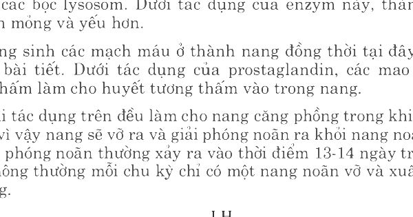

##### 2.3.2.2. Giai đoạn bài tiết (Giai đoạn progesteron)
- **Bài tiết hormon và biến đổi ở buồng trứng:**
Sau khi phóng noãn, tuyến yên vẫn tiếp tục bài tiết FSH và LH. Dưới tác dụng của LH, một ít tế bào hạt còn lại ở vỏ nang vỡ được biến đổi nhanh chóng để trở thành các tế bào hoàng thể. Các tế bào hạt này trương to gấp hai lần chứa đầy hạt mỡ trong bào tương và có màu vàng nhạt. Các tế bào hạt này tăng sinh, tạo thành một khối vây quanh cục máu đông. Cấu trúc lúc này có màu vàng (nhìn buồng trứng tươi, không nhuộm) nên được gọi là hoàng thể.
Các tế bào hoàng thể dưới tác dụng kích thích của LH đã bài tiết một lượng lớn progesteron và estrogen, đồng thời mạch máu phát triển mạnh trong hoàng thể. Sau khi phóng noãn 7-8 ngày, hoàng thể có đường kính xấp xỉ 1,5 cm. Sau đó hoàng thể bắt đầu giảm dần chức năng bài tiết.
- **Biến đổi của niêm mạc tử cung:**
Trong giai đoạn này estrogen vẫn tiếp tục làm tăng sinh lớp niêm mạc tử cung nhưng tác dụng này yếu hơn nhiều so với progesteron.
Dưới tác dụng của progesteron, niêm mạc tử cung dày nhanh và bài tiết dịch. Các tuyến càng dài ra, cong queo, chứa đầy các chất tiết. Bào tương của các tế bào đệm tăng lên, lắng đọng nhiều lipid và glycogen. Các mạch máu phát triển, trở nên xoắn lại và cung cấp máu cho niêm mạc tử cung cũng tăng lên. Một tuần sau phóng noãn, niêm mạc tử cung dày tới 5-6 mm.
Mục đích của tất cả các thay đổi trên là tạo ra kiểu niêm mạc tử cung chứa đầy chất dinh dưỡng để cung cấp cho trứng đã thụ tinh khi được di chuyển vào buồng tử cung. Chất dịch bài tiết từ niêm mạc tử cung được gọi là “sữa tử cung”.
- **Hiện tượng kinh nguyệt:**
Sau phóng noãn nếu không có hiện tượng thụ tinh thì khoảng 2 ngày cuối cùng của chu kỳ, hoàng thể đột nhiên bị thoái hóa. Nồng độ estrogen và progesteron đột ngột giảm xuống mức rất thấp và gây ra hiện tượng kinh nguyệt.
Do nồng độ hai hormon giảm, niêm mạc tử cung bị thoái hóa tới 65% chiều dày. Các động mạch xoắn co thắt do tác dụng của các sản phẩm bài tiết từ niêm mạc bị thoái hóa mà một trong những sản phẩm đó là prostaglandin. Một mặt do các động mạch nuôi dưỡng lớp niêm mạc chức năng bị co thắt gây tình trạng thiếu máu, mặt khác do thiếu tác dụng kích thích của hai hormon nên lớp niêm mạc này bắt đầu hoại tử đặc biệt là các mạch máu. Kết quả của những biến đổi này là mạch máu bị tổn thương và máu chảy đọng lại dưới lớp niêm mạc chức năng. Vùng chảy máu lan rộng nhanh trong 34-36 giờ. Tiếp theo đó lớp niêm mạc bị hoại tử sẽ tách khỏi tử cung ở những vùng chảy máu. Sau khoảng 48 giờ kể từ khi xảy ra hiện tượng chảy máu, toàn bộ lớp niêm mạc chức năng bong ra.

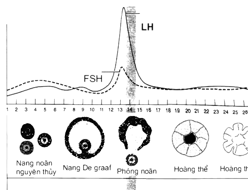

Khối mô bị bong ra, dịch và máu trong khoang tử cung nhờ tác dụng co cơ tử cung của prostaglandin sẽ được đẩy ra ngoài qua đường âm đạo.

Lượng máu trung bình trong mỗi chu kỳ là 38,13 ± 24,76 ml. Máu kinh nguyệt là máu không đông. Trong trường hợp cường kinh, do hiện tượng bong niêm mạc và chảy máu xảy ra quá nhanh nên trong máu kinh nguyệt có thể có những cục máu đông.

Thời gian chảy máu trung bình mỗi chu kỳ là 3-5 ngày. Sau khi ngừng chảy máu, niêm mạc lại được tái tạo dưới tác dụng của estrogen được bài tiết từ các nang noãn phát triển ở buồng trứng trong chu kỳ mới.

### 2.4. Dậy thì và mãn kinh

#### 2.4.1. Dậy thì
Ở nữ giới, trong thời kỳ bào thai cũng như sau khi sinh buồng trứng không hoạt động cho tới khi nhận được những kích thích phù hợp từ tuyến yên. Hai buồng trứng bắt đầu hoạt động, thể hiện bằng hoạt động sinh giao tử và bài tiết hormon sinh dục nữ dẫn đến những thay đổi về thể chất, tâm lý, sự trưởng thành và hoàn thiện về chức năng sinh dục. Thời kỳ phát triển và trưởng thành này được gọi là dậy thì.
- **Những biến đổi về cơ thể:**
Trong thời kỳ này cơ thể các em gái phát triển nhanh về chiều cao cũng như trọng lượng. Cơ thể trở nên cân đối, mềm mại, thân hình có đường cong do lớp mỡ dưới da phát triển đặc biệt ở một số vùng như ngực, mông, khung chậu nở rộng hơn.
Xuất hiện một số đặc tính sinh dục nữ thứ phát như hệ thống lông mu, lông nách phát triển. Giọng nói trong hơn. Tâm lý cũng có những biểu hiện như hay tư lự và thường ít nghịch ngợm hơn, ý tứ hơn trong cách cư xử...
- **Hoạt động của tuyến sinh dục:**
  + Chức năng sinh giao tử của buồng trứng bắt đầu hoạt động. Hằng tháng dưới tác dụng của hormon tuyến yên, các nang noãn nguyên thuỷ phát triển, có khả năng tiến tới chín và phóng noãn. Như vậy, từ thời kỳ này các em gái bắt đầu có khả năng sinh con. Tuy nhiên, vì chức năng của các cơ quan thuộc hệ thống sinh sản chưa phát triển thành thục nên chưa đủ khả năng mang thai, nuôi con vì vậy cần tư vấn cho các thiếu nữ cách quan hệ với các bạn khác giới, cách phòng tránh thai, cách phòng tránh các bệnh lây nhiễm theo đường tình dục.
  + Chức năng nội tiết của buồng trứng: Song song với khả năng sinh giao tử, buồng trứng bắt đầu bài tiết estrogen và progesteron. Dưới tác dụng của hai hormon này, chuyển hóa của cơ thể sẽ tăng mạnh, cơ thể phát triển nhanh, các cơ quan sinh dục như tử cung, vòi tử cung, âm đạo, âm hộ, tuyến vú đều phát triển cả về kích thước và chức năng. Một dấu hiệu đặc biệt quan trọng đánh dấu thiếu nữ đã dậy thì đó là xuất hiện kinh nguyệt hằng tháng.
Tất cả những biến đổi về hoạt động của hệ thống sinh sản, thể chất và tâm lý đều do tác dụng của các hormon buồng trứng và hormon hướng sinh dục của tuyến yên. Các dấu hiệu dậy thì ở nữ thường thể hiện rõ rệt hơn ở nam giới.
- **Thời gian xuất hiện dậy thì:**
Tuổi dậy thì không phải là một thời điểm mà là một khoảng thời gian. Khoảng thời gian này có thể thay đổi theo từng cá thể nhưng thường kéo dài 3-4 năm.
Thời điểm bắt đầu dậy thì ở nữ thường được đánh dấu bằng biểu hiện tuyến vú bắt đầu phát triển. Ở Việt Nam, thời điểm này thường từ 8-10 tuổi.
Thời điểm dậy thì hoàn toàn được đánh dấu bằng lần có kinh đầu tiên, ở Việt Nam hiện nay vào khoảng 13-14 tuổi, sớm hơn những thập niên của thế kỷ trước khoảng 2 năm.
- **Cơ chế dậy thì** (*xem mục 1.7.1*).

#### 2.4.2. Mãn kinh
Ở phụ nữ vào khoảng 40-50 tuổi, các nang noãn của buồng trứng trở nên không đáp ứng với kích thích của hormon tuyến yên. Quá trình này xảy ra từ từ dẫn đến giảm chức năng buồng trứng. Biểu hiện của sự suy giảm này là chu kỳ kinh nguyệt và chu kỳ phóng noãn trở nên không đều. Sau vài tháng đến vài năm các chu kỳ biến đổi ở buồng trứng, chu kỳ biến đổi ở niêm mạc tử cung ngừng hoạt động, người phụ nữ không còn kinh nguyệt, không phóng noãn, nồng độ các hormon sinh dục nữ giảm đến mức thấp nhất. Hiện tượng này gọi là mãn kinh.
- **Nguyên nhân của mãn kinh:**
Mãn kinh là do sự kiệt quệ của buồng trứng ở vào khoảng tuổi quanh 45, ở buồng trứng số nang noãn có khả năng đáp ứng với tác dụng kích thích của FSH và LH còn rất ít, vì vậy lượng estrogen giảm dần đến mức thấp nhất. Với lượng estrogen này thì không đủ để tạo cơ chế điều hoà ngược dương tính kích thích phóng noãn.
- **Biểu hiện của thời kỳ mãn kinh:**
Tất cả những biểu hiện thường gặp trong thời kỳ mãn kinh chủ yếu là do giảm nồng độ estrogen gây ra. Các biểu hiện đó là:
  + Buồng trứng teo nhỏ, thoái hóa, không phóng noãn.
  + Không có kinh nguyệt.
  + Teo đường sinh dục trong như tử cung, cổ tử cung, vòi tử cung.
  + Teo bộ phận sinh dục ngoài như âm đạo, âm hộ, môi lớn, môi nhỏ. Thành âm đạo mỏng, hẹp, ngắn, kém đàn hồi hơn, ít tiết dịch hơn và pH của dịch ít acid hơn do vậy dễ chấn thương, dễ nhiễm khuẩn, giao hợp khó và đau do âm đạo bị khô.
  + Vú trở nên phẳng và nhẽo do teo các mô đệm và ống dẫn sữa.
  + Giảm mô mỡ ở vùng xương mu, lông thưa hơn.
  + Có những biến đổi về hình thể như dáng người không nhanh nhẹn, lớp mỡ dưới da phát triển mạnh ở vùng bụng làm tỷ lệ vòng eo/mông tăng. Có thể mọc râu ở cằm và trên môi.
  + Có những biến đổi về mặt tâm lý, trí nhớ như tính tình dễ thay đổi, hay buồn bực cáu gắt, hay quên... những thay đổi này sẽ mất đi sau một thời gian.
  + Có những cơn bốc nóng lên mặt hoặc vã mồ hôi vào ban đêm do rối loạn hoạt động của hệ thần kinh tự chủ.
Trong thời kỳ này, do giảm lượng estrogen nên người phụ nữ dễ mắc một số bệnh như loãng xương, viêm âm đạo, viêm bàng quang, xơ vữa động mạch.
Ở Việt Nam tuổi mãn kinh của phụ nữ là 49,3 ± 3,2 tuổi.

---

### 2.5. Thụ thai, mang thai và sinh đẻ

#### 2.5.1. Sinh lý thụ tinh
Thụ tinh là quá trình kết hợp giữa giao tử đực (tinh trùng mang bộ đơn bội $23$ nhiễm sắc thể) và giao tử cái (noãn bào II mang bộ đơn bội $23$ nhiễm sắc thể) để tạo thành một hợp tử lưỡng bội ($46$ nhiễm sắc thể), khôi phục lại bộ nhiễm sắc thể đặc trưng của loài và xác định giới tính di truyền của cơ thể mới (hợp tử mang cặp $46\text{,XX}$ sẽ phát triển thành thai gái; hợp tử mang cặp $46\text{,XY}$ sẽ phát triển thành thai trai).

- **Vị trí và thời điểm thụ tinh:**
  + Sự thụ tinh thông thường diễn ra tại đoạn một phần ba ngoài của vòi tử cung (đoạn bóng vòi trứng).
  + Noãn sau khi phóng noãn chỉ duy trì được khả năng thụ tinh tối ưu trong khoảng từ $12$ đến $24$ giờ (tối đa không quá $48$ giờ). Trong khi đó, tinh trùng sau khi phóng vào đường sinh dục nữ có thể sống và duy trì khả năng thụ tinh trong khoảng từ $24$ đến $48$ giờ (đôi khi đến $72$ giờ). Do đó, thời điểm giao hợp có khả năng thụ thai cao nhất là trong khoảng thời gian quanh thời điểm phóng noãn.

- **Sự di chuyển và năng lực hóa của tinh trùng (Capacitation):**
  + Trong hàng trăm triệu tinh trùng được phóng thích vào âm đạo trong mỗi lần xuất tinh, chỉ có một số lượng nhỏ (khoảng vài trăm đến một nghìn tinh trùng) có thể vượt qua hàng rào chất nhầy cổ tử cung, buồng tử cung và di chuyển lên đến vị trí một phần ba ngoài vòi trứng nhờ khả năng vận động tự thân của đuôi tinh trùng kết hợp với các cơn co bóp nhịp nhàng của tử cung và nhu động của vòi trứng dưới tác dụng của prostaglandin trong tinh dịch và oxytocin tiết ra khi đạt cực khoái.
  + Trong quá trình di chuyển trong đường sinh dục nữ, tinh trùng trải qua quá trình năng lực hóa (capacitation): lớp cholesterol và glycoprotein bao bọc đầu tinh trùng bị các enzym của dịch đường sinh dục nữ loại bỏ, làm tăng tính thấm của màng tế bào tinh trùng với ion canxi ($\text{Ca}^{2+}$). Dòng $\text{Ca}^{2+}$ đi vào bào tương làm đuôi tinh trùng chuyển động mạnh mẽ hơn theo kiểu quất roi và chuẩn bị cho phản ứng cực đầu.

- **Phản ứng cực đầu (Acrosome reaction) và sự xâm nhập của tinh trùng vào noãn:**
  + Noãn khi mới phóng thích được bao bọc bởi hai cấu trúc bảo vệ quan trọng: lớp tế bào hạt (vành tia - corona radiata) ở ngoài cùng và màng trong suốt (zona pellucida) cấu tạo bởi các glycoprotein (chủ yếu là ZP1, ZP2, ZP3) ở bên trong (*hình 14.12*).
  + Khi tinh trùng tiếp cận lớp tế bào hạt, màng ngoài của cực đầu tinh trùng hợp nhất với màng bào tương và vỡ ra, giải phóng các enzym thủy phân chứa trong cực đầu (acrosome), đặc biệt là hyaluronidase và các enzym tiêu protein (acrosin).
  + Hyaluronidase phân giải liên kết giữa các tế bào hạt, mở đường cho tinh trùng tiếp cận màng trong suốt. Tại đây, protein trên màng tinh trùng gắn đặc hiệu với thụ thể ZP3 trên màng trong suốt. Enzym acrosin sau đó tiêu hủy cục bộ màng trong suốt, tạo điều kiện cho tinh trùng tiến sát vào màng bào tương của noãn bào.

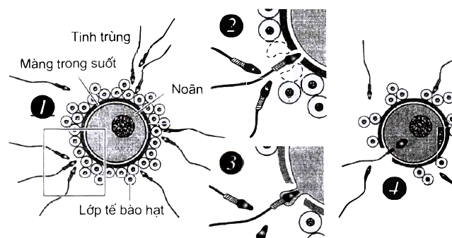

- **Phản ứng vỏ và cơ chế chống đa thụ tinh (Polyspermy prevention):**
  + Ngay khi màng bào tương của tinh trùng đầu tiên tiếp xúc và hòa nhập với màng bào tương của noãn, sự khử cực màng noãn xảy ra lập tức (ngăn chặn thụ tinh đa tinh trùng nhanh).
  + Tiếp theo là phản ứng vỏ (cortical reaction): các bọc vỏ (cortical granules) nằm sát dưới màng bào tương của noãn giải phóng enzym qua hiện tượng xuất bào vào khoang quanh noãn. Các enzym này làm biến đổi cấu trúc glycoprotein của màng trong suốt (làm cứng màng trong suốt và bất hoạt thụ thể ZP3), khiến không một tinh trùng nào khác có thể xâm nhập thêm vào noãn (ngăn chặn thụ tinh đa tinh trùng vĩnh viễn).

- **Sự hoàn tất phân chia của noãn và hòa nhập hai tiền nhân:**
  + Sự xâm nhập của tinh trùng đóng vai trò là kích thích phát động noãn bào II hoàn tất lần phân chia giảm nhiễm thứ hai, giải phóng cực cầu thứ hai (thể định hướng thứ hai) bị tống ra ngoài khoang quanh noãn (*hình 14.13*).
  + Phần nhân còn lại của noãn trở thành tiền nhân cái mang $23$ nhiễm sắc thể đơn bội ($23\text{,X}$).
  + Đầu tinh trùng nằm trong bào tương noãn trương to lên, chromatin giãn xoắn để hình thành tiền nhân đực mang $23$ nhiễm sắc thể đơn bội ($23\text{,X}$ hoặc $23\text{,Y}$).
  + Hai tiền nhân nhân đôi lượng ADN ($1n \rightarrow 2c$), tiến lại gần nhau, màng tiền nhân tiêu biến, các nhiễm sắc thể kết hợp tạo thành bộ nhiễm sắc thể lưỡng bội ($2n = 46$). Thoi phân bào hình thành và hợp tử bắt đầu lần phân bào nguyên nhiễm đầu tiên.

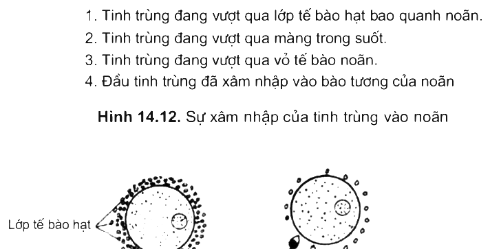

#### 2.5.2. Sự di chuyển của phôi vào buồng tử cung
- Sau khi thụ tinh tại một phần ba ngoài vòi tử cung, hợp tử vừa thực hiện các lần phân chia tế bào liên tiếp (tạo thành phôi $2$ tế bào, $4$ tế bào, $8$ tế bào rồi thành phôi dâu - morula gồm $16 - 32$ tế bào), vừa di chuyển dọc theo vòi tử cung về phía buồng tử cung.
- Quá trình di chuyển này mất khoảng từ $3$ đến $4$ ngày.
- Động lực giúp phôi di chuyển bao gồm:
  + Dòng dịch bài tiết từ niêm mạc vòi tử cung chảy về phía tử cung.
  + Hoạt động nhịp nhàng của các tế bào biểu mô có lông rung trên bề mặt niêm mạc vòi trứng quạt theo chiều hướng về buồng tử cung.
  + Các đợt sóng co bóp nhu động nhẹ nhàng của lớp cơ trơn vòi tử cung chịu sự điều hòa hiệp đồng giữa estrogen và progesteron.
- Khi tiến vào buồng tử cung, trong lòng phôi dâu xuất hiện một khoang chứa dịch, biến đổi thành phôi nang (blastocyst) có khoảng $100$ tế bào, gồm hai phần rõ rệt:
  + Lớp tế bào lá nuôi (trophoblast) ở ngoại vi: sẽ phát triển thành màng đệm và bánh rau.
  + Khối tế bào nội mầm (embryoblast / inner cell mass) ở bên trong: sẽ phát triển thành phôi thai thực sự.
- **Ý nghĩa lâm sàng - Chửa ngoài tử cung (Ectopic pregnancy):**
  + Nếu có bất thường về cấu trúc hoặc chức năng vòi tử cung (như viêm vòi trứng gây chít hẹp, dính niêm mạc vòi tử cung, khối u chèn ép, hoặc nhu động vòi trứng suy giảm), phôi không thể di chuyển về buồng tử cung mà làm tổ ngay tại vòi trứng (hoặc hiếm hơn là ở buồng trứng hay ổ phúc mạc).
  + Do thành vòi tử cung mỏng, không có lớp màng rụng thích hợp nên khi phôi phát triển lớn sẽ làm giãn căng vòi trứng và vỡ, gây xuất huyết ồ ạt trong ổ bụng, đe dọa trực tiếp đến tính mạng người mẹ nếu không được chẩn đoán và phẫu thuật cấp cứu kịp thời.

#### 2.5.3. Phôi làm tổ và phát triển trong buồng tử cung
- Sau khi vào buồng tử cung, phôi nang tự do trôi trong dịch tử cung từ $1$ đến $3$ ngày để nhận chất dinh dưỡng nuôi dưỡng trực tiếp từ chất tiết giàu glycogen của niêm mạc tử cung ("sữa tử cung").
- **Thời điểm làm tổ:** Vào khoảng ngày thứ $5$ đến ngày thứ $7$ sau khi phóng noãn (tương ứng với ngày thứ $20 - 22$ của chu kỳ kinh nguyệt $28$ ngày). Đây chính là thời điểm "cửa sổ làm tổ", khi niêm mạc tử cung ở đỉnh cao của giai đoạn bài tiết dưới tác dụng phối hợp tối ưu của estrogen và progesteron.
- **Quá trình làm tổ:**
  + Phôi nang thoát ra khỏi màng trong suốt (hiện tượng nở / hatching).
  + Lớp tế bào lá nuôi tiếp xúc và gắn dính vào biểu mô bề mặt niêm mạc tử cung (thường ở vùng đáy hoặc phần trên mặt sau thân tử cung).
  + Tế bào lá nuôi nhanh chóng tăng sinh và biệt hóa thành hai lớp: lớp lá nuôi tế bào (cytotrophoblast) ở trong và lớp lá nuôi hợp bào (syncytiotrophoblast) ở ngoài.
  + Lá nuôi hợp bào tiết ra các enzym tiêu protein mạnh mẽ làm tiêu hủy biểu mô và mô đệm liên kết của niêm mạc tử cung, tạo đường hầm cho phôi nang ăn sâu dần vào lòng nội mạc tử cung cho tới khi phôi vùi hoàn toàn dưới lớp biểu mô.
  + Dưới tác dụng của progesteron, các tế bào mô đệm của niêm mạc tử cung biến đổi thành các tế bào rụng to lớn chứa đầy glycogen và lipid (phản ứng màng rụng), bao quanh phôi để cung cấp dinh dưỡng mô dưỡng (histiotrophic nutrition) trước khi hệ tuần hoàn rau thai được thiết lập.

#### 2.5.4. Chức năng của bánh rau (rau thai)
Bánh rau là cơ quan trao đổi chất và nội tiết tạm thời nhưng sống còn giữa cơ thể mẹ và thai nhi. Bánh rau hoàn chỉnh có diện tích bề mặt trao đổi qua các gai rau (villi) rộng tới nhiều mét vuông. Màng trao đổi nhau thai mỏng (khoảng $3,5\,\mu\text{m}$) ngăn cách giữa máu mẹ trong hồ huyết và máu thai nhi trong mao mạch gai rau.

##### 2.5.4.1. Chức năng dinh dưỡng
- **Glucose:** Là nguồn năng lượng chủ yếu cho sự phát triển của thai. Glucose được vận chuyển từ máu mẹ sang máu thai qua màng rau theo cơ chế khuếch tán được thuận hóa (facilitated diffusion) nhờ chất vận chuyển GLUT ở màng tế bào lá nuôi.
- **Acid amin:** Được vận chuyển tích cực qua màng rau, nồng độ acid amin trong máu thai thường cao hơn trong máu mẹ để phục vụ nhu cầu sinh tổng hợp protein mô thai.
- **Acid béo và lipid:** Acid béo tự do khuếch tán qua màng rau chậm hơn glucose; bánh rau có enzym thủy phân lipid huyết tương mẹ để lấy acid béo tự do cung cấp cho thai.
- **Các ion khoáng và vitamin:** Canxi, phosphat, sắt, iod và các vitamin hòa tan trong nước được vận chuyển tích cực từ mẹ sang thai; vitamin tan trong dầu khuếch tán chậm hơn.

##### 2.5.4.2. Chức năng hô hấp
- Bánh rau đóng vai trò như lá phổi của thai nhi:
  + Phân áp oxy trong máu hồ huyết của mẹ là khoảng $50\text{ mmHg}$, trong khi phân áp oxy trong máu tĩnh mạch rốn của thai chỉ khoảng $30\text{ mmHg}$. Sự chênh lệch phân áp khoảng $20\text{ mmHg}$ thúc đẩy oxy khuếch tán từ mẹ sang con. Dù phân áp oxy máu thai tương đối thấp, thai nhi vẫn nhận đủ lượng oxy cần thiết nhờ nồng độ hemoglobin trong máu thai cao hơn người lớn và huyết sắc tố thai nhi (HbF) có ái lực gắn oxy mạnh hơn hẳn huyết sắc tố người trưởng thành (HbA).
  + Phân áp khí $\text{CO}_2$ trong máu động mạch rốn của thai (khoảng $42 - 43\text{ mmHg}$) cao hơn máu mẹ (khoảng $40\text{ mmHg}$). Dù độ chênh phân áp chỉ từ $2 - 3\text{ mmHg}$, $\text{CO}_2$ khuếch tán qua màng rau nhanh gấp $20$ lần so với oxy nhờ hệ số hòa tan cao.

##### 2.5.4.3. Chức năng bài tiết
- Các sản phẩm thoái hóa của quá trình chuyển hóa ở thai nhi như urê, acid uric, creatinin khuếch tán qua màng rau vào máu mẹ và được hệ bài tiết của người mẹ đào thải ra ngoài. Urê khuếch tán rất nhanh theo građien nồng độ, trong khi creatinin khuếch tán chậm hơn.

##### 2.5.4.4. Chức năng bảo vệ và miễn dịch
- Bánh rau đóng vai trò hàng rào ngăn cách phần lớn vi khuẩn từ mẹ sang thai.
- Kháng thể loại **IgG** của mẹ được vận chuyển chủ động qua màng rau sang thai nhi bắt đầu từ tuần thứ $16$ và tăng mạnh trong các tháng cuối thai kỳ, mang lại cho trẻ sơ sinh khả năng miễn dịch thụ động chống lại nhiều bệnh truyền nhiễm trong vài tháng đầu đời.
- *Lưu ý:* Một số virus (như Rubella, Cytomegalovirus, HIV, virus viêm gan B, Zika) và nhiều loại thuốc hoặc hóa chất độc hại (rượu, nicotin, dioxin) có thể vượt qua màng rau gây dị tật bẩm sinh hoặc tổn thương thai.

##### 2.5.4.5. Chức năng nội tiết của bánh rau
Bánh rau là một tuyến nội tiết phức hợp khổng lồ bài tiết nhiều loại hormon steroid và protein quan trọng:
1. **hCG (Human Chorionic Gonadotropin):**
   - Bản chất: Là một glycoprotein có trọng lượng phân tử khoảng $39.000\text{ Da}$, cấu tạo gồm hai tiểu đơn vị $\alpha$ và $\beta$ (tiểu đơn vị $\beta$ đặc hiệu cho hoạt tính sinh học của hCG).
   - Nguồn gốc và động học bài tiết: Do lá nuôi hợp bào bài tiết rất sớm, có thể phát hiện được trong máu và nước tiểu mẹ từ ngày thứ $8 - 9$ sau phóng noãn (sau khi phôi bắt đầu làm tổ). Nồng độ hCG tăng gấp đôi mỗi $48$ giờ, đạt đỉnh cao nhất vào tuần thứ $10 - 12$ của thai kỳ, sau đó giảm dần và duy trì ở mức thấp ổn định cho tới khi đẻ.
   - Tác dụng sinh lý:
     + Tác dụng giống LH: Duy trì sự tồn tại và phát triển của hoàng thể thai nghén trong $3$ tháng đầu, kích thích hoàng thể bài tiết lượng lớn estrogen và progesteron để bảo vệ nội mạc tử cung và ngăn cản hiện tượng kinh nguyệt.
     + Ở thai nhi nam, hCG kích thích các tế bào Leydig của tinh hoàn thai nhi bài tiết testosteron, thúc đẩy sự biệt hóa đường sinh dục trong của nam giới và kích thích tinh hoàn di chuyển xuống bìu vào các tháng cuối.
2. **Estrogen (chủ yếu là Estriol):**
   - Trong thời kỳ mang thai, nồng độ estrogen tăng dần, đến cuối thai kỳ có thể cao gấp $30$ lần bình thường.
   - Điểm đặc biệt: Bánh rau không có enzym $17\alpha\text{-hydroxylase}$ nên không thể tự tổng hợp estrogen trực tiếp từ cholesterol. Thay vào đó, bánh rau tiếp nhận tiền chất androgen (DHEA-S) do tuyến vỏ thượng thận của mẹ và thai nhi bài tiết, sau đó aromat hóa thành estrogen, trong đó estriol chiếm tới hơn $85\%$. Vì vậy nồng độ estriol trong nước tiểu hoặc máu mẹ phản ánh chức năng của cả trục bánh rau - tuyến thượng thận thai nhi.
   - Tác dụng: Làm tăng kích thước tử cung, phát triển lớp cơ tử cung; kích thích phát triển hệ thống ống dẫn sữa của tuyến vú; làm giãn các dây chằng khung chậu và làm mềm khớp mu, tạo điều kiện thuận lợi cho cuộc đẻ.
3. **Progesteron:**
   - Trong $6 - 8$ tuần đầu, progesteron do hoàng thể thai nghén bài tiết dưới tác dụng của hCG. Từ tuần thứ $8 - 12$ trở đi, bánh rau đảm nhiệm hoàn toàn vai trò tổng hợp progesteron với lượng tăng dần (đạt tới $250\text{ mg/ngày}$ ở cuối thai kỳ).
   - Bánh rau tổng hợp progesteron trực tiếp từ cholesterol của huyết tương mẹ.
   - Tác dụng: Thúc đẩy sự phát triển của các tế bào màng rụng giàu dinh dưỡng; làm giảm trương lực và tần số co bóp của cơ tử cung, giảm tính nhạy cảm của cơ tử cung với oxytocin, tạo môi trường yên tĩnh cho thai làm tổ và phát triển (hormon dưỡng thai); kích thích phát triển các thùy và nang tuyến vú chuẩn bị cho bài tiết sữa.
4. **hCS / hPL (Human Chorionic Somatomammotropin / Placental Lactogen):**
   - Là một hormon protein có trọng lượng phân tử $38.000\text{ Da}$, do lá nuôi hợp bào bài tiết bắt đầu từ tuần thứ $5$ của thai kỳ và tăng dần tỷ lệ thuận với khối lượng bánh rau.
   - Tác dụng:
     + Tác dụng giống GH nhưng yếu hơn: Kích thích sự tăng trưởng nhẹ của thai.
     + Điều hòa chuyển hóa của mẹ: Làm giảm tính nhạy cảm với insulin ở các mô ngoại biên của người mẹ, làm giảm sử dụng glucose ở cơ thể mẹ, nhờ đó giữ lại một lượng lớn glucose tự do trong máu mẹ để ưu tiên khuếch tán sang cho thai nhi.
     + Tăng cường huy động và thoái hóa mô mỡ dự trữ của mẹ thành acid béo tự do để cung cấp năng lượng thay thế cho mẹ.
5. **Relaxin:**
   - Do hoàng thể và bánh rau bài tiết, có bản chất polypeptid ($9.000\text{ Da}$).
   - Tác dụng làm giãn dây chằng khớp mu và làm mềm, giãn nở cổ tử cung ở phụ nữ vào thời điểm chuyển dạ.

#### 2.5.5. Những thay đổi sinh lý ở cơ thể người mẹ khi mang thai
- **Hệ nội tiết:** Tuyến yên phì đại tăng kích thước gấp rưỡi (tăng tiết ACTH, TSH, Prolactin; giảm FSH và LH); nồng độ cortisol huyết tương tăng; aldosteron tăng gấp đôi thúc đẩy giữ muối nước; tuyến giáp to gấp rưỡi và tăng nồng độ hormon $\text{T}_3\text{, T}_4$; tuyến cận giáp tăng tiết PTH giúp huy động canxi từ xương mẹ đáp ứng nhu cầu cốt hóa xương của thai nhi.
- **Hệ sinh dục:** Tử cung tăng thể tích từ khoang vài mililit lên khoảng $5$ lít, khối lượng cơ tử cung tăng từ $50\text{ g}$ lên $1.100\text{ g}$; âm đạo tăng sinh mạch máu, niêm mạc xung huyết mềm ra; tuyến vú to gấp đôi do tăng sinh mô tuyến và lắng đọng mỡ.
- **Hệ tuần hoàn:** Thể tích máu mẹ tăng khoảng $30 - 40\%$ (tăng từ $1 - 2\text{ lít}$ máu) nhằm đáp ứng nhu cầu tuần hoàn tử cung - rau thai; lưu lượng tim tăng $30 - 40\%$ vào những tháng cuối; huyết áp động mạch thường hơi giảm nhẹ ở giữa thai kỳ do giãn mạch ngoại vi rồi trở về bình thường vào cuối thai kỳ.
- **Hệ hô hấp:** Mức tiêu thụ oxy tăng khoảng $20\%$, nồng độ progesteron cao làm tăng độ nhạy cảm của trung tâm hô hấp với $\text{CO}_2$, dẫn đến tăng thông khí phút (thở sâu hơn); tử cung to đẩy cơ hoành lên cao khoảng $4\text{ cm}$.
- **Trọng lượng và chuyển hóa:** Người mẹ tăng trung bình khoảng $10 - 12\text{ kg}$ trong suốt thai kỳ (trong đó thai nhi khoảng $3\text{ kg}$, dịch ối và bánh rau $2\text{ kg}$, tử cung $1\text{ kg}$, tuyến vú $1\text{ kg}$, dịch ngoại bào và thể tích máu $3\text{ kg}$, mỡ dự trữ $1 - 2\text{ kg}$).

---

### 2.6. Cơ chế chuyển dạ và sổ thai
Thời gian mang thai ở người kéo dài trung bình $270 - 290$ ngày (khoảng $38 - 40$ tuần). Cuối thai kỳ, trạng thái "yên tĩnh" của cơ tử cung chấm dứt, chuyển sang trạng thái hưng phấn với các cơn co thắt nhịp nhàng, tăng dần về tần số và cường độ nhằm tống thai và bánh rau ra ngoài qua đường âm đạo.

#### 2.6.1. Nguyên nhân và cơ chế phát động cơn co tử cung

##### 2.6.1.1. Vai trò của hormon
- **Sự thay đổi tỷ lệ Estrogen / Progesteron:**
  Trong suốt thai kỳ, progesteron chiếm ưu thế giúp ức chế co bóp tử cung. Từ tháng thứ $7$ trở đi và đặc biệt vào những tuần cuối trước sinh, nồng độ estrogen tiếp tục tăng cao trong khi nồng độ progesteron có xu hướng chững lại hoặc giảm nhẹ. Sự gia tăng tỷ lệ Estrogen/Progesteron làm tăng tính kích thích của cơ tử cung, thúc đẩy hình thành các liên kết khe (gap junctions) giữa các tế bào cơ trơn và kích thích tổng hợp thụ thể oxytocin.
- **Vai trò của Oxytocin:**
  + Oxytocin do vùng dưới đồi tổng hợp và giải phóng từ thùy sau tuyến yên có tác dụng gây co cơ trơn tử cung rất mạnh.
  + Vào cuối thai kỳ, số lượng receptor tiếp nhận oxytocin trên cơ tử cung tăng lên gấp nhiều lần dưới tác dụng kích thích của estrogen.
  + Phản xạ thể dịch - thần kinh Ferguson (cơ chế điều hòa ngược dương tính): Khi đầu thai nhi tì vào đoạn dưới và cổ tử cung làm căng giãn cổ tử cung, các xung động thần kinh cảm giác được truyền về vùng dưới đồi, kích thích tuyến yên tăng bài tiết oxytocin vào máu. Oxytocin theo máu đến tử cung làm tăng cường độ cơn co cơ tử cung, đẩy đầu thai nhi thúc mạnh hơn vào cổ tử cung, lại càng kích thích giải phóng thêm nhiều oxytocin hơn. Vòng feedback dương tính này chỉ kết thúc khi thai nhi đã được tống xuất hoàn toàn ra ngoài.
- **Vai trò của Prostaglandin:**
  Dưới tác dụng của estrogen và oxytocin, màng rụng tử cung và màng ối tăng cường tổng hợp prostaglandin ($\text{PGE}_2$ và $\text{PGF}_{2\alpha}$). Prostaglandin có tác dụng hiệp đồng cực mạnh với oxytocin làm tăng cơn co tử cung và đặc biệt làm mềm, xóa mở cổ tử cung.

##### 2.6.1.2. Vai trò của các yếu tố cơ học
- **Sự căng cơ tử cung:** Theo quy luật sinh lý cơ trơn, sự căng giãn quá mức sợi cơ do thai phát triển tối đa vào cuối thai kỳ làm tăng tính tự co rút và hưng phấn của cơ trơn tử cung.
- **Sự căng giãn cổ tử cung:** Đầu thai nhi chèn ép gây giãn cơ học cổ tử cung là kích thích mạnh mẽ phát động phản xạ co bóp thân tử cung thông qua cơ chế phản xạ thần kinh và thể dịch.

#### 2.6.2. Các giai đoạn sổ thai
Quá trình chuyển dạ đẻ lâm sàng diễn ra qua 3 giai đoạn:
1. **Giai đoạn xóa mở cổ tử cung:** Cơn co tử cung xuất hiện với chu kỳ ban đầu khoảng $15 - 30$ phút/lần, sau đó dày dần lên $2 - 3$ phút/lần. Cơn co xuất phát từ vùng đáy tử cung lan truyền xuống dưới thân, kéo cổ tử cung mỏng đi (xóa) và mở rộng dần từ $1\text{ cm}$ đến $10\text{ cm}$ (mở hết). Đầu ối hình thành và vỡ ối.
2. **Giai đoạn sổ thai:** Cơn co tử cung đạt cường độ tối đa kết hợp đồng bộ với động tác rặn đẻ của người mẹ (co cơ hoành và cơ thành bụng làm tăng mạnh áp lực trong ổ bụng), đẩy thai nhi lọt qua khung chậu, âm đạo và sổ ra ngoài.
3. **Giai đoạn sổ rau và cầm máu sau đẻ:** Khoảng $15 - 30$ phút sau khi sổ thai, tử cung tiếp tục co bóp làm bánh rau bong ra khỏi thành tử cung và tống xuất ra ngoài cùng màng ối. Ngay sau khi rau sổ, lớp cơ tử cung (đặc biệt là các sợi cơ đan chéo) co thắt cực mạnh tạo thành "khối cầu an toàn", siết chặt các mạch máu xoắn như các nút buộc sinh lý, giúp cầm máu hiệu quả tại vị trí rau bám.

---

### 2.7. Bài tiết và bài xuất sữa

#### 2.7.1. Sự phát triển của tuyến vú
- Tuyến vú bắt đầu phát triển từ tuổi dậy thì dưới tác dụng chủ yếu của estrogen (kích thích phân nhánh và phát triển hệ thống ống dẫn sữa, tăng lắng đọng mô mỡ) và progesteron (phát triển các tiểu thùy và các bọc tuyến sữa).
- Trong thời kỳ mang thai, sự kết hợp nồng độ cao của estrogen, progesteron cùng với các hormon prolactin, GH, cortisol và insulin làm cho tuyến vú phát triển hoàn chỉnh về cấu trúc giải phẫu: các bọc nang tuyến phát triển mạnh, lòng bọc tuyến mở rộng sẵn sàng cho chức năng chế tiết sữa.

#### 2.7.2. Sinh lý bài tiết sữa (Lactogenesis - Vai trò của Prolactin)
- **Cơ chế ức chế trong thời kỳ có thai:** Trong suốt thai kỳ, nồng độ prolactin máu mẹ tăng cao gấp $10 - 20$ lần bình thường dưới kích thích của estrogen, nhưng tuyến vú hầu như không tiết sữa (chỉ bài tiết vài mililit chất dịch trong gọi là sữa non - colostrum vào những tuần cuối). Nguyên nhân là do nồng độ rất cao của estrogen và progesteron do bánh rau tiết ra đã cạnh tranh và ức chế trực tiếp tác dụng kích thích tạo sữa của prolactin tại các tế bào biểu mô bọc tuyến.
- **Sự bài tiết sữa sau đẻ:** Ngay sau khi sổ rau thai, nguồn cung cấp estrogen và progesteron bị cắt đứt đột ngột, nồng độ của chúng trong máu mẹ giảm xuống mức rất thấp. Tác dụng ức chế bị dỡ bỏ, prolactin lập tức phát huy tác dụng kích thích các tế bào biểu mô bọc nang sữa tổng hợp và bài tiết các thành phần của sữa mẹ (casein, lactose, chất béo) vào lòng bọc tuyến.
- Khi người mẹ cho con bú, động tác mút núm vú của trẻ kích thích các thụ cảm thể cơ học ở quầng vú, truyền tín hiệu ức chế hormon ức chế bài tiết prolactin (PIH/dopamin) ở vùng dưới đồi, kích thích thùy trước tuyến yên phóng thích từng đợt prolactin vào máu để chuẩn bị sữa cho cữ bú tiếp theo.

#### 2.7.3. Sinh lý bài xuất sữa (Phóng thích sữa - Phản xạ Oxytocin)
- Sữa được bài tiết tích lũy trong các nang tuyến sữa và các ống dẫn nhỏ, không thể tự chảy ra ngoài nếu không có cơ chế bài xuất sữa chủ động.
- **Phản xạ phun sữa (Milk ejection / Let-down reflex):**
  + Khi trẻ bắt đầu mút núm vú, xung động thần kinh từ các thụ thể xúc giác ở núm vú truyền qua tủy sống lên vùng dưới đồi, kích thích các nhân trên thị và nhân cạnh não thất tăng tổng hợp và truyền xuống giải phóng oxytocin từ thùy sau tuyến yên vào dòng tuần hoàn.
  + Oxytocin theo máu đến tuyến vú trong vòng $30 - 60$ giây, tác động đặc hiệu làm co thắt các tế bào cơ biểu mô (myoepithelial cells) bao quanh các bọc nang tuyến và các ống dẫn sữa nhỏ. Sự co thắt này ép các nang tuyến, tống sữa vào các ống dẫn lớn và xoang chứa sữa ở quầng vú, tạo áp lực đẩy các tia sữa ra miệng trẻ.
- **Ảnh hưởng của yếu tố tâm lý và tác dụng toàn thân:**
  + Phản xạ bài xuất sữa rất nhạy cảm với các yếu tố tâm lý: nghe tiếng con khóc, nhìn thấy con hoặc âu yếm con có thể khởi phát giải phóng oxytocin làm sữa chảy ra ngoài; ngược lại, lo âu, đau đớn, căng thẳng hay sợ hãi sẽ ức chế tiết oxytocin và làm tắc dòng sữa.
  + Oxytocin giải phóng khi cho con bú đồng thời tác động lên cơ tử cung gây các cơn co hồi tử cung nhẹ, giúp tử cung nhanh chóng co nhỏ lại kích thước ban đầu và giảm thiểu nguy cơ mất máu sau đẻ. Do đó, việc cho con bú sớm ngay sau sinh có ý nghĩa vô cùng quan trọng đối với sức khỏe của cả mẹ và bé.

#### 2.7.4. Thành phần và tính ưu việt của sữa mẹ
- **Sữa mẹ so với sữa bò:**
  + Nồng độ lactose trong sữa mẹ (khoảng $7\%$) cao hơn sữa bò (khoảng $4,5\%$), cung cấp năng lượng tối ưu cho sự phát triển của hệ thần kinh trung ương và duy trì hệ vi khuẩn đường ruột có lợi ($Lactobacillus$).
  + Hàm lượng protein trong sữa mẹ (khoảng $1 - 1,2\%$) thấp hơn sữa bò (khoảng $3,3\%$) nhưng có tỷ lệ whey/casein lý tưởng ($60/40$ so với $20/80$ ở sữa bò), giúp tạo các cục đông mềm mịn trong dạ dày trẻ, dễ tiêu hóa và không gây quá tải chức năng lọc của thận trẻ sơ sinh.
  + Nồng độ canxi và phospho trong sữa mẹ phù hợp với tỷ lệ hấp thu tối ưu của cơ thể trẻ.
- **Các yếu tố miễn dịch vượt trội:** Sữa mẹ (đặc biệt là sữa non) chứa nồng độ rất cao các kháng thể bài tiết ($\text{sIgA}$), lysozyme, lactoferrin (protein gắn sắt ức chế vi khuẩn phát triển), đại thực bào và bạch cầu lympho sống, giúp trẻ chống lại các nhiễm khuẩn đường ruột và đường hô hấp.
- **Nhu cầu dinh dưỡng của người mẹ:** Mỗi ngày cơ thể mẹ sản xuất khoảng $0,8 - 1,5\text{ lít}$ sữa, tiêu hao khoảng $50\text{ g}$ mỡ, $100\text{ g}$ lactose, $2 - 3\text{ g}$ canxi phosphat cùng lượng lớn năng lượng và nước, đòi hỏi chế độ ăn uống phải được bồi dưỡng đầy đủ chất dinh dưỡng và tinh thần thoải mái.

---

### 2.8. Sinh lý các biện pháp phòng tránh thai
Mang thai là sự kết hợp của chuỗi sự kiện: phóng noãn, thụ tinh, di chuyển và làm tổ của phôi trong buồng tử cung. Các biện pháp tránh thai can thiệp vào một hoặc nhiều khâu trong chuỗi quá trình này.

#### 2.8.1. Các biện pháp tránh thai tạm thời

##### 2.8.1.1. Dùng thuốc tránh thai nội tiết
- **Viên thuốc tránh thai kết hợp:**
  + Thành phần gồm estrogen tổng hợp (ethinyl estradiol) và progestin (dẫn chất của progesteron). Thường đóng dạng vỉ $28$ viên ($21$ viên có hoạt chất và $7$ viên giả dược).
  + Cơ chế tác dụng: Nồng độ ổn định của estrogen và progestin ngoại sinh tạo cơ chế điều hòa ngược âm tính lên vùng dưới đồi và tuyến yên, ức chế bài tiết $\text{G}_n\text{RH}$, FSH và đặc biệt triệt tiêu đỉnh phóng thích LH, do đó **ngăn chặn hoàn toàn hiện tượng chín và phóng noãn**. Ngoài ra, thuốc làm dịch nhầy cổ tử cung đặc lại ngăn cản tinh trùng xâm nhập và làm teo mỏng niêm mạc tử cung cản trở phôi làm tổ.
- **Viên thuốc chỉ có progestin (Mini-pill) hoặc que cấy/thuốc tiêm progestin:**
  + Thích hợp cho phụ nữ đang cho con bú vì không ảnh hưởng đến tiết sữa.
  + Cơ chế: Chủ yếu làm đặc dịch nhầy cổ tử cung thành nút chặn tinh trùng và làm niêm mạc tử cung teo mỏng, kém phát triển, không thích hợp cho phôi làm tổ.
- **Viên thuốc tránh thai khẩn cấp:**
  + Chứa progestin liều cao (như levonorgestrel) hoặc chất kháng thụ thể progesteron (như mifepriston).
  + Uống trong vòng $72$ giờ sau giao hợp không an toàn. Cơ chế: Nếu chưa phóng noãn thì ức chế hoặc làm chậm phóng noãn; nếu đã thụ tinh thì làm biến đổi giải phẫu và chức năng niêm mạc tử cung làm phôi không thể bám vào làm tổ.

##### 2.8.1.2. Các biện pháp sinh lý (tránh thai tự nhiên)
- **Phương pháp tính vòng kinh theo Ogino và Knaus:**
  + Dựa trên cơ sở sinh lý: Hiện tượng phóng noãn thường xảy ra cố định vào ngày thứ $14$ trước ngày đầu tiên của kỳ kinh nguyệt kế tiếp; noãn chỉ sống $24$ giờ và tinh trùng sống được khoảng $48$ giờ trong đường sinh dục nữ (*hình 14.14*).
  + Với chu kỳ kinh nguyệt đều $28$ ngày, ngày phóng noãn là ngày thứ $14$ ($28 - 14 = 14$). Vùng nguy hiểm có khả năng thụ thai cao kéo dài từ ngày thứ $10$ đến ngày thứ $17$ của chu kỳ. Giai đoạn an toàn tương đối là từ ngày $1$ đến ngày $9$; giai đoạn an toàn tuyệt đối là từ ngày $18$ đến ngày $28$.
  + *Nhược điểm:* Chỉ áp dụng được cho phụ nữ có chu kỳ kinh nguyệt rất đều đặn và không bảo vệ được trước các thay đổi bất thường do cảm xúc hoặc thể chất làm rụng trứng đột xuất.

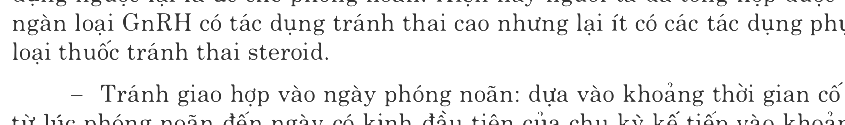

- **Phương pháp theo dõi thân nhiệt cơ sở:** Đo thân nhiệt vào mỗi buổi sáng ngay sau khi thức dậy; sau khi phóng noãn, progesteron làm thân nhiệt tăng vọt khoảng $0,3 - 0,5^\circ\text{C}$ và duy trì suốt pha hoàng thể. Kiêng giao hợp cho đến khi nhiệt độ đã tăng cao được ít nhất $3$ ngày.
- **Phương pháp cho con bú vô kinh (LAM):** Động tác bú thường xuyên của trẻ ức chế giải phóng $\text{G}_n\text{RH}$ và gonadotropin, ngăn cản sự phát triển của nang noãn và gây vô kinh tự nhiên trong $6$ tháng đầu sau sinh.

##### 2.8.1.3. Biện pháp cơ học và dụng cụ tử cung
- **Bao cao su (nam và nữ):** Ngăn cản tinh trùng tiếp xúc với âm đạo và cổ tử cung; ưu điểm lớn nhất là biện pháp duy nhất giúp phòng ngừa hiệu quả các bệnh lây truyền qua đường tình dục (HIV, lậu, giang mai, viêm gan B/C).
- **Màng ngăn âm đạo và mũ tử cung:** Che kín lỗ ngoài cổ tử cung ngăn cản tinh trùng xâm nhập.
- **Dụng cụ tử cung (IUD - Vòng tránh thai):**
  + Là vật thể lạ bằng chất dẻo (thường có quấn dây đồng hoặc phóng thích progestin) được đặt vào buồng tử cung.
  + Cơ chế tác dụng: Gây phản ứng viêm vô khuẩn cục bộ tại lớp đệm niêm mạc tử cung, thu hút các tế bào bạch cầu đa nhân và đại thực bào tiết ra các enzym và cytokin làm tiêu hủy tinh trùng và ngăn cản phôi làm tổ; ion đồng giải phóng có tác dụng gây độc và làm giảm sức sống của tinh trùng; IUD chứa hormon làm teo mỏng niêm mạc tử cung.

#### 2.8.2. Các biện pháp tránh thai vĩnh viễn (Triệt sản)
- **Thắt và cắt ống dẫn tinh ở nam giới (Vasectomy):**
  + Là tiểu phẫu đơn giản làm gián đoạn đường dẫn tinh từ mào tinh hoàn lên túi tinh. Tinh trùng không thể đi vào tinh dịch khi xuất tinh.
  + *Đặc điểm sinh lý quan trọng:* Thủ thuật hoàn toàn không ảnh hưởng đến các tế bào Leydig, do đó nồng độ testosteron trong máu, sự bài tiết dịch của túi tinh và tuyến tiền liệt, khả năng cương dương, khoái cảm và hoạt động tình dục của nam giới vẫn diễn ra hoàn toàn bình thường. Tinh trùng bị chặn lại tại mào tinh hoàn sẽ bị các đại thực bào tiêu hóa và tái hấp thu.
- **Thắt và cắt vòi tử cung ở nữ giới (Tubal ligation):**
  + Làm gián đoạn sự thông thương của vòi trứng, ngăn cản noãn gặp tinh trùng.
  + *Đặc điểm sinh lý quan trọng:* Hai buồng trứng vẫn được tưới máu và hoạt động nội tiết bình thường, chu kỳ hormon và chu kỳ kinh nguyệt hằng tháng của người phụ nữ không bị thay đổi.

---

### 2.9. Đại cương về vô sinh - hiếm muộn và hỗ trợ sinh sản

#### 2.9.1. Định nghĩa và dịch tễ học
- **Định nghĩa:** Vô sinh - hiếm muộn là tình trạng một cặp vợ chồng chung sống, có quan hệ tình dục đều đặn (trung bình $2 - 3$ lần/tuần), không sử dụng bất kỳ biện pháp tránh thai nào mà sau $12$ tháng (đối với người vợ dưới $35$ tuổi) hoặc sau $6$ tháng (đối với người vợ từ $35$ tuổi trở lên) vẫn chưa thể thụ thai.
- **Phân loại:**
  + *Vô sinh nguyên phát (Primary infertility):* Cặp vợ chồng chưa từng có thai lần nào.
  + *Vô sinh thứ phát (Secondary infertility):* Người vợ đã từng có thai ít nhất một lần (dù sinh con, sảy thai hoặc nạo hút thai) nhưng sau đó không thể có thai lại.
- **Dịch tễ học tại Việt Nam:** Nghiên cứu dịch tễ trên diện rộng của Trường Đại học Y Hà Nội phối hợp với Bệnh viện Phụ Sản Trung ương cho thấy tỷ lệ vô sinh ở các cặp vợ chồng trong độ tuổi sinh sản tại Việt Nam là khoảng $7,7\%$ (tương đương khoảng $1$ triệu cặp vợ chồng), trong đó tỷ lệ vô sinh nguyên phát chiếm khoảng $3,9\%$ và vô sinh thứ phát chiếm $3,8\%$. Nguyên nhân xuất phát từ người chồng chiếm khoảng $40\%$, từ người vợ chiếm khoảng $40\%$, do cả hai vợ chồng chiếm $10\%$, và khoảng $10\%$ còn lại là vô sinh chưa rõ nguyên nhân.

#### 2.9.2. Các nguyên nhân gây vô sinh - hiếm muộn
- **Nguyên nhân do người chồng:**
  + Bất thường về số lượng và chất lượng tinh trùng (chiếm tới $90\%$ các trường hợp vô sinh nam): vô tinh (azoospermia), thiểu tinh (oligospermia), tinh trùng yếu (asthenozoospermia), tinh trùng dị dạng (teratozoospermia).
  + Rối loạn chức năng nội tiết trục dưới đồi - tuyến yên - tinh hoàn (giảm tiết $\text{G}_n\text{RH}$, LH, FSH hoặc testosteron).
  + Tổn thương thực thể: giãn tĩnh mạch thừng tinh, ẩn tinh hoàn, tắc ống dẫn tinh do viêm nhiễm, chấn thương hoặc phẫu thuật.
  + Tác động của môi trường: phơi nhiễm hóa chất độc hại, bức xạ, nhiệt độ vùng bìu quá cao, nghiện rượu bia, thuốc lá, căng thẳng thần kinh.
- **Nguyên nhân do người vợ:**
  + Tổn thương vòi tử cung: viêm tắc, dính hoặc ứ dịch vòi tử cung cản trở tinh trùng và noãn gặp nhau (chiếm tỷ lệ hàng đầu).
  + Rối loạn phóng noãn: suy trục dưới đồi - tuyến yên, hội chứng buồng trứng đa nang (PCOS), suy buồng trứng sớm, tăng prolactin máu.
  + Bất thường tại tử cung và cổ tử cung: u xơ tử cung dưới niêm mạc, polyp buồng tử cung, dính buồng tử cung (hội chứng Asherman), dị dạng tử cung bẩm sinh, viêm dính cổ tử cung hoặc chất nhầy cổ tử cung chứa kháng thể kháng tinh trùng.
  + Lạc nội mạc tử cung (Endometriosis).

#### 2.9.3. Các kỹ thuật hỗ trợ sinh sản chủ yếu
1. **Bơm tinh trùng vào buồng tử cung (Intrauterine Insemination - IUI):**
   - Mẫu tinh dịch của người chồng được xử lý trong phòng xét nghiệm (lọc rửa, loại bỏ tinh tương, vi khuẩn và các tinh trùng chết/dị dạng, cô đặc các tinh trùng có độ di động tiến tới nhanh).
   - Tinh trùng lọc rửa được bơm trực tiếp qua ống thông mềm vào buồng tử cung của người vợ tại thời điểm rụng trứng, giúp rút ngắn quãng đường di chuyển và tăng mật độ tinh trùng tiếp cận noãn.
2. **Thụ tinh trong ống nghiệm (In Vitro Fertilization - IVF):**
   - Người vợ được kích thích buồng trứng bằng hormon để nhiều nang noãn phát triển đồng thời.
   - Chọc hút noãn trưởng thành qua ngả âm đạo dưới hướng dẫn của siêu âm.
   - Cho noãn thụ tinh với tinh trùng đã lọc rửa trong môi trường nuôi cấy nhân tạo chuyên biệt để tạo thành phôi. Phôi được nuôi cấy trong tủ ấm từ $3$ đến $5$ ngày (đạt giai đoạn phôi phân chia hoặc phôi nang - blastocyst) rồi chuyển vào buồng tử cung của người mẹ.
3. **Tiêm tinh trùng vào bào tương noãn (Intracytoplasmic Sperm Injection - ICSI):**
   - Là bước phát triển đột phá của kỹ thuật IVF: Sử dụng hệ thống vi thao tác tinh vi để chọn lọc một tinh trùng duy nhất có hình thái tốt và tiêm thẳng trực tiếp vào bào tương của một noãn bào trưởng thành.
   - Chỉ định đặc biệt hiệu quả cho các trường hợp nam giới thiểu tinh nặng, tinh trùng bất động, hoặc tinh trùng thu được từ phẫu thuật.
4. **Trưởng thành noãn non trong ống nghiệm (In Vitro Maturation - IVM):**
   - Chọc hút các noãn non chưa trưởng thành từ các nang noãn nhỏ ở người phụ nữ không cần hoặc chỉ cần kích thích buồng trứng tối thiểu (rất phù hợp cho phụ nữ mắc hội chứng buồng trứng đa nang nhằm tránh hội chứng quá kích buồng trứng).
   - Noãn non được nuôi cấy trong môi trường giàu hormon đặc biệt để hoàn tất quá trình trưởng thành ngoài cơ thể trước khi tiến hành thụ tinh bằng ICSI.
5. **Thu thập tinh trùng bằng phẫu thuật:**
   - Áp dụng cho các trường hợp vô tinh do tắc nghẽn hoặc không do tắc nghẽn: Chọc hút tinh trùng từ mào tinh hoàn qua da (PESA), vi phẫu thuật hút tinh trùng từ mào tinh hoàn (MESA), hoặc trích hút/sinh thiết mô tinh hoàn tìm tinh trùng (TESE/micro-TESE) để phục vụ cho kỹ thuật ICSI.

---

## CÂU HỎI TỰ LƯỢNG GIÁ

1. Trình bày các giai đoạn của quá trình sản sinh tinh trùng tại ống sinh tinh và vai trò dinh dưỡng, kiểm soát của tế bào Sertoli.
2. Trình bày nguồn gốc, bản chất hóa học, tác dụng sinh lý của testosteron và cơ chế điều hòa bài tiết testosteron theo trục vùng dưới đồi - tuyến yên - tinh hoàn.
3. Trình bày vai trò của inhibin trong cơ chế điều hòa ngược âm tính chọn lọc đối với hormon FSH của tuyến yên.
4. Nêu các yếu tố ảnh hưởng đến sự sản sinh tinh trùng (nhiệt độ, pH, hormon, hóa chất, phóng xạ).
5. Phân tích các thông số cơ bản của tinh dịch đồ theo chuẩn WHO và giá trị chẩn đoán của tinh dịch đồ trong đánh giá khả năng sinh sản của nam giới.
6. Trình bày nguồn gốc, bản chất hóa học, tác dụng của estrogen lên cơ quan sinh dục nữ, xương và quá trình chuyển hóa.
7. Trình bày nguồn gốc, bản chất hóa học, tác dụng của progesteron lên niêm mạc tử cung, thân nhiệt và vai trò an thai của progesteron.
8. Trình bày diễn biến của nồng độ các hormon tuyến yên (FSH, LH) và buồng trứng (estrogen, progesteron) trong chu kỳ kinh nguyệt $28$ ngày.
9. Giải thích cơ chế điều hòa ngược dương tính của estrogen dẫn đến đỉnh LH và cơ chế vỡ nang gây phóng noãn.
10. Phân tích cơ chế gây chảy máu kinh nguyệt ở giai đoạn cuối của chu kỳ khi hoàng thể thoái hóa.
11. Trình bày những biến đổi về thể chất, tâm lý và cơ chế hoạt động của trục dưới đồi - tuyến yên - tuyến sinh dục trong thời kỳ dậy thì ở nam và nữ.
12. Trình bày nguyên nhân và các biểu hiện lâm sàng của thời kỳ mãn kinh ở phụ nữ do suy giảm nồng độ estrogen.
13. Mô tả các giai đoạn của quá trình thụ tinh, phản ứng cực đầu của tinh trùng và cơ chế phản ứng vỏ ngăn ngừa hiện tượng đa thụ tinh.
14. Trình bày quá trình di chuyển của phôi từ vòi tử cung vào buồng tử cung và cơ chế phôi làm tổ tại lớp nội mạc tử cung.
15. Trình bày các chức năng dinh dưỡng, hô hấp, bài tiết, bảo vệ và chức năng nội tiết của bánh rau (đặc biệt là các hormon hCG, estrogen, progesteron và hCS).
16. Phân tích cơ chế phát động cơn co tử cung trong chuyển dạ đẻ: vai trò của tỷ lệ estrogen/progesteron, phản xạ Ferguson của oxytocin và prostaglandin.
17. Phân tích cơ chế bài tiết sữa của prolactin và phản xạ tống xuất sữa của oxytocin khi trẻ mút núm vú; giải thích vì sao khi mang thai tuyến vú chưa tiết sữa.
18. Trình bày cơ chế sinh lý của các biện pháp tránh thai: viên thuốc tránh thai kết hợp, dụng cụ tử cung, phương pháp Ogino - Knaus và triệt sản vĩnh viễn.
