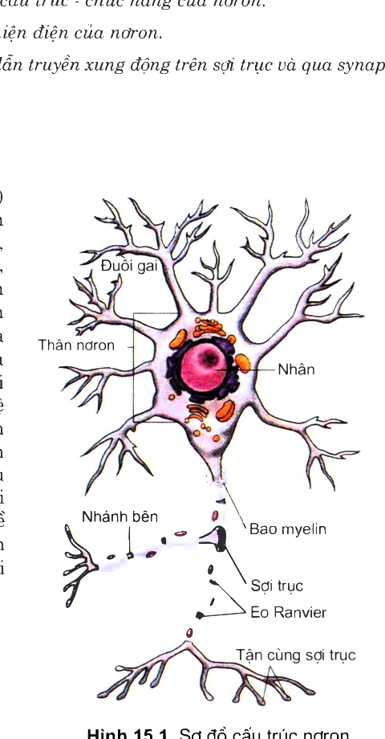
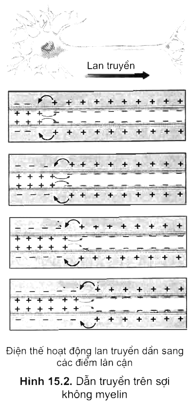
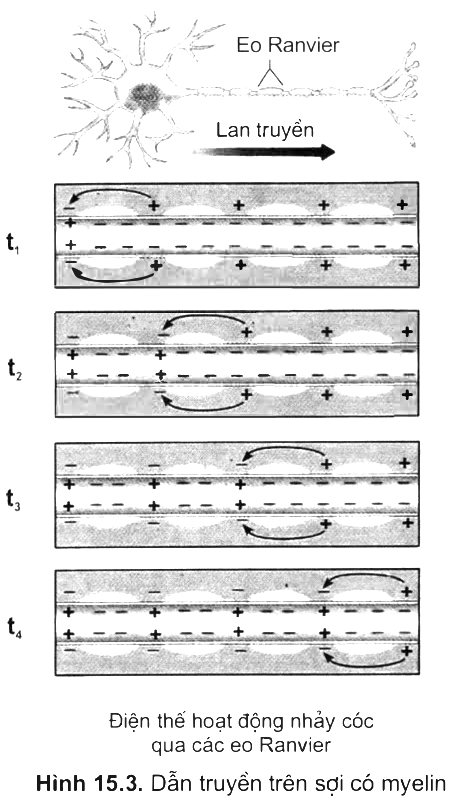
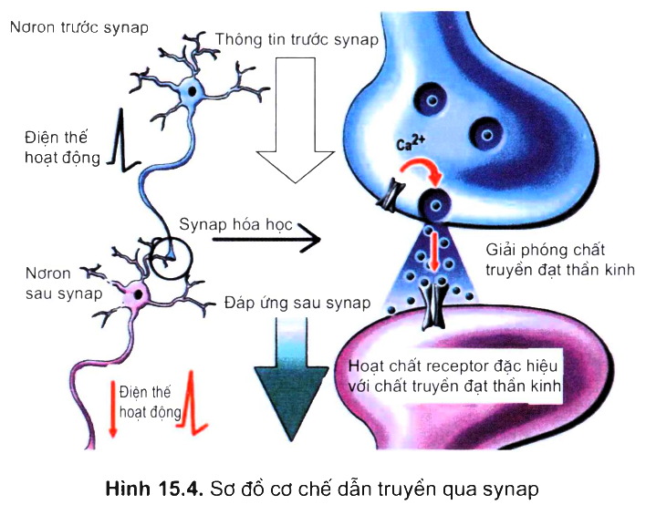
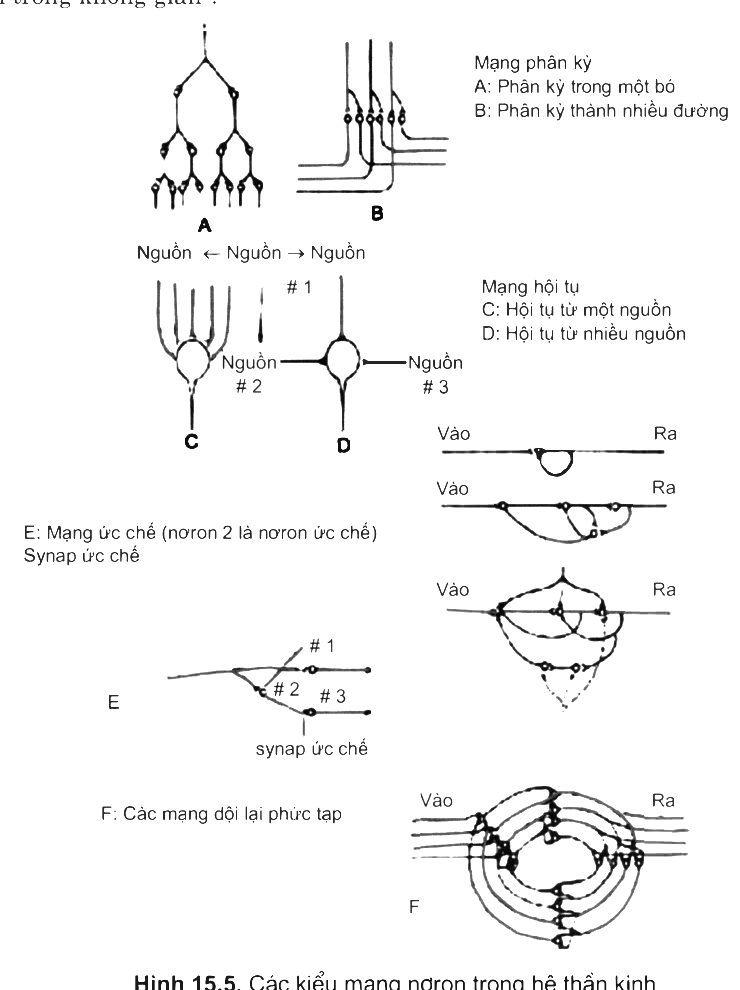

# BÀI 15: SINH LÝ NƠRON

## MỤC TIÊU
*Sau khi học xong bài này, sinh viên có khả năng:*
1. Trình bày được đặc điểm cấu trúc - chức năng của nơron.
2. Trình bày được các biểu hiện điện của nơron.
3. Trình bày được đặc điểm dẫn truyền xung động trên sợi trục và qua synap.

---

Nơron (tế bào thần kinh) là đơn vị cấu trúc (không liên tục mà tiếp xúc với nơron khác), là đơn vị chức năng (phát, truyền và nhận xung động), đơn vị dinh dưỡng (phần nào bị tách rời khỏi nơron thì thoái hóa) và là đơn vị bệnh lý (cái chết của một nơron không kéo theo cái chết của các nơron khác) của hệ thần kinh. Hệ thống thần kinh của người có từ 14 tỷ đến trên 100 tỷ nơron (theo các tài liệu khác nhau). Nơron có hình thái rất đa dạng và khác nhau về kích thước. Nơron có những phần chính là thân, sợi trục và sợi gai (*hình 15.1*).

---

## 1. ĐẶC ĐIỂM CẤU TRÚC - CHỨC NĂNG CỦA NƠRON

### 1.1. Cấu trúc của nơron

#### 1.1.1. Thân nơron
Thân nơron có hình dáng kích thước rất khác nhau. Ngoài nhân và các bào quan (lưới nội bào có hạt, ty thể, bộ máy Golgi,...), trong thân nơron còn có các xơ thần kinh và các ống siêu vi, các thể vùi (giọt lipid, hạt glycogen, sắc tố). Thân chứa nhiều ARN (tạo thành các thể Nissl), tập hợp các thân nơron tạo nên chất xám của hệ thần kinh. Trên màng của thân có các protein cảm thụ đặc hiệu (receptor) với chất truyền đạt thần kinh tương ứng.

#### 1.1.2. Sợi trục
Mỗi nơron chỉ có một sợi trục xuất phát từ thân nơron dài từ vài micromét đến vài chục centimét. Sợi trục có thể có nhánh ngang đi tới tế bào thần kinh, tế bào cơ hoặc tế bào tuyến. Đầu tận cùng sợi trục chia nhánh nhỏ dần và tận cùng bằng các cúc tận cùng. Trong cúc tận cùng có các bọc synap nhỏ chứa chất truyền đạt thần kinh (neurotransmitter). Trong sợi trục không có lưới nội bào có hạt và ribosom nhưng có nhiều xơ thần kinh, ống siêu vi, ty thể, lưới nội bào trơn.

Có hai loại sợi trục là **sợi không myelin** và **sợi có myelin**. Các tế bào Schwann bao bọc quanh sợi trục, cuộn thành nhiều lớp tạo thành vỏ Schwann. Giữa các lớp cuộn có chứa chất lipoprotein là myelin. Lớp này có tính cách điện. Bao myelin không liên tục, bị đứt quãng ở **eo Ranvier** (cách nhau $1 - 1,5\text{ mm}$ trên sợi trục). Sợi có myelin có trong chất trắng của các trung tâm thần kinh và ở các dây thần kinh ngoại biên. Có một số sợi không có chất myelin; các sợi này là các sợi không có myelin hay sợi xám.

#### 1.1.3. Sợi gai (đuôi gai)
Là các tua bào tương ngắn, phân nhánh ở gần thân và lan ra xung quanh thân nơron. Trừ nơron của hạch gai chỉ có một sợi gai, các nơron có nhiều sợi gai.

#### 1.1.4. Synap
Là chỗ tiếp nối giữa sợi trục của một nơron với một tế bào thần kinh khác hoặc với một tế bào đáp ứng khác (cơ, tuyến). Synap gồm:
- **Màng trước synap:** màng của các cúc tận cùng của sợi trục.
- **Khe synap:** rộng khoảng $10 - 40\text{ nm}$.
- **Màng sau synap:** màng của tế bào thần kinh, tế bào cơ hoặc tế bào tuyến.

Tận cùng trước synap có nhiều hình dạng khác nhau nhưng phần lớn giống như những cúc hình tròn hoặc hình trứng nên được gọi là cúc tận cùng. Bên trong các cúc tận cùng có các bọc nhỏ và ty thể. Các bọc nhỏ chứa chất truyền đạt thần kinh là những chất khi được giải phóng vào khe synap sẽ kích thích hoặc ức chế nơron sau synap tùy theo receptor có trên màng sau synap. Các ty thể sản xuất ATP cần cho quá trình tổng hợp chất truyền đạt thần kinh.

---

### 1.2. Các chất truyền đạt thần kinh (neurotransmitter)
Hiện nay, người ta xác định được khoảng hơn 40 chất hóa học được coi là chất truyền đạt ở synap. Các chất này được chia thành hai nhóm: nhóm có phân tử nhỏ và nhóm có phân tử lớn.

#### 1.2.1. Nhóm có phân tử nhỏ
Là những chất có tác dụng lên receptor tương ứng trong thời gian cực ngắn, gây ra các đáp ứng cấp của hệ thần kinh (dẫn truyền tín hiệu cảm giác và dẫn truyền tín hiệu vận động). Hầu hết các chất này được tổng hợp ở cytosol của cúc tận cùng rồi được hấp thu theo cơ chế tích cực vào các bọc nhỏ. Mỗi loại nơron chỉ tổng hợp và giải phóng một chất dẫn truyền có phân tử nhỏ. Phần lớn các chất này ảnh hưởng lên các kênh ion (làm tăng hoặc giảm hoạt động kênh), chỉ có một vài chất là tác động lên enzym. Các chất điển hình trong nhóm này là:

- **Acetylcholin:** được sản xuất ở các nơron trong nhiều vùng của vỏ não, một số nhân nền não, nơron trước hạch của hệ thần kinh tự chủ, nơron sau hạch của hệ phó giao cảm,... Acetylcholin có tác dụng kích thích nơron sau, trừ ở tận cùng phó giao cảm là có tác dụng ức chế.
- **Noradrenalin:** được tổng hợp ở các nơron trong não và vùng dưới đồi. Noradrenalin của sợi sau hạch giao cảm hoạt hóa các receptor ở một số nơi và ức chế receptor ở một số nơi khác.
- **Dopamin:** được các nơron của chất đen và các nhân nền giải phóng, có tác dụng gây ức chế (ưu phân cực màng sau synap) nếu gắn với receptor $\text{D}_2$.
- **GABA (gamma aminobutyric acid):** được bài tiết ở các cúc tận cùng trong tủy sống, tiểu não, nhân nền và ở nhiều vùng của vỏ não, có tác dụng ức chế.
- **Serotonin:** do các nhân ở não giữa và một số vùng khác của não, sừng sau tủy sống và vùng dưới đồi sản xuất. Serotonin có tác dụng ức chế đường dẫn truyền cảm giác đau ở tủy sống, có vai trò trong hoạt động cảm xúc và giấc ngủ.
- **Glycin:** có tác dụng làm mở kênh clo nên gây ức chế.

Sau khi hòa màng với màng trước synap và giải phóng chất truyền đạt, các bọc nhỏ trở thành một phần của màng trước synap. Sau vài giây đến vài phút, phần màng này lại lõm vào trong rồi khép kín lại để trở thành bọc mới. Bọc mới vẫn có các protein vận chuyển cần thiết để đưa các phân tử mới được tổng hợp vào bên trong bọc.

#### 1.2.2. Nhóm có phân tử lớn
Gồm các chất có bản chất là peptid nên còn được gọi là **các peptid thần kinh (neuropeptides)**. Các chất này có tác dụng chậm. Các peptid thần kinh là một phần của những phân tử protein lớn do ribosom trong thân nơron tổng hợp. Các phân tử protein này được vận chuyển ngay vào mạng lưới nội bào. Mạng lưới nội bào và bộ máy Golgi phân cắt chúng thành những mảnh nhỏ hơn, tạo thành các peptid não hoặc thành các tiền chất của chúng. Sau đấy, bộ máy Golgi đưa các chất này vào các bọc chứa và các bọc này lại được đưa ra bào tương rồi được vận chuyển tới đầu sợi trục với tốc độ vài centimét/ngày.

Mỗi loại nơron có thể tổng hợp và giải phóng một hay nhiều peptid não khác nhau. Tại các cúc tận cùng, các peptid não được giải phóng giống như hiện tượng xảy ra với các chất truyền đạt có phân tử nhỏ nhưng các bọc không được tái sử dụng. Lượng peptid não được giải phóng ít hơn nhưng tác dụng của chúng lại mạnh hơn hàng nghìn lần so với chất truyền đạt có phân tử nhỏ. Tốc độ tạo thành các peptid não cũng chậm hơn rất nhiều so với các chất truyền đạt có phân tử nhỏ. Các peptid não thường gây các tác dụng kéo dài như đóng kênh canxi, làm thay đổi bộ máy chuyển hóa của tế bào, hoạt hóa hoặc bất hoạt gen và tác dụng lâu dài lên receptor (có thể vài ngày đến vài năm). Chức năng của các peptid còn chưa được biết hết. Một số chất điển hình của nhóm này là endorphin, vasopressin, encephalin, chất P, neurotensin, gastrin,...

#### Bảng so sánh đặc điểm hai nhóm chất truyền đạt thần kinh:

| Đặc điểm | Nhóm phân tử nhỏ | Nhóm phân tử lớn (Neuropeptid) |
| :--- | :--- | :--- |
| **Nơi tổng hợp** | Cytosol của cúc tận cùng | Thân nơron (bởi ribosom, lưới nội bào, Golgi) |
| **Vận chuyển** | Đóng bọc ngay tại cúc tận cùng | Vận chuyển dòng bào tương dọc sợi trục ($vài\text{ cm/ngày}$) |
| **Bọc chứa** | Được tái sử dụng (hòa màng rồi lõm lại) | Không được tái sử dụng |
| **Tốc độ & thời gian tác dụng** | Nhanh, ngắn ngủi (vài phần nghìn giây) | Chậm, kéo dài (vài ngày đến vài năm) |
| **Cường độ tác dụng** | Bình thường | Rất mạnh (gấp hàng nghìn lần) |
| **Cơ chế tác động** | Mở/đóng kênh ion (thay đổi tính thấm) | Đổi bộ máy chuyển hóa, gen, đóng kênh $\text{Ca}^{2+}$ |
| **Ví dụ điển hình** | Acetylcholin, Noradrenalin, Dopamin, GABA, Glycin, Serotonin | Endorphin, Encephalin, Chất P, Vasopressin, Neurotensin |

#### 1.2.3. Chuyển hóa chất truyền đạt thần kinh
Sau khi đã phát huy tác dụng, các chất truyền đạt trung gian bị khử hoạt nhanh chóng nhờ vậy nơron sau không bị kích thích kéo dài.

Các chất có phân tử nhỏ bị khử hoạt trong vòng vài phần nghìn giây, tùy theo từng chất có thể theo ba con đường:
1. Khuếch tán khỏi khe synap vào các dịch xung quanh.
2. Được tái hấp thu tích cực vào cúc tận cùng và được sử dụng lại, thường xảy ra với noradrenalin ở các cúc tận cùng của hệ giao cảm.
3. Bị enzym đặc hiệu phân giải ngay tại khe synap. Ví dụ, acetylcholin bị acetylcholinesterase (gắn với collagen và glycosaminoglycan lấp đầy khe synap) phân giải thành ion acetat và cholin; một phân tử cholinesterase có thể thủy phân 10 phân tử acetylcholin trong $1/1000\text{ giây}$. Noradrenalin bị enzym monoamin oxidase ở các tận cùng thần kinh và catechol-O-methyltransferase có ở mọi mô phân giải.

Các chất có phân tử lớn chủ yếu khuếch tán ra các mô xung quanh rồi bị phá hủy trong vài phút cho đến vài giờ nhờ các enzym đặc hiệu hoặc không đặc hiệu.

---

## 2. HƯNG PHẤN Ở NƠRON

### 2.1. Đặc điểm hưng phấn của nơron
Giống như mọi tế bào sống khác, nơron có tính hưng phấn mà một trong các biểu hiện là sự xuất hiện điện thế hoạt động do sự khử cực màng tế bào. Sự phân cực của màng trong trạng thái nghỉ (điện thế nghỉ) và sự khử cực màng trong trạng thái hưng phấn (điện thế hoạt động) là hậu quả của sự thay đổi tính thấm đối với các ion $\text{Na}^+$ và $\text{K}^+$ (xem Bài 4: Sinh lý điện thế màng và điện thế hoạt động). Khi hưng phấn, chuyển hóa của nơron tăng: nhu cầu oxy tăng, sản xuất nhiều $\text{NH}_3$, tăng tạo acetylcholin và glutamin,...

So với các tế bào khác, nơron có tính hưng phấn cao hơn rất nhiều tức là ngưỡng kích thích của nơron rất thấp. Các kích thích có thể là từ môi trường bên ngoài (ánh sáng, âm thanh, nhiệt độ, áp suất,...), từ bên trong cơ thể (thay đổi áp suất khí trong máu, áp suất lên thành mạch...); thậm chí có những nơron đều đặn tự phát xung động một cách nhịp nhàng (ví dụ, nơron ở trung tâm hô hấp). Nơron có hoạt tính chức năng cao tức là có khả năng đáp ứng với các kích thích nhịp nhàng có tần số cao.

Với một kích thích có cường độ bằng hoặc cao hơn ngưỡng thì điện thế được dẫn truyền đến các vùng khác ngoài điểm kích thích và tại chỗ xuất phát của sợi trục xuất hiện điện thế hoạt động. Điện thế hoạt động được dẫn truyền dọc theo sợi trục tới các nhánh tận cùng rồi tới các cúc tận cùng và gây giải phóng chất truyền đạt thần kinh.

### 2.2. Sự dẫn truyền điện thế hoạt động trên sợi trục nơron
Một khi đã được tạo ra tại một điểm bất kỳ trên màng nơron, điện thế hoạt động sẽ kích thích các điểm lân cận và làm cho nó được lan truyền ra toàn bộ màng. Đây là quy luật **“tất cả hoặc không”** được áp dụng cho mọi mô có tính hưng phấn.

Sự dẫn truyền điện thế hoạt động trên sợi trục có những đặc điểm sau:
- Xung động chỉ được dẫn truyền trên nơron nguyên vẹn về mặt chức năng.
- Trên sợi trục, xung động được dẫn truyền theo cả hai hướng. Hướng đi tới các nhánh tận cùng của sợi trục là **hướng thuận**, hướng đi tới các đuôi gai của chính nơron ấy là **chiều nghịch**.
- Cường độ kích thích càng lớn thì tần số xung động xuất hiện trên sợi trục càng cao chứ không phải là biên độ xung động tăng. Do đó, mặc dù nơron hưng phấn theo định luật “tất cả hoặc không” nhưng hệ thần kinh vẫn nhận biết được kích thích là mạnh hay yếu.
- Trong một bó sợi trục, xung động chỉ được dẫn truyền theo chiều dọc của sợi có xung động, không lan tỏa ra các sợi lân cận. Do đó, thông tin thần kinh được truyền chính xác tới nơi cần phải đến.
- Tốc độ dẫn truyền tỷ lệ thuận với đường kính sợi trục (*xem bảng 15.1*).

#### Dẫn truyền ở sợi không myelin:
Ở sợi không myelin, xung động được dẫn truyền từ điểm hưng phấn sang hai điểm liền kề ở hai bên và cứ thế dọc theo chiều dài của sợi trục (*hình 15.2*). Tính thấm với ion $\text{Na}^+$ tại điểm bị kích thích tăng lên đột ngột. Tại điểm bị kích thích (có khử cực), dòng điện từ màng hướng vào trong còn ở nơi không bị khử cực thì dòng điện hướng ra ngoài. Khi đi qua nơi màng chưa bị khử cực, dòng điện làm tính thấm với natri tại chỗ ấy tăng, ion $\text{Na}^+$ ồ ạt đi vào và làm khử cực tại nơi ấy. Các dòng điện tại các điểm mới bị khử cực lại gây ra các dòng điện tại chỗ lan sang các điểm lân cận. Như vậy xung động điện được truyền theo cả hai hướng. Tốc độ dẫn truyền trên sợi không myelin tỷ lệ với căn bậc hai của đường kính sợi (khoảng $0,5\text{ m/s}$ ở những sợi có đường kính rất nhỏ), chậm hơn tốc độ dẫn truyền trên sợi có myelin.

#### Dẫn truyền ở sợi có myelin:
Ở sợi có myelin (*hình 15.3*): màng tế bào Schwann chứa chất sphingomyelin bao quanh sợi trục làm nhiều lớp. Sphingomyelin có tính cách điện tốt, ngăn cản sự khuếch tán của các ion. Các tế bào Schwann dài chừng $1\text{ mm}$ và không liên tục, giữa các tế bào Schwann có khoảng trống không có chất myelin được gọi là **eo Ranvier**. Tại eo Ranvier, tính thấm của màng với ion cao hơn màng của một số sợi không myelin tới 500 lần. Điện thế hoạt động được truyền **nhảy cách (nhảy cóc)** từ eo Ranvier này sang eo Ranvier kế tiếp dọc theo chiều dài sợi trục.

Dẫn truyền theo lối nhảy cách có hai ưu điểm lớn:
1. **Tốc độ dẫn truyền nhanh hơn rất nhiều** so với sợi không myelin cùng kích thước. Tốc độ dẫn truyền trên sợi có myelin tỷ lệ thuận với đường kính của sợi, có thể đạt tới $130\text{ m/s}$ ở các sợi có đường kính lớn.
2. **Tiết kiệm được nhiều năng lượng** cho nơron vì sự khử cực đòi hỏi năng lượng chỉ xảy ra ở các eo Ranvier, lượng ion qua lại màng ít hơn so với lối dẫn truyền liên tiếp đến hàng trăm lần nên ít tốn năng lượng để tái vận chuyển ion qua màng.

Dựa vào sự có bao myelin hay không và tốc độ dẫn truyền trên sợi trục, người ta phân chia các sợi theo bảng dưới đây (*bảng 15.1*).

#### Bảng 15.1. Phân loại sợi theo tốc độ dẫn truyền

| Loại sợi | Chức năng | Đường kính ($\mu\text{m}$) | Tốc độ truyền ($\text{m/s}$) |
| :---: | :--- | :---: | :---: |
| **$\text{A}\alpha$** | Sợi cảm giác ở suốt cơ, thị giác, sợi vận động cơ vân | 15 $(9 - 20)$ | $70 - 120$ |
| **$\text{A}\beta$** | Sợi truyền xúc giác (da) | 8 | $30 - 70$ |
| **$\text{A}\gamma$** | Sợi vận động ở suốt cơ | 5 | $15 - 45$ |
| **$\text{A}\delta$** | Dẫn truyền cảm giác nhiệt và đau “nhanh” (da) | 3 | $5 - 30$ |
| **B** | Sợi trước hạch giao cảm | 3 | $3 - 15$ |
| **C** | Dẫn truyền cảm giác đau “chậm”, sợi sau hạch giao cảm (không có myelin) | 1 $(0,5 - 2)$ | $0,5 - 2$ |

---

## 3. DẪN TRUYỀN QUA SYNAP

### 3.1. Sự dẫn truyền ở synap hóa học
Sự dẫn truyền ở tuyệt đại đa số synap trong hệ thần kinh trung ương là thông qua các chất truyền đạt thần kinh (*neurotransmitter*). Các chất truyền đạt được tổng hợp ở các tận cùng thần kinh, được chứa trong các bọc nhỏ ở cúc tận cùng và được giải phóng vào khe synap bởi cơ chế xuất bào (*exocytosis*) khi điện thế hoạt động lan tới cúc tận cùng.

Chất truyền đạt khuếch tán trong khe synap và tới gắn vào các receptor đặc hiệu ở màng sau synap. Màng sau synap có các receptor kích thích và receptor ức chế.

### 3.2. Sự giải phóng chất truyền đạt ở cúc tận cùng
Màng cúc tận cùng có nhiều kênh canxi đóng mở theo điện thế. Điện thế hoạt động tới cúc tận cùng làm mở các kênh canxi ở màng cúc tận cùng, ion $\text{Ca}^{2+}$ đi vào trong tế bào. Nồng độ ion $\text{Ca}^{2+}$ trong tế bào cao làm các bọc nhỏ gắn vào các vị trí gắn và hòa màng với màng trước synap, chất truyền đạt chứa trong bọc được giải phóng vào khe synap. Chất truyền đạt khuếch tán trong khe synap và tới gắn vào các receptor tương ứng gây hiệu ứng ở màng sau synap. Lượng ion $\text{Ca}^{2+}$ vào tế bào càng nhiều thì lượng chất truyền đạt được giải phóng càng lớn.

### 3.3. Tác dụng của chất truyền đạt lên nơron sau synap
Màng của nơron sau synap có chứa các receptor là các protein cảm thụ. Các protein này có hai phần: phần gắn với chất truyền đạt là phần thò ra ngoài màng phía khe synap và phần protein vào bên trong nơron. Có hai loại protein xuyên vào bên trong nơron: một là loại kênh được hoạt hóa hóa học còn loại kia là một enzym làm thay đổi chuyển hóa tế bào.

- **Các kênh được hoạt hóa khi receptor gắn với chất truyền đạt:** Có ba loại kênh là kênh natri cho ion $\text{Na}^+$ vào tế bào, kênh kali cho ion $\text{K}^+$ đi ra ngoài tế bào và kênh clo cho ion $\text{Cl}^-$ đi vào tế bào.
  - **Kênh natri mở:** gây khử cực và hưng phấn ở nơron; chất truyền đạt làm mở kênh natri được gọi là **chất truyền đạt kích thích**. Các chất gây kích thích (ví dụ, acetylcholin, glutamat, noradrenalin,...) là các chất khi gắn vào receptor đặc hiệu ở màng sau synap làm mở kênh natri. Các kênh này mở ra làm các ion $\text{Na}^+$ vào tế bào, gây khử cực ở màng sau synap và tạo ra **điện thế kích thích sau synap (EPSP - Excitatory Postsynaptic Potential)**.
  - **Kênh kali và kênh clo mở:** làm lượng kali đi ra ngoài tăng và lượng clo vào trong tăng, gây **ưu phân cực ở màng** (mặt trong âm hơn nữa so với mặt ngoài) nên nơron sau bị ức chế; chất truyền đạt làm mở hai kênh này được gọi là **chất truyền đạt ức chế**. Các chất gây ức chế (ví dụ glycin, GABA,...) là các chất khi gắn vào receptor đặc hiệu làm đóng các kênh natri hoặc làm mở kênh kali hoặc kênh clo nên gây ưu phân cực ở màng sau synap và tạo ra **điện thế ức chế sau synap (IPSP - Inhibitory Postsynaptic Potential)**, làm cho nơron sau synap khó khử cực, đòi hỏi kích thích phải có cường độ mạnh hơn mới đủ để gây hưng phấn ở nơron này.
- **Các receptor là enzym:** bị hoạt hóa gây ra các hiệu ứng khác nhau lên nơron sau synap:
  - Hoạt hóa bộ máy chuyển hóa của nơron, tạo ra nhiều AMP vòng và chất này xúc tác các phản ứng trong nơron.
  - Hoạt hóa hệ gen làm tăng tổng hợp receptor.
  - Hoạt hóa các protein kinase trong tế bào làm giảm tổng hợp receptor.
  Những thay đổi trên có thể làm thay đổi tính đáp ứng của nơron trong nhiều phút, nhiều giờ, thậm chí tới hàng năm. Có lẽ các chất này có vai trò đối với trí nhớ.

Các xung động theo chiều nghịch về thân tế bào, tới các đuôi gai thì bị tắt, không kích thích được nơron khác vì ở đuôi gai không có chất trung gian truyền đạt thần kinh.

### 3.4. Chậm synap và mỏi synap

#### 3.4.1. Chậm synap
Quá trình thông tin được truyền qua synap phải qua nhiều bước: đưa các bọc nhỏ xuống, màng của bọc hòa màng với màng của cúc tận cùng, chất truyền đạt được giải phóng và khuếch tán trong khe synap, chất truyền đạt gắn với receptor ở màng sau synap, các kênh mở ra để các dòng ion đi qua gây khử cực màng sau synap. Tuy mỗi bước rất ngắn nhưng cả quá trình vẫn đòi hỏi một thời gian nhất định bởi vậy tốc độ dẫn truyền qua synap chậm hơn tốc độ dẫn truyền trên sợi trục. Đây là **hiện tượng chậm synap**.

#### 3.4.2. Mỏi synap
Nếu có nhiều kích thích liên tục, kéo dài qua synap thì lượng chất truyền đạt được sản xuất ra không kịp bù lại lượng đã tiêu hao; khi đó xung động không được dẫn truyền qua synap nữa hoặc được dẫn truyền kém đi rất nhiều, đó là **hiện tượng mỏi synap**. Trong lúc có mỏi synap, nếu kích thích vào nơron trước và nơron sau synap thì vẫn thấy có biểu hiện hưng phấn, chứng tỏ nơron không bị mỏi.

### 3.5. Một số yếu tố ảnh hưởng lên dẫn truyền ở synap
- **Ion $\text{Ca}^{2+}$:** làm các bọc nhỏ dễ di chuyển tới màng cúc tận cùng và dễ vỡ nên làm tăng dẫn truyền qua synap. Ion $\text{Mg}^{2+}$ có tác dụng ngược lại.
- **pH:** Nơron rất nhạy cảm với sự thay đổi pH trong dịch kẽ.
  - **Nhiễm kiềm:** làm tăng tính hưng phấn của nơron. Ví dụ, khi pH máu động mạch tăng lên đến $7,8 - 8,0$ thì thường xuất hiện co giật do tăng tính hưng phấn nơron; cơn động kinh dễ xuất hiện khi bệnh nhân động kinh tăng thở và bị nhiễm kiềm hô hấp.
  - **Nhiễm toan:** làm giảm tính hưng phấn của nơron. Người bị toan huyết do đái tháo đường, bị urê huyết cao thường bị hôn mê khi pH giảm xuống dưới 7,0.
- **Thiếu oxy:** Chỉ cần thiếu oxy trong vài giây cũng làm cho nơron bị mất tính hưng phấn. Điều này thường xảy ra khi tuần hoàn não bị gián đoạn tạm thời, bệnh nhân bị mất tri giác sau $3 - 5\text{ giây}$ thiếu máu.
- **Thuốc:**
  - Một số thuốc như **cafein, theophyllin, theobromin** làm tăng tính hưng phấn do làm giảm ngưỡng kích thích.
  - **Strychnin:** làm tăng tính hưng phấn do ức chế chất truyền đạt ức chế.
  - **Thuốc mê:** Phần lớn các thuốc mê làm tăng ngưỡng kích thích do đó làm giảm sự dẫn truyền qua synap ở nhiều nơi. Các thuốc mê tan trong mỡ có thể làm thay đổi tính thấm của màng khiến màng kém đáp ứng.
  - **Chất phong bế synap:** Một số chất tranh chấp với chất truyền đạt trung gian, chiếm các receptor đặc hiệu ở màng sau synap (ví dụ, chất **curare** chiếm các receptor của acetylcholin ở synap thần kinh - cơ; **atropin** chiếm các receptor ở hậu hạch phó giao cảm; **hexamethionum** chiếm các receptor ở hậu hạch giao cảm) và do đó phong bế synap.

### 3.6. Dẫn truyền điện qua synap (synap điện)
Ở một vài nơi (ví dụ: ở võng mạc, ở hành khứu), dẫn truyền qua synap được thực hiện nhờ sự dẫn điện thụ động phụ thuộc vào trương lực điện. Giữa các tế bào này có nối kết lỏng lẻo, cho phép dòng điện từ tế bào này được truyền sang tế bào khác. Khoảng cách giữa hai tế bào ở chỗ nối kết chỉ là $2\text{ nm}$. Tại chỗ nối kết có các cầu nối được tạo bởi các protein thuộc màng là **connexin**. Sáu phân tử connexin tạo thành một kênh nước. Kênh ở một tế bào nối với kênh của tế bào kia tạo thành chỗ nối kết lỏng lẻo, cho phép các phân tử nhỏ và các ion đi từ tế bào này sang tế bào kia, làm cho bào tương của chúng liên tục nhau. Khi điện thế hoạt động trên màng một tế bào lan đến chỗ kết nối, dòng điện đi qua chỗ nối để sang tế bào kia. Tại chỗ này, dòng điện có thể đi theo cả hai chiều bởi vậy tế bào có thể được coi như nơron trước hoặc nơron sau hạch. Kiểu kết nối này ít gặp trong hệ thần kinh trung ương nhưng có vai trò quan trọng đối với sự co cơ tim và cơ tạng. Do điện thế hoạt động được lan truyền nhanh từ tế bào này sang tế bào khác trong một tạng nên kiểu nối kết này làm cho mô hoạt động như một hợp bào.

---

## 4. HIỆN TƯỢNG CỘNG KÍCH THÍCH SAU SYNAP

Một tế bào thần kinh đồng thời nhận hàng ngàn thông tin kích thích và ức chế. Các thông tin này được tổng hợp lại nhờ quá trình “cộng kích thích”. Cúc tận cùng rất nhỏ và mỗi lần chỉ có một vài bọc giải phóng hóa chất; lượng chất truyền đạt trung gian này không đủ gây hưng phấn ở màng sau synap. Tuy nhiên, thời gian tác dụng lên màng sau synap tương đối dài nên nếu có thêm chất truyền đạt trung gian được giải phóng vào khe synap vào lúc tác dụng lần trước chưa tắt hẳn thì kích thích sau có thể “cộng” với kích thích trước và đủ để gây tác dụng.

### 4.1. Cộng kích thích theo không gian (Spatial summation)
Nếu chỉ có một cúc tận cùng giải phóng chất truyền đạt thì hầu như không bao giờ gây được hưng phấn ở nơron sau vì lượng này chỉ đủ để gây ra một điện thế kích thích không quá $0,5 - 1\text{ mV}$ trong khi cần phải $10 - 20\text{ mV}$ mới đạt tới ngưỡng kích thích. Tuy nhiên, thường có nhiều cúc tận cùng bị kích thích đồng thời và thậm chí khi các cúc tận cùng này giải phóng chất truyền đạt trên một vùng rộng của màng sau synap thì tác dụng của các cúc có thể được “cộng” lại, đủ để gây ra hưng phấn ở màng sau synap. Sở dĩ được như vậy là do điện thế được phân bố đồng đều trên màng nơron và tính dẫn điện của nơron rất tốt nên sự thay đổi điện thế ở một điểm trên thân nơron sẽ dẫn đến một sự thay đổi điện thế gần đúng như thế ở bất kỳ điểm nào khác trong tế bào. Do vậy, khi có nhiều kích thích đồng thời xảy ra tại các điểm khác nhau trên một diện lớn của cùng một màng sau synap thì các điện thế riêng lẻ được “cộng” lại và nếu đủ lớn, đạt tới ngưỡng kích thích thì gây ra điện thế hoạt động ở đoạn phát sinh sợi trục. Các đuôi gai cũng có vai trò quan trọng trong hiện tượng cộng kích thích trong không gian vì chúng tỏa rộng nên nhận được nhiều tín hiệu ở xung quanh thân nơron; hơn nữa, phần lớn các tận cùng trước synap tiếp xúc với đuôi gai nên phần lớn kích thích tới nơron là được truyền qua các đuôi gai.

### 4.2. Cộng kích thích theo thời gian (Temporal summation)
Chất truyền đạt do một cúc tận cùng giải phóng chỉ có tác dụng lên kênh ion trong khoảng $1\text{ ms}$ trong khi điện thế kích thích sau synap lại dài tới $15\text{ ms}$, nếu có một lần mở thứ hai trên kênh này thì điện thế sau synap sẽ tăng thêm một mức. Vì vậy, tần số kích thích càng cao thì hiệu ứng lên điện thế sau synap càng lớn. Nếu các điện thế kích thích sau synap xuất hiện liên tiếp nhau và đủ nhanh ở cùng một cúc tận cùng thì chúng có thể được “cộng” lại để làm nơron sau synap hưng phấn. Đây là hiện tượng cộng kích thích theo thời gian.

---

## 5. HIỆN TƯỢNG ỨC CHẾ TRƯỚC SYNAP

Nơi phát sinh điện thế hoạt động là chỗ xuất phát của sợi trục. Ngưỡng để tạo ra điện thế hoạt động ở nơi này là vào khoảng $-65\text{ mV}$.

Trong trường hợp có một điện thế kích thích và một điện thế ức chế tác động đồng thời lên cùng một nơron thì hai điện thế này triệt tiêu nhau hoàn toàn hoặc một phần. Nếu một nơron đang bị kích thích lại nhận một tín hiệu ức chế từ một nơron khác tới thì điện thế sau synap của nó có thể bị giảm xuống thấp hơn ngưỡng kích thích và hưng phấn của nó bị dập tắt. Mức độ hưng phấn hay ức chế của nơron là tổng đại số của các điện thế kích thích và điện thế ức chế tới nó trong cùng một thời điểm. Tổng các điện thế kích thích và ức chế lên nơron trong một thời điểm là điện thế tổng. Nếu điện thế tổng ở màng sau synap đủ lớn để làm khử cực chỗ xuất phát của sợi trục thì điện thế hoạt động xuất hiện. Nhiều khi điện thế kích thích lên màng sau vẫn gây được hưng phấn mặc dù chưa đạt đến ngưỡng kích thích bình thường. Trong trường hợp này, điện thế của màng gần ngưỡng kích thích hơn lúc bình thường nên tín hiệu từ một nguồn khác tới dễ gây hưng phấn hơn. Hiện tượng này được gọi là **sự thuận hóa hay sự thích nghi của nơron**. Các tín hiệu trong hệ thần kinh thường gây thuận hóa ở một nhóm lớn nơron giúp cơ thể đáp ứng nhanh và dễ dàng đối với các tín hiệu từ một nguồn thứ hai đi tới.

Lượng chất truyền đạt trung gian được giải phóng bị giảm nếu có *ức chế trước synap*. Chất GABA là chất truyền đạt điển hình có tác dụng ức chế này. Nơron chứa GABA tiếp xúc với nơron khác qua synap trục - trục. GABA làm giảm lượng ion $\text{Ca}^{2+}$ đi vào cúc tận cùng của nơron trước synap trong lúc đang có dẫn truyền. Trong ức chế trước synap, tính hưng phấn của nơron sau synap không bị giảm. Như vậy, ức chế trước synap chỉ ức chế một kích thích nhất định chứ không ảnh hưởng lên kích thích từ các synap khác tới.

Màng sau synap cũng có thể bị ức chế bởi GABA. Có nhiều loại receptor với GABA ở màng sau synap:
- **Receptor $\text{GABA}_A$:** gắn với GABA làm mở kênh clo nên làm giảm điện thế hoạt động khiến ion $\text{Ca}^{2+}$ vào tế bào ít đi dẫn đến lượng chất truyền đạt được giải phóng ít đi.
- **Receptor $\text{GABA}_B$:** gắn với GABA hoạt hóa protein G; protein này mở kênh kali nên gây ưu phân cực ở màng sau synap hoặc ức chế kênh $\text{Ca}^{2+}$.

Tổng điện thế ức chế sau synap làm tăng phân cực nên làm tăng ngưỡng, cản trở khử cực ở chỗ này. Bởi vậy, trái với ức chế trước synap, ức chế sau synap làm giảm tác dụng của mọi kích thích tới nơron.

Sự dẫn truyền xung động ở synap thần kinh cơ và ở các synap trong hệ thần kinh tự chủ được mô tả kỹ hơn trong các Bài 18 và 20.

---

## 6. DẪN TRUYỀN XUNG ĐỘNG TRONG MỘT HỆ THỐNG NƠRON

Hệ thần kinh trung ương được tạo nên từ vô vàn đám nơron riêng biệt, từ một vài cho đến rất nhiều nơron. Mỗi đám hay tập hợp nơron có những đặc điểm tổ chức riêng khiến chúng xử lý thông tin theo cách riêng và làm cho hệ thần kinh thực hiện được các chức năng rất đa dạng của mình. Dưới đây là các nguyên lý hoạt động chung của các tập hợp nơron.

### 6.1. Truyền tiếp tín hiệu trong một tập hợp thần kinh
Trong một tập hợp nơron có những “sợi vào” và những “sợi ra”. Mỗi sợi lại có hàng trăm hàng nghìn nhánh; mỗi nhánh lại chia thành hàng nghìn tận cùng tạo synap với các đuôi gai, sợi trục, thân của nơron khác. Các đuôi gai của một nơron cũng chia nhánh tỏa ra một vùng rộng xung quanh thân. Vùng chịu kích thích của một nơron được gọi là **trường chịu kích thích** của nơron đó. Các nơron càng ở xa thì càng nhận được ít tận cùng đi tới nó. Phải có nhiều cúc tận cùng đồng thời giải phóng hoặc giải phóng nhanh liên tiếp chất truyền đạt mới gây hưng phấn lên nơron sau nên những nơron ở xa cũng nhận kích thích song chưa đủ mức tới ngưỡng để hưng phấn. Tuy chưa hưng phấn nhưng các nơron này có điện thế màng gần ngưỡng kích thích hơn trước và trở nên dễ bị kích thích (hiện tượng thuận hóa của nơron). Từ điều này, chúng ta thấy một sợi vào có **vùng bị kích thích** (còn gọi là vùng tới ngưỡng) và **vùng dễ bị kích thích** (vùng được thuận hóa hay vùng dưới ngưỡng). Với sợi của nơron ức chế cũng có trường ức chế, vùng ức chế tương tự như các vùng của nơron kích thích.

### 6.2. Truyền theo cách phân kỳ
Hiện tượng phân kỳ là hiện tượng tín hiệu thần kinh đi tới gây ra hưng phấn một số lượng nơron lớn hơn rất nhiều so với số sợi đi tới (*hình 15.5 A, B*).
- **Phân kỳ khuếch đại:** Trên đường dẫn truyền, cứ qua mỗi chặng thì số nơron bị kích thích lại nhiều lên. Ví dụ điển hình là truyền tín hiệu của bó tháp, một tế bào tháp trên vỏ não có thể kích thích tới 10.000 sợi cơ vân.
- **Phân kỳ thành nhiều đường hơn:** Từ tập hợp nơron, tín hiệu được truyền ra theo hai hướng riêng rẽ. Ví dụ, thông tin cảm giác trong tủy sống đi theo hai đường, một đường lên tiểu não, một đường tới phần thấp của não và vỏ não (*hình 15.5*).

### 6.3. Truyền theo cách hội tụ
Các tín hiệu thần kinh từ nhiều nguồn chỉ tới kích thích một nơron (*hình 15.5 C, D*).
- Các nhánh tận của một nơron tận cùng trên một nơron khác. Nhờ đó, có nhiều tận cùng kích thích đồng thời lên nơron để gây hưng phấn theo “cộng kích thích trong không gian”.
- Các nhánh tận của nhiều nguồn khác nhau tận cùng trên một nơron. Ví dụ, nơron trung gian trong tủy sống nhận tín hiệu từ ngoại vi, từ các sợi liên đốt tủy, từ vỏ não, từ não; những tín hiệu từ các nơron trung gian lại hội tụ lên nơron vận động ở sừng trước tủy để chi phối cơ.

Dẫn truyền theo cách hội tụ cho phép cộng kích thích từ nhiều nguồn khác nhau và đáp ứng cuối cùng là hiệu quả của tổng đại số các kích thích. Đây là một trong những phương thức quan trọng của hệ thần kinh trong xử lý thông tin, tạo thành cái gọi là **“con đường chung cuối cùng”**.

*Chú thích hình 15.5:*
- **Mạng phân kỳ:**
  - A: Phân kỳ trong một bó
  - B: Phân kỳ thành nhiều đường
- **Mạng hội tụ:**
  - C: Hội tụ từ một nguồn
  - D: Hội tụ từ nhiều nguồn
- **E: Mạng ức chế (nơron 2 là nơron ức chế) - Synap ức chế**
- **F: Các mạng dội lại phức tạp (vòng phản hồi)**

### 6.4. Kích thích và ức chế đồng thời
Đôi khi, tín hiệu tới một tập hợp nơron gây tín hiệu kích thích đi ra theo một hướng đồng thời gây ra tín hiệu ức chế đi theo hướng khác. Ví dụ, một nhóm nơron ở tủy truyền xung động kích thích gây ra động tác duỗi cẳng chân đồng thời lại phát xung động ức chế các cơ mặt sau đùi để khỏi cản trở động tác duỗi. Đây là sự phân bố thần kinh đối lập. Một mặt, tín hiệu kích thích nơron vận động, mặt khác lại kích thích nơron trung gian và nơron trung gian này ức chế con đường ra thứ hai của mạng. Mạng vừa gây hưng phấn vừa gây ức chế này có vai trò quan trọng, tránh cho nhiều phần của hệ thần kinh phải hoạt động quá mức.

---

## TỰ LƯỢNG GIÁ

1. Trình bày đặc điểm tính hưng phấn của nơron.
2. Trình bày đặc điểm dẫn truyền điện thế hoạt động trên sợi trục.
3. Mô tả sự dẫn truyền điện thế hoạt động trên sợi có myelin và không có myelin.
4. Mô tả sự dẫn truyền xung động qua synap.
5. So sánh đặc điểm của nhóm chất truyền đạt thần kinh có phân tử nhỏ và phân tử lớn.
6. Trình bày các yếu tố ảnh hưởng đến sự dẫn truyền xung động qua synap.
7. Mô tả hiện tượng cộng kích thích theo không gian và cộng kích thích theo thời gian.
8. Mô tả cơ chế kích thích ở màng sau synap.
9. Mô tả cơ chế gây ức chế ở màng sau synap.
10. Giải thích hiện tượng chậm synap và hiện tượng mỏi synap.
