# BÀI 16: SINH LÝ HỆ THẦN KINH CẢM GIÁC

## MỤC TIÊU
*Sau khi học xong bài này, sinh viên có khả năng:*
1. Trình bày được các tính chất chung của receptor.
2. Trình bày được receptor, đường dẫn truyền, trung tâm và đặc điểm của cảm giác nông.
3. Trình bày được receptor, đường dẫn truyền, trung tâm và đặc điểm của cảm giác sâu.
4. Trình bày được receptor, đường dẫn truyền, trung tâm và đặc điểm của vị giác.
5. Trình bày được receptor, đường dẫn truyền, trung tâm và đặc điểm của khứu giác.
6. Trình bày được receptor, đường dẫn truyền, trung tâm và đặc điểm của thị giác.
7. Trình bày được receptor, đường dẫn truyền, trung tâm và đặc điểm của thính giác.

---

Cơ thể nhận biết được tính chất, đặc điểm của thế giới bên ngoài nhờ các cảm giác mà các sự vật và hiện tượng gây ra cho cơ thể. Các cảm giác được các bộ phận nhận cảm cảm giác đặc hiệu tiếp nhận rồi truyền về hệ thần kinh trung ương - nhất là vỏ não, để được phân tích, tích hợp; từ đấy cơ thể có những đáp ứng phù hợp.

Thông thường, người ta phân chia các cảm giác thành **cảm giác thân thể** bao gồm **cảm giác nông** (như xúc giác, nóng lạnh, đau); **cảm giác sâu** (như cảm giác ở xương, khớp) và **các giác quan** (thị giác, thính giác, vị giác, khứu giác). Tất cả các cảm giác đều cung cấp thông tin về sự thay đổi của môi trường bên trong và bên ngoài cơ thể, chỉ khác nhau về cơ quan nhận cảm, về phân bố các cơ quan này, về đường dẫn truyền trong hệ thần kinh và về nơi tận cùng trong hệ thần kinh trung ương.

---

## 1. SINH LÝ RECEPTOR

### 1.1. Phân loại receptor
Kể từ Sherrington (1906), sinh lý học phân chia các loại cảm giác theo bản chất của kích thích và vị trí của bộ phận nhận cảm. Bộ phận nhận cảm cảm giác có thể là một phân tử, một tế bào, một đám tế bào, một tập hợp nhiều tế bào tạo thành một cơ quan. Tất cả đều được gọi dưới một tên chung là **receptor**.

Có nhiều cách phân loại receptor:
- **Theo vị trí của receptor:**
  - *Receptor ngoài* (mắt, tai, vị, da) nhận kích thích từ bên ngoài cơ thể.
  - *Receptor trong* là các receptor nằm ở các cơ quan, tạng.
- **Theo kích thích:** receptor cơ, nhiệt, ánh sáng, hóa học,...
- **Theo cảm giác mà nó tiếp nhận.**
- **Theo tốc độ thích nghi:**
  - *(1) Thích nghi chậm* (trương lực, tư thế): các receptor phát xung động liên tục khi có kích thích.
  - *(2) Thích nghi nhanh:* các receptor phát xung động chậm dần trong khi có kích thích.

Phần này không đề cập đến các receptor trên màng tế bào, các receptor trên một số cơ quan đặc biệt như tim, mạch, phổi, ống tiêu hóa,... mà chỉ đề cập đến các receptor của các cảm giác nông và cảm giác bản thể.

### 1.2. Các đặc tính chung của receptor

#### 1.2.1. Có sự đáp ứng với kích thích đặc hiệu
Mỗi receptor chỉ đáp ứng với một kích thích đặc hiệu tới nó. Ví dụ, receptor với nóng chỉ đáp ứng với nhiệt độ cao mà không đáp ứng với ánh sáng hoặc áp suất. Tính đặc hiệu của cảm giác không chỉ liên quan đến tính đặc hiệu của kích thích mà còn liên quan đến tổ chức của hệ thống cảm giác, mỗi cảm giác đi theo con đường riêng và tận cùng ở những nơi xác định trong hệ thần kinh. Như vậy cảm giác mang tính hệ thống chứ không phải ở mức độ tế bào. Tính hệ thống thể hiện ở chỗ mục đích của nó là “dịch” các tín hiệu nhận được theo “bản giải mã” được di truyền hay học tập được. Theo tính hệ quả thì tác nhân kích thích là đặc hiệu không phải chỉ vì nó tác động lên receptor đặc hiệu với nó mà còn do nó không được receptor nào khác tiếp nhận. Có một số tác nhân được gọi là tác nhân kích thích chung, ví dụ như dòng điện, vì kích thích lên tất cả các mô chịu kích thích, kích thích lên tất cả các receptor do đó gây nên tất cả mọi cảm giác mà các loại receptor tiếp nhận. Tuy nhiên, quy luật này không có giá trị tuyệt đối vì các đầu thần kinh tự do đều là nơi xuất phát của các cảm giác rất khác nhau và receptor cũng có thể đáp ứng với kích thích không đặc hiệu với nó. Ví dụ, ấn lên receptor lạnh gây cảm giác lạnh chứ không gây cảm giác về áp suất, ấn lên nhãn cầu gây cảm giác “nổ đom đóm mắt”. Các ví dụ trên cho thấy tác nhân cơ học, áp suất là tác nhân ít đặc hiệu.

Lý do khiến cho receptor đặc hiệu với kích thích là do ngưỡng kích thích của nó với kích thích tương ứng thấp. Điều này đã được thực nghiệm chứng minh.

#### 1.2.2. Có mối tương quan giữa lượng cảm giác và kích thích
Giả sử cho một người cầm ở mỗi tay một vật có trọng lượng $P$ là $1\text{ kg}$. Ta thêm dần vào một bên các quả cân nhỏ hơn và xem đến mức độ nào thì người đó cảm nhận thấy sự thay đổi. Nếu đến khi thêm $100\text{ g}$ thì người đó nhận thấy sự thay đổi thì sai số có thể là $100/1000$ hay $1/10$. Nếu làm thí nghiệm với xúc giác thì sai số còn lớn hơn ($1/5 - 1/4$). Như vậy, cơ có khả năng đánh giá tốt hơn. Từ mức $P + P/10$ muốn gây ra cảm giác mới về tăng khối lượng, ta cần phải thêm $(P + P/10)/10$ và cứ như thế mãi. Điều này có nghĩa là sự phân biệt nhỏ nhất giữa hai kích thích là do có sự chênh lệch thực sự và sự phân biệt này tỷ lệ thuận với kích thích. Nói cách khác, cái gây ra sự phân biệt không phải là giá trị tuyệt đối mà là giá trị tương đối của sự gia tăng này. Điều này đã được nêu thành **định luật Weber-Fechner**:

$$S = a \log R + b$$

Trong đó:
- $S$: mức độ cảm giác
- $R$: cường độ kích thích
- $a, b$: hằng số

Như vậy, “lượng của cảm giác” tỷ lệ với logarit của “lượng của kích thích”. Về mặt điện sinh lý, người ta thấy rằng tần số xung động xuất hiện ở một cơ quan cảm giác tăng theo logarit của cường độ kích thích. Quy luật Weber áp dụng cho mọi receptor cảm giác.

#### 1.2.3. Có sự biến đổi kích thích cảm giác thành xung động thần kinh
Kích thích tác động lên receptor làm thay đổi điện thế màng của receptor. Điện thế mới này được gọi là **điện thế receptor**. Điện thế receptor được hình thành bởi các cách khác nhau, mỗi cách tương ứng với một receptor nhưng đều làm thay đổi tính thấm của màng đối với các ion do:
- Bị biến dạng, màng bị kéo căng làm các kênh ion mở ra.
- Chất hóa học tác động lên màng làm mở kênh.
- Thay đổi nhiệt độ của màng làm thay đổi tính thấm.
- Tác dụng của bức xạ điện từ lên receptor, trực tiếp hoặc gián tiếp làm thay đổi tính thấm màng và cho ion đi qua.

Biên độ tối đa của phần lớn các điện thế receptor là khoảng $100\text{ mV}$, xấp xỉ điện thế hoạt động và tương ứng với điện thế màng khi tính thấm với ion $\text{Na}^+$ là cao nhất. Khi điện thế receptor vượt trên ngưỡng kích thích của sợi thần kinh nối với receptor thì điện thế hoạt động xuất hiện. Điện thế receptor càng cao thì tần số điện thế hoạt động trên sợi càng cao (*hình 16.1*), giống như hiện tượng xảy ra trong dẫn truyền ở nơron (xem Bài 15. Sinh lý Nơron).

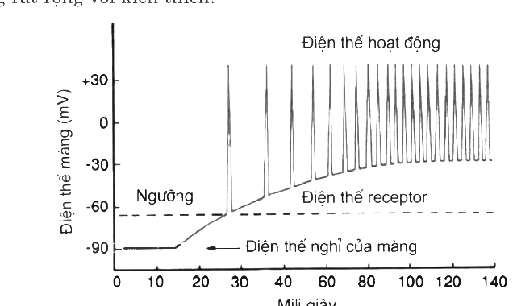

Nếu tăng dần cường độ kích thích lên receptor thì điện thế receptor tăng theo; thoạt tiên tăng nhanh nhưng sau đó mức tăng giảm đi trong khi cường độ kích thích vẫn còn tăng cao. Nói chung, tần số điện thế hoạt động tăng gần như tỷ lệ thuận với sự tăng điện thế receptor. Như vậy, một kích thích cảm giác rất yếu cũng có thể gây tín hiệu, kích thích rất mạnh lên receptor làm tăng tần số điện thế hoạt động nhưng càng mạnh thì tăng càng ít. Điều này quan trọng vì nó khiến cho receptor có thể rất nhạy cảm với những kích thích yếu nhưng không phải phát xung tối đa khi kích thích rất mạnh. Nhờ đó receptor có dải đáp ứng rất rộng với kích thích.

#### 1.2.4. Có khả năng thích nghi
Receptor có khả năng thích nghi một phần hoặc toàn phần đối với kích thích. Với kích thích cảm giác liên tục, thoạt tiên receptor phát xung với tần số rất cao, sau đó phát xung chậm dần rồi cuối cùng có nhiều receptor không đáp ứng nữa.

Khả năng thích nghi tùy thuộc vào loại receptor. Các tiểu thể Pacini thích nghi rất nhanh, các receptor ở khớp và ở suốt cơ thích nghi chậm, các receptor với áp suất ở động mạch cảnh và ở động mạch chủ chỉ thích nghi sau hai ngày, receptor đau và receptor hóa học ở các tạng không thích nghi. Thời gian tồn tại thích nghi ở các loại receptor cũng khác nhau; ví dụ, vài phần trăm giây ở tiểu thể Pacini, trên một giây ở receptor chân lông.

Receptor thích nghi nhờ hai cơ chế:
- **Thay đổi cấu trúc receptor:** Ví dụ, khi thích nghi với nhìn sáng - tối, các tế bào nón và tế bào que trên võng mạc thay đổi nồng độ các chất nhạy cảm với ánh sáng ở bên trong tế bào; ở các tiểu thể Pacini thì kích thích làm biến dạng chất lỏng bên trong dẫn đến thay đổi áp suất nén vào sợi trung tâm của tiểu thể và gây ra điện thế receptor,...
- **Phần đầu của sợi thần kinh trở nên thích nghi,** có thể do bất hoạt các kênh ở màng. Cơ chế này chậm hơn.

Người ta cho rằng có cả hai cơ chế trên tham gia vào đặc tính thích nghi của receptor.

---

## 2. XÚC GIÁC

### 2.1. Receptor xúc giác
Sự va chạm, áp suất, rung động được tiếp nhận bởi các receptor xúc giác. Có rất nhiều loại receptor xúc giác (*hình 16.2*):
- Một số đầu dây thần kinh tự do.
- Các **tiểu thể Meissner** ở đỉnh các gai da, nhiều nhất ở đầu ngón tay, ngón chân, lòng bàn tay, đầu lưỡi, môi, núm vú. Các tiểu thể này cũng có các sợi myelin, sợi không myelin nhận cả thông tin về sự rung động có tần số dưới $80/\text{giây}$.
- Các **đĩa Merkel** ở dưới lớp biểu bì da.
- Các tận cùng có myelin và không có myelin ở chân lông.
- Các **tiểu thể Pacini** nằm ngay dưới da và cả ở lớp sâu của da, trong mô liên kết ở các tạng, bao khớp, dây chằng, màng liên cốt, màng xương, cân, mạc treo, vỏ bọc mạch máu. Tiểu thể này có các đầu nhánh của sợi có myelin, một số tiểu thể khác lại có sợi không myelin. Các tiểu thể này rất nhạy cảm với sự biến dạng và sự rung động, có thể truyền tín hiệu rung động có tần số $30 - 800/\text{giây}$.

Các receptor xúc giác được phân bố không đồng đều, có nhiều nhất ở đầu các ngón tay ($135/\text{cm}^2$), đầu lưỡi, môi, đầu mũi, mặt dưới ngón chân cái; má, mi mắt, vòm hầu, mặt trong môi có ít hơn; phần trên đùi, mặt trước cẳng tay, mặt trong cẳng chân, cổ và phần da che xương có ít nhất. Giác mạc, vành tai không có receptor xúc giác. Tại các nơi này, tế bào thượng bì đóng vai trò receptor. Các receptor xúc giác có liên quan với các receptor nhiệt và receptor đau.

Các receptor này không chịu tác dụng trực tiếp của áp suất mà gián tiếp qua sự biến dạng của da do áp suất gây ra. Nếu sự biến dạng đủ mạnh thì các receptor này cho biết cả hướng của biến dạng. Nhờ phương pháp nghiên cứu điện sinh lý, gần đây người ta còn thấy ở lớp nông trên da có các đầu thần kinh tự do rất nhạy cảm, nhận cảm giác ngứa, cảm giác buồn kiểu kiến bò.

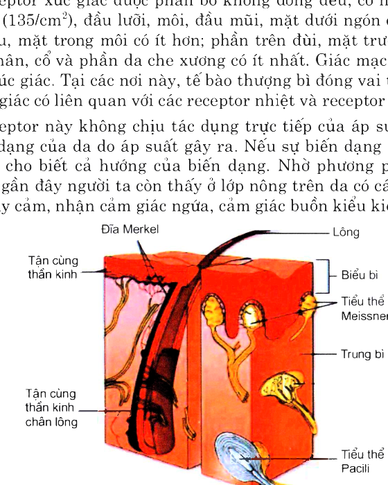

### 2.2. Dẫn truyền cảm giác xúc giác (hình 16.3)

#### 2.2.1. Từ receptor vào tủy sống
Các xung động từ receptor theo các sợi cảm giác hình T có nhân nằm ở hạch gai theo rễ sau vào các phần khác nhau của sừng sau tủy sống. Các sợi xuất phát từ các receptor được biệt hóa thuộc loại $\text{A}\beta$ có tốc độ dẫn truyền $30 - 70\text{ m/s}$; các sợi thần kinh tự do thuộc loại $\text{A}\delta$ có myelin dẫn truyền với tốc độ $5 - 30\text{ m/s}$; ngoài ra còn có sợi C không myelin dẫn truyền với tốc độ tối đa $2\text{ m/s}$. Cảm giác xúc giác quan trọng giúp cho cơ thể xác định chính xác và nhanh chóng vị trí, cường độ và thay đổi cường độ kích thích được truyền nhanh. Các cảm giác thô (ví dụ, về áp suất lên toàn thân, xúc giác thô sơ, ngứa) được dẫn truyền chậm. Trong tủy, thông tin xúc giác lên não theo một trong hai con đường:

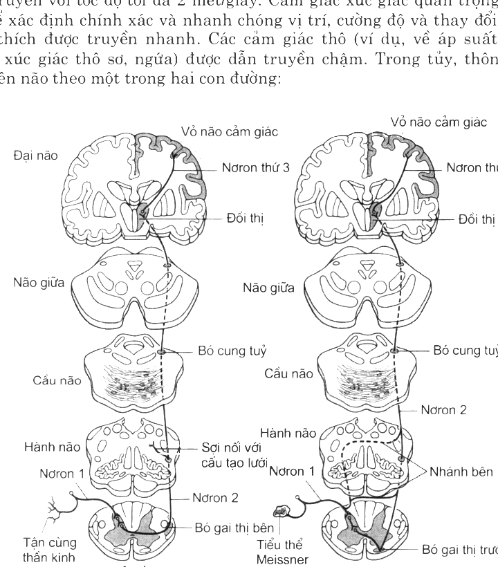

#### 2.2.2. Bó gai - đồi thị sau (Bó cung giữa: Lemniscus Medialis)
Dẫn truyền cảm giác xúc giác tinh tế, cảm giác rung, va chạm trên da, cảm giác về vị trí, cảm giác tinh tế về áp suất. Sợi trục nơron thứ nhất tiếp tục đi lên theo cột trắng sau, tận cùng tại nhân thon và nhân chêm ở hành não. Từ hai nhân này, nơron thứ hai bắt chéo sang bên kia rồi tận cùng ở đồi thị. Chỗ bắt chéo tạo thành dải Reil giữa ở thân não. Bó này gồm nhiều sợi to, có myelin, dẫn truyền nhanh ($30 - 110\text{ m/s}$), trên đường đi nhận thêm các sợi cảm giác từ dây tam thoa (V) và các sợi xúc giác của vùng đầu - mặt. Các sợi truyền cảm giác xúc giác thân tận cùng ở nhân bụng sau - bên của đồi thị; các sợi truyền cảm giác xúc giác từ nhân dây tam thoa tận cùng ở nhân bụng sau - giữa của đồi thị. Hai nhân này của đồi thị tạo thành phức hợp bụng nền của đồi thị. Từ phức hợp này, nơron thứ ba đi lên vùng cảm giác thân thể S-I của vỏ não. Một ít sợi tới phần thấp ở mỗi bên thùy đỉnh (vùng cảm giác thân thể S-II). Bó gai - đồi thị sau có tính định hướng cao, các sợi trục được sắp xếp từ tủy lên đồi thị theo nơi xuất phát tương ứng. Do bó này bắt chéo nên cảm giác nửa người bên phải được đưa về đồi thị và vỏ não bên trái và ngược lại.

#### 2.2.3. Bó gai - đồi thị trước và bên
Sợi trục nơron thứ nhất vào sừng sau tủy. Nơron thứ hai bắt chéo trong tủy, theo cột trắng trước - bên đi lên và tận cùng ở đồi thị. Ở hành não, bó này chập vào bó gai - đồi thị sau. Bó gồm các sợi có myelin, đường kính nhỏ, truyền xung động chậm (vài mét - $40\text{ m/s}$), không định hướng thật rõ nên cho cảm giác không chính xác bằng bó gai-đồi thị sau. Bó này dẫn truyền cảm giác xúc giác thô sơ, cảm giác về nhiệt độ, cảm giác đau, cảm giác về áp suất.

### 2.3. Trung tâm nhận cảm xúc giác ở vỏ não
Có rất nhiều sợi từ phức hợp bụng - nền đồi thị đi tới rất nhiều vùng của vỏ não. Các cảm giác thân thể đều tận cùng ở các vùng S-I và S-II của vỏ não cảm giác thuộc thùy đỉnh, nằm ngay phía sau rãnh trung tâm, chủ yếu là các vùng 1, 2, 3, 5, 7 và 40 theo bản đồ chức năng vỏ não của Brodmann (*hình 16.4*).

Lên đến vỏ não, tính định hướng của các sợi trục cảm giác vẫn được duy trì nên mỗi phần của cơ thể có hình chiếu tương ứng trên vùng S-I. Diện tích hình chiếu của một phần tỷ lệ với số lượng receptor có trên phần đó, tức là tỷ lệ thuận với số cảm giác và mức độ phân biệt tinh tế về cảm giác của phần đó. Trên vùng cảm giác của vỏ não, hình chiếu của các phần cơ thể lộn ngược (hình chiếu của đầu nằm ở phần thấp, phía ngoài còn phần của chi dưới lại nằm ở cao, phía giữa (*hình 16.5a*). Nếu tổn thương rộng vùng S-I thì bệnh nhân không cảm nhận được sự thay đổi áp suất lên cơ thể, không đánh giá đúng trọng lượng của vật, không nhận biết được hình dạng và tính chất bề mặt của vật. Bệnh nhân vẫn nhận cảm được nóng - lạnh và đau nhưng không nhận cảm chính xác được về tính chất, cường độ và nhất là vị trí của hai cảm giác này. Vai trò của vùng S-II chưa rõ. Vùng này nhận các sợi từ đồi thị, từ vùng S-I, từ nửa người bên kia và từ các vùng thị giác, thính giác tới.

Các vùng 5, 7 của Brodmann nhận các sợi từ các vùng cảm giác khác của vỏ não, từ S-I, nhân bụng - nền, một số vùng của đồi thị, vùng thị giác và vùng thính giác của vỏ não tới. Vùng này được gọi là các vùng liên hợp cảm giác. Kích thích điện vào vùng này có thể gây ra cảm giác phức tạp, thậm chí có thể gây cảm giác như có vật thật. Vai trò của vùng này là kết hợp những thông tin từ nhiều điểm trên các vùng cảm giác để cho nhận thức về vật. Nếu bị tổn thương vùng này, bệnh nhân mất khả năng nhận biết bằng xúc giác các đồ vật phức tạp, các hình dạng phức tạp, mất cảm giác về hình dạng của chính mình. Đặc biệt là nếu chỉ bị ở một bên thì bệnh nhân “lãng quên” nửa người bên kia, thường thực hiện các động tác bằng một nửa người, sờ mó vật thì chỉ sờ mó một phía, một bên của vật đó. Chứng này được gọi là **chứng mất nhận thức về hình thể (amorphosynthesis)**.

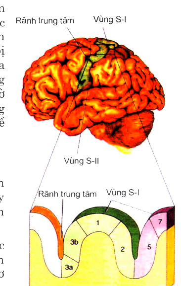

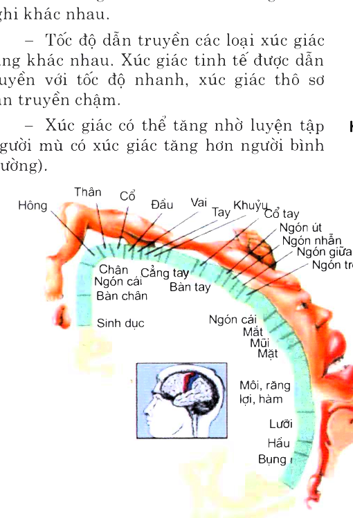

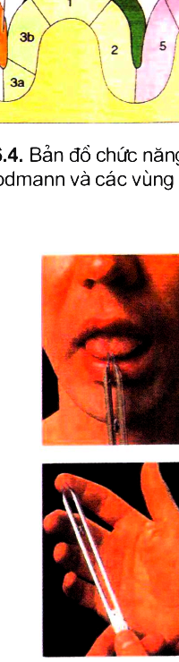

### 2.4. Đặc điểm của xúc giác
- Có nhiều loại receptor tiếp nhận cảm giác xúc giác. Những receptor này phân bố không đều và có khả năng thích nghi khác nhau.
- Tốc độ dẫn truyền các loại xúc giác cũng khác nhau. Xúc giác tinh tế được dẫn truyền với tốc độ nhanh, xúc giác thô sơ dẫn truyền chậm.
- Xúc giác có thể tăng nhờ luyện tập (người mù có xúc giác tăng hơn người bình thường).

### 2.5. Thăm dò xúc giác
Để thăm dò xúc giác, người ta dùng compa Weber để đo khoảng cách nhỏ nhất giữa hai điểm gây ra được hai cảm giác riêng biệt (*hình 16.5b*). Ví dụ, ở đầu lưỡi là $1\text{ mm}$, ở môi trên là $3 - 4\text{ mm}$, ở lòng bàn tay là $15\text{ mm}$, ở đùi là $70\text{ mm}$. Cần chú ý là cảm giác này thay đổi theo cá thể, tập luyện làm tăng, mệt mỏi làm giảm. Xúc giác đặc biệt phát triển ở người mù.

---

## 3. CẢM GIÁC NÓNG LẠNH

### 3.1. Receptor nhiệt
Có hai loại receptor nhiệt là receptor với nóng và receptor với lạnh. Các receptor nằm ở lớp nông của da, cách xa nhau, mỗi receptor nhận cảm ở một vùng có đường kính khoảng $1\text{ mm}$. Số điểm nhận cảm giác lạnh nhiều gấp 3 - 10 lần số điểm nhận cảm giác nóng. Sự phân bố receptor khác nhau theo vùng: vùng môi có $15 - 25\text{ receptor lạnh/cm}^2$, ở ngón tay là $3 - 5\text{ receptor/cm}^2$, ở thân thì chưa đến $1\text{ receptor/cm}^2$. Sự phân bố receptor nóng cũng tương tự.

#### 3.1.1. Các receptor nóng
Là các tiểu thể có vỏ bọc, bên trong có các đầu sợi trục có myelin tạo thành các đám. Có người cho rằng chúng là những tiểu thể Ruffini nhưng các tiểu thể này lại giống tiểu thể Pacini đơn giản và có mặt ở cả những vùng kém nhận cảm với nhiệt. Các receptor nóng nằm ở sâu hơn so với receptor lạnh. Receptor nóng phát xung khi bị đặt các đầu kim nóng lên. Receptor nóng ngừng hoạt động ở nhiệt độ dưới $20 - 25^\circ\text{C}$, hoạt động mạnh nhất ở khoảng $38 - 43^\circ\text{C}$ (phát $5 - 7\text{ xung/giây}$) giới hạn cao nhất là $45 - 47^\circ\text{C}$. Người ta cho rằng khi bị kích thích, chuyển hóa của các receptor nhiệt tăng nhiều (nhiệt độ thay đổi $10^\circ\text{C}$ làm tốc độ phản ứng trong tế bào tăng lên gấp đôi) và sự thay đổi chuyển hóa làm cho receptor hưng phấn.

#### 3.1.2. Các receptor lạnh
Hưng phấn khi đặt đầu kim lạnh lên chúng. Receptor lạnh ngừng hoạt động ở nhiệt độ $30 - 40^\circ\text{C}$, hoạt động mạnh nhất ở khoảng $24 - 25^\circ\text{C}$ (phát $5 - 7\text{ xung/giây}$).

### 3.2. Dẫn truyền cảm giác nóng - lạnh (hình 16.3)
Xung động từ các receptor nóng chủ yếu theo các sợi C về tủy với tốc độ $0,4 - 2\text{ m/s}$. Các xung động từ các receptor lạnh chủ yếu được dẫn truyền theo các sợi $\text{A}\delta$ có myelin với tốc độ khoảng $20\text{ m/s}$ và một ít theo sợi C. Các sợi vào tủy theo rễ sau. Trong tủy, các sợi đi lên hoặc đi xuống một vài đốt tủy trong bó Lissauer rồi tận cùng ở sừng sau. Từ sừng sau, nơron thứ hai dài, bắt chéo sang tới bó gai - đồi thị ở bên đối diện trước (bó xúc giác) và theo bó này lên tận cùng ở chất lưới của thân não và ở phức hợp bụng - nền của đồi thị.

### 3.3. Nhận cảm ở vỏ não
Từ phức hợp bụng - nền của đồi thị, một số sợi cảm giác nóng lạnh đi lên vùng vỏ não cảm giác. Tại vùng này có những nơron nhận cảm đặc hiệu với nóng lạnh ở từng vùng cơ thể. Khả năng phân biệt nóng lạnh giảm ở người bị tổn thương hồi sau trung tâm.

### 3.4. Đặc điểm của cảm giác nóng - lạnh
- Cảm giác nóng - lạnh là một cảm giác tương đối: cùng một tác nhân kích thích là nhiệt nhưng lại gây ra hai cảm giác khác nhau là nóng hoặc lạnh. Cảm giác nhận biết được tuỳ thuộc vào sự chênh lệch về nhiệt độ giữa vật tiếp xúc với nơi cảm nhiệt. Nếu vật tiếp xúc có nhiệt độ cao hơn thì sẽ có cảm giác nóng, ngược lại nếu vật tiếp xúc có nhiệt độ thấp hơn thì sẽ có cảm giác lạnh.
- Cảm giác nóng - lạnh mang tính chủ quan, thay đổi theo từng cá thể.
- Do các receptor nhận cảm giác nóng - lạnh phân bố thưa thớt nên phải có hiện tượng cộng kích thích (kích thích vào vùng rộng) thì mới nhận biết được.

---

## 4. CẢM GIÁC ĐAU

Cảm giác đau là một cảm giác đặc biệt, khác với các cảm giác khác. Cảm giác này thông báo cho não biết kích thích có hại cho cơ thể và cần có các cơ chế sinh lý và tâm lý để loại trừ kích thích đó. Cảm giác đau là một cảm giác phức tạp. *“Đau là một trải nghiệm khó chịu về cảm giác cũng như về cảm xúc do tổn thương có thực ở mô hoặc được cho là có tổn thương như thế gây ra”*. Theo định nghĩa về đau được nhiều người chấp nhận này thì đau mang tính chủ quan, có liên quan với những kinh nghiệm đã thu được trong cuộc sống và bị chi phối bởi nhiều yếu tố khác (truyền thống, văn hóa, tôn giáo,...). Đau có thể xuất hiện ở mọi nơi trong cơ thể, có rất nhiều tính chất như đau nông, đau sâu, đau âm ỉ, đau chói, đau đột ngột, đau tại chỗ, đau xuyên ra chỗ khác,... Đau là một triệu chứng gặp trong rất nhiều bệnh và dựa vào tính chất của đau có thể chẩn đoán bệnh.

### 4.1. Receptor đau

#### 4.1.1. Vị trí
Receptor đau ở da và ở các mô là những đầu tự do của dây thần kinh. Chúng được phân bố rộng trên lớp nông của da, niêm mạc và ở các mô bên trong như màng xương, thành động mạch, mặt khớp, màng não, lá thành bao quanh các tạng, đường dẫn mật. Nói chung, các mô nằm sâu có ít receptor đau nhưng nếu các mô này bị tổn thương rộng hoặc mạn tính thì vẫn gây cảm giác đau nhờ hiện tượng cộng kích thích.

#### 4.1.2. Các loại receptor
Các kích thích lên receptor đau là kích thích cơ học, nhiệt và hóa học. Hầu hết các receptor đau tiếp nhận mọi loại kích thích nhưng có những receptor nhạy cảm hơn với một kích thích nhất định. Các receptor đau còn chịu tác dụng của nhiệt độ quá cao hoặc quá thấp (nhúng tay vào nước đá cũng có cảm giác rát như khi bị bỏng, bỏng nông gây cảm giác đau rát). Nói chung, các receptor đau nhận kích thích hóa học và nhiệt nhận cảm giác đau cấp còn mọi loại receptor đau đều nhận cảm giác đau mạn tính.

#### 4.1.3. Khả năng thích nghi
Điều cần chú ý là các receptor đau không có khả năng thích nghi nên cảm giác đau luôn tồn tại để thông báo cho cơ thể biết là có tác nhân có hại và vị trí của tác nhân này. Thậm chí, nếu nguyên nhân gây đau kéo dài thì các receptor đau còn tăng tính hưng phấn (giảm ngưỡng kích thích) và truyền cảm giác mạnh hơn. Ví dụ, chứng tăng đau (*hyperalgesia*) nguyên phát khi da bị bỏng nông, chứng tăng đau thứ phát trong hội chứng Brown - Séquard hoặc hội chứng đồi thị.

### 4.2. Dẫn truyền cảm giác đau (hình 16.6)
- **Cảm giác đau cấp:** được truyền về sừng sau tủy theo các **sợi $\text{A}\delta$ (có myelin)** với tốc độ $6 - 30\text{ m/s}$.
- **Cảm giác đau mạn:** được truyền theo **sợi C (không myelin)** với tốc độ $0,5 - 2\text{ m/s}$. Nếu chỉ ức chế sợi $\text{A}\delta$ thì mất cảm giác đau cấp. Nếu ức chế sợi C bằng thuốc tê tại chỗ thì mất cảm giác đau chậm.

Trong tủy, các nơron này đi lên hoặc đi xuống từ 1 đến 3 đốt tủy và tận cùng ở chất xám sừng sau. Nơron thứ hai bắt chéo sang cột trắng trước - bên đối diện và lên não theo nhiều đường: bó tuỷ sống - đồi thị, bó tuỷ sống - cấu tạo lưới tận cùng ở hành não, cầu não, não giữa ở cả hai bên. Từ cấu tạo lưới nằm ở các vùng này, có nhiều nơron đi tới các nhân của đồi thị và một số vùng ở nền não, có những sợi đi lên hoạt hóa vỏ não.

Nơron thứ ba từ đồi thị lên nhiều vùng ở nền não và vùng cảm giác đau ở vỏ não.

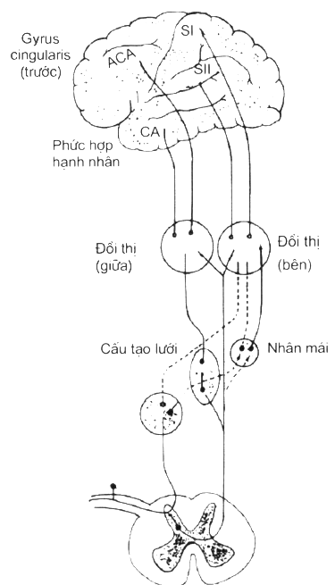

### 4.3. Trung tâm nhận thức cảm giác đau
Đường dẫn truyền cảm giác đau tận cùng ở cấu trúc lưới của thân não, trung tâm dưới vỏ như nhân lá trong của đồi thị và vùng S-I, S-II, vùng đỉnh, vùng trán của vỏ não. Kích thích vào những vùng này gây cảm giác đau.
- Cấu trúc lưới và trung tâm dưới vỏ vừa có chức năng nhận thức đau vừa tạo ra các đáp ứng về tâm lý khi đau.
- Vỏ não có chức năng phân tích cảm giác đau tinh vi, phân biệt vị trí, đánh giá mức độ đau.

### 4.4. Đặc điểm của cảm giác đau
- Receptor tiếp nhận cảm giác đau không có tính thích nghi.
- Cảm giác đau hay đi kèm với cảm giác xúc giác và khi đi kèm với cảm giác xúc giác thì việc định vị cảm giác đau sẽ chính xác hơn.
- Cảm giác đau cấp thường xác định vị trí chính xác hơn so với cảm giác đau chậm (đau tạng).
- Có nhiều tác nhân gây đau nhưng dù tác nhân nào thì cũng gây đau do tổn thương mô, do thiếu oxy mô hoặc do co cơ.

---

## 5. CẢM GIÁC BẢN THỂ (Cảm giác sâu)

Cảm giác bản thể là cảm giác cho biết tư thế, vận động của thân thể hoặc một phần của thân thể. Cảm giác bản thể bắt nguồn từ các receptor ở xương, ở khớp, ở cơ. Các cảm giác này chủ yếu là cảm giác không ý thức nhưng không thể thiếu được trong việc giúp cho cơ thể thích ứng với các cử động trong mỗi thời điểm của quá trình thực hiện động tác. Sự nhận biết về vị trí, tư thế của một phần cơ thể hoặc toàn thân còn cần đến những thông tin từ các nguồn khác nữa (từ tai trong, mắt, tiểu não,...).

### 5.1. Receptor cảm giác sâu
- Receptor nhận cảm giác về trương lực cơ là **suốt thần kinh - cơ**. Receptor này có nhiều ở các cơ. Suốt thần kinh - cơ có khả năng nhận cảm về sự thay đổi chiều dài của cơ.
- Receptor nhận cảm giác ở gân là **thể Golgi**. Thể Golgi cho biết sức căng của cơ.

### 5.2. Đường dẫn truyền cảm giác sâu (hình 16.7)
- **Đường cảm giác sâu có ý thức (bó Goll và Burdach):** dẫn truyền cảm giác bản thể từ cơ, gân, xương, khớp lên thuỳ đỉnh của vỏ não đối bên. Đường dẫn truyền này cho biết vị trí, cử động từng phần của cơ thể, đồng thời cũng dẫn truyền cảm giác tinh vi về xúc giác.
- **Đường cảm giác sâu không có ý thức (Flechsig và Gowers):** dẫn truyền cảm giác sâu từ cơ, xương, khớp đặc biệt cảm giác về trương lực cơ và tận cùng ở vỏ tiểu não cùng bên. Đường dẫn truyền này có tác dụng giữ thăng bằng và điều hoà động tác có tính chất tự động.

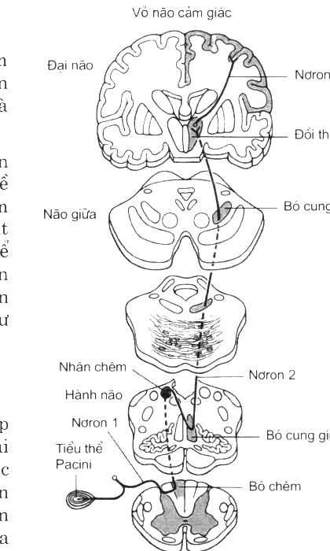

### 5.3. Trung tâm nhận cảm cảm giác sâu
Trung tâm nhận cảm cảm giác sâu nhận tín hiệu được truyền về từ hai bó cảm giác sâu có ý thức và không có ý thức là tủy sống, vỏ não và tiểu não.

### 5.4. Đặc điểm của cảm giác sâu
- Cảm giác sâu bao gồm cảm giác về trương lực cơ và cảm giác gân đều truyền về tiểu não cùng bên và là cảm giác không có ý thức.
- Các cảm giác sâu bắt nguồn từ cơ, gân, xương, khớp truyền về thuỳ đỉnh của vỏ não đối bên là cảm giác sâu có ý thức. Ví dụ, nhắm mắt mà vẫn biết được tư thế, vị trí cơ thể trong không gian. Tuy nhiên sự nhận biết về tư thế, vị trí của cơ thể còn cần có những thông tin từ nơi khác như tai trong, mắt.

---

## 6. VỊ GIÁC

Vị giác, cùng với khứu giác, giúp phân biệt, lựa chọn thức ăn. Cả hai giác quan có liên quan nhiều đến chức năng cảm xúc và hành vi của hệ thần kinh, đặc biệt là ở động vật. Cần phân biệt cảm giác vị giác với hương vị của thức ăn; hương vị thức ăn là tổng hợp của các tính chất về vị, về mùi, về xúc giác và nhiệt độ của thức ăn.

### 6.1. Receptor vị giác

#### 6.1.1. Vị trí và phân bố
Trên lưỡi có bốn loại gai, ba loại gai có nụ vị giác, một loại có các receptor cơ học. Receptor vị giác là các **nụ vị giác** nằm trên các gai vị giác ở lưỡi.

Các nụ vị giác phân bố không đều trên lưỡi. Một số lớn nằm ở các gai chỗ V lưỡi (mỗi gai có khoảng 200 nụ vị giác), một số ít hơn nằm ở các gai có hình nấm trên diện phẳng trước lưỡi, một số nằm ở các gai dọc hai bên lưỡi. Ngoài ra, có một số nụ vị giác nằm rải rác ở vòm hầu, trụ màn hầu, thậm chí ở gần đầu thực quản. Người trưởng thành có khoảng 10.000 nụ vị giác, trẻ nhỏ có ít hơn. Từ 46 tuổi trở lên, các nụ vị giác thoái hóa nhanh chóng làm cho khả năng phân biệt vị giác kém đi. Tế bào vị giác có chu kỳ sống khoảng vài ngày. Các tế bào thoái hóa được thay thế bởi các tế bào mới, phát sinh từ các tế bào đệm. Sự tiếp xúc với nơron đi tới làm tế bào biểu mô biến thành tế bào vị giác. Nếu cắt đứt liên hệ thần kinh thì các tế bào vị giác bị mất.

Mỗi nụ vị giác gồm 40 - 60 tế bào vị giác là các tế bào biểu mô bị biến đổi và các tế bào chống đỡ. Mỗi nụ vị giác có một lỗ nhỏ; các phân tử hóa học trong thức ăn qua lỗ này đi vào bên trong nụ vị giác. Các receptor nằm ở các vi nhung mao của tế bào vị giác, hướng về các lỗ nhỏ (*hình 16.8*).

Các nụ vị giác của hai phần ba trước lưỡi nhận các sợi của dây thần kinh mặt (dây VII), các sợi ở một phần ba sau lưỡi nhận các sợi của dây lưỡi hầu (dây IX), các nụ ở hầu nhận sợi của dây X.

Dùng vi điện cực nghiên cứu riêng rẽ từng nụ vị giác khi bị kích thích bởi từng vị cơ bản, người ta thấy phần lớn các nụ vị giác đáp ứng với hai, ba thậm chí bốn vị khác nhau và hơn nữa. Tuy nhiên, một nụ vị giác nhạy cảm hơn với một hay hai vị cơ bản nói trên. Như vậy receptor vị giác cũng có tính đặc hiệu nhất định.

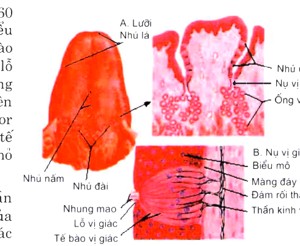

#### 6.1.2. Kích thích vị giác

##### 6.1.2.1. Các vị cơ bản
Tác nhân gây cảm giác vị phải hòa tan trong nước bọt trước khi kích thích receptor. Các nghiên cứu tâm sinh lý, sinh lý đã xác định có 13 loại receptor ở các tế bào vị giác (receptor với natri, kali, clo, adenosin, inosin, ngọt, đắng, glutamat, ion $\text{H}^+$,...). Các loại receptor trên có thể được gộp vào bốn loại receptor cho bốn cảm giác vị cơ bản là ngọt, mặn, chua và đắng. Hàng trăm cảm giác vị khác nhau mà con người nhận cảm được là sự tổ hợp khác nhau của bốn cảm giác cơ bản này. Bốn cảm giác này được coi là cơ sở của tất cả mọi cảm giác vị, giống như ba màu cơ bản là cơ sở tạo ra muôn màu.
- **Cảm giác chua:** do các acid gây ra. Cường độ cảm giác chua tỷ lệ thuận với logarit nồng độ ion $\text{H}^+$, acid càng đậm thì càng gây cảm giác chua nhiều.
- **Cảm giác mặn:** do các muối phân ly gây ra. Vị mặn của các muối khác nhau cũng khác nhau. Các ion dương gây cảm giác mặn nhiều hơn là các ion âm.
- **Cảm giác ngọt:** do nhiều chất gây ra, phần lớn là các chất hữu cơ như các chất đường, glycol, alcol, aldehyd, ceton, amid, ester, acid amin, acid sulfonic và một vài muối vô cơ. Điều lý thú là chỉ cần thay đổi một chút về cấu trúc hóa học của các chất gây ngọt (ví dụ, thêm vào một gốc hóa học) cũng làm cho nó gây ra vị đắng.
- **Cảm giác đắng:** do nhiều chất gây ra và hầu hết là các chất hữu cơ trong đó có các chất có chuỗi dài chứa nitơ và các alcaloid (cà phê, strychnin, nicotin, quinin và nhiều loại thuốc). Có chất gây cảm giác ngọt lúc đầu, sau đó lại gây cảm giác đắng (saccarin). Cảm giác đắng mạnh gây phản xạ tống thức ăn ra ngoài. Có thể đây là mục đích bảo vệ cơ thể của cảm giác vì nhiều chất độc gây chết có trong thực vật là các alcaloid có vị rất đắng.

Đầu lưỡi chủ yếu nhận cảm vị ngọt và vị mặn; hai bên lưỡi chủ yếu nhận cảm vị chua; phía sau lưỡi và màn hầu nhận cảm vị đắng.

##### 6.1.2.2. Ngưỡng kích thích
Ngưỡng kích thích vị giác là nồng độ thấp nhất của chất đó trong dung môi đủ để gây cảm giác vị. Mỗi cảm giác vị có ngưỡng khác nhau. Ngưỡng của cảm giác đắng thấp hơn nhiều so với ngưỡng của các cảm giác khác. Có người bị mất cảm giác vị đối với một số chất, nhất là các hợp chất thuộc loại thio - urê. Chất phenylthiocarbamat thường được dùng để phát hiện chứng điếc vị.

Có hàng trăm cảm giác vị khác nhau nhưng các cảm giác này được coi là tổ hợp của bốn cảm giác vị cơ bản là chua, mặn, ngọt và đắng. Mỗi nụ vị giác có thể nhận cảm nhiều vị khác nhau nhưng nhạy cảm hơn với một hay hai vị. Mỗi cảm giác vị có một ngưỡng kích thích khác nhau.

### 6.2. Dẫn truyền cảm giác vị và trung tâm nhận cảm giác vị
Điện thế hoạt động được dẫn truyền theo các dây thần kinh mặt (từ 2/3 trước lưỡi), dây lưỡi - hầu (từ phần sau lưỡi), dây X (từ nền lưỡi). Các đường này đều về nhân đơn độc. Từ nhân này, nơron thứ hai tới nhân bụng sau - giữa của đồi thị đối bên. Từ đồi thị, nơron thứ ba đi tới vỏ não. Vùng nhận cảm vị giác trên vỏ não nằm ở gần vùng cảm giác lưỡi trên vùng S-I. Đường đi và nơi tận cùng của đường dẫn truyền vị giác đi sát với đường cảm giác chung của lưỡi (*hình 16.9*).

Mặt khác, từ nhân đơn độc, các xung động vị giác được truyền thẳng tới nhân nước bọt trên và nhân nước bọt dưới và xung động từ các nhân này tới kích thích các tuyến nước bọt bài tiết.

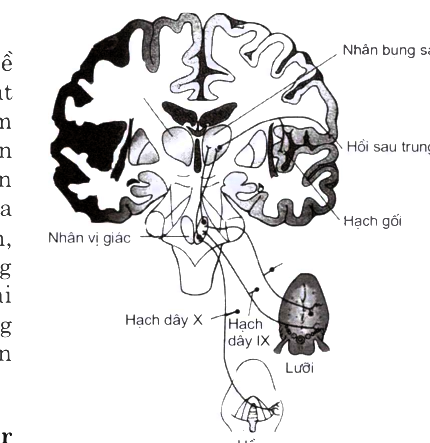

### 6.3. Đặc điểm của cảm giác vị
- Cảm giác vị có tính thích nghi rất nhanh, có thể thích nghi hoàn toàn trong vài phút. Receptor chỉ có khả năng đảm bảo tới 50% sự thích nghi, phần còn lại là do thích nghi ở hệ thần kinh. Sự ưa thích hay ghét sợ một vị nào đấy có liên quan đến nhu cầu cần có vị đó (ví dụ thèm và ưa vị ngọt khi đường huyết hạ, thèm và thích vị mặn khi thiếu muối), do kinh nghiệm đã trải qua và là do cơ chế phản xạ thần kinh trung ương chứ không phải tại receptor.
- Cảm giác vị chịu ảnh hưởng của các cảm giác khác. Cảm giác khứu tăng cường cảm giác vị. Các cảm giác khác của lưỡi có ảnh hưởng tới nhận cảm vị giác. Cảm giác lạnh làm tăng cảm giác ngọt; có thêm một ít muối làm tăng cảm giác ngọt của glucose. Thức ăn thô ráp và cay quá lại gây cảm giác đau. Sự phối hợp giữa các cảm giác trên và thị giác giúp người ta chế biến, lựa chọn thức ăn theo ý muốn, theo nhu cầu của cơ thể.

---

## 7. KHỨU GIÁC

Khứu giác cho biết cảm giác về mùi. Khứu giác ở người không phát triển bằng khứu giác ở động vật. Cảm giác khứu mang tính chủ quan nên khó nghiên cứu. Khứu giác có liên quan nhiều tới vị giác. Đối với việc lựa chọn, ưa hay không ưa một thức ăn, cảm giác về mùi có vai trò quan trọng hơn hoặc bằng cảm giác về vị. Ngoài tác dụng lên ăn uống, khứu giác cũng còn có tác dụng trong việc phát hiện kẻ thù, con mồi, đồng loại.

### 7.1. Niêm mạc mũi và receptor khứu giác

#### 7.1.1. Vùng nhận cảm mùi
Là một vùng niêm mạc nhỏ được gọi là **niêm mạc khứu** ở hai bên vách mũi, che phủ vùng xương cuốn trên và phần trên xương cuốn giữa (*hình 16.10*). Ở vùng niêm mạc này có khoảng 100 triệu tế bào khứu nằm xen kẽ với các tế bào đệm.

#### 7.1.2. Receptor khứu giác
Là các tế bào lưỡng cực có nguồn gốc từ hệ thần kinh trung ương. Phía mặt của các tế bào trông ra lớp niêm dịch có các nút; mỗi nút có 6 - 12 sợi lông khứu có đường kính khoảng $8\text{ }\mu\text{m}$ và dài chừng $200\text{ }\mu\text{m}$. Các sợi lông nằm trong lớp niêm dịch bao phủ mặt trong khoang mũi và tạo thành một lớp phủ dày. Chính các sợi lông này là nơi tiếp nhận kích thích hóa học. Rải rác giữa các tế bào khứu có các tuyến Bowmann bài tiết niêm dịch trên bề mặt của niêm mạc khứu. Màng của sợi lông có nhiều phân tử protein xuyên suốt chiều dày của màng. Các protein này có khả năng gắn vào các phân tử mang mùi và khi gắn sẽ làm cho receptor khứu giác bị kích thích.

### 7.2. Dẫn truyền cảm giác khứu và trung tâm nhận cảm giác khứu

#### 7.2.1. Dẫn truyền từ receptor vào hành khứu
Hành khứu (dây thần kinh sọ I) là mô não phình ra ở phía trước nền não, nằm trên xương sàng. Các sợi thần kinh mảnh xuất phát từ niêm mạc khứu đi xuyên qua các lỗ xương sàng vào hành khứu. Sợi trục của các tế bào khứu rất ngắn, tận cùng ở các tiểu cầu trong hành khứu. Mỗi hành khứu có hàng ngàn tiểu cầu, mỗi tiểu cầu là nơi tận cùng của khoảng 25.000 sợi trục từ tế bào khứu. Tiểu cầu cũng là nơi tận cùng của các đuôi gai của khoảng 25 tế bào mũ ni có kích thước lớn và khoảng 60 tế bào nấm có kích thước nhỏ hơn, nằm ở phía trên tiểu cầu. Sợi trục của những tế bào này theo đường khứu vào hệ thần kinh (*hình 16.10*). Có thể là những tiểu cầu khác nhau đáp ứng với các mùi khác nhau. Các tế bào mũ ni và tế bào búi phát xung liên tục giống như tế bào khứu. Kích thích mùi làm tăng hay làm giảm số xung cơ bản của các tế bào này, qua đó truyền cảm giác mùi về hệ thần kinh.

#### 7.2.2. Dẫn truyền từ hành khứu về não
Tín hiệu khứu giác được truyền từ hành khứu về não ở chỗ giữa não giữa và đại não. Tại đó, nó được chia thành hai đường: một đường đi tới vùng khứu giữa (đường cổ nhất), một đường đi tới vùng khứu bên (là đường cũ và đường mới).

##### 7.2.2.1. Đường dẫn truyền cổ và vùng khứu giữa
Vùng khứu giác gồm nhóm nhân nằm ở phần giữa nền não trước và ở phía trên vùng dưới đồi. Nhân quan trọng nhất là nhân vách có liên quan chặt chẽ với vùng dưới đồi và các phần khác của hệ viền là hệ có vai trò trong các hành vi cơ bản. Vùng này chịu trách nhiệm về các đáp ứng sơ đẳng với khứu giác như liếm môi, tiết nước bọt, đáp ứng khác về ăn uống và cảm xúc do mùi gây ra. Vùng này cũng chi phối các phản xạ được điều kiện hóa phức tạp đối với khứu giác.

##### 7.2.2.2. Đường dẫn truyền cũ và vùng khứu giác bên
Vùng khứu giác bên có các đường đi tới hầu hết các phần của hệ viền, đặc biệt là tới hồi hải mã, nơi có vai trò quan trọng nhất đối với quá trình học tập. Đối với khứu giác, hồi hải mã có lẽ có vai trò trong việc hình thành “ưa” hoặc “không ưa” một thức ăn nào đấy.

##### 7.2.2.3. Đường dẫn truyền mới
Đường này được phát hiện sau cùng, đi qua nhân lưng giữa của đồi thị rồi đến vùng sau bên của vỏ não vùng trán trước. Vùng này có chức năng giúp cho phân tích mùi một cách có ý thức.

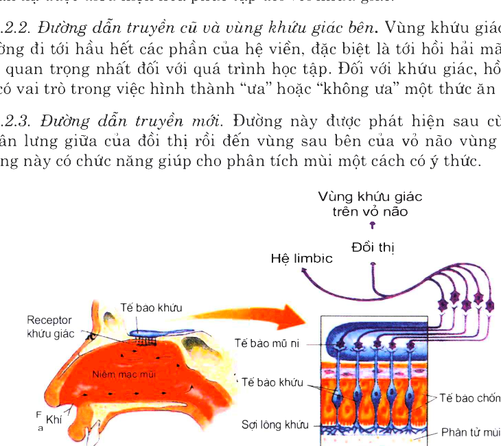

Tóm lại, có một hệ thống rất cổ chịu trách nhiệm về các phản xạ cơ bản với khứu giác, một hệ thống cũ chịu trách nhiệm kiểm soát tự động việc tiếp nhận hay tránh thức ăn nhờ trải nghiệm trong cuộc sống và có một hệ thống mới có tác dụng giúp cho việc nhận cảm mùi một cách có ý thức.

Từ các trung tâm nhận cảm khứu giác lại có những sợi đi ngược trở lại về hành khứu, tận cùng tại các tế bào hạt ở trung tâm hành khứu. Từ các tế bào hạt lại có các sợi tới ức chế tế bào mũ ni và tế bào nấm. Người ta cho rằng vòng feedback âm này có tác dụng giúp cho việc phân biệt một cách nhạy cảm và tinh tế.

### 7.3. Đặc điểm của cảm giác khứu
- Kích thích mùi có bản chất hóa học: các phân tử mùi theo không khí vào mũi, hoà tan trong lớp niêm dịch rồi gắn với receptor khứu giác làm mở kênh ion gây khử cực màng receptor.
- Khác với cảm giác thị giác và vị giác, cảm giác khứu giác có từ 7 - 50 mùi cơ bản do vậy có thể có tới 50 loại receptor khác nhau để cảm nhận các mùi cơ bản.
- Ngưỡng kích thích khứu giác rất thấp. Tuy nhiên, rất khó xác định ngưỡng kích thích của các mùi khác nhau vì khứu giác mang tính chủ quan.
- Cảm giác khứu có tính thích nghi cao. Tính thích nghi này một phần do sự thích nghi của receptor, phần khác do tâm lý và thích nghi về tâm lý mạnh hơn nhiều. Như vậy tính thích nghi của cảm giác khứu một phần là do receptor nhưng phần chủ yếu do vai trò của hệ thần kinh trung ương. Thích nghi ở receptor xảy ra nhanh sau giây đầu tiên, còn thích nghi ở nơron xảy ra chậm (sau 1 phút).

---

## 8. THỊ GIÁC

### 8.1. Mắt
Cơ quan nhận cảm kích thích ánh sáng là mắt, có thể được ví với một cái máy quay phim gồm một hệ thống kính hội tụ, một lỗ có thể điều chỉnh được độ rộng (đồng tử) cho ánh sáng đi qua và lớp võng mạc nhạy cảm với ánh sáng. Mắt có khả năng thay đổi độ hội tụ để sao cho ảnh của vật nằm trên võng mạc. Mắt có thể bị mắc các tật về khúc xạ (cận thị, viễn thị, lão thị, loạn thị). Nhân mắt (một thấu kính hội tụ) có thể bị đục nên cản trở các tia sáng đi qua mắt tới võng mạc (*hình 16.11*).

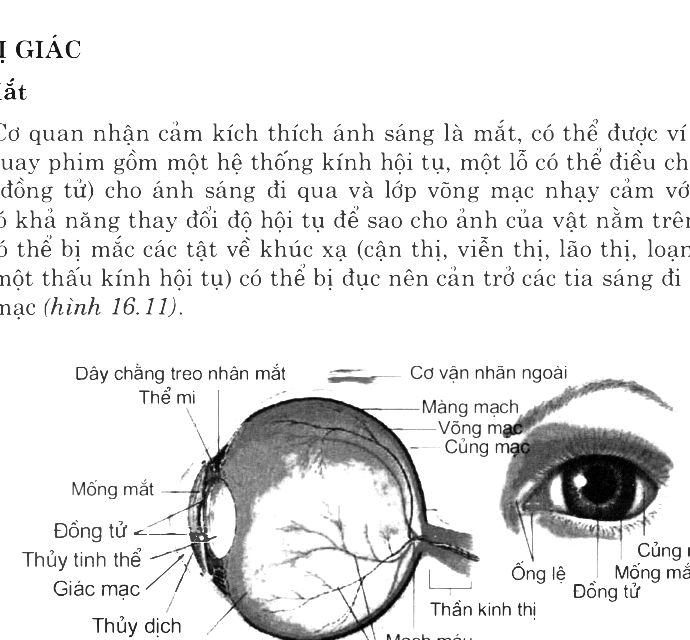

#### 8.1.1. Hệ thống thấu kính hội tụ của mắt

##### 8.1.1.1. Các giao diện khúc xạ
Hệ thống thấu kính của mắt có bốn giao diện khúc xạ. Tổng đại số các hệ số khúc xạ của các giao diện cho một hệ số chung và khi đó có thể coi cả mắt như một thấu kính. Với cách đơn giản hóa này, mắt có một giao diện khúc xạ ở cách điểm trung tâm võng mạc $17\text{ mm}$ và hệ số hội tụ chung là khoảng $59\text{ diop}$ khi nhìn xa.

Độ hội tụ chủ yếu của mắt là do mặt trước của giác mạc gây ra vì hệ số khúc xạ của giác mạc chênh lệch nhiều so với hệ số khúc xạ của không khí. Độ hội tụ của nhân mắt (nằm trong mắt) tạo ra $20\text{ diop}$ (2/3 độ hội tụ của toàn hệ thống). Nếu lấy nhân mắt ra và cho tiếp xúc với không khí thì độ hội tụ của nó tăng lên 6 lần. Lý do là hệ số khúc xạ của nhân mắt và của các dịch bao quanh nó không chênh lệch nhau mấy nên tia sáng đi qua ít bị khúc xạ.

##### 8.1.1.2. Khả năng điều tiết để nhìn xa - gần
Nhân mắt có thể thay đổi độ cong một cách đáng kể để điều chỉnh độ hội tụ sao cho ảnh của vật nằm trên võng mạc. Ở trẻ em, nhân mắt có thể tăng độ hội tụ tới $14\text{ diop}$ (từ 20 lên $34\text{ diop}$), tức là độ cong của nhân mắt tăng lên nhiều. Cơ chế điều chỉnh tiêu cự là như sau:

Nhân mắt của người trẻ là một bao dai, đàn hồi, chứa các sợi protein quánh và trong suốt. Khi bao không bị kéo, nhân mắt có dạng gần như hình cầu. Xung quanh nhân mắt có khoảng 70 sợi dây chằng bám theo hình tia, có tác dụng kéo rìa của nhân mắt về phía giới hạn trước võng mạc. Lực kéo này làm cho nhân mắt tương đối dẹt khi mắt nghỉ ngơi. Chỗ bám của dây chằng vào thể mi có cơ thể mi. Khi nhìn xa, các cơ thể mi giãn, các sợi dây chằng căng và nhân mắt dẹt hơn. Khi nhìn gần, các sợi cơ thể mi co, các sợi dây chằng chùng và nhân mắt phồng lên, độ hội tụ của nhân mắt tăng (*hình 16.12*).

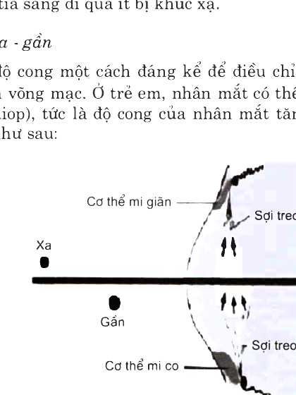

Các cơ thể mi hoàn toàn chịu sự chi phối của thần kinh phó giao cảm. Kích thích phó giao cảm làm cơ thể mi co, dẫn đến giãn dây chằng và làm tăng độ hội tụ. Nhờ độ hội tụ tăng, mắt có thể nhìn rõ được các vật ở gần hơn. Khi một vật từ xa lại gần thì tần số xung động phó giao cảm tới cơ thể mi tăng dần để mắt có thể luôn luôn thay đổi tiêu cự và cố định được ảnh của vật trên võng mạc.

- **Đồng tử:** Đồng tử có chức năng làm tăng hoặc giảm lượng ánh sáng đi vào mắt. Lượng ánh sáng qua mắt tỷ lệ thuận với bình phương bán kính đồng tử. Đồng tử người có đường kính nhỏ nhất là $1,5\text{ mm}$ và lớn nhất là $8\text{ mm}$. Vậy lượng ánh sáng qua đồng tử có thể tăng hoặc giảm 30 lần nhờ thay đổi bán kính đồng tử. Đóng mở đồng tử là một phản xạ. Độ mở của đồng tử có liên quan đến độ dài tiêu cự. Đồng tử càng nhỏ thì các tia sáng đều qua phần trung tâm của hệ thấu kính và các tia đều rơi vào tiêu điểm nên ảnh của vật càng rõ; võng mạc ra trước hay ra sau tiêu điểm cũng ít ảnh hưởng. Nếu đồng tử giãn to thì ngược lại, sự di chuyển của võng mạc ảnh hưởng rất lớn lên độ nét của ảnh trên võng mạc.

#### 8.1.2. Thị lực
Thị lực của mắt là khả năng phân biệt các nguồn sáng nằm sát nhau. Trong điều kiện được chiếu sáng đủ, mắt bình thường có thể phân biệt được hai điểm sáng cách nhau 1 phút góc (tức là các tia sáng từ hai điểm đến mắt tạo thành góc $\alpha = 1\text{ phút}$ ($1\text{ phút} = 1/60^\circ$)). Thị lực được tính theo công thức $1/\alpha$. Giá trị bình thường là 1/1. Trong thực tế, người ta đo thị lực bằng các bảng hình, bảng chữ, trên đó có hình hoặc chữ có kích thước khác nhau và ở cách xa mắt một khoảng cách nhất định (ví dụ, 5 mét) được nhìn dưới một góc là 1 phút. Chính xác hơn, người ta dùng các vòng có chỗ khuyết, chỗ khuyết tạo một góc 1 phút (vòng Landolt). Thị lực đo được là tỷ số giữa khoảng cách mà đối tượng nhìn thấy rõ vật (chữ hoặc chỗ mở của vòng) và khoảng cách đáng lẽ phải nhìn thấy rõ vật. Thị lực còn phụ thuộc vào màu sắc, độ tương phản của vật.

#### 8.1.3. Các tật khúc xạ của mắt
- **8.1.3.1. Lão thị:** Càng nhiều tuổi thì nhân mắt càng to và dày lên, kém đàn hồi hơn do các sợi protein bị thoái hóa. Khả năng phồng lên của nhân mắt giảm và đến 45 - 50 tuổi nhân mắt chỉ có thể tăng độ hội tụ lên $2\text{ diop}$, đến 70 tuổi thì không tăng được nữa. Hiện tượng nhân mắt không thích nghi được nữa gọi là chứng lão thị. Mắt bị lão thị chỉ có một tiêu cự ứng với một khoảng cách tùy theo từng cá thể, mắt không thích nghi với nhìn gần cũng như với nhìn xa và phải dùng các thấu kính hội tụ hai tròng hoặc có độ hội tụ tăng dần từ trên xuống dưới để nhìn được rõ.
- **8.1.3.2. Viễn thị:** Do nhãn cầu ngắn hoặc do độ hội tụ của mắt kém nên ảnh của vật rơi ra phía sau võng mạc. Các cơ thể mi có thể co lại để làm tăng độ hội tụ nên bệnh nhân vẫn trông thấy rõ vật ở xa. Nếu vật tiến lại gần thì các cơ thể mi càng co cho đến khi không co thêm được nữa, ảnh của vật rơi ở trước võng mạc. Người viễn thị cao tuổi thì nhìn xa cũng kém và còn kém hơn so với điều tiết để nhìn gần. Để sửa tật này cần đeo **thấu kính hội tụ**.
- **8.1.3.3. Cận thị:** Do nhãn cầu dài hoặc do độ hội tụ của mắt tăng hơn bình thường; bệnh nhân nhìn rõ vật ở gần, không nhìn rõ vật ở xa. Khi các cơ thể mi đã giãn hết rồi thì không còn cơ chế nào để làm giảm độ hội tụ của mắt nữa; khi đó bệnh nhân không còn cách nào để ảnh của một vật ở xa rơi đúng trên võng mạc. Khi vật lại gần hơn, bệnh nhân có thể tăng độ hội tụ để ảnh của vật rơi trên võng mạc. Để sửa tật này cần đeo **thấu kính phân kỳ**.
- **8.1.3.4. Loạn thị:** Do độ cong của giác mạc hoặc của hệ thấu kính của mắt không đều làm cho độ hội tụ của hệ thấu kính không đồng đều theo các trục, vì vậy các tia sáng không cùng rơi vào một điểm. Mắt chỉ có khả năng điều chỉnh độ hội tụ chung chứ không có khả năng đồng thời điều chỉnh độ hội tụ theo từng trục. Bệnh nhân không thể nhìn rõ toàn bộ vật, nhìn rõ được chỗ này lại thấy mờ chỗ khác tùy theo trục. Để sửa tật này, cần đeo **thấu kính lăng trụ đặc biệt** để điều chỉnh độ hội tụ theo trục bị rối loạn. Tật này có thể đi kèm với một tật khúc xạ khác, ví dụ vừa loạn thị vừa cận thị và được điều trị bằng kính làm cho từng mắt, từng người.
- **8.1.3.5. Đục nhân mắt:** Là một bệnh do nhiều nguyên nhân và rất hay gặp ở người cao tuổi. Các protein sợi bị thoái hóa, sau đó đông đặc lại tạo nên một vùng đục ở nhân mắt hoặc làm đục cả nhân mắt, cản trở tia sáng đi qua. Để điều trị phải mổ, lấy đi nhân mắt bị đục và thay thế bằng nhân mắt nhân tạo. Sau khi thay nhân mắt, thị lực trở về mức trước khi bị đục.

#### 8.1.4. Các dịch trong mắt
- **8.1.4.1. Thủy dịch:** Thủy dịch do thể mi bài tiết theo cơ chế tích cực (xem Bài 8, mục 6).
- **8.1.4.2. Nước mắt:** Nước mắt do các tuyến lệ nằm ở góc ngoài mi mắt trên sản xuất. Nước mắt chảy trên bề mặt của mắt và đổ vào khoang mũi qua ống lệ và túi lệ. Chớp mắt giúp dàn trải nước mắt. Nước mắt có tác dụng lấp các chỗ không đều trên giác mạc, ngăn khô giác mạc, làm sạch bụi, khí độc, ngăn nhiễm khuẩn (nhờ có lysozym và immunoglobulin A),... Chảy nước mắt nhiều là một đáp ứng nhằm bảo vệ mắt và còn là một biểu hiện cảm xúc.

#### 8.1.5. Võng mạc
Cấu trúc võng mạc gồm có nhiều lớp tế bào (*hình 16.13*). Sau khi đã qua các phần trong suốt của mắt và các lớp tế bào khác của võng mạc, ánh sáng tới lớp receptor nhận cảm ánh sáng là các tế bào nón và các tế bào que. Phần trung tâm võng mạc chỉ có tế bào nón, càng ra ngoài rìa võng mạc thì mật độ tế bào que càng dày. Phía sau các tế bào nón và tế bào que là lớp sắc tố đen của võng mạc có tác dụng không cho ánh sáng phản xạ trong nhãn cầu (giống như lớp màu đen trong hộp đựng phim của máy ảnh), nhờ đó mà nhìn vật được rõ. Lớp sắc tố này còn chứa vitamin A là chất rất cần thiết cho sự nhìn. Vitamin A trong lớp sắc tố được trao đổi với các tế bào nón và tế bào que. Độ nhạy cảm của tế bào que tỷ lệ thuận với logarit của nồng độ rhodopsin. Ở chỗ sáng lâu, rhodopsin bị phân giải nhiều, tế bào que kém nhạy cảm; đó là sự thích nghi với sáng. Ngược lại, ở trong bóng tối lâu thì sự kết hợp giữa retinal và scotopsin tăng, vitamin A tăng chuyển thành retinal nên chất nhận cảm ánh sáng trong tế bào que tăng, độ nhạy cảm của tế bào que tăng lên; đó là sự thích nghi với tối. Giúp cho nhìn rõ vật ở chỗ sáng, chỗ tối còn do sự điều tiết đường kính đồng tử, sự thích nghi của các tế bào trong các lớp của võng mạc.

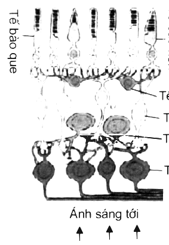

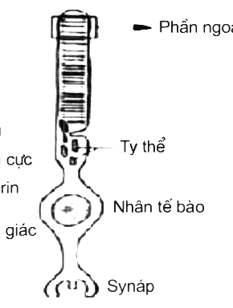

### 8.2. Receptor ánh sáng
Receptor nhận cảm ánh sáng là các tế bào que và tế bào nón ở võng mạc (*hình 16.14*). Mỗi võng mạc có khoảng 100 triệu tế bào que và 3 triệu tế bào nón. Trung bình có khoảng 60 tế bào que và 2 tế bào nón hội tụ về một sợi thần kinh.

#### 8.2.1. Tế bào que
Nhận cảm ánh sáng đen trắng, giúp nhìn được vật có cường độ ánh sáng từ mạnh đến mờ và nhìn được vật trong bóng tối. Phần ngoài của tế bào que có chứa chất rhodopsin (scotopsin + retinal 11 cis). Dưới tác dụng của năng lượng ánh sáng, sau một chuỗi phản ứng xảy ra chỉ trong vài phần triệu giây, rhodopsin bị phân giải thành scotopsin và retinal 11-trans. Chất metarhodopsin trong chuỗi phản ứng ấy gây ra biến đổi điện ở tế bào que. Retinal 11-trans được chuyển thành retinal 11-cis và retinal 11-cis lại kết hợp với scotopsin để tạo thành rhodopsin. Vitamin A có sẵn trong tế bào nón và tế bào que là một con đường để tái tạo retinal 11-cis qua việc tạo thành retinol 11-trans. Khi các tế bào võng mạc thừa retinal thì lượng thừa chuyển thành vitamin A; khi các tế bào này thiếu retinal thì vitamin A sẽ được chuyển thành retinal: thiếu vitamin A dẫn đến thiếu retinal và gây bệnh quáng gà, gây khô giác mạc làm giác mạc dễ bị tổn thương, dẫn đến mù loà.

#### 8.2.2. Tế bào nón
Nhạy cảm với ánh sáng màu có cường độ mạnh, giúp nhìn rõ các đường nét và màu sắc của vật. Chất nhận cảm màu trong tế bào nón là phức hợp của retinal và các photopsin. Có ba loại photopsin khác nhau: một loại hấp thụ mạnh nhất với bước sóng $445\text{ nm}$ (ứng với màu lam), một loại với bước sóng $535\text{ nm}$ (ứng với màu lục) và một loại với bước sóng $570\text{ nm}$ (ứng với màu đỏ). Trong mỗi tế bào nón có chứa một loại photopsin nên mỗi tế bào nón chỉ nhạy cảm tối đa với một màu nhất định. Ba màu lam, lục và đỏ là ba màu cơ bản, từ đấy có thể tạo ra tất cả mọi màu bằng cách pha trộn chúng theo những tỷ lệ khác nhau. Đấy chính là cơ sở của cơ chế nhìn màu. Não sẽ dựa vào tỷ lệ các loại tế bào nón bị kích thích mà cho nhận định về màu và sắc độ của màu. Ở người có trường hợp bị mù màu là do thiếu một hay hai loại tế bào nón khiến cho không nhận cảm được màu tương ứng với bước sóng đặc hiệu của tế bào nón bị thiếu. Bệnh này là bệnh di truyền từ mẹ và chỉ có con trai mắc do rối loạn gen trên thể nhiễm sắc X.

#### 8.2.3. Hưng phấn ở receptor thị giác
Điều khác biệt quan trọng giữa các tế bào nón và tế bào que với các receptor cảm giác khác là khi bị kích thích thì ở các tế bào này lại xảy ra **hiện tượng ưu phân cực** (mặt trong màng càng âm hơn so với mặt ngoài do số ion $\text{Na}^+$ đi vào ít hơn số ion natri đi ra). Hiện tượng ưu phân cực xảy ra nhanh và tồn tại lâu nên cảm giác nhìn thấy vật lâu hơn thời gian ảnh của vật tồn tại trên võng mạc. Sự biến đổi điện thế ở các receptor thị giác tỷ lệ thuận với logarit cường độ ánh sáng. Điều này cho phép mắt có khả năng phân biệt độ sáng hơn kém nhau hàng nghìn lần. Sự thay đổi điện thế ở các tế bào nón và tế bào que sinh ra dòng điện chạy trong bào tương từ điểm bị kích thích tới synap (chứ không phải là sự lan truyền của điện thế hoạt động vì không sinh ra điện thế hoạt động).

### 8.3. Dẫn truyền cảm giác thị

#### 8.3.1. Dẫn truyền tín hiệu trong võng mạc
Tín hiệu từ các tế bào nón và tế bào que được truyền tới các loại tế bào khác ở các lớp của võng mạc (tế bào ngang, tế bào lưỡng cực, tế bào amacrin, tế bào hạch). Người ta chưa xác định chắc chắn được hết các chất truyền đạt thần kinh ở võng mạc nhưng đã biết chất truyền đạt của tế bào nón là glutamat, của tế bào ngang là GABA. Các tế bào hạch khi bị kích thích sinh ra điện thế hoạt động. Các sợi thần kinh thị giác xuất phát từ các tế bào hạch dẫn truyền điện thế hoạt động này tới não.

#### 8.3.2. Dẫn truyền tín hiệu trong hệ thần kinh trung ương
Đường dẫn truyền thị giác tới não được mô tả trong *hình 16.15*. Trường nhìn bị mất ở bệnh nhân bị tổn thương đường dẫn truyền thị giác phụ thuộc vào vị trí của tổn thương:
- Cắt đứt dây thần kinh thị giác một bên (tổn thương A): mù hoàn toàn mắt cùng bên.
- Tổn thương bắt chéo thị giác (chiasma opticum, tổn thương B): mất thị trường thái dương của cả hai mắt (bán manh hai mắt phía thái dương).
- Tổn thương dải thị giác (tổn thương C): mất nửa thị trường đối bên của cả hai mắt (bán manh đồng danh đối bên).

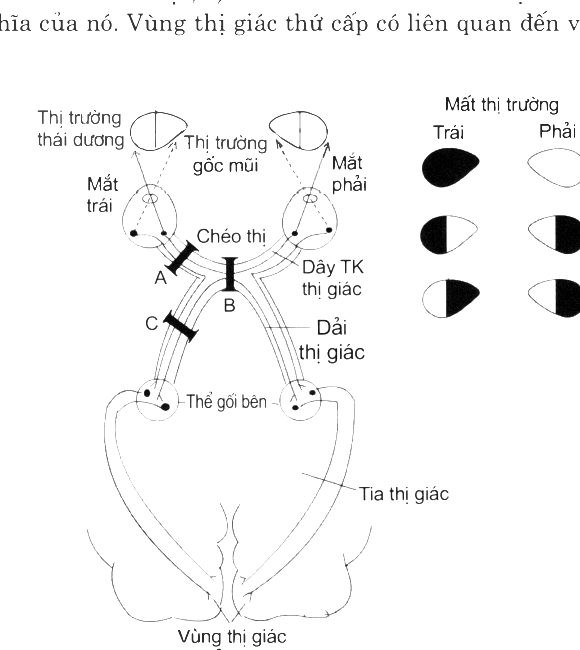

### 8.4. Nhận cảm giác thị trên vỏ não
Trên vỏ não có các vùng nhận cảm thị giác (*hình 16.16*):
- **Vùng thị giác sơ cấp:** ở thuỳ chẩm (vùng 17 trên bản đồ vỏ não của Brodmann) nhận biết về độ tương phản, màu và chiều sâu. Tổn thương vùng này làm mất thị giác có ý thức nhưng vẫn còn những đáp ứng vô thức đối với thay đổi cường độ ánh sáng, chuyển động của ánh sáng như quay mắt, quay đầu, tránh nguồn sáng mạnh...
- **Vùng thị giác thứ cấp (vùng thị giác liên hợp):** nằm ở phía trên, trước và dưới vùng thị giác sơ cấp (vùng 18 trên bản đồ vỏ não của Brodmann). Vùng này nhận các tín hiệu từ vùng 17 và có chức năng phân tích ý nghĩa của cảm giác thị giác (hình thể, hình dạng 3 chiều, chuyển động của vật; chi tiết và màu sắc của vật,...) và từ các tính chất đó nhận thức được vật là vật gì và ý nghĩa của nó. Vùng thị giác thứ cấp có liên quan đến việc nhận biết chữ viết, đọc.

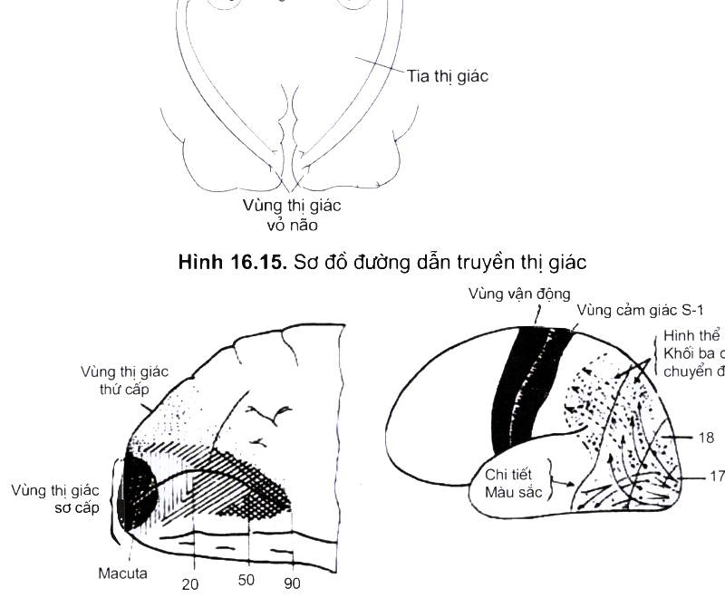

Vỏ não còn tham gia chi phối cử động các cặp cơ vận nhãn (cơ thẳng giữa, cơ thẳng bên, cơ thẳng trên, cơ thẳng dưới, cơ chéo trên, cơ chéo dưới) thông qua các dây thần kinh sọ số III, IV, VI.

### 8.5. Đặc điểm của thị giác
- Cơ chế cảm nhận ánh sáng là cơ chế quang hóa học và do tế bào que đảm nhận thông qua việc phân giải chất rhodopsin có trong tế bào que thành scotopsin và retinal.
- Cơ chế nhìn màu do tế bào nón đảm nhận. Chất nhạy cảm với màu của tế bào nón là phức hợp của retinal và các photopsin.
- Nhìn là sự phối hợp của cả hai cơ chế hóa học và vật lý có sự tham gia của nhiều bộ phận như hệ thống thấu kính hội tụ của mắt, đồng tử, võng mạc, các receptor, đường dẫn truyền thần kinh và trung tâm nhận cảm cảm giác của vỏ não.
- Nhờ sự kết hợp hình ảnh của vật trên hai võng mạc và trên hai vùng chẩm của vỏ não mà có được hình ảnh nổi của vật.
- Nhờ sự phối hợp giữa nhìn - sờ và nhờ cử động của nhãn cầu mà thấy được khoảng cách và sự chuyển động của các vật.

---

## 9. THÍNH GIÁC

Kích thích thính giác có bản chất vật lý (sóng âm). Cơ quan nhận cảm thính giác là tai. Tai người nhận cảm được các âm có tần số từ 16 đến khoảng $20.000\text{ Hz}$. Giới hạn trên có thể bị giảm xuống còn $5000\text{ Hz}$ ở người có tuổi.

### 9.1. Dẫn truyền và khuếch đại sóng âm (hình 16.17)
Sóng âm tới cơ quan thính giác chủ yếu qua **ống tai ngoài** vào tới **màng nhĩ**, làm rung màng nhĩ. Vành tai và ống tai ngoài tạo thành một cái phễu có tác dụng định hướng nguồn âm và khuếch đại sóng âm do cộng hưởng. Rung động của màng nhĩ được **chuỗi xương nhỏ trong hòm màng nhĩ (tai giữa)** truyền tới **cửa sổ bầu dục**. Tai giữa đảm bảo truyền âm từ môi trường khí (cản âm kém) sang môi trường dịch (cản âm nhiều). Năng lượng của sóng âm không bị giảm vì âm được truyền từ màng nhĩ có diện tích lớn ($50\text{ mm}^2$) sang cửa sổ bầu dục có diện tích nhỏ hơn ($3\text{ mm}^2$) và nhờ các xương nhỏ hoạt động như một hệ thống đòn bẩy (khuếch đại lên 1,3 lần). Hai cơ căng màng nhĩ và cơ căng xương bàn đạp ở tai giữa có tác dụng điều chỉnh việc truyền các âm có tần số thấp, bảo vệ tai khỏi các âm có cường độ lớn, giảm các tạp âm, giảm sự cộng hưởng trong tai giữa và làm các âm trầm không che lấp các âm cao.

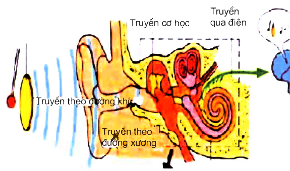

Từ cửa sổ bầu dục vào trong là **tai trong (hay mê cung)**. Trong tai trong có cơ quan nhận cảm thăng bằng là *tiền đình tai* và một bộ phận xoắn ốc nằm trong xương đá gọi là *ốc tai*. Ốc tai gồm ba ống nằm chồng lên nhau: trên cùng là **thang tiền đình** (chứa ngoại dịch), ở giữa là **thang giữa** (chứa nội dịch có nhiều kali hơn ngoại dịch) và dưới cùng là **thang hòm nhĩ** (chứa ngoại dịch). Thang tiền đình và thang giữa được ngăn cách bởi **màng Reissner**; thang giữa và thang hòm nhĩ được ngăn cách bởi **màng đáy**. Màng Reissner là một màng rất mỏng, rất dễ rung động nên dao động âm từ thang tiền đình sang thang giữa không bị ảnh hưởng. Màng này có tác dụng duy trì nội dịch trong thang giữa là dịch cần thiết cho hoạt động bình thường của các tế bào có lông của cơ quan Corti (thành phần nội dịch khác với thành phần ngoại dịch: có nhiều kali, rất ít natri).

### 9.2. Receptor nhận cảm thính giác
Tiếp nhận kích thích thính giác là **cơ quan Corti** (*hình 16.18*). Đây là một cấu trúc nằm trên màng đáy thuộc tai trong. Cơ quan này gồm có các tế bào có lông là những tế bào nhạy cảm cơ - điện. Các tế bào này là các receptor âm. Receptor âm chứa nhiều kali và có điện thế âm so với ngoại dịch. Kênh kali đóng mở theo chiều nghiêng của sợi lông tế bào. Sóng âm làm rung cửa sổ bầu dục, làm màng này dao động và làm cho chất dịch chuyển động trong thang tiền đình và thang giữa theo cả hai chiều (vào trong hoặc ra ngoài) theo sự dao động của sóng âm. Dịch chuyển động làm các tế bào nhận cảm chuyển động theo. Mỗi tần số âm được nhận cảm ở một chỗ trên màng ốc tai: âm có tần số cao được nhận cảm ở gần cửa sổ bầu dục, âm có tần số thấp được nhận cảm ở phần đỉnh của ốc tai. Màng đáy rung làm các sợi lông của các tế bào rung và va đụng vào màng mái, dịch trong ốc tai chảy qua lại và đè lên trên các sợi lông, làm các tế bào có lông bị kích thích.

Receptor bị khử cực bởi dòng kali đi vào tế bào. Khi các tế bào lông nghiêng về thang tiền đình thì các kênh kali mở ra và tế bào bị khử cực; khi nghiêng về hướng ngược lại thì các kênh kali đóng lại và tế bào bị ưu phân cực.

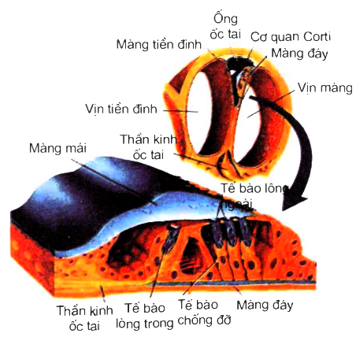

### 9.3. Dẫn truyền tín hiệu từ receptor về hệ thần kinh trung ương
Các sợi trục xuất phát từ cơ quan Corti tới các nhân ốc tai trước và sau ở hành não. Từ các nhân này, nơron thứ hai bắt chéo sang bên kia qua thể thang tới nhân trám trên (có một ít sợi lên nhân trám trên cùng bên). Từ nhân trám trên, tín hiệu được tiếp tục truyền qua các chặng rồi cuối cùng tận cùng ở vùng thính giác ở vỏ não (*hình 16.19*).

Đường dẫn truyền thính giác có những đặc điểm đáng chú ý:
- Tín hiệu từ mỗi tai được truyền về cả hai bán cầu não. Tuy nhiên về bán cầu đối bên có nhiều hơn một chút so với bán cầu cùng bên.
- Đường dẫn truyền có tính định hướng cao.
- Trên đường đi lên não, đường dẫn truyền thính giác cho các nhánh bên tới hệ thống lưới kích thích của thân não. Từ hệ này có các sợi lan toả đi lên vỏ não, xuống tuỷ sống và kích thích toàn bộ hệ thống thần kinh trung ương khi có kích thích âm mạnh. Ngoài ra còn có nhánh bên tới tiểu não và kích thích tiểu não khi có kích thích âm mạnh.

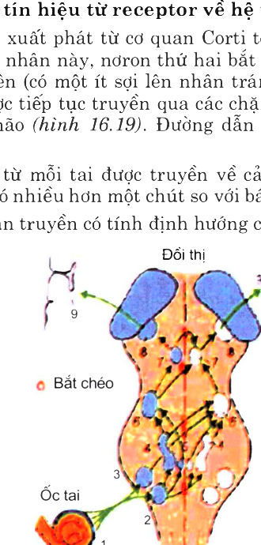

### 9.4. Trung tâm nhận cảm thính giác ở vỏ não
Vùng nghe trên vỏ não nằm chủ yếu ở hồi thái dương trên (*hình 16.20*):
- **Vùng nghe sơ cấp:** là vùng nhận tín hiệu từ thể gối giữa tới; tổn thương vùng này thì không nhận cảm được âm mặc dù cơ quan nghe là bình thường.
- **Vùng nghe liên hợp:** nhận các thông tin từ vùng nghe sơ cấp và từ các vùng của đồi thị, gần thể gối giữa. Tổn thương vùng nghe liên hợp thì vẫn nhận cảm được âm nhưng không nhận thức tính chất, ý nghĩa của âm.

Từ các vùng nghe của vỏ não có các đường đi xuống ốc tai, ức chế cơ quan Corti, có tác dụng hướng sự chú ý vào các âm nhất định nào đấy mà bỏ qua các âm khác.

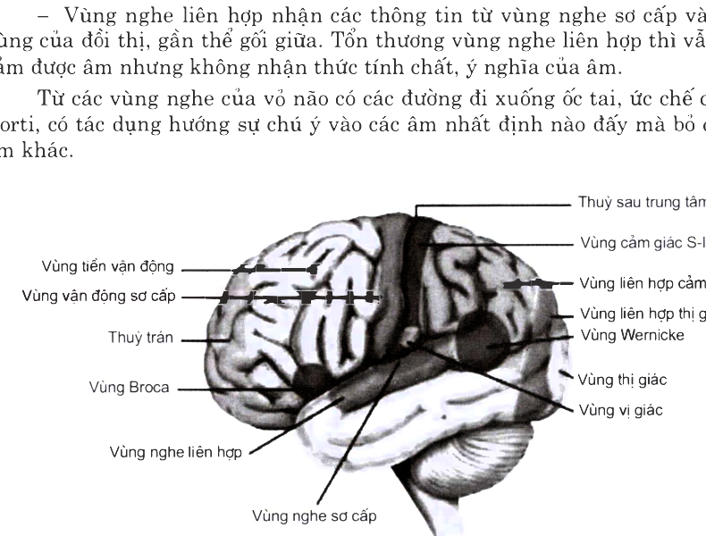

### 9.5. Đặc điểm của thính giác
- Tai có thể nghe được âm có tần số từ $16\text{ Hz} - 20.000\text{ Hz}$ và nhận biết được tính chất âm thanh như cường độ, âm sắc, hoà âm, phản âm.
- Bản chất của cơ chế nghe chính là cơ chế truyền âm và khuếch đại âm. Nghe là một chức năng sinh lý thực hiện được nhờ sự phối hợp hoạt động bình thường của nhiều bộ phận của tai như ống tai ngoài, màng nhĩ, chuỗi xương nhỏ, cửa sổ bầu dục, tai trong, đường dẫn truyền và trung tâm cảm giác thính giác,... Tổn thương các bộ phận này sẽ ảnh hưởng đến chức năng nghe.
- Do có sự chênh lệch về thời gian và chênh lệch về cường độ của âm đến từng tai rồi đến hai trung tâm thính giác khác nhau ở vỏ não nên có thể xác định được nguồn âm và âm thanh nổi.
- Thính giác và thị giác có sự bù trừ về chức năng (người bị khiếm thị có thính giác rất tốt).

---

## TỰ LƯỢNG GIÁ

1. Kể 4 đặc tính chung của receptor và trình bày về sự đáp ứng đặc hiệu với kích thích và mối tương quan giữa lượng cảm giác với kích thích.
2. Trình bày về đặc tính biến đổi kích thích cảm giác thành xung động thần kinh tại receptor.
3. Trình bày về khả năng thích nghi của receptor.
4. Trình bày về receptor tiếp nhận xúc giác.
5. Kể tên các đường dẫn truyền, trung tâm nhận cảm xúc giác và nêu các đặc điểm của xúc giác.
6. Trình bày về receptor tiếp nhận cảm giác nóng - lạnh.
7. Kể tên các đường dẫn truyền, trung tâm nhận cảm giác nóng - lạnh và nêu các đặc điểm của cảm giác nóng - lạnh.
8. Trình bày về vị trí và các loại receptor tiếp nhận cảm giác đau.
9. Kể tên các đường dẫn truyền, trung tâm nhận thức cảm giác đau và nêu các đặc điểm của cảm giác đau.
10. Kể tên các receptor cảm giác sâu, đường dẫn truyền, trung tâm nhận cảm giác sâu và nêu các đặc điểm của cảm giác sâu.
11. Trình bày về receptor tiếp nhận vị giác, đường dẫn truyền, trung tâm và các đặc điểm của vị giác.
12. Trình bày về receptor tiếp nhận khứu giác, tên các chặng của đường dẫn truyền và các đặc điểm của khứu giác.
13. Trình bày về receptor tiếp nhận kích thích sáng tối và ánh sáng màu.
14. Trình bày về đường dẫn truyền, các vùng nhận cảm thị giác của vỏ não và các đặc điểm của thị giác.
15. Trình bày về receptor tiếp nhận kích thích thính giác, đặc điểm của đường dẫn truyền thính giác và trung tâm nhận cảm thính giác ở vỏ não.
16. Trình bày về đặc điểm của thính giác.
