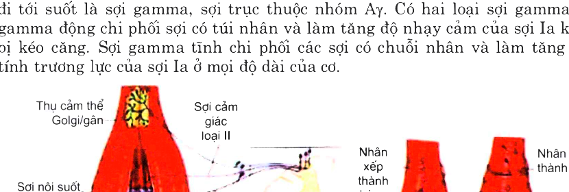
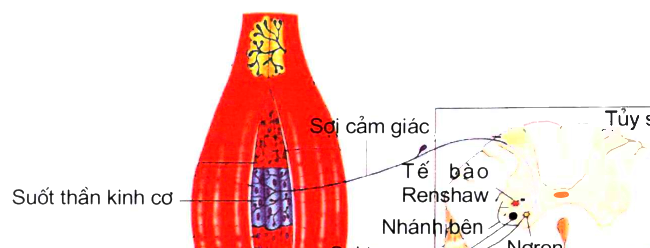
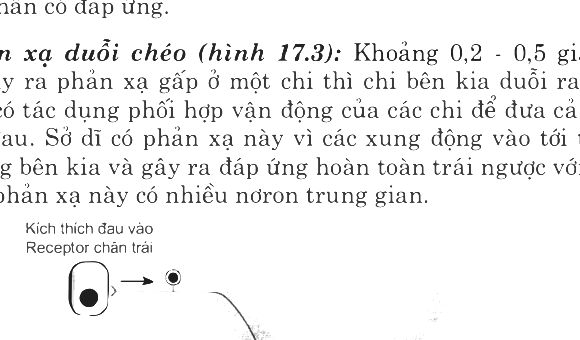
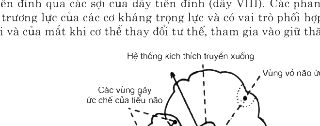
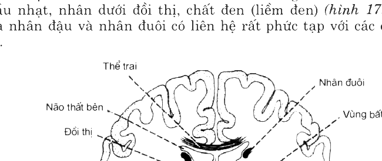
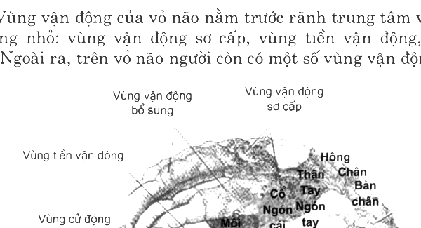
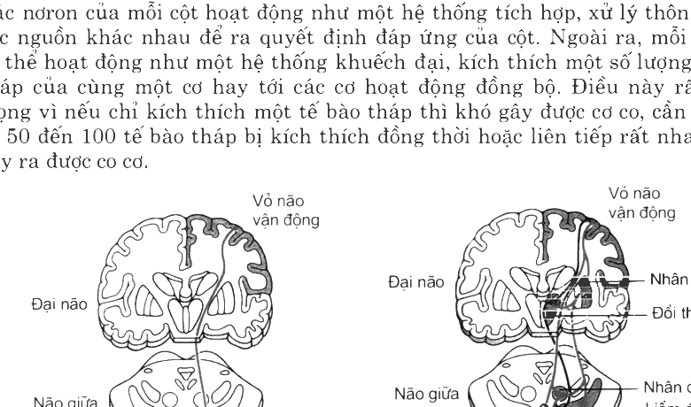

# BÀI 17: SINH LÝ HỆ THẦN KINH VẬN ĐỘNG

## MỤC TIÊU
*Sau khi học xong bài này, sinh viên có khả năng:*
1. Trình bày được đặc điểm cấu trúc - chức năng của đơn vị vận động và của suốt cơ.
2. Trình bày được các phản xạ vận động ở tủy sống.
3. Trình bày được các vùng chức năng vận động trên vỏ não.
4. Trình bày được sự tích hợp chức năng của các cấu trúc thần kinh trong kiểm soát và điều hoà vận động.

---

Hệ thống thần kinh kiểm soát vận động có ý thức của cơ thể bao gồm vỏ não, các trung tâm dưới vỏ, tủy sống. Vỏ não là nơi xuất phát của các ý định, ra lệnh thực hiện và kiểm soát việc thực hiện động tác tùy ý. Các trung tâm dưới vỏ bao gồm các nhân xám trung ương, tiểu não, thân não chịu trách nhiệm điều hòa, phối hợp vận động để hoàn thành động tác. Tủy sống là nơi có “con đường chung cuối cùng” qua đó động tác được thực hiện, góp phần làm cho động tác được hoàn thiện. Các receptor đưa thông tin cảm giác bản thể và cảm giác có ý thức phản hồi về hệ thần kinh trung ương, giúp cho việc điều chỉnh động tác trong quá trình đang được thực hiện.

---

## 1. CHỨC NĂNG VẬN ĐỘNG CỦA TỦY SỐNG

### 1.1. Đơn vị vận động

#### 1.1.1. Thành phần

##### 1.1.1.1. Các nơron vận động
Các nơron vận động của tuỷ sống nằm ở sừng trước tuỷ và gồm có hai loại:
- **Nơron vận động alpha:** sợi trục lớn thuộc loại $\text{A}\alpha$ (đường kính $9 - 20\text{ }\mu\text{m}$), chi phối các sợi cơ vân lớn. Mỗi sợi trục bị kích thích gây co từ vài ba sợi đến hàng trăm sợi cơ vân. Sợi trục của nơron alpha và số sợi cơ vân do nó chi phối tạo thành một **đơn vị vận động**. Các xung động vận động từ các trung tâm phía trên tới tuỷ sống, được tích hợp trong các vòng nơron trung gian nằm trong chất xám của đốt tuỷ sống rồi mới tới nơron vận động alpha ở sừng trước tuỷ sống. Từ sừng trước, sợi trục đi theo rễ trước dây thần kinh tủy sống tới chi phối cơ.
- **Nơron vận động gamma:** nhỏ hơn, nằm gần nơron alpha, có số lượng bằng khoảng một nửa số nơron alpha. Sợi trục thuộc loại $\text{A}\gamma$ (đường kính khoảng $5\text{ }\mu\text{m}$) đi theo rễ trước tới chi phối các sợi cơ của suốt cơ. Nơron này hoạt động thường xuyên ở các mức độ khác nhau để duy trì trương lực cơ.
- Trong tuỷ sống còn có **tế bào Renshaw:** tế bào ức chế, truyền tín hiệu ức chế qua nhánh nối ngang đến các nơron vận động xung quanh nơron bị kích thích, tác dụng ức chế bên.

Xung động thần kinh của nơron alpha và nơron gamma theo sợi trục tới các đầu tận cùng, làm giải phóng chất dẫn truyền trung gian là acetylcholin, gây khử cực ở tế bào cơ và làm co cơ.

##### 1.1.1.2. Sợi cơ
Tất cả các sợi cơ của một đơn vị vận động đều thuộc vào một loại được phân chia theo tính chất hóa học và đặc điểm co của sợi cơ. Có các loại sợi sau:
- **Sợi co nhanh (Sợi trắng):** sợi cơ (tế bào cơ) có kích thước lớn, tạo ra lực co mạnh. Tốc độ co nhanh do các cầu nối có hoạt tính ATPase mạnh và do mạng lưới nội cơ tương tái hấp thu ion $\text{Ca}^{2+}$ nhanh. Sợi cơ loại này chóng mỏi vì có ít ty thể (*mitochondria*) nên không chuyển hóa theo con đường oxy hóa được. Năng lượng cho co cơ dựa vào việc phân giải glycogen để sinh ra ATP. Mỏi cơ xuất hiện khi dự trữ glycogen trong cơ giảm. Do sợi cơ không chuyển hóa theo con đường oxy hóa nên có ít mao mạch tới các sợi cơ này.
- **Sợi co chậm (Sợi đỏ):** tế bào cơ có kích thước nhỏ, khi co không tạo ra lực lớn nhưng có khả năng co lâu. Kích thước tế bào nhỏ tạo điều kiện tốt để oxy vào sâu trong tế bào và các chất chuyển hóa dễ được đào thải khỏi tế bào. Tốc độ co chậm do các cầu nối có hoạt tính ATPase yếu và do mạng lưới nội cơ tương tái hấp thu ion $\text{Ca}^{2+}$ chậm. Do thời gian co của cơ dài nên kích thích cơ với tần số thấp có thể gây hiện tượng cộng kích thích và làm cơ co cứng. Cơ co lâu không bị mỏi là do nguồn ATP chủ yếu của cơ là từ chuyển hóa theo con đường oxy hóa. Hoạt tính ATPase yếu và tái hấp thu canxi chậm ở sợi cơ loại này không đòi hỏi phải có nhiều ATP. Do đòi hỏi nhiều oxy nên mao mạch đến các sợi cơ này nhiều.
- **Sợi có tính chất của cả hai loại sợi trên.**

#### Bảng so sánh hai loại sợi cơ của đơn vị vận động:

| Đặc điểm | Sợi co nhanh (Sợi trắng - Type II) | Sợi co chậm (Sợi đỏ - Type I) |
| :--- | :--- | :--- |
| **Kích thước sợi cơ** | Lớn | Nhỏ |
| **Lực co** | Rất mạnh | Nhỏ hơn |
| **Tốc độ co** | Nhanh | Chậm |
| **Hoạt tính ATPase cầu nối** | Mạnh | Yếu |
| **Tái hấp thu $\text{Ca}^{2+}$ vào SER** | Nhanh | Chậm |
| **Số lượng ty thể** | Ít | Nhiều |
| **Mạch máu mao mạch** | Ít | Nhiều (giàu mạch máu) |
| **Nguồn năng lượng chủ yếu** | Đường phân yếm khí từ glycogen | Chuyển hóa oxy hóa hiếu khí |
| **Độ bền mỏi** | Chóng mỏi (khi cạn glycogen) | Rất bền bỉ, co lâu không mỏi |

#### 1.1.2. Đặc điểm của đơn vị vận động
- Trong một cơ có nhiều đơn vị vận động; có đơn vị chỉ có một vài sợi cơ, có đơn vị có tới hàng nghìn sợi cơ. Đơn vị vận động ở cơ thực hiện các động tác chính xác (ví dụ, các cơ cử động ngón tay, cơ vận nhãn,...) nhỏ hơn ở các cơ lớn thực hiện các động tác của một phần rộng của cơ thể hay để giữ tư thế.
- Khi nơron alpha của đơn vị vận động hưng phấn thì tất cả các sợi cơ của đơn vị vận động đó đều co.
- Các sợi cơ của một đơn vị vận động được phân bố rải rác trong cả khối cơ nên lực co do chúng tạo ra cũng được phân bố rải rác.

#### 1.1.3. Huy động đơn vị vận động trong co cơ
Thứ tự huy động các đơn vị vận động tham gia co cơ giúp cho việc kiểm soát vận động. Khi thực hiện co cơ, các đơn vị vận động nhỏ được huy động trước các đơn vị vận động lớn do dễ bị kích thích hơn. Số lượng các nơron vận động được huy động tùy thuộc vào tính chất của động tác. Ví dụ, để thực hiện các động tác chính xác, không đòi hỏi lực co cơ lớn thì vỏ não chỉ kích thích tối thiểu đến các nơron vận động và chỉ gây hưng phấn ở các đơn vị vận động nhỏ do vậy cơ sẽ lâu bị mỏi.

---

### 1.2. Chức năng vận động của tủy sống và các phản xạ tủy
Ngoài chức năng dẫn truyền cảm giác lên các trung tâm phía trên, các xung động vận động từ các trung tâm phía trên xuống, tuỷ sống còn là trung tâm của những phản xạ đơn giản. Chất xám tuỷ là trung tâm của các phản xạ và các chức năng vận động khác của tuỷ sống. Các thông tin cảm giác về tuỷ sống theo rễ sau của dây thần kinh tuỷ. Vào trong tuỷ sống, thông tin được truyền đi theo hai đường: một đường dừng lại ở chất xám tuỷ sống và gây nên các phản xạ do đốt tuỷ đó chi phối; một đường tiếp tục lên các trung tâm cao hơn của trục não - tuỷ (lên các đốt tuỷ sống cao hơn, lên vỏ não). Trong tuỷ sống có rất nhiều sợi đi lên và đi xuống từ đốt tuỷ sống này tới đốt tuỷ sống khác. Các sợi này là các đường dẫn truyền của các phản xạ liên đốt tuỷ, trong đó có các phản xạ phối hợp vận động của mặt trước và mặt sau chi. Các phản xạ của tủy sống góp phần phối hợp động tác. Cung phản xạ của tủy tương đối đơn giản.

#### 1.2.1. Phản xạ căng cơ
Phản xạ này có tác dụng làm co cơ khi cơ bị kéo giãn ra. Ví dụ, gõ búa phản xạ vào gân cơ tứ đầu gây phản xạ co cơ này nên cẳng chân đang gấp sẽ duỗi ra. Cơ gấp và cơ duỗi đều có phản xạ này nên phản xạ căng cơ được ứng dụng rất thường quy trong thăm khám thần kinh (phản xạ đầu gối, các phản xạ duỗi).

##### 1.2.1.1. Receptor của phản xạ căng cơ là suốt cơ (hình 17.1)
Số lượng suốt trong mỗi cơ phụ thuộc vào từng loại cơ: những cơ thực hiện động tác tinh tế, chính xác có nhiều suốt hơn là các cơ chỉ dùng để duy trì tư thế. Ví dụ, số lượng suốt cơ ở bàn tay (khoảng 80 suốt), bằng 20% số suốt ở các cơ lưng trong khi khối lượng các cơ lưng gấp 100 lần khối lượng các cơ ở bàn tay. Trong suốt cơ có các sợi cơ nội suốt chỉ có khả năng co ở 2 đầu (dưới tác dụng của nơron vận động gamma) còn phần trung tâm thì có các sợi thần kinh cảm giác và thần kinh vận động.

- **Các sợi cơ nội suốt:** sợi nội suốt là các sợi cơ vân rất mảnh, phần giữa có rất ít hoặc không có xơ actin và xơ myosin nên chỉ có hai đầu sợi là có khả năng co rút. Có hai loại sợi chính là:
  - **Sợi có túi nhân:** dài $7\text{ mm}$, đường kính $30\text{ }\mu\text{m}$, các nhân tập trung ở vùng giữa làm chỗ này phồng lên như một cái túi, mỗi suốt có 2 - 5 sợi loại này.
  - **Sợi có chuỗi nhân:** dài $4\text{ mm}$, đường kính $15\text{ }\mu\text{m}$, các nhân xếp nối nhau thành một hàng, trong mỗi suốt có khoảng 6 - 10 sợi.
  Mô liên kết bao quanh suốt liên tục với mô liên kết của sợi ngoại suốt. Khi sợi ngoại suốt co thì sợi nội suốt ngắn lại, khi sợi ngoại suốt bị kéo căng thì sợi nội suốt dài ra. Như vậy, chiều dài của suốt thay đổi theo chiều dài của cơ.

- **Thần kinh ở suốt:**
  - Có hai loại sợi cảm giác xuất phát từ suốt thần kinh cơ:
    - Loại thứ nhất còn gọi là **sợi sơ cấp** là một sợi to (thuộc nhóm $\text{Ia}$) có các nhánh tới tất cả mọi sợi cơ nội suốt ở phần trung tâm.
    - Loại thứ hai còn gọi là **sợi thứ cấp** là các sợi thuộc nhóm $\text{II}$, nhỏ hơn, chỉ tới và tận cùng ở hai đầu các sợi có chuỗi nhân. Phần nhận cảm giác của suốt nằm ở phần trung tâm suốt.
  - Sợi vận động đi tới suốt là **sợi gamma**, sợi trục thuộc nhóm $\text{A}\gamma$. Có hai loại sợi gamma:
    - **Sợi gamma động:** chi phối sợi có túi nhân và làm tăng độ nhạy cảm của sợi $\text{Ia}$ khi cơ bị kéo căng.
    - **Sợi gamma tĩnh:** chi phối các sợi có chuỗi nhân và làm tăng hoạt tính trương lực của sợi $\text{Ia}$ ở mọi độ dài của cơ.

##### 1.2.1.2. Cung phản xạ căng cơ
Khi cả khối cơ bị kéo dài hoặc khi hai đầu của sợi nội suốt co lại sẽ kích thích phần trung tâm của suốt. Xung động đi theo sợi $\text{Ia}$ vào tủy sống qua rễ sau tới kích thích nơron alpha, rồi xung động từ nơron alpha đi theo rễ trước tới cơ vân tương ứng, gây co cơ (*hình 17.2*). Cạnh nơron alpha có **tế bào Renshaw**. Tế bào này nhận tín hiệu từ nơron alpha tới kích thích và khi hưng phấn lại quay lại ức chế nơron alpha. Nơron alpha càng hưng phấn mạnh thì sự ức chế của tế bào Renshaw lên nó càng mạnh. Đây là cơ chế điều hòa tại chỗ hoạt động của nơron alpha.

Như vậy, cơ vân bị kéo dài ra một cách đột ngột sẽ gây ra phản xạ co để ngăn không cho nó bị dài thêm. Khi cơ đã đạt đến một độ dài mới thì phản xạ căng cơ chấm dứt. Khi cơ bị ngắn lại đột ngột thì các hiện tượng xảy ra hoàn toàn ngược lại do các xung động được truyền về tuỷ sống từ các thụ cảm thể Golgi ở đầu gân. Kết quả là các sợi cơ vân không bị kích thích và giãn ra. Phản xạ căng cơ âm này có tác dụng chống lại sự rút ngắn chiều dài cơ. Tóm lại, phản xạ căng cơ có tác dụng giữ cho cơ có một độ dài không thay đổi. Cung phản xạ căng cơ là **cung phản xạ đơn synap** nên đáp ứng chấm dứt ngay và không có hiện tượng lan tỏa. Nơron vận động alpha chính là con đường chung cuối cùng, vừa có vai trò tích hợp, vừa có vai trò ly tâm. Do tốc độ dẫn truyền của sợi $\text{Ia}$ lớn và cung phản xạ chỉ có một synap nên thời gian tiềm tàng của phản xạ rất ngắn. Đứt rễ sau dây thần kinh tủy sống làm giảm thông tin theo sợi $\text{Ia}$ về tủy, làm tế bào alpha không bị kích thích nên làm giảm mức độ tăng trương lực.

##### 1.2.1.3. Vai trò của nơron gamma
Nếu hệ vận động gamma tăng kích thích lên sợi nội suốt làm co sợi nội suốt sẽ làm tăng tính chịu kích thích của suốt và do đó làm phản xạ căng cơ mạnh lên, động tác được mềm mại và liên tục. Ngược lại, nếu hệ gamma giảm kích thích lên sợi nội suốt thì phản xạ căng cơ sẽ bị giảm, các động tác được thực hiện rất nhanh. Trong số các sợi thần kinh vận động tới cơ có 31 phần trăm là các sợi gamma tới chi phối các suốt cơ. Xung động từ vùng vận động của vỏ não hoặc từ vùng nào của não đến nơron alpha thì cũng kích thích cả nơron gamma khiến cho các sợi nội suốt co đồng thời với sợi ngoại suốt. Điều này có hai tác dụng: trước hết là ngăn không cho suốt kháng lại sự co cơ, sau nữa là duy trì cho cơ có một độ mềm mại thích hợp trong khi thực hiện động tác cho dù cơ có thay đổi về chiều dài. Nếu suốt không co giãn trùng với sự co giãn của khối cơ thì phần nhận cảm của suốt lúc thì bị trùng, lúc thì bị kéo căng quá và cơ không thể hoạt động tối ưu được.

##### 1.2.1.4. Ý nghĩa của phản xạ căng cơ
Trong khi động tác tùy ý đang được thực hiện, sợi $\text{Ia}$ từ các suốt luôn thông báo cho các trung tâm vận động những thay đổi về chiều dài của cơ và tác động thêm lên nơron vận động alpha. Nhờ có phản xạ căng cơ, các động tác được mềm mại và liên tục chứ không run rẩy, giật cục và cơ thể duy trì được vị trí, tư thế của chi khi mang một vật nặng.

#### 1.2.2. Phản xạ gân
Giữa các sợi gân của cơ có **thụ cảm thể Golgi**. Trung bình có từ 10 đến 15 sợi cơ được nối với một thụ cảm thể Golgi. Khi cơ co thì các thụ cảm thể Golgi ở gân của cơ đó bị kích thích, xung động được truyền theo các sợi $\text{A}\alpha$ có tốc độ nhanh về tủy, cho biết sức căng của cơ. Xung động được truyền về tuỷ sống và gây **phản xạ ức chế co cơ**, ngăn không cho cơ căng quá mức. Khác với trường hợp cơ bị căng, sợi dẫn truyền cảm giác căng ở gân về tủy ức chế gián tiếp nơron alpha qua nơron trung gian. Cũng như các suốt cơ, thụ cảm thể Golgi thông báo thường xuyên cho các trung tâm vận động cao hơn về những thay đổi tức thời độ căng ở các cơ khi đang thực hiện động tác. Ví dụ, các thông tin từ hai bộ phận này được truyền theo bó tủy - tiểu não sau lên tiểu não với tốc độ khoảng $120\text{ m/s}$. Phản xạ này còn có tác dụng phân bố đồng đều lực co giữa các nhóm sợi cơ: sợi nào đã co mạnh thì bị ức chế, sợi nào co yếu thì bị kích thích do đó sức tải được phân bố đồng đều cho các sợi, tránh được một số sợi phải chịu tải quá mức dẫn đến bị tổn thương. Phản xạ gân có thể bị ức chế bởi các trung tâm cao hơn tủy. Trong lâm sàng, để làm phản xạ này dễ bộc lộ hơn người ta làm **nghiệm pháp Jendrassik**: bảo bệnh nhân tập trung tư tưởng kéo mạnh hai bàn tay nắm chặt nhau và gõ búa phản xạ vào gân cơ tứ đầu đùi trong lúc bệnh nhân đang kéo mạnh tay. Phản xạ gân cũng mang tính chất tiết đoạn, tức là mỗi đốt tủy là trung tâm của phản xạ gân ở một vùng (khoanh) nhất định của cơ thể (*bảng 17.1*).

#### 1.2.3. Phản xạ rút lui
Khi một vùng da của chi bị kích thích, nhất là bị đau thì gây phản xạ làm gấp chi đó lại. Nếu kích thích đau ở các nơi khác thì gây phản xạ làm nơi đó rời xa kích thích. Phản xạ này còn được gọi là **phản xạ gấp** mặc dù không phải chỉ có cơ gấp mới tham gia. Người ta cũng có thể gọi phản xạ này là **phản xạ da** do kích thích gây phản xạ tác động vào receptor đau ở da. Receptor của cảm giác đau là các đầu tự do của các sợi thần kinh $\text{A}\delta$ và C. Vào tới tủy, sợi cảm giác tiếp xúc với nhiều nơron trung gian rồi mới tới nơron vận động; cung phản xạ ngắn nhất cũng có tới 3 - 5 nơron. Phần lớn thông tin qua nhiều nơron thuộc các mạng như mạng phân kỳ (để gây phản xạ lan tỏa tới các cơ cần thiết khác), mạng ức chế các cơ đối lập, mạng lặp lại kích thích sau khi kích thích đã chấm dứt. Một số nơron trung gian truyền thông tin tới các trung tâm cao hơn, một số khác tham gia vào cung phản xạ gây động tác rút lui nhằm đưa cơ thể hoặc một phần cơ thể tránh xa tác nhân kích thích có hại. Bộ phận đáp ứng là cơ gấp co lại khi nơron alpha chi phối cơ đó bị kích thích.

Phản xạ rút lui xuất hiện vài phần nghìn giây sau khi các receptor đau bị kích thích.

Phản xạ rút lui có các đặc điểm:
- **Có thời gian tiềm tàng dài** do các sợi dẫn truyền nhỏ, tốc độ dẫn truyền chậm và có nhiều synap.
- **Vẫn còn đáp ứng khi không còn tiếp xúc với tác nhân kích thích** nhờ các đường song song và các cung lặp lại kích thích. Bởi vậy, chi bị đau vẫn được giữ ở xa tác nhân kích thích trong khi chờ đợi não quyết định nên đặt ở vị trí nào. Sau khi kích thích đã hết thì cơ trở về mức co ban đầu nhưng phải sau nhiều phần nghìn giây do hiện tượng lặp lại kích thích. Hiện tượng này lâu hay mau phụ thuộc vào cường độ kích thích ban đầu: kích thích yếu thì không gây hiện tượng lặp lại kích thích, kích thích mạnh có thể gây hiện tượng này kéo dài tới hơn một giây. Sự lặp lại kích thích trước hết là do các nơron trung gian (dài chừng 6 - 8 mili giây), sau đó là do các mạng quặt ngược tạo ra các vòng phản xạ trong mạng nơron (có thể kéo dài nhiều giây).
- **Cơ đối lập cùng bên bị ức chế:** qua các nơron trung gian, nơron alpha chi phối cơ đối lập bị ức chế. Sự phân bố thần kinh đối lập này thường gặp ở tủy sống. Nhờ có hiện tượng này mà động tác gấp không bị cản trở.
- **Đáp ứng định hình nhờ phản xạ duỗi chéo:** chi bị kích thích gấp lại còn chi đối diện lại duỗi ra. Cơ duỗi bên kia bị kích thích do có các nơron trung gian bắt chéo trong tủy sống sang kích thích các nơron vận động cơ duỗi bên kia. Ở chi dưới, nhờ phản xạ này mà khi một chân co lên khỏi mặt đất thì chi bên kia vẫn chống đỡ cho cơ thể.
- **Nếu kích thích nhẹ thì chỉ phần bị kích thích đáp ứng.** Ví dụ, nếu chạm bàn tay vào bàn là nóng thì rụt bàn tay ấy ra xa bàn là. Nếu kích thích mạnh thì nhiều cơ được huy động, đáp ứng lan tỏa. Ví dụ, nếu nắm phải hòn than đỏ thì chẳng những có đáp ứng ở ngón tay, bàn tay đó mà cả cánh tay, thân mình hoặc toàn thân có đáp ứng.

#### 1.2.4. Phản xạ duỗi chéo (hình 17.3)
Khoảng $0,2 - 0,5\text{ giây}$ sau khi kích thích đã gây ra phản xạ gấp ở một chi thì bên kia duỗi ra. Đó là **phản xạ duỗi chéo**, có tác dụng phối hợp vận động của các chi để đưa cả cơ thể ra xa tác nhân gây đau. Sở dĩ có phản xạ này vì các xung động vào tới tuỷ sống thì bắt chéo cả sang bên kia và gây ra đáp ứng hoàn toàn trái ngược với bên có đáp ứng gấp. Cung phản xạ này có nhiều nơron trung gian.

#### 1.2.5. Phản xạ da
Phản xạ da xuất hiện khi gãi trên da ở một số nơi (da bụng, da bìu,...) gây co cơ ở gần hoặc ở dưới chỗ đó. Cung phản xạ có ba nơron, nơron trung gian nằm trong bó tủy - đồi thị trước nên khi bó này bị đứt thì mất phản xạ da. Kích thích cơ học hay điện gây được phản xạ nhưng một kích thích đơn độc dù mạnh cũng không gây được phản xạ; ngược lại kích thích yếu nhưng lặp đi lặp lại chắc chắn gây được phản xạ theo quy luật cộng kích thích. Trung tâm phản xạ có vị trí nhất định tùy theo vùng da và cũng được ứng dụng trong thăm khám để phát hiện và xác định vị trí tổn thương ở tủy (*bảng 17.1*). Một trong những phản xạ da hay được sử dụng là **phản xạ Babinski**: dùng kim gãi nhẹ phía ngoài lòng bàn chân từ phía gót lên gây phản xạ làm gấp các ngón chân. Nếu bó tháp bị tổn thương thì các ngón chân, nhất là ngón cái, xòe ra (có dấu hiệu Babinski dương tính). Cần chú ý là trẻ dưới ba tuổi thường có dấu hiệu Babinski nhưng không phải do bị tổn thương bó tháp mà do sự myelin hóa trong hệ thần kinh chưa được hoàn thành.

#### Bảng 17.1. Một số phản xạ tủy thông thường và trung tâm

| Phản xạ | Kích thích | Đáp ứng | Trung tâm |
| :--- | :--- | :--- | :--- |
| **Ngửa bàn tay** | Gõ đầu xương quay | Cơ ngửa dài co | Đoạn cổ 5 - 6 |
| **Mỏm khuỷu** | Gõ mấu trụ | Duỗi cẳng tay | Đoạn cổ 6 - 7 - 8 |
| **Bánh chè (đầu gối)** | Gõ lên gân cơ tứ đầu | Duỗi cẳng chân | Đoạn thắt lưng 3 - 4 |
| **Gân gót** | Gõ lên gân gót | Duỗi bàn chân | Đoạn cùng 1 - 2 |
| **Da bụng** | Gãi bờ ngoài cơ thẳng | Co cơ, rốn lệch | Đoạn lưng 11 - 12 |
| **Da bìu** | Gãi phía trong da đùi | Cơ bìu co | Đoạn thắt lưng 1 - 2 |
| **Hậu môn** | Gãi quanh hậu môn | Cơ vòng co | Đoạn cùng 2 |

#### 1.2.6. Rối loạn do tổn thương ở tủy

##### 1.2.6.1. Hiện tượng choáng tuỷ
Khi tuỷ sống bị đứt ngang đột ngột thì xảy ra hiện tượng choáng tuỷ. Ngay tức khắc có các triệu chứng sau: mất mọi cảm giác, vận động, phản xạ gân xương, trương lực cơ (mất hoàn toàn mọi chức năng của tuỷ), hôn mê, tụt huyết áp (do mất tác dụng của giao cảm lên tim-mạch).

Hiện tượng này là do khi tuỷ sống bị đứt thì tuỷ bị mất các tín hiệu kích thích từ các trung tâm cao hơn đi tới nó. Động vật càng cao cấp thì hiện tượng choáng tuỷ xảy ra càng nặng và càng kéo dài. Nếu qua được cơn choáng tuỷ, một số rối loạn được phục hồi (ví dụ huyết áp) nhưng bệnh nhân bị mất vận động và cảm giác ở phần dưới chỗ bị đứt; các phản xạ có trung tâm là các đốt tuỷ dưới chỗ bị đứt ngang sẽ mạnh hơn bình thường (do mất sự ức chế từ các trung tâm phía trên), các phản xạ bàng quang, trực tràng có thể được hồi phục.

##### 1.2.6.2. Hội chứng Brown - Séquard
Là hậu quả của bị đứt ngang nửa tủy. Sau khi hồi phục:
- **Bên lành:** còn vận động và cảm giác sâu, mất cảm giác đau và cảm giác nóng lạnh.
- **Bên bị tổn thương:** mất vận động, mất cảm giác sâu, còn cảm giác nóng lạnh, cảm giác xúc giác thô sơ, rối loạn xúc giác tinh tế, bị giãn mạch.

---

## 2. CHỨC NĂNG VẬN ĐỘNG CỦA THÂN NÃO

Thân não gồm hành não, cầu não và não giữa. Thân não có nhiều chức năng có tính sinh mệnh: điều hoà hô hấp, điều hoà tim-mạch, điều hoà chức năng tiêu hóa. Đối với vận động, thân não chi phối các động tác có tính động hình, điều hoà thăng bằng, cử động của nhãn cầu.

### 2.1. Nhân tiền đình
Nhân tiền đình nằm ở hành não, có vai trò phối hợp và làm tăng tác dụng của các nhân lưới ở cầu não, kích thích các cơ kháng trọng lực và qua các liên hệ với cơ quan tiền đình ở ốc tai, có tác dụng tham gia giữ thăng bằng cho cơ thể. Nhân tiền đình nhận thông tin từ các receptor của cơ quan tiền đình qua các sợi của dây tiền đình (dây VIII). Các phản xạ tiền đình duy trì trương lực của các cơ kháng trọng lực và có vai trò phối hợp cử động của chi dưới và của mắt khi cơ thể thay đổi tư thế, tham gia vào giữ thăng bằng (*hình 17.4*).

#### 2.1.1. Nhân tiền đình nhận các thông tin từ não và tiểu não tới
Não và tiểu não có tác dụng ức chế nhân tiền đình. Nếu mất sự ức chế này thì nhân tiền đình sẽ phát xung nhanh và nhiều, kích thích nơron alpha, gây ra các triệu chứng do tăng trương lực cơ giống như khi cấu tạo lưới thoát ức chế (*hình 17.4*). Tuy nhiên, tăng trương lực do nhân tiền đình thoát ức chế khác với tăng trương lực do cấu tạo lưới thoát ức chế: tăng trương lực do nhân tiền đình là do nơron alpha bị kích thích còn tăng trương lực do cấu tạo lưới là do cả hai nơron alpha và gamma bị kích thích. Vì nơron gamma không có vai trò gì trong tăng trương lực do nhân tiền đình thoát ức chế nên nếu có cắt rễ sau dây thần kinh cũng không cải thiện được nhiều.

#### 2.1.2. Nhân tiền đình nhận thông tin từ cơ quan tiền đình
Mê lộ màng của tai trong, các ống bán khuyên là cơ quan nhận cảm về thăng bằng và vị trí của đầu trong không gian; còn ốc tai là cơ quan nghe. Receptor ở bộ máy tiền đình là các tế bào có lông.

Trong các túi bầu dục (*saccule*) và túi nhỏ (*utricule*) có các hòn đá tai và các tế bào có lông. Các tế bào này thường xuyên phát xung với tần số khoảng $100\text{ xung/giây}$. Khi các sợi lông ngả về phía sợi lông dài nhất ở một đầu thì bị kéo ra xa nhân tế bào, làm mở nhiều kênh kali, gây ra hiện tượng khử cực ở tế bào lông và tần số xung ở các tế bào lông tăng lên. Ngược lại, nếu các sợi lông ngả về phía kia thì lại gây hiện tượng ưu phân cực ở tế bào lông, tần số xung ở các tế bào lông giảm xuống. Ở các nơi khác nhau, sợi lông được sắp xếp theo các hướng khác nhau. Mỗi khi vị trí trong không gian của đầu thay đổi, các hòn đá tai chuyển động theo quy luật vật lý và trọng lượng của chúng làm ngả các sợi lông. Tín hiệu từ các sợi lông phát ra được chuyển về não và cho biết vị trí, sự thay đổi vị trí của đầu so với lúc trước. Đá tai có quán tính lớn hơn quán tính của dịch bao quanh nên khi chạm vào tế bào có lông còn cho biết gia tốc chuyển động thẳng.

Các ống bán khuyên được sắp xếp theo ba mặt phẳng không gian, trong có chứa nội dịch. Khi nội dịch di chuyển thì kích thích cơ quan nhận cảm có ở phần phình của ống. Khi đầu quay thì ống bán khuyên có cùng mặt phẳng quay theo đầu làm nội dịch trong đó chảy dồn về phía phần phình, làm ngả các sợi lông ở đấy, kích thích mê lộ. Xung động từ mê lộ được truyền về não. Khi đầu quay đột ngột, ống bán khuyên quay theo đầu còn nội dịch trong ống có xu hướng đứng yên do quán tính của nó. Vì vậy xảy ra hiện tượng nội dịch chảy ngược với chiều quay của đầu trong vài giây và kích thích các receptor trong ống bán khuyên. Kích thích kiểu này cho biết gia tốc góc của chuyển động. Khi đầu ngừng quay đột ngột thì xảy ra hiện tượng ngược lại. Các ống bán khuyên không cho biết sự thay đổi vị trí theo chiều trước - sau và theo chiều phải - trái nhưng có vai trò trong việc giữ thăng bằng vì cho phép cơ thể dự đoán sự mất thăng bằng và làm cho các trung tâm tham gia giữ thăng bằng gây ra các đáp ứng thích hợp. Thông tin từ các receptor của cơ quan tiền đình được truyền về nhân tiền đình qua dây VIII. Cơ quan tiền đình bị kích thích quá mức gây cảm giác chóng mặt, nôn nao.

#### 2.1.3. Các phản xạ tiền đình
- **Phản xạ tiền đình - mắt:** giúp cho mắt nhìn cố định vào vật trong khi đầu xoay. Ví dụ, nếu đầu xoay sang trái, mắt chuyển động sang phải để giữ cho ảnh nằm trên vùng trung tâm võng mạc. Khi mắt đã chuyển dời đến chỗ xa nhất (khóe mắt) thì lại rất nhanh chóng trở về giữa mắt. Nếu đầu vẫn tiếp tục quay, mắt lại chuyển theo hướng ngược lại với hướng quay của đầu. Đây là hiện tượng **rung giật nhãn cầu**. Cử động chậm của mắt để nhìn cố định vào vật là do các ống bán khuyên. Tổn thương các đường tiền đình có thể gây rung giật nhãn cầu. Phá hủy các receptor ở tiền đình ngăn được hiện tượng rung giật nhãn cầu khi xoay đầu.
- **Phản xạ đá tai:** Receptor trong các túi nhỏ bị kích thích bởi gia tốc thẳng của đầu khi rơi từ trên cao xuống và gây ra phản xạ co các cơ chi dưới trước khi bàn chân chạm đất nhằm tránh cho chân bị tổn thương khi xuống cầu thang hoặc nhảy từ cao xuống.

Từ nhân tiền đình có các sợi đi xuống tủy sống qua các bó tiền đình - tủy. Xung động từ nhân tiền đình có tác dụng kích thích nơron vận động alpha chi phối cơ kháng trọng lực.

### 2.2. Nhân đỏ (hình 17.4)
Nhân đỏ nằm trong cuống não, là nơi xuất phát của bó nhân đỏ - tủy có tác dụng ức chế trương lực cơ thông qua ức chế nơron alpha.

Nhân đỏ nhận các sợi từ nhân răng của tiểu não đối bên đi tới. Nhân đỏ phối hợp với nhân tiền đình và các trung tâm vận động dưới vỏ khác (tiểu não, cuống não, hành não) trong các phản xạ tư thế và chỉnh thế. Phản xạ tư thế và chỉnh thế là những phản xạ phức tạp giữ cho cơ thể ổn định ở một tư thế nhất định hoặc làm cho cơ thể tự động trở về tư thế cũ khi tư thế cũ bị mất ổn định hoặc làm cho cơ thể trở về bình thường khi lâm vào tư thế bất thường (nghiêng, ngửa, lộn người,...). Các phản xạ này xuất hiện khi có thông tin từ mê lộ ở tai trong, từ các receptor bản thể. Trung tâm của các phản xạ này là nhân đỏ và nhân tiền đình. Hai nhân này phối hợp với nhau để điều chỉnh trương lực của các cơ ở các phần khác nhau của cơ thể để giữ tư thế thăng bằng, ổn định. Các phản xạ tư thế và chỉnh thế còn chịu tác dụng của thị giác.

### 2.3. Cấu tạo lưới (hình 17.4)
Các nhân của cấu tạo lưới được chia thành hai nhóm:
- **Nhóm nhân lưới ở cầu não:** nằm trên đường đi của các đường dẫn truyền cảm giác, có tác dụng kích thích các chức năng của tuỷ sống qua bó cấu tạo lưới - tuỷ sống, kích thích các cơ kháng trọng lực (từ nhóm này có các sợi đi lên khắp vỏ não và hoạt hóa không đặc hiệu vỏ não).
- **Nhóm nhân lưới ở hành não:** thông qua bó cấu tạo lưới - tuỷ ức chế các chức năng của tuỷ sống, ức chế các cơ kháng trọng lực.

Cả hai nhóm này chịu tác dụng của vỏ não và của các nơi khác để gây co các cơ kháng trọng lực và gây ức chế các nhóm cơ nào đó để động tác được thực hiện theo yêu cầu.

### 2.4. Các củ não sinh tư
- **2.4.1. Củ não sinh tư trước:** là trung tâm của các phản xạ định hướng với ánh sáng như máy mắt, lay tròng mắt, quay đầu đưa mắt về phía nguồn sáng. Hai củ não sinh tư trước nhận những sợi vận động từ vỏ não xuống và là nơi xuất phát của bó mái - tủy đến tận cùng ở sừng trước và chi phối cử động của đầu, mắt, thân và chi dưới, chịu ảnh hưởng của kích thích thị giác.
- **2.4.2. Củ não sinh tư sau:** là trung tâm của những phản xạ định hướng với âm thanh như vểnh tai, quay đầu, hướng tai về phía nguồn âm, làm co cơ búa để tránh những tổn thương do âm thanh quá mạnh gây ra cho cơ quan thính giác.

### 2.5. Rối loạn do tổn thương ở thân não
Tổn thương ở các trung tâm trong cấu tạo lưới dẫn đến choáng tủy. Tủy sống bị mất liên hệ với thân não. Các phản xạ bị mất hoàn toàn, kéo dài hàng tháng ở người. Khi được hồi phục, các phản xạ không bình thường như trước như mất đáp ứng tại chỗ trong phản xạ rút lui; chỉ chạm nhẹ vào bàn chân cũng làm các cơ gấp toàn thân co. Sau cùng, các nơron vận động bị hưng phấn quá mức dẫn đến một số nhóm cơ bị co liên tục.

---

## 3. CÁC NHÂN Ở NỀN NÃO

Các nhân nền não phối hợp chặt chẽ với vỏ não và hệ tháp. Chức năng của các nhân nền não là giúp vỏ não trong việc thực hiện các kiểu vận động đã được huấn luyện và đã trở thành vô thức; giúp cho việc lập kế hoạch cho nhiều hình thức vận động đồng thời và kế tiếp nhau để vỏ não có thể lựa chọn và sắp xếp nhằm đạt tới một mục đích nhất định. Các nhân này nhận tín hiệu từ vỏ não và truyền tín hiệu lên vỏ não. Các nhân nền não bao gồm: **nhân đuôi, nhân đậu (bèo sẫm, bèo nhạt), nhân cầu nhạt, nhân dưới đồi thị, chất đen (liềm đen)** (*hình 17.5*). Hai nhân chính là nhân đậu và nhân đuôi có liên hệ rất phức tạp với các cấu trúc khác của não.

Các nhân nền não có rất nhiều những đường liên hệ với vỏ não và đồi thị. Các sợi từ mọi vùng của vỏ não đều đi tới vùng nhân đuôi và nhân đậu. Nhân đuôi nhận các thông tin liên quan đến cử động của mắt, ngoài ra còn nhận thông tin từ vỏ não có liên quan đến nhận thức và hành vi. Nhân đậu nhận thông tin liên quan đến kiểm soát vận động. Hai nhân này lại có nhiều sợi đi tới nhân cầu nhạt, các nhân của cấu tạo lưới, chất đen. Các sợi từ nhân đuôi, nhân đậu, các nhân cấu tạo lưới, chất đen đi tới đồi thị. Thông tin được đồi thị tiếp nhận rồi chuyển lên vỏ não. Như vậy là vòng liên hệ được khép kín.

Chất đen liên hệ với nhân đậu thông qua chất truyền đạt trung gian là **dopamin**; tổn thương đường liên hệ này dẫn đến mắc **bệnh Parkinson** (run khi nghỉ, co cứng cơ kiểu bánh xe răng cưa, cử động chậm chạp). Nhân dưới đồi thị có đường liên hệ sang nhân cầu nhạt. Do nhân dưới đồi thị nhận thông tin từ vỏ não vận động nên tổn thương các nhân này gây ra các cử động bất thường, không kiểm soát được của chi dưới (ví dụ, **hiện tượng đá văng - múa vung nửa người / hemiballismus**,...).

---

## 4. TIỂU NÃO

### 4.1. Định khu chức năng của tiểu não
Tiểu não vô cùng quan trọng đối với việc kiểm soát các động tác nhanh và phối hợp động tác. Tiểu não giúp các động tác tuỳ ý và phức tạp xảy ra theo trình tự và được điều hoà. Tiểu não còn có vai trò quan trọng trong giữ thăng bằng, chỉnh thế, điều hoà trương lực cơ. Tiểu não phát triển theo bậc thang tiến hóa của loài và của cá thể; tiểu não người là phát triển nhất; tiểu não người lớn phát triển hơn tiểu não trẻ em. Tiểu não phát triển theo bậc thang tiến hóa và tiểu não người có ba thùy:
- **Thùy nhung (Nguyên tiểu não / Archicerebellum):** có sớm nhất, có liên hệ với bộ máy tiền đình nên còn được gọi là tiểu não tiền đình, có chức năng điều hoà thăng bằng và là trung tâm của các phản xạ mê lộ.
- **Thùy trước (Tiểu não cổ / Paleocerebellum):** hình thành sau thùy nhung, nhận thông tin từ tủy sống lên. Toàn bộ thùy trước và phần thùy sau có liên quan tới tủy được gọi là tiểu não tủy sống, chiếm phần giữa của vỏ tiểu não, có chức năng điều hoà trương lực và là trung tâm của các phản xạ giữ thăng bằng và chỉnh thế.
- **Thùy sau (Tiểu não mới / Neocerebellum):** hình thành muộn nhất, nhận các đường liên hệ từ vỏ não tới nên còn được gọi là tiểu não – não. Phần này của tiểu não chiếm phía bên của vỏ tiểu não, có chức năng điều hoà phối hợp các động tác phức tạp.

### 4.2. Các đường liên hệ của tiểu não
Tiểu não có những đường liên hệ qua lại với vỏ não vận động, với đồi thị, các nhân của thân não, với tuỷ sống.

#### Các đường đi tới tiểu não gồm:
- **Bó vỏ - cầu - tiểu não:** xuất phát từ vùng vận động và vùng tiền vận động trên vỏ não, vùng cảm giác trên vỏ não qua nhân cầu não tới tiểu não đối bên.
- **Bó cầu tiểu não.**
- **Các bó từ các nhân của thân não:** đặc biệt là nhân trám và nhân tiền đình cho các sợi tận cùng ở nhiều vùng của tiểu não.
- **Các bó tủy - tiểu não:**
  - Bó tủy - tiểu não trước tới tiểu não cho biết các tín hiệu vận động đến sừng trước tủy như thế nào.
  - Bó tủy- tiểu não sau đưa các thông tin từ suốt cơ, từ thụ cảm thể Golgi và từ da, khớp lên tiểu não cho biết trạng thái tức thời của cơ, sức căng cơ, vị trí và tốc độ cử động của các phần thân thể. Các bó này dẫn truyền với tốc độ rất nhanh ($120\text{ m/s}$), thông báo kịp thời cho tiểu não về những thay đổi của các động tác.

Các thông tin tới tiểu não chia thành hai hướng: một hướng tới một trong các nhân của tiểu não, một hướng tới vùng tương ứng trên vỏ tiểu não, sau đó vỏ tiểu não lại chuyển tín hiệu tới nhân đỏ. Trên vỏ tiểu não có các điểm tương ứng với các điểm của cảm giác và vận động trên bán cầu đại não. Các thông tin từ một vùng cơ thể được truyền về một điểm nhất định trên vỏ tiểu não rồi từ đấy được chiếu lên điểm tương ứng trên vỏ não và ngược lại. Bản đồ hình chiếu cơ thể trên tiểu não không rõ như ở trên vỏ bán cầu đại não. Thuy nhộng kiểm soát vận động của thân, cổ, vai, hông. Vùng trung gian của bán cầu tiểu não liên quan đến cử động của các chi, bàn tay, bàn chân, các ngón. Vùng bên tham gia vào việc lập trình tự các động tác nên quan trọng đối với sự phối hợp động tác.

#### Từ các nhân của tiểu não có các đường rời khỏi tiểu não:
- **Bó tiểu não - tiền đình:** xuất phát từ nhân mái đi tới nhân tiền đình ở hành não cùng bên rồi qua nhân tiền đình liên hệ với các dây vận nhãn ở não giữa và với tủy sống.
- **Bó tiểu não - hành não:** xuất phát từ nhân mái đến cấu tạo lưới của hành não và tiếp xúc với nhân trám.
- **Bó tiểu não - nhân đỏ:** xuất phát từ nhân răng và tận cùng ở nhân đỏ đối bên.
- **Bó tiểu não - đồi thị - vỏ não:** xuất phát từ nhân răng, đi tới đồi thị đối bên rồi lên vỏ não.
- **Bó tiểu não - tiểu não:** đảm nhiệm việc liên hệ giữa hai bán cầu tiểu não.

Do sự bắt chéo hai lần của các đường từ tiểu não xuống tủy sống mà **bán cầu tiểu não điều hoà vận động của nửa người cùng bên**. Các rối loạn xuất hiện ở cùng bên với bán cầu bị tổn thương.

### 4.3. Rối loạn khi bị tổn thương tiểu não
Khi tiểu não bị tổn thương, các vận động tuỳ ý vẫn còn nhưng có những rối loạn về trương lực cơ, về thăng bằng và tư thế, về phối hợp động tác. Các động tác càng phức tạp, tinh tế thì biểu hiện bị rối loạn càng rõ. Người bị tổn thương tiểu não không thực hiện được các động tác nhanh, động tác theo trình tự một cách mềm mại và uyển chuyển.
- **Tổn thương phần tiểu não - tủy sống:** không gây triệu chứng rõ ở người; có lẽ do chức năng được bù lại nhờ các giác quan như thị giác và nhờ hoạt động của đại não bù.
- **Tổn thương tiểu não - tiền đình:** gây ra các rối loạn giống khi bị hỏng tiền đình (đầu lắc lư, đi lảo đảo, rối loạn thăng bằng, mất điều hòa). Bệnh nhân không giữ được thăng bằng, khi đứng lên dễ bị ngã; run và bước bước dài khi đi lại. Phản xạ mê cung quá mức. Đứt đường liên hệ giữa não và tiểu não với các trung tâm vận động của cấu tạo lưới gây hiện tượng tư thế mất não và **duỗi cứng mất não**. Tổn thương ở bao trong, cuống tiểu não gây tư thế mất não: chi trên bị gấp lại, chi dưới bị duỗi và xoay vào trong. Bị đứt phía trên cấu tạo lưới ở cầu não dẫn đến duỗi cứng mất não (lưng và cổ ưỡn ra phía sau, chi trên duỗi và sấp, chi dưới duỗi và xoay vào trong).
- **Tổn thương tiểu não - đại não:** gây rối loạn vận động nhẹ, trừ khi bị tổn thương một vùng rộng. Nếu các đường đi ra bị tổn thương thì không thực hiện được các động tác mềm mại, đòi hỏi phối hợp. Động tác bị giật cục, sai tầm – sai hướng (ngón tay chỉ mũi), run rẩy đầu chi (run khi làm việc / run chủ ý để đưa về hướng cũ; khác với run tĩnh trạng trong Parkinson), không thực hiện được các động tác liên tục (ví dụ, sấp ngửa bàn tay liên tiếp - mất liên động). Hỏng nhân răng làm các rối loạn trên càng trầm trọng và xuất hiện rung. Hỏng hai bán cầu gây rối loạn nặng hơn là hỏng một bán cầu.
- **Đứt cuống tiểu não trên** (mất đường liên hệ tiểu não - đồi thị - vỏ não) gây liệt và run nhưng ít rối loạn thăng bằng.
- **Đứt cuống tiểu não dưới:** gây rối loạn nặng về thăng bằng.
- **Đứt cả ba cuống:** gây rối loạn cả về cử động và thăng bằng.

---

## 5. VỎ NÃO

Các cử động có ý thức cần đến sự hoạt động của vỏ não và sự kiểm soát của các trung tâm khác ở thấp hơn (các nhân ở nền não, tiểu não, thân não, tuỷ sống); chính các trung tâm này đưa các tín hiệu đặc hiệu tới các cơ. Với các động tác tinh tế của bàn tay, ngón tay thì vỏ não có đường truyền trực tiếp tới nơron vận động ở sừng trước mà không qua các trung tâm vận động khác.

### 5.1. Vỏ não vận động (hình 17.6)
Vùng vận động của vỏ não nằm trước rãnh trung tâm và được phân ra làm ba vùng nhỏ: vùng vận động sơ cấp, vùng tiền vận động, vùng vận động bổ sung. Ngoài ra, trên vỏ não người còn có một số vùng vận động đặc biệt.

#### 5.1.1. Vùng vận động sơ cấp (vùng 4 theo Brodmann)
Vùng này nằm ngay trước rãnh trung tâm. Bán cầu não phải chi phối vận động của nửa người bên trái và bán cầu não trái chi phối nửa người bên phải. Có thể vẽ được bản đồ hình chiếu của các cơ ở các vùng cơ thể. Trên bản đồ này, hình cơ thể lộn ngược: đầu ở thấp, mình ở trên và chi dưới ở cao nhất. Phần nào của cơ thể càng có nhiều động tác phức tạp, tinh tế thì vùng đại diện của phần đó trên vỏ não càng lớn (hơn một nửa diện tích của vùng này là vùng đại diện cho bàn tay và cho các cơ quan liên quan đến nói).

#### 5.1.2. Vùng tiền vận động (vùng 6 theo Brodmann)
Vùng này nằm ngay trước vùng vận động sơ cấp (*hình 17.6*). Bản đồ hình chiếu của cơ thể trên vùng này cũng giống như ở trên vùng vận động sơ cấp. Các tín hiệu xuất phát từ vùng tiền vận động gây nên các cử động của các nhóm cơ thực hiện các động tác chuyên biệt; ví dụ như tạo tư thế của vai và của cánh tay sao cho phù hợp với động tác của bàn tay. Vùng tiền vận động có thể đưa tín hiệu tới vùng vận động sơ cấp để kích thích nhiều nhóm cơ hoặc cũng có thể đưa tín hiệu tới các nhân nền rồi thông qua đồi thị mà tới vùng vận động sơ cấp. Như vậy, vùng tiền vận động, nhân nền, đồi thị và vùng vận động sơ cấp tạo thành một phức hợp chi phối phần lớn các cử động phức tạp đòi hỏi sự phối hợp của nhiều cơ.

#### 5.1.3. Vùng vận động bổ sung (vùng 8 theo Brodmann)
Vùng này nằm ngay phía trước và phía trên của vùng tiền vận động (*hình 17.6*). Phải kích thích mạnh vùng này mới gây được co cơ và thường gây co cơ ở cả hai bên. Kích thích vùng này thường gây ra động tác nắm một bàn tay hoặc đồng thời nắm cả hai bàn tay. Nói chung, vùng này hoạt động phối hợp với vùng tiền vận động để tạo ra tư thế của các phần khác nhau của cơ thể, cử động của đầu của mắt và do vậy làm nền cho sự kiểm soát của vùng vận động sơ cấp và vùng tiền vận động đối với các cử động tinh tế của bàn tay, bàn chân.

#### 5.1.4. Một số vùng vận động đặc biệt trên vỏ não người
- **Vùng Broca:** nằm ở ngay phía trước vùng vận động sơ cấp và ngay phía trên rãnh ngang. Vùng này chi phối cử động nói. Người bị tổn thương vùng này vẫn phát âm được (“a”, “á”, “ơ”, “ớ”) nhưng không nói được thành từ (mất ngôn ngữ vận động Broca). Một vùng vỏ não kề ngay đó gây ra các động tác hô hấp phù hợp với các cử động của thanh đới, với các cử động của miệng, lưỡi trong lúc nói. Các hoạt động của vùng tiền vận động có liên quan tới vùng Broca rất phức tạp.
- **Vùng cử động quay đầu:** nằm hơi cao hơn vùng liên hợp vận động. Kích thích vùng này gây động tác xoay đầu. Vùng này liên quan chặt chẽ với vùng cử động mắt, có tác dụng làm đầu và mắt hướng theo vật.
- **Vùng cử động khéo léo của bàn tay:** nằm trong vùng tiền vận động, ngay phía trước vùng cử động bàn tay và ngón tay của vùng vận động sơ cấp. Tổn thương vùng này làm cho các động tác của bàn tay không được phối hợp và không có mục đích (**motor apraxia**), không thực hiện được hoặc rất khó thực hiện động tác viết.

### 5.2. Các đường vận động xuất phát từ vỏ não (hình 17.7)
Có hai con đường đưa tín hiệu vận động từ vỏ não xuống tủy sống: con đường trực tiếp theo bó vỏ - tủy và con đường gián tiếp qua các đường tới các trung tâm ở thân não. Nói chung, đường trực tiếp chỉ huy các cử động tinh tế của các đầu chi như của bàn tay, ngón tay.

#### 5.2.1. Bó vỏ - tủy (bó tháp)
Bó này có khoảng một triệu sợi trục. Một phần ba bó này bắt nguồn từ vùng vận động sơ cấp, một phần ba từ vùng tiền vận động, phần còn lại là từ các vùng cảm giác thân thể nằm sau rãnh trung tâm. Sau khi rời vỏ não, bó này đi qua thân não, tới hành não thì phần lớn bắt chéo sang bên kia (tạo thành **bó tháp chéo / bó vỏ - tủy bên** chiếm khoảng 80 - 90%), một phần nhỏ tiếp tục đi thẳng xuống tủy rồi bắt chéo sang bên kia (**bó tháp thẳng / bó vỏ - tủy trước**).

Các sợi có myelin trong bó tháp (xuất phát từ các tế bào tháp khổng lồ - tế bào Betz - chỉ có ở vùng vỏ não vận động sơ cấp) có đường kính lớn, trung bình là $16\text{ }\mu\text{m}$ dẫn truyền xung động với tốc độ rất nhanh, tới $70\text{ m/s}$, có khoảng 30.000 sợi. Tại tủy sống, bó tháp thẳng và bó tháp bắt chéo chủ yếu tiếp xúc với các nơron trung gian ở các vùng đệm trong chất xám tủy. Riêng tại chỗ phình của đoạn tủy cổ - nơi xuất phát của các dây vận động tới bàn tay, ngón tay - thì có một số sợi của bó tháp tiếp xúc trực tiếp với các nơron vận động alpha ở sừng trước. Các nhánh bên của sợi trục bó tháp đi tới các nhân nền và tiểu não.

Các tế bào của vỏ não vận động được sắp xếp thành các cột dọc có đường kính chỉ tới một phần mười milimet và trong mỗi cột có đến hàng nghìn nơron. Mỗi cột cũng có sáu lớp tế bào giống như ở các vùng khác của vỏ não. Các tế bào tháp nằm ở lớp thứ năm kể từ bề mặt của vỏ não, còn các tín hiệu đi tới các cột thì theo các tế bào nằm ở các lớp từ lớp thứ hai đến lớp thứ tư. Lớp thứ sáu chủ yếu là các sợi liên hệ giữa các vùng khác nhau của vỏ não. Mỗi cột hoạt động như một đơn vị, kích thích một cơ hoặc một nhóm cơ hoạt động đồng bộ. Các nơron của mỗi cột hoạt động như một hệ thống tích hợp, xử lý thông tin từ các nguồn khác nhau để ra quyết định đáp ứng của cột. Ngoài ra, mỗi cột còn có thể hoạt động như một hệ thống khuếch đại, kích thích một số lượng lớn sợi tháp của cùng một cơ hay tới các cơ hoạt động đồng bộ. Điều này rất quan trọng vì nếu chỉ kích thích một tế bào tháp thì khó gây được co cơ, cần phải có từ 50 đến 100 tế bào tháp bị kích thích đồng thời hoặc liên tiếp rất nhanh mới gây ra được co cơ.

#### 5.2.2. Các đường gián tiếp từ vỏ não (Hệ ngoại tháp)
Trước đây, thuật ngữ “hệ ngoại tháp” được dùng để chỉ các bó vận động tác động lên nơron vận động ở tủy sống mà sợi trục không nằm trong bó tháp. Bởi vậy, các bó xuất phát từ các nhân nền, cấu tạo lưới, nhân tiền đình, nhân đỏ cũng được xếp vào hệ ngoại tháp. Ngày nay, thuật ngữ “hệ ngoại tháp” rất ít được dùng. Có hai con đường dẫn truyền tín hiệu vận động gián tiếp xuất phát từ vỏ não: **bó vỏ não - tiền đình** và **bó vỏ não - cấu tạo lưới**. Hai bó này có tác dụng ức chế các nhân của cấu tạo lưới trong cầu não ở đối bên và ức chế hệ thống tiền đình, chịu trách nhiệm duy trì tư thế và điều hòa các động tác tùy ý. Tổn thương các bó này làm mất vai trò ức chế của cấu tạo lưới nên làm tăng trương lực cơ.

Chức năng vận động của vỏ não chủ yếu chịu sự kiểm soát của các cảm giác thân thể và của các vùng giác quan như vùng thị giác, vùng thính giác. Khi có thông tin từ các nguồn cảm giác tới thì vỏ não vận động sẽ hoạt động phối hợp với nhân nền và tiểu não để xử lý thông tin và quyết định đáp ứng vận động thích hợp. Vùng vận động của vỏ não nhận nhiều sợi đi tới, quan trọng nhất là các sợi dưới vỏ từ các vùng vỏ não lân cận, các sợi dưới vỏ của bán cầu bên kia qua thể chai tới, các sợi cảm giác từ đồi thị.

---

## 6. TÍCH HỢP CHỨC NĂNG CỦA CÁC PHẦN THẦN KINH TRONG KIỂM SOÁT VÀ ĐIỀU HÒA VẬN ĐỘNG

### 6.1. Tủy sống
Tại tủy sống có các chương trình vận động tại chỗ cho các cơ ở mọi phần của cơ thể như phản xạ rút lui. Ngoài ra, tại tủy sống còn có những chương trình vận động phức tạp hơn như cử động của chi dưới lúc đi, phối hợp cử động giữa hai bên, giữa chi dưới với chi trên lúc đi nhờ phân bố và chi phối thần kinh đối lập. Các chương trình vận động của tủy sống chịu sự chi phối của các tầng cao hơn.

### 6.2. Trung tâm dưới vỏ
Mức dưới vỏ có chức năng duy trì một trương lực nhất định để giữ tư thế đứng và thường xuyên thay đổi trương lực này theo các hướng khác nhau để đáp ứng lại các thông tin từ cơ quan tiền đình nhằm giữ thăng bằng.

### 6.3. Các nhân nền não
Vai trò của các nhân này là giúp vỏ não trong việc thực hiện các kiểu vận động đã được học tập rồi và đã trở thành vô thức; giúp cho việc lập kế hoạch cho nhiều hình thức vận động đồng thời kế tiếp nhau để vỏ não có thể lựa chọn và sắp xếp lại nhằm thực hiện một mục đích nhất định. Các động tác đòi hỏi có sự tham gia của các nhân nền não là viết, ném bóng, đánh máy chữ ... Các nhân này còn có tác dụng điều hòa cả về thời gian và kích thước của động tác (ví dụ, làm thay đổi tốc độ viết, cỡ chữ viết). Tham gia vào việc lập chương trình của nhân nền còn có vỏ não vận động, vỏ não cảm giác, vùng hình thành tư duy của vỏ não.

### 6.4. Vỏ não
Thông qua bó vỏ não - tủy sống, các tín hiệu vận động từ vỏ não tới tủy sống và gây ra các kiểu vận động khác nhau. Đường này làm thay đổi cường độ, thời gian, tính chất của đáp ứng tại tủy. Đường này thậm chí còn có thể ức chế hình thành đáp ứng thông thường của tủy và thay thế bằng các hình thức phức tạp hơn. Các hình thức vận động do vỏ não chi phối thường phức tạp hơn và có thể học được qua tập luyện; còn của tủy thì chủ yếu là di truyền và cứng nhắc.

### 6.5. Tiểu não
Tiểu não ảnh hưởng lên mọi mức độ kiểm soát co cơ. Tiểu não tăng cường phản xạ căng cơ của tủy sống, phối hợp với các nhân nền trong việc tạo tư thế nhất là đối với các động tác nhanh cần giữ thăng bằng và làm cho các động tác được liên tục, mềm dẻo. Tiểu não đưa các tín hiệu bổ túc lên vỏ não, làm cơ chuyển sang hoạt động rất nhanh và mạnh vào lúc khởi đầu và làm động tác ngừng lại đúng mức và đúng lúc. Tiểu não cũng giúp cho vỏ não chương trình hóa vận động, nhất là vận động đòi hỏi co cơ mềm mại, liên tục từ hướng này sang hướng khác. Tiểu não rất quan trọng đối với thực hiện các động tác rất nhanh.

### 6.6. Hệ viền (hệ limbic)
Từ trạng thái không vận động chuyển sang trạng thái thực hiện các chuỗi động tác đòi hỏi sự tham gia hoạt động của hệ thống tạo động cơ của não. Hệ thống rất phức tạp này bao gồm nhiều phần của não (vùng vách, vùng cạnh khứu giác, vùng epithalamus, nhân trước của đồi thị, hạch nền, hải mã, hạnh nhân). Các vùng này phối hợp hoạt động trong việc tạo ra động cơ cho phần lớn các đáp ứng vận động cũng như các chức năng khác của não.

---

## TỰ LƯỢNG GIÁ

1. Mô tả đặc điểm cấu trúc - chức năng của đơn vị vận động.
2. Mô tả đặc điểm cấu trúc - chức năng của suốt cơ.
3. Trình bày về phản xạ căng cơ và ý nghĩa của phản xạ căng cơ.
4. Trình bày về phản xạ rút lui và ý nghĩa.
5. Trình bày về phản xạ da và phản xạ duỗi chéo.
6. Kể tên các phản xạ vận động của tủy sống.
7. Trình bày vai trò của nhân tiền đình của thân não đối với chức năng vận động.
8. Trình bày vai trò của nhân đỏ và cấu tạo lưới của thân não đối với chức năng vận động.
9. Kể tên các nhân nền não và nêu vai trò của các nhân nền não lên chức năng vận động.
10. Trình bày về định khu chức năng của tiểu não.
11. Trình bày về vai trò của vùng vận động sơ cấp, vùng tiền vận động và vùng vận động bổ sung của vỏ não.
12. Trình bày về vai trò của một số vùng vận động đặc biệt của vỏ não.
13. Trình bày sự tích hợp chức năng của các phần thần kinh trong kiểm soát và điều hòa vận động.
