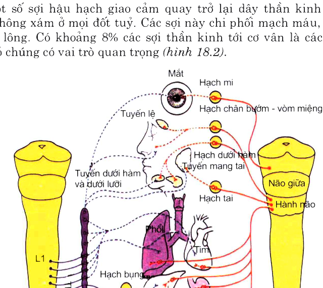
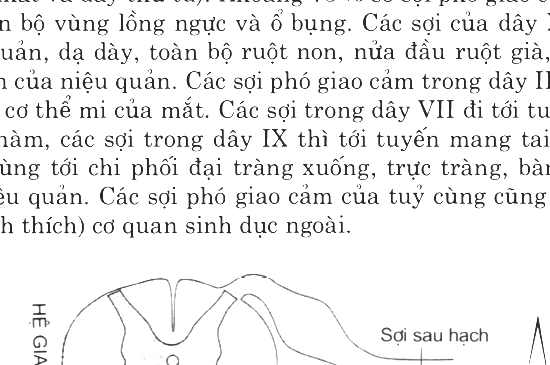

# BÀI 18: SINH LÝ HỆ THẦN KINH TỰ CHỦ

## MỤC TIÊU
*Sau khi học xong bài này, sinh viên có khả năng:*
1. Trình bày được đặc điểm cấu tạo của hệ thần kinh tự chủ.
2. Trình bày được chức năng và điều hòa chức năng hệ thần kinh tự chủ.

---

Phần thần kinh trung ương kiểm soát chức năng của các tạng được gọi là **hệ thần kinh tự chủ** (còn được gọi là *hệ thần kinh thực vật, hệ thần kinh dinh dưỡng, hệ thần kinh tạng*). Hệ này điều hoà huyết áp động mạch, cử động và bài tiết dịch của ống tiêu hóa, bài tiết một số hormon, co cơ bàng quang, tiết mồ hôi, thân nhiệt và nhiều hoạt động khác, trong đó có những hoạt động hoàn toàn phụ thuộc vào hệ thần kinh tự chủ và có những hoạt động phụ thuộc một phần vào hoạt động của hệ này. Thông qua những hoạt động này, hệ thần kinh tự chủ đóng vai trò rất quan trọng trong điều hoà nội môi và giúp cơ thể thích nghi với sự thay đổi của môi trường. Hệ thần kinh tự chủ có các trung tâm nằm ở tuỷ sống, thân não và vùng dưới đồi (*hypothalamus*). Các phần của vỏ não, đặc biệt là vỏ hệ limbic có ảnh hưởng lên hoạt động của hệ thần kinh tự chủ. Thường thì hệ thần kinh tự chủ cũng hoạt động trên cơ sở các phản xạ tạng.

---

## 1. ĐẶC ĐIỂM GIẢI PHẪU - CHỨC NĂNG CỦA HỆ THẦN KINH TỰ CHỦ

### 1.1. Hệ giao cảm
Hệ giao cảm có hai chuỗi hạch giao cảm ở hai bên cột tuỷ sống, hai hạch trước cột sống (hạch tạng và hạch hạ vị) và các sợi thần kinh đi từ các hạch tới các tạng khác nhau. Các dây giao cảm xuất phát từ tuỷ ở các đốt từ **lưng 1 (L1 / T1)** đến **thắt lưng 2 (TL2 / L2)** tới các hạch rồi từ các hạch tới các tạng hay mô mà nó chi phối (*hình 18.1*).

Từ tuỷ sống tới mô chịu kích thích có hai nơron giao cảm: **nơron trước hạch (sợi tiền hạch)** và **nơron sau hạch (sợi hậu hạch)**. Thân của nơron tiền hạch nằm ở sừng bên của chất xám tuỷ sống và sợi trục đi ra theo rễ trước của tuỷ sống cùng với dây thần kinh tuỷ sống, theo nhánh thông trắng tới hạch của chuỗi giao cảm. Từ đây, sợi có thể đi theo một trong ba con đường sau:
1. Tạo synap với nơron hậu hạch nằm ở trong hạch đó.
2. Đi lên trên hoặc đi xuống dưới để tạo synap trong một hạch khác của chuỗi hạch.
3. Hoặc đi xa hơn trong chuỗi hạch rồi qua các sợi giao cảm lan toả khỏi chuỗi hạch và tận cùng ở hạch trước cột sống. Nơron hậu hạch bắt đầu từ hạch trong chuỗi hạch hoặc từ hạch trước cột sống. Từ hai nơi này, các sợi hậu hạch đi tới các cơ quan.

Một số sợi hậu hạch giao cảm quay trở lại dây thần kinh tuỷ sống qua **nhánh thông xám** ở mọi đốt tuỷ. Các sợi này chi phối mạch máu, tuyến mồ hôi, cơ dựng lông. Có khoảng 8% các sợi thần kinh tới cơ vân là các sợi giao cảm, chứng tỏ chúng có vai trò quan trọng (*hình 18.2*).

Sự phân bố thần kinh giao cảm tới tạng phụ thuộc vào vị trí hình thành nên tạng lúc còn là bào thai. Ví dụ, tim nhận nhiều sợi giao cảm xuất phát từ đốt sống cổ vì tim có nguồn gốc từ cổ của bào thai, các tạng trong ổ bụng nhận các sợi giao cảm từ các đoạn thấp của ngực vì phần lớn ruột là xuất phát từ khu vực này. Các sợi giao cảm không phân bố giống như các sợi thần kinh tuỷ bắt nguồn từ cùng một đốt tuỷ sống. Ví dụ: các sợi giao cảm xuất phát từ đốt L1 thường đi lên theo chuỗi hạch tới đầu; từ đốt L2 tới cổ, từ L7, L8, L9, L10 và L11 tới bụng, từ L12, TL1 và TL2 tới chi dưới.

Các sợi giao cảm tận cùng ở **tuỷ thượng thận** đi thẳng từ sừng bên chất xám tuỷ sống mà không dừng và tạo synap ở đâu cả. Tại tuỷ thượng thận, chúng tận cùng trực tiếp ở các nơron đã biến đổi thành các tế bào bài tiết **adrenalin** và **noradrenalin** vào máu. Về mặt bào thai học thì các tế bào này có nguồn gốc là mô thần kinh và tương tự như nơron hậu hạch giao cảm. Chúng có các sợi thần kinh thô sơ và chính các sợi này bài tiết các hormon trên.

### 1.2. Hệ phó giao cảm (hình 18.2)
Các sợi phó giao cảm rời khỏi hệ thần kinh trung ương qua các **dây thần kinh sọ III, VII, IX, X**, các dây thứ hai và thứ ba của đoạn tuỷ cùng (đôi khi qua cả dây thứ nhất và dây thứ tư: **S1 - S4**).
- Khoảng **75% số sợi phó giao cảm nằm trong dây X** và tới toàn bộ vùng lồng ngực và ổ bụng. Các sợi của dây X tới chi phối tim, phổi, thực quản, dạ dày, toàn bộ ruột non, nửa đầu ruột già, gan, túi mật, tụy và phần trên của niệu quản.
- Các sợi phó giao cảm trong **dây III** tới chi phối cơ co đồng tử, các cơ thể mi của mắt.
- Các sợi trong **dây VII** đi tới tuyến lệ, tuyến mũi, tuyến dưới hàm.
- Các sợi trong **dây IX** thì tới tuyến mang tai.
- Các sợi phó giao cảm ở **tuỷ cùng** tới chi phối đại tràng xuống, trực tràng, bàng quang và phần thấp của niệu quản. Các sợi phó giao cảm của tuỷ cùng cũng cho các nhánh tới chi phối (kích thích) cơ quan sinh dục ngoài.

Hệ phó giao cảm cũng có nơron trước hạch và nơron sau hạch. Tuy nhiên trừ một vài dây phó giao cảm ở dây thần kinh sọ, sợi tiền hạch phó giao cảm đi thẳng tới cơ quan mà nó chi phối. Nơron hậu hạch phó giao cảm nằm ở trong thành của tạng hay ngay sát tạng; các sợi tiền hạch tạo synap ở đây, các sợi hậu hạch chỉ dài từ một mm đến vài cm đi ngay trong tạng và chi phối tạng đó.

#### Bảng so sánh cấu tạo hệ giao cảm và hệ phó giao cảm:

| Đặc điểm | Hệ giao cảm | Hệ phó giao cảm |
| :--- | :--- | :--- |
| **Trung tâm ở TKTW** | Sừng bên chất xám tủy sống từ ngực 1 đến thắt lưng 2 (T1 - L2) | Thân não (các nhân dây sọ III, VII, IX, X) và đoạn tủy cùng (S2 - S4) |
| **Hạch tự chủ** | Nằm gần cột sống (chuỗi hạch cạnh sống và hạch trước cột sống) | Nằm ngay sát hoặc trong thành cơ quan đáp ứng (hạch tận cùng) |
| **Sợi tiền hạch** | Ngắn, có bao myelin, bài tiết Acetylcholin | Dài, có bao myelin, bài tiết Acetylcholin |
| **Sợi hậu hạch** | Dài, không có myelin, bài tiết Noradrenalin (trừ tuyến mồ hôi, cơ dựng lông, một số mạch máu tiết ACh) | Rất ngắn, không có myelin, bài tiết Acetylcholin |
| **Tỷ lệ phân nhánh** | Phân kỳ rộng (1 tiền hạch tiếp xúc nhiều hậu hạch), tác dụng lan tỏa | Tỷ lệ 1:1 hoặc rất ít phân nhánh, tác dụng khu trú |

---

## 2. DẪN TRUYỀN QUA SYNAP Ở HỆ THẦN KINH TỰ CHỦ

### 2.1. Sợi cholinergic và sợi adrenergic
- Sợi bài tiết acetylcholin được gọi là **sợi cholinergic**.
- Sợi bài tiết noradrenalin được gọi là **sợi adrenergic**.
Các chất này là chất truyền đạt thần kinh phó giao cảm hay chất truyền đạt thần kinh giao cảm.

Các sợi tiền hạch của cả hệ giao cảm và hệ phó giao cảm đều là sợi cholinergic; do đó acetylcholin hoặc các chất giống acetylcholin khi được tiêm vào hạch sẽ kích thích nơron hậu hạch của cả hệ giao cảm lẫn hệ phó giao cảm.

Các sợi hậu hạch của hệ phó giao cảm đều là sợi cholinergic giải phóng acetylcholin (Ach). Ngược lại phần lớn các sợi hậu hạch của hệ giao cảm là adrenergic giải phóng noradrenalin, trừ các sợi hậu hạch giao cảm tới tuyến mồ hôi, tới cơ dựng lông và tới một số mạch máu là cholinergic.

### 2.2. Các receptor ở các cơ quan đáp ứng
Để gây tác dụng lên cơ quan đáp ứng, chất truyền đạt thần kinh trước hết phải gắn với các receptor đặc hiệu nằm ở mặt ngoài của màng tế bào đáp ứng. Khi chất truyền đạt thần kinh gắn vào receptor thì cấu trúc của phân tử receptor bị biến đổi và dẫn đến kích thích hoặc ức chế tế bào bằng cách:
- Thay đổi tính thấm của màng.
- Tác động lên các enzym bên trong tế bào thông qua AMP vòng.

Tác dụng phụ thuộc vào bản chất của protein receptor trên màng và vào hiệu quả của sự thay đổi cấu trúc không gian của receptor khi gắn với chất truyền đạt thần kinh. Chính vì vậy mà tác dụng trên các cơ quan khác nhau thì khác nhau.

#### 2.2.1. Các receptor cholinergic
Là các receptor tiếp nhận Ach. Có hai loại receptor khác nhau là **receptor muscarinic** và **receptor nicotinic**. Chất muscarin chỉ kích thích các receptor muscarinic, chất nicotin thì chỉ kích thích các receptor nicotinic; còn acetylcholin thì kích thích cả hai.
- **Các receptor muscarinic:** có ở tất cả các tế bào chịu kích thích bởi các nơron hậu hạch phó giao cảm và bởi các sợi hậu hạch giao cảm bài tiết acetylcholin. **Atropin** ức chế các receptor muscarinic ở cơ tim, hệ thần kinh trung ương ...
- **Các receptor nicotinic:** có ở các hạch giao cảm và phó giao cảm, tấm vận động của cơ vân, tủy thượng thận và ở một số nơi trong hệ thần kinh trung ương. Các receptor này bị kích thích bởi ACh và nicotin, tuy nhiên liều cao nicotin lại có tác dụng ức chế receptor này.

Do có hai loại receptor khác nhau nên trên lâm sàng khi dùng thuốc cần lưu ý vì có nhiều thuốc đặc hiệu được dùng để kích thích hay ức chế lên mỗi loại receptor nhất định.

#### 2.2.2. Các receptor adrenergic
Có hai loại receptor adrenergic chính là **receptor alpha ($\alpha$)** và **receptor beta ($\beta$)**. Các receptor lại được phân ra làm receptor $\beta_1$ và receptor $\beta_2$, receptor $\alpha_1$ và receptor $\alpha_2$. Các receptor $\alpha$ được hoạt hóa bởi adrenalin và bị ức chế bởi phenoxybenzamin. Các receptor $\beta$ được hoạt hóa bởi isoproterenol và bị ức chế bởi propranolol.
- **Receptor $\alpha_1$:** có nhiều trong tuyến nước bọt (làm tăng bài tiết kali và nước), trong cơ trơn (làm co cơ trơn). Chất truyền tin thứ hai là $\text{IP}_3$, ion $\text{Ca}^{2+}$ và có thể cả GMPv.
- **Receptor $\alpha_2$:** có trong hệ thần kinh trung ương, thận, tử cung, tuyến mang tai, tụy, dưỡng bào (giải phóng hạt bên trong), tiểu cầu (gây kết tụ), một số màng trước synap sợi phó giao cảm trong ống tiêu hóa. Các catecholamin tác động lên các receptor này bằng cách ức chế adenylat cyclase qua trung gian là protein G.

Noradrenalin chủ yếu kích thích các receptor $\alpha$ nhưng cũng có kích thích yếu lên các receptor $\beta$. Adrenalin kích thích cả hai loại receptor mạnh như nhau. Do đó, tác dụng của noradrenalin và adrenalin lên các cơ quan khác nhau phụ thuộc vào loại receptor có ở các cơ quan đó. Nếu ở một cơ quan chỉ có toàn là receptor beta thì adrenalin sẽ có tác dụng kích thích mạnh hơn (xem Bài 13, mục 5.3.2).

Cần chú ý là receptor alpha có một số là kích thích, một số lại là ức chế; với receptor beta cũng vậy. Do đó, receptor $\alpha$ và $\beta$ không nhất thiết chỉ có tác dụng ức chế hoặc là kích thích mà tác dụng của nó phụ thuộc vào ái lực của receptor ở cơ quan mà nó chi phối với chất truyền đạt thần kinh. Hormon tổng hợp tương tự như noradrenalin và adrenalin là chất **isopropyl norepinephrin** có tác dụng rất mạnh lên receptor $\beta$ nhưng không có tác dụng lên receptor $\alpha$.

---

## 3. TÁC DỤNG KÍCH THÍCH VÀ ỨC CHẾ CỦA HỆ GIAO CẢM VÀ CỦA HỆ PHÓ GIAO CẢM LÊN CÁC CƠ QUAN

Tác dụng của hệ giao cảm và của hệ phó giao cảm lên các tạng khác nhau được trình bày tóm tắt trong *bảng 18.1*. Qua bảng này, chúng ta có thể thấy kích thích giao cảm hoặc phó giao cảm gây kích thích lên một số cơ quan này nhưng lại gây ức chế lên một số khác. Hơn nữa, trong khi giao cảm kích thích thì phó giao cảm đôi khi lại ức chế cơ quan ấy. Điều này chứng tỏ có lúc hai hệ này tác động đối nghịch nhau. Tuy vậy, phần lớn các cơ quan thường do một hệ chi phối mạnh hơn là do hệ kia.

#### Bảng 18.1. Tác dụng của hệ thần kinh tự chủ lên các cơ quan

| Cơ quan | Tác dụng của giao cảm | Tác dụng của phó giao cảm |
| :--- | :--- | :--- |
| **Mắt** - Đồng tử - Cơ thể mi |  Giãn Giãn nhẹ (nhìn xa) |  Co Co rút (nhìn gần) |
| **Tuyến mũi, nước mắt, mang tai, dưới hàm, dạ dày, tụy** | Co mạch tuyến và bài tiết nhẹ | Kích thích bài tiết tăng thể tích và tăng nồng độ enzym |
| **Tuyến mồ hôi** | Bài tiết nhiều (cholinergic) | Tiết mồ hôi lòng bàn tay |
| **Tim** - Mạch vành - Cơ tim |  Giãn ($\beta_2$), co ($\alpha$) Tăng nhịp, tăng lực co |  Giãn Giảm nhịp, giảm lực co |
| **Phổi** - Tiểu phế quản - Mạch máu phổi |  Giãn Co vừa |  Co Giãn ? |
| **Ruột** - Cơ thắt - Nhung mao |  Tăng trương lực Giảm nhu động và trương lực |  Giãn Tăng nhu động và trương lực |
| **Gan** | Giải phóng glucose | Tăng nhẹ tổng hợp glycogen |
| **Túi mật, đường mật** | Giãn | Co |
| **Thận** | Giảm lọc, giảm tiết renin | Không có tác dụng |
| **Bàng quang** - Cơ detrusor - Cơ tam giác |  Giãn nhẹ Co |  Co Giãn |
| **Dương vật** | Xuất tinh | Cương |
| **Tiểu động mạch** - Da - Tạng ổ bụng - Cơ vân |  Co Co Co ($\alpha$), Giãn ($\beta_2$), Giãn (cholinergic) |  Không có tác dụng - - |
| **Máu** - Đông máu - Glucose, lipid |  Tăng Tăng |  - - |
| **Chuyển hóa cơ sở** | Tăng tới 100% | - |
| **Bài tiết của tủy thượng thận** | Tăng | - |
| **Hoạt động tâm thần** | Tăng | - |
| **Cơ dựng lông** | Co | - |
| **Cơ vân** | Tăng phân giải glycogen | - |
| **Tế bào mỡ** | Phân giải mỡ | - |

---

## 4. ĐẶC ĐIỂM HOẠT ĐỘNG CỦA HỆ THẦN KINH TỰ CHỦ

### 4.1. Gây ra đáp ứng với tần số kích thích rất thấp
Điều khác biệt điển hình giữa hệ thần kinh tự chủ với hệ thần kinh thân (Somatic Nervous System) là chỉ cần một tần số kích thích rất thấp lên hệ thần kinh tự chủ cũng gây ra được hoạt động tối đa của các cơ quan đáp ứng. Nói chung, để duy trì hoạt động bình thường của giao cảm và phó giao cảm thì chỉ cần tần số khoảng $1\text{ xung/giây}$. Đáp ứng tối đa xuất hiện khi sợi thần kinh tự chủ phát xung với tần số từ **10 đến 20 xung/giây**, trong khi muốn cơ vân đáp ứng tối đa thì cần một tần số kích thích là từ **50 đến 500 xung/giây**.

### 4.2. “Trương lực” giao cảm và phó giao cảm
Hệ giao cảm và hệ phó giao cảm hoạt động liên tục và mức hoạt động cơ sở của chúng được gọi là **trương lực giao cảm** và **trương lực phó giao cảm**. Ý nghĩa của tính trương lực là nó cho phép một hệ làm tăng hay làm giảm hoạt động của một cơ quan nhất định nào đó. Ví dụ, trương lực giao cảm bình thường giữ cho hầu hết các tiểu động mạch vòng đại tuần hoàn co lại làm cho đường kính của chúng bằng một nửa đường kính tối đa. Nếu kích thích giao cảm thì các mạch này có thể co thêm nữa. Hệ giao cảm hoạt động có xu hướng liên tục và chỉ gây ra co mạch, không bao giờ gây giãn. Một ví dụ khác là trương lực của hệ phó giao cảm lên cơ trơn ống tiêu hóa. Nếu cắt dây X chi phối ruột thì dạ dày và ruột bị mất trương lực kéo dài, thức ăn di chuyển chậm và táo bón nặng, kéo dài. Điều này chứng tỏ bình thường trương lực của phó giao cảm lên ống tiêu hóa là rất mạnh. Tuy nhiên, não có thể làm giảm hoặc làm tăng trương lực này.

Chính vì hệ thần kinh tự chủ có một trương lực hoạt động nhất định nên ngay sau khi cắt dây giao cảm hoặc phó giao cảm chi phối một cơ quan nào đó thì cơ quan đó mất trương lực của giao cảm hoặc phó giao cảm nhưng sau một thời gian thì trương lực nội tại sẽ tăng lên để đưa cơ quan đó trở về gần mức cơ sở bình thường. Mặt khác sau nhiều tuần thì cơ quan đó cũng trở nên nhạy cảm hơn với noradrenalin hoặc acetylcholin được đưa vào cơ thể. Cơ chế của hiện tượng này còn chưa rõ.

---

## 5. ĐIỀU HÒA HOẠT ĐỘNG HỆ THẦN KINH TỰ CHỦ

### 5.1. Ảnh hưởng của vỏ não
Ảnh hưởng của vỏ não lên hoạt động của hệ thần kinh tự chủ rõ khi có cảm xúc, thể hiện bằng thay đổi nhịp tim, nhịp thở, co giãn mạch nông, thay đổi hoạt động ở tạng. Phần lớn các phản xạ có sự tham gia của hệ thần kinh tự chủ do các kích thích bên ngoài và từ bên trong cơ thể là không có ý thức nhưng cũng có một số phản xạ do kích thích từ vỏ não (phản xạ thích nghi của mắt với ánh sáng, các phản xạ được điều kiện hóa bài tiết dịch tiêu hóa, phản xạ bài xuất phân và nước tiểu).

### 5.2. Vai trò của hành não, cầu não và não giữa
Nhiều vùng của cấu tạo lưới thuộc hành não, cầu não, não giữa và nhiều nhân của não có tác dụng điều hòa các chức năng tự động (ví dụ, huyết áp, nhịp tim, bài tiết của các tuyến tiêu hóa, nhu động ống tiêu hóa, co cơ bàng quang). Các hoạt động chức năng có tính sinh mệnh như nhịp tim, huyết áp, hô hấp được điều hòa bởi các trung tâm nằm ở phần thấp của thân não. Cần chú ý là các trung tâm điều hòa tim mạch liên quan đến các trung tâm điều hòa hô hấp ở hành não và cầu não nhưng điều hòa hô hấp không phải là chức năng của hệ thần kinh tự chủ mà là một trong các chức năng không tùy ý của cơ thể.

### 5.3. Vai trò của vùng dưới đồi
Vùng dưới đồi được coi là **trung tâm cao nhất của hệ thần kinh tự chủ**:
- Kích thích **phần trước** của vùng dưới đồi gây ra các đáp ứng giống như kích thích **phó giao cảm**.
- Kích thích **phần sau** vùng dưới đồi gây ra các đáp ứng giống như kích thích **giao cảm**.

### 5.4. Hormon
- **Hormon của tuyến giáp:** làm tăng tác dụng của giao cảm.
- **Tuyến tủy thượng thận:** sản xuất và giải phóng noradrenalin và adrenalin nên có thể được coi như một nơron hậu hạch giao cảm lớn. Kích thích dây giao cảm tới thượng thận làm thượng thận tăng bài tiết catecholamin. Như vậy, các cơ quan chịu ảnh hưởng đồng thời bởi hai cách: trực tiếp của hệ giao cảm và gián tiếp của tủy thượng thận qua các hormon. Hai cách này bổ sung cho nhau và có thể thay thế nhau. Các cấu trúc của cơ thể không nhận sợi giao cảm vẫn nhận được kích thích có tác dụng như kích thích giao cảm thông qua các catecholamin được tuyến thượng thận giải phóng vào máu.

### 5.5. Stress
Khi phần lớn hệ giao cảm cùng hưng phấn mạnh thì gây ra huyết áp tăng, lượng máu đến các cơ tăng trong khi lượng máu đến ống tiêu hóa, thận và một số cơ quan không cần thiết giảm; chuyển hóa tế bào toàn thân, glucose huyết, phân giải glycogen ở gan, lực co cơ, hoạt động tâm thần ... đều tăng. Tất cả những tác dụng trên cộng lại làm cho cơ thể có khả năng hoạt động mạnh hơn rất nhiều so với bình thường. Các stress tâm lý và thể xác thường kích thích hệ giao cảm nên người ta cho rằng mục đích của hệ giao cảm là làm tăng hoạt động của cơ thể trong trạng thái stress và đấy là đáp ứng với stress của hệ giao cảm. Hiện tượng này được gọi là **phản ứng báo động**, là **phản ứng chiến đấu hay phản ứng rút lui (Fight or Flight response)** (tùy biểu hiện trụ lại để chiến đấu hoặc bỏ chạy).

---

## 6. THUỐC ẢNH HƯỞNG LÊN HỆ THẦN KINH TỰ CHỦ

Hiện nay, với việc phát hiện các receptor và tìm ra những chất có tác dụng chọn lọc lên từng receptor, các chất có tác dụng lên hệ thần kinh tự chủ được dùng nhiều trong điều trị tùy theo từng trường hợp rối loạn cụ thể nhất là trong các bệnh tim mạch. Điều cần chú ý là một loại receptor có thể có mặt ở nhiều nơi khác nhau và có tác dụng khác nhau ở mỗi nơi nên gây tác dụng mong muốn ở nơi này thì lại gây tác dụng không mong muốn ở nơi khác. Các thuốc ảnh hưởng lên hệ thần kinh tự chủ có thể có tác dụng tại trung tâm hay tại ngoại vi bằng nhiều cơ chế khác nhau.

### 6.1. Thuốc ảnh hưởng lên các cơ quan đáp ứng adrenergic

#### 6.1.1. Thuốc giống giao cảm
Adrenalin, methoxamin và một số thuốc khác có tác dụng giống giao cảm. Các thuốc giống giao cảm thường có tác dụng dài hơn noradrenalin và adrenalin (từ 30 phút đến 2 giờ so với 1 - 2 phút). Một số thuốc có tác dụng đặc hiệu lên một loại receptor adrenergic nhất định. Ví dụ, **phenylephrin** chỉ tác động lên receptor $\alpha$; **isoproterenol, albuterol** chỉ tác động lên receptor $\beta$.

#### 6.1.2. Thuốc làm giải phóng noradrenalin ở cúc tận cùng
Thuốc có tác dụng gián tiếp qua hệ giao cảm chứ không tác dụng trực tiếp lên cơ quan đáp ứng. Ví dụ, **ephedrin, tyramin, amphetamin**. Các thuốc này làm các bọc nhỏ giải phóng noradrenalin.

#### 6.1.3. Thuốc kìm hãm hoạt tính adrenergic
Thuốc có tác dụng kìm hãm hoạt tính này ở nhiều khâu:
1. Ngăn chặn sự tổng hợp và tích trữ noradrenalin ở các cúc tận cùng. Thuốc điển hình được biết đến là **reserpin**.
2. Ức chế giải phóng noradrenalin từ cúc tận cùng, chất điển hình là **guanethidin**.
3. Ức chế receptor $\beta$: **Propranolol** ức chế tất cả các receptor $\beta$, **metoprolol** chỉ ức chế receptor $\beta_1$.
4. Ức chế dẫn truyền tại hạch: **Hexamethionum** ức chế cả hạch giao cảm và hạch phó giao cảm.

### 6.2. Thuốc ảnh hưởng lên cơ quan đáp ứng cholinergic

#### 6.2.1. Thuốc có tác dụng phó giao cảm (muscarinic)
Các thuốc này có tác dụng trực tiếp lên các receptor muscarinic và lên các cơ quan đáp ứng với sợi cholinergic của phó giao cảm; ví dụ, gây bài tiết mồ hôi, gây giãn mạch ở một số cơ quan và ngay cả ở các mạch không nhận sợi cholinergic. Thuốc thường được dùng là **pilocarpin** và **metacholin**.

#### 6.2.2. Thuốc làm tăng tác dụng của phó giao cảm (thuốc kháng cholinesterase)
Các thuốc này ức chế cholinesterase nên làm cho ACh tồn tại lâu trong khe synap, kết quả là lượng ACh tăng dần khi có kích thích liên tiếp và gây ra mức độ đáp ứng tăng theo. Thuốc loại này có **neostigmin, pyridostigmin, ambenonium**.

#### 6.2.3. Thuốc ức chế hoạt tính cholinergic ở cơ quan đáp ứng (thuốc kháng muscarin)
**Atropin** và các thuốc tương tự như **homatropin, scopolamin** ức chế tác dụng của Ach lên các receptor muscarinic nhưng không ảnh hưởng lên tác dụng của ACh đối với receptor nicotinic ở nơron hậu hạch hay ở cơ vân.

### 6.3. Thuốc có tác dụng lên hạch

#### 6.3.1. Thuốc kích thích hạch
**Nicotin** kích thích receptor nicotinic tại hạch giao cảm và hạch phó giao cảm. **Metacholin** có tác dụng kích thích receptor nicotinic và muscarinic. **Pilocarpin** chỉ kích thích receptor muscarinic.

#### 6.3.2. Thuốc ức chế hạch
Các chất **tetraethyl ammonium, hexamethionum, pentholium** ức chế dẫn truyền trong hạch giao cảm và hạch phó giao cảm. Các thuốc này được dùng chủ yếu để ức chế giao cảm vì các dấu hiệu ức chế giao cảm thường che lấp sự ức chế phó giao cảm.

---

## TỰ LƯỢNG GIÁ

1. So sánh hệ giao cảm và hệ phó giao cảm về trung tâm, sợi tiền hạch và hậu hạch, chất truyền đạt thần kinh và receptor.
2. Trình bày đặc điểm hoạt động của hệ thần kinh tự chủ.
3. Liệt kê tác dụng của hệ phó giao cảm lên các cơ quan.
4. Liệt kê tác dụng của hệ giao cảm lên các cơ quan.
5. Trình bày vai trò của các cấu trúc thần kinh tham gia điều hòa hoạt động của hệ thần kinh tự chủ.
