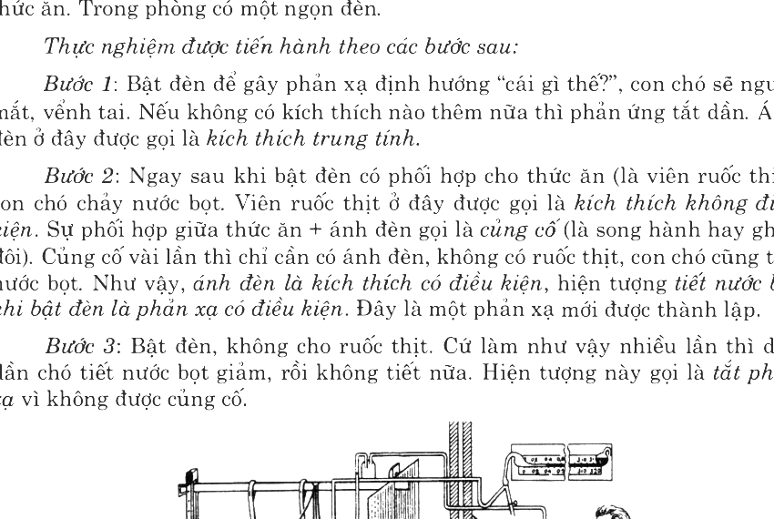
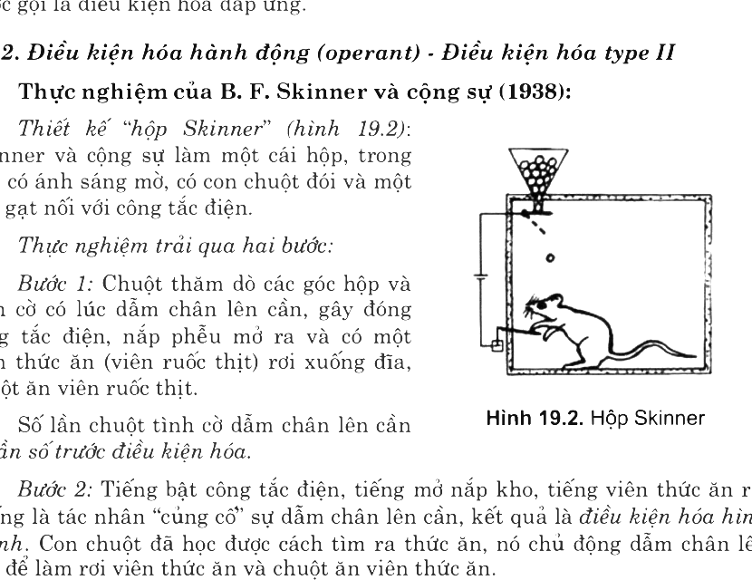
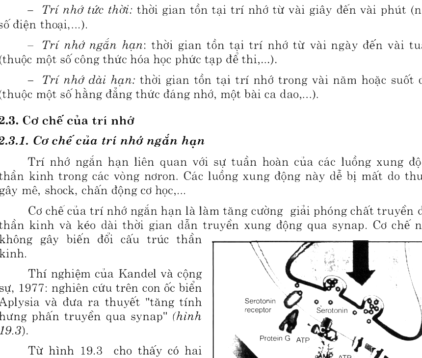
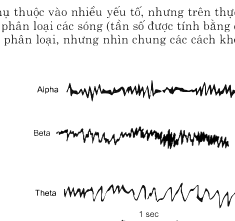

# Bài 19: MỘT SỐ CHỨC NĂNG CẤP CAO CỦA HỆ THẦN KINH

## MỤC TIÊU
*Sau khi học xong bài này, sinh viên có khả năng:*
1. Trình bày được định nghĩa và phân loại điều kiện hóa (ĐKH).
2. Nêu được những đặc điểm của ĐKH đáp ứng và ĐKH hành động, so sánh sự khác nhau giữa hai loại ĐKH này.
3. Trình bày được các giả thuyết về nơi xảy ra ĐKH.
4. Trình bày được phân loại trí nhớ và các cơ chế hình thành trí nhớ.
5. Trình bày được vai trò của một số cấu trúc thần kinh, chất hóa - thần kinh, hormon trong hoạt động cảm xúc.
6. Trình bày được các loại sóng cơ bản trên điện não đồ và ý nghĩa của việc ghi điện não đồ.

---

Hệ thần kinh ngoài chức năng cảm giác, vận động, tự chủ còn có những chức năng cấp cao như học tập, trí nhớ, cảm xúc, tư duy, ngôn ngữ... Các chức năng cấp cao là biểu hiện phức tạp của hoạt động thần kinh, có sự tham gia của nhiều vùng trên vỏ não và các cấu trúc dưới vỏ, đặc biệt là hệ viền (hệ limbic) và cấu tạo lưới. Trong khuôn khổ bài này chỉ đề cập đến một số chức năng cấp cao: học tập thông qua điều kiện hóa, trí nhớ, cảm xúc và thăm dò chức năng não bằng điện não đồ.

---

## 1. ĐIỀU KIỆN HÓA (HỌC TẬP THÔNG QUA ĐIỀU KIỆN HÓA)

Học tập là một quá trình biến đổi hành vi của cá thể dựa trên cơ sở tích luỹ kinh nghiệm sống của chính cá thể đó. Có nhiều hình thức học tập khác nhau, từ hình thức học tập đơn giản (như sự quen nhờn, sự nhạy cảm hóa) đến các hình thức học tập phức tạp (như học tập thông qua điều kiện hóa, học tập bằng nhận thức, học tập qua thử và sai, học tập bằng quan sát...). Trong các hình thức học tập đó, học tập thông qua điều kiện hóa là hình thức cơ bản nhất đã được nghiên cứu kỹ lưỡng cả về phương diện tâm lý học và sinh lý học.

### 1.1. Khái niệm và phân loại
#### 1.1.1. Định nghĩa
Điều kiện hóa (conditioning) là quá trình hình thành một phản ứng mới của cơ thể đối với một kích thích vốn trước đó là kích thích trung tính, sau khi kích thích trung tính này được kết hợp lặp đi lặp lại nhiều lần với một kích thích không điều kiện (kích thích có ý nghĩa sinh học). Bản chất của điều kiện hóa chính là sự thành lập phản xạ có điều kiện (PXCDK).

#### 1.1.2. Phân loại điều kiện hóa
Dựa trên phương thức hình thành và vai trò của cá thể trong quá trình học tập, người ta chia điều kiện hóa thành hai loại cơ bản:
- **Điều kiện hóa đáp ứng** (respondent conditioning), còn gọi là *điều kiện hóa cổ điển* (classical conditioning) hay *điều kiện hóa kiểu Pavlov* (loại I).
- **Điều kiện hóa hành động** (operant conditioning), còn gọi là *điều kiện hóa thao tác*, *điều kiện hóa công cụ* (instrumental conditioning) hay *điều kiện hóa kiểu Skinner* (loại II).

---

### 1.2. Điều kiện hóa đáp ứng (Điều kiện hóa cổ điển)
Hình thức điều kiện hóa này do nhà sinh lý học người Nga Ivan Petrovich Pavlov (1849 - 1936) phát hiện và nghiên cứu một cách có hệ thống vào đầu thế kỷ XX.

#### 1.2.1. Thí nghiệm của I.P. Pavlov
Pavlov tiến hành thí nghiệm trên chó nuôi trong phòng cách âm đặc biệt (Hình 19.1).
- Chó được cố định trên giá thí nghiệm, mổ thông tuyến nước bọt mang tai ra ngoài má để hứng và đếm từng giọt nước bọt tiết ra.
- Cho kích thích trung tính tác động trước: ví dụ ánh đèn bật sáng hoặc tiếng chuông reo. Ban đầu, ánh đèn hay tiếng chuông chỉ gây ra phản xạ định hướng (chó quay đầu, vểnh tai nghe), hoàn toàn không làm tiết nước bọt.
- Ngay sau đó (vài giây), cho kích thích không điều kiện tác động: đưa thức ăn (bột thịt) vào miệng chó. Thức ăn kích thích receptor vị giác gây tiết nước bọt (phản xạ không điều kiện - PXKĐK).
- Lặp lại việc phối hợp giữa ánh đèn (hoặc tiếng chuông) với việc cho ăn nhiều lần (vài chục lần).
- Sau đó, chỉ cần bật đèn sáng hoặc rung chuông (không cho ăn), quan sát thấy nước bọt vẫn tiết ra từ lỗ rò tuyến nước bọt. 

Như vậy, một kích thích vốn trước đây là trung tính (ánh đèn/tiếng chuông) nay đã trở thành **kích thích có điều kiện** (KTCĐK), có khả năng gây ra phản ứng tiết nước bọt gọi là **đáp ứng có điều kiện** (hay phản xạ có điều kiện).

#### 1.2.2. Đặc điểm của điều kiện hóa đáp ứng
1. **Tính chất phản xạ:** Đáp ứng là thụ động, mang tính chất phản xạ tự động của cơ thể (thường là phản xạ thực vật như tiết nước bọt, thay đổi nhịp tim, co thắt mạch máu...). Động vật không chủ động tác động vào môi trường.
2. **Trật tự thời gian:** Kích thích có điều kiện (kích thích trung tính ban đầu) phải tác động trước hoặc đồng thời với kích thích không điều kiện. Nếu kích thích không điều kiện tác động trước, phản xạ có điều kiện rất khó thành lập hoặc không thể thành lập được.
3. **Sự củng cố:** Kích thích không điều kiện đóng vai trò là tác nhân củng cố. Nếu ngừng củng cố (bật đèn mà mãi mãi không cho ăn), phản ứng tiết nước bọt sẽ yếu dần và mất hẳn; hiện tượng này gọi là **ức chế dập tắt**.
4. **Tính khái quát hóa kích thích:** Khi phản xạ có điều kiện vừa mới hình thành, các kích thích tương tự (ví dụ âm thanh có tần số gần giống tiếng chuông gốc) cũng có thể gây ra đáp ứng tiết nước bọt.
5. **Tính phân biệt kích thích:** Nếu chỉ củng cố kích thích chuẩn (cho ăn) mà không củng cố các kích thích tương tự (không cho ăn), con vật dần dần chỉ đáp ứng với kích thích chuẩn mà không đáp ứng với các kích thích tương tự; hiện tượng này gọi là **ức chế phân biệt**.

---

### 1.3. Điều kiện hóa hành động (Điều kiện hóa công cụ)
Hình thức này do B.F. Skinner (nhà tâm lý học người Mỹ) phát triển dựa trên các nghiên cứu trước đó của E.L. Thorndike về "học tập qua thử và sai" (quy luật hiệu quả - law of effect).

#### 1.3.1. Thí nghiệm của B.F. Skinner
Skinner chế tạo ra một chiếc hộp thí nghiệm đặc biệt gọi là **Hộp Skinner** (Skinner box) (Hình 19.2).
- Một con chuột đói được nhốt vào trong hộp. Trong hộp có một chiếc cần gạt (đòn bẩy) nối với máng thức ăn tự động và một bóng đèn tín hiệu.
- Chuột đói chạy nhảy lung tung trong hộp tìm lối thoát hoặc thức ăn. Trong quá trình vận động ngẫu nhiên đó, chuột vô tình chạm chân hoặc ấn vào cần gạt.
- Khi cần gạt bị ấn xuống, một viên thức ăn lập tức rơi vào máng. Chuột ăn viên thức ăn (nhận được sự củng cố tích cực).
- Sau một số lần vô tình ấn trúng cần gạt, khoảng thời gian giữa các lần ấn ngắn dần. Cuối cùng chuột học được hành vi: mỗi khi bị đói, nó chủ động chạy ngay lại ấn cần gạt để lấy thức ăn.
- Trong biến thể phức tạp hơn: Skinner cài đặt để thức ăn chỉ rơi ra khi chuột ấn cần gạt vào lúc bóng đèn trong hộp bật sáng. Chuột nhanh chóng học được cách chỉ ấn cần gạt khi có tín hiệu đèn sáng.

#### 1.3.2. Đặc điểm của điều kiện hóa hành động
1. **Tính chủ động:** Đáp ứng của con vật là hành vi vận động chủ động (operant behavior), tác động lên môi trường xung quanh nhằm đạt được mục đích (thức ăn, nước uống) hoặc tránh né kích thích có hại (điện giật).
2. **Vai trò của sự củng cố:** Hành vi xảy ra trước sự củng cố. Bản chất sự củng cố là hậu quả của chính hành vi đó:
   - **Củng cố dương tính (củng cố tích cực):** Xuất hiện phần thưởng (thức ăn, nước uống) làm tăng xác suất lặp lại hành vi.
   - **Củng cố âm tính:** Loại bỏ một kích thích khó chịu (tắt dòng điện giật dưới chân) cũng làm tăng xác suất lặp lại hành vi trốn tránh.
   - **Trừng phạt:** Xuất hiện kích thích có hại (bị điện giật) khi thực hiện hành vi, làm giảm hoặc dập tắt hành vi đó.
3. **Ứng dụng:** Điều kiện hóa hành động là nền tảng của quá trình huấn luyện xiếc thú, giáo dục, dạy học và hình thành các thói quen, kỹ năng vận động ở người.

---

### 1.4. So sánh điều kiện hóa đáp ứng và điều kiện hóa hành động

| Tiêu chí | Điều kiện hóa đáp ứng (Pavlov) | Điều kiện hóa hành động (Skinner) |
| :--- | :--- | :--- |
| **Bản chất đáp ứng** | Bị động, mang tính phản xạ tự động (thực vật hoặc cử động không chủ ý). | Chủ động, là hành vi vận động có ý thức nhằm vào môi trường. |
| **Trật tự kích thích** | Kích thích có điều kiện xuất hiện trước kích thích không điều kiện. | Hành vi của cá thể xuất hiện trước tác nhân củng cố. |
| **Vai trò cá thể** | Con vật thụ động tiếp nhận các tác nhân kích thích. | Con vật chủ động phát ra hành vi để tạo ra kết quả. |
| **Cơ quan đáp ứng** | Chủ yếu là các tuyến bài tiết, cơ trơn, hệ thần kinh tự chủ. | Cơ vân, hệ thần kinh vận động somatic. |
| **Ý nghĩa sinh học** | Giúp cơ thể chuẩn bị đón nhận kích thích sắp tới. | Giúp cơ thể thích nghi chủ động và cải tạo môi trường sống. |

---

### 1.5. Giả thuyết về nơi xảy ra điều kiện hóa
Cơ chế thần kinh của sự hình thành phản xạ có điều kiện diễn ra ở đâu trên trục thần kinh? Có ba giả thuyết chính:
1. **Giả thuyết vỏ não - vỏ não (Thuyết Pavlov):**
   - Pavlov cho rằng đường liên hệ thần kinh tạm thời được hình thành trực tiếp giữa hai vùng cảm thụ trên vỏ não: trung tâm nhận cảm kích thích có điều kiện (ví dụ vùng thị giác hoặc thính giác) và trung tâm nhận cảm kích thích không điều kiện (ví dụ vùng vị giác - ăn uống). Khi hai trung tâm này hưng phấn đồng thời, giữa chúng xuất hiện sự "thông đường" qua các sợi liên hợp nội vỏ.
2. **Giả thuyết vỏ não - dưới vỏ - vỏ não (Thuyết Asratyan):**
   - Sự hình thành đường liên hệ tạm thời không chỉ đơn thuần trên bề mặt vỏ não mà bắt buộc phải khép kín qua các cấu trúc dưới vỏ, đặc biệt là cấu tạo lưới thân não và đồi thị. Các xung động từ điểm vỏ não này đi xuống dưới vỏ, được khuếch đại bởi hệ thống lưới, rồi chiếu ngược lên điểm vỏ não kia.
3. **Giả thuyết dưới vỏ (Thuyết Gastaut):**
   - Đường liên hệ tạm thời có thể được thành lập ngay ở mức các nhân dưới vỏ (đồi thị, hạ đồi, hệ viền) mà chưa cần đến vỏ não nguyên vẹn. Các thực nghiệm cắt bỏ vỏ não ở động vật bậc thấp cho thấy chúng vẫn có thể hình thành được một số phản xạ có điều kiện đơn giản. Tuy nhiên, ở động vật bậc cao và người, vỏ não đóng vai trò tối cao trong việc điều hành, tinh chỉnh và tích hợp các phản xạ có điều kiện phức tạp.

---

## 2. TRÍ NHỚ

### 2.1. Khái niệm và phân loại trí nhớ
#### 2.1.1. Định nghĩa
Trí nhớ là khả năng tiếp nhận, xử lý, lưu giữ và tái hiện lại thông tin, kinh nghiệm đã tích luỹ được trong quá trình sống của cá thể. Trí nhớ là cơ sở của toàn bộ hoạt động nhận thức, tư duy và nhân cách của con người.

#### 2.1.2. Phân loại trí nhớ
Dựa vào các tiêu chí khác nhau, có nhiều cách phân loại trí nhớ:
1. **Phân loại theo thời gian tồn tại của dấu vết trí nhớ:**
   - **Trí nhớ tức thì (trí nhớ cảm giác):** Kéo dài vài trăm mili-giây đến vài giây. Giữ lại ấn tượng cảm giác nguyên vẹn ngay sau khi kích thích ngừng tác dụng.
   - **Trí nhớ ngắn hạn (trí nhớ làm việc - working memory):** Tồn tại trong vài giây đến vài phút hoặc vài giờ. Dung lượng có hạn (thường khoảng $7 \pm 2$ đơn vị thông tin). Dễ bị xóa sạch bởi các tác nhân gây nhiễu, chấn động não hoặc sốc điện.
   - **Trí nhớ dài hạn:** Tồn tại nhiều ngày, nhiều tháng, nhiều năm hoặc suốt cả cuộc đời. Dung lượng gần như vô hạn. Có tính bền vững cao trước các tác động cơ học hay sốc điện.
   - Quá trình chuyển đổi từ trí nhớ ngắn hạn sang trí nhớ dài hạn được gọi là **quá trình củng cố trí nhớ** (memory consolidation), đòi hỏi sự tham gia quan trọng của cấu trúc hồi hải mã (hippocampus).
2. **Phân loại theo bản chất thông tin tích luỹ:**
   - **Trí nhớ hiển hiện (trí nhớ tường thuật - declarative memory):** Trí nhớ về các sự kiện, kiến thức, khái niệm, từ ngữ, khuôn mặt... có thể diễn đạt bằng ngôn ngữ hoặc hình ảnh tư duy (đòi hỏi sự tham gia của ý thức). Gồm trí nhớ tình tiết (episodic) và trí nhớ ngữ nghĩa (semantic).
   - **Trí nhớ tiềm ẩn (trí nhớ không tường thuật hay trí nhớ thao tác - non-declarative / procedural memory):** Trí nhớ về các kỹ năng vận động, thói quen (đi xe đạp, bơi lội, đánh máy...), phản xạ có điều kiện. Thể hiện qua hành động mà không cần sự tái hiện có ý thức bằng lời nói.

---

### 2.2. Cơ chế của trí nhớ ngắn hạn
Trí nhớ ngắn hạn chưa làm thay đổi cấu trúc synap vĩnh viễn mà dựa trên các cơ chế chức năng sinh lý:
1. **Mạch nơron dội lại (reverberating circuit):** 
   - Xung động thần kinh sau khi đi qua chuỗi nơron sẽ kích thích các nhánh bên quay ngược trở lại tái kích thích các nơron ban đầu, tạo thành một vòng tuần hoàn xung động khép kín. Vòng tuần hoàn này duy trì trạng thái hưng phấn trong một khoảng thời gian nhất định sau khi kích thích bên ngoài đã chấm dứt.
2. **Hiện tượng tạo thuận sau co cứng (post-tetanic potentiation):**
   - Khi synap bị kích thích lặp đi lặp lại với tần số cao, lượng ion $Ca^{2+}$ tích tụ lại trong cúc tận cùng trước synap ngày càng nhiều (do các bơm $Ca^{2+}$ chưa kịp đẩy hết $Ca^{2+}$ ra ngoài). Lượng $Ca^{2+}$ nội bào tăng cao làm tăng giải phóng lượng chất truyền đạt thần kinh trong các xung động tiếp theo, làm tăng tính dẫn truyền qua synap trong nhiều phút đến nhiều giờ.

---

### 2.3. Cơ chế của trí nhớ dài hạn
Trí nhớ dài hạn đòi hỏi sự biến đổi thực thể về hình thái cấu trúc synap và sự biến đổi hóa sinh, biểu hiện gen trong nơron.

#### 2.3.1. Thuyết biến đổi cấu trúc
- Tăng số lượng vị trí giải phóng bọc chất truyền đạt thần kinh ở màng trước synap.
- Tăng số lượng bọc chứa chất truyền đạt thần kinh.
- Tăng số lượng cúc tận cùng của sợi gai (tăng gai sợi gai - dendritic spines).
- Thay đổi cấu trúc và diện tích bề mặt màng sau synap, giúp tăng hiệu quả tiếp nhận kích thích.

#### 2.3.2. Thuyết biến đổi chức năng và hóa sinh
##### 2.3.2.1. Thuyết điều kiện hóa
Kéo dài thời gian dẫn truyền điện thế hoạt động qua synap tạo đường mòn dấu vết trí nhớ (Hình 19.3):
- Xung động thần kinh lặp đi lặp lại gây tăng giải phóng chất truyền đạt thần kinh ở cúc tận cùng.
- Hoạt hóa men adenyl cyclase, làm tăng tổng hợp AMP vòng ($cAMP$) và GMP vòng ($cGMP$) ở nơron.
- $cAMP$ hoạt hóa protein kinase A (PKA), dẫn đến phosphoryl hóa các kênh ion $K^+$, làm đóng các kênh $K^+$. Khi kênh $K^+$ bị đóng, pha tái cực của điện thế hoạt động bị kéo dài ra.
- Điện thế hoạt động kéo dài làm cho kênh $Ca^{2+}$ phụ thuộc điện thế mở ra lâu hơn, một lượng lớn ion $Ca^{2+}$ tràn vào cúc tận cùng làm giải phóng ồ ạt chất truyền đạt thần kinh trong thời gian dài.
- Tăng nồng độ $Ca^{2+}$ ở màng sau synap hoạt hóa enzym protein kinase phụ thuộc calci là **calpain**, chất này tách ra từ một protid ở gần đó là **phodrin**. Sự tăng số lượng receptor glutamat (như receptor NMDA và AMPA) làm kéo dài thời gian dẫn truyền xung động qua synap (tạo hiện tượng điện thế hóa dài hạn - Long-Term Potentiation: LTP). Hiện tượng này diễn ra chủ yếu ở vỏ não và hippocampus, liên quan trực tiếp đến quá trình ổn định trí nhớ và học tập.

##### 2.3.2.2. Thuyết tổng hợp các protein (hoặc peptid) nhớ (Mc Connell - 1962, Ungar - 1972...)
- Các tác giả nghiên cứu theo hướng này đều có nhận định chung: ở động vật thí nghiệm có hiện tượng tăng tổng hợp ARN và tăng hàm lượng protein trong não khi thành lập được trí nhớ.
- Khi sử dụng các chất ức chế tổng hợp protein (như puromycin, cycloheximid) tiêm vào não động vật thì thấy cản trở quá trình hình thành trí nhớ dài hạn nhưng không làm mất trí nhớ ngắn hạn.
- Từ hiện tượng này, các nhà nghiên cứu đưa ra giả thuyết rằng trong quá trình hình thành trí nhớ, não đã sản xuất ra các "chất nhớ" có bản chất là protein hoặc peptid đặc hiệu (như scotophobin do Ungar phân lập).
- *Tóm lại:* Cơ chế của trí nhớ rất phức tạp, bao gồm cả biến đổi điện thế màng, tín hiệu nội bào qua chất truyền tin thứ hai, hoạt hóa gen tổng hợp protein cấu trúc mới và tái tổ chức mạng lưới synap thần kinh. Vấn đề này vẫn đang tiếp tục được nghiên cứu sâu rộng.

---

## 3. CƠ SỞ SINH LÝ CỦA HOẠT ĐỘNG CẢM XÚC

### 3.1. Khái niệm về hoạt động cảm xúc
#### 3.1.1. Định nghĩa cảm xúc
Cảm xúc là thái độ chủ quan của con người hay động vật đối với các sự kiện và hiện tượng của môi trường xung quanh cũng như đối với bản thân. 

Cảm xúc là điểm gặp nhau của sinh lý học và tâm lý học, bao gồm hai khía cạnh là thể xác và tâm thần:
- **Khía cạnh tâm thần:** Bao gồm sự tiếp nhận cảm giác, cảm nhận được cảm giác đó và sự đáp ứng lại cảm giác đó (trạng thái chủ quan vui, buồn, sợ hãi, giận dữ...).
- **Khía cạnh thể xác:** Bao gồm những thay đổi chức năng của cơ thể như tăng nhịp tim, tăng huyết áp, giãn đồng tử, toát mồ hôi, co thắt dạ dày - ruột, run rẩy, thay đổi nét mặt và tư thế khi cảm nhận được một cảm xúc nào đó. Những thay đổi này do hệ thần kinh tự chủ và hệ nội tiết chi phối.

#### 3.1.2. Phân loại cảm xúc
Có nhiều cách phân loại cảm xúc:
1. **Dựa vào những biến đổi tâm lý do cảm xúc gây ra:**
   - **Cảm xúc hưng cảm (khoái cảm):** Là trạng thái khí sắc nâng cao, vui vẻ cùng với sự ham muốn (tăng khí sắc), tư duy nhanh và hoạt động tăng. Những cảm xúc trái ngược không hề có, trạng thái lạc quan chế ngự toàn bộ. Trong một số trường hợp, trạng thái hưng cảm có kèm theo bẳn gắt, nổi nóng. Trạng thái hưng cảm là do hưng phấn toàn não bộ, từ vỏ não xuống dưới vỏ; có tác dụng tăng cường (kích thích) hoạt động của cơ thể.
   - **Cảm xúc trầm cảm (giảm khí sắc):** Là khí sắc suy giảm, buồn rầu sâu sắc, chán nản, phiền não; là cảm giác âm u và khó xác định về một điều khó chịu nào đó. Thường kèm theo những cảm giác nặng nề về thể xác như cảm giác khó thở, nặng nề ở vùng tim, ngực, ở toàn thân. Ham muốn bị giảm sút. Tất cả thế giới đều trở nên tẻ nhạt, xám ngắt, không có gì mang lại được sự vui thích. Đôi khi trạng thái trầm cảm có kèm theo lo lắng, sợ hãi, nhút nhát, nói lắp. Trạng thái trầm cảm là do giảm quá trình hưng phấn của não, đồng thời tăng quá trình ức chế các trung tâm dưới vỏ; có tác dụng kìm hãm sự hoạt động của cơ thể.
2. **Dựa vào mức độ phức tạp về nội dung của cảm xúc:**
   - **Cảm xúc thấp:** Là những cảm xúc phát sinh trên cơ sở các phản xạ không điều kiện, liên quan với hoạt động của hệ thống tín hiệu thứ nhất và có tính chất sinh học nhiều hơn (đói, khát, đau đớn, khoái cảm bản năng...).
   - **Cảm xúc cao:** Xuất hiện trên cơ sở các điều kiện hóa (phản xạ có điều kiện) và xây dựng trên cơ sở các cảm xúc thấp, cùng với sự tích lũy kinh nghiệm của cá thể trong cuộc sống xã hội (tình cảm đạo đức, tình cảm thẩm mỹ, tình yêu quê hương, gia đình...). Vì thế, đôi khi người ta dùng chung một thuật ngữ để chỉ cả cảm xúc cao lẫn tình cảm, mặc dù hai trạng thái này có khác nhau.

---

### 3.2. Vai trò của các cấu trúc thần kinh, một số chất hóa - thần kinh và hormon trong hoạt động cảm xúc

#### 3.2.1. Vai trò của các cấu trúc thần kinh
Hệ thống viền (hệ limbic) cùng với vùng hạ đồi là trung tâm chi phối chủ yếu các phản ứng cảm xúc:
- **Phức hợp amygdala (hạnh nhân):** Có chức năng hình thành các phản ứng cảm xúc và biểu thị cảm xúc, đặc biệt là cảm xúc sợ hãi, hung dữ và các hành vi tự vệ.
- **Vùng hippocampus (hồi hải mã):** Tham gia vào sự hình thành và biểu thị cảm xúc, liên kết cảm xúc với ngữ cảnh không gian và trí nhớ.
- **Vùng septum (vùng vách):** Có chức năng làm giảm cường độ các phản ứng cảm xúc, tạo khoái cảm và ức chế sự hung dữ.
- Vùng septum cùng với hippocampus và vỏ não thuỳ trán tạo thành hệ thống "lưỡng lự và nghi ngờ", hệ thống này đóng vai trò trong ức chế cảm xúc, đặc biệt tạo nên sự thận trọng trong những tình huống mới xuất hiện.
- **Vùng hạ đồi (hypothalamus):** Là trung tâm tích hợp cao cấp của hệ thần kinh tự chủ và nội tiết, chuyển tải các trạng thái cảm xúc thành các biểu hiện thể xác (tim đập nhanh, tăng huyết áp, vã mồ hôi khi xúc động).

#### 3.2.2. Vai trò của một số chất hóa - thần kinh
- **Serotonin (5-HT):** Ức chế hoạt động của hệ thống hoạt hóa cấu tạo lưới và những hoạt động khác của não nên nó đóng vai trò tạo nên giấc ngủ. Serotonin cũng có tác dụng ức chế dẫn truyền cảm giác đau ở tuỷ sống nên làm dịu đau. Vì có các tác dụng này nên serotonin ảnh hưởng rất lớn đến hoạt động cảm xúc; thiếu hụt serotonin liên quan trực tiếp đến bệnh lý trầm cảm.
- **Noradrenalin (NA):** Làm tăng hưng phấn tâm thần, kích thích hệ thống hoạt hóa cấu tạo lưới, duy trì sự tỉnh táo và khí sắc sảng khoái.
- **Dopamin (DA):** Tham gia điều hòa hệ thống tưởng thưởng (reward system), tạo cảm giác thỏa mãn và hưng phấn. Tăng hoạt tính dopamin có tác dụng gây rối loạn cảm xúc và đóng vai trò trung tâm trong cơ chế bệnh sinh của bệnh tâm thần phân liệt.
- **Acetylcholin (ACh):** Tham gia vào hoạt động trí nhớ và các chức năng tâm thần khác, đặc biệt là cảm xúc.
- **Endorphin - Enkephalin:** Các peptid opioid nội sinh có tác dụng ức chế cảm giác đau, làm dịu đau và đem lại cảm giác khoan khoái, hưng phấn dễ chịu.
- **GABA ($\gamma$-aminobutyric acid):** Chất ức chế chính của hệ thần kinh trung ương; thiếu hụt GABA gây nên trạng thái lo lắng, bồn chồn, căng thẳng.
- **Phenylethylamin:** Có tác dụng tương tự chất amphetamin, tức là gây kích thích tâm thần mạnh mẽ.
- **Betacarbolin:** Có tác dụng ức chế hoạt động tâm thần.
- **Chất P (Substance P):** Gây trạng thái buồn chán, lo âu và liên quan đến cảm giác đau khổ.

#### 3.2.3. Vai trò của một số hormon trong hoạt động cảm xúc
- **ACTH và Cortisol:** Tăng tiết trong trạng thái stress, căng thẳng thần kinh và liên quan trực tiếp với trạng thái sợ hãi, lo âu.
- **Hormon tuyến giáp ($T_3 - T_4$):** Khi nồng độ các chất này tăng cao (trong ưu năng tuyến giáp / Basedow) gây mất ngủ, tăng kích thích thần kinh, gây tình trạng dễ xúc động và hay cáu gắt, lo âu.
- **Testosteron:** Hormon sinh dục nam liên quan tới trạng thái hung hãn, tính chủ động và hành vi cạnh tranh, xâm lược.

*Cảm xúc là một trong những hoạt động tâm thần quan trọng, nó được chi phối bởi nhiều cấu trúc thần kinh, nhiều chất hóa - thần kinh và một số hormon. Rối loạn hoạt động của những hệ thống này sẽ là cơ sở gây ra một số bệnh lý tâm thần.*

---

## 4. ĐIỆN NÃO ĐỒ

### 4.1. Nguyên lý của phép ghi điện não
- Bình thường ở trạng thái nghỉ, màng của nơron có điện thế nghỉ khoảng $-65$ đến $-70\text{ mV}$, có nơi chỉ khoảng $-40\text{ mV}$. Khi hoạt động, ở mỗi nơron xuất hiện một điện thế hoạt động. 
- Các điện thế hoạt động của tất cả các nơron (đặc biệt là điện thế sau synap hưng phấn và ức chế ở các sợi gai của các nơron tháp vỏ não) tổng hợp lại thành điện thế hoạt động của não. 
- Điện thế này lan truyền qua màng não, xương sọ và ra khắp các điểm trên da đầu theo quy luật dẫn truyền thể tích. Ta có thể ghi được điện thế của não bằng cách nối hai cực của máy ghi với hai điểm bất kỳ trên da đầu.
- Đồ thị ghi lại các sóng điện não gọi là **điện não đồ** (*electroencephalogram* - EEG). Cách đặt điện cực của máy vào da đầu gọi là **chuyển đạo** hay **đạo trình**.

---

### 4.2. Các sóng cơ bản trên điện não đồ cơ sở
Các sóng điện não là những dao động có tần số, biên độ và hình dáng khác nhau (Hình 19.4). Tần số là số dao động trong một đơn vị thời gian, thường tính theo chu kỳ/giây ($c/\text{sec}$ hoặc $\text{Hz}$). 

Tính chất của điện não đồ phụ thuộc vào nhiều yếu tố, nhưng trên thực tế người ta thường dựa vào *tần số* để phân loại các sóng. Có nhiều cách phân loại, nhưng nhìn chung các cách không khác nhau nhiều lắm.

#### 4.2.1. Nhịp alpha ($\alpha$)
- Nhịp $\alpha$ được Berger mô tả lần đầu tiên vào năm 1920 nên còn gọi là *nhịp Berger*.
- **Vị trí xuất hiện:** Bình thường, ở người trưởng thành khỏe mạnh nghỉ ngơi nhắm mắt, nhịp $\alpha$ xuất hiện đều đặn, ưu thế ở các chuyển đạo vùng chẩm và vùng đỉnh. Ở một số người có thể có nhịp $\alpha$ ưu thế ở vùng thái dương, trung tâm nhưng trường hợp này rất hiếm gặp. Thậm chí có khoảng $10\%$ số người được nghiên cứu không có nhịp $\alpha$.
- **Biên độ:** Bình thường khoảng $35 - 70\ \mu\text{V}$, có trường hợp tới $100\ \mu\text{V}$. Thường thấy biên độ nhịp $\alpha$ bên bán cầu não phải cao hơn bên bán cầu não trái một ít (có lẽ vùng chẩm phải phản ứng mạnh hơn bên trái đối với những kích thích trực quan như nhạc, hình vẽ...).
- **Tần số:** Bình thường khoảng $8 - 13\text{ chu kỳ/giây}$, thường gặp là $9 - 10\text{ chu kỳ/giây}$. Tần số $\alpha$ thay đổi theo tuổi:
  - Ở lứa tuổi $4 - 6$ tuổi, khoảng $50\%$ trẻ bắt đầu xuất hiện nhịp $\alpha$ với tần số $8\text{ chu kỳ/giây}$ không ổn định ở vùng chẩm.
  - Đến $7 - 8$ tuổi, nhịp $\alpha$ ở vùng chẩm đã ổn định hơn, nhưng tần số vẫn chậm.
  - Càng lớn lên tần số nhịp $\alpha$ càng tăng, đạt tới $9 - 10\text{ chu kỳ/giây}$.
  - Sau 50 tuổi tần số nhịp $\alpha$ có xu hướng giảm dần, đặc biệt sau $60 - 65$ tuổi tần số có khi chỉ còn $8\text{ chu kỳ/giây}$.
- **Tính đối xứng:** Nhịp $\alpha$ ở những điểm đối xứng của hai bán cầu trên điện não đồ cơ sở bình thường mang tính chất đồng bộ và giống nhau cả hai bên. Chúng có thể giống nhau cả về biên độ và hình dạng. Tuy nhiên, thông thường vẫn thấy có một vài sự khác nhau về biên độ và về sự phân bố nhịp $\alpha$. Nếu tình trạng không đối xứng về biên độ không vượt quá $25 - 30\%$ thì vẫn coi là bình thường. Ngược lại, nếu tần số giữa hai bên đối xứng khác nhau, chênh lệch vượt quá $1\text{ chu kỳ/giây}$ đã có thể kết luận là có thay đổi bất thường.
- **Hiện tượng dập tắt nhịp $\alpha$ (phản ứng ngừng $\alpha$ hay phản ứng thức tỉnh):** Nhịp $\alpha$ bình thường bị dập tắt (bị mất) khi người bệnh mở mắt, tập trung sự chú ý, khi căng thẳng tinh thần, khi có tác động của kích thích đặc biệt là kích thích ánh sáng (Hình 19.4 dưới). Trong trạng thái này mà không thấy phản ứng dập tắt nhịp $\alpha$ thì phải coi là có biểu hiện bệnh lý.
- **Chỉ số:** Chỉ số nhịp $\alpha$ bình thường chiếm khoảng $70\%$ ở vùng chẩm.
- **Nguồn gốc:** Nguồn gốc của sóng $\alpha$ là do hệ đồi thị - vỏ não không đặc hiệu hoạt động tự phát tạo ra sóng có chu kỳ và tạo sự hoạt hóa đồng bộ của hàng triệu nơron ở vỏ não.

#### 4.2.2. Nhịp beta ($\beta$)
- Nhịp $\beta$ được Berger mô tả lần đầu tiên vào năm 1929. Sóng $\beta$ còn được gọi là *sóng căng thẳng*.
- Nhịp $\beta$ là nhịp sóng thay đổi nhiều nhất trên điện não đồ. Nhiều tác nhân làm thay đổi nhịp sóng này: no, đói, thể dục thể thao, căng thẳng tinh thần...
- **Vị trí:** Nhịp $\beta$ ghi được trên tất cả các vùng não nhưng ưu thế ở vùng trước của não, tức là vùng trán, vùng thái dương và thường không đối xứng ở hai bán cầu não.
- **Tần số:** Bình thường khoảng $14 - 35\text{ chu kỳ/giây}$, hay gặp ở $14 - 24\text{ chu kỳ/giây}$.
- **Biên độ:** Bình thường khoảng $5 - 15\ \mu\text{V}$, hay gặp là $8 - 10\ \mu\text{V}$ (Bekhtereva, 1966). Theo Husson (1957) thì biên độ nhịp $\beta$ hay gặp là $5 - 30\ \mu\text{V}$.
- Khi làm phản ứng dập tắt nhịp $\alpha$ (phản ứng ngừng) thì bộc lộ rõ nhịp $\beta$ vì nhịp $\beta$ không bị dập tắt.
- **Cơ chế:** Sóng $\beta$ xuất hiện khi não hoạt động, điện não bị *khử đồng bộ*, tức là các nhóm nơron phát sóng không cùng một lúc nên biên độ sóng thấp và tần số phát sóng cao.

#### 4.2.3. Nhịp delta ($\delta$)
- Sóng $\delta$ là sóng chậm, thường xuất hiện ở vùng trước của não, cũng có thể gặp ở vùng đỉnh và chẩm. Nhịp $\delta$ là nhịp ngủ và nhịp bệnh lý, cũng gặp ở trẻ em.
- **Tần số:** $1 - 3,5\text{ chu kỳ/giây}$.
- **Biên độ:** Biên độ thấp khoảng $20 - 50\ \mu\text{V}$. Nếu biên độ nhịp $\delta$ lên đến $200\ \mu\text{V}$ hoặc hơn, xuất hiện thành từng cơn, bền vững thì phải nghĩ tới quá trình bệnh lý (u não, tổn thương khu trú).
- **Chỉ số:** Chỉ số nhịp $\delta$ bình thường chiếm khoảng $5\%$ ở vùng trước của não người lớn lúc thức.
- **Nguồn gốc:** Khi cắt các sợi thần kinh đi từ đồi thị đến vỏ não, làm mất tác dụng hoạt hóa của đồi thị đối với vỏ não, thì mất sóng $\alpha$ và xuất hiện sóng $\delta$. Như vậy là khi vỏ não không bị tác động bởi các cấu trúc thấp của não thì tại vỏ não sẽ có một cơ chế gây đồng bộ hóa các nơron ở đây, tạo các sóng đồng bộ $\delta$.

#### 4.2.4. Nhịp teta ($\theta$)
- Sóng $\theta$ là sóng chậm, thường xuất hiện ở vùng trước của não. Thường gặp trên điện não của trẻ em. Từ 10 tuổi trở lên thì sóng $\theta$ giảm nhiều.
- **Tần số:** $4 - 7\text{ chu kỳ/giây}$.
- **Biên độ:** Thường $20 - 50\ \mu\text{V}$. Nếu biên độ lên đến $100\ \mu\text{V}$ hay hơn thì phải nghĩ đến quá trình bệnh lý.
- **Chỉ số:** Chỉ số nhịp $\theta$ bình thường khoảng $10\%$ ở vùng trước của não.
- Trên thực tế, các sóng chậm $\theta$ và $\delta$ thường xuất hiện xen kẽ với nhau nên người ta thường tính tổng số sóng chậm $\theta, \delta$ và khi chỉ số chung của chúng đạt $15\%$ thì có thể kết luận là bình thường nếu chúng xuất hiện ở vùng trước của não với biên độ thấp. Nếu chỉ số của các sóng chậm $\theta$ và $\delta$ nhiều hơn $15\%$ thì phải nghĩ tới hiện tượng bệnh lý.

#### 4.2.5. Có thể gặp một số sóng khác (hiếm gặp)
- **Nhịp Rolando:** Tần số $7 - 11\text{ chu kỳ/giây}$. Biên độ $20 - 40\ \mu\text{V}$. Nhịp Rolando xuất hiện ở *vùng trán*, trong tình trạng yên tĩnh, trên một người khỏe mạnh, tỉnh táo.
- **Sóng lamda ($\lambda$):** Sóng $\lambda$ có độ dài khoảng 300 miligiây xuất hiện có giai đoạn, thường ở *vùng chẩm*, khi phải nhìn những kích thích phức tạp.
- **Nhịp xích ma ($\sigma$):** Tần số $14 - 16\text{ chu kỳ/giây}$. Biên độ $30 - 50\ \mu\text{V}$. Nhịp $\sigma$ xuất hiện dưới dạng hoạt động (sóng) kịch phát, đều, lan toả trong thời gian *ngủ chưa sâu* (giai đoạn 2 của giấc ngủ NREM - thoi giấc ngủ). Nếu kích thích làm tỉnh ngủ thì nhịp $\sigma$ sẽ mất.

---

### 4.3. Ý nghĩa của điện não đồ
Điện não đồ có ý nghĩa lớn trong nghiên cứu chức năng thần kinh cũng như trong lâm sàng thần kinh:
- **Sử dụng điện não đồ để nghiên cứu chức năng thần kinh:** Điện não đồ thường được sử dụng trong nghiên cứu những vấn đề chung về sinh lý thần kinh, như nghiên cứu mối liên hệ chức năng của các nơron ở những vùng khác nhau trong hệ thần kinh, nghiên cứu hoạt động thần kinh cấp cao mà trong đó chủ yếu là vấn đề cơ chế hình thành quá trình điều kiện hóa và hình thành trí nhớ. Mặt khác, điện não đồ còn được sử dụng để đánh giá những thay đổi chức năng thần kinh sau một quá trình luyện tập thể lực hoặc sau những tác động khác như châm cứu, tập dưỡng sinh...
- **Sử dụng điện não đồ trong lâm sàng thần kinh:** Trong lâm sàng điện não đồ được sử dụng chủ yếu và cung cấp thông tin có ý nghĩa trong hai trường hợp là *chẩn đoán động kinh* và *rối loạn giấc ngủ*. Ngoài ra điện não đồ còn được sử dụng làm một thăm dò chức năng thần kinh để cung cấp thêm thông tin trong chẩn đoán các trường hợp bệnh lý đau đầu, rối loạn tuần hoàn não, u não... Tuy nhiên, trong các trường hợp này điện não đồ chỉ cho các thông tin rất hạn chế và không đặc hiệu nên không thể chỉ dựa vào điện não đồ để chẩn đoán bệnh được. Trong lâm sàng điện não đồ còn được sử dụng để theo dõi và đánh giá tiến triển của bệnh trong quá trình điều trị.

---

## TỰ LƯỢNG GIÁ

1. Trình bày định nghĩa về "Điều kiện hóa" và phân loại điều kiện hóa (ĐKH).
2. Nêu những đặc điểm của ĐKH đáp ứng, ĐKH hành động và so sánh sự khác nhau giữa ĐKH đáp ứng và ĐKH hành động.
3. Trình bày các giả thuyết về nơi xảy ra ĐKH.
4. Phân loại trí nhớ theo sự hình thành và theo thời gian tồn tại của trí nhớ.
5. Giải thích về cơ chế của trí nhớ ngắn hạn.
6. Giải thích cơ chế của trí nhớ dài hạn theo thuyết điều kiện hóa và thuyết hình thành các "chất nhớ".
7. Trình bày vai trò của các cấu trúc thần kinh trong hoạt động cảm xúc.
8. Trình bày vai trò của các chất hóa - thần kinh đối với hoạt động cảm xúc.
