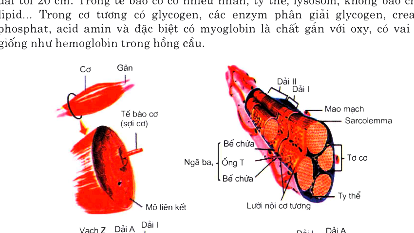
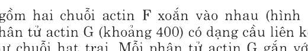
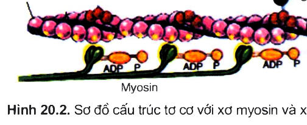
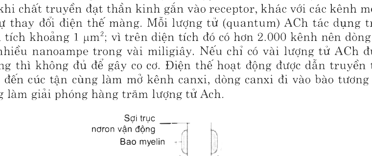
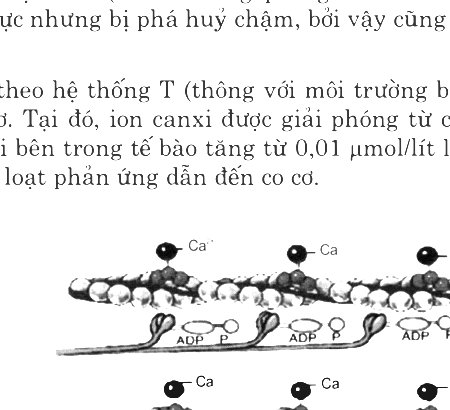
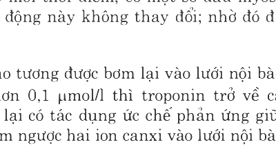
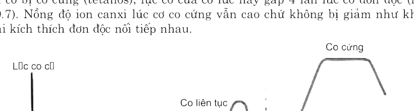

# Bài 20: SINH LÝ CƠ

## MỤC TIÊU
*Sau khi học xong bài này, sinh viên có khả năng:*
1. Trình bày được cách phân loại cơ và chức năng của từng loại cơ.
2. Trình bày được các hình thức co cơ.
3. Trình bày được cơ chế co cơ vân, cơ trơn, cơ tim.
4. Trình bày được các nguồn năng lượng trong co cơ và hiện tượng nợ oxy.
5. Trình bày được điều hòa hoạt động co cơ.

---

Cơ là mô có tính đàn hồi, chiếm tới $50\%$ khối lượng của cơ thể. Trong cơ thể cơ đóng vai trò là một cơ quan đáp ứng của hệ thần kinh trung ương và hệ nội tiết. Cơ hoạt động như một bộ máy sinh học (sinh công, sinh nhiệt) và thông qua hoạt động co cơ mà tham gia điều hòa nhiều chức năng của cơ thể như tuần hoàn, hô hấp, tiêu hóa, bài tiết...

Dựa vào cấu trúc của sợi cơ dưới kính hiển vi, người ta phân cơ thành các loại:
- **Cơ vân** (còn gọi là cơ xương vì bám vào xương). Cơ vân thực hiện các động tác tuỳ ý và chiếm $40 - 50\%$ trọng lượng cơ thể người trưởng thành. Do khối lượng cơ vân lớn nên ngay cả khi cơ thể không vận động, cơ vân tiêu thụ tới $20\%$ lượng oxy của cơ thể.
- **Cơ trơn.** Cơ trơn thực hiện các cử động không tuỳ ý và có vai trò quan trọng trong điều hoà hoạt động của các tạng như phế quản, ống tiêu hóa, mạch máu.
- **Cơ tim.** Cơ tim là một cơ đặc biệt, co bóp nhịp nhàng theo chu kỳ suốt cả cuộc đời để đảm bảo tuần hoàn cho cơ thể.

Mặc dù có chức năng tương tự, giữa các cơ có sự khác nhau về cấu trúc, về tính chất co.

---

## 1. CƠ VÂN

### 1.1. Đặc điểm cấu trúc - chức năng (Hình 20.1)

#### 1.1.1. Tế bào cơ vân
Tế bào cơ vân (sợi cơ) có đường kính $10 - 100\ \mu\text{m}$ và có thể dài tới $20\text{ cm}$. Trong tế bào cơ có nhiều nhân, ty thể, lysosom, không bào chứa lipid... Trong cơ tương có glycogen, các enzym phân giải glycogen, creatin phosphat, acid amin và đặc biệt có **myoglobin** là chất gắn với oxy, có vai trò giống như hemoglobin trong hồng cầu.

Bên trong mỗi tế bào cơ có hàng trăm tơ cơ. Bao quanh các tơ cơ là cơ tương. Mỗi tơ cơ lại chia thành các đơn vị co duỗi cơ (**sarcomere**) dài chừng $2,5\ \mu\text{m}$, được giới hạn ở hai đầu bởi hai **vạch Z**. 

Dưới kính hiển vi hai chiều, sarcomere có các dải sáng, dải đậm và các vạch kế tiếp nhau (vì thế được gọi là cơ vân). Điều này là do sự sắp đặt của các **xơ myosin** (dày) và **xơ actin** (mảnh) trong tơ cơ:
- Giữa chiều dài các xơ actin có vạch Z (là một protein có cấu trúc phẳng) nên xơ actin nằm ở 2 sarcomere kề nhau, mỗi bên một nửa.
- Kề vạch Z chỉ có xơ actin, tạo thành **dải I** (dải sáng, đẳng hướng - isotropic).
- Vùng có các xơ actin và xơ myosin lồng vào nhau tương ứng với **dải A** (dải tối, dị hướng - anisotropic).
- Phần chỉ có các xơ myosin nằm ở giữa dải A gọi là **vùng H** (đĩa H).
- Phần giữa các xơ myosin dày lên, tạo thành **đường M** (nằm ở trung tâm sarcomere).

Mỗi sarcomere có khoảng 2.000 xơ actin và khoảng 1.000 xơ myosin. Như vậy, khi cơ co hai vạch Z lại gần nhau, các xơ myosin và xơ actin chồng lên nhau nhiều hơn (chiều dài các xơ không đổi); dải I và vùng H ngắn lại. Khi các xơ myosin chạm vào vạch Z thì cơ ở mức co tối đa.

#### 1.1.2. Xơ myosin
Phân tử myosin có một đầu bị chẻ làm hai. Phần đầu này tiếp nối với phần cổ và phần cổ lại nối tiếp với phần đuôi của phân tử và có hoạt tính ATPase. Phần đầu và phần cổ tạo thành **meromyosin nặng**; phần đuôi là **meromyosin nhẹ** (Hình 20.2). 

Mỗi xơ myosin có $150 - 360$ các phân tử nói trên xoắn vào nhau. Phần đầu - cổ của xơ có thể gập lại được như một khớp nên myosin có thể dễ dàng gắn vào và rời khỏi xơ actin và làm cho xơ actin và xơ myosin trượt trên nhau.

#### 1.1.3. Xơ actin
Xơ actin gồm hai chuỗi **actin F** xoắn vào nhau (Hình 20.2). Chuỗi actin F là do nhiều phân tử **actin G** (khoảng 400) có dạng cầu liên kết với nhau thành chuỗi giống như chuỗi hạt trai. Mỗi phân tử actin G gắn với một phân tử ADP - là vị trí hoạt động ở sợi actin.

Cuốn xung quanh xơ actin là **tropomyosin** có dạng sợi và cứ cách khoảng 40 nanomet lại có một phân tử **troponin** gắn vào. Troponin (TN) lại gồm 3 tiểu đơn vị:
- **TN-C:** Có tác dụng liên kết với ion canxi.
- **TN-T:** Gắn với tropomyosin.
- **TN-I:** Có tác dụng ngăn tạo liên kết giữa actin và myosin khi cơ nghỉ. Tác dụng ức chế này của TN-I bị mất đi khi TN-C bão hoà ion canxi. Phức hợp troponin có chức năng gắn tropomyosin vào xơ actin.

#### 1.1.4. Mạng nội cơ tương (Hình 20.3)
Mạng nội cơ tương trong tế bào cơ vân rất phong phú.
- **Các ống ngang (ống T):** Màng tế bào cơ có nhiều chỗ lõm hướng về các tơ cơ, tạo thành các ống ngang nằm ở chỗ dải A và dải I tiếp xúc nhau, chạy ngang qua các tơ cơ. Các ống ngang chia ra nhiều nhánh, tạo thành một mạng lưới. Các ống ngang mở thông ra bên ngoài nên trong lòng ống cũng chứa dịch ngoại bào; bởi vậy điện thế hoạt động trên màng cơ được truyền qua các ống ngang mà vào sâu bên trong sợi cơ.
- **Các ống dọc:** Các ống dọc của mạng nội cơ tương nằm song song với các tơ cơ và cũng phân ra nhiều nhánh nối với nhau. Các ống dọc đổ vào những bể chứa lớn được gọi là **bể chứa tận cùng**.
- **Bể chứa tận cùng** tiếp giáp với các ống ngang và có những chân gắn vào màng của ống ngang giúp cho sự truyền kích thích từ ống ngang đến bể chứa và ống dọc.
- Ống ngang, ống dọc và bể chứa tận cùng tạo thành một bộ ba (**triade**) được gọi là hệ thống ống T là kho chứa ion canxi. Hệ thống này rất phát triển ở các cơ vận động nhanh. Màng của hệ thống ống T có **receptor dihydropyridin (DHP)** nhạy cảm với sự thay đổi điện thế và có tác dụng làm mở **receptor ryanodin** của màng lưới nội bào tương. Receptor ryanodin ở màng của lưới nội cơ tương có các kênh cho ion canxi đi ra.

---

### 1.2. Đơn vị vận động
Sợi trục của nơron vận động thường chia nhiều nhánh đến nhiều sợi cơ. Nơron vận động (sợi thần kinh vận động đơn độc) cùng với tất cả các sợi cơ do nó chi phối tập hợp lại thành một **đơn vị vận động**. 

Số sợi cơ do một nơron vận động chi phối có thể từ 5 sợi (ở các cơ vận nhãn ngoài) tới 1000 sợi hoặc hơn (ở cơ thái dương). Các sợi cơ của một đơn vị vận động có thể nằm rải rác trong cả khối cơ vân và nơron vận động chia ra làm nhiều nhánh để chi phối các sợi này. 

Có hai loại đơn vị vận động là đơn vị vận động nhanh và đơn vị vận động chậm:
- Muốn biết một đơn vị vận động thuộc loại nào người ta cần biết nguyên ủy của nơron và đặc điểm của nơron (nhất là tần số xung động ở nơron).
- **Các đơn vị vận động chậm:** Có quá trình oxy hóa xảy ra mạnh và rất nhạy cảm với sự thiếu oxy, có nhiều mao mạch và myoglobin, lâu bị mỏi hơn là các đơn vị vận động nhanh. Các cơ "đỏ" (ví dụ các cơ duy trì tư thế) chủ yếu có đơn vị vận động chậm.
- **Các đơn vị vận động nhanh:** Các cơ co rất nhanh (còn được gọi là cơ "trắng") có đơn vị vận động nhanh nhiều hơn số đơn vị vận động chậm nên thực hiện được các động tác nhanh như đi lại, chạy.
- Cơ co càng mạnh thì càng có nhiều đơn vị vận động tham gia. Tần số xung động theo sợi thần kinh tới đơn vị vận động tăng làm tăng lực co.

Khi tới cơ, sợi trục có myelin của nơron alpha chia ra nhiều nhánh đi tới các sợi cơ. Số sợi cơ do một nơron alpha chi phối tùy thuộc vào loại cơ. Ở các cơ lớn chịu trách nhiệm tạo lực và tư thế, mỗi nơron chi phối vài trăm đến vài nghìn sợi cơ. Ở các cơ thực hiện động tác chính xác, mỗi nơron chỉ chi phối vài sợi cơ. Mỗi sợi cơ vân chỉ nhận một nhánh tận cùng.

---

### 1.3. Synap thần kinh - cơ
Chỗ lõm ở sợi cơ, nơi có sự truyền đạt tín hiệu thần kinh tới cơ có tên là **tấm vận động** (Hình 20.4). 

Dưới kính hiển vi điện tử, các bọc nhỏ ở cúc tận cùng có đường kính khoảng $50\text{ nm}$, trong chứa chất truyền đạt thần kinh là **acetylcholin (ACh)**. ACh được các cúc tận cùng trước synap tổng hợp từ cholin và acetyl coenzym A nhờ enzym *cholin - acetyltransferase*. ACh tạo thành được trữ trong các bọc nhỏ; trong mỗi bọc có khoảng $5.000 - 10.000$ phân tử ACh. Các bọc nhỏ này tập trung ở một vùng trên màng trước synap được gọi là vùng hoạt động. 

Trong khe synap (rộng khoảng $60\text{ nm}$) có chứa **acetylcholinesterase** là enzym phân giải ACh. 

Màng sau synap có nhiều vị trí gắn là những chỗ lõm vào của màng nằm đối diện với vùng hoạt động của màng trước synap. Các điểm tiếp nhận ACh trên màng sau synap ở gần các vị trí gắn.

---

### 1.4. Dẫn truyền xung động ở tấm vận động (Hình 20.4)
Sự dẫn truyền xung động ở tấm vận động xảy ra tương tự như ở synap thần kinh. Các receptor ACh ở tấm vận động cơ vân được gọi là các **receptor nicotinic** vì chúng bị kích thích bởi nicotin. 

Các receptor này là một protein xuyên màng, có 5 tiểu đơn vị tạo thành một kênh cho nước qua nằm trong lớp lipid kép của màng. Hai trong số này được gọi là tiểu đơn vị alpha có vị trí gắn với ACh. Khi hai tiểu đơn vị này gắn với ACh, protein bị biến đổi cấu trúc không gian và kênh mở ra cho cả ion natri và kali đi qua. Kênh này được gọi là kênh được hoạt hóa hóa học, chỉ mở khi chất truyền đạt thần kinh gắn vào receptor, khác với các kênh mở ra khi có sự thay đổi điện thế màng. 

Mỗi lượng tử (quantum) ACh tác dụng trên một diện tích khoảng $1\ \mu\text{m}^2$; vì trên diện tích đó có hơn 2.000 kênh nên dòng ion đạt tới nhiều nanoampe trong vài miligiây. Nếu chỉ có vài lượng tử ACh được giải phóng thì không đủ để gây co cơ. 

Điện thế hoạt động dẫn truyền theo sợi trục đến cúc tận cùng làm mở kênh canxi, dòng canxi đi vào bào tương cúc tận cùng làm giải phóng hàng trăm lượng tử ACh.

Điện thế ở tấm vận động không tuân theo định luật tất cả hoặc không. Mức độ khử cực tỷ lệ thuận với số kênh được mở ra. Nếu chỉ có một kênh mở (khi 2 phân tử ACh gắn vào receptor, mỗi phân tử gắn vào một tiểu đơn vị alpha) thì màng tế bào chỉ bị khử cực một vài $\mu\text{V}$. Nếu có một bọc nhỏ giải phóng $5.000 - 10.000$ phân tử ACh thì màng sẽ khử cực khoảng $1\text{ mV}$ (điện thế tối thiểu ở tấm vận động). Do các bọc nhỏ giải phóng tự phát với tần số 1 lần/giây, điện thế tối thiểu này xuất hiện khoảng một lần mỗi giây. Điện thế này có thể có vai trò quan trọng trong việc duy trì sự toàn vẹn của sợi cơ vì cơ vân bị teo khi bị mất dây thần kinh chi phối. 

Lượng chất truyền đạt được giải phóng từ $200 - 300$ bọc nhỏ gây khử cực khoảng $50\text{ mV}$ và làm xuất hiện **điện thế tấm vận động**. Chính điện thế tấm vận động làm xuất hiện điện thế hoạt động ở màng tế bào cơ. Điện thế tấm vận động gây khử cực màng cơ ở các vùng lân cận đạt tới ngưỡng và điện thế hoạt động xuất hiện. Điện thế này lan tỏa dọc theo sợi cơ và làm cơ co.

ACh bị khử hoạt rất nhanh bởi cholinesterase có ở khe synap. 

Có nhiều chất độc và thuốc ngăn chặn sự dẫn truyền thần kinh - cơ làm cơ bị yếu đi, thậm chí bị liệt:
- **Độc tố botulinum:** Ức chế giải phóng ACh.
- **Chất curare:** Được sử dụng trong gây mê có tác dụng ngăn không cho ACh gắn vào receptor theo cơ chế cạnh tranh.
- **Succinylcholin:** Một số chất tương tự ACh (thuốc cường phó giao cảm) có tác dụng gây khử cực nhưng bị phá huỷ chậm, bởi vậy cũng có tác dụng gây liệt do khử cực kéo dài.

Điện thế hoạt động lan nhanh theo hệ thống T (thông với môi trường bên ngoài tế bào) vào sâu trong tế bào cơ. Tại đó, ion canxi được giải phóng từ các ống ngang lân cận. Nồng độ ion canxi bên trong tế bào tăng từ $0,01\ \mu\text{mol/lít}$ lúc nghỉ lên $1 - 10\ \mu\text{mol/lít}$ và gây ra một loạt phản ứng dẫn đến co cơ.

---

### 1.5. Cơ chế phân tử của co cơ (Hình 20.5)
Tập hợp các đáp ứng từ khi có điện thế kích thích tới cơ dẫn đến cơ co được gọi là **cặp (couple) kích thích - co cơ**. Quá trình này gồm 4 giai đoạn:

#### 1.5.1. Điện thế hoạt động theo hệ thống ống T tới các sợi cơ và giải phóng ion canxi từ lưới nội bào làm nồng độ canxi trong bào tương tăng lên tới một nghìn lần.

#### 1.5.2. Ion canxi gắn vào troponin nằm trên sợi actin làm troponin bị biến đổi cấu trúc không gian khiến cho tropomyosin nằm sâu hơn vào rãnh giữa hai chuỗi actin F. 
Lúc này, các vị trí gắn (vị trí hoạt động) ở phân tử actin bị bộc lộ và phân tử myosin có thể tạo các cầu nối với phân tử actin. Để hai mảnh đầu của myosin chập lại cần một phân tử ATP. Lúc này, phức hợp ATP-myosin và phần đầu tạo thành một góc $90^\circ$.

#### 1.5.3. Các xơ trượt lên nhau:
- Khi nồng độ ion canxi cao, giữa các đầu myosin và actin hình thành các cầu nối. Actin hoạt hóa ATPase ở đầu myosin và ATP bị thuỷ phân. 
- Các phản ứng này đòi hỏi $3\text{ mmol/l}$ ion magiê ($\text{Mg}^{2+}$) và kết quả là hình thành nên phức hợp **Actin-Myosin-ADP-Phosphat vô cơ**. 
- Phosphat vô cơ tách ra khỏi phức hợp, đầu myosin gấp lại tạo thành góc $50^\circ$ làm cho tơ actin trượt trên myosin. 
- ADP được giải phóng và làm các đầu myosin trở về vị trí cuối cùng ($45^\circ$) và quá trình trượt chấm dứt. 
- Lúc này, lại cần có phân tử ATP mới gắn vào đầu myosin và đầu myosin tách khỏi sợi actin. Phần đầu - cổ của myosin trở về vị trí ban đầu ($90^\circ$).
- **Hiện tượng cứng cơ ở tử thi (rigor mortis):** Là do ATP không được tổng hợp nữa nên ion canxi không được bơm lại vào lưới nội bào và không tạo được phức hợp actin-myosin ổn định. Hiện tượng cứng này chỉ mất đi khi các xơ cơ bị phân huỷ.
- Một chu kỳ mới lại được lặp lại theo tần số điện thế hoạt động nếu nồng độ ion canxi trong tế bào đủ để duy trì troponin ở trạng thái hoạt động; nếu không thì cơ giãn. 
- Năng lượng để làm gấp cầu nối là từ thuỷ phân ATP thành ADP và phosphat vô cơ. ATP và ATPase đều có ở chỗ cầu nối nhưng ATPase chỉ được hoạt hóa khi myosin gắn với actin, do vậy phản ứng thuỷ phân chỉ xảy ra khi có cầu nối. 
- Các đầu myosin không trượt đồng thời mà trượt đi trượt lại nên cơ co thành từng đợt. Ở mỗi thời điểm, có một số đầu myosin hoạt động nhưng về tổng thể số đầu hoạt động này không thay đổi; nhờ đó đảm bảo cơ co liên tục và có hiệu quả.

#### 1.5.4. Cơ giãn ra:
Ion canxi trong bào tương được bơm lại vào lưới nội bào tương và khi nồng độ trong tế bào thấp hơn $0,1\ \mu\text{mol/l}$ thì troponin trở về cấu trúc không gian bình thường, tropomyosin lại có tác dụng ức chế phản ứng giữa actin và myosin và chu kỳ chấm dứt. Để bơm ngược hai ion canxi vào lưới nội bào tương cần một phân tử ATP. Ion canxi có vai trò rất quan trọng đối với mọi loại cơ.

---

### 1.6. Hình thức co cơ

#### 1.6.1. Co cơ trương lực
Co cơ trương lực là do điện thế hoạt động ở các đơn vị vận động riêng lẻ gây ra. Người ta không thấy cơ co vì các đơn vị vận động hoạt động lệch pha nhau.

#### 1.6.2. Co cơ đơn độc (Hình 20.6)
Một kích thích đơn độc bao giờ cũng làm giải phóng tối đa ion canxi và gây ra co các sợi cơ vân (định luật tất cả hoặc không). Do kích thích quá ngắn, thời gian trượt của các sợi lại tương đối dài nên không thể tác động lên tất cả các vị trí hoạt động actin và myosin được, bởi vậy không làm cho cơ co đến mức tối đa. Một kích thích đơn độc tiếp theo làm cơ co thêm. 

Đồ thị co cơ đơn độc gồm 3 giai đoạn:
1. **Giai đoạn tiềm tàng:** Từ lúc có kích thích đến khi cơ bắt đầu co.
2. **Giai đoạn co:** Cơ rút ngắn chiều dài hoặc phát sinh lực co.
3. **Giai đoạn giãn:** Cơ trở về chiều dài hoặc lực căng ban đầu.

Như vậy, các kích thích liên tiếp đã gây hiệu ứng cộng kích thích. Tần số kích thích tăng ($20\text{ Hz}$ với cơ co chậm; $60 - 100\text{ Hz}$ với cơ co nhanh) thì đơn vị vận động co tối đa và cơ bị **co cứng (tetanos)**, lực co của cơ lúc này gấp 4 lần lúc co đơn độc (Hình 20.7). Nồng độ ion canxi lúc cơ co cứng vẫn cao chứ không bị giảm như khi có hai kích thích đơn độc nối tiếp nhau.

#### 1.6.3. Co cơ đẳng trường
Co cơ đẳng trường là hình thức co cơ mà chiều dài của cơ không thay đổi nhưng trương lực cơ thay đổi. Lực co cơ tăng do:
- Tăng số lượng nơron alpha hoạt động thêm làm tăng số sợi cơ co nên làm tăng lực co.
- Tăng tần số xung trên nơron alpha làm tăng lượng canxi được giải phóng từ mạng nội cơ tương mỗi khi cơ bị kích thích. Nếu tần số tăng vừa phải thì có hiện tượng cộng kích thích. Nếu tần số cao thì các lần co đơn độc chồng lên nhau và cơ co cứng, tạo ra lực co tối đa; tần số cần thiết để tạo lực co tối đa được gọi là **tần số gây co cứng** hay **tần số tới hạn**.

Lực co cơ đẳng trường phụ thuộc vào chiều dài của sợi cơ trước lúc co:
- Nếu độ dài của sarcomere là $2,2\ \mu\text{m}$ thì mỗi cầu nối gắn với một phân tử actin trên sợi mảnh và tạo ra được lực tối đa.
- Nếu sarcomere dài tới $3,5\ \mu\text{m}$ thì các xơ actin và xơ myosin không lồng vào nhau nên không tạo ra lực.
- Nếu sarcomere ngắn dưới $2,0\ \mu\text{m}$ thì các xơ mỏng ở hai bên của sarcomere chéo nhau; nếu ngắn dưới $1,5\ \mu\text{m}$ thì vạch Z tiếp giáp với xơ dày myosin và cả hai trường hợp này đều không tạo ra lực.

#### 1.6.4. Co cơ đẳng trương
Co cơ đẳng trương là hình thức co cơ mà chiều dài của cơ thay đổi nhưng trương lực cơ (hay sức tải) không thay đổi. 

Co cơ đẳng trương (có rút ngắn sợi cơ) đòi hỏi phải lặp lại các chu kỳ trượt của các xơ cơ. Thoạt tiên, cơ co đẳng trường vì cơ chỉ ngắn lại khi lực sinh ra bằng mức tải (load) của cơ. Trọng lượng mà cơ nâng được trong khi co đẳng trương được gọi là **mức sau tải (afterload)**. Khi cơ ngắn lại, lực không thay đổi và vẫn bằng mức sau tải trong suốt thời gian cơ co. Tốc độ rút ngắn cơ cũng không thay đổi. Tính chất co thay đổi theo mức chịu tải của cơ.

---

### 1.7. Hiệu suất co cơ
Hiệu suất co cơ là tỷ lệ phần trăm năng lượng tiêu hao được chuyển thành công cơ học. 
- Hiệu suất tối đa của co cơ là $20 - 25\%$, phần còn lại được chuyển thành nhiệt năng. 
- Hiệu suất co cơ thấp vì có tới một nửa năng lượng bị mất đi trong quá trình tạo ATP, sau đó chỉ có $40 - 45\%$ năng lượng trong ATP được chuyển thành công cơ học. 
- Hiệu suất cao nhất đạt được khi cơ co với tốc độ vừa phải (tốc độ co cơ vào khoảng $30\%$ tốc độ tối đa). 
- Nếu cơ co rất chậm hoặc co mà không tạo ra vận động (ví dụ run cơ) thì phần lớn năng lượng của ATP được chuyển thành nhiệt nên hiệu suất co cơ rất thấp. 
- Nếu cơ co quá nhanh thì hiệu suất co cơ cũng không cao vì phần lớn năng lượng được dùng để thắng lực ma sát nhớt trong cơ.

---

### 1.8. Mỏi cơ
Hiện tượng mỏi cơ xuất hiện khi cơ co mạnh và kéo dài. Mỏi cơ là do hiện tượng thiếu oxy và tích lũy các chất chuyển hóa như **acid lactic**, giảm nồng độ glycogen trong cơ. 

Khi vận cơ, máu đến cơ nhiều hơn và oxy được giải phóng nhiều hơn nhưng cũng không thể bù lại hoàn toàn được những biến đổi này. Hơn nữa cơ căng chèn ép lên mạch nên có thể làm giảm lưu thông máu đến cơ. 

Ngoài ra, sự dẫn truyền thần kinh - cơ ở tấm vận động cũng có thể bị giảm do các chất truyền đạt thần kinh không được tái tạo kịp nên làm giảm khả năng co của cơ.

---

### 1.9. Điều hòa co cơ vân
Hệ thần kinh trung ương điều khiển hoạt động co cơ vân thông qua các sợi vận động với chất truyền đạt thần kinh hoạt động tại synap thần kinh - cơ là ACh. Do vậy, nếu tổn thương nơron vận động cơ sẽ không hoạt động (liệt) và sẽ dẫn đến teo cơ.

---

### 1.10. Phì đại cơ và teo cơ

#### 1.10.1. Phì đại cơ
Phì đại cơ là hiện tượng khối lượng cơ tăng:
- **Phì đại sinh lý:** Cơ phì đại sinh lý khi cơ co với tốc độ tối đa hoặc gần tối đa. Mức độ phì đại sẽ lớn hơn nếu cơ đồng thời bị kéo căng trong lúc co. Trong trường hợp cơ phì đại sinh lý, tốc độ tổng hợp protein, myoglobin của cơ tăng, số xơ cơ tăng, trong tế bào xuất hiện nhiều tơ cơ mới, lượng enzym nói chung và các enzym chuyển hóa glucid tăng, tế bào cơ to ra nhưng *số lượng sợi cơ không tăng*. Lao động thể lực và tập luyện đúng làm cơ phì đại sinh lý. Tác dụng này xuất hiện nhanh nhưng cũng sẽ mất dần nếu ngừng luyện tập.
- **Phì đại bệnh lý:** Là sự tích tụ các chất bất thường trong tế bào cơ như collagen, sợi xơ...

#### 1.10.2. Teo cơ
Teo cơ là hiện tượng khối lượng cơ giảm:
- Teo cơ xảy ra khi cơ không hoạt động hoặc giảm hoạt động trong một thời gian dài hoặc thần kinh chi phối cơ bị tổn thương. 
- Trong trường hợp cơ bị teo, các protein bị thoái hóa nhanh, số lượng tơ cơ, xơ cơ giảm, tế bào cơ nhỏ đi nhưng *không giảm về số lượng*. 
- Nếu liên hệ thần kinh được tái lập trong vòng ba tháng đầu sau khi bị đứt thì cơ có thể được phục hồi hoàn toàn. Càng để lâu thì khả năng phục hồi càng kém rồi không còn khả năng phục hồi nữa.
- Trong bệnh **nhược cơ (myasthenia gravis)** không có sự dẫn truyền tín hiệu thần kinh sang cơ do cơ thể sinh ra kháng thể chống lại các kênh ion / receptor nicotinic (bệnh tự miễn).
- **Teo cơ trong bệnh Aran - Duchenne** là do thoái hóa nơron vận động ở sừng trước tuỷ nên có kèm theo liệt mềm.

---

## 2. CƠ TRƠN

### 2.1. Đặc điểm cấu trúc - chức năng
Cơ trơn có ở thành các tạng rỗng (ống tiêu hóa, phế quản, bàng quang, tử cung, mạch máu) và ở một số nơi khác như mống mắt, thể mi. Cơ trơn có ý nghĩa quan trọng trong lâm sàng.

- **Cấu tạo tế bào:** Tế bào cơ trơn dài ($10 - 500\ \mu\text{m}$), mảnh ($5 - 10\ \mu\text{m}$) và chỉ có một nhân, không có các vạch sẫm tối và hệ thống ống nhỏ. Bề mặt của tế bào cơ trơn có những chỗ lõm vào làm tăng diện tích của tế bào.
- **Tơ cơ:** Cơ trơn không có sarcomere, các xơ mảnh và xơ dày phân tán trong tế bào nền. Các xơ mảnh gắn vào các **thể đặc**; một số thể đặc bám vào màng tế bào, một số lơ lửng trong bào tương. Các thể đặc được tạo bởi **alpha actinin** là một protein có ở vạch Z của cơ vân.
- Xơ dày có myosin, còn xơ mảnh có actin và tropomyosin nhưng **không có troponin**.
- Tế bào cơ trơn nhỏ nên kích thích từ bề mặt tế bào có thể đi tới các thành phần co bên trong tế bào mà không cần đến hệ thống ống T. Tốc độ co của cơ trơn chậm hơn của cơ vân tới 100 lần.
- **Phân bố thần kinh:** Dọc trên sợi trục của các nơron giao cảm và phó giao cảm nằm trong khối cơ trơn có các cúc trong đó có các bọc nhỏ chứa chất truyền đạt thần kinh. Giữa các nhánh sợi thần kinh giao cảm và phó giao cảm với sợi cơ có những chỗ tiếp xúc có vai trò như synap thần kinh ở các nơi khác; tại đấy các chất truyền đạt thần kinh đi vào dịch kẽ ở cách tế bào cơ từ vài nanomet đến vài $\mu\text{m}$. Các chất truyền đạt khuếch tán đến tế bào cơ trơn và gây hiệu ứng. Hiệu ứng kích thích hay ức chế phụ thuộc vào receptor có trên màng tế bào cơ trơn (xem Bài 18. Sinh lý hệ thần kinh tự chủ).

---

### 2.2. Cơ chế co cơ trơn
Cơ trơn khác với cơ vân ở chỗ **không có troponin**. Chất tiếp nhận ion canxi trong tế bào cơ trơn là **calmodulin**. Vai trò của calmodulin tương tự như troponin C của tế bào cơ vân.

Ở cơ trơn, chu kỳ tạo cầu nối là do sự phosphoryl hóa myosin gây ra bởi ion canxi:
1. Cầu nối myosin có 4 chuỗi nhẹ, mỗi đầu xơ myosin có hai chuỗi nhẹ. Nếu không có một trong các chuỗi nhẹ được phosphoryl hóa thì myosin không gắn được vào actin.
2. Sự phosphoryl hóa xảy ra dưới tác dụng của enzym **MLCK (myosin light chain kinase)**. MLCK được hoạt hóa bởi calmodulin, còn calmodulin lại được hoạt hóa bởi canxi.
3. Có nhiều cơ chế làm canxi đi vào trong tế bào cơ trơn:
   - Do chất truyền đạt thần kinh gắn vào receptor làm mở kênh canxi.
   - Do các kênh canxi mở ra khi có điện thế hoạt động ở tế bào cơ.
   - Do canxi được giải phóng từ mạng nội cơ tương. Các kênh này mở ra dưới tác dụng của inositol triphosphat ($\text{IP}_3$).
4. Chu kỳ tạo cầu nối của sợi cơ trơn dài hơn ở sợi cơ vân rất nhiều do hoạt tính ATPase ở các đầu cầu nối rất yếu.

---

### 2.3. Chiều dài và lực co của cơ trơn
Chiều dài và lực co của cơ trơn khác với của cơ vân:
- Tốc độ co (tốc độ hình thành cầu nối) phụ thuộc vào sự phosphoryl hóa chuỗi nhẹ.
- **Hiện tượng cầu chốt (latch bridges):** Các cầu nối không còn được phosphoryl hóa vẫn gắn vào actin được gọi là cầu chốt. Các cầu này làm cơ trơn có khả năng chỉ tiêu hao ít năng lượng mà vẫn duy trì được trương lực vì các cầu nối này không được tạo theo chu kỳ hoặc có chu kỳ tạo thành rất dài nên không sử dụng nhiều ATP. Do thời gian tồn tại của cầu nối myosin - actin kéo dài nên lực co tối đa của cơ trơn thường lớn hơn của cơ vân.
- Cơ trơn có khả năng co ngắn nhiều hơn so với cơ vân mà vẫn duy trì được lực co cơ hoàn toàn, nhờ vậy các tạng rỗng (bàng quang, ruột, mạch máu...) có thể thay đổi đường kính trong phạm vi rất lớn.
- Hơn nữa, cơ trơn ở các nơi này có khả năng trở lại lực co ban đầu chỉ sau vài giây hoặc vài phút sau khi bị thay đổi độ dài. Ví dụ, thể tích nước tiểu trong bàng quang tăng đột ngột làm áp suất trong bàng quang tăng đột ngột nhưng chỉ sau 15 giây đến một phút thì áp suất trong bàng quang lại trở về gần mức ban đầu (tính thích ứng với thể tích).

---

### 2.4. Điều hòa co cơ trơn
Co cơ trơn được điều hòa bằng hệ thống thần kinh và thể dịch:

#### 2.4.1. Điều hòa bằng hệ thống thần kinh
Hệ thần kinh tự chủ điều hòa sự co, giãn cơ trơn thông qua hoạt động của hệ thần kinh giao cảm và phó giao cảm với các chất truyền đạt thần kinh là acetylcholin và noradrenalin (xem bài 18. Sinh lý hệ thần kinh tự chủ).

#### 2.4.2. Điều hòa bằng hệ thống thể dịch
##### 2.4.2.1. Các hormon
Các hormon trong máu (angiotensin II, serotonin, vasopressin, adrenalin...) có ảnh hưởng lên cơ trơn, nhất là cơ trơn mạch máu:
- Các hormon có tác dụng kích thích gây co mạch gắn vào các receptor làm mở các kênh natri hoặc kênh canxi nên gây khử cực.
- Các hormon có tác dụng ức chế gây co mạch gắn vào các receptor làm đóng kênh natri và kênh canxi hoặc làm mở kênh kali nên gây ưu phân cực.

##### 2.4.2.2. Các yếu tố tại chỗ
Các yếu tố tại chỗ như thiếu oxy, tăng nồng độ $\text{CO}_2$, tăng nồng độ ion hydro ($\text{H}^+$), tăng ion kali, giảm ion canxi, tăng acid lactic, các chất được sản xuất tại mô bị viêm như bradykinin, histamin... gây giãn cơ trơn, giãn mạch.

---

## 3. CƠ TIM

### 3.1. Đặc điểm cấu trúc - chức năng
- Sợi cơ tim rộng khoảng $15 - 20\ \mu\text{m}$, dài khoảng $100\ \mu\text{m}$, dày khoảng $5\ \mu\text{m}$.
- Về mặt hình thái, cơ tim vừa mang đặc điểm của cơ vân (có vân, có sarcomere...), vừa mang đặc điểm cơ trơn (chỉ có một nhân, không có tấm vận động...).
- Tế bào cơ tim có **ống T lớn hơn** của cơ vân và nằm ở **vạch Z** chứ không nằm ở chỗ tiếp xúc giữa dải A và dải I. Lưới nội bào tiếp xúc với các ống T và màng tế bào.
- Dưới kính hiển vi, các tế bào cơ tim xếp nối nhau và dọc hai bên các sợi kề nhau có những chỗ hòa màng (các đĩa xen - intercalated discs và các mối nối hở - gap junctions) tạo điều kiện truyền xung động dễ dàng từ sợi này sang sợi khác; bởi vậy **cơ tim hoạt động như một hợp bào**. Cơ tim có những tính chất quan trọng khác với hai loại cơ trên.

---

### 3.2. Khác biệt chính giữa cơ vân và cơ tim

#### 3.2.1. Cơ tim không có tấm vận động
Kích thích tới cơ tim lan truyền trong toàn bộ cơ tim theo **định luật tất cả hoặc không**.

#### 3.2.2. Cơ tim khó bị kéo dài hơn cơ vân
Tức là với cùng một độ giãn thì lực tạo ra lúc co của cơ tim lớn hơn của cơ vân. Độ dài của một sarcomere cơ tim trước khi co phụ thuộc vào lượng máu về tim. Vì lượng máu này thay đổi theo hoạt động của cơ thể nên cơ chế này là cơ chế nội tại rất quan trọng điều hoà lực co cơ tim (**luật Frank-Starling**). Ngoài ra, với cùng một độ dài, lực co của một sarcomere còn phụ thuộc vào lượng ion canxi đi vào tế bào cơ tim. Đây cũng là cơ chế tự điều hoà lực co của tim.

#### 3.2.3. Lực co của cơ tim có thể thay đổi theo thời gian của điện thế hoạt động
Thời gian này thay đổi theo dòng canxi vào tế bào. Canxi được giải phóng khỏi lưới nội bào là do ion canxi phát động chứ không phải do màng bị khử cực (hiện tượng phóng thích canxi do canxi kích thích - CICR). Lượng canxi được giải phóng khỏi lưới nội bào chịu ảnh hưởng của nhiều yếu tố:
- **Adrenalin và noradrenalin:** Làm tăng lượng canxi đi vào trong tế bào, do đó làm tăng lượng canxi được giải phóng khỏi lưới nội bào.
- **Catecholamin:** Làm tăng canxi trong lưới nội bào nên lượng canxi được giải phóng do canxi phát động cũng tăng.
- **Trao đổi ion natri - canxi:** Lượng canxi trong tế bào được điều hoà bởi sự trao đổi ion natri - canxi: cứ 3 ion natri đi vào tế bào thì có một ion canxi được vận chuyển ra khỏi tế bào. Khi điện thế hoạt động ở giai đoạn khử cực, chênh lệch nồng độ natri thấp nên lượng canxi ra khỏi tế bào cũng thấp. 
- **Ouabain và các glycosid trợ tim:** Ức chế bơm $\text{Na}^+ - \text{K}^+ - \text{ATPase}$ làm cho ion natri tích lại trong tế bào; nồng độ natri trong tế bào tăng làm giảm chênh lệch natri giữa trong và ngoài tế bào nên làm giảm sự trao đổi natri - canxi. Khi nồng độ ion canxi trong tế bào tăng thì canxi đi vào tế bào còn natri được bơm ra khỏi tế bào. Do canxi có vai trò quan trọng đối với hoạt động của cơ tim nên ngoài các thuốc kể trên, trong lâm sàng còn dùng các thuốc ức chế bơm canxi để điều trị một số trường hợp tăng huyết áp.

#### 3.2.4. Chiều dài và lực co
Với cùng một độ dài của sarcomere, lực co của cơ tim thay đổi theo lượng ion canxi đi vào tế bào do vậy nồng độ canxi trong tế bào là yếu tố quan trọng trong điều hòa lực co của cơ tim. 

Thời gian điện thế hoạt động và thời gian ion canxi nằm trong cơ tương gần như bằng nhau, do đó **không có hiện tượng cộng kích thích**. Thời gian trơ của cơ tim dài và chấm dứt khi cơ tim sắp hết co do vậy **cơ tim không bị co cứng như cơ vân**.

---

## 4. NĂNG LƯỢNG TRONG CO CƠ

### 4.1. ATP
Cơ cũng như các tế bào khác, cần năng lượng *phát triển*, để *duy trì hoạt động tế bào*, để *hoạt động bơm ion*.

Ngoài những lý do trên cơ cần năng lượng cho *hoạt động co cơ*. Năng lượng này được lấy từ sự phân giải ATP. Năng lượng lấy từ ATP được dùng để:
- Thực hiện cơ chế trượt: các cầu nối gắn vào sợi actin và kéo sợi actin trượt sâu vào sợi myosin.
- Bơm ion canxi từ dịch cơ tương vào mạng nội bào tương sau khi cơ đã ngừng co.
- Bơm ion natri, kali qua màng sợi cơ để duy trì môi trường ion thích hợp cho sự tạo và dẫn truyền điện thế hoạt động.

Sự thuỷ phân ATP cung cấp năng lượng để tạo công:
$$\text{ATP} + \text{H}_2\text{O} \rightarrow \text{ADP} + \text{H}_3\text{PO}_4 + 7,3\text{ Kcal}$$

Nồng độ ATP trong sợi cơ vào khoảng $4\text{ mmol}$, chỉ đủ để duy trì co cơ đầy đủ trong khoảng $1 - 2\text{ giây}$. Do vậy muốn duy trì được co cơ kéo dài, ATP phải luôn luôn được tái tạo từ sự phosphoryl hóa trở lại phân tử ATP. Sự tái tạo này diễn ra rất nhanh chỉ trong một phần của giây.

---

### 4.2. Phosphocreatin: có trong cơ
Phosphocreatin là nguồn cung cấp năng lượng để tái tạo ATP vì chất này cũng có dây nối giàu năng lượng giống ATP. Chất này bị thuỷ phân dưới tác dụng của enzym *phosphocreatintransferase*:

$$\text{PC} + \text{ADP} \underset{\text{Phosphocreatintransferase}}{\rightleftharpoons} \text{ATP} + \text{C (creatin)}$$

Tuy nhiên, tổng lượng phosphocreatin trong cơ cũng chỉ rất nhỏ, chỉ nhiều gấp 5 lần ATP. Nếu cộng cả năng lượng dự trữ trong cả ATP và phosphocreatin (PC) thì cũng chỉ đủ cung cấp cho co cơ trong $7 - 8\text{ giây}$.

---

### 4.3. Glycogen
Glycogen dự trữ trong cơ chính là nguồn năng lượng được dùng để tái tạo ATP và phosphocreatin.

Sự phân giải glycogen xảy ra trong bào tương của tế bào cơ và gan để cho glucose. Sự phân giải glucose được xảy ra theo một trong hai con đường:
- **Thoái hóa hiếu khí:** Glucose từ máu vào tế bào, qua một loạt các phản ứng hóa học để tạo thành acid pyruvic, acid pyruvic đi vào chu trình acid citric. Các phản ứng này xảy ra trong ty thể, cứ một phân tử glucose thoái hóa sẽ cho **36 phân tử ATP**.
- **Thoái hóa yếm khí:** Trong một số trường hợp lao động nặng mặc dù tăng thông khí nhưng việc cung cấp oxy không đủ, glucose sẽ được chuyển hóa theo con đường yếm khí để tạo **acid lactic**. Phản ứng hóa học xảy ra nhanh hơn và cung cấp ATP cũng nhanh hơn.

Nguồn ATP được tạo ra từ quá trình đường phân được dùng để co cơ hoặc để tái tạo phosphocreatin từ creatin và phosphat dưới tác dụng của enzym *creatinphosphokinase*.

Tốc độ tạo ATP từ quá trình đường phân nhanh gấp 2,5 lần so với việc tạo ATP từ việc oxy hóa các dạng thức ăn khác trong tế bào.

---

### 4.4. Oxy hóa các dạng thức ăn khác
Trên $95\%$ năng lượng để cung cấp ATP cho co cơ kéo dài lấy từ các phản ứng oxy hóa các chất dinh dưỡng khác. Trong 3 loại thức ăn glucid, protid, lipid thì **lipid là nguồn cung cấp năng lượng nhiều nhất**.

---

## 5. HIỆN TƯỢNG NỢ OXY

Khi cơ vận động, mạch máu giãn, lưu lượng máu cung cấp oxy cho cơ tăng. Sự tiêu thụ oxy tăng theo năng lượng tiêu dùng. Năng lượng này được cung cấp trong điều kiện hiếu khí.

Khi cơ vận động gắng sức liên tục, lượng oxy cung cấp không đủ để tái tổng hợp năng lượng, cơ sẽ sử dụng năng lượng theo con đường yếm khí và sản phẩm acid lactic được tạo ra nhiều làm pH giảm và ức chế hoạt động của các enzym trong mô, đồng thời thiếu nguồn glycogen và creatin phosphat dự trữ gây mệt cơ làm lực co tối đa giảm. Sau thời gian nghỉ cơ sẽ hồi phục lại.

Khi cơ nghỉ sau giai đoạn hoạt động gắng sức, cơ sử dụng oxy để oxy hóa acid lactic thành hợp chất có thể cung cấp ATP. Quá trình này đã tiêu thụ một lượng lớn oxy sau khi vận động. Lượng oxy này được đòi hỏi cho các phản ứng hiếu khí xảy ra cho đến khi trạng thái ban đầu của cơ được phục hồi.

Sự tích tụ quá nhiều acid lactic và sự thiếu glycogen xảy ra trong khi luyện tập được gọi là **tình trạng nợ oxy** bởi vì tình trạng này phải được trả lại bằng sự tiêu thụ oxy sau co cơ. Lượng oxy nợ này cao gấp 6 lần lượng oxy tiêu thụ cơ bản cho co cơ, do vậy gắng sức chỉ thực hiện trong thời gian ngắn, vận động bình thường có thể thực hiện trong thời gian dài.

---

## TỰ LƯỢNG GIÁ

1. Trình bày về phân loại cơ và chức năng từng loại cơ.
2. Trình bày cơ chế co cơ vân và nêu sự khác nhau giữa cơ chế co cơ vân và co cơ trơn.
3. Kể 4 hình thức co cơ và nêu đặc điểm của từng hình thức co cơ.
4. Trình bày cơ chế điều hòa co cơ vân và cơ trơn.
5. Trình bày sự khác nhau về đặc điểm co cơ tim với co cơ vân.
6. Trình bày về nguồn năng lượng co cơ lấy từ ATP và phosphocreatin.
7. Trình bày về nguồn năng lượng co cơ lấy từ glycogen và oxy hóa các dạng thức ăn khác.
8. Giải thích hiện tượng mỏi cơ và nợ oxy.

---

## TÀI LIỆU THAM KHẢO

1. **Bộ môn Dược lý** (2001), *Dược lý học*, Nhà xuất bản Y học.
2. **Bộ môn Giải phẫu** (2001), *Giải phẫu người*, tập I, Nhà xuất bản Y học.
3. **Bộ môn Hoá sinh** (2001), *Hoá sinh*, Nhà xuất bản Y học.
4. **Bộ môn Mô học - Phôi thai học** (1998), *Mô học*, Nhà xuất bản Y học.
5. **Bộ môn Mô học - Phôi thai học** (1998), *Phôi thai học*, Nhà xuất bản Y học.
6. **Bộ môn Nhi** (2000), *Bài giảng Nhi khoa*, tập I, tập II, Nhà xuất bản Y học.
7. **Bộ môn Nội** (2000), *Bài giảng Bệnh học Nội khoa* tập I, tập II, Nhà xuất bản Y học.
8. **Bộ môn Sinh lý bệnh** (2001), *Miễn dịch học*, Nhà xuất bản Y học.
9. **Bộ môn Sinh lý học** (1996), *Chuyên đề Sinh lý học* tập I, Nhà xuất bản Y học.
10. **Bộ môn Sinh lý học** (1996), *Sinh lý học lâm sàng cơ sở*, sách dịch, Nhà xuất bản Y học.
11. **Bộ môn Sinh lý học** (1998), *Sinh lý học* tập I, Nhà xuất bản Y học.
12. **Bộ môn Sinh lý học** (2000), *Sinh lý học* tập II, Nhà xuất bản Y học.
13. **Bộ Y tế** (2003), *Các giá trị sinh học người Việt Nam thập kỷ 90, thế kỷ XX*, Nhà xuất bản Y học.
14. **Nguyễn Bửu Triều, Trần Quán Anh** (2002), *Bệnh học giới tính nam*, Nhà xuất bản Y học.
15. **Braunwald E; Fanci A.S.; Kasper D.L. et al** (2002), *Harrison's Manual of Medicine*, $15^{\text{th}}$ Edition, Mc Graw - Hill, Boston.
16. **Francis S. Greenspan; John D. Baster** (1994), *Basic & Clinical Endocrinology*, $4^{\text{th}}$ Edition, Printed in the USA.
17. **Geoffrey M. Cooper** (1997), *The Cell: A Molecular Approach*, Printed in the USA.
18. **Guyton A.C., Hall J.E.** (1997), *Human Physiology and Mechanisms of Disease*, $6^{\text{th}}$ Edition, W. B. Saunders Company.
19. **Guyton and Hall** (2000), *Textbook of Medical Physiology*, $10^{\text{th}}$ Edition, Printed in the USA.
20. **Guyton A.C., and Hall J.E** (2016). *Textbook of Medical Physiology*, $13^{\text{th}}$ Edition, W.B. Elsevier Company, Philadelphia, USA.
21. **Rodney Rhoades, Richard Pflanzer** (2003), *Human Physiology*, $4^{\text{th}}$ Edition, Saunders College Publishing.
22. **Samson Wright** (1996), *Applied Physiology*, Oxford Medical Publication.
23. **Silverthorn** (2001), *Human Physiology*, $2^{\text{nd}}$ Editon, Printed in the USA.
24. **Shlomo Melmed, Kenneth S.Polonsky, P.Reed Larsen, Henry M.Kronenberg** (2016), *Williams textbook of endocrinology*, $13^{\text{th}}$ edition.
25. **Vander A.; Sherman J.; Luciano D.** (1998), *Human Physiology - The Mechanism of Body Function*, $7^{\text{th}}$ Edition, McGraw - Hill Companies.
26. **William F. Ganong** (2001), *Review of Medical Physiology*, $20^{\text{th}}$ Edition, McGraw - Hill Companies.
